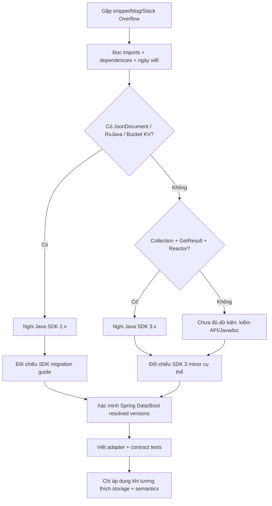

# Nhận diện API hoặc ví dụ cũ thuộc SDK và Spring Data thế hệ trước

## 1. Đặt vấn đề: ví dụ đúng ở năm trước có thể sai với dependency hôm nay

Trong module **SPRING_DATA_COUCHBASE**, ta xây dựng tầng truy cập Couchbase bằng Spring Data, từ document mapping, repository, `CouchbaseTemplate` và SQL++ đến bucket/scope/collection, chỉ mục, TTL, CAS, giao dịch và reactive API. Khi đọc một blog, câu trả lời Stack Overflow hoặc source code cũ, dễ thấy những đoạn trông hoàn toàn hợp lý:

```java
// Mã lịch sử của Java SDK 2.x, KHÔNG phải API SDK 3.x.
JsonDocument document = JsonDocument.create(
    "order::1001",
    JsonObject.create().put("state", "READY"));

bucket.upsert(document);
JsonDocument loaded = bucket.get("order::1001");
```

Hoặc:

```java
// Mã lịch sử của Spring Data Couchbase 3.x,
// KHÔNG phải lời khuyên dùng trong Spring Data 4+/5+/6+.
couchbaseTemplate.save(order);
```

Cả hai có thể là **ví dụ đúng trong thế hệ thư viện ban đầu**, chứ không phải code có thể dán nguyên vào ứng dụng hiện tại. Đổi một tên class hoặc import chưa đủ: API mới thay đổi nơi đặt operation, kiểu result, xử lý lỗi, reactive engine, cấu hình, repository query và vài semantics dữ liệu.

Bài này dạy **cách nhận diện và phân loại nguồn cũ**, không tuyên bố mọi API cũ đều “sai”. Nếu dự án vẫn chạy SDK 2 hoặc Spring Data Couchbase 3, ví dụ đó có thể biên dịch đúng. Ta cần biết **nó thuộc dòng nào**, **ứng dụng thật đang dùng phiên bản nào**, và **có nên/được phép di trú hay không**.

### Mục tiêu học tập

Sau bài này, bạn có thể:

1. Phân biệt **Couchbase Server version**, **Java SDK version**, **Spring Data Couchbase version**, **Spring Boot version** và **Spring Data Commons version**.
2. Nhìn import, dependency, class và method để phán đoán ví dụ thuộc SDK 2.x hay SDK 3.x.
3. Nhận ra thay đổi của Spring Data Couchbase **3.x → 4.x**, đặc biệt cấu hình, annotations, Template fluent API và repository queries.
4. Hiểu vì sao SDK 3 chuyển KV sang `Collection`, Query sang `Cluster` và dùng `GetResult`/`MutationResult`.
5. Phân biệt RxJava 1 cũ của SDK 2 với Reactor `Mono`/`Flux` và `CompletableFuture` trong SDK 3.
6. Nhận diện Sub-document builders, `N1qlQuery`, Views, Query DSL và counter APIs cũ.
7. Đọc ví dụ SQL++ bằng cách kiểm keyspace bucket/scope/collection, parameter binding và index/query consistency.
8. Xác minh API thực sự được hỗ trợ theo **dependency đã resolve**, thay vì đoán từ tài liệu "current".
9. Lập migration checklist bao gồm mapping, CAS, expiry, durability, auditing, retry và error semantics.
10. Viết compatibility tests để chứng minh code mới giữ đúng storage contract và business behavior.

## 2. Bốn nhãn phiên bản phải đọc tách biệt

Từ “Couchbase 4” có thể gây nhầm: có thể là Spring Data Couchbase 4, Couchbase Server 4, một Java SDK version khác hoặc một blog được viết năm 2024.

| Thành phần | Vai trò | Không tự nói lên điều gì? |
| --- | --- | --- |
| **Couchbase Server** | Data/Query/Index services, storage, scopes/collections, transaction features | Không cho biết Java SDK/import đang dùng. |
| **Couchbase Java SDK** | API `Cluster`/`Bucket`/`Collection`, KV, SQL++, reactive/async, serializers, exceptions | Không quyết định mọi Spring Data method. |
| **Spring Data Couchbase** | Entity mapping, `CouchbaseRepository`, `CouchbaseTemplate`, auditing, query derivation | Không đồng nhất số major với Java SDK hoặc server. |
| **Spring Boot** | Dependency management, starter, auto configuration, lifecycle và metrics | Không nên suy Spring Data major chỉ từ tên bài viết. |
| **Spring Data Commons** | Base repository contracts, `@Id`, `@Version`, events, auditing | Không cung cấp trực tiếp Couchbase SDK operations. |
| **JDK/Project Reactor** | Runtime/cú pháp, `Mono`/`Flux`, scheduling | Không tự chứng minh server hỗ trợ feature mới. |

**Quy tắc:** Một lời khuyên migration chỉ đúng khi biết **bộ phiên bản đang resolve** và khả năng của Couchbase Server trong môi trường triển khai.

### 2.1. Mốc lịch sử chắc chắn

- Java SDK **2.x → 3.x** là bước **breaking API**: loại bỏ SDK `Document` wrappers, đưa KV qua `Collection`, thay đổi Query/results/options, chuyển RxJava sang Reactor và đổi environment. Couchbase công bố hướng dẫn migration riêng.
- Spring Data Couchbase **3.x → 4.x** chuyển underlying Java SDK 2 → 3, làm lại Template theo fluent API, đổi một số annotations/imports, repository query và cấu hình. Có tài liệu migration chính thức.
- Các bản Spring Data 5.x/6.x tiếp tục phát triển. Không gán bừa rằng một lời gọi mới trong docs 6.x chắc chắn tồn tại ở Spring Data 4.0.
- Scopes và collections là chức năng server hỗ trợ đầy đủ từ Couchbase Server **7.0**; Java SDK 3 có các abstractions này trước đó. Khi server cũ chưa hỗ trợ collections, dùng `defaultCollection()` tương thích theo hướng dẫn SDK.

### 2.2. Một ví dụ không có phiên bản là bằng chứng yếu

Nếu bài viết chỉ ghi “Use Couchbase SDK” nhưng không có `pom.xml`, package imports, Javadoc version và ngày cập nhật, hãy gắn nhãn **UNVERIFIED**. Nhiều method giống tên nhau qua các major nhưng **khác receiver, tham số, kết quả hoặc error semantics**.

## 3. Luồng nhận diện trước khi thử copy một snippet



Cần tách hai câu hỏi:

1. **Ví dụ được viết cho hệ nào?**
2. **Dự án đang dùng hệ nào?**

Ngay cả khi cùng major, ví dụ `current` có thể dùng feature mới trong minor release hoặc server feature mà cluster của bạn chưa có.

## 4. Nhìn package/import: dấu vết có giá trị hơn tên biến

Các tên class dưới đây là **dấu hiệu**, không phải thuật toán phán đoán chắc chắn 100%.

| Dấu vết trong mã | Khả năng | Điều cần xác minh |
| --- | --- | --- |
| `com.couchbase.client.java.document.JsonDocument` | Java SDK 2.x | SDK 3 KV đã bỏ `Document` wrapper. |
| `com.couchbase.client.java.document.RawJsonDocument` | Java SDK 2.x | SDK 3 dùng `RawJsonTranscoder` khi cần. |
| `com.couchbase.client.java.env.DefaultCouchbaseEnvironment` | Java SDK 2.x | SDK 3 dùng `ClusterEnvironment`. |
| `com.couchbase.client.java.query.N1qlQuery` | Java SDK 2.x query API | SDK 3 dùng `cluster.query(statement, options)`. |
| `com.couchbase.client.java.subdoc.MutateInBuilder` | SDK 2 sub-document builder | SDK 3 dùng danh sách `MutateInSpec`. |
| `rx.Observable`, `rx.Single`, `rx.Completable` trong code Couchbase | SDK 2 reactive stack | SDK 3 reactive namespace dùng Reactor. |
| `com.couchbase.client.java.document.json.JsonObject` | Java SDK 2.x | JSON object đã chuyển package khi lên SDK 3. |
| `com.couchbase.client.java.json.JsonObject` | Java SDK 3.x | Phân biệt với package `document.json` của SDK 2. |
| `com.couchbase.client.java.kv.GetResult` | Java SDK 3.x | Xác minh receiver `Collection` và imports. |
| `com.couchbase.client.java.kv.MutateInSpec` | Java SDK 3.x | Sub-document spec API. |
| `com.couchbase.client.java.env.ClusterEnvironment` | Java SDK 3.x | Đổi environment/options. |
| `org.springframework.data.couchbase.core.mapping.Document` | Spring Data qua nhiều thế hệ | Không đủ để phân biệt 3.x và 4+. |
| `org.springframework.data.couchbase.repository.Query` | Spring Data 4+ path của repository `@Query` | Xem imports và module đã resolve. |
| `org.springframework.data.couchbase.core.query.Query` (annotation cũ) | Spring Data 3.x-style | Annotation đã chuyển package trong migration 4.x. |

**Đặc biệt:** `@Id` nằm trong `org.springframework.data.annotation.Id` ở Spring Data hiện đại. `@Field` của Spring Data hiện đại là `org.springframework.data.couchbase.core.mapping.Field`. Một IDE có hai classes trùng tên sẽ dễ auto-import nhầm.

### 4.1. Đừng chỉ grep một từ chung

Tìm `Cluster`, `Bucket`, `Document` hay `Query` đơn lẻ thường nhiễu. `Bucket` vẫn hợp lệ trong SDK 3 cho quản lý bucket và `bucket.scope/defaultCollection`, `@Document` của Spring Data vẫn tồn tại, và SQL++ có thể vẫn được gọi là N1QL trong tài liệu cũ.

Kết hợp **package đầy đủ + receiver type + return type + version metadata** để đưa ra kết luận.

## 5. Ma trận SDK 2 và SDK 3: thay đổi nơi đặt operations

| Chức năng | SDK 2.x lịch sử | SDK 3.x |
| --- | --- | --- |
| KV get/insert/upsert/replace/remove | `Bucket.get/insert/upsert/replace/remove` | `Collection.get/insert/upsert/replace/remove`. |
| KV tồn tại | `Bucket.exists` | `Collection.exists`. |
| Replicas | `Bucket.getFromReplica` | `Collection.getAnyReplica` hoặc `getAllReplicas`. |
| Lock/touch | `Bucket.getAndLock/getAndTouch/touch` | `Collection` methods tương ứng. |
| Sub-document | `Bucket.lookupIn/mutateIn` builder | `Collection.lookupIn/mutateIn` với spec lists. |
| Binary append/prepend | `Bucket.append/prepend` | `collection.binary().append/prepend`. |
| KV binary counter | `Bucket.counter` | `collection.binary().increment/decrement`. |
| SQL++/N1QL | `bucket.query(N1qlQuery...)` | `cluster.query(statement, QueryOptions)`. |
| Analytics | Bucket-level legacy query | `cluster.analyticsQuery(...)`. |
| Search | API lịch sử ở bucket | `cluster.searchQuery(...)` (API chi tiết theo version). |
| Query index management | BucketManager/ClusterManager cũ | `cluster.queryIndexes()` và `QueryIndexManager`. |
| KV return | `JsonDocument` hoặc `Document` subtype | `GetResult`, `MutationResult`, `ExistsResult`. |
| Environment | `CouchbaseEnvironment` / `DefaultCouchbaseEnvironment` | `ClusterEnvironment` / builder. |
| Reactive | RxJava 1 SDK integration | Reactor `Mono`/`Flux` dưới `.reactive()`. |
| Async | AsyncBucket/Rx-era APIs | `.async()` với `CompletableFuture`. |

**Cẩn trọng:** Các dòng mô tả vị trí API, **không bảo đảm semantics giống hệt**. Binary counter và JSON path increment là hai mục đích lưu trữ khác nhau; `Collection.defaultCollection()` không tương đương một scope tenant mới.

## 6. SDK 2: `JsonDocument` → SDK 3: `GetResult`/`MutationResult`

### 6.1. Mã SDK 2.x lịch sử

```java
// LỊCH SỬ SDK 2.x — chỉ để nhận diện.
JsonDocument doc = JsonDocument.create(
    "order::1001",
    JsonObject.create().put("state", "READY")
);

bucket.upsert(doc);

JsonDocument loaded =
    bucket.get("order::1001");

String state =
    loaded.content().getString("state");

long oldCas = loaded.cas();
```

Nhận diện:

- `JsonDocument.create(id, JsonObject)`.
- `bucket.upsert(document)`, `bucket.get(id)`.
- `content()` trả payload, `cas()` nằm trên document wrapper.

### 6.2. SDK 3.x: key là tham số, result riêng

```java
import com.couchbase.client.java.Cluster;
import com.couchbase.client.java.Bucket;
import com.couchbase.client.java.Collection;
import com.couchbase.client.java.json.JsonObject;
import com.couchbase.client.java.kv.GetResult;
import com.couchbase.client.java.kv.MutationResult;

Cluster cluster = Cluster.connect(
    connectionString, userName, password
);
Bucket bucket = cluster.bucket("shop");
Collection orders = bucket.defaultCollection();

MutationResult saved = orders.upsert(
    "order::1001",
    JsonObject.create().put("state", "READY")
);

GetResult loaded = orders.get("order::1001");
String state =
    loaded.contentAsObject().getString("state");

long readCas = loaded.cas();

// Cluster/environment lifecycle được framework quản lý trong
// Spring Boot; ví dụ standalone cần disconnect khi kết thúc.
```

**Không** gọi `saved.content()` như thể `MutationResult` là full document. Trong SDK 3, result type chỉ cung cấp metadata liên quan với operation, ví dụ `cas()`; đọc payload cần `get`/`lookupIn`.

### 6.3. Thay đổi hành vi ít nhìn thấy

- `bucket.defaultCollection()` chọn **_default._default**, không tự chọn `shop.sales.orders`.
- Result CAS là opaque token; không tăng thủ công.
- Dùng `JsonObject` thuộc SDK serializer; raw Java SDK không chạy `MappingCouchbaseConverter` của Spring Data.
- SDK 3 mở bucket theo hướng lazy; lỗi kết nối có thể xuất hiện ở operation đầu thay vì tại `cluster.bucket()`.
- Đối với production, username/password lấy từ secret manager; không hard-code như ví dụ.
- Không tự gọi `cluster.disconnect()` trong mỗi repository method.

## 7. Scopes/Collections: tên giống nhau nhưng có thể trỏ tới dữ liệu khác

SDK 2 thường chỉ dùng keyspace bucket. SDK 3 thể hiện namespace rõ:

```java
Bucket shop = cluster.bucket("shop");
Collection orders = shop
    .scope("sales")
    .collection("orders");
```

So sánh:

```java
Collection defaultOrders =
    shop.defaultCollection();
```

Hai collections **không mặc định là cùng nơi**.

### 7.1. Bẫy migration quan trọng

Nếu dữ liệu cũ nằm trong default collection và bạn đổi code sang `scope("sales").collection("orders")`, ứng dụng có thể thấy `DocumentNotFoundException` dù key không mất. Nguyên nhân là **routing changed**, không phải tự động data migration.

### 7.2. Khi server chưa có Collections đầy đủ

Tài liệu migration SDK ghi feature Collections phổ biến từ Server 7.0. Với cluster cũ không hỗ trợ scope/collection tùy chỉnh, dùng `defaultCollection()` theo hướng dẫn; không tưởng tượng SDK 3 có method scope là server tự tạo namespace.

### 7.3. Một migration keyspace đòi nhiều thứ hơn Java diff

- Tạo scope/collection qua quản trị/IaC.
- Phân quyền RBAC tương ứng.
- Chuyển/dual-write/copy documents theo business policy.
- Cập nhật indexes và SQL++ keyspace.
- Thay routing của repository/Template/SDK.
- Kiểm TTL, CAS, dữ liệu nguyên bản, type hints.
- Đo query/CRUD và thực hiện rollback plan.

## 8. Old overloaded options → `GetOptions`/`UpsertOptions`

### 8.1. Trước: timeout qua overload

```java
// SDK 2.x lịch sử.
JsonDocument loaded =
    bucket.get("order::1001", 5, TimeUnit.SECONDS);
```

### 8.2. Sau: options object và `Duration`

```java
import java.time.Duration;
import com.couchbase.client.java.kv.GetOptions;

GetResult loaded = orders.get(
    "order::1001",
    GetOptions.getOptions()
        .timeout(Duration.ofSeconds(5))
);
```

Các optional params thường được gom vào `Options` thay vì hàng loạt overloads. Khi di trú:

1. Kiểm default timeout cũ/mới.
2. Không nhầm milliseconds, seconds, `Duration`.
3. Kiểm API hỗ trợ `expiry`, `preserveExpiry`, `durability`, `cas` trên đúng operation.
4. Giới hạn overall deadline cho requests có SDK retry.
5. Đừng đặt timeout dài hơn chỉ để mã mới “đỡ lỗi”; quan sát p95/p99 và nguyên nhân.

## 9. CouchbaseEnvironment → ClusterEnvironment

### 9.1. Dấu hiệu code cũ

```java
// SDK 2.x lịch sử, không copy sang SDK 3.x.
CouchbaseEnvironment env =
    DefaultCouchbaseEnvironment.builder()
        .kvTimeout(TimeUnit.SECONDS.toMillis(5))
        .build();
```

### 9.2. SDK 3.x

```java
import java.time.Duration;
import com.couchbase.client.java.env.ClusterEnvironment;
import com.couchbase.client.java.env.TimeoutConfig;

ClusterEnvironment environment =
    ClusterEnvironment.builder()
        .timeoutConfig(
            TimeoutConfig.kvTimeout(
                Duration.ofSeconds(5)))
        .build();
```

Nếu tạo `ClusterEnvironment` riêng, ứng dụng phải quản lý lifecycle theo contract (disconnect cluster rồi shutdown environment); nếu dùng Spring Boot, nên để configuration/beans quản lý resource thay vì tạo environment/cluster mới trong từng call.

### 9.3. Mapping không phải 1-1 cho mọi field

Các config options của `DefaultCouchbaseEnvironment` (endpoint counts, thread pools, SSL, timeout, retry strategy) có thể đã:

- Đổi tên.
- Được chuyển vào `IoConfig`/`TimeoutConfig`/`SecurityConfig`.
- Có semantics khác.
- Bị loại bỏ hoàn toàn.
- Được quản lý bởi SDK mới theo cách khác.

Không tự chuyển `.kvEndpoints(x)` thành `.numKvConnections(x)` mà bỏ qua giới hạn connection và behavior. Đọc **bảng Environment Options Reference** của migration guide cho đúng SDK minor.

## 10. Authentication: bucket password cũ khác RBAC mới

SDK 2 hỗ trợ một số cluster cũ với bucket-level password. SDK 3 chỉ hỗ trợ RBAC theo hướng dẫn migration. API kết nối mẫu:

```java
Cluster cluster = Cluster.connect(
    connectionString,
    userName,
    password
);
```

Trong production:

- Lưu secret ngoài source code.
- Phân quyền tối thiểu trên bucket/scope/collection, Query/Index nếu cần.
- Dùng TLS và credential/certificate đúng policy.
- Đừng dùng `Administrator` trong application chỉ vì blog cũ dùng.
- Kiểm backup/restore/bootstrap config; sửa user/password không phải “đổi tên method”.

Mã `Cluster.connect("host", "bucket", "bucket-password")` trong tài liệu rất cũ có thể biểu thị auth semantics không còn phù hợp; phải xác định API signatures và cluster version trước khi chạy.

## 11. Bootstrap trở nên lazy: lỗi có thể xuất hiện muộn hơn

Trong SDK 2, một số lỗi tài nguyên có thể xuất hiện khi open bucket. SDK 3 thay đổi bootstrap để `cluster.bucket("name")` trả handle nhanh, còn network readiness/error được xử lý tại operation thực.

```java
Bucket b = cluster.bucket("shop"); // Không chứng minh keyspace reachable.
Collection c = b.defaultCollection();
GetResult result = c.get("health::probe"); // Có thể timeout/fail.
```

**Không** dùng riêng `bucket(...)` làm health check. Nếu cần readiness, dùng APIs chẩn đoán/ping/waitUntilReady theo SDK version và thiết kế check đúng service/collection.

### 11.1. Phản ứng với exception cũng thay đổi

SDK 3 có `CouchbaseException`/`ErrorContext` và proactive retry. Một lỗi cũ có thể đến nhanh, nay SDK retry đến timeout. Hãy kiểm:

- Loại exception cụ thể, không parse message.
- `AmbiguousTimeoutException` vs `UnambiguousTimeoutException` với write.
- CAS mismatch cần đọc lại state.
- SDK retries đã làm gì; không bọc thêm retry vô hạn ở service.
- `ErrorContext` có thể chứa document key, SQL statement hoặc endpoint; không log nguyên vào dashboard rộng quyền.

## 12. SDK 2 Sub-document builder → SDK 3 spec lists

### 12.1. Dạng builder lịch sử

```java
// Java SDK 2.x lịch sử.
bucket.mutateIn("order::1001")
    .upsert("shipping.tracking_code", "VN123456")
    .execute();
```

Một số biến thể cũ dùng `MutateInBuilder.upsertDocument(true)`, `.insert(...)` và `.execute()`.

### 12.2. Dạng `MutateInSpec` mới

```java
import java.util.List;
import com.couchbase.client.java.kv.MutateInSpec;
import com.couchbase.client.java.kv.MutateInResult;

MutateInResult changed = orders.mutateIn(
    "order::1001",
    List.of(
        MutateInSpec.upsert(
            "shipping.tracking_code", "VN123456"),
        MutateInSpec.replace(
            "shipping.status", "SHIPPED")
    )
);

long newCas = changed.cas();
```

Nếu cần tạo document khi chưa tồn tại (semantics của builder `upsertDocument(true)` cũ), SDK migration guide dùng `MutateInOptions.storeSemantics(StoreSemantics.UPSERT)`; **đây không giống** `MutateInSpec.upsert` trên path.

### 12.3. Hai cách nói "upsert" khác nhau

- `MutateInSpec.upsert("path", value)`: chèn/sửa một **path bên trong document đã chọn**.
- `MutateInOptions.storeSemantics(StoreSemantics.UPSERT)`: điều chỉnh hành vi **outer document có tồn tại hay chưa** theo hỗ trợ của operation/server.

Bỏ mất khác biệt này có thể biến một request từng tạo document mới thành `DocumentNotFound`, hoặc vô tình tạo document khi business chỉ cho phép update.

### 12.4. Đừng phá atomicity khi di trú

Mọi specs trong **một `mutateIn`** atomic trên cùng document. Nếu chuyển một builder cũ thành ba `mutateIn` riêng, giữa các requests có thể có partial update hoặc concurrency race. Giữ số specs hợp lệ trong giới hạn SDK/server (thông thường tối đa 16), kiểm CAS và error handling.

## 13. Binary counter khác JSON path increment

Một blog SDK 2 có thể viết:

```java
// SDK 2.x lịch sử: bucket.counter(...)
// Counter key-value chuyên dụng, không phải nested JSON field.
```

SDK 3 đưa các thao tác binary/non-JSON qua:

```java
// SDK 3.x: dedicated binary KV.
orders.binary().increment(counterKey);
```

Nếu mục tiêu là **một trường JSON** như `stats.views`, dùng Sub-document:

```java
orders.mutateIn(
    orderId,
    List.of(
        MutateInSpec.increment("stats.views", 1)
    )
);
```

Hai ví dụ **khác storage representation**: binary counter document khác JSON document có field counter. Đừng thay `bucket.counter(key)` bằng `mutateIn(key,"counter")` nếu key cũ chứa binary counter chứ không phải JSON body; cần data migration/dual-read.

### 13.1. API raw append cũng khác array append

`collection.binary().append(...)` nối raw bytes vào document dạng phù hợp; `MutateInSpec.arrayAppend(...)` thêm phần tử **vào JSON array** theo path. Bài viết cũ về “append” có thể chỉ raw string/binary; kiểm class receiver và content type.

## 14. Raw JSON, serializers và transcoders

SDK 2 dùng các `Document` types để quyết định encoding:

| SDK 2 | Cách xử lý SDK 3 |
| --- | --- |
| `JsonDocument`/`JsonArrayDocument` | Default JSON serialization/transcoding. |
| `RawJsonDocument` | `RawJsonTranscoder.INSTANCE` cho bytes JSON đã mã hóa. |
| `StringDocument` | `RawStringTranscoder` khi đúng storage contract. |
| `ByteArrayDocument`/`BinaryDocument` | `RawBinaryTranscoder`. |
| `SerializableDocument` | `SerializableTranscoder` trong trường hợp tương thích được kiểm tra. |
| `LegacyDocument` | Bị loại bỏ; không giữ compatibility hack mơ hồ. |

Ví dụ raw JSON trong SDK 3:

```java
import java.nio.charset.StandardCharsets;
import com.couchbase.client.java.codec.RawJsonTranscoder;
import com.couchbase.client.java.kv.UpsertOptions;

byte[] bytes = "{\"state\":\"READY\"}"
    .getBytes(StandardCharsets.UTF_8);

orders.upsert(
    orderId,
    bytes,
    UpsertOptions.upsertOptions()
        .transcoder(RawJsonTranscoder.INSTANCE)
);
```

**Cảnh báo storage semantics:**

- `JsonObject` không đồng nghĩa Spring Data entity converter. `MappingCouchbaseConverter` và `CouchbaseCustomConversions` là một tầng khác.
- Raw String/Binary/JSON khác content flags; Query/SQL++ trên non-JSON có thể không hoạt động như trước.
- Đừng serialize `BigDecimal`/`Money`, `Instant`, enum, boolean bằng “cách SDK tự chọn” nếu schema cũ có custom conversion.
- Khi migrate transcoder, test raw bytes, flags, JSON types và entity readback, không chỉ `upsert` thành công.
- Raw SDK patch không chạy Spring auditing/callbacks của repository.

## 15. N1QL và SQL++: đổi tên ngôn ngữ chưa phải đổi API

Couchbase gọi query language là **N1QL** trong tài liệu cũ; tài liệu mới dùng tên **SQL++**. Tên mới không có nghĩa câu `SELECT` cũ tự mất hiệu lực. **SDK API thực thi query** mới là chỗ thay đổi lớn.

### 15.1. SDK 2 query object

```java
// SDK 2.x lịch sử.
N1qlQueryResult result = bucket.query(
    N1qlQuery.simple(
        "SELECT * FROM `shop` LIMIT 10")
);

for (N1qlQueryRow row : result) {
    JsonObject value = row.value();
}
```

Dấu hiệu: `N1qlQuery`, `N1qlQueryResult`, `N1qlQueryRow`, `bucket.query(...)`.

### 15.2. SDK 3 Query service tại Cluster

```java
import com.couchbase.client.java.query.QueryResult;
import com.couchbase.client.java.query.QueryOptions;
import com.couchbase.client.java.json.JsonObject;

String sql = """
    SELECT META(o).id AS orderId,
           o.state
    FROM `shop`.`sales`.`orders` AS o
    WHERE o.state = $state
    """;

QueryResult result = cluster.query(
    sql,
    QueryOptions.queryOptions()
        .parameters(
            JsonObject.create().put("state", "READY"))
        .readonly(true)
);

for (JsonObject row : result.rowsAsObject()) {
    String id = row.getString("orderId");
}
```

Khác biệt:

- Query chuyển từ `bucket.query(N1qlQuery...)` sang `cluster.query(sql, options)`.
- Bind parameters nằm trong `QueryOptions.parameters(...)`.
- Kết quả có `QueryResult.rowsAsObject()` và `metaData()`.
- `readonly(true)` dành cho SELECT thực sự chỉ đọc; không gắn vào UPDATE để ép retry.
- Nếu server hỗ trợ scopes/collections, query xác định keyspace ba cấp; không chỉ thay `FROM bucket` bằng tên mới.
- SQL++ index và `QueryScanConsistency.REQUEST_PLUS` cần cân nhắc consistency/latency.

### 15.3. `N1qlQuery.simple` không còn trong SDK 3

Snippet `bucket.query(N1qlQuery.parameterized(...))` không thể được sửa chỉ bằng import `N1qlQueryResult` khác: SDK 3 bỏ kiểu query wrapper đó. Chuyển thành SQL statement string + options; kiểm prepared query `adhoc(...)` nếu có và xác minh named/positional parameters.

### 15.4. Query DSL cũ

SDK 2 có fluent N1QL Query DSL. Migration guide nêu DSL không được mang sang SDK 3; “migration kit” không chính thức là tài liệu tham khảo **unofficial/unsupported**. Ưu tiên SQL++ statement + parameters được test, không phụ thuộc DSL copy tay thiếu bảo trì.

## 16. Query errors: đừng chỉ tìm `finalSuccess()`

Code SDK 2 kiểm `N1qlQueryResult.finalSuccess()` hoặc duyệt `errors()` để biết thất bại. SDK 3 thay behavior, thường ném `CouchbaseException` ở query call hoặc error signal trên reactive stream.

### 16.1. Dấu hiệu mã cũ

```java
// SDK 2.x-style pseudocode.
N1qlQueryResult result = bucket.query(query);
if (!result.finalSuccess()) {
    // Inspect result.errors().
}
```

### 16.2. Mã mới

```java
try {
    QueryResult result = cluster.query(sql, options);
    List<JsonObject> rows = result.rowsAsObject();
    // Business processing...
} catch (com.couchbase.client.core.error.CouchbaseException ex) {
    // Classify by type/category, not raw ErrorContext.
    throw ex;
}
```

`options`, `sql` và imports được xác lập bên ngoài đoạn minh họa. Không biến Query failure thành `Collections.emptyList()` để giả lập việc “không có rows”: nó che sự cố và sai nghiệp vụ.

`ErrorContext` có thể chứa document ID, SQL statement, endpoint hoặc dữ liệu nhạy cảm; không log raw `ex.getMessage()`/`ex.context()` vào dashboard rộng quyền.

## 17. Replica read semantics: `getFromReplica` đã tách đôi

SDK 2 có `Bucket.getFromReplica` với `ReplicaMode`. SDK 3 dùng:

```java
// Có thể trả kết quả sớm từ active/replica theo API semantics.
var one = orders.getAnyReplica(orderId);

// Thu các kết quả từ nguồn khả dụng để ứng dụng so sánh.
var many = orders.getAllReplicas(orderId);
```

Không coi đọc từ replica là mới nhất; replica có thể lag theo consistency/durability. Nếu SDK 2 dùng `ReplicaMode.ALL` để đối chiếu, đổi bừa thành `getAnyReplica` đã **đổi semantics**. Đọc hướng dẫn về `getAllReplicas` và thiết kế aggregation nếu nghiệp vụ cần.

## 18. RxJava 1 của SDK 2 → Reactor của SDK 3

| SDK 2 reactive | SDK 3 reactive | Tương đồng |
| --- | --- | --- |
| `rx.Observable<T>` | `reactor.core.publisher.Flux<T>` | 0..N values. |
| `rx.Single<T>` | `reactor.core.publisher.Mono<T>` | Thường 0..1 value. |
| `rx.Completable` | `Mono<Void>` | Completion/error. |
| `bucket.async()` + Rx APIs | `collection.reactive()` | Reactive SDK mới. |
| Async thế hệ cũ | `collection.async()` | `CompletableFuture` API. |

### 18.1. Code dùng Reactor

```java
import reactor.core.publisher.Mono;
import com.couchbase.client.java.kv.GetResult;

Mono<GetResult> operation =
    orders.reactive().get(orderId);

Mono<String> state = operation.map(result ->
    result.contentAsObject().getString("state")
);
```

**Đừng nhầm:** Spring Data reactive và SDK reactive đều có thể trả `Mono`/`Flux` nhưng không cùng persistence pipeline. Raw `orders.reactive().mutateIn` không tự gọi `@LastModifiedDate` hoặc callbacks của Spring Data.

### 18.2. Không chỉ đổi kiểu generic

- Kiểm `Single` → `Mono` có cho phép empty không.
- Kiểm scheduling, cancellation, backpressure và error propagation.
- Kiểm cold/lazy subscribe và behavior của `retryWhen`/resubscription.
- Không gọi `block()` trong WebFlux event loop.
- Dùng `StepVerifier` test complete/error/cancel.
- Không retry non-idempotent writes sau ambiguous timeout.
- `collection.async()` và `collection.reactive()` khác execution model, không dùng thay thế vô điều kiện.

## 19. Views: SDK View API khác repository View support

Migration Spring Data Couchbase 4.x ghi **repository support cho Views đã bị loại bỏ**, chuyển queries sang SQL++/N1QL. Nhưng tài liệu migration Java SDK 3 vẫn nêu `bucket.viewQuery(...)` cho View service. Không vì vậy khẳng định Couchbase Server View service hay toàn bộ SDK View API biến mất cùng lúc.

### 19.1. Dấu hiệu Spring Data cũ

```java
// Tên API Spring Data Couchbase 3.x lịch sử.
couchbaseTemplate.findByView(...);
couchbaseTemplate.findBySpatialView(...);
```

Spring Data 4+ dùng `findByQuery`/repository queries hoặc SDK trực tiếp nếu phù hợp. **Không có phép đổi 1-1 cho View semantics**: cần viết lại query, index, sorting, consistency và test dữ liệu.

### 19.2. Đừng hứa performance không đổi

View MapReduce/Spatial View và SQL++/GSI có cơ chế index/consistency khác nhau. Đo `EXPLAIN`, query latency, index build, filter semantics và xử lý `MISSING`/`NULL`, không chỉ đổi annotation rồi xem code compile.

## 20. Spring Data 3.x → 4.x: thay đổi lớn cần thuộc lòng

Theo hướng dẫn migration Spring Data Couchbase 3.x → 4.x:

1. Underlying Java SDK chuyển **2.x → 3.x**.
2. XML configuration bị loại bỏ, ưu tiên Java/annotation config.
3. `AbstractCouchbaseConfiguration` dùng `getConnectionString`, `getUserName`, `getPassword`, `getBucketName` theo RBAC.
4. `@Id`/`@Field` imports cũ từ SDK chuyển sang Spring Data packages.
5. Template làm lại thành **fluent API**.
6. Repository `@Query` đổi package và một số interfaces cũ bị bỏ.
7. Spring Data repository View support bị bỏ; SQL++/N1QL thành query path chính.

**Hệ quả:** Đừng ép transitive Java SDK 2 vào Spring Data Couchbase 4+ hoặc ngược lại. Spring Boot starter quản lý dependency versions theo release train; kiểm compatibility và dependency resolution trước khi thay major.

## 21. Spring Data: annotations `@Id` và `@Field` từ SDK cũ

### 21.1. Imports lịch sử

```java
// Spring Data Couchbase 3.x-era / SDK 2 imports.
import com.couchbase.client.java.repository.annotation.Id;
import com.couchbase.client.java.repository.annotation.Field;
```

### 21.2. Imports hiện đại

```java
import org.springframework.data.annotation.Id;
import org.springframework.data.annotation.Version;
import org.springframework.data.couchbase.core.mapping.Document;
import org.springframework.data.couchbase.core.mapping.Field;
```

Entity minh họa:

```java
@Document
class OrderDocument {

    @Id
    String id;

    @Version
    Long version;

    @Field("state")
    String state;

    @Field("customer_id")
    String customerId;
}
```

Nếu import sai, Spring Data có thể không nhận diện ID/property name đúng, làm dữ liệu thay `customer_id` thành `customerId` hoặc `@Version` không gắn CAS như mong đợi. Những lỗi như vậy có thể **không xuất hiện khi biên dịch** nhưng gây sai data/query/optimistic locking.

**Chú ý:** `@Document` trong `org.springframework.data.couchbase.core.mapping.Document` tồn tại qua nhiều thế hệ, không chứng minh version hiện đại.

### 21.3. Test mapping sau đổi imports

1. Repository save entity với `id`.
2. SDK raw get trả đúng key/body.
3. Kiểm JSON storage field `customer_id`.
4. Repository findById roundtrip và query theo field.
5. Hai writers update qua `@Version`/CAS để phát hiện lost update.

## 22. Spring Data configuration: JavaConfig, RBAC và Boot

Spring Data Couchbase 4.x yêu cầu Java/annotation configuration; ví dụ `AbstractCouchbaseConfiguration`:

```java
import org.springframework.context.annotation.Configuration;
import org.springframework.data.couchbase.config.AbstractCouchbaseConfiguration;

@Configuration
class CouchbaseConfig extends AbstractCouchbaseConfiguration {

    @Override
    public String getConnectionString() {
        return "couchbase://127.0.0.1";
    }

    @Override
    public String getUserName() {
        return "app-user";
    }

    @Override
    public String getPassword() {
        // Demo placeholder; inject via secret manager in production.
        return "replace-with-secure-secret";
    }

    @Override
    public String getBucketName() {
        return "shop";
    }
}
```

Trong Spring Boot thông thường, starter/auto configuration đã có thể cấu hình các beans tương ứng. Không copy một `AbstractCouchbaseConfiguration` custom song song một cách mù quáng: dễ tạo duplicate `Cluster`/beans, sai metrics, connection lifecycle hoặc routing.

### 22.1. Những thứ không giải quyết được bằng method rename

- Secret/credential RBAC thay bucket password.
- TLS truststore và certificate policy.
- Scope/collection routing theo tenant/entity.
- Timeout/retry/SDK environment tuning.
- Health/readiness và lazy bucket bootstrap.
- Định nghĩa một `Cluster` shared bean và lifecycle đóng kết nối.
- Repository/Template mapping và custom conversions.

### 22.2. Scope/collection trong Spring Data

Server mới có scopes/collections, nhưng `getBucketName` **không tự** đưa mọi entity vào custom collection. Spring Data version phù hợp có các cơ chế `getScopeName`, entity `@Scope`/`@Collection` và fluent operations; kiểm API và behavior theo release đang dùng, không tự tưởng tượng method trong Spring Data 4.0.

## 23. Spring Data Template: `save`/`findByN1QL` cũ → fluent

Theo bảng migration chính thức:

| Spring Data 3.x | Spring Data 4.x+ | Thay đổi |
| --- | --- | --- |
| `save` | `upsertById` | Fluent upsert theo entity type. |
| `insert` | `insertById` | Create. |
| `update` | `replaceById` | Replace existing. |
| `findById` | `findById` fluent | Entity class ở bước đầu. |
| `findByN1QL` | `findByQuery` | SQL++ query entity. |
| `findByN1QLProjection` | `findByQuery` | Điều chỉnh projection. |
| `queryN1QL` | Raw SDK query | Dùng `Cluster.query`. |
| `exists` | `existsById` | Existence by key. |
| `remove` | `removeById` | Delete. |
| `findByView` / `findBySpatialView` | Removed | Thiết kế lại query/index. |
| `execute` | Raw SDK direct | Xem transactional/conversion boundary. |

### 23.1. Snippet trước/sau

```java
// Lịch sử Spring Data 3.x:
couchbaseTemplate.save(order);
```

```java
// Spring Data 4+:
couchbaseTemplate
    .upsertById(OrderDocument.class)
    .one(order);

OrderDocument found = couchbaseTemplate
    .findById(OrderDocument.class)
    .one(orderId);
```

```java
List<OrderDocument> found = couchbaseTemplate
    .findByQuery(OrderDocument.class)
    .all();
```

Một số operations trả entity/null hoặc result khác tùy API; kiểm Javadoc thay vì copy signature 3.x. `Upsert`, `Insert` và `Replace` có **semantics khác nhau**, không đổi bừa để code compile.

### 23.2. `CouchbaseTemplate` không phải Java SDK

Template biết entity class, converter và mappings. Raw `Collection` không tự chạy custom converters/auditing. Trong ứng dụng hybrid, phải test cùng JSON storage contract. Template `mutateInById` hiện hành chỉ tài liệu hóa các path mutations insert/upsert/replace/remove; không giả định SDK counter/array/lookup/XATTR có wrapper tương đương trong mọi Spring Data version.

## 24. Repository `@Query` package và interfaces bị loại

Migration guide:

- `org.springframework.data.couchbase.core.query.Query` (annotation cũ) → `org.springframework.data.couchbase.repository.Query`.
- `ReactiveCouchbaseSortingRepository` bị loại; cân nhắc `ReactiveSortingRepository` hoặc `ReactiveCouchbaseRepository`.
- `CouchbasePagingAndSortingRepository` bị loại; cân nhắc `PagingAndSortingRepository` hoặc `CouchbaseRepository`.
- `getCouchbaseOperations()` của repository không còn theo API cũ; inject `CouchbaseTemplate` hoặc `Cluster` qua adapter/service.

### 24.1. Ví dụ hiện đại

```java
import org.springframework.data.couchbase.repository.CouchbaseRepository;
import org.springframework.data.couchbase.repository.Query;

interface OrderRepository
        extends CouchbaseRepository<OrderDocument, String> {

    @Query("#{#n1ql.selectEntity} WHERE state = $1")
    List<OrderDocument> findByState(String state);
}
```

Cú pháp `#{#n1ql.selectEntity}`/positional binds cần đối chiếu với **version và repository query contract cụ thể**; trong nhiều trường hợp chỉ cần derived method `findByState`. Nếu query custom, kiểm tenant scope, index, data type và `MISSING`/`NULL`.

### 24.2. Lưu ý Spring Data Commons

Interfaces CRUD/paging/sorting trong Spring Data Commons đã thay đổi giữa các release trains; thay `extends` mà không test paging/sorting có thể làm method không khả dụng hoặc query behavior khác. Đọc resolved Javadoc, không suy các method từ tên interface.

## 25. Automatic index annotations cũ không nên copy

Spring Data migration ghi index-management được thiết kế lại và loại các annotations:

- `@ViewIndexed`.
- `@N1qlSecondaryIndexed`.
- `@N1qlPrimaryIndexed`.

Khi gặp chúng trong blog, đó là **dấu hiệu nguồn cũ**. Không tạo primary index trên production chỉ vì test thiếu index. Thiết kế GSI bằng DDL/index migration theo query thực tế, dùng `EXPLAIN` và kiểm build/readiness.

### 25.1. “Đổi annotation” không đổi server artifact

Một index cũ trên default collection không tự chuyển sang custom collection; một SQL++ query mới không tự có covering index. Cần di trú DDL, RBAC và query plan, không chỉ Java source.

## 26. Auditing và lifecycle giữa các thế hệ

Spring Data có `@CreatedDate`, `@LastModifiedDate`, `@CreatedBy`, `@LastModifiedBy`, callbacks và `AuditorAware`/`ReactiveAuditorAware`. Khi đổi repository/Template hoặc raw SDK path:

- Kiểm `@Version` và CAS.
- Xác định creation/update detection.
- Kiểm field JSON names qua `@Field`.
- Kiểm callback nào thực sự được kích hoạt trên operation mới.
- So sánh timestamps/actor sau update bằng raw JSON.
- Không sửa created fields khi chỉ update entity.
- Không tin raw SDK `mutateIn` tự chạy auditing hay Bean Validation.

Đặc biệt, nếu code SDK 2 cũ dùng `JsonDocument` raw, chuyển thành SDK 3 `collection.upsert(key, JsonObject)` **vẫn là raw SDK**, không biến nó thành Spring Data entity save.

## 27. CAS, TTL và durability: dễ compile đúng nhưng sai dữ liệu

| Hợp đồng cần giữ | Bẫy migration | Kiểm thử |
| --- | --- | --- |
| Key/ID | ID trước nằm trong `JsonDocument`, giờ truyền riêng | Correct ID, key routing. |
| CAS | Mất optimistic-locking khi đổi replace/save | Stale-write test, `@Version`. |
| TTL/expiry | Overload time unit cũ vs `Duration`/options mới | Metadata expiry readback. |
| Preserve expiry | Một update có thể đổi vòng đời document | Test `preserveExpiry(true)` theo SDK/server. |
| Durability | Legacy `PersistTo`/`ReplicateTo` vs `DurabilityLevel` | Kiểm semantics/topology. |
| Serializer | SDK document types vs transcoders | JSON types/content flags và entity mapping. |
| Audit | Repository vs raw SDK path | Created/modified fields. |
| Type hints | `_class`/`@TypeAlias`/package rename | Subtype materialization. |
| GSI | Index/keyspace/field path khác | `EXPLAIN`, index state. |
| Reactive | RxJava→Reactor resubscription | Idempotency và cancellation. |

### 27.1. Durability không phải thay enum đơn giản

Legacy `PersistTo`/`ReplicateTo` và synchronous durability levels như `MAJORITY` hoặc `PERSIST_TO_MAJORITY` có semantics và requirements khác. Xem server compatibility, bucket type, replica/persistence behavior; **không** bỏ durability để test xanh.

### 27.2. TTL là metadata toàn document

JSON `expires_at` là application field, không phải server expiry. Không chuyển tự động nó thành `MutateInOptions.expiry(...)` mà không biết retention policy. Cũng không mặc định update một JSON path làm document tự “được gia hạn” TTL.

## 28. Tìm version thực tế trước khi quyết định “deprecated”

Không nên lấy số version trong một comment, một bài blog hay POM parent do người khác dán làm chân lý. Cần biết **resolved dependency graph của ứng dụng**.

### 28.1. Maven: nhìn dependency management và dependency tree

Các câu lệnh để **người học chạy trên dự án của họ** khi được phép:

```bash
mvn -q dependency:tree \
  -Dincludes=org.springframework.data:spring-data-couchbase

mvn -q dependency:tree \
  -Dincludes=com.couchbase.client:java-client

mvn -q dependency:tree \
  -Dincludes=io.projectreactor:reactor-core
```

```bash
mvn help:effective-pom
```

Kiểm scope, dependency management BOM, exclusions, plugins tạo source, runtime classpath và test classpath. Đừng chỉ `grep` trực tiếp `pom.xml`: Spring Boot parent/BOM hoặc multi-module project có thể quản lý version ở nơi khác.

**Trong assignment này chỉ tạo bài học, không chạy các lệnh trên**. Chúng là ví dụ cho người học thực hiện ở workspace phù hợp.

### 28.2. Gradle: xác minh runtime classpath

```bash
./gradlew dependencies \
  --configuration runtimeClasspath

./gradlew dependencyInsight \
  --dependency java-client \
  --configuration runtimeClasspath

./gradlew dependencyInsight \
  --dependency spring-data-couchbase \
  --configuration runtimeClasspath
```

Tên `runtimeClasspath` có thể khác cho từng module hoặc custom configurations. Xem chính xác configuration tương ứng ứng dụng được build/deploy.

### 28.3. Vấn đề dependency conflict

Nếu một module dùng Spring Data Couchbase đời mới nhưng một thư viện khác kéo SDK 2, có thể gặp:

- `NoSuchMethodError` hoặc `ClassNotFoundException` khi runtime.
- Multiple versions của `core-io`/Reactor.
- API compile khác với classpath triển khai.
- Duplicate/shaded classes khó chẩn đoán.
- Code demo xanh trong IDE nhưng fail ở service build.

Không thêm exclusions tùy ý để “hết warning” trước khi lập compatibility matrix. Spring Boot starter thường quản lý versions tương thích; nếu override, ghi rõ vì sao và kiểm thông báo support.

## 29. Xác định version của nguồn tài liệu

Mỗi snippet cần đánh dấu các metadata:

```yaml
source_url: "https://docs.couchbase.com/java-sdk/..."
source_date: "ngay-truy-cap-hoac-ngay-bai-viet"
sdk_family: "java-sdk"
sdk_major: "2-or-3-or-unknown"
spring_data_major: "3-or-4-or-5-or-6-or-unknown"
server_min_feature: "requires-collections-or-unknown"
status: "legacy | supported | needs-verification"
risk: "api-only | semantic | data-migration | security"
```

Đây là **template ghi chú phân loại trong bài học**, không phải file metadata của module được phép sửa.

### 29.1. Năm bước xác minh mạnh hơn một câu trả lời web

1. Đọc **URL versioned** của tài liệu SDK/Spring Data, không chỉ `current`.
2. Xem ngày/release branch và ví dụ có imports đủ không.
3. Xem Javadoc method signature của exact version.
4. Xem dependency đã resolve (Build Tool/IDE).
5. Viết compile test và integration/contract test trên cluster test.

Nếu lời khuyên từ blog mâu thuẫn với Javadoc đã resolve và release notes chính thức, ưu tiên Javadoc/release notes của version đang chạy.

### 29.2. Deprecated khác removed, unsupported khác incompatible

| Nhãn | Ý nghĩa | Hành động |
| --- | --- | --- |
| **Supported** | API có trong version hiện tại và được hỗ trợ | Test behavior theo use case. |
| **Deprecated** | API còn tồn tại nhưng được khuyên thay | Lập kế hoạch migration, không xóa mù. |
| **Removed** | API không còn trong target version | Refactor/migration bắt buộc. |
| **Internal/Volatile** | Không có compatibility commitment tương tự public stable API | Tránh phụ thuộc hoặc pin version rất cẩn trọng. |
| **Unsupported bridge** | Shim/migration kit không chính thức | Dùng tạm với code review/license/test. |
| **Server feature unavailable** | Java method có nhưng cluster không hỗ trợ | Chọn default/fallback hoặc upgrade server. |
| **Unknown** | Thiếu dependency/nguồn đáng tin | Không dán thẳng vào production. |

Một method “trông giống API cũ” nhưng vẫn tồn tại ở SDK 3 là **không nhất thiết deprecated**; ví dụ `Bucket` vẫn được dùng cho bucket, views và scope access.

## 30. Checklist phân loại nhanh một snippet cũ

Đặt một loạt câu hỏi ngắn:

| Câu hỏi | Nếu “có” |
| --- | --- |
| Có `JsonDocument`/`RawJsonDocument`? | Nghi SDK 2, đổi model sang result + transcoder. |
| Có `DefaultCouchbaseEnvironment`? | Nghi SDK 2 config, xem `ClusterEnvironment`. |
| Có `bucket.get/upsert(...)` thay vì `collection`? | Nghi SDK 2 KV, kiểm keyspace. |
| Có `N1qlQuery.simple/parameterized`? | Nghi SDK 2 Query. |
| Có `MutateInBuilder.execute()`? | Nghi SDK 2 Sub-document. |
| Có `rx.Observable`/`rx.Single`? | Nghi SDK 2 reactive stack. |
| Có `bucket.counter`? | Nghi SDK 2 binary counter semantics. |
| Có `@ViewIndexed`/`@N1qlPrimaryIndexed`? | Nghi Spring Data 3-era automatic indexing. |
| Có `couchbaseTemplate.save`? | Nghi Spring Data Template 3.x-style. |
| Có `findByN1QL`/`queryN1QL`? | Nghi Spring Data Template 3.x-style. |
| Có `ReactiveCouchbaseSortingRepository`? | Spring Data interface cũ. |
| Có `org.springframework.data.couchbase.core.query.Query` annotation? | Spring Data 3-era import. |
| Có XML Couchbase configuration? | Nghi Spring Data trước 4.x. |
| Chỉ có `@Document` hoặc `Bucket`? | Chưa đủ kết luận. |
| Chỉ có `JsonObject`? | Chưa đủ kết luận; kiểm import/context. |
| Có `@Version`? | Không đủ kết luận, nhưng phải test CAS. |

Đây là **heuristics**, không phải code scanner có thể tự sửa an toàn. Nên gắn **độ tin cậy** và yêu cầu xác minh thay vì một kết luận nhị phân từ grep.

## 31. Case study: di trú order repository có cả SDK raw

Tình huống ban đầu:

- Spring Boot đời cũ, Spring Data Couchbase 3.x.
- Java SDK 2.x với `JsonDocument` và `bucket.mutateIn` builder.
- Entity có `@Field("customer_id")` import từ SDK.
- Query theo View hoặc `findByN1QL`.
- Một background worker dùng RxJava.
- Production bucket chứa documents với `_class`, TTL và một số counters.

Mục tiêu: Spring Data mới hơn và SDK 3 tương thích với server.

### 31.1. Inventory trước code change

Ghi lại:

```text
Framework: Spring Boot / Spring Data Couchbase / Commons
Driver: Couchbase Java SDK / core-io / Reactor
Server: supported major/minor and features
Keyspace: bucket / scope / collection
Stored documents: JSON content & flags, type hint, TTL, CAS
Queries: SQL++ / Views, named/positional params, indexes
Operations: GET, UPSERT, REPLACE, mutating subdoc, counter
Reactive: RxJava pipeline / scheduler / retry
Security: RBAC, TLS, tenant boundaries
Reliability: CAS, durability, timeout, idempotency
```

Không thể đặt lịch đổi dependency chính xác nếu không biết cluster và data contract thực tế.

### 31.2. Phân nhóm mức độ rủi ro

**API-only refactor:** `JsonDocument` wrapper → `GetResult`, khi content/flags đúng và không đổi serializer semantics.

**Semantic migration:** `getFromReplica` → `getAnyReplica`/`getAllReplicas`, View → SQL++, Reactor retries, operation bootstrap/error.

**Data migration:** bucket default → custom collection, `@Field` storage name change, custom converter representation, binary counter → JSON field.

**Security/operations migration:** RBAC, TLS, index management, durability, observability.

Chỉ xử lý “API-only” bằng compiler/compiler-assisted refactoring. Các nhóm khác cần test dữ liệu/infra và rollout.

### 31.3. Đừng đổi mọi thứ một lúc

Một thứ tự triển khai giảm rủi ro:

1. Chốt compatibility matrix và target versions được hỗ trợ.
2. Tạo integration tests với old data fixture và API hiện tại.
3. Chuẩn hóa domain/persistence adapter, tách raw SDK khỏi business logic.
4. Tạo schema migration có version/CAS cho storage thay đổi.
5. Nâng Spring Data/SDK dưới dependency management phù hợp.
6. Chuyển import/methods/template/repository/reactive code.
7. Chuyển DDL/keyspace và quan sát query plans.
8. Test transaction/TTL/durability/error/idempotency.
9. Canary deploy, theo dõi metrics, rollback theo policy.
10. Xóa legacy compatibility adapter sau khi dữ liệu và clients đã chuyển xong.

## 32. Code migration không phải data migration

Đây là điều dễ bị bỏ qua nhất.

### 32.1. Một dữ liệu cũ vẫn tồn tại sau SDK upgrade

```json
{
  "_class": "com.example.legacy.Order",
  "customerId": "customer::42",
  "createdAt": "2024-10-01T10:20:30Z",
  "money": "VND:150000"
}
```

SDK 3 có thể đọc raw JSON này như cũ, nhưng Spring Data entity mới có thể mong:

```json
{
  "_class": "order-document",
  "schema_version": 2,
  "customer_id": "customer::42",
  "created_at_ms": 1727778030000,
  "money": {
    "currency": "VND",
    "amount_minor": 150000
  }
}
```

**Không** khẳng định hai documents tương đương nếu chưa xác định timezone/precision, converter tiền và type hint; ví dụ chỉ cho thấy storage representation **có thể** đổi.

### 32.2. Quy trình an toàn khi schema đổi

1. Xác định authoritative representation cho mỗi field.
2. Tạo fixtures cho từng schema version, null/missing và corrupt cases.
3. Viết reader hỗ trợ V1/V2 trong giai đoạn chuyển tiếp.
4. Chuyển dữ liệu theo batch có CAS/transaction khi cần.
5. Cập nhật `schema_version` cùng các fields trong một mutation atomic nếu cùng document.
6. Dual-read/compare, metrics và reconciliation.
7. Đổi writer sang V2 sau khi readers an toàn.
8. Xây/chuyển indexes và xác minh query path.
9. Kiểm rollback: writer mới có làm old reader mất khả năng đọc không?
10. Ngừng fallback V1 khi tỷ lệ old documents gần 0 và đã phê duyệt.

### 32.3. CAS giúp an toàn nhưng không chữa converter sai

Nếu migration đọc entity bằng converter mới sai giá trị, CAS chỉ đảm bảo write không ghi đè concurrent writer — **không** đảm bảo transformed data đúng. Cần raw JSON fixtures và semantic assertions.

## 33. Contract test: Spring Data và Java SDK phải cùng nhìn một document

Một test tích hợp có thể thực hiện:

1. Repository save `OrderDocument` có `@Id`, `@Field`, `@Version`, auditing.
2. SDK `Collection.get(id).contentAsObject()` đọc raw body, kiểm `_class`/alias, field names và types.
3. SDK `lookupIn` đọc nested fields, nhận CAS.
4. SDK `mutateIn` sửa một field cùng audit fields với CAS.
5. Repository `findById` đọc lại entity.
6. SQL++ query xác minh field path/index.
7. Repository `save(staleEntity)` bị optimistic locking khi `@Version` hoạt động.
8. Kiểm expiry/durability policy và index visibility.
9. Kiểm reactive counterpart với `StepVerifier`.
10. Kiểm secret không bị log khi query/mapping lỗi.

Không chỉ assert `upsert` trả success: code mới có thể ghi sai field path và query/repository không thấy.

### 33.1. JSON type hints có thể phá migration âm thầm

`_class` có thể lưu tên class đầy đủ; đổi package/class có thể khiến reader cũ không materialize đúng. `@TypeAlias` hoặc custom type key theo Spring Data configuration có thể giảm coupling, nhưng **không** tự sửa mọi document V1. Test subtype readback và xử lý alias migration.

## 34. SQL++ keyspace và index migration

### 34.1. Từ bucket-level query sang scope/collection

Legacy query có thể dùng:

```sql
SELECT * FROM `shop` WHERE type = "order";
```

Với custom collection, new keyspace có thể là:

```sql
SELECT META(o).id, o.state
FROM `shop`.`sales`.`orders` AS o
WHERE o.state = "READY";
```

**Đây là thay đổi data/routing**, không chỉ syntax. Indexes ở default collection không tự index dữ liệu trong custom collection; collection mới có thể rỗng.

### 34.2. Query index nên được quản lý qua migration

```sql
CREATE INDEX ix_orders_state
ON `shop`.`sales`.`orders`(state);
```

Trong lab, kiểm `EXPLAIN` và index state. Production index DDL cần workflow phê duyệt, không để REST request tự tạo index khi SQL++ báo không tìm thấy.

### 34.3. Đừng đánh đồng KV consistency với Query consistency

KV get theo key không cần GSI; SQL++ dùng index có thể chưa thấy ngay mutation mới nếu scan consistency chưa đủ. Khi test read-after-write, dùng `QueryScanConsistency.REQUEST_PLUS` hoặc mutation-state strategy phù hợp và ghi nhận latency. Không đổ lỗi converter khi thực tế là GSI lag, cũng không đổ lỗi GSI khi raw JSON field bị ghi sai.

## 35. Error handling thay đổi: từ legacy result code sang exception + context

SDK 3 dùng typed `CouchbaseException`, `ErrorContext` và proactive retry. Migration không chỉ sửa catch class:

- `DocumentNotFoundException` có thể là trạng thái domain, không phải transient.
- `CasMismatchException` cần reload/revalidate, không retry cùng CAS.
- `AmbiguousTimeoutException` trên increment/append cần reconcile, không resend mù.
- `UnambiguousTimeoutException` có thể retry theo operation safety/deadline.
- `PathMismatch`/`ParsingFailure` cần sửa schema/query.
- SDK có thể đã retry trước khi đến application.
- `ErrorContext` có thể chứa document key/SQL statement; không log raw.

### 35.1. Đừng dùng `catch (Exception e) { retry(); }` để “hợp SDK 3”

Một lỗi compiler do API cũ không được giải quyết bằng retry runtime. Ngược lại, khi chuyển từ RxJava sang Reactor, một `retryWhen` mới được thêm bừa có thể tạo double side effect nếu mutation đã commit nhưng response mất.

### 35.2. Tracing/metrics thay đổi theo generation

SDK 2 có các integrations khác SDK 3. `EventBus`, logger, Micrometer/OpenTelemetry modules và tracing thresholds phải đọc theo đúng SDK version. Không giả định mọi `OpenTracing` hoặc metrics class đời cũ còn dùng nguyên được. Đo p95/p99, retry count, exceptions theo category nhưng tránh document IDs/high-cardinality labels.

## 36. Những anti-pattern khi dùng tài liệu cũ

### 36.1. Copy import và ép dependency để code cũ compile

```text
Snippet yêu cầu JsonDocument.
Project hiện tại dùng Spring Data 6.x / SDK 3.x.
Developer ép java-client:2.x vào classpath.
=> Dependency conflict, runtime API mismatch.
```

Giải pháp là **migrate source code theo target stack**, không đưa SDK 2 quay lại dependency graph chỉ để dùng `JsonDocument`.

### 36.2. Đổi `bucket.get` thành `collection.get` nhưng chọn sai collection

```text
Old: bucket="shop", default collection
New: bucket="shop", scope="sales", collection="orders"
```

Nếu chưa copy data, `DocumentNotFoundException` là hành vi đúng vì keyspace đã đổi. Không tự thêm retry cho tới khi “document xuất hiện”; thực hiện data migration hoặc giữ default collection theo kế hoạch.

### 36.3. Bỏ `JsonDocument` nhưng làm mất CAS

```java
// Sai nếu read-modify-write cần optimistic locking:
GetResult old = orders.get(id);
JsonObject state = old.contentAsObject();
state.put("status", "SHIPPED");
orders.upsert(id, state); // Có thể ghi đè concurrent writer.
```

Nếu business phụ thuộc snapshot, dùng `replace(id, content, options.cas(old.cas()))` hoặc equivalent trong Spring Data `@Version`, có retry sau revalidation.

### 36.4. Xem `JsonObject` của SDK và entity converter là một

`JsonObject` chỉ phản ánh JSON của SDK; nó không biết mọi `@Field`, `@TypeAlias`, custom conversions hoặc auditing của Spring. Một patch ghi `customerId` có thể tồn tại song song với `customer_id` và repository đọc sai.

### 36.5. Đổi RxJava `retry` sang Reactor `retryWhen` cho write

Reactor resubscribe upstream; nếu server đã commit một `increment`/`arrayAppend` nhưng client nhận ambiguous timeout, có thể tạo side effects kép. Có operation ID, CAS và reconciliation thay vì generic retry.

### 36.6. Bỏ View nhưng không tạo SQL++ index

Repository `findByView` cũ bị loại; thay bằng `findByQuery` mà quên GSI và query consistency sẽ dẫn đến planning failures hoặc full scan. Cần DDL/readiness/performance tests.

### 36.7. Chuyển `@Id`, `@Field` nhưng làm đổi schema

Auto-import sai class hoặc quên field aliases có thể ghi JSON path khác. Phải kiểm raw JSON sau repository save và SQL++ queries dùng đúng field names.

### 36.8. Dùng `@Version` như schema version

CAS là opaque concurrency token; `schema_version` trong JSON là application field do bạn quản lý. Không thay cả hai bằng một trường `version` duy nhất khi migration.

### 36.9. Đồng nhất Index/Query API trên các SDK minors

Một Java SDK 3.1, 3.7 và 3.13 có thể khác feature availability; Spring Data 4.0, 5.5 và 6.2 cũng không phải cùng API. Chọn Javadoc **exact version**, không copy `current` mà không kiểm.

### 36.10. Tạo database client per request

SDK 3 `Cluster`/`ClusterEnvironment` nên có lifecycle dài, Spring có shared beans. Không tạo `Cluster.connect`/`disconnect` cho mỗi HTTP request để thay cũ. Điều này phá connection pooling, tăng latency và overhead.

## 37. Bộ integration tests bắt buộc khi migration

Tối thiểu, dùng test cluster với server version mục tiêu, keyspaces riêng, các schema fixtures lịch sử, Spring Boot/Data/SDK versions đã resolve.

| Case | Dữ liệu/operation | Kỳ vọng |
| --- | --- | --- |
| SDK KV | Insert/get/upsert/replace/remove | Key/content/CAS/result đúng. |
| Keyspace | Default và custom collection | Không đọc nhầm giữa namespaces. |
| Mapping | `@Id`/`@Field`/`@TypeAlias` | Raw JSON và entity roundtrip khớp. |
| Custom converter | Money, enums, timestamps | Type/precision/timezone không đổi. |
| CAS | Two writers race | Stale overwrite bị từ chối. |
| TTL | Create/update/preserve expiry | Retention không bị thay ngoài policy. |
| Durability | KV write với yêu cầu rõ | Đáp ứng hoặc trả lỗi đúng, không downgrade. |
| Sub-document | Multi-spec mutation | Một spec lỗi không commit một phần. |
| Sub-document | Raw SDK vs Template | Path/metadata/audit tương thích. |
| SQL++ | Named parameters và WHERE | Query đúng rows, không interpolation. |
| GSI | Keyspace/index sau migration | `EXPLAIN` có plan phù hợp. |
| Query consistency | KV write rồi SQL++ read | Tôn trọng scan consistency. |
| Repository | Derived query + custom `@Query` | Find/count/paging/sorting đúng. |
| View migration | View output vs SQL++ | Số rows/filter/sort/aggregations khớp. |
| Reactive | Completion/error/cancellation | `Mono`/`Flux` không block/hang. |
| Reactive retry | Ambiguous write | Không double increment/append. |
| Spring auditing | Create/update | Created/modified fields đúng. |
| Spring error translation | SDK failure vs repository failure | Typed causes/errors phù hợp. |
| Missing/NULL | JSON schema cũ | Mapping, query/filter không sai. |
| Security | RBAC restricted user | Chỉ operation được cấp quyền chạy. |
| Config | TLS/timeout/bootstrap | Readiness/health chính xác. |
| Index deployment | Not ready/index missing | Không query fail vĩnh viễn khi deploy thành công. |
| Rollback | Old reader + new writer compatibility | Có hoặc không theo kế hoạch công khai. |
| Data migration | V1→V2 batch/CAS | Không mất field, không ghi đè changes. |

### 37.1. Kiểm thử nào cần Couchbase thật?

Mock `Cluster`, repository hoặc `Collection` giúp kiểm service mapping/branching nhưng **không** chứng minh:

- JSON field path và type hint được server lưu như mong muốn.
- CAS thật sự chống concurrent lost updates.
- TTL/expiry/durability semantics.
- GSI/index/query consistency.
- Scope/collection routing và RBAC.
- Sub-document mutation atomicity.

Cần integration test với Couchbase Server phù hợp. Không chạy destructive integration tests trên production.

### 37.2. Những gì cần lưu trong test reports

- Server version, keyspace và topology.
- Spring Boot/Data/Commons + SDK resolved versions.
- JDK version.
- Feature flags/configuration.
- Source fixture schema version.
- Result của raw JSON + entity roundtrip.
- Query plan và perf metrics.
- Các lỗi known/ambiguous được phân loại.

Không log secrets, raw customer data hoặc connection strings có credential trong artifact kiểm thử.

## 38. Ví dụ test contract: entity → SDK → repository

Một entity mẫu cho target Spring Data:

```java
import org.springframework.data.annotation.Id;
import org.springframework.data.annotation.Version;
import org.springframework.data.couchbase.core.mapping.Document;
import org.springframework.data.couchbase.core.mapping.Field;

@Document
public class OrderDocument {

    @Id
    private String id;

    @Version
    private Long version;

    @Field("customer_id")
    private String customerId;

    @Field("state")
    private String state;

    // Constructors, getters, setters omitted.
}
```

Quy trình test (pseudocode dùng API thật):

```java
// 1. Repository path lưu entity target.
OrderDocument order = new OrderDocument();
// Set ID, customerId và state trong fixture test.
OrderDocument saved = repository.save(order);

// 2. SDK raw read và assert field name thực tế.
JsonObject raw = orders.get(saved.getId())
    .contentAsObject();
assert "customer::42".equals(
    raw.getString("customer_id"));

// 3. SDK patch với CAS (sử dụng snapshot mới nếu cần).
GetResult snapshot = orders.get(saved.getId());

orders.mutateIn(
    saved.getId(),
    List.of(
        MutateInSpec.replace("state", "SHIPPED")
    ),
    MutateInOptions.mutateInOptions()
        .cas(snapshot.cas())
);

// 4. Repository đọc lại và assert entity được materialize.
OrderDocument actual = repository
    .findById(saved.getId())
    .orElseThrow();

assert "SHIPPED".equals(actual.getState());
```

**Cảnh báo:** Đoạn này là skeleton có constructors/accessors/beans/fixture được cung cấp từ test setup, không phải class độc lập compile-ready. Nó kiểm **storage interoperability**, không tự khẳng định callbacks/auditing được raw SDK gọi. Nếu yêu cầu auditing, bổ sung `modified_at_ms`/`modified_by` trong cùng mutation hoặc giữ entity path.

### 38.1. Test stale entity

1. Repository đọc entity A và giữ `@Version`.
2. SDK raw sửa state với CAS mới.
3. Repository `save(A)` bằng version cũ.
4. Kỳ vọng optimistic lock failure hoặc behavior đúng contract.
5. Đọc lại raw document, chứng minh SDK change không bị ghi đè.

### 38.2. Test Query consistency

Sau bước SDK update, query theo `state="SHIPPED"`. Nếu Query service/GSI chưa thấy ngay, thử `REQUEST_PLUS` trong test đọc sau ghi. Đừng nhầm trường hợp này với mapping sai.

## 39. Kế hoạch di trú theo pha có thể rollback

Một lộ trình gợi ý, đặc biệt khi có nhiều services cùng đọc một collection:

### Pha A — Inventory và baseline

- Liệt kê build/dependency/runtime versions của từng service.
- Liệt kê mọi snippet/API legacy được sử dụng.
- Ghi storage schema, keyspace, indexes, TTL/durability và field converter.
- Chụp baseline metrics p50/p95/p99, errors, query plans, CPU và size.
- Tạo fixtures V1/V2, test cases cho MISSING/NULL/wrong type.

### Pha B — Compatibility adapters

- Tách domain khỏi `JsonDocument`/SDK-specific results.
- Tạo persistence ports với method nghiệp vụ, ví dụ `loadOrder`, `markShipped`.
- Giữ một adapter cho SDK legacy nếu còn cần, một adapter target theo dependency được phép.
- Tránh trộn SDK 2 và SDK 3 trong **cùng classpath** để đỡ API/class conflicts.
- Viết contract tests chạy với từng implementation theo phiên bản tương ứng.

### Pha C — Storage + infrastructure readiness

- Tạo target scope/collection và RBAC.
- Thiết kế index migration/readiness gate.
- Kiểm target server/SDK compatibility.
- Nếu schema đổi, triển khai reader hỗ trợ cả version cũ/mới.
- Chọn data-copy/backfill strategy có checkpoints và CAS.
- Chọn chính sách dual-read/dual-write nếu thực sự cần, kèm reconciliation.

### Pha D — Refactor code & rollout

- Đổi SDK APIs có test, không dùng search-and-replace mù.
- Đổi Spring Data configuration, imports, repositories và Template.
- Migrate RxJava pipelines, query names, options.
- Chạy integration tests và fault injection.
- Canary một phần traffic, đo error/perf/data divergence.
- Kiểm operational observability và secret redaction.

### Pha E — Finalize và cleanup

- Chuyển writer/reader sang target contract khi đã chứng minh compatibility.
- Rebuild/cut over indexes, gỡ Views/legacy paths đã ngừng sử dụng.
- Ngừng dual writes và bỏ compatibility shims có review.
- Xác minh không còn legacy runtime dependencies.
- Lưu runbook rollback và thời điểm không thể rollback vì data format changed.

### 39.1. Thế nào là rollback thật?

Rollback không chỉ là deploy lại jar cũ. Nếu ứng dụng mới đã ghi documents với `_class` alias khác, field names mới hoặc chuyển từ default collection sang custom collection, old binary có thể **không đọc được dữ liệu mới**. Rollback plan cần data compatibility hoặc forward-fix, không hứa rollback đơn giản.

## 40. Bài thực hành

### Bài 1 — Nhận diện SDK 2 từ imports

Cho một snippet chứa `JsonDocument`, `DefaultCouchbaseEnvironment`, `rx.Single` và `bucket.query(N1qlQuery.simple(...))`. Phân loại từng dấu vết, nêu thay thế SDK 3 tương ứng.

### Bài 2 — Nhận diện không đủ chứng cứ

Snippet chỉ có `@Document`, `Bucket` và `JsonObject`. Giải thích vì sao không thể kết luận chính xác phiên bản, những imports/dependencies cần xem thêm.

### Bài 3 — KV document/result

Viết lại SDK 2 `bucket.upsert(JsonDocument)`/`bucket.get` thành SDK 3 `Collection.upsert/get`, assert JSON payload và CAS.

### Bài 4 — Migrate keyspace có chủ đích

Dữ liệu cũ ở default collection. Tạo scope `sales`/collection `orders` trên test cluster; chứng minh việc đổi SDK handle không tự di chuyển documents. Thiết kế copy/migration và rollback.

### Bài 5 — Environment và timeout

Đối chiếu `DefaultCouchbaseEnvironment.kvTimeout(milliseconds)` với `ClusterEnvironment.timeoutConfig(TimeoutConfig.kvTimeout(Duration))`. Test tổng deadline và không hard-code credentials.

### Bài 6 — Sub-document builder

Viết lại `bucket.mutateIn(key).upsert(...).execute()` thành `Collection.mutateIn` với `MutateInSpec` list. Kiểm atomicity và CAS; giải thích `storeSemantics(UPSERT)` khác path upsert.

### Bài 7 — Binary vs JSON counter

Phân biệt `Bucket.counter` cũ, `collection.binary().increment` mới và `MutateInSpec.increment("stats.views",1)`. Tạo hai fixture storage types rồi chứng minh không thể chuyển bừa.

### Bài 8 — SQL++ query wrapper

Đổi `N1qlQuery.parameterized` và `N1qlQueryResult` thành `cluster.query`/`QueryOptions.parameters`/`QueryResult`. Test named params, syntax error và safe error logging.

### Bài 9 — Replica semantics

Migrate đoạn `getFromReplica(ReplicaMode.ALL)` sang `getAllReplicas`; giải thích tại sao `getAnyReplica` có thể thay đổi kết quả trong use case quorum/validation.

### Bài 10 — RxJava → Reactor

Chuyển một flow `Observable<LegacyOrder>` sang `Flux<Order>`. Test completion, error, cancellation, scheduling và không block trong WebFlux.

### Bài 11 — Spring Data annotations

Thay `com.couchbase.client.java.repository.annotation.Id/Field` bằng Spring Data imports. Test raw JSON field `customer_id`, `@Version` optimistic locking và entity roundtrip.

### Bài 12 — Fluent Template

Migrate `couchbaseTemplate.save` và `findByN1QL` sang `upsertById` và `findByQuery`. Kiểm insert/replace/upsert semantics, audit và converter.

### Bài 13 — Repository `@Query`

Migrate import `@Query` cũ, dùng derived query hoặc custom SQL++ với index theo field. Test pagination/sorting theo Spring Data Commons target.

### Bài 14 — Views → SQL++

Thiết kế một SQL++ query thay cho Spring Data `findByView`. So sánh filter, sorting, aggregation và index scan consistency; đo performance.

### Bài 15 — Legacy Index annotations

Tìm `@ViewIndexed`/`@N1qlPrimaryIndexed` trong một sample cũ. Thiết kế DDL migrations và readiness checks thay vì copy annotation.

### Bài 16 — TTL/CAS/durability

Tạo fixture với expiry và concurrent writers. Sau khi đổi SDK API, test CAS stale rejected, TTL preservation và requested durability.

### Bài 17 — Converter/time/type hint

Tạo V1 dùng `_class` là class name cũ, timestamp ISO và Money string; V2 dùng alias, epoch millis, object Money. Viết reader/migration có schema version và test equivalence.

### Bài 18 — Reactive retry an toàn

Dùng `StepVerifier` với read-only GET retry; chứng minh không áp generic retry cho `increment`/`arrayAppend` sau ambiguous timeout.

### Bài 19 — Dependency graph

Tạo một POM/Gradle sample có SDK 2 bị transitively kéo vào Spring Data mới; dùng dependency tree/insight để xác định và giải quyết qua compatible BOM thay vì override mù.

### Bài 20 — Rollback rehearsal

Deploy new reader/writer trên test cluster, migrate một batch dữ liệu rồi thử rollback old reader. Viết quy trình xử lý khi old binary không hiểu new fields/type aliases.

## 41. Câu hỏi tự kiểm tra

1. Vì sao không suy phiên bản Spring Data Couchbase chỉ từ tên “Couchbase 4”?
2. Server version khác Java SDK version như thế nào?
3. Vì sao Spring Boot BOM ảnh hưởng dependency đã resolve?
4. Dấu hiệu nào nhận diện Java SDK 2 từ `JsonDocument`?
5. `JsonObject` đổi package thế nào giữa SDK 2 và 3?
6. Vì sao `@Document` không xác định chính xác Spring Data generation?
7. KV API chuyển từ `Bucket` sang lớp nào trong SDK 3?
8. `defaultCollection()` khác `scope(...).collection(...)` ra sao?
9. Vì sao thay Collection handle không di chuyển documents?
10. SDK 3 thay `JsonDocument` bằng kết quả nào với GET?
11. `MutationResult` có cung cấp full document content không?
12. Vì sao `RawJsonDocument` cần transcoder phù hợp?
13. `RawStringTranscoder` và JSON transcoder khác nhau về storage type ra sao?
14. `CouchbaseEnvironment` đổi thành lớp nào?
15. `Duration` giúp gì khi thay timeout overload cũ?
16. SDK 3 lazy bootstrap thay đổi nơi nhận lỗi thế nào?
17. Vì sao `bucket(...)` không đủ làm readiness check?
18. Legacy bucket password khác RBAC như thế nào?
19. `MutateInBuilder.execute` mới được thay bằng API nào?
20. `MutateInSpec.upsert` khác `StoreSemantics.UPSERT` ở đâu?
21. Binary counter khác `MutateInSpec.increment` về storage ra sao?
22. `N1qlQuery.simple` chuyển sang API nào?
23. Vì sao Query service được gọi tại `Cluster` trong SDK 3?
24. `QueryResult.rowsAsObject()` khác `N1qlQueryRow` ở đâu?
25. Query errors được xử lý khác result `finalSuccess()` cũ như thế nào?
26. SQL++ có nhất thiết là ngôn ngữ khác N1QL không?
27. `readonly(true)` chỉ phù hợp với nhóm query nào?
28. `getFromReplica` khác `getAnyReplica`/`getAllReplicas` thế nào?
29. `rx.Observable` tương ứng kiểu Reactor nào?
30. `rx.Single` và `Mono` có giống hệt empty/error semantics không?
31. `CompletableFuture` khác reactive publisher như thế nào?
32. Vì sao `Mono.retryWhen` có thể nguy hiểm với mutation non-idempotent?
33. Spring Data 3.x → 4.x thay đổi underlying SDK thế nào?
34. XML configuration có còn được dùng trong migration Spring Data 4.x không?
35. `@Id`/`@Field` cần chuyển import nào?
36. `@Document` import có đổi trong migration 3.x → 4.x không?
37. Spring Data Template `save` được chuyển sang fluent method nào?
38. `findByN1QL` chuyển thành gì?
39. `queryN1QL` có được thay bằng method Template cùng tên không?
40. Spring Data `@Query` đổi package ra sao?
41. `ReactiveCouchbaseSortingRepository` nên thay theo hướng nào?
42. Vì sao repository View support bị bỏ không đồng nghĩa SDK View API bị bỏ?
43. `@ViewIndexed`/`@N1qlPrimaryIndexed` nói gì về tuổi của snippet?
44. Vì sao phải tạo GSI/index migrations riêng?
45. `@Version` tương ứng CAS hay JSON schema version?
46. Raw SDK có tự chạy Spring auditing/converter không?
47. Vì sao field alias thay đổi có thể tạo duplicate JSON properties?
48. CAS có bảo vệ được converter sai không?
49. TTL option thay đổi có thể gây rủi ro vòng đời document nào?
50. Durability mới có thể thay legacy `PersistTo`/`ReplicateTo` bằng cách rename 1-1 không?
51. Cách nào xem đúng resolved Maven/Gradle dependencies?
52. Vì sao không nên ép SDK 2 vào classpath Spring Data 4+?
53. Deprecated, removed và unsupported khác nhau thế nào?
54. Khi nào một snippet có `Bucket` vẫn đúng trong SDK 3?
55. Vì sao query không thấy row có thể do GSI lag?
56. Vì sao tests chỉ mock repository không đủ để chứng minh keyspace routing?
57. Migration from default collection sang custom collection có cần data migration không?
58. Khi nào dual-read/dual-write trở nên cần thiết?
59. Vì sao rollback jar không phải lúc nào rollback dữ liệu được?
60. Một API sample chỉ dẫn “latest” cần được xác minh theo những metadata nào?

## 42. Nguồn chính thức và cách sử dụng

Các tài liệu dưới đây là **nguồn tham chiếu để xác minh**, không thay exact-version Javadoc hoặc resolved dependency graph của dự án:

1. [Couchbase — Migrating Java SDK 2.x Code to 3.x](https://docs.couchbase.com/java-sdk/current/project-docs/migrating-sdk-code-to-3.n.html): bảng API mapping `Bucket`→`Collection`, environment, transcoder, query, replica, RxJava→Reactor.
2. [Couchbase — Java SDK Compatibility](https://docs.couchbase.com/java-sdk/current/project-docs/compatibility.html): Java/JDK/server compatibility và feature support.
3. [Couchbase — Java SDK Release Notes](https://docs.couchbase.com/java-sdk/current/project-docs/sdk-release-notes.html): version-specific feature additions, breaking/behavior notes.
4. [Couchbase — Java SDK KV Operations](https://docs.couchbase.com/java-sdk/current/howtos/kv-operations.html): `GetResult`, mutations, CAS, expiration.
5. [Couchbase — Java SDK Sub-Document Operations](https://docs.couchbase.com/java-sdk/current/howtos/subdocument-operations.html): `lookupIn`, `mutateIn`, atomic specs và errors.
6. [Couchbase — Java SDK SQL++ Queries](https://docs.couchbase.com/java-sdk/current/howtos/sqlpp-queries-with-sdk.html): `cluster.query`, options, parameters, index/consistency.
7. [Couchbase — Java SDK Error Handling](https://docs.couchbase.com/java-sdk/current/howtos/error-handling.html): exceptions, SDK retry, ambiguous timeout, idempotency.
8. [Couchbase — Java SDK Transactions](https://docs.couchbase.com/java-sdk/current/howtos/distributed-acid-transactions-from-the-sdk.html): transactional operations và callback lifecycle.
9. [Spring Data Couchbase — Migration from 3.x to 4.x](https://docs.spring.io/spring-data/couchbase/reference/commons/migrating.html): config, annotations, Template, repository, indexes và Views.
10. [Spring Data Couchbase — Installation and Configuration](https://docs.spring.io/spring-data/couchbase/reference/couchbase/configuration.html): dependency/Boot compatibility, `AbstractCouchbaseConfiguration`.
11. [Spring Data Couchbase — Entity Mapping](https://docs.spring.io/spring-data/couchbase/reference/couchbase/entity.html): `@Document`, `@Field`, `@Version` và conversions.
12. [Spring Data Couchbase — Template & Direct Operations](https://docs.spring.io/spring-data/couchbase/reference/couchbase/template.html): fluent entity APIs, sub-document limitations và exception translation.
13. [Spring Data Couchbase — Repositories](https://docs.spring.io/spring-data/couchbase/reference/couchbase/repository.html): derived queries, custom query, repository contracts.
14. [Spring Data Commons — Auditing](https://docs.spring.io/spring-data/commons/reference/auditing.html): created/modified fields và auditor contexts.
15. [Spring Data Commons — Upgrade Notes](https://docs.spring.io/spring-data/couchbase/reference/commons/upgrade.html): release train upgrade, links đến release notes.
16. [Javadoc — Couchbase SDK 2.7 JsonObject](https://javadoc.io/static/com.couchbase.client/java-client/2.7.23/com/couchbase/client/java/document/json/JsonObject.html): chứng cứ package JSON lịch sử.
17. [Javadoc — Couchbase SDK 3 JsonObject](https://docs.couchbase.com/sdk-api/couchbase-java-client/com/couchbase/client/java/json/JsonObject.html): package `com.couchbase.client.java.json` hiện hành.
18. [Project Reactor — Error Handling](https://projectreactor.io/docs/core/release/reference/coreFeatures/error-handling.html): retry/resubscription và error signals.
19. [Project Reactor — StepVerifier](https://projectreactor.io/docs/test/release/reference/): kiểm thử reactive pipelines.

> **Kết luận:** Khi thấy `JsonDocument`, `DefaultCouchbaseEnvironment`, `N1qlQuery`, `MutateInBuilder`, `rx.Observable`, `couchbaseTemplate.save` hoặc repository View APIs trong một tài liệu, hãy **xác định thế hệ SDK/Spring Data trước khi áp dụng**. Java SDK 2→3 và Spring Data Couchbase 3→4 có nhiều thay đổi lớn về kiến trúc và semantics; một phép rename chưa đủ. Luôn đối chiếu **dependency đã resolve + Javadoc đúng version + Couchbase Server compatibility + raw JSON/storage contract**, sau đó kiểm thử CAS, TTL, durability, auditing, SQL++ index và reactive behavior. Di trú an toàn nghĩa là **dữ liệu và nghiệp vụ vẫn đúng**, không chỉ là mã đã biên dịch.
