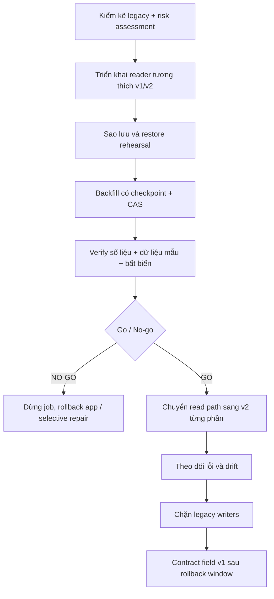
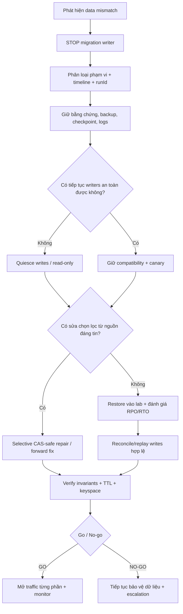

# Kiểm thử dữ liệu cũ, sao lưu và phương án khôi phục khi di trú lỗi

Trong module **SPRING_DATA_COUCHBASE**, dữ liệu ứng dụng thường là các **JSON document** được ánh xạ bởi Spring Data Couchbase thông qua `@Document`, `@Id`, `@Scope`, `@Collection` và `CouchbaseRepository`/`CouchbaseTemplate`. Khác với việc chỉ thay một class Java rồi chạy unit test, **di trú dữ liệu** phải làm việc với những document được ghi bởi nhiều phiên bản ứng dụng, có trường bị thiếu, kiểu dữ liệu không đồng nhất, expiration/TTL khác nhau và cập nhật đồng thời từ hệ thống đang hoạt động.

Một migration có thể chạy hết 100% batch mà vẫn làm hỏng dữ liệu: bộ chuyển đổi đã đặt sai `tenantId`, làm mất trường mở rộng không biết trước, chuyển nhầm số tiền, làm hết hạn TTL, hoặc ghi đè một update mới bằng bản document cũ. Ngược lại, **một bản sao lưu được tạo thành công chưa chứng minh có thể phục hồi**: cần kiểm tra phạm vi dữ liệu, quyền truy cập, tính nhất quán của snapshot, thao tác restore trên môi trường cô lập và khả năng đối soát những thay đổi phát sinh sau thời điểm backup.

Bài học thuộc chương **Tiến hóa và di trú**, tập trung vào ba việc có quan hệ chặt chẽ:

1. **Kiểm thử dữ liệu cũ** và bảo đảm ứng dụng đọc/ghi đúng khi các thế hệ document cùng tồn tại.
2. **Sao lưu có thể kiểm chứng** để hỗ trợ phục hồi khi script, mapping hoặc thao tác vận hành gây mất/sai dữ liệu.
3. **Phương án khôi phục có điểm quyết định rõ ràng**, phân biệt rollback phiên bản ứng dụng, sửa dữ liệu tiến tới (forward fix), và restore dữ liệu từ backup.

Ví dụ xuyên suốt là chuyển document khách hàng trong Couchbase từ cấu trúc v1 sang v2 mà vẫn phục vụ yêu cầu trong thời gian chuyển đổi. Các nguyên tắc cũng áp dụng khi đổi bucket/scope/collection, tách một document thành nhiều document, backfill chỉ mục SQL++, chuẩn hóa TTL hoặc đổi cách lưu CAS.

> **Nguyên tắc cốt lõi:** Chỉ được gọi migration là an toàn khi bạn biết **đã di trú document nào, chưa di trú document nào, phiên bản ứng dụng nào còn đọc được chúng, backup nào có thể restore và sẽ làm gì với các write xuất hiện sau backup**.

## 1. Mục tiêu học tập

Sau khi học xong, bạn có thể:

- Lập **bản kiểm kê legacy data** theo keyspace, document type, `schemaVersion`, phân bố kiểu JSON, TTL và các ngoại lệ.
- Thiết kế **golden fixtures** cho dữ liệu v0/v1/v2, document thiếu trường, `null`, kiểu sai, văn bản Unicode và document không xác định.
- Viết bộ chuyển đổi **idempotent, bảo toàn dữ liệu** và tách validation nghiệp vụ khỏi thao tác ghi.
- Hiểu vì sao `@Version`/CAS giúp chống ghi đè stale document nhưng không thay thế backup.
- Kiểm thử migration khi **người dùng vẫn đang ghi**, kể cả xung đột CAS, resume sau crash và re-run toàn batch.
- Phân biệt **backup**, **export**, **replication** và **rollback script**; không xem một file JSON export là backup đầy đủ toàn cụm.
- Lập kế hoạch `cbbackupmgr` theo bộ phiên bản, vị trí lưu, quyền, retention và restore drill.
- Tính **RPO/RTO** và biết khi nào full restore có thể làm mất dữ liệu hợp lệ phát sinh sau backup.
- Thiết kế quy trình **expand → migrate/backfill → verify → cutover → contract** có rollback window.
- Chọn giữa **rollback application**, **selective data repair**, **forward fix** và **restore vào môi trường cô lập**.
- Kiểm chứng metadata liên quan: bucket/scope/collection, indexes, RBAC, transaction ATR, TTL, CAS và query consistency.
- Lập ma trận kiểm thử và checklist go/no-go trước khi chuyển một hệ thống Spring Data Couchbase lên schema mới.

## 2. Tình huống xuyên suốt: document khách hàng v1 → v2

Giả sử hệ thống quản lý khách hàng lưu document trong:

```text
Bucket: appdata
Scope: crm
Collection: customers

Key: customer::tenant-a::C001
```

Document v1:

```json
{
  "docType": "customer",
  "schemaVersion": 1,
  "tenantId": "tenant-a",
  "name": "Nguyễn Văn An",
  "email": "an@example.test",
  "status": "ACTIVE",
  "loyaltyPoints": 150
}
```

Phiên bản mới muốn gom thông tin hồ sơ và liên hệ:

```json
{
  "docType": "customer",
  "schemaVersion": 2,
  "tenantId": "tenant-a",
  "name": "Nguyễn Văn An",
  "email": "an@example.test",
  "profile": {
    "displayName": "Nguyễn Văn An"
  },
  "contact": {
    "emailRaw": "an@example.test"
  },
  "status": "ACTIVE",
  "loyaltyPoints": 150
}
```

Ở giai đoạn **expand**, ta **giữ tạm các field v1** `name` và `email` để ứng dụng cũ còn đọc được document. Chỉ sau khi đã xác minh không còn reader/writer v1, mới cân nhắc **contract** để bỏ các field cũ; đây là một thay đổi rủi ro cao và cần backup/rollback plan riêng.

### 2.1. Vì sao không tự tách họ và tên?

`name = "Nguyễn Văn An"` không cho phép một thuật toán chung tách chính xác mọi tên người, đặc biệt với cách đặt tên nhiều ngôn ngữ. Vì vậy ví dụ v2 dùng `displayName` **giữ nguyên chuỗi gốc**, không tự suy `firstName`/`lastName` rồi ghi đè thông tin người dùng.

Đây là một nguyên tắc kiểm thử quan trọng: **migration không được tự tạo dữ liệu mà thuật toán không thể suy ra đáng tin cậy**.

### 2.2. Mục tiêu thực tế

- API v1 còn đọc được dữ liệu khi ứng dụng mới được triển khai.
- API v2 đọc được document v1 và v2 trong giai đoạn chuyển tiếp.
- Migration có thể chạy lại mà không làm tăng `loyaltyPoints` hay xóa field không biết trước.
- Mọi document được chuyển về dạng v2 hợp lệ hoặc được đưa vào danh sách lỗi có thể điều tra.
- Nếu migration sai, có đường **ngừng write, phục hồi hoặc sửa tiến tới** mà không xóa mất những update hợp lệ phát sinh trong lúc chuyển đổi.

## 3. Đừng nhầm schema Java với schema của dữ liệu đang tồn tại

Spring Data Couchbase có thể ánh xạ một class:

```java
@Document
@Scope("crm")
@Collection("customers")
public class CustomerDocument {

    @Id
    private String id;

    private String tenantId;
    private String name;
    private String email;
    private String status;
    private long loyaltyPoints;

    @Version
    private Long version;
}
```

Nhưng thay code thành:

```java
private Profile profile;
private Contact contact;
```

**không tự biến các document cũ thành JSON mới**. Những document thiếu `profile`/`contact` có thể được ánh xạ với giá trị `null` hoặc phát lỗi tùy converter/constructor/validation.

### 3.1. Rủi ro từ primitive field

Khi dữ liệu cũ thiếu `loyaltyPoints`, một primitive `long` có thể dẫn tới giá trị mặc định `0` ở đường mapping cụ thể. Điều đó dễ làm một document **chưa có giá trị** bị hiểu nhầm thành document có đúng **0 điểm**.

Ở đường đọc tương thích, cân nhắc wrapper `Long` hoặc mô hình phân biệt trạng thái **MISSING / NULL / VALID / INVALID**. Không gán default nghiệp vụ nếu chưa có quy tắc và số liệu phê duyệt.

### 3.2. `@Version` không phải `schemaVersion`

Hai giá trị khác nhau:

| Trường | Mục đích |
| --- | --- |
| `schemaVersion` trong JSON | Biểu thị thế hệ cấu trúc dữ liệu ứng dụng |
| `@Version Long` của Spring Data Couchbase | CAS metadata cho optimistic locking trong operation được hỗ trợ |
| SDK `GetResult.cas()` | Token kiểm tra stale write ở cấp document |
| Migration run version | Phiên bản code/chính sách của job backfill |
| API version | Hợp đồng HTTP/DTO, có thể khác schemaVersion |

Không tự đặt `@Version` thành `schemaVersion`, không tự cộng CAS và không dùng CAS token để quyết định một document thuộc v1 hay v2.

## 4. Nguyên tắc đầu tiên: kiểm kê trước khi sửa

Trước khi chạy script, lập danh mục:

- **Môi trường**: production/staging/test, cluster, phiên bản Couchbase Server, SDK, Spring Data, Spring Boot và JDK.
- **Keyspace**: bucket, scope, collection, document type, key pattern và tenant.
- **Schema thực tế**: phiên bản v0/v1/v2, document không có version, field thiếu, `null`, kiểu dữ liệu sai.
- **Quy mô**: số document, kích thước trung bình/lớn nhất, phân bố theo tenant, tốc độ create/update/delete.
- **TTL/expiration**: document vĩnh viễn và document có hạn; giá trị nào được kỳ vọng giữ nguyên.
- **Indexes**: các secondary indexes, Query Service và index build state.
- **Readers/writers**: phiên bản ứng dụng nào đang đọc/ghi, worker/batch/event consumer nào sử dụng field cũ.
- **Ràng buộc nghiệp vụ**: uniqueness, CAS, trạng thái, liên kết key, tổng/counter, quyền truy cập tenant.
- **Backup/restore**: bản backup gần nhất, retention, restore test gần nhất, thời gian hoàn thành thực đo.
- **External integrations**: CDC/stream, Kafka/outbox, caches, search index, các hệ thống khác có thể tiếp tục ghi.

Không bắt đầu từ giả định “mọi document có cùng class Java” chỉ vì hiện tại Repository chỉ ánh xạ một entity.

## 5. Kiểm kê schemaVersion bằng SQL++

Ví dụ keyspace:

```sql
SELECT IFMISSINGORNULL(c.schemaVersion, "MISSING") AS versionLabel,
       COUNT(1) AS documentCount
FROM `appdata`.`crm`.`customers` AS c
WHERE c.docType = "customer"
GROUP BY IFMISSINGORNULL(c.schemaVersion, "MISSING");
```

Kết quả minh họa:

| versionLabel | documentCount |
| --- | ---: |
| `MISSING` | 850 |
| `1` | 125.000 |
| `2` | 2.100 |
| `"legacy"` | 17 |

**Không bỏ qua 850 document thiếu version hoặc 17 document có version kiểu chuỗi.** Cần phân loại chúng theo cấu trúc thực tế và quyết định convert, quarantine hay can thiệp thủ công.

### 5.1. Điều kiện lọc là một giả định

Query trên dùng `WHERE c.docType = "customer"`, nên **không đếm document thiếu `docType`**. Nếu lịch sử có document chưa có discriminator, phải bổ sung phương pháp kiểm kê theo key pattern, scan đã kiểm soát, danh sách key từ nguồn dữ liệu hoặc báo cáo khác.

Không dùng một truy vấn chỉ đếm document “đẹp” để tuyên bố đã bao phủ toàn bộ dữ liệu.

### 5.2. Index và scan consistency

```sql
CREATE INDEX ix_customer_migration
ON `appdata`.`crm`.`customers` (
    docType,
    schemaVersion
);
```

Đây là index minh họa; phải đánh giá truy vấn, version, tài nguyên và tác động build index trước khi tạo trên môi trường thật. **Không có secondary index phù hợp, SQL++ query có thể không chạy hoặc rất tốn chi phí.**

Khi có write mới, secondary index có thể cập nhật bất đồng bộ. `REQUEST_PLUS` có thể yêu cầu mức scan consistency phù hợp **tại thời điểm query**, nhưng **không biến các lần đếm khác nhau thành cùng một snapshot toàn cục** và không thay thế việc kiểm soát nguồn write.

## 6. Phân biệt MISSING, NULL, sai kiểu và sai nghĩa

Bốn trường hợp không tương đương:

```json
{"docType":"customer", "name":"Nguyễn Văn An"}
```

```json
{"docType":"customer", "name":null}
```

```json
{"docType":"customer", "name":42}
```

```json
{"docType":"customer", "name":" "}
```

| Trường hợp | Rủi ro | Chính sách gợi ý |
| --- | --- | --- |
| `name` MISSING | Chưa có dữ liệu lịch sử | Chỉ dùng fallback nếu quy tắc được phê duyệt |
| `name=null` | Trạng thái cố ý hoặc lỗi importer | Phân biệt với MISSING khi điều tra |
| `name=42` | Sai kiểu | Quarantine, không ép số thành tên người |
| `name=" "` | Sai nghĩa dù đúng kiểu | Quy định blank/whitespace hợp lệ hay không |
| Email không chuẩn | Validation/nguồn dữ liệu cũ | Không âm thầm đổi email hoặc xóa user |
| `schemaVersion="2"` | Version lưu sai kiểu | Quy tắc sửa riêng, không cho qua như số `2` |
| `profile` đã có nhưng không phải object | Converter có thể lỗi | Không ghi đè không điều kiện |

Migration phải tách **dữ liệu có thể chuyển chắc chắn** khỏi **dữ liệu cần điều tra**. Số record lỗi không nên được giấu bằng `onErrorContinue` hay một default tùy tiện.

## 7. Lập bộ golden fixtures cho dữ liệu cũ

Một thư viện fixture tốt phản ánh **dữ liệu thực tế đã được ẩn danh** và các trường hợp biên, không chỉ một JSON tự viết cho happy path.

| Fixture | Đầu vào | Kết quả kỳ vọng |
| --- | --- | --- |
| `legacy-v1-happy` | `name` và `email` dạng chuỗi | V2 có `profile.displayName` và `contact.emailRaw` giữ nguyên |
| `legacy-v0-no-version` | Thiếu `schemaVersion`, có fields v1 hợp lệ | Có thể chuyển sau khi xác định đúng dạng legacy |
| `already-v2` | `schemaVersion=2`, dữ liệu v2 hợp lệ | No-op, không ghi lại không cần thiết |
| `legacy-missing-name` | Thiếu `name` | Quarantine hoặc fallback đã được duyệt |
| `legacy-null-email` | `email=null` | Hợp đồng null rõ, không tạo chuỗi `"null"` |
| `legacy-wrong-name-type` | `name` là number/array | Quarantine |
| `legacy-extra-fields` | Có `customAttributes` chưa được class mới biết | Không làm mất field |
| `legacy-unicode` | Dấu tiếng Việt và ký tự nhiều byte | Bảo toàn chính xác |
| `legacy-invalid-date` | Mốc thời gian thiếu timezone | Không tự đoán múi giờ |
| `legacy-expiring` | Có TTL còn 10 phút | Không biến thành document vĩnh viễn |
| `legacy-expired` | Document có thể hết hạn trong lúc job | Xử lý not found; không hồi sinh |
| `legacy-concurrent-update` | CAS thay đổi giữa get và replace | Retry có giới hạn, đọc lại |
| `legacy-missing-type` | Không có `docType` | Phân loại bằng rule đã được phê duyệt |
| `v2-partial` | Version 2 nhưng thiếu field mới | Báo dữ liệu chưa hợp lệ, không coi version là bằng chứng duy nhất |
| `future-v3` | Version lớn hơn ứng dụng hỗ trợ | Không downgrade âm thầm |
| `mixed-tenant` | Key nói tenant-a, body nói tenant-b | Quarantine/security alert |

Nên có fixture cho cả **document từng bị phần mềm cũ ghi sai** và **document có cấu trúc hoàn toàn lạ**. Không dùng tên, email, địa chỉ hay thông tin nhạy cảm production nguyên trạng trong bộ test công khai.

## 8. Invariant trước, sau và xuyên suốt migration

Không chỉ kiểm tra `schemaVersion=2`. Viết rõ điều gì **phải được bảo toàn**:

1. Document key không đổi nếu mục tiêu chỉ là bổ sung field.
2. `tenantId` giữ nguyên và phù hợp quy tắc định danh.
3. `loyaltyPoints` không thay đổi; không tràn, không âm nếu domain cấm.
4. `status` không được tự chuyển từ `ACTIVE` sang `DISABLED` hoặc ngược lại.
5. Chuỗi `name` được giữ nguyên ở `profile.displayName`, bao gồm Unicode và khoảng trắng có ý nghĩa.
6. `email` được giữ nguyên ở `contact.emailRaw`; nếu thêm email chuẩn hóa, lưu thành field **riêng** có chính sách.
7. Những field chưa thuộc migration, ví dụ `customAttributes`, **không bị xóa**.
8. Document có TTL không tự trở thành document không hạn; metadata expiration cần được bảo toàn khi contract yêu cầu.
9. Migration một document hai lần không làm đổi giá trị sau lần đầu.
10. Tất cả writer mới sau cutover tuân thủ schema và không ghi lại v1 trái phép.

### 8.1. Test metamorphic/idempotency

Nếu `M` là bộ chuyển đổi v1 → v2:

\[
M(M(d)) = M(d)
\]

trên tập document hợp lệ. Và với invariant \(I\):

\[
I(d) = I(M(d))
\]

đối với các thuộc tính phải bảo toàn.

Đây là kiểm thử **tính chất của converter**. Nó không tự chứng minh backup hay thao tác ghi database an toàn.

## 9. Đường triển khai an toàn: expand → migrate → verify → cutover → contract



**Expand** trước khi xóa: ứng dụng mới hiểu cả hai dạng document, trong khi write mới có thể tạm mang cả field v1 và v2.

**Migrate/backfill** sau khi có đường đọc tương thích: cập nhật dữ liệu cũ theo batch, có checkpoint và CAS.

**Verify** trước cutover: so record counts, invariants, lỗi, sample deep-diff, expiration và các writer còn sống.

**Cutover** theo từng phần: bật feature flag, canary tenant, theo dõi và giữ đường quay lại.

**Contract** chỉ khi hết thời hạn cần rollback và không còn client dùng field cũ. Đây thường là bước **khó đảo ngược nhất**.

## 10. Cơ chế đọc tương thích phải hoạt động trước migration

Một service v2 cần chấp nhận document v1 mà không tạo ra giá trị sai:

```text
readCustomer(id):
    raw = KV get(id)

    if schemaVersion == 2 and shape valid:
        parseV2(raw)
    else if schemaVersion == 1 or legacy fingerprint được chấp nhận:
        parseLegacyView(raw)
    else:
        reject/quarantine/raise migration-compatibility error
```

Không giải quyết vấn đề bằng cách:

```java
CustomerDocument doc = repository.findById(id).orElseThrow();
return doc.getProfile().getDisplayName(); // NPE nếu profile MISSING.
```

Thay vào đó, tạo một **anti-corruption layer/compatibility adapter** để ánh xạ v1/v2 thành một domain view có validation rõ. Khi đã xử lý được dữ liệu cũ, ứng dụng có thể được triển khai **trước job backfill**, giảm nguy cơ cutover đồng thời.

### 10.1. Không để mapping “nuốt” dữ liệu bất thường

Nếu JSON chứa `loyaltyPoints = "150"` dưới dạng string nhưng domain mong `long`, không nên tự tin rằng mọi converter đều đổi đúng. Kiểm tra loại và báo lỗi dữ liệu nếu không có rule chuyển kiểu được phê duyệt.

### 10.2. Phân biệt unknown schema với missing document

Một document chưa hỗ trợ v3 không phải `404 NOT_FOUND`. Nếu ứng dụng mới gặp v3 hoặc shape không thể parse, báo một lỗi **compatibility/data-quality** riêng, đo lường và xử lý, tránh xóa/ghi đè document để “sửa NPE”.

## 11. Converter minh họa: bảo toàn field cũ trong pha expand

Đoạn Java dưới đây minh họa chuyển đổi **cấu trúc JSON** trên một document v1 hợp lệ, không thực hiện I/O.

```java
package com.example.crm.migration;

import com.couchbase.client.java.json.JsonObject;

public final class CustomerV2Converter {

    private CustomerV2Converter() {}

    public static JsonObject convert(JsonObject source) {
        if (!"customer".equals(source.getString("docType"))) {
            throw new IllegalArgumentException(
                    "Không đúng document type customer");
        }

        Integer version = source.getInt("schemaVersion");

        if (version != null && version > 2) {
            throw new IllegalArgumentException(
                    "Không được downgrade future schema");
        }

        if (version != null && version == 2) {
            validateV2(source);
            return source; // No-op; writer không cần replace.
        }

        String oldName = source.getString("name");
        if (oldName == null || oldName.isBlank()) {
            throw new IllegalArgumentException(
                    "Legacy customer thiếu name hợp lệ");
        }

        // Minh họa deep-copy bằng JSON serialization;
        // cần đánh giá loại dữ liệu đặc thù và serializer thực tế.
        JsonObject result =
                JsonObject.fromJson(source.toString());

        JsonObject profile = result.getObject("profile");
        if (profile == null) {
            profile = JsonObject.create();
        }

        String existing = profile.getString("displayName");
        if (existing != null && !existing.equals(oldName)) {
            throw new IllegalArgumentException(
                    "Tên legacy và profile hiện tại mâu thuẫn");
        }

        profile.put("displayName", oldName);
        result.put("profile", profile);

        String email = source.getString("email");
        if (email != null) {
            JsonObject contact = result.getObject("contact");
            if (contact == null) {
                contact = JsonObject.create();
            }

            String current = contact.getString("emailRaw");
            if (current != null && !current.equals(email)) {
                throw new IllegalArgumentException(
                        "Email legacy và contact mâu thuẫn");
            }

            contact.put("emailRaw", email);
            result.put("contact", contact);
        }

        // Giữ name/email cũ trong giai đoạn expand.
        result.put("schemaVersion", 2);
        validateV2(result);
        return result;
    }

    private static void validateV2(JsonObject document) {
        JsonObject profile = document.getObject("profile");
        if (profile == null
                || profile.getString("displayName") == null
                || profile.getString("displayName").isBlank()) {
            throw new IllegalArgumentException(
                    "V2 thiếu profile.displayName");
        }
    }
}
```

**Điều kiện quan trọng:**

- Ví dụ giả định `schemaVersion` là **số nguyên hoặc missing**. Nếu nó là chuỗi `"2"`, SDK getter có thể báo lỗi kiểu; job phải phân loại/quarantine chứ không tự bỏ qua.
- `source.getObject("profile")` cần được bảo vệ trước trường hợp field là array/string; dữ liệu sai kiểu đi vào quarantine, không cố convert mọi giá trị.
- Nếu tài liệu `name` và `profile.displayName` mâu thuẫn, không chọn “lấy cái nào cũng được”; phải có policy source of truth.
- `JsonObject.fromJson(source.toString())` là cách minh họa clone cho JSON đơn giản, không phải bảo đảm bảo toàn mọi biểu diễn số/kiểu mở rộng trong mọi serializer. Test deep-diff trên dữ liệu đặc thù.
- **Không xóa field cũ** ở pha expand, tránh ứng dụng v1 bị lỗi sau một bản deploy có thể rollback.

### 11.1. Converter không cần mở transaction nhiều document

Việc chuyển đổi thuần một JSON document là một hàm. Đối với migration **một document tại một thời điểm**, CAS-controlled replace có thể đủ để chống ghi đè update đồng thời. Nếu migration tách một customer thành **nhiều document có invariant**, phải đánh giá multi-document transaction và phạm vi API hỗ trợ.

## 12. Ghi backfill với CAS để không ghi đè dữ liệu mới

Mẫu SDK một document:

```java
package com.example.crm.migration;

import com.couchbase.client.java.Collection;
import com.couchbase.client.java.kv.GetResult;
import com.couchbase.client.java.json.JsonObject;

import static com.couchbase.client.java.kv.ReplaceOptions.replaceOptions;

public final class CustomerBackfill {

    private final Collection customers;

    public CustomerBackfill(Collection customers) {
        this.customers = customers;
    }

    public void migrateOne(String documentKey) {
        GetResult result = customers.get(documentKey);
        JsonObject current = result.contentAsObject();

        Integer version = current.getInt("schemaVersion");
        if (version != null && version == 2) {
            // Validate shape để tránh v2 hỏng, rồi no-op.
            CustomerV2Converter.convert(current);
            return;
        }

        JsonObject updated =
                CustomerV2Converter.convert(current);

        customers.replace(
                documentKey,
                updated,
                replaceOptions()
                        .cas(result.cas())
                        .preserveExpiry(true));
    }
}
```

**Cảnh báo về API/version:** `ReplaceOptions.preserveExpiry(true)` và hành vi giữ expiration cần kiểm tra theo phiên bản Couchbase Server/Java SDK. Nếu tổ hợp version không hỗ trợ, phải chọn đường update khác đã được kiểm thử hoặc bảo toàn expiration theo API phù hợp. **Không xóa dòng preserveExpiry rồi giả định TTL vẫn đúng**.

### 12.1. Tại sao cần CAS?

Timeline:

```text
T1 Backfill: get customer C001, points=150, CAS=A
T2 Application: update points=180, CAS=B
T3 Backfill: replace toàn JSON cũ với points=150, CAS=A
```

Với CAS, bước T3 bị từ chối thay vì âm thầm ghi đè 180 bằng 150. Khi gặp CAS mismatch:

1. Ghi nhận conflict theo key/migration run.
2. Đọc lại **document mới**.
3. Chạy converter lại trên dữ liệu mới.
4. Retry có **giới hạn và backoff**.
5. Nếu conflict liên tục, đưa key vào retry queue/quarantine, không khóa toàn job mãi.

### 12.2. Không retry cùng snapshot cũ

Sai:

```java
for (int i = 0; i < 5; i++) {
    try {
        customers.replace(id, oldUpdatedJson,
                replaceOptions().cas(oldCas));
        break;
    } catch (RuntimeException ignored) {
        // Vẫn giữ oldCas và oldUpdatedJson.
    }
}
```

Đúng là **đọc lại và chuyển đổi lại theo trạng thái mới** sau khi xác định exception thuộc loại có thể retry. Không catch mọi exception: permission, invalid payload và CAS conflict phải được phân loại khác nhau.

### 12.3. Spring Data `@Version` cũng không thay kiểm tra shape

Một entity `@Version Long` có thể phát hiện stale write ở Repository/Template operations được hỗ trợ. Nhưng nếu mapper v2 làm mất field cũ **trước khi save**, CAS chỉ nói “không có update song song”; nó **không chứng minh transformation không phá dữ liệu**.

Vì vậy migration payload-lạ thường nên kiểm soát raw JSON và có test round-trip thay vì mù quáng đọc entity mới rồi `save` lại toàn bộ.

## 13. Giữ TTL: kiểm thử riêng metadata expiration

Một Couchbase document có thể có **expiration/TTL**, ví dụ session, mã xác minh, reservation hoặc dữ liệu tạm. Nếu backfill dùng thao tác thay document không giữ expiration, một document vốn hết hạn sau 10 phút có thể trở thành dữ liệu giữ lâu hơn dự kiến, hoặc bị gán một TTL mới không đúng.

### 13.1. Test expiration trước và sau

Ở môi trường test:

1. Insert một document legacy có expiry dự kiến gần, ví dụ khoảng 10 phút.
2. Đọc lại trạng thái expiration bằng API/metadata được phiên bản hỗ trợ, ghi thời gian trước migration.
3. Chạy backfill.
4. Đọc lại expiration sau migration.
5. Assert không bị xóa hoặc gia hạn ngoài policy, với dung sai do độ phân giải/thời gian xử lý.
6. Kiểm tra document thực sự hết hạn theo chính sách trên fixture phù hợp.

**Đừng test chính xác tới millisecond** nếu server/API làm tròn hoặc thông tin expiry có độ phân giải riêng.

### 13.2. Expired document có thể biến mất giữa scan và replace

Một key được SQL++ liệt kê lúc T1 có thể hết hạn lúc T2. Khi `get` trả not found, đừng tự `upsert` một document được tạo từ snapshot cũ để “sửa lỗi”. Điều đó có thể **hồi sinh dữ liệu đã hết hạn hợp lệ**.

### 13.3. TTL khác retention cho migration checkpoint

TTL của customer là đặc tính dữ liệu nghiệp vụ. TTL của migration run/checkpoint là đặc tính vận hành. Không gắn cùng một default expiry cho cả hai và không để checkpoint bị xóa trước khi có thể resume hoặc kiểm toán.

## 14. Backfill theo batch: checkpoint, idempotency và restart

Một backfill an toàn cần có định danh run, batch và trạng thái:

```json
{
  "migrationId": "customer-v1-to-v2",
  "runId": "run-2026-11-25-a",
  "sourceKeyspace": "appdata.crm.customers",
  "targetVersion": 2,
  "status": "RUNNING",
  "lastCheckpoint": "opaque-cursor-or-last-key",
  "scanned": 125850,
  "converted": 125000,
  "skippedAlreadyV2": 2100,
  "quarantined": 17,
  "casConflicts": 312
}
```

Các số chỉ là minh họa; trong một báo cáo thật, các bộ đếm phải **được định nghĩa sao cho không đếm lặp batch sau resume** hoặc cung cấp hai nhóm metric: số attempt và số unique keys đã xử lý.

### 14.1. Quy trình batch gợi ý

```text
initializeMigrationRun(runId, targetVersion)

for each page of document keys from a stable scan strategy:
    for each key:
        try:
            raw = kv.get(key)
            classify(raw)
            if already valid v2: record SKIPPED
            else:
                converted = convert(raw)
                kv.replace(key, converted, CAS + expiry policy)
                record CONVERTED
        catch CAS conflict:
            bounded re-read/recompute/retry
        catch invalid legacy:
            quarantine key + reason
        catch transient infrastructure:
            retry with backoff / pause batch
    persist checkpoint + batch summary
    emit progress metrics

after scan:
    run catch-up / reconciliation for concurrent writers
    run verification gates
    mark VERIFIED only when gates pass
```

### 14.2. Checkpoint không phải bằng chứng mọi write đã commit

Nếu process crash **sau replace nhưng trước checkpoint**, khi resume có thể xử lý lại key đó. Vì vậy converter phải **idempotent**, và trạng thái `already valid v2` phải là no-op an toàn.

Ngược lại, nếu ghi checkpoint **trước replace**, crash có thể làm bỏ sót key. Luôn thiết kế sao cho re-scan không gây hỏng và có bước verify/catch-up cuối.

### 14.3. Pagination đúng cho tập đang thay đổi

`OFFSET` trên SQL++ khi dữ liệu đang được cập nhật có thể gây **bỏ sót hoặc đọc trùng** vì vị trí các row thay đổi. Nên xem xét phân trang theo key/cursor, snapshot inventory đã lưu, hoặc cơ chế scan/stream được công cụ hỗ trợ.

Nhưng keyset pagination cũng cần quy định **thời điểm thêm/xóa key và late writes**. Không tuyên bố chỉ thay OFFSET bằng last-key là có snapshot nhất quán.

## 15. Giới hạn tải để migration không làm sập production

- Chọn batch size theo độ trễ/p95 và khả năng phục vụ của Couchbase, không chỉ theo RAM của worker.
- Có **rate limit, max concurrency và backpressure**.
- Giữ thời gian đọc–chuyển đổi–replace ngắn để giảm CAS conflict.
- Không chạy một transaction nhiều document kéo dài hàng giờ cho toàn bộ backfill.
- Kiểm tra Index/Query Service khi dùng SQL++ inventory; KV read/write tác động Data Service.
- Giới hạn retry, jitter/backoff, circuit breaker/pause khi cluster quá tải.
- Theo dõi latency read/write, queue depth, timeout, conflict, mutation rate và error distribution.
- Có kill switch **dừng ghi migration mới** mà không làm ứng dụng người dùng chết theo.

### 15.1. Multi-document migration cần boundary khác

Nếu v1 customer sẽ được **tách thành profile document và preference document** mà chúng phải cùng tồn tại mới hợp lệ, một CAS replace trên source không đủ. Cân nhắc transaction cho **nhóm document của cùng customer**, hoặc workflow expand với marker và reconciliation nếu không thể atomic.

Không gộp hàng triệu customer trong một transaction; chọn **đơn vị nhỏ, có thể retry và xác minh riêng**.

## 16. Xử lý writer v1 chạy song song với job migration

Một hệ thống thường có API pods, scheduled jobs, message consumers và admin scripts. Nếu writer cũ còn ghi cấu trúc v1 sau khi migration đã chuyển C001 sang v2, nó có thể **xóa field v2 bằng full-document replace** hoặc ghi dữ liệu v1 mới.

### 16.1. Các chiến lược thường gặp

| Chiến lược | Lợi ích | Rủi ro |
| --- | --- | --- |
| Dừng write trong maintenance window | Dễ lấy snapshot và verify | Downtime/queue backlog |
| Deploy reader/writer tương thích trước | Giảm downtime | Cần test hai thế hệ dữ liệu |
| Dual-field write trong một document | Ứng dụng cũ và mới cùng đọc | Hai bản field có thể mâu thuẫn nếu writer không đồng bộ |
| Ghi v2 làm chuẩn, reader v1 adapter | Có source of truth rõ | App v1 không hỗ trợ có thể không rollback |
| Dual-write sang hai collections | Hỗ trợ đổi keyspace | Cần transaction/outbox/reconciliation, không tự atomic |
| CDC/change stream/catch-up | Giảm khoảng lệch khi online backfill | Cần contract và checkpoint/version phù hợp |
| Blue/green keyspace | Cutover/restore rõ hơn | Chi phí nhân đôi và đồng bộ writes |

Không chọn `dual-write` chỉ vì nó nghe an toàn. Hai `collection.upsert` độc lập sang old/new collections vẫn có thể **commit một bên và lỗi một bên**.

### 16.2. Điểm chốt write contract

Trước cutover:

- Xác định **phiên bản ứng dụng nhỏ nhất** còn chạy.
- Kiểm tra mọi writer có tuân thủ tương thích v2 hay không.
- Chặn hoặc nâng cấp batch scripts dùng field cũ.
- Ghi nhận cách xử lý write giữa lần scan cuối và cutover.
- Có kế hoạch **catch-up/reconciliation** sau khi writers chuyển sang chính sách mới.

## 17. Kiểm thử compatibility giữa ứng dụng cũ và mới

Lập ma trận:

| Reader | Writer | Document | Kỳ vọng |
| --- | --- | --- | --- |
| App v1 | App v1 | v1 | Hoạt động như baseline |
| App v2 | App v1 | v1 | v2 đọc được, validation rõ |
| App v2 | App v2 | v2 | Happy path |
| App v1 | App v2 | v2 có legacy fields | v1 còn đọc được trong rollback window |
| App v2 | Backfill | v1 chuyển v2 | Không mất business fields |
| App v1 | Backfill | v2 | Không crash hoặc ghi mất field nếu chưa chặn writer |
| App v2 | Unknown v3 | v3 | Từ chối/downgrade không tự động |
| API pod v2 | Legacy worker | v2 bị worker cũ ghi | Test phát hiện regression |
| Admin/export | v2 | v2 | Không xóa field khi round-trip |
| Reactive reader | Concurrent backfill | v1/v2 | Không leak error, không ghi sai CAS |

### 17.1. Thử rollback code ngay trong rehearsal

Trước cutover, chạy thử một **build v1 thực tế** trên một bản data v2 đã được backfill. Nếu v1 không đọc/ghi đúng, rollback binary **không khả thi** dù team vẫn còn image/container của release cũ.

Kết quả rehearsal phải phân loại:

- **Rollback app an toàn**: v1 đã chứng minh đọc/ghi dữ liệu v2.
- **Chỉ rollback app ở chế độ read-only**.
- **Không rollback app được**, cần forward fix hoặc reverse migration có kiểm soát.

## 18. Test automation: assertions quan trọng hơn line coverage

Một converter có thể đạt branch coverage cao nhưng vẫn thay đổi dữ liệu sai. Bộ test nên chia:

1. **Parsing/type validation**: missing/null/wrong-type, unknown versions.
2. **Business invariants**: tenant/status/points/displayName không thay đổi sai.
3. **Idempotency**: convert lần hai không làm thay đổi result.
4. **Losslessness**: field lạ, nested arrays/objects và Unicode được giữ nguyên trong pha expand.
5. **CAS/concurrency**: app cập nhật cùng key giữa get và replace.
6. **TTL**: expiry không bị reset, expired document không hồi sinh.
7. **Spring Data mapping**: entity v2 đọc được document legacy qua adapter.
8. **SQL++**: index/scan consistency và cách kiểm kê document thiếu discriminator.
9. **Resume/retry**: job crash sau write trước checkpoint.
10. **Backup/restore**: restore môi trường cô lập, kiểm tra dữ liệu và khởi động app.
11. **Cutover/rollback**: feature flag quay lại và writer version phù hợp.
12. **Security**: tenant isolation, không lộ dữ liệu từ backup/diagnostic.

**Mỗi test quan trọng phải ghi rõ fixture, thao tác, điểm lỗi và trạng thái cuối mong đợi.**

## 19. Unit test converter: dữ liệu v1 đúng

Ví dụ JUnit 5:

```java
import static org.junit.jupiter.api.Assertions.*;
import org.junit.jupiter.api.Test;

import com.couchbase.client.java.json.JsonObject;

class CustomerV2ConverterTest {

    @Test
    void convertsLegacyNameWithoutChangingBusinessFields() {
        JsonObject input = JsonObject.create()
                .put("docType", "customer")
                .put("schemaVersion", 1)
                .put("tenantId", "tenant-a")
                .put("name", "Nguyễn Văn An")
                .put("email", "an@example.test")
                .put("loyaltyPoints", 150)
                .put("customAttributes",
                        JsonObject.create()
                                .put("segment", "silver"));

        JsonObject output = CustomerV2Converter.convert(input);

        assertEquals(2, output.getInt("schemaVersion"));
        assertEquals("Nguyễn Văn An",
                output.getObject("profile")
                        .getString("displayName"));
        assertEquals("Nguyễn Văn An",
                output.getString("name"));
        assertEquals("an@example.test",
                output.getObject("contact")
                        .getString("emailRaw"));
        assertEquals(150,
                output.getInt("loyaltyPoints"));
        assertEquals("silver",
                output.getObject("customAttributes")
                        .getString("segment"));
    }

    @Test
    void reRunningConverterIsIdempotent() {
        JsonObject input = JsonObject.create()
                .put("docType", "customer")
                .put("schemaVersion", 1)
                .put("name", "Nguyễn Văn An");

        JsonObject once = CustomerV2Converter.convert(input);
        JsonObject twice = CustomerV2Converter.convert(once);

        assertEquals(once, twice);
    }

    @Test
    void refusesUnsupportedFutureVersion() {
        JsonObject future = JsonObject.create()
                .put("docType", "customer")
                .put("schemaVersion", 3)
                .put("name", "Nguyễn Văn An");

        assertThrows(IllegalArgumentException.class,
                () -> CustomerV2Converter.convert(future));
    }
}
```

Đây là minh họa về **kỳ vọng và cấu trúc test**, không thay việc chạy build tương thích với dependency thật. Có thể dùng property-based testing để tạo nested fields ngẫu nhiên và kiểm tra converter không xóa field không thuộc phạm vi.

### 19.1. Không chỉ assert schemaVersion

Test chỉ kiểm tra `schemaVersion==2` vẫn có thể pass dù `loyaltyPoints` bị mất hoặc `tenantId` đổi. Hãy assert **tập invariants**, không chỉ một field chứng tỏ job đã chạy.

## 20. Integration test CAS: writer không được bị ghi đè

Mô phỏng:

1. Backfill đọc document C001 ở CAS A với `loyaltyPoints=150`.
2. App thay C001 thành `loyaltyPoints=180`, tạo CAS B.
3. Backfill cố `replace` bằng CAS A.
4. Operation phải **phát hiện stale write**, không ghi `loyaltyPoints=150` đè lên 180.
5. Backfill đọc lại B, chuyển đổi payload mới và thử lại theo policy.
6. Cuối cùng C001 có schema v2 **và** `loyaltyPoints=180`.

### 20.1. Lỗi CAS không đồng nghĩa lỗi dữ liệu

Một CAS conflict khi backfill chạy online có thể là dấu hiệu writer ứng dụng hoạt động bình thường. Job cần phân biệt **conflict có thể retry** với **invalid document** hoặc **permission failure**.

### 20.2. Không chạy `save` entity mới trên document legacy không hiểu hết

Nếu class Spring Data mới không ánh xạ một số field cũ, full-document save có thể làm mất chúng. Một test phải đọc raw JSON trước/sau và so toàn bộ field không được phép thay đổi, chứ không chỉ dùng entity getter để so.

## 21. Integration test crash/restart: job phải resume an toàn

Giả lập một batch 100 keys:

```text
Keys 1..40 đã replace thành v2
Process crash trước khi ghi checkpoint mới
Keys 41..100 chưa được xử lý
```

Sau restart:

- Job có thể đọc lại keys 1..40.
- Converter v2 phải **no-op**, không ghi/đổi CAS nếu không cần.
- Keys 41..100 được chuyển theo chính sách.
- Không có customer bị nhân đôi hoặc mất.
- Counts cuối cùng dựa trên **unique keys/outcomes**, không cộng mù quáng attempts.
- Checkpoint phản ánh progress nhưng **verification cuối mới quyết định thành công**.

### 21.1. Crash sau checkpoint trước mutation là tình huống khác

Nếu code ghi checkpoint trước khi một batch đã thực sự ghi xong, restart có thể **bỏ sót** những keys chưa chuyển. Hãy thiết kế checkpoint **sau** việc xử lý đã được xác nhận và có catch-up query/scanner để phát hiện thiếu sót.

## 22. Khi nào cần multi-document transaction cho migration?

Không phải mọi migration đều cần transaction. Với document v1 được bổ sung field v2 **trên chính một key**, CAS replace thường đủ để bảo vệ một lần cập nhật document.

Nhưng nếu thay đổi từ:

```text
customer::C001  { profile, preferences }
```

sang:

```text
customer::C001   { profileReference }
profile::C001    { ... }
preferences::C001 { ... }
```

và business invariant yêu cầu cả ba cùng tồn tại/được liên kết, cân nhắc **transaction với các thao tác SDK `ctx`** hoặc workflow hai pha có marker và reconciliation nếu hệ thống không hỗ trợ atomic boundary mong muốn.

### 22.1. Đừng mở transaction cho cả chiến dịch backfill

```text
Sai kỳ vọng:
  BEGIN
  migrate 1.000.000 document
  COMMIT
```

Transaction quá rộng gây timeout, contention và tải metadata; không phải một cơ chế "undo" thuận tiện cho job lớn. **Đơn vị transaction nên nhỏ theo aggregate**, còn job tổng thể phải có checkpoint, idempotency và kế hoạch khôi phục.

### 22.2. Transaction callback có thể được retry

Không ghi file export, gửi email, publish message hoặc ghi database khác **trong SDK transaction callback**. Nếu callback chạy lại, side effect bên ngoài không rollback. Dùng outbox/side-effect orchestration nếu việc đổi schema phải phát event.

## 23. Phân biệt sao lưu, export, replication và audit log

| Cơ chế | Mục tiêu chính | Điều không được tự suy |
| --- | --- | --- |
| **Couchbase backup bằng công cụ hỗ trợ** | Lưu dữ liệu/metadata trong phạm vi backup để phục hồi | Chưa chứng minh restore được nếu chưa drill |
| **JSON export bằng `cbexport` hoặc script** | Trích xuất/tải dữ liệu cho nghiên cứu/chuyển đổi | Không tự là full backup kèm CAS, TTL, index, RBAC |
| **XDCR/replication** | Sao chép thay đổi sang cluster khác | Sai dữ liệu/xóa nhầm có thể bị replicate; không thay backup lịch sử |
| **Snapshot storage** | Điểm khôi phục ở tầng hạ tầng | Phải xác minh consistency theo engine/topology và quy trình restore |
| **Application audit/outbox** | Truy vết ý định nghiệp vụ, event và thay đổi | Không phải backup của toàn bộ JSON/keyspace |
| **Git/release artifact** | Khôi phục code/config | Không khôi phục dữ liệu đã bị script sửa |
| **Migration journal/checkpoint** | Resume/reconcile | Không phục hồi bản JSON trước đó nếu không lưu hoặc backup |

Một lệnh export 500 document dùng làm fixture **không chứng minh** toàn bộ 125.000 document có bản sao khôi phục được. Và một bản XDCR replica vẫn có thể chứa dữ liệu đã bị migration sai phá hỏng.

## 24. Thiết kế backup trước khi chạy migration

Trước batch đầu tiên, xác nhận:

1. **Phạm vi:** những bucket/scope/collection nào bị sửa, cùng những collection có liên quan/invariant.
2. **Thời điểm:** bản backup được tạo trước mutation mang tính phá hủy; ghi mốc giờ, runId và release.
3. **Nhất quán:** có cần quiesce writers hoặc một quy trình capture/reconciliation để đảm bảo phục hồi hợp đồng nghiệp vụ không?
4. **Retention:** giữ nhiều thế hệ backup, tránh bản xấu ghi đè/xóa bản tốt.
5. **Lưu trữ:** đủ dung lượng, tách miền lỗi, encryption, quyền tối thiểu, không lộ password.
6. **Phạm vi metadata:** buckets, indexes, scopes/collections, users/roles, cluster settings, transaction metadata có được backup/restore theo công cụ/version không?
7. **Phục hồi:** có restore rehearsal ở môi trường cô lập và có số liệu RTO thực tế không?
8. **Write sau backup:** có cơ chế catch-up/log/replay hoặc chấp nhận mất theo RPO không?
9. **Owner và runbook:** người phê duyệt go/no-go, người có quyền restore, kênh thông báo sự cố.
10. **Bằng chứng:** ID/đường dẫn backup, số lượng, dung lượng, checksum/manifest nếu công cụ hỗ trợ, kết quả verify.

**Backup chỉ là một bước của phương án khôi phục.** Nếu không biết dữ liệu sau thời điểm backup sẽ xử lý ra sao, bạn chưa có rollback plan hoàn chỉnh.

## 25. `cbbackupmgr`: minh họa tạo backup repository

Couchbase có công cụ `cbbackupmgr` cho quy trình backup/restore ở những phiên bản/edition hỗ trợ. Cấu trúc lệnh minh họa:

```bash
# MÔI TRƯỜNG MINH HỌA: đọc --help và tài liệu theo đúng version.
# Không lưu mật khẩu trực tiếp trong shell history.

cbbackupmgr config \
  --archive /secure-backups/couchbase \
  --repo before-customer-v2

cbbackupmgr backup \
  --archive /secure-backups/couchbase \
  --repo before-customer-v2 \
  --cluster couchbase://source-cluster.example \
  --username "$CB_USER" \
  --password "$CB_PASS"

cbbackupmgr list \
  --archive /secure-backups/couchbase \
  --repo before-customer-v2
```

**Lưu ý:** Cú pháp, yêu cầu edition, cách truyền credentials an toàn, bản quyền, các tùy chọn include/exclude, encryption, backup schedule và phạm vi metadata có thể khác theo phiên bản. Trước khi dùng production, xác minh từ công cụ `--help` và tài liệu chính thức cho đúng phiên bản. Đoạn trên **không phải lệnh được thực thi trong bài học**.

### 25.1. Ghi nhận một backup cụ thể

Sau khi backup trả thành công, phải lưu ít nhất:

```text
migrationId: customer-v1-to-v2
sourceCluster: source-cluster.example
archive: /secure-backups/couchbase
repository: before-customer-v2
backupTimestamp: <exact timestamp from tool>
toolVersion: <cbbackupmgr version>
sourceServerVersion: <Couchbase Server version>
scope: <buckets / scopes / collections covered>
verifyStatus: RESTORE_DRILL_PENDING
operator: <team or service identity>
```

Không tự ghi `verifyStatus=PASSED` chỉ vì `backup` command exit 0. Phải restore vào một nơi riêng rồi kiểm tra.

### 25.2. Mật khẩu và backup files là dữ liệu nhạy cảm

Lệnh chứa `--password "$CB_PASS"` chỉ minh họa. Trong sản phẩm thực cần cân nhắc **secret manager, stdin/credential mechanism phù hợp version, process listing, CI log và shell history**. Backup có thể chứa PII/secret trong data, nên mã hóa và kiểm soát đọc/xóa phải tương ứng mức nhạy cảm của production.

## 26. Backup consistency khi ứng dụng vẫn ghi

Khi backup chạy đồng thời với write, các document có thể được capture tại **những thời điểm khác nhau** tùy cơ chế backup và tính năng phiên bản. Không được tự giả định một backup của nhiều collection là **một transaction snapshot nhất quán toàn ứng dụng** nếu công cụ không công bố hợp đồng đó.

Ví dụ:

```text
T0: Account A = 100, Account B = 100.
T1: Backup đọc Account A.
T2: Business transaction chuyển 40 từ A sang B.
T3: Backup đọc Account B.
```

Nếu backup không cung cấp snapshot nhất quán theo yêu cầu, bản restore có thể cần **reconciliation** cho các bất biến xuyên nhiều document. Biểu đồ này chỉ minh họa loại rủi ro cần đánh giá; tính chất backup thực tế phải xem theo công cụ và phiên bản.

### 26.1. Cách giảm rủi ro

- Khi cần **điểm phục hồi nhất quán ứng dụng**, cân nhắc maintenance window/quiesce writes phù hợp.
- Nếu không dừng writes, cần **journal, change capture hoặc đối soát theo transfer/order IDs** ở mức nghiệp vụ.
- Lập danh sách collection nào phải đồng bộ khi restore.
- Đảm bảo việc lấy backup không làm hệ thống production vượt giới hạn latency/tài nguyên.
- Restore và chạy invariant checks để chứng minh backup có giá trị thực.

Không ghi vào runbook “backup là snapshot ACID” khi chưa có tài liệu/kiểm thử chứng minh.

## 27. Restore rehearsal: sao lưu chỉ có giá trị khi khôi phục được

Một lần rehearsal phải có **cluster/namespace cô lập**, không chạy restore trực tiếp vào production để “thử”.

Cấu trúc lệnh minh họa:

```bash
# CHỈ chạy trên cluster lab tách biệt và đã được phê duyệt.
# Kiểm tra options/target topology theo đúng phiên bản.

cbbackupmgr restore \
  --archive /secure-backups/couchbase \
  --repo before-customer-v2 \
  --cluster couchbase://restore-lab.example \
  --username "$RESTORE_USER" \
  --password "$RESTORE_PASS"
```

Trong một số phiên bản, restore cần lựa chọn backup range, mapping bucket, cấu hình target và các options khác. **Không copy lệnh này sang production nguyên trạng**. Cần đọc tài liệu về những đối tượng được restore, xung đột với dữ liệu target, quyền, indexes và phạm vi metadata.

### 27.1. Runbook phục hồi thử nghiệm

1. Xác thực backup source và thời điểm.
2. Tạo target test cô lập đủ Services/dung lượng/version tương thích.
3. Kiểm tra secrets/RBAC và quyền đọc archive.
4. Chạy restore với options đã phê duyệt.
5. Đối chiếu số document, key patterns và schema versions.
6. Kiểm tra TTL/expiration trên fixtures có thể kiểm chứng.
7. Kiểm tra các index, scopes/collections, query readiness và quyền cần thiết.
8. Chạy `@SpringBootTest`/integration tests với app version cần rollback.
9. Đối soát invariant nghiệp vụ theo fixtures phù hợp.
10. Ghi **thời gian restore thật**, lỗi phát sinh và kết quả go/no-go.
11. Hủy dữ liệu lab an toàn theo chính sách bảo mật.

### 27.2. Những gì restore không nên được ngầm hứa

Không mặc định backup/restore luôn bao gồm:

- Mọi cluster-level setting, certificate, user/role và secret.
- Toàn bộ trạng thái index có thể query ngay không cần build.
- Một bản chụp ứng dụng nhất quán giữa nhiều buckets khi writers vẫn chạy.
- Toàn bộ dữ liệu nằm ngoài Couchbase (Kafka, PostgreSQL, object storage).
- Sự kiện/command phát sinh **sau timestamp backup**.

Phạm vi thực tế phải được chứng minh trên **công cụ/version và cấu hình của bạn**.

## 28. RPO và RTO: định lượng cái giá của khôi phục

Hai chỉ số chính:

**RPO (Recovery Point Objective):** mức dữ liệu mới nhất có thể mất khi phục hồi, thường diễn đạt theo **thời gian**.

**RTO (Recovery Time Objective):** thời gian tối đa để khôi phục dịch vụ đến trạng thái có thể chấp nhận.

Ví dụ:

```text
Backup hoàn tất lúc 09:00.
Migration bắt đầu lúc 09:30.
Lỗi nghiêm trọng phát hiện lúc 10:15.
Nếu restore nguyên backup 09:00:
  Các thay đổi hợp lệ sau 09:00 có nguy cơ không còn.
```

Nếu RPO cho phép mất tối đa 5 phút nhưng bản backup đã hơn 75 phút, **full restore chỉ từ backup đó không đáp ứng RPO**, trừ khi có cơ chế replay/catch-up khả thi.

### 28.1. Ước tính trên số liệu, không dùng cảm tính

Ví dụ rehearsal đo:

```text
Fetch archive:        8 phút
Provision cluster:   12 phút
Restore dữ liệu:     25 phút
Rebuild index:       10 phút
Verify ứng dụng:      7 phút
Cutover traffic:      5 phút
----------------------------
Tổng:                67 phút
```

Đây là **số minh họa**, không phải benchmark Couchbase. RTO thực tế phải cộng cả thời gian chuẩn bị/phê duyệt/quyết định và thời gian khắc phục phát sinh, không chỉ thời gian `cbbackupmgr restore` chạy.

### 28.2. Khôi phục có thể cần forward replay

Nếu cần giữ những giao dịch hợp lệ sau backup, thường phải:

- Tìm nguồn event/journal/CDC hoặc write log **được xác thực**.
- Phân loại những mutation do migration lỗi so với mutation nghiệp vụ hợp lệ.
- Replay những mutation cần thiết với idempotency key và ordering/sequence.
- Đối soát các bất biến và side effects liên hệ trước khi mở traffic.

Không replay mù quáng một log chứa cả mutation sai của job migration.

## 29. Ba cấp rollback: ứng dụng, sửa dữ liệu và full restore

| Cách xử lý | Khi phù hợp | Rủi ro/điều kiện |
| --- | --- | --- |
| **Rollback ứng dụng/feature flag** | Schema mới vẫn tương thích với reader/writer cũ | App cũ có thể phá field mới khi ghi, phải test |
| **Forward fix/selective repair** | Có thể xác định các document bị lỗi và sửa chính xác | Cần CAS, journal và verification |
| **Reverse migration được thiết kế** | Có hàm đảo đáng tin, không mất thông tin | Không phải mọi transform đều đảo được |
| **Restore từ backup vào lab, copy chọn lọc** | Cần lấy lại payload trước khi lỗi cho một tập key | Phải tránh ghi đè update hợp lệ sau backup |
| **Full restore production** | Sự cố dữ liệu lớn, RPO/RTO và runbook cho phép | Có thể mất write mới; phải quiesce/đối soát |
| **Blue/green switch** | Có target keyspace được đồng bộ/verify | Phải xử lý drift, in-flight requests, writer ownership |

**Ưu tiên rollback ít phá hủy nhất đáp ứng mục tiêu.** Với một field v2 bị đổi sai ở 50 khách hàng, không tự động restore cả bucket và xóa hàng nghìn đơn hàng hợp lệ phát sinh sau backup.

### 29.1. Rollback app khác rollback data

Rollback container image v2 → v1 không làm dữ liệu đã di trú trở lại v1. Nếu v1 không hiểu document v2, app rollback có thể khiến sự cố trầm trọng hơn.

### 29.2. Reverse migration có thể mất thông tin

Nếu v2 tách một field thành nhiều nguồn hoặc đã xóa field cũ, việc “đổi `schemaVersion=1`” **không khôi phục được nội dung đã mất**. Chỉ có backup hoặc journal chứa nguồn gốc phù hợp mới giúp phục hồi thật.

## 30. Quyết định khôi phục theo loại sự cố

| Dấu hiệu lỗi | Hành động ưu tiên |
| --- | --- |
| Một vài document legacy sai kiểu, converter từ chối | Quarantine, giữ nguyên document, điều tra |
| CAS conflict khi backfill | Re-read/recompute/retry có giới hạn |
| Job crash giữa batch | Resume theo checkpoint + idempotent scan |
| App v2 lỗi khi đọc v1 | Rollback feature flag/compat reader, dừng rollout |
| App v1 bị lỗi khi đọc v2 | Không rollback binary mù quáng; forward fix hoặc bridge reader |
| V2 profile sai nhưng field v1 còn đúng | Selective repair bằng CAS từ field v1 |
| Field v1 đã bị xóa, không khôi phục từ v2 | Restore dữ liệu gốc vào lab, đối chiếu journal |
| TTL bị reset hàng loạt | Dừng job, đánh giá khả năng khôi phục expiry/retention |
| Sai bucket/scope/collection | Dừng writer, kiểm kê cả nguồn và đích trước khi sửa |
| Di trú phá dữ liệu quy mô lớn | Mở incident, quiesce writes nếu cần, chuẩn bị restore/replay |
| Query timeout vì index chưa sẵn sàng | Khắc phục index/query plan; không coi dữ liệu bị xóa |
| Sai kết quả do index lag | Điều chỉnh scan consistency và verify KV/snapshot phù hợp |
| Backup command thành công nhưng restore fail | **NO-GO**, không đủ bằng chứng rollback |
| Có writes hợp lệ sau backup | Không full restore khi chưa có phương án xử lý mất/replay writes |

Đừng gộp mọi lỗi vào `catch (Exception) { restoreBackup(); }`. **Khôi phục là thao tác rủi ro cao** và phải dựa trên phân loại nguyên nhân và hậu quả dữ liệu.

## 31. Selective repair không được ghi đè update hợp lệ

Giả sử backup lúc 09:00 có C001 `loyaltyPoints=150`. Lúc 09:30 người dùng nhận thêm 30 điểm thành 180. Lúc 10:00 migration làm sai `profile.displayName`.

Nếu restore **nguyên document** từ backup:

```text
profile.displayName: sửa đúng
loyaltyPoints:        180 -> 150   (MẤT UPDATE HỢP LỆ)
```

Phương án an toàn hơn khi đã có bằng chứng:

1. Restore backup vào **cluster lab**.
2. Lấy field gốc `name` từ bản trước migration.
3. Đọc C001 **hiện tại** với CAS.
4. Kiểm tra tenant/key/record history và xác nhận chỉ field hồ sơ cần sửa.
5. Dùng patch/sub-document mutation hoặc CAS replace được hỗ trợ để sửa **chính field cần sửa**.
6. Kiểm tra `loyaltyPoints` vẫn 180 và TTL còn đúng.
7. Lưu audit/repair runId, before/after digest và người phê duyệt.

**Không coi field trong backup mặc nhiên mới hơn** dữ liệu hiện tại; nó là bằng chứng về một thời điểm cũ.

### 31.1. Sub-document mutation có ích nhưng không giải quyết mọi thứ

Couchbase sub-document API có thể cập nhật một đường JSON cụ thể mà không thay toàn document, tùy phiên bản và operation. Nhưng vẫn cần **CAS/condition và validation** nếu user có thể sửa cùng field. Không chỉ vì patch nhỏ mà bỏ qua concurrency.

## 32. Không dùng backup để che lỗi chọn sai keyspace

Ví dụ app cũ truy cập:

```text
appdata.crm.customers
```

nhưng job mới cấu hình nhầm:

```text
appdata._default._default
```

Cùng key `customer::tenant-a::C001` ở hai collection là **hai document khác nhau**.

Trước khi chạy migration:

- Log/kiểm tra **bucket, scope, collection thực tế**, không chỉ key prefix.
- So số document/key samples ở đúng source và target.
- Kiểm tra Spring Data `@Scope`/`@Collection`, `CouchbaseTemplate` configuration và SDK `Collection`.
- Không tạo collection/bucket mới tự động để “khắc phục not found” khi thiếu quyền hoặc cấu hình sai.
- Trong kế hoạch restore, phân biệt **di chuyển keyspace** với **sửa schema trong cùng keyspace**.

Đổi vị trí dữ liệu có thể là migration **khác** với đổi JSON shape; nên có runId, kiểm thử và rollback plan riêng nếu rủi ro lớn.

## 33. Index migration và query readiness

Đổi field `name` sang `profile.displayName` có thể kéo theo đổi index:

```sql
CREATE INDEX ix_customer_profile_display
ON `appdata`.`crm`.`customers` (
    docType,
    profile.displayName
);
```

Không xóa ngay index cũ nếu app v1 vẫn query `name`. Quy trình thường là:

1. Tạo index mới, theo dõi build và tài nguyên.
2. Dùng `EXPLAIN`/query plan để kiểm tra query v2.
3. Backfill dữ liệu đủ để index mới có giá trị.
4. Canary query v2 với scan consistency thích hợp.
5. Chuyển read path và theo dõi latency/kết quả.
6. Chỉ gỡ index cũ khi đã qua rollback window và không còn truy vấn v1.

### 33.1. Verify count không nên chỉ dùng một lần SQL++ query

Để khẳng định “125.000 document v1 đã được chuyển”, cần kết hợp:

- Scan inventory, đếm theo schemaVersion **sau khi đã có điều kiện consistency phù hợp**.
- Sample KV read theo key.
- Danh sách quarantine và keys bị bỏ sót.
- Bất biến field value/digest.
- Theo dõi **writers còn sinh v1 sau lúc verify**.

Secondary index lag hoặc một writer cũ ghi thêm v1 có thể khiến kết luận từ một query trước cutover nhanh chóng lỗi thời.

## 34. Backup, transactions và metadata ATR

Couchbase distributed transactions dùng metadata như **Active Transaction Record (ATR)** và cơ chế cleanup. Một migration dùng transaction cho nhiều document phải kiểm tra:

- SDK/Server version và transaction support cho operation được dùng.
- Quyền trên keyspace nghiệp vụ và metadata/ATR.
- Transaction đang chạy khi backup, cutover hoặc rollback.
- Thao tác restore có được hỗ trợ trong trạng thái target hiện tại không.
- Visibility của committed/staged documents theo contract SDK/Server.
- Không tự xóa ATR để “mở khóa migration”.

### 34.1. Quiesce không chỉ dừng một HTTP endpoint

Nếu cần dừng writes để có điểm restore/verify ổn định, phải xét **background jobs, scheduled tasks, stream consumers, admin tools và các service khác** dùng cùng bucket/scope/collection.

Một ứng dụng đã dừng nhận HTTP nhưng vẫn còn worker tiêu thụ Kafka có thể tiếp tục ghi v1/v2, làm sai snapshot và cutover.

## 35. Test rollback ứng dụng với dữ liệu v2

Một rehearsal:

1. Deploy app v2 + compatibility layer trên restore-lab.
2. Import/backfill một bộ document hỗn hợp v1/v2.
3. Chạy happy-path API v2.
4. Bật feature flag về đường đọc v1.
5. Deploy app v1 hoặc bản rollback candidate thực tế.
6. Chạy read và write vào những document **v2 có legacy fields**.
7. Kiểm tra app v1 không xóa `profile`/`contact` khi lưu document.
8. Kiểm tra app v2 sau đó vẫn đọc được dữ liệu.
9. Ghi rõ compatibility chỉ là **read-only** hay **read-write**.
10. Nếu fail, đánh dấu **ROLLBACK_APP_UNSAFE**, không tự đưa kế hoạch vào production.

### 35.1. Vì sao “giữ field cũ” chưa đủ?

Một v1 writer dùng full-document save từ class không có `profile` có thể **ghi đè và xóa field mới**. Vì vậy phải test **write của v1**, không chỉ read của v1, khi muốn rollback application thật sự.

## 36. Test backup và restore theo dữ liệu có hạn TTL

Fixture phục hồi nên gồm:

```text
C001: v1, không expiration
C002: v1, TTL ngắn
C003: v2, có nested customAttributes
C004: bị xóa trước backup
C005: bị xóa sau backup
C006: được cập nhật sau backup
```

Các câu hỏi cần kiểm chứng:

- C001/C003 có nội dung đúng sau restore không?
- C002 có expiry đúng contract của backup tool/version không, hay cần policy chuyển expiration?
- C004 có bị vô tình hồi sinh không?
- C005/C006 là dữ liệu sau backup; runbook có xử lý khác biệt bằng replay/repair không?
- Index và permissions có sẵn cho app/queries trên target không?
- CAS của document sau restore có thể **khác** CAS trước backup không? Không reuse token stale cho mutation.
- Kết quả restore có khớp **manifest và scope backup** không?

**Không nhất thiết mọi backup tool khôi phục TTL/CAS/index theo cùng cách.** Phải biết những metadata nào được hỗ trợ và thiết kế kiểm thử/repair nếu chúng quan trọng.

## 37. Rủi ro khi chạy migration trên dữ liệu thật có thông tin nhạy cảm

- Backup và export có thể chứa tên, email, địa chỉ hoặc thông tin khác cần bảo vệ.
- Ưu tiên fixture **synthetic** hoặc dữ liệu đã ẩn danh để test công khai.
- Restore-lab phải có mạng/cấp quyền cô lập; không để app lab gửi email hoặc gọi payment thật.
- Không log toàn bộ JSON của customer lỗi nếu chứa PII.
- Quarantine nên lưu **key, reason code, field path, runId và digest** hơn là lưu raw document ngoài kho bảo mật.
- Backup cần encryption/secret management, rotation và deletion policy.
- Các tài khoản chạy migration/restore có quyền tối thiểu; không dùng tài khoản admin toàn cụm nếu không cần.
- Verify tenant và keyspace của mỗi record trước khi copy/repair để tránh **rò rỉ dữ liệu xuyên tenant**.

Một “rollback thành công” nhưng làm lộ dữ liệu ở môi trường test vẫn là sự cố nghiêm trọng.

## 38. Monitoring trong lúc backfill và cutover

Những metric nên theo dõi:

| Metric | Ý nghĩa |
| --- | --- |
| `migration_scanned_unique_keys` | Số keys đã duyệt, không cộng lại sau resume |
| `migration_converted_total` | Số document thực sự ghi thành v2 |
| `migration_skipped_v2_total` | Document đã hợp lệ v2 |
| `migration_quarantined_total` | Document không thể chuyển tự động |
| `migration_cas_conflicts_total` | Tranh chấp với writers |
| `migration_retry_attempts_total` | Retry thực hiện, khác unique converted |
| `migration_not_found_total` | Key biến mất do delete/expiry hoặc scan stale |
| `migration_invalid_type_total` | Dữ liệu sai kiểu |
| `migration_verify_mismatch_total` | Sai bất biến hoặc digest |
| `migration_legacy_writes_detected` | App/worker còn tạo v1 sau cutover |
| `migration_batch_latency_p95` | Tác động batch |
| `couchbase_kv_error_rate` | Hạ tầng Data Service |
| `couchbase_query_latency_p95` | Query/index readiness |
| `backup_age_hours` | Độ cũ của backup |
| `restore_drill_last_success` | Kết quả rehearsal gần nhất |
| `recovery_estimated_rpo` | Rủi ro mất write sau backup |
| `recovery_tested_rto` | Thời gian restore đã đo |

### 38.1. Đặt stop criteria trước khi chạy

Ví dụ tiêu chí cần phê duyệt:

- **Bất kỳ** trường hợp đổi sai tenant, số dư hoặc dữ liệu nhạy cảm → **STOP**.
- Tỷ lệ lỗi parse vượt ngưỡng dữ liệu đã khảo sát → **PAUSE/NO-GO**.
- CAS conflicts tăng bất thường và ảnh hưởng latency ứng dụng → giảm rate/pause.
- Một nhóm document đang bị đổi TTL sai → stop và đánh giá selective repair.
- Backup chưa được restore drill hoặc rollback app không được chứng minh → **NO-GO cho cutover phá hủy**.
- App legacy writer còn sinh v1 sau khi tuyên bố đã cắt → giữ compatibility, không contract.

Ngưỡng phần trăm cụ thể phải được chọn từ **baseline và SLO** của hệ thống, không sao chép bừa bãi một số liệu từ bài học.

## 39. Kịch bản thử lỗi: migration dừng giữa chừng

Thiết kế test có thể lặp:

```text
Input:
  1.000 customer v1
  50 customer v2
  10 invalid
  20 customer có concurrent updates

Action:
  chạy backfill tới 300 keys
  kill worker test trước checkpoint
  khởi động lại cùng runId/checkpoint policy
  cho ứng dụng tiếp tục ghi đồng thời

Assert:
  converter không gây side effect khi chạy lại
  v2 không bị downgrade
  business fields của concurrent updates được giữ
  invalid keys nằm trong quarantine
  TTL policy được giữ
  cuối job có report số unique keys và outcome rõ
```

Không chỉ assert “job exit code 0”. Nếu vẫn có 10 invalid documents, trạng thái chính xác có thể là **COMPLETED_WITH_QUARANTINE** hoặc **BLOCKED**, tùy tiêu chí phê duyệt; không ghi `SUCCESS_ALL` khi chưa xử lý.

## 40. Kịch bản thử lỗi: backup tốt nhưng rollback dữ liệu có mất write

Dựng tình huống có chủ ý:

1. Backup có C001 `loyaltyPoints=150`.
2. Sau backup, app cộng hợp lệ thành `180`.
3. Migration ghi sai `profile.displayName`.
4. Đề xuất restore nguyên document từ backup.
5. Test phát hiện `loyaltyPoints` sẽ về `150` nếu làm vậy.
6. Sửa runbook: selective repair field profile hoặc replay increment từ journal đáng tin, có CAS.
7. Sau repair, assert `loyaltyPoints=180` và `profile.displayName` đúng.
8. So trạng thái tất cả key liên quan trước khi mở lại traffic.

Đây là **bài kiểm tra kế hoạch khôi phục**, không phải kiểm tra converter. Nó chứng minh lý do **backup không phải nút Undo** cho một production database còn nhận writes.

## 41. Kịch bản thử lỗi: di chuyển keyspace và dual writes

Giả sử tách:

```text
FROM: appdata.crm.customers
TO:   appdata.identity.profiles
```

Các thử nghiệm cần có:

- Copy customer C001 sang target với key/payload mapping đúng.
- Cả source và target có cùng `tenantId` và dữ liệu bất biến.
- App cập nhật source trong lúc copy → target cần catch-up, không giữ stale.
- Nếu một bên write thành công bên kia lỗi → có detection/reconciliation, không giả định dual-write atomic.
- Nếu dùng Couchbase transaction cho cả hai document, xác minh scope/version, metadata/ATR và operation support.
- Reader cutover chỉ khi target verify và late writes đã được xử lý.
- Rollback reader sang source phải chứng minh source **vẫn được đồng bộ**; nếu không, rollback chỉ đọc dữ liệu cũ.
- Xóa source chỉ sau retention window và backup đã kiểm chứng.

### 41.1. Không đánh dấu schemaVersion=2 thay cho copy đã hoàn thành

Nếu target profile còn thiếu, một marker version trên source không đủ. Cần **cơ chế trạng thái của migration** hoặc transaction bảo vệ source/target, và một bước verify theo key.

## 42. Quy trình incident khi phát hiện migration phá dữ liệu



### 42.1. Những việc cần làm ngay

1. Dừng/bật kill switch các **migration writers** và các writer bị xác định đang phá dữ liệu.
2. Không xóa/quét thêm document với “fix script” chưa kiểm chứng.
3. Ghi **runId, thời điểm bắt đầu/kết thúc, commit/change window, key ranges, release phiên bản và impacted tenants**.
4. Giữ backup/journal/diagnostics theo chính sách và phân quyền.
5. Đối chiếu source-of-truth để xác định loại corruption.
6. Chọn rollback app, selective repair, forward fix hoặc full restore **theo dữ liệu mới và RPO/RTO**.
7. Rehearsal phương án trên môi trường cô lập hoặc canary có quyền hạn rõ.
8. Chỉ mở lại traffic khi invariant quan trọng và data freshness được xác minh.

### 42.2. Không khắc phục bằng cách “chạy lại migration” vô điều kiện

Nếu converter sai logic, re-run có thể tiếp tục làm hỏng những document chưa bị ảnh hưởng hoặc làm field sai trở thành source of truth. **Dừng, xác minh logic, tạo fix có test**, rồi mới tiếp tục.

## 43. Bảng chẩn đoán lỗi thường gặp

| Triệu chứng | Nguyên nhân khả dĩ | Hành động |
| --- | --- | --- |
| Job báo đủ count nhưng app v2 NPE | Document v2 partial, converter thiếu validation | Validate shape, quarantine, compat reader |
| Query không tìm v0 legacy | Query lọc `docType` mà v0 thiếu | Mở rộng inventory có kiểm soát |
| Field lạ biến mất sau `save` | Entity mapper không giữ unknown fields | Raw JSON round-trip test, selective patch |
| `loyaltyPoints` giảm sau backfill | Ghi đè stale snapshot | CAS, đọc lại khi conflict, repair có journal |
| Document sống lâu hơn dự kiến | TTL bị reset khi replace | Kiểm tra preserveExpiry và restore/repair expiry |
| Document “hồi sinh” | Job upsert key đã expire/delete | Không upsert từ snapshot cũ; xử lý not found |
| SchemaVersion trở lại v1 | Legacy writer còn hoạt động | Upgrade/chặn writer, catch-up |
| Query count sai lệch | Index lag, scan không bao phủ | Scan consistency, KV sampling, quiesce |
| Backfill bỏ sót keys | OFFSET trên tập thay đổi, checkpoint sai | Keyset/scan strategy + reconciliation |
| Quá nhiều CAS conflicts | Batch quá chậm, writes nhiều | Giảm concurrency, recompute bounded |
| Cluster latency tăng | Query/index build, batch overload | Rate limit/pause, đo SLO |
| Restore được dữ liệu nhưng app không khởi động | Thiếu index/config/RBAC/Services | Restore drill checklist |
| Backup có nhưng `restore` lỗi | Archive sai/permission/version/target thiếu | NO-GO, sửa runbook và drill lại |
| Rollback app v1 xóa field mới | v1 full-document save | Read-write compatibility test |
| Restore data làm mất giao dịch mới | Backup cũ hơn write hợp lệ | RPO/replay/selective repair |
| Cùng key khác data giữa collections | Sai keyspace/mapping | Inventory đúng bucket/scope/collection |
| CAS token không còn hợp lệ sau restore | Metadata/CAS thay đổi | Đọc lại CAS, không reuse token |
| Transaction cleanup lỗi | Metadata/ATR permission/version | Kiểm tra RBAC/SDK, không tự xóa ATR |
| Backup lab lộ PII | Thiếu cách ly/ẩn danh/quyền | Bảo vệ archive và môi trường test |

## 44. Checklist go/no-go trước ngày di trú

### 44.1. Khảo sát dữ liệu

- [ ] Đã xác định chính xác keyspace và những document types liên quan.
- [ ] Có inventory theo version, missing/null/wrong-type, tenant, TTL và count.
- [ ] Có golden fixtures đã ẩn danh, gồm bad legacy và future version.
- [ ] Đã ghi rõ invariant cần bảo toàn, field được đổi và field phải giữ nguyên.
- [ ] Có source-of-truth và quy tắc quarantine/repair được phê duyệt.

### 44.2. Code và compatibility

- [ ] App mới đọc được document v1 và v2.
- [ ] Migration converter idempotent, không tự tạo dữ liệu không thể suy.
- [ ] Không làm mất unknown fields ở pha expand.
- [ ] CAS xử lý concurrent writes và retry có giới hạn.
- [ ] TTL/expiry đã test đúng version.
- [ ] Spring Data mapping/`@Version` không bị nhầm với `schemaVersion`.
- [ ] App rollback candidate đã test **cả read và write** trên v2.
- [ ] Legacy jobs/consumers/writers đã được kiểm kê.

### 44.3. Backup/khôi phục

- [ ] Backup đúng scope, có archive/repository/version/timestamp rõ.
- [ ] Backup được bảo vệ bằng encryption, least privilege, retention.
- [ ] Đã **restore thử trên cluster lab cô lập**.
- [ ] Đã đo RTO thực tế; RPO được chấp nhận hoặc có replay plan.
- [ ] Đã kiểm tra indexes, Services, RBAC, TTL và app readiness sau restore.
- [ ] Có selective repair/forward fix plan cho lỗi cục bộ.
- [ ] Có full restore runbook với bước quiesce, phê duyệt và đối soát writes mới.
- [ ] Không dựa vào XDCR/JSON export như backup duy nhất nếu không đáp ứng mục tiêu.

### 44.4. Vận hành/cutover

- [ ] Backfill có rate limit, max concurrency, checkpoint và kill switch.
- [ ] Catch-up và verification cuối xử lý được live writers.
- [ ] Có canary, feature flag và rollback window.
- [ ] Có stop criteria từ mismatch, error, SLO và legacy writes.
- [ ] Có giám sát duplicate, CAS conflict, quarantine, data drift và backup age.
- [ ] Có owner phê duyệt, lịch maintenance, on-call và incident channel.
- [ ] Bước contract/xóa field cũ **chưa chạy** trước khi chứng minh rollback không còn cần.

## 45. Bài thực hành

Chuẩn bị **Couchbase test** ở `appdata.crm.customers`, không sử dụng dữ liệu PII production thô.

**Bài 1 — Legacy inventory.** Tạo document v0/v1/v2, bao gồm missing schemaVersion. Viết query đếm version và chỉ ra document thiếu `docType` không được query mẫu bao phủ.

**Bài 2 — Golden fixtures.** Viết 12 fixture gồm null/wrong-type/Unicode/extra field/TTL/future version; xác định expected outcome từng case.

**Bài 3 — Converter v1→v2.** Viết hàm bổ sung `profile.displayName`/`contact.emailRaw`, giữ name/email và business fields.

**Bài 4 — Idempotency.** Assert `convert(convert(doc))` bằng `convert(doc)` cho fixture hợp lệ.

**Bài 5 — Losslessness.** Thêm nested `customAttributes` mà class mới không biết; chứng minh converter không xóa nó.

**Bài 6 — CAS concurrency.** Sau `get` của job, app cập nhật points; job `replace` với CAS cũ phải thất bại, rồi đọc lại và chuyển đổi chính xác.

**Bài 7 — TTL.** Insert document có expiry ngắn, chạy backfill; kiểm tra policy expiration được bảo toàn.

**Bài 8 — Resume.** Crash sau batch write trước checkpoint, chạy lại và xác minh không bị double-convert hoặc mất key.

**Bài 9 — Live writers.** Cho app v1 và v2 ghi xen kẽ, tìm trường hợp app v1 xóa field v2; sửa compatibility policy.

**Bài 10 — Backup metadata.** Lập manifest backup gồm timestamp, source/target, tool version, bucket scope và RPO.

**Bài 11 — Restore drill.** Sao lưu bằng công cụ được hỗ trợ, restore trên lab và chạy Spring Data integration tests.

**Bài 12 — Field preservation.** Dùng restore-lab để so deep-diff giữa bản cũ và bản v2, whitelist những field được phép thêm/đổi.

**Bài 13 — Rollback binary.** Deploy app v1 lên dữ liệu v2, test read và write; phân loại rollback safe/read-only/unsafe.

**Bài 14 — RPO.** Backup lúc 09:00, lỗi lúc 10:15; tính khoảng thời gian data có nguy cơ mất nếu full restore, thiết kế replay.

**Bài 15 — Selective repair.** Backup points=150, hiện tại points=180; chỉ sửa sai displayName, không làm mất 30 điểm mới.

**Bài 16 — Keyspace migration.** Copy một số customer sang `identity.profiles`, tạo catch-up test khi writer cập nhật source trong lúc copy.

**Bài 17 — SQL++ index.** Tạo index cho schemaVersion và profile, dùng `EXPLAIN`, xem xét REQUEST_PLUS và query readiness.

**Bài 18 — Quarantine.** Thu thập invalid document keys cùng reason code, không log PII nguyên vẹn.

**Bài 19 — Stop criteria.** Thiết kế kill switch khi invariant mismatch hoặc TTL reset xảy ra; luyện pause/resume.

**Bài 20 — Recovery rehearsal.** Giả lập migration phá field ở 50 keys, chọn selective repair hoặc full restore và giải thích theo RPO/RTO.

**Bài 21 — Incident report.** Viết runbook gồm detection, containment, evidence, recovery, verification và reopen traffic.

Không chạy backup/restore phá hủy, fault injection hoặc di trú tập lớn trên production. Mọi bài thực hành cần có nguồn dữ liệu cô lập, có thể reset và quyền phù hợp.

## 46. Câu hỏi tự kiểm tra

1. Vì sao thay entity Java không có nghĩa document trong Couchbase đã đổi schema?
2. `schemaVersion` khác `@Version`/CAS ở điểm nào?
3. Vì sao phải phân biệt MISSING, NULL và wrong-type?
4. SQL++ query lọc `docType="customer"` bỏ sót trường hợp nào?
5. Vì sao không tự tách `name` thành firstName/lastName cho mọi khách hàng?
6. Tại sao cần golden fixtures từ legacy data đã ẩn danh?
7. Idempotent converter có tính chất toán học nào?
8. Vì sao chỉ assert `schemaVersion=2` là chưa đủ?
9. Một converter có thể làm mất `customAttributes` bằng cách nào?
10. Vì sao dùng CAS khi backfill trên dữ liệu đang được ứng dụng cập nhật?
11. Nếu CAS conflict, nên retry trên snapshot cũ hay đọc lại?
12. Vì sao `@Version Long` không chứng minh converter đúng nghĩa nghiệp vụ?
13. TTL bị reset sau replace gây rủi ro gì?
14. Vì sao không nên upsert một key bị hết hạn trong lúc scan?
15. Checkpoint được ghi trước mutation có thể tạo lỗi gì?
16. Vì sao offset pagination trên tập đang thay đổi có nguy cơ bỏ sót?
17. Bước catch-up cuối xử lý nhóm thay đổi nào?
18. Lợi ích của deploy compatibility reader trước backfill là gì?
19. Vì sao dual-write hai collections không tự atomic?
20. App rollback v1 có thể đọc được v2 nhưng vẫn nguy hiểm khi write như thế nào?
21. Vì sao contract/xóa field cũ nên làm sau rollback window?
22. Backup khác JSON export ra sao?
23. Vì sao XDCR không thay thế backup lịch sử?
24. Sao lưu exit code 0 có chứng minh restore khả thi không?
25. Restore rehearsal cần kiểm tra dữ liệu và cấu hình gì?
26. Sao lưu trong lúc writers chạy có thể gây vấn đề consistency nào?
27. RPO khác RTO như thế nào?
28. Khi backup lúc 09:00 và lỗi lúc 10:15, full restore có nguy cơ làm mất điều gì?
29. Tại sao selective repair có thể an toàn hơn restore nguyên document?
30. CAS cũ từ trước restore có nên được dùng tiếp không?
31. Backup có mặc nhiên bao gồm mọi index/RBAC/secrets không?
32. Migration một document có luôn cần transaction nhiều document không?
33. Di trú một triệu document trong một transaction có phù hợp không?
34. Khác biệt giữa rollback app và rollback dữ liệu là gì?
35. Vì sao reverse migration không phải lúc nào cũng tồn tại?
36. Làm sao xác định writer legacy vẫn tạo ra document v1 sau cutover?
37. Khi nào nên NO-GO dù migration test happy path đã pass?
38. Làm sao giữ dữ liệu nhạy cảm khỏi backup/restore-lab và log?
39. Khi migration làm mất field nhưng các writer hợp lệ vẫn cập nhật, phải đối soát thế nào?
40. Những bằng chứng nào cần có trước khi tuyên bố migration đã hoàn tất và có thể xóa field cũ?

## 47. Ghi nhớ

**Kiểm thử di trú là kiểm thử lịch sử dữ liệu, không chỉ kiểm thử code mới.** Một collection có thể chứa nhiều thế hệ document, field thiếu, sai kiểu, TTL bất thường hoặc JSON được ghi bởi worker chưa cập nhật. Hãy kiểm kê dữ liệu, định nghĩa invariants, tạo golden fixtures và viết converter **idempotent, bảo toàn dữ liệu**, dùng CAS để tránh ghi đè update mới.

**Backup phải phục hồi được mới là backup đáng tin.** Trước migration, ghi rõ phạm vi, thời điểm, retention, cách ly bảo mật, RPO/RTO và **restore rehearsal**. Không đánh đồng `cbexport`, replication/XDCR hay một exit code backup thành bảo đảm khôi phục nguyên trạng. Full restore có thể làm mất những giao dịch hợp lệ xảy ra sau backup; chọn selective repair, forward fix hoặc replay có kiểm soát khi phù hợp.

**Rollback ứng dụng không tự rollback dữ liệu.** Chỉ quay về binary cũ khi đã thử **read và write trên schema mới**. Không xóa field legacy trước thời hạn rollback; không suy rằng một migration đã complete chỉ vì batch cursor đến cuối, khi còn document quarantine, writer cũ hoặc drift chưa được đối soát.

Cuối cùng, phương án khôi phục phải được **diễn tập trên môi trường cô lập** với tình huống thật: CAS conflict, crash trước checkpoint, TTL reset, app cũ ghi đè field mới, restore mất write sau backup và keyspace sai. Một migration đạt chuẩn khi có **bằng chứng dữ liệu đúng, đường dừng an toàn, khả năng phục hồi trong RPO/RTO và trách nhiệm vận hành rõ ràng**.
