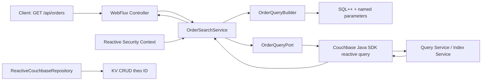

# Tạo bộ lọc động, sắp xếp và phân trang danh sách đơn hàng

Trong một ứng dụng thương mại điện tử, trang quản lý đơn hàng thường cần kết hợp nhiều điều kiện: trạng thái đơn, khách hàng, số tiền, khoảng ngày tạo và mã đơn hàng. Người dùng có thể chọn cột sắp xếp, hướng tăng/giảm và chuyển trang. Việc tạo một phương thức repository riêng cho **mọi tổ hợp bộ lọc** nhanh chóng trở nên khó bảo trì; việc ghép trực tiếp chuỗi người dùng vào SQL++ lại gây rủi ro injection, truy vấn quá rộng và lỗi phân quyền đa tenant.

Bài **“Tạo bộ lọc động, sắp xếp và phân trang danh sách đơn hàng”** thuộc chương **Bài thực hành** trong module **SPRING_DATA_COUCHBASE**. Chúng ta áp dụng document mapping, `ReactiveCouchbaseRepository`, Couchbase SDK reactive query, SQL++, bucket/scope/collection, chỉ mục, phân trang và `StepVerifier` để xây một endpoint tìm kiếm đơn hàng có thể chạy trong Spring WebFlux. Đồng thời, bài giải thích sự khác biệt giữa **giới hạn dòng trả về** và **chi phí truy vấn**, lưu ý TTL, CAS, consistency và cách mở rộng sang thao tác ghi hoặc transaction nếu bài toán phát triển.

> **Bài học cốt lõi:** Giá trị bộ lọc phải được **bind bằng tham số**; tên field và từ khóa `ORDER BY` phải lấy từ **allowlist do server định nghĩa**; `tenantId` phải lấy từ ngữ cảnh xác thực, không nhận từ client; `LIMIT`/`OFFSET` cần được đẩy xuống SQL++; và kết quả phân trang chỉ đáng tin khi có **thứ tự xác định** cùng index/`EXPLAIN` phù hợp.

## 1. Kết quả cần đạt

Sau khi hoàn thành bài thực hành, bạn có thể:

1. Thiết kế document `Order` trong Couchbase collection riêng, cùng khóa document và field JSON nhất quán.
2. Viết mô hình yêu cầu tìm kiếm với bộ lọc tùy chọn nhưng **được validate**.
3. Xây SQL++ `WHERE` động mà không ghép giá trị người dùng trực tiếp vào statement.
4. Xây `ORDER BY` với ba trường hợp hợp lệ và khóa phụ ổn định.
5. Thực hiện phân trang `LIMIT`/`OFFSET` ở Query Service, với kích thước trang bị giới hạn.
6. Trả `hasNext` bằng kỹ thuật yêu cầu `pageSize + 1` dòng thay vì luôn chạy `COUNT`.
7. Gọi SQL++ qua Couchbase Java SDK reactive bên cạnh Spring Data Couchbase repository cho CRUD.
8. Cung cấp endpoint WebFlux trả `Mono<OrderPage>` mà không gọi `block()`/`subscribe()`.
9. Áp dụng tenant isolation, read-only query, timeout và error handling có chủ đích.
10. Thiết kế index cho hai kiểu lọc/sắp xếp phổ biến và kiểm tra `EXPLAIN`.
11. Hiểu giới hạn của offset pagination khi dữ liệu đổi trong lúc người dùng chuyển trang.
12. Nâng cấp sang keyset/cursor pagination khi trang sâu hoặc dữ liệu lớn.
13. Viết unit tests cho input, bộ dựng query và service; viết integration tests với Couchbase thật.
14. Đánh giá đúng hiệu năng, giới hạn của secondary-index consistency và các trường hợp cần CAS/transaction.

## 2. Đề bài nghiệp vụ

Xây endpoint:

```http
GET /api/orders?status=PAID&customerId=CUST-001&minTotalMinor=100000&page=0&size=20&sort=CREATED_AT&direction=DESC
```

Một người quản lý đã đăng nhập xem danh sách đơn hàng của **tenant mình được phép truy cập**. API cho lọc:

| Trường | Ví dụ | Ngữ nghĩa |
| --- | --- | --- |
| `status` | `PAID` | Chỉ lấy đơn có trạng thái tương ứng. |
| `customerId` | `CUST-001` | Chỉ lấy đơn của một khách hàng. |
| `minTotalMinor` | `100000` | Tổng tiền tính bằng đơn vị nhỏ nhất, lớn hơn hoặc bằng giá trị. |
| `maxTotalMinor` | `500000` | Tổng tiền nhỏ hơn hoặc bằng giá trị. |
| `createdFromMs` | Epoch milliseconds | Thời gian tạo **từ mốc này, gồm mốc**. |
| `createdToMs` | Epoch milliseconds | Thời gian tạo **trước mốc này, không gồm mốc**. |
| `orderCodePrefix` | `O-2026-` | Mã đơn hàng bắt đầu bằng tiền tố hợp lệ. |
| `page` | `0` | Chỉ số trang bắt đầu từ 0. |
| `size` | `20` | Số dòng trong một trang, từ 1 đến 100. |
| `sort` | `CREATED_AT` | `CREATED_AT`, `TOTAL` hoặc `ORDER_CODE`. |
| `direction` | `DESC` | `ASC` hoặc `DESC`. |

Đầu ra ví dụ:

```json
{
  "page": 0,
  "size": 20,
  "hasNext": true,
  "items": [
    {
      "id": "order::tenant-a::O-2026-102",
      "orderCode": "O-2026-102",
      "customerId": "CUST-001",
      "status": "PAID",
      "totalMinor": 245000,
      "currency": "VND",
      "createdAtMs": 1795000000000
    }
  ]
}
```

JSON trên **minh họa cấu trúc**; `hasNext: true` giả định còn ít nhất một kết quả ngoài trang hiện tại. Không phải kết quả thực tế được truy xuất từ cluster trong bài viết này.

### Tiêu chí chấp nhận

- Thiếu filter thì không làm mất điều kiện tenant và `deleted = FALSE`.
- Filter có giá trị rỗng/không hợp lệ được từ chối hoặc chuẩn hóa theo quy tắc rõ.
- Không chèn được tên cột/từ khóa SQL++ tùy ý qua `sort` hoặc `direction`.
- Trang 0, size 20 trả tối đa 20 item, có `hasNext` dựa trên dòng thứ 21.
- Các trang có thứ tự xác định khi nhiều đơn có cùng thời gian tạo.
- Tenant A không thể xem đơn Tenant B qua bất kỳ tổ hợp filter nào.
- Không truy vấn `findAll().filter(...).skip(...).take(...)` để phân trang tại Java.
- Có index/`EXPLAIN` và kiểm thử với số đơn lớn hơn page size.

## 3. Phạm vi kiến trúc và lựa chọn API



Trong cùng ứng dụng Spring Data Couchbase:

- **`ReactiveCouchbaseRepository<OrderEntity,String>`** tiện cho CRUD, `findById` và document mapping.
- **`ReactiveCouchbaseTemplate`** có thể hỗ trợ truy vấn tùy biến theo API của release; cần kiểm tra chữ ký/hỗ trợ sort/projection/paging.
- **Couchbase Java SDK reactive query** là đường thực hành được chọn để kiểm soát tường minh SQL++, named parameters, `ORDER BY` và `LIMIT` khi điều kiện tùy chọn thay đổi nhiều.
- **Không trộn dữ liệu từ các đường trên** rồi giả định chúng có cùng entity callbacks, metadata CAS, auditing hay transaction context.

Ví dụ dùng cú pháp khái niệm của **Couchbase Java SDK 3.x**, Spring Data Couchbase, Java 17+, Spring WebFlux và Reactor. Với phiên bản triển khai khác, cần đối chiếu chính xác API query options, reactive result mapping, annotations và phần auto-configuration. Không coi các đoạn mã rời là một project đã chạy nếu chưa thêm dependency, cấu hình cluster, fixture, security và test.

## 4. Chuẩn bị môi trường thực hành

Cần một Couchbase Server/cluster được phép tạo index và đọc/ghi document trong **môi trường phát triển hoặc test riêng**. Dùng:

```text
Bucket:      app
Scope:       sales
Collection:  orders
```

Dữ liệu này chỉ là namespace minh họa. Khi chạy thật, cấu hình ứng dụng và SQL++ phải trỏ cùng bucket/scope/collection, user có quyền KV/query/index phù hợp, và collection tồn tại trước khi seed.

Trong Spring Boot, các dependency thường bao gồm Spring WebFlux, Spring Data Couchbase reactive support, Couchbase Java SDK và thư viện test Reactor/JUnit. Chọn BOM/version tương thích theo Spring Boot đang dùng; **không thêm hai SDK khác phiên bản chỉ vì copy snippet**.

### 4.1. Quy tắc an toàn khi thử

Không tạo index hoặc seed/xóa hàng loạt trên production để làm bài này. Dữ liệu fixture phải được tách biệt theo keyspace hoặc tenant test, có cleanup. Không dùng thông tin người dùng thật hay token thật trong bản ghi ví dụ.

## 5. Thiết kế document Order

Một document chuẩn hóa:

```json
{
  "tenant_id": "tenant-a",
  "order_code": "O-2026-101",
  "customer_id": "CUST-001",
  "status": "PAID",
  "total_minor": 145000,
  "currency": "VND",
  "created_at_ms": 1795000000000,
  "updated_at_ms": 1795000100000,
  "deleted": false
}
```

Document ID:

```text
order::tenant-a::O-2026-101
```

Quy tắc:

1. `tenant_id` và `order_code` phải được kiểm chứng từ nghiệp vụ/identity, không để client tự chọn tenant khi tìm kiếm.
2. `total_minor` là số nguyên biểu diễn **đơn vị nhỏ nhất của tiền tệ**; không dùng `double` cho số tiền.
3. `created_at_ms`/`updated_at_ms` lưu epoch milliseconds nhất quán; chuyển đổi từ thời gian người dùng tại biên request.
4. `deleted` có giá trị boolean rõ trên **mọi document**. Predicate `deleted = FALSE` không tự bao gồm document thiếu field.
5. `status` dùng giá trị được chuẩn hóa, ví dụ `NEW`, `PAID`, `SHIPPED`, `CANCELLED`.
6. Document key có thể hỗ trợ nhận dạng, nhưng **không thay điều kiện tenant hoặc kiểm tra quyền**.
7. Nếu đơn hàng có array lines lớn, query danh sách nên chọn **projection hẹp**, không tải cả document.

### 5.1. Entity dùng cho KV CRUD

```java
package example.orders;

import org.springframework.data.annotation.Id;
import org.springframework.data.annotation.Version;
import org.springframework.data.couchbase.core.mapping.Collection;
import org.springframework.data.couchbase.core.mapping.Document;
import org.springframework.data.couchbase.core.mapping.Field;
import org.springframework.data.couchbase.core.mapping.Scope;

@Document
@Scope("sales")
@Collection("orders")
public class OrderEntity {

    @Id
    private String id;

    @Field("tenant_id")
    private String tenantId;

    @Field("order_code")
    private String orderCode;

    @Field("customer_id")
    private String customerId;

    @Field
    private String status;

    @Field("total_minor")
    private Long totalMinor;

    @Field
    private String currency;

    @Field("created_at_ms")
    private Long createdAtMs;

    @Field("updated_at_ms")
    private Long updatedAtMs;

    @Field
    private Boolean deleted;

    @Version
    private Long version;

    protected OrderEntity() {}

    public String getId() { return id; }
    public String getTenantId() { return tenantId; }
    public String getStatus() { return status; }
    public Long getTotalMinor() { return totalMinor; }

    // Factory, validation và các accessors khác lược bỏ.
}
```

`@Version` là optimistic locking/CAS trong các đường Spring Data Couchbase hỗ trợ theo release; không tự tạo field JSON `version` hoặc transaction nhiều document.

```java
package example.orders;

import org.springframework.data.couchbase.repository.ReactiveCouchbaseRepository;

public interface OrderRepository
        extends ReactiveCouchbaseRepository<OrderEntity, String> {
}
```

Bài tìm kiếm danh sách sử dụng SDK query cho projection DTO; repository ở đây thể hiện tích hợp CRUD của cùng module. **Không** map một phần JSON từ query list sang `OrderEntity` rồi save entity thiếu field.

## 6. Dữ liệu thử nghiệm: có trùng khóa sort

Nên seed ít nhất 25–50 documents cho một tenant để test `hasNext`, cùng một số document của tenant khác. Bảng mẫu:

| Tenant | Mã đơn | Trạng thái | Khách hàng | Tổng (minor) | created_at_ms | deleted |
| --- | --- | --- | --- | ---: | ---: | --- |
| tenant-a | O-2026-101 | PAID | CUST-001 | 145000 | 1795000000000 | false |
| tenant-a | O-2026-102 | PAID | CUST-001 | 245000 | 1795000000000 | false |
| tenant-a | O-2026-103 | NEW | CUST-002 | 98000 | 1794900000000 | false |
| tenant-a | O-2026-104 | SHIPPED | CUST-001 | 500000 | 1794800000000 | false |
| tenant-a | O-2026-105 | CANCELLED | CUST-003 | 20000 | 1794700000000 | false |
| tenant-a | O-2026-106 | PAID | CUST-002 | 155000 | 1794600000000 | true |
| tenant-b | O-2026-201 | PAID | CUST-001 | 999000 | 1795000000000 | false |

**Điểm kiểm tra:** `O-2026-101` và `O-2026-102` có cùng `created_at_ms`, buộc API phải có **tie-breaker** để thứ tự không thay đổi tùy plan.

### 6.1. Seed một document bằng SQL++

```sql
INSERT INTO `app`.`sales`.`orders` (KEY, VALUE)
VALUES (
  "order::tenant-a::O-2026-101",
  {
    "tenant_id": "tenant-a",
    "order_code": "O-2026-101",
    "customer_id": "CUST-001",
    "status": "PAID",
    "total_minor": 145000,
    "currency": "VND",
    "created_at_ms": 1795000000000,
    "updated_at_ms": 1795000100000,
    "deleted": FALSE
  }
);
```

Chạy trên keyspace test. Dùng ID cố định để không sinh nhiều document trùng khi seed lại; nếu đã tồn tại, xử lý lỗi duplicate hoặc reset fixture theo quy trình có kiểm soát, không dùng `UPSERT` bừa bãi trên production.

## 7. Mô hình bộ lọc: nullable nhưng có hợp đồng

Khai báo status:

```java
package example.orders;

public enum OrderStatus {
    NEW, PAID, SHIPPED, CANCELLED
}
```

Hướng sắp xếp và cột cho phép:

```java
package example.orders;

public enum OrderSort {
    CREATED_AT, TOTAL, ORDER_CODE
}

public enum SortDirection {
    ASC, DESC
}
```

Trong dự án Java thật, mỗi top-level `public enum` phải ở file cùng tên; bài gom vào một khối mã để dễ đọc, không hàm ý hai enum `public` đặt trong một file duy nhất.

Bộ lọc:

```java
package example.orders;

import java.util.Locale;

public record OrderFilter(
    OrderStatus status,
    String customerId,
    Long minTotalMinor,
    Long maxTotalMinor,
    Long createdFromMs,
    Long createdToMs,
    String orderCodePrefix
) {
    public OrderFilter {
        if (customerId != null) {
            customerId = customerId.trim();
            if (customerId.isEmpty() || customerId.length() > 80) {
                throw new IllegalArgumentException(
                    "Invalid customerId"
                );
            }
        }

        if (minTotalMinor != null && minTotalMinor < 0) {
            throw new IllegalArgumentException(
                "minTotalMinor must not be negative"
            );
        }
        if (maxTotalMinor != null && maxTotalMinor < 0) {
            throw new IllegalArgumentException(
                "maxTotalMinor must not be negative"
            );
        }
        if (minTotalMinor != null && maxTotalMinor != null
                && minTotalMinor > maxTotalMinor) {
            throw new IllegalArgumentException(
                "minTotalMinor exceeds maxTotalMinor"
            );
        }

        if (createdFromMs != null && createdFromMs < 0) {
            throw new IllegalArgumentException(
                "Invalid createdFromMs"
            );
        }
        if (createdToMs != null && createdToMs < 0) {
            throw new IllegalArgumentException(
                "Invalid createdToMs"
            );
        }
        if (createdFromMs != null && createdToMs != null
                && createdFromMs >= createdToMs) {
            throw new IllegalArgumentException(
                "createdFromMs must precede createdToMs"
            );
        }

        if (orderCodePrefix != null) {
            orderCodePrefix = orderCodePrefix
                .trim()
                .toUpperCase(Locale.ROOT);
            if (orderCodePrefix.isEmpty()) {
                orderCodePrefix = null;
            } else if (!orderCodePrefix
                    .matches("[A-Z0-9-]{1,32}")) {
                throw new IllegalArgumentException(
                    "Invalid orderCodePrefix"
                );
            }
        }
    }
}
```

Những quyết định có chủ đích:

- `null` nghĩa là **không áp dụng** điều kiện tương ứng; không ghép `field = NULL` rồi trông chờ nó tự bỏ lọc.
- `customerId` chỉ trim và giới hạn chiều dài vì giá trị được bind, không phải fragment SQL++.
- `minTotalMinor`/`maxTotalMinor` có cận và quan hệ min ≤ max.
- Mốc thời gian dùng nửa khoảng `[createdFromMs, createdToMs)`, dễ ghép nhiều khoảng liên tiếp mà không trùng biên.
- `orderCodePrefix` được chuẩn hóa và chỉ cho `A–Z`, số và dấu gạch nối. Vì dùng `LIKE prefix%`, cấm `%`/`_` do client tự cung cấp.
- Với dữ liệu legacy có code chứa ký tự khác, phải thiết kế escape LIKE đúng SQL++ version thay vì mở rộng regex tùy tiện.
- Không có field `tenantId` trong `OrderFilter` do client gửi.

## 8. Mô hình phân trang và sắp xếp

```java
package example.orders;

public record OrderPageRequest(
    int page,
    int size,
    OrderSort sort,
    SortDirection direction
) {
    public OrderPageRequest {
        if (page < 0) {
            throw new IllegalArgumentException(
                "page must not be negative"
            );
        }
        if (size < 1 || size > 100) {
            throw new IllegalArgumentException(
                "size must be between 1 and 100"
            );
        }
        if (sort == null || direction == null) {
            throw new IllegalArgumentException(
                "sort and direction are required"
            );
        }
        long offset = (long) page * size;
        if (offset > 10_000L) {
            throw new IllegalArgumentException(
                "Deep OFFSET pages require cursor pagination"
            );
        }
    }

    public long offset() {
        return (long) page * size;
    }
}
```

Không tính `page * size` bằng `int` rồi mới ép sang `long`: phép nhân có thể overflow trước khi convert. Quy tắc `offset ≤ 10000` chỉ là **giới hạn minh họa**; ứng dụng production chọn dựa trên SLO và chi phí query đo thực tế.

### 8.1. Tại sao cần khóa phụ khi sort?

Nếu hai đơn đều có `created_at_ms = 1795000000000`, `ORDER BY created_at_ms DESC` không xác định thứ tự của hai row cùng timestamp. Khi phân trang bằng `OFFSET`, chúng có thể đổi vị trí ở các lần gọi/plan khác nhau.

Giải pháp: thêm **document ID** làm tie-breaker:

```sql
ORDER BY o.created_at_ms DESC, META(o).id DESC
```

Nếu sort theo tổng tiền:

```sql
ORDER BY o.total_minor ASC, META(o).id ASC
```

`META(o).id` là document ID và là khóa phân biệt các row trong collection. Chọn cùng hướng cho tie-breaker giúp biểu thức cursor đơn giản hơn. Phải đánh giá index và plan: thêm `META(o).id` có thể ảnh hưởng khả năng tận dụng index để sort, không mặc định sort luôn được index pushdown.

## 9. Mô hình response: DTO thay vì entity đầy đủ

```java
package example.orders;

public record OrderListItem(
    String id,
    String orderCode,
    String customerId,
    String status,
    long totalMinor,
    String currency,
    long createdAtMs
) {
}
```

```java
package example.orders;

import java.util.List;

public record OrderPage(
    List<OrderListItem> items,
    int page,
    int size,
    boolean hasNext
) {
}
```

Không trả CAS/version, thông tin thanh toán nhạy cảm, address hoặc toàn bộ order lines nếu màn hình chỉ cần những field ở trên. Giảm projection giúp hạn chế bytes mạng và mapping, nhưng **không tự bảo đảm** covering index; phải xem `EXPLAIN`.

## 10. Nguyên tắc dựng SQL++ động an toàn

Trong một câu query động, có hai nhóm đầu vào:

**Giá trị dữ liệu** như tenant, status, min/max, timestamp và prefix **được bind** qua `$tenantId`, `$status`, `$minTotalMinor`...

**Cấu trúc SQL++** như tên cột, hướng `ASC`/`DESC`, tên collection **không được lấy trực tiếp từ chuỗi client**. Chúng phải được server lựa chọn từ một tập constant cho phép.

### 10.1. Ví dụ nguy hiểm: ghép raw input vào `ORDER BY`

```java
// Anti-pattern: cho client nhập nguyên SQL fragment.
String sql = "SELECT ... FROM ... ORDER BY "
    + requestSort;
```

`requestSort` do client gửi có thể phá cú pháp hoặc thay cấu trúc truy vấn. Named parameters **không thay thế việc allowlist identifier**: `ORDER BY $sortField` không được hiểu như một cách bind tên column tùy ý.

### 10.2. Ví dụ nguy hiểm: ghép filter value

```java
// Anti-pattern: nối customerId thành SQL literal.
String sql = "WHERE o.customer_id = '"
    + customerId
    + "'";
```

Ngay cả khi code cố tự escape chuỗi, độ đúng còn phụ thuộc encoding và quy tắc SQL++. Dùng **named parameters** sẽ an toàn và dễ test hơn.

## 11. Tạo `QuerySpec` độc lập với cách chạy query

```java
package example.orders;

import com.couchbase.client.java.json.JsonObject;

// Mô hình ứng dụng, không phải class sẵn của SDK.
public record QuerySpec(
    String statement,
    JsonObject parameters
) {
}
```

Tầng dựng query chỉ chịu trách nhiệm:

- Dựng SQL++ có cấu trúc hợp lệ.
- Thu thập named parameters.
- Kiểm tra allowlist cột sắp xếp.
- Không phụ thuộc Spring WebFlux hay SDK kết nối thật.

Tách riêng tầng này cho phép unit test **SQL++ text và bind values** mà không cần cluster.

## 12. Bài giải: builder SQL++ với bộ lọc động

```java
package example.orders;

import com.couchbase.client.java.json.JsonObject;
import org.springframework.stereotype.Component;

@Component
public final class OrderQueryBuilder {

    public QuerySpec build(
            String authenticatedTenant,
            OrderFilter filter,
            OrderPageRequest page) {

        if (authenticatedTenant == null
                || authenticatedTenant.isBlank()) {
            throw new IllegalArgumentException(
                "Authenticated tenant is required"
            );
        }

        JsonObject params = JsonObject.create()
            .put("tenantId", authenticatedTenant)
            .put("limit", page.size() + 1)
            .put("offset", page.offset());

        StringBuilder sql = new StringBuilder("""
            SELECT META(o).id AS id,
                   o.order_code AS orderCode,
                   o.customer_id AS customerId,
                   o.status AS status,
                   o.total_minor AS totalMinor,
                   o.currency AS currency,
                   o.created_at_ms AS createdAtMs
            FROM `app`.`sales`.`orders` AS o
            WHERE o.tenant_id = $tenantId
              AND o.deleted = FALSE
            """);

        if (filter.status() != null) {
            sql.append(" AND o.status = $status");
            params.put("status", filter.status().name());
        }

        if (filter.customerId() != null) {
            sql.append(" AND o.customer_id = $customerId");
            params.put("customerId", filter.customerId());
        }

        if (filter.minTotalMinor() != null) {
            sql.append(" AND o.total_minor >= $minTotalMinor");
            params.put(
                "minTotalMinor", filter.minTotalMinor()
            );
        }

        if (filter.maxTotalMinor() != null) {
            sql.append(" AND o.total_minor <= $maxTotalMinor");
            params.put(
                "maxTotalMinor", filter.maxTotalMinor()
            );
        }

        if (filter.createdFromMs() != null) {
            sql.append(
                " AND o.created_at_ms >= $createdFromMs"
            );
            params.put(
                "createdFromMs", filter.createdFromMs()
            );
        }

        if (filter.createdToMs() != null) {
            sql.append(
                " AND o.created_at_ms < $createdToMs"
            );
            params.put(
                "createdToMs", filter.createdToMs()
            );
        }

        if (filter.orderCodePrefix() != null) {
            sql.append(
                " AND o.order_code LIKE $orderCodePattern"
            );
            params.put(
                "orderCodePattern",
                filter.orderCodePrefix() + "%"
            );
        }

        // Chỉ ghép biểu thức từ enum do server định nghĩa.
        String sortExpression = switch (page.sort()) {
            case CREATED_AT -> "o.created_at_ms";
            case TOTAL -> "o.total_minor";
            case ORDER_CODE -> "o.order_code";
        };

        String direction = switch (page.direction()) {
            case ASC -> "ASC";
            case DESC -> "DESC";
        };

        sql.append(" ORDER BY ")
            .append(sortExpression)
            .append(" ")
            .append(direction)
            .append(", META(o).id ")
            .append(direction)
            .append(" LIMIT $limit OFFSET $offset");

        return new QuerySpec(sql.toString(), params);
    }
}
```

Trong phương thức `build`:

- `authenticatedTenant` do **service** truyền từ security context, không đến từ query string của client.
- `deleted = FALSE` là điều kiện luôn có, không thể bị `status == null` làm mất.
- Chỉ khi field có giá trị mới thêm điều kiện tương ứng.
- Tất cả **giá trị** sử dụng `JsonObject`/named parameters.
- `sortExpression` và `direction` đến từ enum/switch cố định, không ghép raw string của người dùng.
- `LIMIT` dùng `size + 1` để phát hiện còn trang sau.
- `OFFSET` đã được validate trong `OrderPageRequest`.
- `ORDER BY` có document ID làm khóa phụ để ổn định thứ tự khi các giá trị chính trùng nhau.

### 12.1. Một SQL++ được tạo ra

Với `status=PAID`, `minTotalMinor=100000`, `sort=TOTAL`, `direction=ASC`:

```sql
SELECT META(o).id AS id,
       o.order_code AS orderCode,
       o.customer_id AS customerId,
       o.status AS status,
       o.total_minor AS totalMinor,
       o.currency AS currency,
       o.created_at_ms AS createdAtMs
FROM `app`.`sales`.`orders` AS o
WHERE o.tenant_id = $tenantId
  AND o.deleted = FALSE
  AND o.status = $status
  AND o.total_minor >= $minTotalMinor
ORDER BY o.total_minor ASC, META(o).id ASC
LIMIT $limit OFFSET $offset;
```

Tham số tương ứng:

```json
{
  "tenantId": "tenant-a",
  "status": "PAID",
  "minTotalMinor": 100000,
  "limit": 21,
  "offset": 0
}
```

**Không tự nối** dấu `;` vào mọi dynamic query nếu dùng driver/SDK có quy tắc statement khác. Ví dụ hiển thị trong SQL++ chỉ để dễ đọc.

### 12.2. Vì sao không dùng `($status IS NULL OR o.status = $status)` cho mọi filter?

Viết một statement cố định với nhiều `OR` có thể thuận tiện, nhưng với các optional filters phức tạp, `OR` có thể làm Query Service khó chọn index/scan range hiệu quả. Việc thêm **điều kiện chỉ khi cần** làm intent rõ hơn và cho phép đánh giá plan theo từng kiểu truy vấn. Tuy nhiên, cũng tạo nhiều statement shapes: cần theo dõi query plans, prepared statement/cache và hiệu năng với workload thực tế.

## 13. Query port: tách SQL builder khỏi SDK

```java
package example.orders;

import reactor.core.publisher.Flux;

// Port do ứng dụng định nghĩa.
public interface OrderQueryPort {
    Flux<OrderListItem> fetch(QuerySpec spec);
}
```

Lợi ích:

- Builder không cần biết API query reactive cụ thể.
- Service chỉ phụ thuộc `Flux<OrderListItem>`.
- Unit test có thể dùng fake port.
- Thay `Cluster.reactive().query` bằng `ReactiveCouchbaseTemplate` hoặc thư viện wrapper theo release không làm thay đổi hợp đồng service.

## 14. Adapter Couchbase SDK reactive

```java
package example.orders;

import static com.couchbase.client.java.query.QueryOptions.queryOptions;

import com.couchbase.client.java.Cluster;
import com.couchbase.client.java.json.JsonObject;
import org.springframework.stereotype.Repository;
import reactor.core.publisher.Flux;

@Repository
public final class CouchbaseOrderQueryPort
        implements OrderQueryPort {

    private final Cluster cluster;

    public CouchbaseOrderQueryPort(Cluster cluster) {
        this.cluster = cluster;
    }

    @Override
    public Flux<OrderListItem> fetch(QuerySpec spec) {
        return cluster.reactive()
            .query(
                spec.statement(),
                queryOptions()
                    .parameters(spec.parameters())
                    .readonly(true)
            )
            .flatMapMany(result -> result.rowsAsObject())
            .map(this::toItem);
    }

    private OrderListItem toItem(JsonObject row) {
        // Fixture/schema đảm bảo các field required không null.
        return new OrderListItem(
            row.getString("id"),
            row.getString("orderCode"),
            row.getString("customerId"),
            row.getString("status"),
            row.getLong("totalMinor"),
            row.getString("currency"),
            row.getLong("createdAtMs")
        );
    }
}
```

**Lưu ý API:** Đây là hình dạng thường dùng của **Couchbase Java SDK 3.x**. Kiểm tra `Cluster.reactive().query`, `QueryOptions`, `rowsAsObject()`, `readonly(true)` và return types theo SDK đang có. Đường mapping JSON trong ví dụ tạo **DTO đọc**, không đi qua Spring Data entity auditing callbacks/converters như `repository.save`.

**Dữ liệu không hợp lệ:** `getLong` trả null nếu field vắng/mapping sai; autounboxing có thể ném lỗi. Trong production, cần ràng buộc schema lúc ghi, kiểm tra null/kiểu dữ liệu, metrics và xử lý bản ghi legacy rõ ràng. **Không tự gán `0` cho amount thiếu** để API âm thầm sai giá trị tiền.

### 14.1. Query chỉ đọc, không mutation

`readonly(true)` là query option phù hợp với SELECT theo API SDK hỗ trợ; nó **không thay** phân quyền RBAC tại Couchbase hoặc kiểm tra tenant trong SQL++.

### 14.2. Không đóng Cluster ở mỗi request

`Cluster` thường là bean chia sẻ theo application lifecycle. Không gọi `disconnect` từ `doFinally` cho từng `fetch`. Resource kết nối do Spring Boot/application quản lý.

### 14.3. Vì sao không `block()`?

Không viết:

```java
// Anti-pattern trong WebFlux:
var result = cluster.reactive()
    .query(statement)
    .block();
```

`block()` chặn thread trong khi request chờ SDK. Trả `Flux`/`Mono` cho tầng service để WebFlux quản lý subscription/cancellation.

## 15. Service xây trang bằng kỹ thuật `size + 1`

```java
package example.orders;

import java.util.List;
import org.springframework.stereotype.Service;
import reactor.core.publisher.Mono;

@Service
public final class OrderSearchService {

    private final TrustedTenantProvider tenants;
    private final OrderQueryBuilder queryBuilder;
    private final OrderQueryPort queryPort;

    public OrderSearchService(
            TrustedTenantProvider tenants,
            OrderQueryBuilder queryBuilder,
            OrderQueryPort queryPort) {
        this.tenants = tenants;
        this.queryBuilder = queryBuilder;
        this.queryPort = queryPort;
    }

    public Mono<OrderPage> search(
            OrderFilter filter,
            OrderPageRequest page) {

        return tenants.requireCurrentTenant()
            .switchIfEmpty(Mono.error(
                new IllegalStateException(
                    "Authenticated tenant is missing"
                )
            ))
            .flatMap(tenantId -> {
                QuerySpec spec =
                    queryBuilder.build(tenantId, filter, page);

                return queryPort.fetch(spec)
                    .collectList()
                    .map(rows -> {
                        boolean hasNext =
                            rows.size() > page.size();

                        List<OrderListItem> visible =
                            List.copyOf(
                                rows.subList(
                                    0,
                                    Math.min(
                                        page.size(),
                                        rows.size()
                                    )
                                )
                            );

                        return new OrderPage(
                            visible,
                            page.page(),
                            page.size(),
                            hasNext
                        );
                    });
            });
    }
}
```

`TrustedTenantProvider` là một **port của ứng dụng**:

```java
package example.orders;

import reactor.core.publisher.Mono;

public interface TrustedTenantProvider {
    Mono<String> requireCurrentTenant();
}
```

Implementation production phải lấy tenant từ principal/claims đã được xác thực trong Spring Security reactive context, kiểm tra quyền truy cập và không trả một tenant rỗng. `ReactiveSecurityContextHolder` giúp đọc `SecurityContext`; tuy nhiên việc ánh xạ principal sang tenant phụ thuộc identity schema của hệ thống, không dùng `getName()` như tenant nếu chưa chứng minh.

### 15.1. Vì sao `collectList` ở đây chấp nhận được?

Bài này **đặt `LIMIT = size + 1` ở SQL++** và validate `size ≤ 100`. Khi query/SDK tuân thủ giới hạn row đó, `collectList` chỉ gom tối đa 101 DTO cho một request, thay vì gom toàn bộ đơn hàng của tenant.

Cần vẫn cân nhắc **kích thước mỗi row** (projection hẹp), concurrency của nhiều HTTP requests và overhead SDK. `collectList` không được dùng trên một `findAll()` không giới hạn.

### 15.2. Vì sao không chạy `COUNT` ngay?

Để hiển thị nút “Trang sau”, chỉ cần biết liệu có **row thứ 21** khi size=20. Truy vấn `COUNT(*)` riêng có thể phải scan nhiều entries và thêm latency, đặc biệt với filter phức tạp. Nếu UI thật sự cần tổng số trang, hãy cân nhắc chiến lược count riêng hoặc trì hoãn, đồng thời chấp nhận rằng hai query độc lập có thể quan sát hai trạng thái dữ liệu khác nhau.

## 16. WebFlux controller nhận filter tùy chọn

```java
package example.orders;

import org.springframework.web.bind.annotation.GetMapping;
import org.springframework.web.bind.annotation.RequestMapping;
import org.springframework.web.bind.annotation.RequestParam;
import org.springframework.web.bind.annotation.RestController;
import reactor.core.publisher.Mono;

@RestController
@RequestMapping("/api/orders")
public final class OrdersController {

    private final OrderSearchService service;

    public OrdersController(OrderSearchService service) {
        this.service = service;
    }

    @GetMapping
    public Mono<OrderPage> list(
        @RequestParam(required = false)
        OrderStatus status,

        @RequestParam(required = false)
        String customerId,

        @RequestParam(required = false)
        Long minTotalMinor,

        @RequestParam(required = false)
        Long maxTotalMinor,

        @RequestParam(required = false)
        Long createdFromMs,

        @RequestParam(required = false)
        Long createdToMs,

        @RequestParam(required = false)
        String orderCodePrefix,

        @RequestParam(defaultValue = "0")
        int page,

        @RequestParam(defaultValue = "20")
        int size,

        @RequestParam(defaultValue = "CREATED_AT")
        OrderSort sort,

        @RequestParam(defaultValue = "DESC")
        SortDirection direction
    ) {
        OrderFilter filter = new OrderFilter(
            status,
            customerId,
            minTotalMinor,
            maxTotalMinor,
            createdFromMs,
            createdToMs,
            orderCodePrefix
        );

        OrderPageRequest paging =
            new OrderPageRequest(
                page, size, sort, direction
            );

        return service.search(filter, paging);
    }
}
```

Spring WebFlux có thể bind enum từ query string như `PAID`, `CREATED_AT` và `DESC`, tùy conversion configuration. Input sai cần được phản hồi 400 thông qua framework/exception handler. Code không nhận `tenantId` từ query string.

### 16.1. Dùng DTO riêng cho API thực tế

Khi filter phát triển thêm, controller có thể dùng request DTO/validation và binder thay vì hàng chục tham số. Tuy nhiên, không đưa **sort field SQL++ raw** hoặc tenant do client kiểm soát vào DTO rồi dùng trực tiếp trong builder.

### 16.2. Phân trang không phải transaction

Mỗi lần client gọi `GET /api/orders?page=n` là một query độc lập. Kể cả lần gọi dùng `Mono` được compose đúng, nó **không tự tạo snapshot** cho tất cả các trang. Dữ liệu mới được insert, update hoặc hết TTL có thể thay đổi tập kết quả giữa các request.

## 17. Thử endpoint bằng các kịch bản rõ ràng

### 17.1. Không có bộ lọc

```http
GET /api/orders?page=0&size=20
```

Kỳ vọng: danh sách các đơn chưa bị xóa mềm của **tenant đã xác thực**, sắp theo `createdAtMs DESC` và document ID DESC, tối đa 20 item; không có đơn tenant khác.

### 17.2. Trạng thái + khách hàng

```http
GET /api/orders?status=PAID&customerId=CUST-001&page=0&size=10
```

Kỳ vọng: chỉ các đơn `PAID` của `CUST-001` thuộc tenant hiện tại. SQL++ phải chứa **cả** `tenant_id`, `deleted = FALSE`, `status` và `customer_id`.

### 17.3. Khoảng tổng tiền

```http
GET /api/orders?minTotalMinor=100000&maxTotalMinor=250000&sort=TOTAL&direction=ASC
```

Kỳ vọng: bao gồm cả hai biên tổng tiền; đơn tăng dần theo `total_minor`, cùng tổng tiền sắp tiếp theo bằng document ID.

### 17.4. Khoảng ngày tạo

```http
GET /api/orders?createdFromMs=1794500000000&createdToMs=1795100000000
```

Kỳ vọng: `created_at_ms >= from` và `created_at_ms < to`. Không nhầm epoch **seconds** với **milliseconds**.

### 17.5. Mã đơn hàng bắt đầu bằng tiền tố

```http
GET /api/orders?orderCodePrefix=O-2026-&size=30
```

Kỳ vọng: builder truyền `"O-2026-%"` qua named parameter `$orderCodePattern`. Nếu client gửi `%`, `_` hoặc ký tự không hợp lệ trong prefix, trả 400 thay vì ghép raw LIKE.

### 17.6. Input bị từ chối

```http
GET /api/orders?page=-1&size=500
GET /api/orders?minTotalMinor=500000&maxTotalMinor=100000
GET /api/orders?sort=RAW_SQL
GET /api/orders?direction=SIDEWAYS
```

Kỳ vọng: đều bị từ chối bởi validation/binding, không phát một SQL++ tự động sửa/giới hạn mà người dùng không biết.

## 18. Xử lý lỗi WebFlux và phân quyền

Hợp đồng HTTP minh họa:

| Nhóm lỗi | Response thường xem xét |
| --- | --- |
| page/size/filter/date sai | `400 Bad Request` |
| Không đăng nhập | `401 Unauthorized` |
| Không có quyền tenant hoặc thao tác | `403 Forbidden` hoặc `404` theo chính sách |
| Query Service/SDK tạm thời unavailable | `503 Service Unavailable` |
| Backend timeout | `504 Gateway Timeout` tùy kiến trúc |
| SQL++ syntax/index bị cấu hình sai | `5xx` kèm correlation ID, cảnh báo vận hành |
| Kết quả rỗng hợp lệ | `200 OK` với `items: []`, `hasNext: false` |

Không làm:

```java
// Anti-pattern: che outage bằng trang rỗng.
return queryPort.fetch(spec)
    .onErrorResume(error -> Flux.empty());
```

Lỗi database phải được phân loại, không coi như “không có đơn hàng”. Trả raw SQL++/stack trace hoặc bind values nhạy cảm cho client cũng không phù hợp.

### 18.1. Validate ở boundary và service

Controller validation giúp phản hồi 400 sớm, nhưng service vẫn cần kiểm tra tenant/context và có thể lặp kiểm tra input nếu được gọi từ job/worker không qua HTTP. Không xem request DTO đến từ nội bộ là được phép bỏ qua toàn bộ business validation.

### 18.2. DTO có `status` là chuỗi, nhưng input status dùng enum

`OrderListItem.status` là string lấy từ document JSON; nếu dữ liệu legacy chứa trạng thái lạ, ứng dụng cần policy hiển thị/ẩn hoặc lỗi dữ liệu. Không tự ép trạng thái lạ thành `PAID`. Input của người dùng được giới hạn bằng `OrderStatus` enum để tránh lọc tùy ý.

## 19. Index cho truy vấn phổ biến

Bộ lọc động có nhiều tổ hợp; **không nên** tạo một index cho mọi tổ hợp. Bắt đầu từ workload thực tế và đo.

### 19.1. Danh sách mặc định theo tenant và thời gian

```sql
CREATE INDEX ix_orders_tenant_live_created
ON `app`.`sales`.`orders` (
    `tenant_id`,
    `created_at_ms` DESC
)
WHERE `deleted` = FALSE;
```

### 19.2. Danh sách theo trạng thái và thời gian

```sql
CREATE INDEX ix_orders_tenant_status_created
ON `app`.`sales`.`orders` (
    `tenant_id`,
    `status`,
    `created_at_ms` DESC
)
WHERE `deleted` = FALSE;
```

### 19.3. Danh sách theo khách hàng và thời gian

```sql
CREATE INDEX ix_orders_tenant_customer_created
ON `app`.`sales`.`orders` (
    `tenant_id`,
    `customer_id`,
    `created_at_ms` DESC
)
WHERE `deleted` = FALSE;
```

Các index trên là **gợi ý ban đầu**, không phải bảo đảm planner sẽ dùng hoặc bao hết projection. Với `ORDER BY META(o).id` làm khóa phụ, có thể vẫn cần sort/fetch; nếu nhiều query sort theo `total_minor`, cân nhắc index phục vụ sort đó sau khi đo.

### 19.4. Kiểm tra `EXPLAIN`

Ví dụ trên dữ liệu test:

```sql
EXPLAIN
SELECT META(o).id AS id,
       o.order_code AS orderCode,
       o.total_minor AS totalMinor,
       o.created_at_ms AS createdAtMs
FROM `app`.`sales`.`orders` AS o
WHERE o.tenant_id = "tenant-a"
  AND o.deleted = FALSE
  AND o.status = "PAID"
ORDER BY o.created_at_ms DESC, META(o).id DESC
LIMIT 21 OFFSET 0;
```

Đọc plan và runtime metrics:

- Index nào được chọn? Có đúng keyspace/predicate không?
- Index scan có khoanh vùng theo tenant/status không?
- Có bước `Fetch` phải tải document rộng không?
- `ORDER BY` có cần sort nhiều candidate trước khi trả 21 row không?
- `LIMIT` được áp dụng/pushdown ở đâu?
- Kích thước result và thời gian query thay đổi ra sao khi tăng page?
- Có cần thêm field trong index để hỗ trợ covering query không?

**Đừng khẳng định `LIMIT 21` làm index chỉ scan đúng 21 entries.** Filter, sort, phân trang và kế hoạch thực thi có thể yêu cầu nhiều công việc hơn.

## 20. Tại sao phân trang offset sẽ chậm ở trang sâu?

`OFFSET` yêu cầu server xác định rồi bỏ qua phần đầu của tập kết quả theo thứ tự query:

```sql
SELECT META(o).id AS id, o.order_code AS orderCode
FROM `app`.`sales`.`orders` AS o
WHERE o.tenant_id = "tenant-a"
  AND o.deleted = FALSE
ORDER BY o.created_at_ms DESC, META(o).id DESC
LIMIT 21 OFFSET 100000;
```

Query chỉ trả tối đa 21 row, nhưng để tới vị trí offset 100.000 có thể cần scan/sort/skip rất nhiều rows tùy index và kế hoạch. Vì vậy bài giải có cap offset, thay vì nhận `page=9999999`.

### 20.1. Bất ổn khi dữ liệu đổi giữa hai trang

Giả sử client gọi trang 0 với `size=2`, sau đó có một đơn mới được tạo ở đầu danh sách. Trang 1 dùng `OFFSET 2` có thể chứa lại một đơn vừa ở trang 0; hoặc nếu một đơn bị xóa, có thể bỏ sót một đơn. **Tie-breaker giúp thứ tự xác định trong một trạng thái dữ liệu, nhưng không tạo snapshot qua nhiều requests.**

### 20.2. Khi nào offset vẫn phù hợp?

Offset tương đối đơn giản cho trang đầu, tập dữ liệu nhỏ/vừa, UI cần nhảy trực tiếp đến số trang và độ thay đổi của dữ liệu chấp nhận được. Không nên loại bỏ offset một cách máy móc; chọn dựa trên query cost, SLO và UX.

## 21. Bài nâng cao: keyset/cursor pagination

Khi UI chỉ cần “Xem thêm” và danh sách lớn, có thể dùng keyset với **sort cố định**:

```sql
SELECT META(o).id AS id,
       o.order_code AS orderCode,
       o.created_at_ms AS createdAtMs,
       o.total_minor AS totalMinor
FROM `app`.`sales`.`orders` AS o
WHERE o.tenant_id = $tenantId
  AND o.deleted = FALSE
  AND (
    o.created_at_ms < $lastCreatedAtMs
    OR (
      o.created_at_ms = $lastCreatedAtMs
      AND META(o).id < $lastDocumentId
    )
  )
ORDER BY o.created_at_ms DESC, META(o).id DESC
LIMIT $limit;
```

Điều kiện cursor chỉ có ở **trang tiếp theo**; trang đầu phải bỏ toàn bộ nhóm điều kiện `lastCreatedAtMs/lastDocumentId`, không truyền `NULL` rồi mặc định `< NULL` sẽ bỏ qua.

Khi sort giảm dần, một row ở trang sau phải có giá trị **nhỏ hơn** cursor cuối của trang trước, hoặc cùng timestamp nhưng document ID nhỏ hơn. Nếu sort tăng dần, đổi cả dấu so sánh và thứ tự.

### 21.1. Cursor là một phần của hợp đồng bảo mật

Cursor không nên chỉ là base64 của `tenantId:lastCreatedAtMs:lastDocumentId` không ký. Người dùng có thể sửa nội dung để vượt phạm vi hoặc tìm dữ liệu khác.

Một cursor production có thể chứa:

```json
{
  "v": 1,
  "lastCreatedAtMs": 1795000000000,
  "lastDocumentId": "order::tenant-a::O-2026-101",
  "sort": "CREATED_AT_DESC",
  "filtersHash": "hash-of-normalized-filters",
  "expiresAt": 1795600000000
}
```

Sau đó **ký/HMAC hoặc xác thực tính toàn vẹn** theo khóa server quản lý, và luôn ràng buộc tenant đã xác thực, filter/sort, phiên bản cursor và thời hạn. Cursor không thay `WHERE tenant_id = $tenantId`.

### 21.2. Keyset vẫn không tự là snapshot

Keyset thường ổn định hơn offset khi có insert mới ở đầu danh sách, nhưng khi `created_at_ms`, status hoặc deleted flag của row thay đổi giữa requests, vẫn có thể gặp chênh lệch. Nếu nghiệp vụ yêu cầu snapshot bất biến, phải thiết kế cơ chế versioned snapshot/export phù hợp; Reactor/cursor không tự cấp snapshot nhiều HTTP calls.

### 21.3. Cursor cho sort khác cần thiết kế riêng

Với `TOTAL ASC`:

```sql
AND (
  o.total_minor > $lastTotalMinor
  OR (
    o.total_minor = $lastTotalMinor
    AND META(o).id > $lastDocumentId
  )
)
ORDER BY o.total_minor ASC, META(o).id ASC
```

Cần bind cả tuple (`totalMinor`, document ID), và kiểm tra null/missing, sort direction, filters hash và index. Không lấy cursor của `CREATED_AT_DESC` sử dụng lại cho `TOTAL_ASC`.

## 22. Nếu UI cần totalCount thì sao?

Một số UI muốn “Trang 2 / 58”. Khi đó cần đếm theo **cùng bộ filter và tenant**, không đếm toàn collection:

```sql
SELECT COUNT(1) AS totalCount
FROM `app`.`sales`.`orders` AS o
WHERE o.tenant_id = $tenantId
  AND o.deleted = FALSE
  AND o.status = $status;
```

Ví dụ chỉ chứa filter `status`; một count thật phải tái sử dụng **đúng tập predicate** từ builder cho các filter hiện có. Đừng copy một câu `WHERE` khác thiếu tenant, deleted hoặc khoảng tiền.

### 22.1. Hai query không tự có snapshot chung

Nếu service thực hiện query data và count song song, có thể có insert/update/delete/TTL giữa hai thời điểm; số lượng count và items không luôn khớp tuyệt đối. `Mono.zip(dataQuery, countQuery)` chỉ phối hợp publisher, **không tạo transaction hay snapshot**.

### 22.2. COUNT không nhất thiết rẻ

`COUNT(1)` chỉ trả một row nhưng có thể quét nhiều index entries. Cân nhắc:
- Chỉ lấy count khi UI thật sự cần.
- Dùng `hasNext` cho kiểu “Load more”.
- Cache hoặc count gần đúng nếu nghiệp vụ cho phép và gắn nhãn.
- Tối ưu index theo filter, đo p95/p99 và query scans.

## 23. Kết quả tìm kiếm và tính nhất quán của index

Couchbase lưu document bằng KV, trong khi SQL++ thường dùng secondary index để tìm theo `tenant_id`, `status`, `total_minor`...

Sau mutation:

```java
Mono<OrderEntity> saved =
    orderRepository.save(order);
```

Một `findById` theo key có thể thấy document, còn SQL++ query theo status có thể **chưa thấy ngay** nếu secondary index chưa cập nhật ở scan consistency thông thường.

Nếu UI cần read-your-own-write ngay sau tạo đơn, đánh giá scan consistency tương đương `REQUEST_PLUS` hoặc mutation-state/consistent-with options **khi SDK/Framework release hỗ trợ**. Consistency mạnh hơn có thể phải chờ index và tăng độ trễ; không bật cho mọi truy vấn khi nghiệp vụ chấp nhận eventual visibility.

### 23.1. `hasNext` cũng theo dữ liệu tại thời điểm query

Dòng thứ `size + 1` tồn tại tại thời điểm Query Service thực hiện. Không bảo đảm đến lúc client bấm “Next” dòng đó vẫn tồn tại; TTL, soft delete hay update status có thể đổi danh sách.

### 23.2. Query options phải được chọn có chủ đích

Ở `CouchbaseOrderQueryPort`, có thể mở rộng options timeout/scan consistency/tracing/metrics theo SDK version. Không tự giả định mọi option SDK gắn vào `Cluster.reactive().query` sẽ được `ReactiveCouchbaseRepository` dùng giống hệt. Hai đường API có cấu hình và lifecycle riêng.

## 24. Retry, timeout và overload

Một tìm kiếm đơn hàng là **SELECT/read-only**, nhưng vẫn có thể rất đắt nếu index không phù hợp. Retry mọi timeout bằng `retry(10)` có thể khiến Query Service quá tải.

Chính sách nên gồm:

- Timeout SDK/query theo SLA, cùng deadline HTTP end-to-end.
- Retry hữu hạn chỉ cho lỗi có thể phục hồi, với backoff và jitter.
- Không retry input validation, quyền, SQL++ syntax hoặc index configuration error.
- Giới hạn số concurrent queries bằng admission/bulkhead theo instance/tenant.
- Nếu queue đầy, từ chối sớm với lỗi phù hợp thay vì giữ vô hạn request.
- Đo attempts, retries, query scans, response bytes và p95/p99.

```java
// Ví dụ ý định chính sách retry đọc, chưa có classifier cụ thể.
Retry retry = Retry.backoff(
        2,
        java.time.Duration.ofMillis(150)
    )
    .jitter(0.5)
    .filter(this::isTransientReadFailure);
```

`isTransientReadFailure` là helper ứng dụng phải phân loại theo SDK/Spring Data release và operation. Không dùng `instanceof RuntimeException` làm điều kiện vì sẽ retry cả lỗi lập trình và validation.

### 24.1. Cancellation không nhất thiết hủy công việc Server

Khi client disconnect hoặc `timeout` làm Reactor cancel subscription, Query Service có thể đã scan/sort/buffer dữ liệu. Không khẳng định cancellation sẽ dừng Query Service tức thì hoặc không có tài nguyên nào bị tiêu tốn.

## 25. Bảo mật đa tenant: test như một tính năng bắt buộc

Hãy seed ít nhất hai tenant cùng `customer_id` và `status`, rồi đảm bảo mọi query thực thi có `o.tenant_id = $tenantId` từ identity đã xác thực.

### 25.1. Không tin chuỗi tenant ở endpoint

Tránh endpoint:

```java
// Anti-pattern: client tự chọn tenant, thiếu authorization.
@GetMapping("/orders")
Flux<OrderEntity> list(@RequestParam String tenantId) {
    return repository.findAll()
        .filter(o -> tenantId.equals(o.getTenantId()));
}
```

Nó không chỉ tốn tài nguyên vì lọc ở Java, mà còn cho client chọn tenant để đọc. Query tại Server phải có predicate tenant từ security context.

### 25.2. Field `customerId` chưa chắc là điều kiện đủ để cấp quyền

Một nhân viên của tenant A có thể chỉ được xem đơn của các nhóm khách hàng họ quản lý. Nếu có rule này, cần thêm predicate/authorization từ policy đáng tin cậy (và kiểm tra plan/index), không chỉ có tenant. Bài thực hành sử dụng tenant isolation tối thiểu; production cần mô hình ACL/RBAC/ABAC thực tế.

### 25.3. Limit page size cũng là một biện pháp an toàn

`size=1000000` có thể tạo response lớn, tăng tải Query/Index Service và bộ nhớ app. Validation size và offset, rate limit, timeout và projection phải áp dụng kể cả user đã đăng nhập hợp lệ.

## 26. Test builder: không cần cluster vẫn kiểm tra được an toàn

```java
package example.orders;

import static org.assertj.core.api.Assertions.*;

import org.junit.jupiter.api.Test;

class OrderQueryBuilderTest {

    private final OrderQueryBuilder builder =
        new OrderQueryBuilder();

    @Test
    void bindsTenantAndOptionalFilters() {
        OrderFilter filters = new OrderFilter(
            OrderStatus.PAID,
            "CUST-001",
            100000L,
            250000L,
            null,
            null,
            "O-2026-"
        );

        OrderPageRequest page = new OrderPageRequest(
            0, 20, OrderSort.TOTAL, SortDirection.ASC
        );

        QuerySpec spec = builder.build(
            "tenant-a", filters, page
        );

        assertThat(spec.statement())
            .contains("o.tenant_id = $tenantId")
            .contains("o.deleted = FALSE")
            .contains("o.status = $status")
            .contains("o.customer_id = $customerId")
            .contains("o.total_minor >= $minTotalMinor")
            .contains("o.total_minor <= $maxTotalMinor")
            .contains("o.order_code LIKE $orderCodePattern")
            .contains(
                "ORDER BY o.total_minor ASC, META(o).id ASC"
            )
            .contains("LIMIT $limit OFFSET $offset");

        assertThat(
            spec.parameters().getString("tenantId")
        ).isEqualTo("tenant-a");

        assertThat(
            spec.parameters().getString("status")
        ).isEqualTo("PAID");

        assertThat(
            spec.parameters().getString("orderCodePattern")
        ).isEqualTo("O-2026-%");

        assertThat(
            spec.parameters().getInt("limit")
        ).isEqualTo(21);

        assertThat(
            spec.parameters().getLong("offset")
        ).isEqualTo(0L);
    }

    @Test
    void rejectsInvalidFilterRange() {
        assertThatThrownBy(() -> new OrderFilter(
            null, null, 200L, 100L,
            null, null, null
        )).isInstanceOf(IllegalArgumentException.class);
    }

    @Test
    void rejectsExcessivelyDeepOffset() {
        assertThatThrownBy(() -> new OrderPageRequest(
            10000, 20, OrderSort.CREATED_AT,
            SortDirection.DESC
        )).isInstanceOf(IllegalArgumentException.class);
    }
}
```

Các tests kiểm tra cấu trúc query và validation, **chưa chứng minh** SQL++ thực thi được hoặc index sử dụng hiệu quả. Vẫn cần integration test.

### 26.1. Test nhiều tổ hợp filter

Dùng parameterized tests cho:
- Không filter.
- Mỗi filter độc lập.
- Status + customer + range + prefix cùng lúc.
- Sort 3 trường × 2 hướng.
- Timestamp equality ở biên.
- Missing/empty/invalid prefix.
- Tenant ID rỗng bị từ chối.
- Size 1, size 100, size 0 và 101.
- Page 0 và page/offset vượt cap.

### 26.2. Test injection

Bộ lọc `orderCodePrefix` chứa `%`/`_` hoặc chuỗi cố ghép lệnh phải bị reject theo policy; sort và direction chỉ là enum, không cho arbitrary SQL expression. Với `customerId`, vì value bind an toàn, không test bằng cách nối trực tiếp vào statement; assert value chỉ nằm trong `parameters`.

## 27. Test service bằng fake query port và `StepVerifier`

Có thể kiểm tra `size + 1` mà không cần Couchbase bằng một fake `OrderQueryPort` trả 3 item khi size=2.

```java
import static org.assertj.core.api.Assertions.assertThat;

import java.util.List;
import org.junit.jupiter.api.Test;
import reactor.core.publisher.Flux;
import reactor.core.publisher.Mono;
import reactor.test.StepVerifier;

class OrderSearchServiceTest {

    @Test
    void returnsSizeItemsAndHasNextWhenExtraRowExists() {
        TrustedTenantProvider tenantProvider =
            () -> Mono.just("tenant-a");

        OrderQueryPort fakePort = spec -> Flux.fromIterable(
            List.of(
                item("O-001"),
                item("O-002"),
                item("O-003")
            )
        );

        OrderSearchService service =
            new OrderSearchService(
                tenantProvider,
                new OrderQueryBuilder(),
                fakePort
            );

        OrderFilter emptyFilters = new OrderFilter(
            null, null, null, null,
            null, null, null
        );

        OrderPageRequest page = new OrderPageRequest(
            0, 2,
            OrderSort.CREATED_AT,
            SortDirection.DESC
        );

        StepVerifier.create(
                service.search(emptyFilters, page)
            )
            .assertNext(result -> {
                assertThat(result.items()).hasSize(2);
                assertThat(result.hasNext()).isTrue();
                assertThat(result.page()).isZero();
            })
            .verifyComplete();
    }

    private OrderListItem item(String code) {
        return new OrderListItem(
            "order::tenant-a::" + code,
            code, "CUST-001", "PAID",
            1000L, "VND", 1795000000000L
        );
    }
}
```

Test này xác nhận cách cắt list và tính `hasNext`. **Fake port** không chứng minh SDK `LIMIT` hoạt động; integration test phải kiểm tra statement thực và số row khi seed hơn một trang.

### 27.1. Tránh test giả che việc thiếu tenant

Đặt fake `TrustedTenantProvider` trả `Mono.empty()`, assert service báo lỗi và **không gọi queryPort**. Với request không được xác thực, không sinh SQL++ bằng tenant rỗng rồi trả toàn bộ dữ liệu.

### 27.2. Test kết quả rỗng

Fake port phát `Flux.empty()`; service phải trả `OrderPage(items=[], hasNext=false)` bình thường. Không ép empty thành lỗi “database unavailable”.

## 28. Integration test với Couchbase thật

Một test integration cần:

1. Tạo namespace test và index theo cấu hình.
2. Seed ít nhất 30 đơn `tenant-a`, thêm đơn `tenant-b` và `deleted=true`.
3. Dùng implementation `CouchbaseOrderQueryPort` thực thay vì fake.
4. Gọi service với tenant giả lập được kiểm soát.
5. Đọc response bằng `StepVerifier`.
6. Assert size, hasNext, thứ tự và field projection.
7. Gọi page tiếp theo và đối chiếu IDs nếu dữ liệu fixture bất biến.
8. Kiểm tra SQL++/`EXPLAIN` với query shape phổ biến.

Khung:

```java
import static org.assertj.core.api.Assertions.assertThat;

import org.junit.jupiter.api.Test;
import reactor.test.StepVerifier;

// Khung minh họa: integration fixture/service đã được cấu hình.
@Test
void firstPageHasTwentyResultsWhenMoreExist() {
    OrderFilter filters = new OrderFilter(
        OrderStatus.PAID,
        null, null, null, null, null, null
    );

    OrderPageRequest page = new OrderPageRequest(
        0, 20,
        OrderSort.CREATED_AT,
        SortDirection.DESC
    );

    StepVerifier.create(service.search(filters, page))
        .assertNext(result -> {
            assertThat(result.items()).hasSize(20);
            assertThat(result.hasNext()).isTrue();

            assertThat(result.items())
                .allSatisfy(item ->
                    assertThat(item.status()).isEqualTo("PAID")
                );
        })
        .verifyComplete();
}
```

Kết quả PASS phụ thuộc **fixture có ít nhất 21 đơn PAID của tenant đang test**. Nếu dataset chỉ có 3 đơn PAID, test cần kỳ vọng `hasNext=false` và size thực, hoặc phải seed đủ.

### 28.1. Test tie-breaker

Seed hai đơn cùng `created_at_ms` với ID khác nhau, rồi lặp truy vấn nhiều lần trên dataset **không thay đổi**. Assert thứ tự theo `META().id`. Không chỉ so số lượng row.

### 28.2. Test tenant isolation

Gọi bằng tenant A, assert không có ID `order::tenant-b::...` dù đơn tenant B trùng status/customer/số tiền. Đồng thời dùng tenant B để xác minh dữ liệu của B xuất hiện khi được xác thực đúng. Nếu security context mapping phức tạp, test cả lớp WebFlux filter/controller chứ không chỉ giả lập provider trong service.

### 28.3. Test index/consistency có kiểm soát

Khi seed bằng KV rồi query ngay, một index có thể chưa sẵn sàng ở scan consistency mặc định. Integration test cần đợi index sẵn sàng/đặt consistency phù hợp theo SDK release và không dùng `Thread.sleep` tùy tiện như một cơ chế đảm bảo.

## 29. Phân tích lỗi thường gặp

| Triệu chứng | Nguyên nhân có thể | Cách kiểm tra |
| --- | --- | --- |
| Trả đơn tenant khác | Thiếu tenant predicate hoặc lấy tenant từ client | Kiểm tra builder, SecurityContext và cross-tenant tests. |
| Filter status không có tác dụng | Field JSON khác property Java hoặc quên append | Kiểm tra `@Field`, params và statement. |
| Filter ngày trả sai | Dùng epoch seconds thay milliseconds hoặc biên sai | Assert điều kiện `>= from` / `< to` với fixture biên. |
| Prefix có `%` làm query rộng | Không validate/escape LIKE pattern | Whitelist prefix, bind pattern. |
| Sort tùy ý gây SQL++ error | Ghép raw user input vào ORDER BY | Enum/switch allowlist. |
| Hai trang lặp/mất row | Sort không ổn định hoặc dữ liệu đổi | Tie-breaker, keyset/UX snapshot policy. |
| `hasNext=false` dù còn dữ liệu | Query chỉ LIMIT size, không lấy row thứ size+1 | `LIMIT size + 1`, fixture > size. |
| Response quá lớn | Không giới hạn size, projection rộng | Validate size, DTO projection. |
| Query chậm dù LIMIT 20 | Index không phù hợp, sort/fetch/scan rộng | `EXPLAIN` và runtime metrics. |
| Page sâu rất chậm | OFFSET lớn | Keyset/cursor và offset cap. |
| Count lệch items | Hai query không cùng thời điểm/consistency | Giải thích eventual consistency, snapshot policy. |
| Query vừa save chưa thấy đơn | Secondary index lag | Read by ID, scan consistency, test mapping. |
| SDK mapping lỗi null | Document thiếu field hoặc kiểu sai | Validate schema, readback, migration. |
| Client timeout nhưng Server còn tải | Cancel không dừng ngay Query Service | Timeout SDK/Server, admission, metrics. |
| Filter kết quả rỗng che outage | `onErrorResume(Flux.empty())` quá rộng | Phân biệt empty/error, log/trace. |

## 30. Mở rộng bài thực hành theo mức độ

### Mức 1 — Hoàn thiện bắt buộc

- Implement entity, repository, DTO và bộ lọc.
- Xây builder dùng named parameters và allowlist sort.
- Tạo adapter SDK reactive, service và WebFlux endpoint.
- Seed hơn một trang, có hai tenant và cùng timestamp.
- Test validation, hasNext, no-cross-tenant và index plan.

### Mức 2 — Hiệu năng và sản phẩm

- Ghi metrics query duration, số row/bytes, p95/p99, retries.
- Thêm index cho filter có tần suất lớn.
- Thêm response metadata: sort, effective filters, request ID.
- Hạn chế count khi không cần.
- Đưa cursor pagination vào endpoint `/api/orders/search` hoặc cùng endpoint với một `cursor` parameter riêng.
- Kiểm tra page size và query load theo tenant quota.

### Mức 3 — Nhất quán và vận hành

- Phân biệt read-after-write cần consistency nào.
- Xây job export đơn hàng với checkpoint và memory bounded.
- Thiết kế soft delete/tombstone và retention.
- Nếu bổ sung cập nhật trạng thái đơn, dùng CAS/`@Version` và kiểm tra transition.
- Nếu cần đổi trạng thái đơn cùng inventory/ledger, dùng transaction-aware API đúng release hoặc outbox/saga.
- Có runbook khi index chưa sẵn sàng, Query Service quá tải hoặc client retry nhiều.

## 31. Những câu hỏi tự kiểm tra

**Câu 1.** Vì sao không tạo một derived repository method cho mọi tổ hợp status/customer/min/max/date/sort?

Vì số tổ hợp tăng nhanh, tên method khó đọc và mỗi kiểu sort/pagination có thể cần chính sách riêng. SQL++ builder được kiểm soát hoặc abstraction truy vấn động phù hợp giúp tập trung validation, tenant predicate và query plan.

**Câu 2.** Giá trị `customerId` chứa dấu nháy đơn có nguy cơ SQL injection không?

Nếu nó **chỉ được bind** qua named parameter và không trở thành fragment SQL++, dấu nháy là dữ liệu. Vẫn cần giới hạn chiều dài/định dạng theo nghiệp vụ. Nguy cơ đến từ việc ghép raw text vào statement.

**Câu 3.** Có nên bind `$sortField` để thay tên column trong `ORDER BY` không?

Không dùng nó như cách cấp quyền tên field động. Dùng enum/switch allowlist ở server và chèn **biểu thức SQL++ do server kiểm soát**.

**Câu 4.** Vì sao `ORDER BY created_at_ms` chưa đủ?

Nhiều document có thể cùng timestamp. Cần tie-breaker duy nhất như `META(o).id` để thứ tự ổn định cho cùng snapshot dữ liệu.

**Câu 5.** `size=20` nhưng builder dùng `LIMIT 21`, tại sao?

Dòng thứ 21 dùng để biết còn trang sau (`hasNext=true`); response chỉ trả 20 dòng.

**Câu 6.** `LIMIT 21` có bảo đảm Query Service chỉ scan 21 documents không?

Không. Filter, sort, index và query plan có thể yêu cầu scan/fetch nhiều candidate. Dùng `EXPLAIN` và runtime metrics.

**Câu 7.** `collectList` có luôn nguy hiểm không?

Không. Khi SQL++ giới hạn tối đa 101 DTO nhỏ, việc gom thành trang thường chấp nhận được. Nguy hiểm là gom `Flux` không có server-side bound hoặc row quá lớn.

**Câu 8.** Vì sao `status = NULL` không đại diện cho “bỏ filter”?

Trong SQL++, `NULL`/`MISSING` có semantics riêng và predicate không tự bị loại bỏ. Builder chỉ thêm `AND status = $status` nếu status được cung cấp.

**Câu 9.** Vì sao hai lần gọi trang 0 và trang 1 có thể lặp ID dù sort có tie-breaker?

Vì các request có thể thấy **hai trạng thái dữ liệu khác nhau** khi có insert/delete/update giữa calls. Tie-breaker giải quyết thứ tự trong cùng trạng thái, không tạo snapshot đa request.

**Câu 10.** Khi nào nên dùng cursor?

Khi trang sâu, kiểu “Xem thêm”, hoặc muốn hạn chế chi phí OFFSET và giảm một số vấn đề khi insert mới ở đầu. Cursor vẫn phải ràng buộc tenant/filter/sort và không tự tạo snapshot.

**Câu 11.** Vì sao count và data không luôn khớp?

Chúng thường là hai SQL++ queries độc lập, có thể chạy ở các thời điểm/consistency khác nhau. `Mono.zip` không tạo transaction.

**Câu 12.** Có thể lọc tenant bằng `Flux.filter` sau `findAll()` không?

Không nên. Ứng dụng đã có thể đọc dữ liệu tenant khác và tiêu tốn tải lớn. Tenant predicate phải ở query Server và được lấy từ identity đáng tin.

**Câu 13.** KV `findById` thấy đơn mới còn SQL++ query chưa thấy, do đâu?

Thường cần kiểm tra secondary index lag, scan consistency, keyspace, field mapping và type discriminator. Không tự kết luận write thất bại.

**Câu 14.** `@Version` trên `OrderEntity` có làm hai page queries dùng cùng snapshot không?

Không. Nó dùng cho optimistic locking/CAS trên đường mutation hỗ trợ, không phải snapshot của truy vấn phân trang.

**Câu 15.** Tại sao không gọi `repository.save(order)` trong `map` của kết quả tìm kiếm rồi tự `subscribe()`?

Vì nó tạo side effect ngoài vòng đời query, mất error propagation và có thể lặp khi resubscription. Trang tìm kiếm phải là read-only; mutation cần service riêng với authorization, CAS/transaction và idempotency khi phù hợp.

## 32. Checklist hoàn thành bài

| Tiêu chí | Bằng chứng |
| --- | --- |
| Namespace đúng | Bucket/scope/collection test tồn tại. |
| Entity mapping đúng | `@Field` khớp JSON, `@Id` khớp key. |
| Tenant không đến từ client | `TrustedTenantProvider` lấy identity đã xác thực. |
| Filter optional hợp lệ | Unit tests min/max/date/prefix. |
| Bộ lọc không làm mất tenant/deleted | Test SQL++ text + cross-tenant fixture. |
| Query values được bind | `JsonObject` named parameters, không nối raw literal. |
| Sort có allowlist | Enums/switch, test input sai. |
| Có tie-breaker ổn định | `META(o).id` trong ORDER BY. |
| Page size/offset có cap | `OrderPageRequest` validation. |
| Query-side LIMIT có thêm một row | `size + 1`, hasNext test. |
| Response dùng DTO/projection hẹp | Không trả toàn bộ document không cần thiết. |
| Controller không `block`/`subscribe` | WebFlux return `Mono<OrderPage>`. |
| SDK query adapter dùng đúng release | Test `Cluster.reactive().query` và mapping rows. |
| Dữ liệu thiếu field được xử lý | Không tự gán amount=0. |
| Index cho workload phổ biến | `CREATE INDEX` trên test và `EXPLAIN`. |
| Page 0/1 đúng với fixture > size | Integration test, stable dataset. |
| Không lộ tenant B | Cross-tenant integration tests. |
| Query lỗi không biến thành trang rỗng | Error handling/metrics tests. |
| Có timeout/admission | SDK/Query options và service limits. |
| Consistency được hiểu đúng | KV read vs SQL++ index tests. |
| Cursor có nguyên tắc ràng buộc | Tenant/filter/sort/HMAC/expiry nếu triển khai. |
| Có báo cáo chi phí query | p95/p99, scans, rows/bytes, timeout. |
| TTL/soft delete được xét | Fixture và điều kiện `deleted=FALSE`. |
| Mutation mở rộng dùng CAS/transaction khi cần | Không suy atomicity từ Reactor. |

## 33. Ghi nhớ

**Bộ lọc động, sắp xếp và phân trang** trong Spring Data Couchbase cần được xây theo **một hợp đồng truy vấn an toàn và có thể đo được**. Dùng `OrderFilter` để validate, builder để chỉ thêm điều kiện cần thiết, **named parameters** cho dữ liệu, **allowlist** cho `ORDER BY`, document ID làm khóa phụ ổn định, và `LIMIT size+1 / OFFSET` tại Query Service để trả trang có `hasNext`. Với WebFlux, service và adapter SDK reactive phải **return publisher**, không `block()` hay tự `subscribe()`.

Tính đúng đắn còn bao gồm **tenant isolation, projection nhỏ, chỉ mục phù hợp và xử lý lỗi rõ ràng**. Offset pagination đơn giản nhưng tốn kém ở trang sâu và không tạo snapshot xuyên requests; cursor/keyset là bước mở rộng khi cần. Secondary index có thể chưa thấy mutation mới ở consistency thông thường, còn TTL/soft delete/update có thể làm kết quả thay đổi theo thời gian. Hãy hoàn thành bài bằng **unit tests cho builder và service, integration tests với nhiều tenant/cùng timestamp, cùng `EXPLAIN` và đo tải thực tế** — không chỉ bằng việc endpoint trả HTTP 200.
