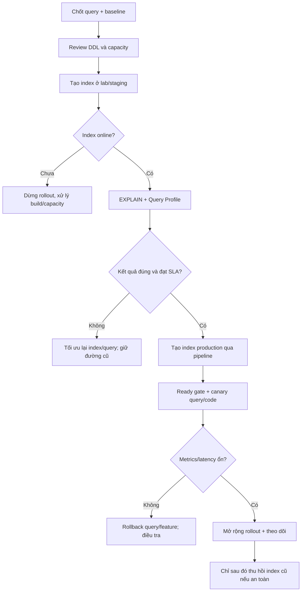

# Tạo chỉ mục và so sánh kế hoạch truy vấn trước và sau trong Spring Data Couchbase

## 1. Bối cảnh bài thực hành

Ứng dụng thương mại điện tử lưu các đơn hàng trong Couchbase. Endpoint `GET /orders?status=PAID` cần lấy đơn hàng mới nhất thuộc tenant đã xác thực, hiển thị mã đơn và tổng tiền. Ở môi trường thử nghiệm ít dữ liệu, câu SQL++ hoàn thành nhanh dù chưa có index chuyên biệt. Khi số Order tăng lên, Query Service có thể phải quét nhiều document, lọc rồi sắp xếp mới chọn được 20 dòng.

Nhóm phát triển định thêm một secondary index và nói: “Index sẽ làm query nhanh hơn.” Bài thực hành này yêu cầu **chứng minh hoặc bác bỏ giả thuyết bằng kế hoạch thực thi và số liệu**, thay vì chỉ chạy `CREATE INDEX` và nhìn thấy truy vấn vẫn trả kết quả.

Đây là một bài trong chương **Bài thực hành** của module **SPRING_DATA_COUCHBASE**, gắn với phát triển tầng truy cập Couchbase bằng Spring Data repositories, `CouchbaseTemplate`, document mapping và SQL++; đồng thời luyện tập thiết kế bucket/scope/collection, chỉ mục, độ mới của GSI, TTL, CAS, khả năng vận hành và API reactive.

Đường thực hành chính:

```text
Tạo dataset lab
    ↓
Chốt SQL++ + tiêu chí đúng dữ liệu
    ↓
EXPLAIN + đo baseline với primary index (chỉ ở lab)
    ↓
Thiết kế composite secondary index theo WHERE/ORDER BY
    ↓
CREATE INDEX → kiểm tra online → EXPLAIN lại
    ↓
Chạy Query Profile, đo p50/p95/p99 và tài nguyên
    ↓
Thử covering và partial index
    ↓
So trade-off đọc/ghi, viết kết luận, rollback index thử nghiệm
```

**Lưu ý phạm vi:** Hướng dẫn dùng tên bucket `commerce`, scope `sales`, collection `orders` thuộc **môi trường lab**. Không có cluster thật hay kết quả benchmark được kết nối/đo trong bài. Tên operator và cách optimizer lựa chọn index có thể khác giữa các phiên bản Couchbase Server; học viên cần ghi nhận đầu ra thực tế.

## 2. Mục tiêu và sản phẩm cần nộp

Sau bài lab, bạn phải:

1. Phân biệt `primary index`, composite secondary GSI, covering index và partial index theo đúng workload.
2. Thiết kế một index dùng các điều kiện equality `tenantId`, `status` và thứ tự `createdAt DESC`, lý giải vì sao chọn thứ tự key.
3. Chạy `EXPLAIN` trước/sau, nhận diện index được chọn, operator `IndexScan`/`IndexScan3`, `spans`, `Fetch`, `Filter`, `Order` và `Limit` nếu chúng xuất hiện.
4. Đo Query Profile/thời gian thực, số entries scanned và documents fetched; không đồng nhất `EXPLAIN` với benchmark.
5. Tìm hiểu vì sao index mới **có thể không được chọn**, ngay cả khi đã `online`, và cách kiểm chứng thay vì ép hint mù quáng.
6. Thử một index covering rồi đánh giá khi nào giảm `Fetch` thực sự có ích.
7. Thử partial index gắn với `_class` và `deleted`; kiểm chứng query không tương thích không được coi index này là nguồn dữ liệu đầy đủ.
8. Đối chiếu SQL++ viết tay với câu SQL++ thực của Spring Data repository/`@Query` và các projection.
9. Kiểm soát scan consistency, dữ liệu, cache, warm-up, concurrency và chi phí mutation để kết luận hợp lệ.
10. Chuẩn bị báo cáo before/after, tiêu chí chấp nhận, phương án cleanup/rollback và câu hỏi tự đánh giá.

### 2.1. Artefact học viên cần lưu

| Artefact | Phải có |
| --- | --- |
| Mô tả workload | Query, tham số, kích thước dữ liệu, mục tiêu latency/correctness |
| Baseline | `EXPLAIN` ban đầu và kết quả đo latency/profile |
| DDL index | Câu `CREATE INDEX`, key order, nơi tạo, trạng thái online |
| After plan | `EXPLAIN` sau index, operator/index/span khác gì |
| Benchmark | Số lượt, p50/p95/p99, rows, entries scanned, Fetch, sort và tải |
| Thử nghiệm covering/partial | Kết quả đúng/sai khi thay query, chi phí so với index cơ bản |
| Integration check | Kết quả SQL++ từ repository giống query thủ công và đúng tenant |
| Quyết định | Giữ index nào, thu hồi index nào, chứng cứ và rủi ro |
| Phục hồi | Lệnh `DROP INDEX` chỉ cho index lab, không ảnh hưởng dữ liệu |

**Definition of Done:** có dữ liệu chứng minh chính xác query/plan được so sánh; kết quả nghiệp vụ tương đương; chỉ mục đúng collection và sẵn sàng; có số đo **thật từ lab** hoặc ghi rõ chưa đo; và không biến việc làm bài thành thay đổi ngoài ý muốn ở production.

## 3. Chuẩn bị môi trường và nguyên tắc an toàn

### 3.1. Yêu cầu

- Couchbase Server hỗ trợ SQL++ Query Service, Index Service và scope/collection.
- Bucket `commerce`, scope `sales`, collection `orders` trong môi trường lab do quản trị viên tạo, hoặc một keyspace tương đương được cấp quyền.
- Quyền đọc/ghi dữ liệu mẫu và, đối với người thực thi DDL, quyền quản lý index thích hợp. Không dùng quyền DDL của application runtime trên production.
- Java 17+, Spring Data Couchbase/Java SDK tương thích theo BOM và phiên bản cụm thực tế; client SQL++/Query Workbench để chạy query/`EXPLAIN`.
- Bộ đo HTTP hoặc Java benchmark có khả năng lặp lại request và ghi percentiles; dữ liệu và statement được cố định giữa các lần so sánh.

Không có yêu cầu chạy Gradle/Python ở bước biên soạn bài này. Khi thực hành trong dự án học viên, việc compile/integration test được thực hiện theo quy trình lab riêng.

### 3.2. Quy tắc không làm hỏng dữ liệu

1. Dùng dữ liệu giả, namespace ID riêng như `order::LAB-INDEX-A::...`, không sao chép customer thật.
2. Không tạo primary index trên collection lớn của production chỉ để “có baseline”.
3. Không `DROP INDEX` có tên không thuộc lab; kiểm tra keyspace và chủ sở hữu trước.
4. Không `DELETE` theo predicate tenant trên bucket dùng chung; nếu cần cleanup, dùng danh sách ID seed đã lưu và được phép xóa.
5. Chạy DDL qua người/CI pipeline có thẩm quyền, đợi build hoàn thành.
6. Ghi nhận phiên bản Server, Index Service topology, SDK và scan consistency; không suy kết quả của version khác.
7. Giữ dữ liệu **không đổi** trong các lần benchmark chính, ngoài thử nghiệm mutation có chủ đích ở phần riêng.

### 3.3. Phiếu môi trường ban đầu

| Trường | Giá trị cần điền |
| --- | --- |
| Couchbase Server/version/edition | Chưa xác định |
| Java SDK/Spring Data Couchbase | Chưa xác định |
| Bucket/scope/collection | `commerce.sales.orders` trong lab |
| Query node/Index nodes | Chưa xác định |
| Number of document/tenant | Chưa đo |
| Có query/index workload khác cùng chạy? | Chưa xác định |
| Scan consistency sử dụng | Chưa xác định |
| Query timeout, page size, concurrency | Chưa xác định |
| Backup/cleanup owner | Chưa xác định |

Nếu tên collection khác, thay đồng bộ ở toàn bộ SQL++ và Java trước khi chạy. Không thay sai scope rồi kết luận index không hiệu quả.

## 4. Mô hình dữ liệu và query đích

### 4.1. Document Order

Giả sử ID `order::LAB-INDEX-A::1001` trong `commerce.sales.orders`:

```json
{
  "_class": "salesOrder",
  "tenantId": "LAB-INDEX-A",
  "orderNumber": "ORD-1001",
  "customerCode": "C-42",
  "status": "PAID",
  "createdAt": "2026-11-20T08:15:00Z",
  "totalMinor": 1500000,
  "currency": "VND",
  "deleted": false,
  "items": [
    { "sku": "SKU-42", "quantity": 2 },
    { "sku": "SKU-18", "quantity": 1 }
  ]
}
```

Field `totalMinor` chứa **số nguyên theo đơn vị tiền nhỏ nhất do mô hình VND lab quy định**, không có thao tác chuyển đổi tiền tệ. `createdAt` là chuỗi UTC ISO 8601 cố định, cùng định dạng để thứ tự từ vựng tương thích thứ tự thời gian. Trong thực tế, nếu có nhiều kiểu timestamp/offset, phải chuẩn hóa hoặc thiết kế field thời gian kiểu thích hợp.

### 4.2. Ba endpoint/mẫu truy vấn

| Mẫu | Yêu cầu | Gợi ý đường index |
| --- | --- | --- |
| Q1 | 20 Order `PAID` gần nhất theo tenant, chưa xóa | `(tenantId,status,createdAt DESC)` |
| Q2 | Mọi Order của một Customer theo tenant, mới nhất trước | `(tenantId,customerCode,createdAt DESC)` |
| Q3 | Order chứa SKU cụ thể trong mảng `items` | Array index theo `items[].sku` nếu workload cần |

**Q1 là đối tượng benchmark chính.** Q2/Q3 là bài mở rộng để chứng minh một index không tối ưu mọi predicate. Không tạo thêm index chỉ vì tên field xuất hiện ở document.

### 4.3. Chốt SQL++ Q1 trước khi tạo index

```sql
SELECT META(o).id AS orderId,
       o.orderNumber,
       o.createdAt,
       o.totalMinor
FROM `commerce`.`sales`.`orders` AS o
WHERE o.tenantId = $tenantId
  AND o.status = $status
  AND o.deleted = FALSE
  AND o.`_class` = "salesOrder"
ORDER BY o.createdAt DESC, META(o).id DESC
LIMIT $limit;
```

Tham số giả định:

```json
{
  "tenantId": "LAB-INDEX-A",
  "status": "PAID",
  "limit": 20
}
```

Thêm `META(o).id DESC` làm tie-breaker để trang ổn định nếu nhiều Order có cùng `createdAt`. **Không mặc định** index chỉ có `createdAt DESC` đáp ứng trọn vẹn sắp xếp hai khóa: `EXPLAIN` có thể vẫn cần `Order` cho tie-breaker hoặc plan khác. Bài đo riêng biến thể sort một khóa và hai khóa.

Q1 phải:

- Chỉ trả Order thuộc `LAB-INDEX-A`, trạng thái `PAID`, `deleted=false` và discriminator phù hợp.
- Không trả nhiều hơn `limit` dòng.
- Sắp xếp đúng thời gian, rồi ID cho các trường hợp cùng timestamp.
- Giữ nguyên `orderId`, `orderNumber`, `totalMinor` giữa các phương án truy vấn.
- Không dựa vào index order để bỏ `ORDER BY`: **kết quả cần thứ tự phải khai báo thứ tự**.

## 5. Tạo dữ liệu seed có thể kiểm tra bằng mắt

Ví dụ seed dưới đây chỉ dành cho collection lab trống hoặc đã xác nhận ID chưa tồn tại. Lệnh `INSERT` sẽ thất bại khi ID đã có; đó là bảo vệ tránh ghi đè, **không** dùng `UPSERT` mù quáng để lặp lại bài.

### 5.1. Sáu Order tenant A

```sql
INSERT INTO `commerce`.`sales`.`orders` (KEY, VALUE)
VALUES
(
  "order::LAB-INDEX-A::1001",
  {
    "_class":"salesOrder",
    "tenantId":"LAB-INDEX-A",
    "orderNumber":"ORD-1001",
    "customerCode":"C-42",
    "status":"PAID",
    "createdAt":"2026-11-20T08:15:00Z",
    "totalMinor":1500000,
    "currency":"VND",
    "deleted":false,
    "items":[{"sku":"SKU-42","quantity":2}]
  }
),
(
  "order::LAB-INDEX-A::1002",
  {
    "_class":"salesOrder",
    "tenantId":"LAB-INDEX-A",
    "orderNumber":"ORD-1002",
    "customerCode":"C-53",
    "status":"PAID",
    "createdAt":"2026-11-21T09:00:00Z",
    "totalMinor":230000,
    "currency":"VND",
    "deleted":false,
    "items":[{"sku":"SKU-18","quantity":1}]
  }
),
(
  "order::LAB-INDEX-A::1003",
  {
    "_class":"salesOrder",
    "tenantId":"LAB-INDEX-A",
    "orderNumber":"ORD-1003",
    "customerCode":"C-42",
    "status":"PENDING",
    "createdAt":"2026-11-22T10:00:00Z",
    "totalMinor":450000,
    "currency":"VND",
    "deleted":false,
    "items":[{"sku":"SKU-42","quantity":1}]
  }
),
(
  "order::LAB-INDEX-A::1004",
  {
    "_class":"salesOrder",
    "tenantId":"LAB-INDEX-A",
    "orderNumber":"ORD-1004",
    "customerCode":"C-61",
    "status":"PAID",
    "createdAt":"2026-11-23T11:00:00Z",
    "totalMinor":870000,
    "currency":"VND",
    "deleted":true,
    "items":[{"sku":"SKU-90","quantity":3}]
  }
),
(
  "order::LAB-INDEX-A::1005",
  {
    "_class":"salesOrder",
    "tenantId":"LAB-INDEX-A",
    "orderNumber":"ORD-1005",
    "customerCode":"C-42",
    "status":"PAID",
    "createdAt":"2026-11-24T12:00:00Z",
    "totalMinor":990000,
    "currency":"VND",
    "deleted":false,
    "items":[{"sku":"SKU-42","quantity":1}]
  }
),
(
  "order::LAB-INDEX-A::1006",
  {
    "_class":"salesOrder",
    "tenantId":"LAB-INDEX-A",
    "orderNumber":"ORD-1006",
    "customerCode":"C-99",
    "status":"PAID",
    "createdAt":"2026-11-24T12:00:00Z",
    "totalMinor":200000,
    "currency":"VND",
    "deleted":false,
    "items":[{"sku":"SKU-17","quantity":2}]
  }
);
```

### 5.2. Hai Order tenant B làm dữ liệu biên

```sql
INSERT INTO `commerce`.`sales`.`orders` (KEY, VALUE)
VALUES
(
  "order::LAB-INDEX-B::2001",
  {
    "_class":"salesOrder",
    "tenantId":"LAB-INDEX-B",
    "orderNumber":"ORD-2001",
    "customerCode":"C-42",
    "status":"PAID",
    "createdAt":"2026-11-24T13:00:00Z",
    "totalMinor":3000000,
    "currency":"VND",
    "deleted":false,
    "items":[{"sku":"SKU-42","quantity":4}]
  }
),
(
  "order::LAB-INDEX-B::2002",
  {
    "_class":"salesOrder",
    "tenantId":"LAB-INDEX-B",
    "orderNumber":"ORD-2002",
    "customerCode":"C-88",
    "status":"PENDING",
    "createdAt":"2026-11-25T07:00:00Z",
    "totalMinor":100000,
    "currency":"VND",
    "deleted":false,
    "items":[{"sku":"SKU-91","quantity":1}]
  }
);
```

### 5.3. Một document không phải Order

Document này giúp kiểm thử discriminator khi collection chứa nhiều kiểu:

```sql
INSERT INTO `commerce`.`sales`.`orders` (KEY, VALUE)
VALUES (
  "note::LAB-INDEX-A::N-1",
  {
    "_class":"orderNote",
    "tenantId":"LAB-INDEX-A",
    "status":"PAID",
    "createdAt":"2026-11-25T09:00:00Z",
    "deleted":false,
    "body":"Do not return as sales order"
  }
);
```

Trong thiết kế production nên cân nhắc collection riêng cho entity khác loại; đưa document này vào `orders` **chỉ để thực hành điều kiện partial index/discriminator**.

### 5.4. Kết quả nghiệp vụ kỳ vọng của Q1

Với `tenantId=LAB-INDEX-A`, `status=PAID`, `limit=20`:

| Thứ tự | orderId | createdAt | totalMinor |
| ---: | --- | --- | ---: |
| 1 | `order::LAB-INDEX-A::1006` | 2026-11-24 12:00 UTC | 200.000 |
| 2 | `order::LAB-INDEX-A::1005` | 2026-11-24 12:00 UTC | 990.000 |
| 3 | `order::LAB-INDEX-A::1002` | 2026-11-21 09:00 UTC | 230.000 |
| 4 | `order::LAB-INDEX-A::1001` | 2026-11-20 08:15 UTC | 1.500.000 |

1003 bị loại do `PENDING`; 1004 bị loại do `deleted=true`; 2001–2002 bị loại theo tenant; `orderNote` bị loại bởi `_class`. Dữ liệu kỳ vọng được xác định từ seed, không phải số liệu truy vấn đã chạy.

### 5.5. Dữ liệu để benchmark hiệu năng phải lớn hơn seed tay

Chín document nhỏ **không đủ để chứng minh hiệu quả tốc độ**. Để thấy khác biệt index scan, hãy mở rộng dataset lab bằng generator seed **riêng do người học quản lý**, ví dụ 10.000–100.000 Order giả theo nhiều tenant/status/time, có phân bố skew và kích thước payload thực tế. Không cần tạo hàng triệu document khi cluster lab không đủ capacity.

Giữ các đặc điểm:

- 70% `PAID` và 30% `PENDING/CANCELLED` chỉ là giả định phân bố mẫu, phải ghi lại số thực.
- Một số tenant nhỏ, một số tenant lớn để kiểm tra độ chọn lọc.
- Có Order cùng timestamp để thử tie-breaker.
- Một tỷ lệ `deleted=true` để thử partial index.
- Nhiều item và field JSON không nằm trong index để đo `Fetch`.
- Dữ liệu được seed một lần trước benchmark, không mutate giữa các lần đo latency chính.

Nếu không có dữ liệu lớn, vẫn hoàn thành phần **đọc plan và correctness**, nhưng ghi rõ rằng benchmark latency thiếu độ tin cậy thống kê.

## 6. Baseline trước khi có index chuyên biệt

### 6.1. SQL++ cần đường truy cập khả dụng

Một câu SQL++ trên collection có thể **không lập được plan** nếu không có index/đường truy cập được optimizer sử dụng. Không giả định “chưa có index thì Couchbase tự scan mọi document như relational table scan”.

Trong **lab riêng**, có thể tạo một named primary index để có đường scan chung:

```sql
CREATE PRIMARY INDEX ix_orders_lab_primary
ON `commerce`.`sales`.`orders`;
```

**Không tạo primary index chỉ để benchmark trên production.** Primary index là đường truy cập rộng, thường kém chọn lọc với workload lọc theo tenant/status; nó không thay thế GSI được thiết kế theo query.

Nếu collection lab đã có primary/secondary index, chụp danh sách trước và **không xóa index có sẵn**. Để so một primary baseline, học viên có thể cô lập workload trên collection lab trống/riêng hoặc dùng hint ở bước so sánh (sau khi hiểu giới hạn của hint).

### 6.2. Đợi index sẵn sàng

```sql
SELECT name, state, is_primary,
       index_key, condition,
       bucket_id, scope_id, keyspace_id
FROM system:indexes
WHERE bucket_id = "commerce"
  AND scope_id = "sales"
  AND keyspace_id = "orders";
```

Tìm đúng `ix_orders_lab_primary` và trạng thái phục vụ query (thường `online`). DDL được chấp nhận **không đồng nghĩa** index đã hoàn tất build. Không benchmark khi index đang build/rebalance.

### 6.3. Chạy `EXPLAIN` baseline

Thay tham số bằng giá trị lab hoặc truyền named parameters qua client hỗ trợ:

```sql
EXPLAIN
SELECT META(o).id AS orderId,
       o.orderNumber,
       o.createdAt,
       o.totalMinor
FROM `commerce`.`sales`.`orders` AS o
WHERE o.tenantId = "LAB-INDEX-A"
  AND o.status = "PAID"
  AND o.deleted = FALSE
  AND o.`_class` = "salesOrder"
ORDER BY o.createdAt DESC, META(o).id DESC
LIMIT 20;
```

Ghi lại **toàn bộ plan JSON** vào báo cáo môi trường học viên, hoặc bản sao đã che thông tin nhạy cảm. Không chỉ chụp screenshot có một dòng `IndexScan` vì các operator ở phía trên có thể gây chi phí chính.

### 6.4. Mẫu ghi nhận baseline

| Mục | Giá trị đo trong lab |
| --- | --- |
| Index được optimizer chọn | Chưa đo |
| Keyspace, index state | Chưa đo |
| Operator scan | Chưa đo |
| Index spans có tenant/status equality? | Chưa đo |
| Có `Fetch`? | Chưa đo |
| Có `Filter` sau scan? | Chưa đo |
| Có `Order`/sort? | Chưa đo |
| `Limit` được áp ở đâu? | Chưa đo |
| Rows trả về | Chưa đo |
| Entries scanned, documents fetched | Chưa đo |
| p50/p95/p99 latency | Chưa đo |

Không điền “PrimaryScan” chỉ vì đã tạo primary index: optimizer có thể chọn index khác nếu collection không hoàn toàn cô lập.

## 7. Cách đọc cấu trúc `EXPLAIN` có phương pháp

### 7.1. Những operator cần nhận diện

| Operator/thuộc tính thường gặp | Câu hỏi cần trả lời |
| --- | --- |
| `IndexScan`/`IndexScan3` | Đang đọc index nào, đúng collection chưa? |
| `spans` | Predicate tenant/status có thu hẹp dải quét không? |
| `Fetch` | Có phải đọc JSON gốc để lấy field không nằm trong index? |
| `Filter` | Field nào vẫn phải kiểm tra sau index scan? |
| `Order` | Còn phải sort kết quả trung gian hay thứ tự từ index được tận dụng? |
| `Limit`/`Offset` | Được đặt ở tầng nào của plan? |
| `InitialProject`/`Project` | Kết quả chỉ lấy field cần hay kéo document đầy đủ? |
| `Sequence`/`Parallel` | Các bước/nhánh của kế hoạch được ghép thế nào? |
| `cost`/`cardinality` khi có | Ước tính optimizer, không phải số thực đã quan sát |

Tên operator, cấu trúc plan JSON và estimator khác nhau theo Couchbase Server version. Không viết parser tự động phụ thuộc cố định một đường JSON mà chưa xét version hoặc alternate plan.

### 7.2. `spans` quyết định độ chọn lọc

Ở Q1:

```sql
WHERE o.tenantId = "LAB-INDEX-A"
  AND o.status = "PAID"
```

Một index mở đầu bằng `(tenantId,status)` có thể giúp quét dải hẹp hơn so với primary index, nếu optimizer chọn nó. Đọc `spans` để xác định các equality predicate đã được dùng vào scan hay chưa.

Nhưng `spans` không tự nói “đây là plan tốt nhất”. Nếu tenant rất lớn hoặc hầu hết Order đều PAID, dải quét vẫn lớn. Query Profile đo entry count thực mới giúp đánh giá.

### 7.3. `Fetch` không phải lúc nào cũng là vấn đề

Primary index hoặc composite index chỉ giữ một số key; để trả `orderNumber` và `totalMinor`, plan có thể phải Fetch document gốc. Fetch 20 Order có thể rẻ; Fetch 100.000 Order trước khi lọc có thể rất đắt.

Khi thử covering index, mục tiêu là **loại Fetch nếu chi phí giảm đủ lớn**, không phải thêm mọi field chỉ để plan trông “sạch”.

### 7.4. `Order`: sort theo timestamp và tie-breaker

Index `(tenantId,status,createdAt DESC)` có thể hỗ trợ sắp xếp theo timestamp khi các equality prefix đã được ràng buộc, nhưng Q1 còn `META(o).id DESC`. Optimizer có thể cần sort/tie-breaker hoặc kế hoạch riêng. Để hiểu rõ:

1. Chạy Q1 sắp xếp chỉ theo `createdAt DESC`.
2. Chạy Q1 sắp xếp theo `createdAt DESC, META(o).id DESC`.
3. So plan và kết quả theo timestamp trùng.
4. Không bỏ tie-breaker ở API chỉ để loại `Order` nếu yêu cầu phân trang ổn định.

### 7.5. `EXPLAIN` không chạy query nghiệp vụ

`EXPLAIN` cho biết kế hoạch dự kiến; nó không chứng minh thời gian query thật. Chạy statement **không có `EXPLAIN`** cùng named parameters, thu thập Query Profile/metrics, số rows và latency. Tách biệt **kết quả plan** khỏi **kết quả benchmark**.

## 8. Cách đo baseline có thể so sánh được

### 8.1. Chuẩn hóa điều kiện benchmark

Ghi và giữ cố định:

- Cùng số document và phân bố tenant/status.
- Cùng query text và projection; không đổi `LIMIT` giữa các vòng.
- Cùng named parameters, scan consistency, timeout và index readiness.
- Cùng mức concurrency của clients, warm-up và môi trường Query/Index Service.
- Cùng cách đo: server-side profile **và** end-to-end latency nếu muốn đánh giá API.
- Không seed/thay đổi hàng loạt trong lúc đo truy vấn đọc.
- Thực hiện nhiều lượt để tránh nhìn một lần chạy quá may/rủi.

Không benchmark khi index đang build hoặc node đang rebalance vì không biết latency đo phản ánh index mới hay tải vận hành.

### 8.2. Hai nhóm thời gian

| Đo tại đâu | Ý nghĩa |
| --- | --- |
| Query Service metrics/profile | Thời gian execution và operator mà server ghi nhận |
| Java SDK client timer | Thời gian từ lúc ứng dụng gửi query tới khi lấy result |
| HTTP endpoint timer | Thời gian gồm service, mapping/serialization, network |
| Index Service metrics | Chỉ báo tải/scan/update liên quan index |

Không cộng các metrics có thể chồng lấn rồi tuyên bố đó là tổng latency request. Khi nhiều query chạy đồng thời, tổng duration của spans khác wall-clock.

### 8.3. `p50`, `p95`, `p99`

Với một tập phép đo đã sort, percentile phản ánh phần trăm lượt chạy có thời gian không vượt ngưỡng được tính theo phương pháp percentile đã chọn. Chúng không giống phép đo trung bình:

- `p50` thể hiện mức thường gặp.
- `p95` cho thấy 5% lượt chậm nhất bắt đầu ở khoảng nào.
- `p99` giúp quan sát đuôi độ trễ trong workload đủ lớn.

Nếu chỉ chạy 5–10 lượt, `p99` gần như không có ý nghĩa thống kê. Ghi số lượt và phương pháp tính percentile; cần đủ mẫu để đánh giá tail latency.

### 8.4. Bảng benchmark đầu tiên

| Trường | Baseline trước index |
| --- | --- |
| Dataset documents / LAB-INDEX-A | Chưa đo |
| Number of repetitions | Chưa đo |
| Warm-up requests | Chưa đo |
| Client concurrency | Chưa đo |
| Median client latency | Chưa đo |
| p95 / p99 | Chưa đo |
| Query elapsed/execution time | Chưa đo |
| Index entries scanned | Chưa đo |
| Document fetch count | Chưa đo |
| Rows returned / result bytes | Chưa đo |
| Query error/timeout rate | Chưa đo |

Khi số liệu không khả dụng trên Server/SDK version, ghi **“không được metrics cung cấp”** thay vì đoán số 0.

## 9. Thiết kế composite index cho Q1

### 9.1. Từ predicate tới thứ tự key

Q1 có:

```sql
WHERE tenantId = ?
  AND status = ?
  AND deleted = FALSE
  AND `_class` = "salesOrder"
ORDER BY createdAt DESC, META(o).id DESC
```

Ứng viên ban đầu:

```sql
CREATE INDEX ix_orders_lab_tenant_status_created
ON `commerce`.`sales`.`orders`(
    `tenantId`,
    `status`,
    `createdAt` DESC
);
```

Giải thích:

1. `tenantId` là điều kiện equality chung trong hệ multi-tenant; index bắt đầu bằng field này giúp phục vụ nhiều query theo tenant.
2. `status` là điều kiện equality tiếp theo; query có thể thu hẹp tới Order trạng thái PAID.
3. `createdAt DESC` là khóa range/order sau equality prefix, có cơ hội hỗ trợ truy vấn mới nhất.
4. `deleted` và `_class` **chưa** nằm trong key: optimizer có thể cần Fetch/filter vì index thường chưa cover predicate ấy.
5. `orderNumber`/`totalMinor` **chưa** nằm trong key: projection thường phải đọc document gốc.

Đây là ứng viên cần đo, **không phải công thức tuyệt đối**. Nếu phần lớn query khác lọc `customerCode` hoặc partition dữ liệu rất khác, cần index khác hoặc đổi thứ tự key dựa trên workload.

### 9.2. Khi query có thể dùng index theo thứ tự khác

So với:

```sql
CREATE INDEX ix_orders_lab_status_tenant_created
ON `commerce`.`sales`.`orders`(
    `status`,
    `tenantId`,
    `createdAt` DESC
);
```

Nếu Q1 ràng buộc **cả hai equality**, cả hai có thể hỗ trợ. Khác biệt lớn hơn xuất hiện khi các query khác chỉ lọc `tenantId` hoặc chỉ lọc `status`, cùng độ chọn lọc thực tế.

**Bài lab không yêu cầu tạo cả hai index ngay**; hãy chọn một index chính rồi làm thử nghiệm thứ tự key ở phần mở rộng. Nhiều index gần trùng tạo chi phí ghi/dung lượng mà chưa chắc cải thiện SLA.

### 9.3. Đừng đưa mọi field vào index đầu tiên

Một index chứa `tenantId,status,deleted,_class,createdAt,orderNumber,totalMinor,customerCode,items` có thể rất lớn và làm khó phân tích nguyên nhân cải thiện. Thử từng giả thuyết một:

1. Tạo composite index tối thiểu.
2. Đo độ chọn lọc/scan/sort/Fetch.
3. Chỉ sau đó thử covering hoặc partial index.

Đây là phương pháp thí nghiệm có kiểm soát, không chỉ là mẹo tiết kiệm storage.

## 10. Tạo GSI và chờ sẵn sàng

### 10.1. Chạy DDL trên đúng collection

```sql
CREATE INDEX ix_orders_lab_tenant_status_created
ON `commerce`.`sales`.`orders`(
  `tenantId`,
  `status`,
  `createdAt` DESC
);
```

Lệnh nên chạy qua Query Workbench/DDL pipeline đã được cấp quyền. Nếu index trùng tên hoặc đã tồn tại, không tạo đè; kiểm tra định nghĩa thực và đưa tên khác cho thí nghiệm.

### 10.2. Kiểm tra trạng thái qua `system:indexes`

```sql
SELECT name, state, is_primary, index_key,
       condition, bucket_id, scope_id, keyspace_id
FROM system:indexes
WHERE bucket_id = "commerce"
  AND scope_id = "sales"
  AND keyspace_id = "orders"
  AND name IN [
    "ix_orders_lab_primary",
    "ix_orders_lab_tenant_status_created"
  ];
```

Cổng readiness:

1. Index có đúng tên, collection và `index_key`.
2. Trạng thái khả dụng (thường `online`).
3. Không đang build/rebalance gây tải bất thường.
4. Query `EXPLAIN` có thể lập plan.
5. Nếu optimizer vẫn không chọn, có thể điều tra; không kết luận DDL thất bại chỉ vì query plan khác dự kiến.

### 10.3. Deferred build (tùy chọn)

Với tập index cần xây cùng đợt:

```sql
CREATE INDEX ix_orders_lab_tenant_status_created_deferred
ON `commerce`.`sales`.`orders`(
  `tenantId`, `status`, `createdAt` DESC
)
WITH {"defer_build": true};

BUILD INDEX ON `commerce`.`sales`.`orders`(
  `ix_orders_lab_tenant_status_created_deferred`
);
```

Đây là **ứng viên thứ hai để luyện readiness**, không bắt buộc tạo nếu index chính đã đủ. Chỉ tạo khi đã hiểu chi phí build và giới hạn Index Service. Đặt deadline có giới hạn cho việc chờ, báo lỗi khi index không ready; không retry vô hạn.

## 11. So sánh `EXPLAIN` sau composite index

### 11.1. Chạy chính xác cùng một query

```sql
EXPLAIN
SELECT META(o).id AS orderId,
       o.orderNumber,
       o.createdAt,
       o.totalMinor
FROM `commerce`.`sales`.`orders` AS o
WHERE o.tenantId = "LAB-INDEX-A"
  AND o.status = "PAID"
  AND o.deleted = FALSE
  AND o.`_class` = "salesOrder"
ORDER BY o.createdAt DESC, META(o).id DESC
LIMIT 20;
```

Lưu output plan **sau**, không chỉ so latency. Ghi:

| Dấu hiệu | Baseline | Sau composite |
| --- | --- | --- |
| Index name | Chưa đo | Chưa đo |
| Scan operator | Chưa đo | Chưa đo |
| `spans` cho tenant/status | Chưa đo | Chưa đo |
| `Fetch` có/không | Chưa đo | Chưa đo |
| `Filter` cho deleted/type | Chưa đo | Chưa đo |
| `Order` và tie-breaker | Chưa đo | Chưa đo |
| `Limit` trong plan | Chưa đo | Chưa đo |
| Estimated cardinality/cost nếu có | Chưa đo | Chưa đo |

### 11.2. Nếu optimizer vẫn chọn primary index

Có nhiều khả năng:

- Dataset quá nhỏ, primary scan rẻ hơn.
- Index chưa online hoặc DDL ở sai collection.
- Predicate query thực khác (ví dụ dùng tên field do converter đổi).
- Composite key order không phù hợp với một biến thể query.
- Có index khác tốt hơn hoặc thống kê/cardinality khiến optimizer chọn plan khác.
- Projection/filter/tie-breaker làm lợi thế scan không như dự đoán.

Kiểm tra catalog, query thật và dữ liệu. **Không vội kết luận “Couchbase không dùng index”** hoặc thêm hint vào production.

### 11.3. Ép index chỉ để thí nghiệm đối chứng

Khi đã có hai index, trong **lab** có thể thử:

```sql
EXPLAIN
SELECT META(o).id AS orderId,
       o.orderNumber,
       o.createdAt,
       o.totalMinor
FROM `commerce`.`sales`.`orders` AS o
USE INDEX (ix_orders_lab_tenant_status_created USING GSI)
WHERE o.tenantId = "LAB-INDEX-A"
  AND o.status = "PAID"
  AND o.deleted = FALSE
  AND o.`_class` = "salesOrder"
ORDER BY o.createdAt DESC, META(o).id DESC
LIMIT 20;
```

Index hint có thể được sử dụng để xem một kế hoạch dùng index ứng viên, **không bảo đảm nó tốt hơn plan tự chọn**. Cú pháp/hành vi hints phụ thuộc Server version; phải đọc `EXPLAIN` xem hint có được chấp nhận/sử dụng.

Để so công bằng với baseline, thử hint primary tương ứng trên dataset bất biến. Không đưa hints vào production như giải pháp lâu dài nếu chưa có bằng chứng optimizer luôn chọn kém và có kế hoạch theo dõi sau upgrade.

### 11.4. So `ORDER BY createdAt` với hai khóa

Biến thể A:

```sql
ORDER BY o.createdAt DESC
LIMIT 20;
```

Biến thể B:

```sql
ORDER BY o.createdAt DESC, META(o).id DESC
LIMIT 20;
```

Chạy mỗi biến thể trên cùng predicate/projection, ghi `Order` operator và kết quả. Nếu cần pagination ổn định, giữ B ngay cả khi mất lợi thế sort của index chưa đầy đủ; hoặc thiết kế index/cursor thích hợp và kiểm nghiệm riêng.

## 12. Benchmark sau index: tách cải thiện plan khỏi cải thiện latency

### 12.1. Chạy cùng protocol

Sau khi composite index `online`:

1. Đợi Index Service ổn định.
2. Chạy warm-up nhất quán với baseline.
3. Chạy nhiều query giống hệt với cùng tham số, số clients và scan consistency.
4. Thu profile/timings và query metrics.
5. So result set: ID/orderNumber/totalMinor/order đúng **giống baseline**.
6. Tính p50/p95/p99 với cùng phương pháp, ghi số lần chạy.
7. Theo dõi Index/Query Service CPU/memory, network và timeout.

### 12.2. Bảng trước/sau chính

| Chỉ số | Baseline primary | Composite GSI | Δ hoặc nhận xét |
| --- | --- | --- | --- |
| Documents trong keyspace | Chưa đo | Chưa đo | Phải bằng nhau |
| Index name | Chưa đo | Chưa đo | |
| Index entries scanned | Chưa đo | Chưa đo | |
| Documents fetched | Chưa đo | Chưa đo | |
| Rows output | Chưa đo | Chưa đo | Phải cùng tập/đúng thứ tự |
| Query elapsed/execution time | Chưa đo | Chưa đo | |
| Client p50 | Chưa đo | Chưa đo | |
| Client p95 | Chưa đo | Chưa đo | |
| Client p99 | Chưa đo | Chưa đo | |
| Query error/timeout | Chưa đo | Chưa đo | |
| Response bytes | Chưa đo | Chưa đo | Không đổi projection |
| Index disk/memory footprint | Chưa đo | Chưa đo | Chi phí mới |

**Không điền số giả.** Nếu server không expose `index entries scanned` ở profile đang dùng, báo chưa có dữ liệu và nêu nguồn cần bật, không suy số lượng từ `COUNT(*)`.

### 12.3. Tính phần trăm cải thiện

Với cùng định nghĩa một metric latency:

\[
\text{cải thiện latency \%}
=\frac{T_{\text{before}}-T_{\text{after}}}{T_{\text{before}}}\times100\%.
\]

Ví dụ **giả định để luyện phép tính**: trước 40 ms, sau 25 ms, cải thiện `(40−25)/40 = 37,5%`. Đây **không phải kết quả benchmark Couchbase**. Nếu sau chậm hơn, phần trăm âm; đừng đổi cách tính để “đẹp” báo cáo.

### 12.4. Khi index scan ít hơn nhưng latency không giảm

Đây cũng là một kết quả có giá trị. Có thể do:

- Query vốn rất nhanh so với overhead network/Jackson/controller.
- `Fetch` vẫn chiếm thời gian chính.
- `Order` sort vẫn phải làm, nhất là với tie-breaker.
- Cache/working-set đang rất nóng khiến primary scan không đắt ở lab nhỏ.
- Index mới làm CPU/storage contention tăng.
- Variance môi trường lớn hơn cải thiện kỳ vọng.

Đọc từng operator/metric; không chỉ so một con số request latency.

## 13. Thử nghiệm covering index

### 13.1. Mục tiêu

Composite index chỉ có `tenantId/status/createdAt` có thể phải `Fetch` để lấy `orderNumber/totalMinor/deleted/_class`. Một covering index đặt đủ field cần đọc có thể giúp query được xử lý từ index mà không Fetch JSON gốc cho một số plan.

Ứng viên:

```sql
CREATE INDEX ix_orders_lab_cover
ON `commerce`.`sales`.`orders`(
  `tenantId`,
  `status`,
  `createdAt` DESC,
  `orderNumber`,
  `totalMinor`,
  `deleted`,
  `_class`
);
```

Đây là một **index lớn hơn** index tối thiểu. Không mặc định được cover trọn vẹn query có `META(o).id`, tie-breaker và mọi expression trên tất cả phiên bản; hãy đọc `EXPLAIN`, xem `covers`/`Fetch` và thử projection thực.

### 13.2. Chạy sau khi index online

Lặp:

```sql
EXPLAIN
SELECT META(o).id AS orderId,
       o.orderNumber,
       o.createdAt,
       o.totalMinor
FROM `commerce`.`sales`.`orders` AS o
WHERE o.tenantId = "LAB-INDEX-A"
  AND o.status = "PAID"
  AND o.deleted = FALSE
  AND o.`_class` = "salesOrder"
ORDER BY o.createdAt DESC, META(o).id DESC
LIMIT 20;
```

Đánh giá:

- Index cover có được chọn không?
- `Fetch` được loại hay còn cần?
- Entries scanned/rows output có đổi không?
- Sort có thay đổi không?
- Query Profile và p95 cải thiện bao nhiêu?
- Index chiếm thêm tài nguyên bao nhiêu?

### 13.3. Biến thể tối giản cho projection

Để tách ảnh hưởng projection, thử:

```sql
SELECT o.tenantId,
       o.status,
       o.createdAt,
       o.orderNumber,
       o.totalMinor
FROM `commerce`.`sales`.`orders` AS o
WHERE o.tenantId = "LAB-INDEX-A"
  AND o.status = "PAID"
  AND o.deleted = FALSE
  AND o.`_class` = "salesOrder"
ORDER BY o.createdAt DESC
LIMIT 20;
```

Query này có khác projection/tie-breaker so với Q1 gốc nên **chỉ dùng để hiểu covering**, không thay thế benchmark apples-to-apples của Q1.

### 13.4. Khi không nên giữ covering index

- Endpoint chỉ trả 20 document, `Fetch` không đáng kể.
- Collection mutation nhiều; thêm `orderNumber/totalMinor` làm index maintenance tăng.
- Field chứa dữ liệu nhạy cảm hoặc rất lớn, index storage/security cost cao.
- Query thực trả toàn entity, nên vẫn Fetch nhiều field không nằm trong index.
- Có nhiều index gần trùng, write amplification lớn hơn lợi ích đọc.

Một `EXPLAIN` “không còn Fetch” là tín hiệu kỹ thuật, nhưng **chỉ giữ index nếu lợi ích đủ bù chi phí vận hành**.

## 14. Thử nghiệm partial index

### 14.1. Tập document được phép xuất hiện

Trong dataset, `_class` cho Order là `salesOrder` và một số Order `deleted=true`. Nếu Q1 **luôn** chỉ cần Order chưa xóa đúng loại, ứng viên:

```sql
CREATE INDEX ix_orders_lab_active_paid_recent
ON `commerce`.`sales`.`orders`(
  `tenantId`,
  `status`,
  `createdAt` DESC
)
WHERE `_class` = "salesOrder"
  AND `deleted` = FALSE;
```

Partial index lưu **chỉ các document thỏa predicate của định nghĩa index**. Điều kiện query phải đủ để optimizer chứng minh index không làm mất document hợp lệ.

### 14.2. Query tương thích

```sql
SELECT META(o).id AS orderId, o.orderNumber
FROM `commerce`.`sales`.`orders` AS o
WHERE o.tenantId = "LAB-INDEX-A"
  AND o.status = "PAID"
  AND o.`_class` = "salesOrder"
  AND o.deleted = FALSE
ORDER BY o.createdAt DESC
LIMIT 20;
```

Query này **phù hợp về ngữ nghĩa** với partial predicate. Nhưng optimizer có thể chọn index khác theo cost/plan. `EXPLAIN` là bước bắt buộc, không khẳng định chắc chắn nó sẽ chọn `ix_orders_lab_active_paid_recent`.

### 14.3. Query không tương thích

```sql
SELECT META(o).id AS orderId, o.deleted
FROM `commerce`.`sales`.`orders` AS o
WHERE o.tenantId = "LAB-INDEX-A"
  AND o.`_class` = "salesOrder"
ORDER BY o.createdAt DESC;
```

Query này phải tìm được **cả Order bị soft delete** để audit. Partial index chỉ gồm `deleted=false` **không đại diện đầy đủ** cho query; dùng riêng nó có thể làm thiếu dữ liệu.

### 14.4. Field missing và tính đúng

Nếu dữ liệu legacy **không có field `deleted`**, predicate `deleted = FALSE` trong partial index không nhất thiết bao gồm chúng. Không tự coi thiếu field là false nếu dữ liệu/chính sách chưa định nghĩa vậy.

Spring Data có thể thêm `_class` vào query entity; xem discriminator JSON thực và generated SQL++ trước khi thiết kế partial index theo type alias. Một alias cũ khác `salesOrder` có thể bị loại ngoài ý muốn.

### 14.5. Ưu/nhược cần đo

| Ưu điểm có thể có | Giá phải trả/điều kiện |
| --- | --- |
| Ít index entries nếu phần deleted/khác loại lớn | Không cover query cần tập bị loại |
| Index nhỏ hơn, có thể giảm scan | Predicate query phải hàm ý partial predicate |
| Có thể giảm `Fetch` cho filter tương thích | Projection vẫn có thể Fetch vì field không nằm trong key |
| Hỗ trợ các endpoint “active only” | Phải duy trì một đường query khác cho audit/historical |

**Bài tập quan trọng:** đối chiếu kết quả Q1, query audit và `EXPLAIN` của cả hai. Một index nhanh nhưng làm mất Order cần audit là một thiết kế sai mục tiêu.

## 15. Ghi nhận trade-off của ba phương án

Đến thời điểm này có thể có các index lab:

```text
ix_orders_lab_primary
ix_orders_lab_tenant_status_created
ix_orders_lab_cover
ix_orders_lab_active_paid_recent
```

Không để chúng tồn tại vĩnh viễn chỉ vì đã tạo. Hãy so:

| Phương án | Read path mong muốn | Chi phí/rủi ro |
| --- | --- | --- |
| Primary | Đường scan rộng, dùng làm baseline lab | Có thể quét rất nhiều entries |
| Composite | Equality tenant/status + createdAt order | Có thể Fetch thêm projection/predicate |
| Covering | Trả các field chỉ từ index khi plan tương thích | Index lớn, mutation cost, quản trị dữ liệu |
| Partial | Giới hạn active/order type | Không dùng làm tập đầy đủ cho audit |

Không so latency chỉ từ **một lần** thực thi và tuyên bố chiến thắng. Ghi **kế hoạch thực, workload thật, row count, cost và validation** trước khi quyết định.

## 16. Thử ảnh hưởng của thay đổi kích thước trang

Q1 mặc định `LIMIT 20`. Chạy thêm `LIMIT 5`, `20` và `100` với cùng tenant/status. Đối chiếu:

- Index entries scanned tăng thế nào?
- Có bị sort toàn bộ tập trung gian trước khi giới hạn không?
- `Fetch` tăng thế nào?
- Latency/p95 tăng theo page size không?
- Số result bytes có tỷ lệ thuận không?

Không thay đổi các biến khác cùng lúc. Query `LIMIT 100` **không tự có nghĩa** backend chỉ đọc 100 index entries; nếu filter/order kém chọn lọc, scan có thể rộng hơn nhiều.

### 16.1. `OFFSET` và keyset pagination

Với phân trang sâu:

```sql
ORDER BY o.createdAt DESC, META(o).id DESC
LIMIT 20 OFFSET 10000;
```

Query có thể phải duyệt/bỏ qua nhiều hàng trước khi trả trang sâu; index tốt chưa chắc loại chi phí offset lớn. Nếu endpoint thực có trang rất sâu, cân nhắc keyset pagination dựa trên khóa sort ổn định và query plan phù hợp.

Thí nghiệm index Q1 hiện tại **không chứng minh** hiệu năng trang 10.000. Hãy ghi một test riêng nếu workload cần.

### 16.2. Các field có kiểu dữ liệu không nhất quán

Nếu `createdAt` lẫn chuỗi, số epoch và NULL/MISSING, sort có thể không đúng kỳ vọng hoặc index partial có behavior khác. Chuẩn hóa schema trước khi kết luận optimizer/DDL “sắp xếp sai”.

## 17. Thử nghiệm thêm: Q2 theo Customer

Q2 tìm Order của `customerCode` trong tenant, mới nhất trước:

```sql
SELECT META(o).id AS orderId,
       o.orderNumber, o.createdAt
FROM `commerce`.`sales`.`orders` AS o
WHERE o.tenantId = "LAB-INDEX-A"
  AND o.customerCode = "C-42"
  AND o.`_class` = "salesOrder"
  AND o.deleted = FALSE
ORDER BY o.createdAt DESC
LIMIT 20;
```

`ix_orders_lab_tenant_status_created` bắt đầu bằng `tenantId,status`. Ở Q2 **không ràng buộc status**, nên nó không nhất thiết giúp tìm Customer theo `customerCode` hiệu quả.

Ứng viên Q2 nếu endpoint quan trọng:

```sql
CREATE INDEX ix_orders_lab_tenant_customer_created
ON `commerce`.`sales`.`orders`(
  `tenantId`,
  `customerCode`,
  `createdAt` DESC
);
```

Chạy `EXPLAIN`/benchmark trước/sau index Q2, rồi quyết định có thực sự cần giữ **cả index Q1 và Q2**. Trong ứng dụng ghi nhiều, nhiều index không miễn phí. Có thể một read model/endpoint khác là giải pháp phù hợp hơn nếu cần lấy dữ liệu bằng nhiều khóa khác nhau.

## 18. Thử nghiệm mở rộng Q3: index trên mảng

Trường `items` của Order chứa một mảng JSON. Nếu endpoint cần “những Order có ít nhất một SKU `SKU-42`”, SQL++ có thể dùng `ANY`:

```sql
SELECT META(o).id AS orderId,
       o.orderNumber,
       o.createdAt
FROM `commerce`.`sales`.`orders` AS o
WHERE o.tenantId = "LAB-INDEX-A"
  AND o.`_class` = "salesOrder"
  AND ANY i IN o.items
      SATISFIES i.sku = "SKU-42"
      END
ORDER BY o.createdAt DESC;
```

Đây là **một query khác Q1**, không thể giả định index `(tenantId,status,createdAt)` sẽ phục vụ tìm SKU hiệu quả.

Một ứng viên array index:

```sql
CREATE INDEX ix_orders_lab_tenant_item_sku
ON `commerce`.`sales`.`orders`(
  `tenantId`,
  DISTINCT ARRAY i.sku FOR i IN items END
);
```

Trước/sau tạo index này, chạy `EXPLAIN` và ghi:

1. `ANY` có được optimizer gắn với array index hay không?
2. `spans` có chỉ ra điều kiện trên `SKU-42` không?
3. `Fetch` còn cần để trả `orderNumber/createdAt` không?
4. Array entries hoặc chi phí build có tăng theo số items mỗi Order không?
5. Query có giữ đúng Order mà SKU xuất hiện 1 hoặc nhiều lần không?

Phân biệt với `UNNEST`:

```sql
SELECT META(o).id AS orderId,
       i.sku, i.quantity
FROM `commerce`.`sales`.`orders` AS o
UNNEST o.items AS i
WHERE o.tenantId = "LAB-INDEX-A"
  AND i.sku = "SKU-42";
```

`UNNEST` tạo một hàng cho từng phần tử phù hợp, trong khi `ANY` hỏi **document có tồn tại phần tử thỏa không**. Với nhu cầu mở mảng và giữ các giá trị lặp, một index dạng `ALL ARRAY` có thể là ứng viên tùy query/Server version. Đừng coi `DISTINCT ARRAY`, `ALL ARRAY` và index scalar là hoán đổi hoàn toàn.

**Giới hạn lab:** Array index chủ yếu minh họa “chọn index theo cấu trúc predicate”. Nó không thay thế bài đo Q1; nếu không có workload tìm SKU, không cần tạo/giữ array index này.

## 19. Java SDK: chạy đúng query và thu metrics

Khi kết nối Couchbase qua Java SDK, thực hành cần đo cả thời gian client và thông tin Query Service. Không xây một query khác với câu SQL++ đã thử trong Workbench.

### 19.1. Ví dụ named parameters

Đây là ví dụ Java 17+ trên SDK 3.x, giả định `Cluster` đã được cấu hình/tiêm vào service bằng cách an toàn:

```java
import com.couchbase.client.java.Cluster;
import com.couchbase.client.java.json.JsonObject;
import com.couchbase.client.java.query.QueryResult;
import com.couchbase.client.java.query.QueryProfile;
import com.couchbase.client.java.query.QueryScanConsistency;

import static com.couchbase.client.java.query.QueryOptions.queryOptions;

public final class OrderQueryLab {
    private final Cluster cluster;

    public OrderQueryLab(Cluster cluster) {
        this.cluster = cluster;
    }

    public QueryResult recentPaidOrders(String tenantId, int limit) {
        if (tenantId == null || tenantId.isBlank()) {
            throw new IllegalArgumentException("Missing trusted tenant");
        }
        if (limit <= 0 || limit > 100) {
            throw new IllegalArgumentException("Invalid page size");
        }

        String sql = """
            SELECT META(o).id AS orderId,
                   o.orderNumber,
                   o.createdAt,
                   o.totalMinor
            FROM `commerce`.`sales`.`orders` AS o
            WHERE o.tenantId = $tenantId
              AND o.status = $status
              AND o.deleted = FALSE
              AND o.`_class` = "salesOrder"
            ORDER BY o.createdAt DESC, META(o).id DESC
            LIMIT $limit
            """;

        JsonObject parameters = JsonObject.create()
            .put("tenantId", tenantId)
            .put("status", "PAID")
            .put("limit", limit);

        return cluster.query(
            sql,
            queryOptions()
                .parameters(parameters)
                .scanConsistency(QueryScanConsistency.NOT_BOUNDED)
                .profile(QueryProfile.TIMINGS)
        );
    }
}
```

`NOT_BOUNDED` trong đoạn lab giúp giữ một giá trị consistency **cố định** để so sánh. Nó không phải khuyến nghị mặc định cho API cần read-after-write. Với dữ liệu vừa ghi mà ứng dụng phải đọc ngay, cần cân nhắc `REQUEST_PLUS` hoặc cơ chế mutation consistency khi version hỗ trợ; đo riêng chi phí độ mới.

### 19.2. Thu client duration và metadata

```java
long start = System.nanoTime();

QueryResult result = orderQueryLab.recentPaidOrders(
    "LAB-INDEX-A", 20
);

var rows = result.rowsAsObject();
long clientNanos = System.nanoTime() - start;

System.out.println("rows=" + rows.size());
System.out.println("client_ms=" + clientNanos / 1_000_000.0);

result.metaData().metrics().ifPresent(metrics -> {
    System.out.println("elapsed=" + metrics.elapsedTime());
    System.out.println("execution=" + metrics.executionTime());
    System.out.println("resultCount=" + metrics.resultCount());
});
```

Đây là mã đo minh họa; cách truy cập Query Profile/metrics và tên enum có thể thay đổi theo Java SDK version. Hãy compile và kiểm tra contract API thực tế; không coi output minh họa là dữ liệu đã có. Khi query profile được bật, metadata chứa thông tin profiling theo khả năng của phiên bản/server; cần quan sát/capture một cách phù hợp, không log vô hạn JSON plan lớn.

### 19.3. Không trộn dữ liệu bí mật vào query

Tham số `tenantId/status/limit` được truyền bằng `JsonObject` thay vì nối chuỗi SQL++ từ request. Service phải lấy tenant từ context đã xác thực; không chấp nhận tự ý đổi `tenantId` từ body query để đo tenant khác. Không log raw bind values/PII vào metrics có cardinality cao.

### 19.4. Kiểm tra kết quả Java so với SQL++ Workbench

Đối với seed trong phần 5, so các trường:

```text
orderId        orderNumber  totalMinor
...::1006      ORD-1006    200000
...::1005      ORD-1005    990000
...::1002      ORD-1002    230000
...::1001      ORD-1001    1500000
```

Đây là **expected result từ seed**, không phải Java SDK đã chạy. Nếu Java trả kết quả khác, kiểm tra named parameters, collection, condition, scan consistency và kiểu dữ liệu trước khi quy lỗi cho index.

## 20. Spring Data Couchbase: câu query phát sinh mới là nguồn cần tối ưu

Một ứng dụng có thể query qua repository, `CouchbaseTemplate` hoặc SDK trực tiếp. **Index trên Server không biết method Java tên gì**; nó phục vụ SQL++ thực và đường KV thực.

### 20.1. Entity mapping

```java
import java.time.Instant;
import org.springframework.data.annotation.Id;
import org.springframework.data.annotation.TypeAlias;
import org.springframework.data.couchbase.core.mapping.Document;
import org.springframework.data.couchbase.core.mapping.Scope;
import org.springframework.data.couchbase.core.mapping.Collection;

@Document
@TypeAlias("salesOrder")
@Scope("sales")
@Collection("orders")
public class SalesOrder {
    @Id private String id;
    private String tenantId;
    private String orderNumber;
    private String customerCode;
    private String status;
    private String createdAt;
    private long totalMinor;
    private boolean deleted;

    // Constructor, getters và setters được lược bỏ.
}
```

`createdAt` là `String` để giữ cùng mô hình JSON/so sánh trong lab. Ứng dụng production có thể dùng `Instant` cùng converter/định dạng phù hợp; khi đổi kiểu, phải kiểm tra JSON persisted và index expression. `@Scope`/`@Collection` chọn nơi lưu/read theo Spring Data version được hỗ trợ; bucket được cấu hình trong Couchbase operations.

### 20.2. Derived repository query

```java
import java.util.List;
import org.springframework.data.couchbase.repository.CouchbaseRepository;

public interface SalesOrderRepository
        extends CouchbaseRepository<SalesOrder, String> {

    List<SalesOrder>
    findByTenantIdAndStatusAndDeletedFalseOrderByCreatedAtDesc(
        String tenantId,
        String status
    );
}
```

Truy vấn này có thể được Spring Data dịch sang SQL++ theo field, thêm discriminator `_class` và projection phục vụ entity mapping. Nhưng **nó không có LIMIT 20 và tie-breaker theo document ID** như Q1 nếu chưa có paging API/config tương ứng.

Do đó:

- Không dùng `EXPLAIN` Q1 để kết luận phương thức trên có cùng kế hoạch.
- Dùng logging/tracing an toàn để lấy query runtime của chính method.
- Kiểm tra GSI scan vs KV lookup: `findById` theo ID có thể dùng KV và không cần GSI, nhưng derived `findByTenantId...` thường cần đường query/index.
- Repository trả toàn entity có thể Fetch nhiều field, khác DTO projection.

### 20.3. `@Query` và macro Spring Data

Trong những phiên bản hỗ trợ, có thể mô tả query entity:

```java
import org.springframework.data.couchbase.repository.Query;

public interface SalesOrderRepository
        extends CouchbaseRepository<SalesOrder, String> {

    @Query("#{#n1ql.selectEntity} WHERE #{#n1ql.filter} " +
           "AND tenantId = $1 " +
           "AND status = $2 " +
           "AND deleted = FALSE " +
           "ORDER BY createdAt DESC LIMIT 20")
    List<SalesOrder> recentPaid(
        String tenantId, String status
    );
}
```

`#{#n1ql.selectEntity}` và `#{#n1ql.filter}` hỗ trợ mapping/loại entity trong API tương ứng; cú pháp, alias và projection phải đối chiếu đúng Spring Data Couchbase version. Mẫu trên **không có ID tie-breaker**, nên khác Q1. Nếu muốn benchmark chính xác Q1, hãy viết query/DTO và pageable contract tương thích hoặc dùng SDK với statement đã chốt.

### 20.4. Index tự động và annotations

Một số phiên bản Spring Data Couchbase hỗ trợ annotation phục vụ định nghĩa/query index và cơ chế tạo index theo configuration. Nhưng:

- Annotation trên entity **không phải bằng chứng index đã online** trong cluster.
- Khởi động nhiều application instance rồi cùng tạo DDL có thể gây tranh chấp/chi phí vận hành.
- Index có thể đã tồn tại với tên/definition khác hoặc không phù hợp SQL++ runtime.
- Production cần migration DDL riêng, có review, capacity/readiness/rollback.

Bài lab chủ động dùng SQL++ `CREATE INDEX` để thấy rõ DDL và kế hoạch; không dựa vào tạo index tự động như một bước ẩn.

### 20.5. `CouchbaseTemplate` và reactive

Khi dùng `CouchbaseTemplate` hoặc `ReactiveCouchbaseTemplate`, query syntax và mapping phụ thuộc API/version; dù lấy kết quả bằng template, cần xác định **statement SQL++ thực** và projection. Reactive API không tự thay đổi index logic hoặc bảo đảm query đã được batch. Dùng Query Profile để biết index/Fetch/sort, và HTTP/SDK tracing để biết số query hoặc KV GET trên một request.

## 21. Vì sao cùng một query có thể có plan khác nhau theo thời gian?

### 21.1. Trình tối ưu phụ thuộc dữ liệu và thống kê

Nếu tenant A có 5 Order, primary scan có thể rẻ. Nếu tenant A có 5 triệu Order nhưng chỉ 10.000 `PAID` gần đây, composite index có thể hữu ích hơn. Một optimizer có thể dùng thống kê và ước tính chi phí khác nhau sau khi số lượng/độ phân bố dữ liệu thay đổi.

Đừng coi `EXPLAIN` của hôm nay là hợp đồng cố định về operator cho mọi thời điểm. Khi nâng Server, thay thống kê, thêm index hoặc đổi projection, plan có thể đổi.

### 21.2. Query text và parameter selectivity

Một index tốt với:

```text
tenantId = LAB-INDEX-A
status = PAID
```

có thể không phù hợp với truy vấn **chỉ tenant** hoặc query có predicate:

```sql
WHERE LOWER(o.status) = "paid"
```

Expression `LOWER(status)` không tự giống key index `status` đối với optimizer. Nếu workload thực cần truy vấn case-insensitive, hãy chuẩn hóa dữ liệu hoặc thiết kế index expression phù hợp và đo kế hoạch; không sửa query tùy tiện chỉ để index được chọn.

### 21.3. Sự hiện diện của primary index

Giữ primary index trong lab giúp benchmark trước/sau, nhưng nó cũng là **một lựa chọn cho optimizer**. Khi production không có primary, plan có thể khác. Đừng đưa ra kết luận “composite chắc chắn sẽ được chọn” chỉ dựa trên môi trường có/không có primary khác nhau.

### 21.4. Scan consistency và index lag

Khi chạy query ngay sau seed/mutation, GSI có thể chưa thấy document mới dưới `NOT_BOUNDED`. Nếu benchmark trước lúc index cập nhật xong, kết quả rows có thể khác, khiến latency “nhanh hơn” vì thiếu dữ liệu.

Để có số liệu so sánh:

- Chờ index ready và dữ liệu seed ổn định.
- Dùng cùng scan consistency cho cả hai thử nghiệm.
- Xác nhận **row set và row count** phù hợp với dataset.
- Với yêu cầu read-after-write, đo riêng `REQUEST_PLUS` hoặc mutation consistency và ảnh hưởng latency.

Consistency là một biến cần kiểm soát, không phải công cụ chữa predicate/index sai.

## 22. Đo chi phí ghi sau khi tạo index

GSI không miễn phí: mutation document có thể làm Index Service cập nhật entry liên quan. Thêm index có thể cải thiện query Q1 nhưng khiến insert/replace/update tốn tài nguyên hơn.

### 22.1. Thí nghiệm write cost ở lab

Tách một bộ 100–1000 document giả có ID dành riêng cho phép thử mutation, không dùng những Order seed của phép benchmark đọc. Đo **hai giai đoạn**:

1. Trước khi tạo covering/partial/array index bổ sung: ghi N documents, cập nhật `status/totalMinor` và ghi KV latency.
2. Sau khi index mới `online` và ổn định: chạy một bộ mutation tương đương, cùng kích thước/payload/concurrency.

Không thực hiện hai giai đoạn trên **cùng IDs** nếu một giai đoạn chỉ insert còn giai đoạn kia replace; so insert với insert, replace với replace. Nếu cần reset, làm trong collection lab riêng hoặc chuẩn bị hai nhóm ID tương đồng.

Theo dõi:

- KV mutation p50/p95/p99 và timeout.
- Query/Index Service CPU, memory và disk.
- Thời gian xây index và ảnh hưởng khi build.
- Dung lượng index/entry count.
- Tỷ lệ index update lag (nếu metrics theo Server version cung cấp).
- Chi phí read Q1 tương ứng.

### 22.2. Không kết luận từ một lần benchmark nhỏ

Write latency có thể chịu ảnh hưởng disk, network, durability level, compaction, warm-up, rebalance và concurrency. Nếu khác biệt nằm trong sai số, báo kết quả **chưa đủ bằng chứng** thay vì khẳng định index không có chi phí.

Nếu write path cần `CAS` hoặc durability level cụ thể, giữ nguyên cho cả hai giai đoạn. Index không thay thế cơ chế optimistic locking/giao dịch; đây là phép đo chi phí tài nguyên, không phải phép kiểm tra correctness ghi.

### 22.3. Đọc/ghi cần quyết định theo ưu tiên nghiệp vụ

| Loại workload | Điều thường ưu tiên |
| --- | --- |
| Dashboard đọc rất nhiều, ít update | Có thể chấp nhận thêm covering index nếu p95 cải thiện |
| Order thay trạng thái liên tục | Giảm số index trùng/bao gồm nhiều field thay đổi |
| Truy vấn tenant/status cần SLA chặt | Composite index chọn lọc và plan ổn định |
| Audit cần cả deleted Order | Index không được partial loại dữ liệu cần audit |
| SKU search hiếm khi dùng | Có thể không cần array index và write overhead |

Không có con số “số index tối đa” đúng cho mọi ứng dụng. Sử dụng tỷ lệ read/write, SLA, capacity và kết quả đo.

## 23. Độ mới dữ liệu, thời gian và kết quả có ý nghĩa

### 23.1. Phân biệt ba tình huống

| Quan sát | Nguyên nhân có thể | Cần làm |
| --- | --- | --- |
| Cùng query trả rows khác nhau sau insert | GSI chưa bắt kịp, concurrent writer, dữ liệu/tenant khác | Giữ consistency, kiểm KV/row set và watermark |
| Cùng rows nhưng latency tăng trong lúc build index | Tài nguyên Index/Query Service bị tranh chấp | Đo lại khi index ổn định |
| Plan khác dù không sửa query text | Index mới, statistics/optimizer/version khác | Lưu cả hai plan, xem cost/index spans |

### 23.2. Tại sao `REQUEST_PLUS` không phải “nhanh hơn”

`REQUEST_PLUS` yêu cầu Query Service chờ index bắt kịp các mutation liên quan tại thời điểm query. Nó ưu tiên yêu cầu độ mới và có thể làm latency **tăng**, đặc biệt ngay sau mutation lớn. Nó không thêm tính duy nhất business key, không tạo foreign key, và không biến các query tách rời thành snapshot transaction.

Để so index thuần túy, giữ một chế độ consistency cố định. Sau đó làm thí nghiệm **consistency riêng** để biết SLA read-after-write có đáp ứng hay không.

### 23.3. TTL và document biến mất

Nếu Order có TTL, giữa hai lượt benchmark số document có thể giảm do expiration; GSI/Query Service cũng có độ trễ cập nhật phù hợp cách vận hành. Dùng dữ liệu seed **không hết hạn trong cửa sổ benchmark chính**, hoặc ghi rõ thời gian/expiry và loại các lượt thiếu dữ liệu khỏi so sánh đúng quy trình.

Không dùng `COUNT(*)` bằng nhau làm bằng chứng mọi ID giống nhau; với dữ liệu mutable/expired phải kiểm tra tập ID, audit hoặc snapshot.

## 24. Thử nghiệm kế hoạch khi tăng dữ liệu và phân bố tenant

### 24.1. Tenant nhỏ so tenant lớn

Chạy Q1 cho:

- `LAB-INDEX-A`: một tenant có nhiều Order (nếu đã seed mở rộng).
- `LAB-INDEX-B`: một tenant có ít Order.

Giữ predicate và projection như nhau, chỉ đổi tham số tenant. So:

- Kế hoạch optimizer.
- Số entries scanned, Fetch.
- Rows output và latency.
- Tỷ lệ `PAID` trong từng tenant.

Đây là cách kiểm tra **độ lệch phân bố**. Một index có lợi rõ cho tenant lớn có thể không thể hiện nhiều trên tenant nhỏ.

### 24.2. Trạng thái phổ biến và hiếm

Nếu `PAID` chiếm đa số còn `CANCELLED` rất hiếm, query theo CANCELLED có thể được index chọn lọc hơn. Không thay giá trị `status` mà vẫn giữ kết luận benchmark Q1: phải báo các thử nghiệm **theo từng phân bố/predicate**.

### 24.3. Query nâng version

Khi upgrade Couchbase Server/Spring Data/SDK, plan có thể thay đổi vì optimizer và generated SQL++. Giữ một bộ `EXPLAIN` mẫu/hợp đồng kết quả API để đối chiếu; không test bằng cách so chuỗi plan JSON phải giống từng byte, vì operator/order details có thể đổi mà hiệu năng/tính đúng vẫn tốt.

## 25. Kế hoạch triển khai index có kiểm soát

### 25.1. Quy trình expand trước, đổi ứng dụng sau



### 25.2. Readiness gate

Trước khi bật code dựa trên index mới:

1. Kiểm tra name/keyspace/`index_key`/partial condition.
2. Index có trạng thái phục vụ (thường `online`).
3. `EXPLAIN` của **query production thực** cho plan hợp lệ.
4. Query thử trên dữ liệu staging đủ đại diện trả kết quả đúng.
5. Không thấy build/rebalance/Index Service saturation ngoài ngưỡng.
6. Đã có feature flag/rollback hoặc cách điều chỉnh truy vấn nếu optimizer chọn plan kém.

Đặt deadline và báo lỗi nếu index không ready; không retry vô hạn hoặc cho app startup tự tạo index ở hàng trăm instance.

### 25.3. Canary và thu hồi

Khi canary, theo dõi:

- p95/p99 query và API latency.
- Query errors/timeouts.
- Index entries scanned/Fetch/sort.
- Load Index/Query Service.
- KV mutation p95 (write amplification).
- Result count/tenant correctness và scan consistency.

Nếu thoái hóa, **rollback query/feature trước** theo policy; không vội xóa index mới trong khi một số app/job còn có thể phụ thuộc. Sau một cửa sổ quan sát đủ, cân nhắc loại bỏ index cũ gần trùng và duy trì backup/runbook.

## 26. Cleanup index lab và rollback an toàn

### 26.1. Liệt kê các index do bài tạo

Các index **có thể** đã được tạo tùy bài mở rộng:

```text
ix_orders_lab_primary
ix_orders_lab_tenant_status_created
ix_orders_lab_tenant_status_created_deferred
ix_orders_lab_cover
ix_orders_lab_active_paid_recent
ix_orders_lab_tenant_customer_created
ix_orders_lab_tenant_item_sku
```

Chỉ cleanup những index mà **chính người học đã tạo** trong đúng collection lab và đã xác minh không còn job/query nào dùng. Các index Q2/Q3/deferred là tùy chọn; không báo lỗi cleanup vì một index chưa từng được tạo.

### 26.2. Ví dụ DDL thu hồi một index lab

Theo cú pháp DROP INDEX của phiên bản Server đang dùng, có thể dùng dạng fully-qualified:

```sql
DROP INDEX `commerce`.`sales`.`orders`.`ix_orders_lab_cover`;
```

Xem lại tài liệu `DROP INDEX` cho version cụ thể trước khi chạy, xác minh index/keyspace và owner. **Không** dùng lệnh này để thu hồi index production hay một index do dự án khác tạo cùng tên.

Lần lượt thu hồi những index lab không dùng, kiểm tra lại `system:indexes` và `EXPLAIN` nếu giữ một query smoke test. Nếu primary index chỉ dành cho lab, thu hồi sau khi đã có đường truy cập khác phục vụ các truy vấn thử hoặc sau khi kết thúc lab và được phép cleanup.

### 26.3. Rollback index khác rollback dữ liệu

`DROP INDEX` xóa một cấu trúc truy cập, không xóa JSON document. Nhưng query phụ thuộc index có thể thất bại hoặc chuyển sang plan chậm sau khi drop. Vì vậy:

- Giữ dữ liệu lab để so before/after nếu còn học tiếp.
- Kiểm tra query/ứng dụng không còn hint tham chiếu index sắp drop.
- Không xóa primary khi đó là index duy nhất giúp job lab quét collection và chưa hoàn tất việc khác.
- Nếu một index production đã được ứng dụng dùng, cần quy trình thu hồi/rollback được phê duyệt và quan sát riêng.

## 27. Bảng chẩn đoán lỗi thường gặp

| Triệu chứng | Nguyên nhân có thể | Hướng xử lý |
| --- | --- | --- |
| Query lỗi ngay trước khi tạo index | Chưa có index/đường access khả dụng | Tạo primary index **chỉ lab** hoặc GSI thích hợp |
| `CREATE INDEX` thành công nhưng không thấy `online` | Build chưa xong, Index Service thiếu capacity | Kiểm `system:indexes`, đợi readiness có giới hạn |
| Index tạo ở đúng bucket nhưng query không dùng | Sai scope/collection hoặc query khác | So fully-qualified keyspace và SQL++ runtime |
| Index mới không được optimizer chọn | Cost/statistics, dataset nhỏ, predicate không match | `EXPLAIN`, spans, profile, hint chỉ để thí nghiệm |
| `IndexScan` có nhưng quét nhiều entries | Equality prefix không phù hợp/tenant lớn | Xem key order, dữ liệu thực và `spans` |
| `Fetch` vẫn còn | Projection/filter cần field ngoài index | Thử covering có kiểm soát, đo chi phí |
| `Order` vẫn còn | Sort key/tie-breaker không được index đáp ứng | So hai biến thể sort, không bỏ correctness |
| Query nhanh hơn nhưng trả sai rows | Partial predicate/tenant/filter/consistency khác | So ID, row count, scan consistency và quyền |
| Partial index bị thiếu Order legacy | `deleted` MISSING hay `_class` khác | Chuẩn hóa schema/query, giữ index audit phù hợp |
| Q2 vẫn chậm dù Q1 có index tốt | Q2 lọc customerCode, không ràng buộc status | Xem index riêng theo query Q2 |
| Array query không dùng GSI scalar | Predicate `ANY`/`UNNEST` cần array index | Thiết kế biểu thức tương thích, `EXPLAIN` |
| Latency không cải thiện dù scan ít | Network/API/Fetch/sort chiếm chính | Profile và end-to-end tracing |
| Test sau index trả thiếu document vừa ghi | GSI chưa bắt kịp với `NOT_BOUNDED` | Giữ dữ liệu ổn định, chọn consistency theo SLA |
| Benchmark lần đầu rất chậm | Cold cache, index đang build hoặc JIT warm-up | Warm-up, chạy nhiều lượt, ghi điều kiện |
| Benchmark ở lab nhỏ cho kết luận quá mạnh | Dataset không đại diện | Tăng dataset, tenant skew, concurrency, payload |
| Ứng dụng Spring Data không map entity | Alias `_class`/converter/projection khác | Kiểm JSON và generated SQL++ |
| Build index làm write latency tăng | Index Service contention | Đo sau build, kế hoạch capacity/rollout |
| Nhiều index Q1/Q2/cover/partial làm mutation chậm | Write amplification, dư thừa | Đánh giá workload, drop an toàn index không dùng |
| `DROP INDEX` làm API lỗi | App có hint hoặc index bị drop là đường scan duy nhất | Khôi phục DDL theo runbook/rollback code |
| Báo cáo có số đẹp nhưng không tái lập được | Không lưu query/params/environment/baseline | Lưu cả plan, version, dataset, công thức thống kê |

## 28. Kịch bản thực hành theo trạm

Các trạm dưới đây có thể phân chia thành một buổi học có kiểm chứng. Không bắt buộc học viên tạo tất cả các index khi chỉ có quyền đọc/không đủ capacity; khi đó trình bày kế hoạch dự kiến và ghi rõ không thực thi.

### Trạm A — Kiểm tra dữ liệu và kết quả đúng

1. Ghi phiên bản Couchbase/SDK/Spring Data và keyspace lab.
2. Seed dữ liệu phần 5 theo danh sách ID an toàn.
3. Chạy Q1 bằng SQL++ với giá trị `LAB-INDEX-A/PAID/LIMIT 20`.
4. So 4 Order đúng thứ tự và số tiền kỳ vọng.
5. Chạy `SELECT COUNT(*)` theo tenant/status để mô tả phân bố.
6. Nếu muốn benchmark latency, seed thêm dữ liệu giả đủ lớn rồi đóng băng dataset.

Đánh dấu **PASS** nếu correctness đạt và dataset đã được mô tả; không cần giả tạo số benchmark.

### Trạm B — Baseline

1. Đảm bảo query có đường access (primary index trong lab nếu cần).
2. `EXPLAIN` Q1 và lưu plan.
3. Chạy Q1 thực với cấu hình profile/metrics phù hợp.
4. Ghi index name, `spans`, Fetch/Filter/Order/Limit.
5. Chạy số lượt đủ cho latency histogram và ghi protocol.

### Trạm C — Composite

1. Đề xuất key order `tenantId,status,createdAt DESC` từ Q1.
2. Tạo `ix_orders_lab_tenant_status_created`.
3. Đợi online và kiểm tra đúng keyspace.
4. `EXPLAIN` lại **cùng Q1**, lưu plan.
5. Đo latency/profile với cùng điều kiện; so result set.
6. Viết kết luận dựa vào ít nhất **plan + metrics + correctness**, không chỉ một trong ba.

### Trạm D — Covering

1. Giải thích tại sao composite vẫn có thể Fetch.
2. Tạo index `ix_orders_lab_cover` ở phần 13 nếu capacity cho phép.
3. Chạy `EXPLAIN` và đo Q1; kiểm tra `Fetch` có giảm thật không.
4. Thử projection tối giản khác Q1, ghi rõ đây là query khác.
5. Kết luận có nên giữ covering index xét cả read benefit và write cost.

### Trạm E — Partial

1. Xác định domain “active Order”: `_class=salesOrder` và `deleted=false`.
2. Tạo `ix_orders_lab_active_paid_recent` và kiểm tra online.
3. So `EXPLAIN`/rows của Q1 với query cần cả Order deleted.
4. Kiểm tra document `orderNote` không được tính là Order.
5. Giải thích tại sao partial index có thể gây thiếu dữ liệu nếu áp sai query.

### Trạm F — Spring Data và vận hành

1. Gọi Q1 bằng Java SDK với named parameters, lấy metrics.
2. Tạo một repository query gần giống Q1; đối chiếu SQL++ runtime.
3. Quan sát entity projection có thêm field/`_class` hay không.
4. Diễn tập timeout/canary/readiness và kiểm tra index catalog.
5. Viết checklist index nên giữ, index nên thu hồi; nếu có quyền và đúng môi trường, cleanup index lab.

## 29. Bảng tổng hợp kết quả và rubric chấm bài

### 29.1. Bảng cuối học viên điền

| Case | Index chọn thực | Entries scanned | Fetch | Sort | p95 | Rows đúng? | Ghi chú |
| --- | --- | --- | --- | --- | --- | --- | --- |
| Q1 baseline | Chưa đo | Chưa đo | Chưa đo | Chưa đo | Chưa đo | Chưa kiểm | |
| Q1 composite | Chưa đo | Chưa đo | Chưa đo | Chưa đo | Chưa đo | Chưa kiểm | |
| Q1 covering | Chưa đo | Chưa đo | Chưa đo | Chưa đo | Chưa đo | Chưa kiểm | |
| Q1 partial | Chưa đo | Chưa đo | Chưa đo | Chưa đo | Chưa đo | Chưa kiểm | |
| Q1 tie-breaker variant | Chưa đo | Chưa đo | Chưa đo | Chưa đo | Chưa đo | Chưa kiểm | |
| Q2 customer query | Chưa đo | Chưa đo | Chưa đo | Chưa đo | Chưa đo | Chưa kiểm | |
| Q3 array predicate | Chưa đo | Chưa đo | Chưa đo | Chưa đo | Chưa đo | Chưa kiểm | |

### 29.2. Rubric 100 điểm gợi ý

| Thành phần | Điểm tối đa | Tiêu chuẩn |
| --- | ---: | --- |
| Dataset/workload đúng và có baseline | 15 | Tenant/type/deleted/tie-breaker được kiểm |
| Chọn composite index và giải thích key order | 15 | Lập luận theo equality prefix/order/projection |
| Phân tích hai plan `EXPLAIN` | 20 | Index/spans/Fetch/Order/Limit có chứng cứ |
| Benchmark có protocol và số liệu thật | 15 | Nhiều lượt, cùng điều kiện, p95/correctness |
| Covering/partial thí nghiệm đúng ngữ nghĩa | 15 | Không tạo kết luận sai khi query thiếu hàng |
| Đối chiếu Spring Data/runtime | 10 | Hiểu khác biệt DTO/entity/repository |
| Trade-off write/operations và cleanup | 10 | Quyết định có rollback/runbook |
| **Tổng** | **100** | |

Không cộng điểm số benchmark “đẹp” hơn nếu học viên không chứng minh cách đo. Nếu cluster lab hạn chế quyền hoặc dữ liệu, phần điểm benchmark có thể chuyển thành bài phân tích plan có nêu giới hạn, theo hướng dẫn của người dạy.

### 29.3. Gợi ý cấu trúc báo cáo nộp

```text
1. Environment + dataset fingerprint + thời điểm thí nghiệm
2. Query text + parameters + correctness contract
3. EXPLAIN BEFORE (index, spans, operator tree)
4. EXPLAIN AFTER  (index, spans, operator tree)
5. Query Profile metrics + latency distribution
6. Covering vs composite, partial vs full index
7. Spring Data generated SQL++ đối chiếu Q1
8. Read/write trade-off + cost của index
9. Quyết định giữ/drop + rollback/canary
10. Khác biệt chưa giải thích được và việc cần kiểm thêm
```

## 30. Câu hỏi tự kiểm tra

1. Vì sao một query SQL++ không có index phù hợp có thể không lập được kế hoạch?
2. Khi nào có thể dùng primary index làm baseline và vì sao tránh nó trên production lớn?
3. Một composite index `(tenantId,status,createdAt DESC)` được suy ra từ predicate nào của Q1?
4. `spans` trong `EXPLAIN` nói điều gì về độ chọn lọc?
5. `IndexScan3` có nghĩa query chắc chắn không Fetch không?
6. Vì sao `Fetch` 20 document không nhất thiết cần tối ưu?
7. Khi nào `Order` operator còn xuất hiện dù index có `createdAt DESC`?
8. Vì sao `ORDER BY createdAt DESC` có thể không ổn định nếu timestamp trùng?
9. Query `LIMIT 20 OFFSET 10000` có thể tốn công như thế nào?
10. `EXPLAIN` và Query Profile khác nhau ở điểm nào?
11. Vì sao không so p95 từ 5 lần chạy rồi kết luận chắc chắn?
12. Tại sao hai phép benchmark phải dùng cùng scan consistency?
13. Một covering index thêm field projection đánh đổi những chi phí gì?
14. Vì sao partial index `WHERE deleted=FALSE` không thể là nguồn đầy đủ cho audit query cần cả deleted Order?
15. Nếu field `deleted` bị `MISSING` trong legacy data, ý nghĩa query/index ra sao?
16. `@TypeAlias("salesOrder")` có tác động thế nào tới JSON discriminator và partial index?
17. Vì sao một derived repository method không có `LIMIT 20` không được coi là Q1?
18. Tại sao phương thức `findById` và derived query theo field có nhu cầu index khác nhau?
19. `Q2` tìm bằng `customerCode` có thể cần index khác Q1 vì sao?
20. Khi nào cần array index cho `ANY`/`UNNEST`, và tại sao không tạo chỉ vì document có mảng?
21. `REQUEST_PLUS` giải quyết điều gì và không giải quyết điều gì?
22. Vì sao index có trạng thái `online` chưa chứng minh nó được optimizer chọn?
23. Khi nào nên dùng index hint để thí nghiệm, và vì sao cần thận trọng đưa vào production?
24. Một index cải thiện p95 đọc nhưng làm ghi chậm thì cần quyết định theo dữ liệu nào?
25. Có thể kết luận “không mất document” chỉ vì `COUNT(*)` sau test bằng trước test không?
26. Sau khi thêm index mới, khi nào mới an toàn để drop index cũ?
27. Nếu Server upgrade làm plan đổi nhưng latency/correctness vẫn tốt, có cần ép plan giống hệt không?
28. Những dấu hiệu nào cho biết lỗi nằm ở query shape/projection chứ không chỉ index?

## 31. Tài liệu tham khảo

Khi thực hành thực tế, đối chiếu với tài liệu chính thức theo **đúng phiên bản** Couchbase Server, Java SDK và Spring Data Couchbase:

- [Couchbase Server SQL++ — CREATE INDEX](https://docs.couchbase.com/server/current/n1ql/n1ql-language-reference/createindex.html): secondary, composite, partial, array indexes và DDL.
- [Couchbase Server SQL++ — CREATE PRIMARY INDEX](https://docs.couchbase.com/server/current/n1ql/n1ql-language-reference/createprimaryindex.html): đặc tính và giới hạn primary index.
- [Couchbase Server SQL++ — EXPLAIN](https://docs.couchbase.com/server/current/n1ql/n1ql-language-reference/explain.html): cách đọc kế hoạch truy vấn.
- [Couchbase Server SQL++ — DROP INDEX](https://docs.couchbase.com/server/current/n1ql/n1ql-language-reference/dropindex.html): cú pháp thu hồi theo phiên bản.
- [Couchbase Server — Indexes](https://docs.couchbase.com/server/current/learn/services-and-indexes/indexes/indexes.html): Index Service và tổ chức index.
- [Couchbase Java SDK — Querying](https://docs.couchbase.com/java-sdk/current/howtos/n1ql-queries-with-sdk.html): statement/parameters/query options.
- [Spring Data Couchbase — Repositories](https://docs.spring.io/spring-data/couchbase/reference/couchbase/repository.html): repository queries, mapping và truy vấn theo field.
- [Spring Data Couchbase — Reference](https://docs.spring.io/spring-data/couchbase/reference/): các API mapping/query/template và giới hạn tương thích.

Tên operator, một số DDL options, output profile, `QueryProfile.TIMINGS`, SDK metrics và khả năng optimizer của một Server release không phải cam kết cho mọi bản. **Mọi câu SQL++/Java cần được chạy và kiểm chứng trên môi trường lab đã ghi version** trước khi áp dụng hoặc benchmark chính thức.

## 32. Kết luận

Một secondary index tốt không được nhận diện chỉ bằng việc `CREATE INDEX` thành công. Với **Spring Data Couchbase**, cần bắt đầu từ query thực và kết quả nghiệp vụ, đọc `EXPLAIN` baseline để thấy đường scan/Fetch/sort, suy composite key theo điều kiện `WHERE`/`ORDER BY`, đợi index `online` rồi **đọc lại plan và đo query thật** trong điều kiện có thể so sánh.

Composite, covering, partial hay array index đều có **phạm vi sử dụng** và **chi phí duy trì**. Một covering index có thể giảm Fetch nhưng làm index lớn hơn; một partial index có thể chọn lọc nhưng không phục vụ query cần dữ liệu bị loại; một index rất tốt cho Q1 chưa chắc hỗ trợ Q2/Q3. GSI scan consistency, dữ liệu mutable, CAS/TTL và generated SQL++ của repository phải được xem như những biến ảnh hưởng đến phép đo, không bỏ qua.

Bài thực hành đạt mục tiêu khi học viên có **bằng chứng before/after tái lập được, kết quả dữ liệu đúng, số đo hiệu năng trung thực và quyết định giữ hay thu hồi chỉ mục dựa trên trade-off đọc/ghi cùng khả năng vận hành**.
