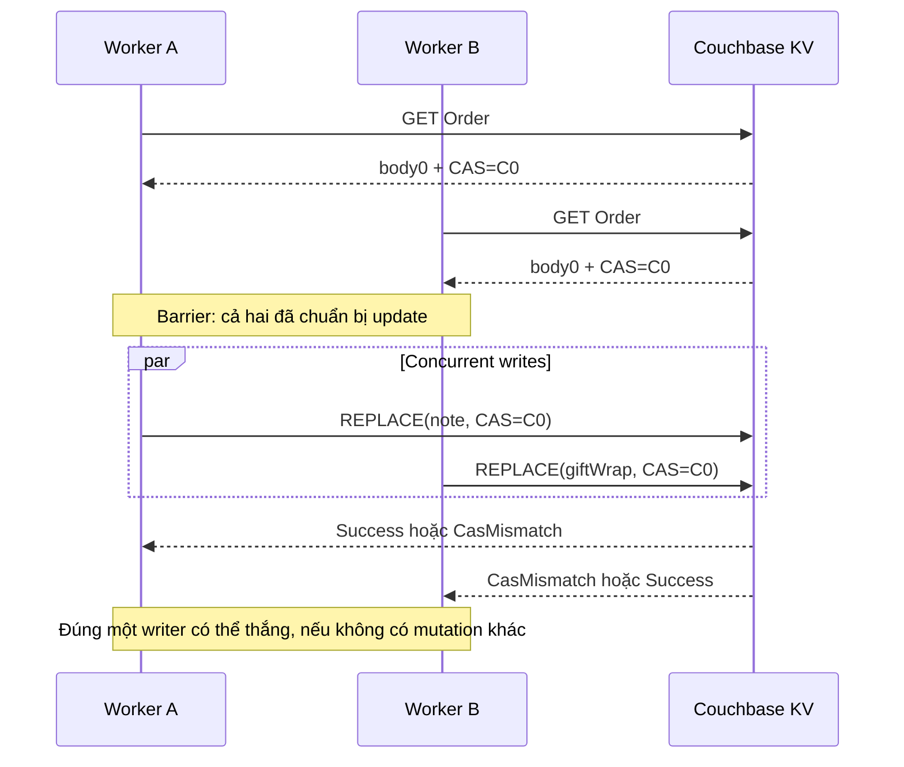
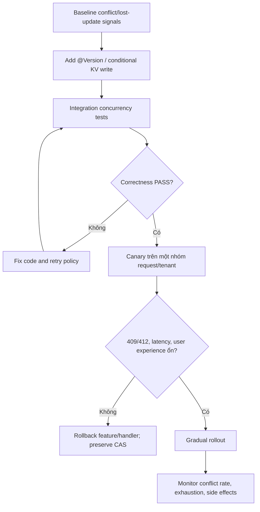

# Xử lý hai yêu cầu cập nhật cạnh tranh bằng CAS trong Spring Data Couchbase

## 1. Bối cảnh: hai người sửa cùng một Order

Một nhân viên chăm sóc khách hàng sửa ghi chú giao hàng trong đơn hàng; gần như cùng thời điểm, khách hàng bật tùy chọn gói quà. Hai request đều đọc bản Order ban đầu, sửa **hai trường khác nhau** và ghi lại **toàn document**. Nếu thao tác replace không có điều kiện đồng thời, một request có thể vô tình ghi đè giá trị vừa được request còn lại cập nhật. Đó là **lost update**, ngay cả khi từng request riêng lẻ chạy thành công.

Trong Couchbase, mỗi document có **CAS (Compare-And-Swap)** ở metadata. Một thao tác KV `replace` có điều kiện CAS chỉ thành công nếu document vẫn có CAS mà ứng dụng đã đọc. Nếu ai đó ghi vào document giữa lúc đọc và lúc replace, ứng dụng nhận lỗi xung đột và phải **đọc lại, đánh giá lại nghiệp vụ, tính lại bản cập nhật**. Không được lặp lại bản JSON cũ chỉ với CAS mới mà không xét thay đổi vừa xảy ra.

Bài thực hành này thuộc chương **Bài thực hành** của module **SPRING_DATA_COUCHBASE**: xây dựng tầng truy cập Couchbase bằng Spring Data document mapping, repository, `CouchbaseTemplate`, SQL++, KV SDK và reactive API; luyện cách thiết kế collection, xử lý CAS, tính nhất quán, TTL, transactions và vận hành đáng tin cậy. Trọng tâm là **hai yêu cầu cập nhật cạnh tranh trên cùng một document** — trước hết xác minh hành vi, sau đó mở rộng tới endpoint HTTP, retry có kiểm soát và kiểm thử hồi quy.

> **Phạm vi:** Các câu lệnh/đoạn Java dưới đây dành cho cluster **lab riêng** đã được cấp quyền. Giá trị thời gian, số request và kết quả “kỳ vọng” là kịch bản được thiết kế, **không phải kết quả chạy cluster thực**. Cần đối chiếu API với đúng phiên bản Couchbase Server, Java SDK và Spring Data Couchbase đang sử dụng.

## 2. Mục tiêu học tập và sản phẩm đầu ra

Sau khi hoàn thành, bạn phải:

1. Giải thích lost update bằng sơ đồ interleaving của hai writer và chỉ ra vì sao `GET → sửa object → save` có thể không an toàn.
2. Phân biệt **CAS metadata của Couchbase**, `@Version` trên Spring Data entity, `schemaVersion` nghiệp vụ và HTTP `ETag`.
3. Thử replace **không dùng CAS** để thấy một thay đổi bị ghi đè trong lab; kiểm chứng lại sau khi reset dữ liệu.
4. Dùng `GetResult.cas()` và `ReplaceOptions.cas(...)` để chỉ cho phép một trong hai writer với cùng CAS ban đầu thắng.
5. Thực hiện retry **đọc lại document hiện hành, áp dụng lại đúng ý định của request và replace bằng CAS mới**, có giới hạn.
6. Thiết lập test hai luồng với synchronization barrier, sao cho cả hai cùng đọc một phiên bản trước khi ghi, không dựa vào `Thread.sleep` may rủi.
7. Phân biệt cập nhật **hai field độc lập** (có thể hợp nhất) với cập nhật **cùng một trạng thái nghiệp vụ** (thường phải từ chối xung đột/đánh giá lại).
8. Dùng Spring Data `@Version`/repository để phát hiện optimistic locking; kiểm tra hành vi với entity mới, entity cũ, custom query và reactive publisher.
9. Mô tả cách trả `409 Conflict`, `412 Precondition Failed` hoặc yêu cầu lại phiên bản thông qua HTTP conditional update theo hợp đồng API.
10. Giữ nguyên TTL, phân loại timeout/`DocumentNotFoundException`/CAS conflict, hiểu vai trò của durability và transaction, không tạo side effect lặp khi retry.
11. Đo conflict rate, retry count, p95 và correctness; nộp bảng kết quả thật hoặc ghi rõ chưa chạy.

### 2.1. Bảng bàn giao

| Artefact | Nội dung cần nộp |
| --- | --- |
| Dữ liệu seed | JSON ban đầu, document ID, tenant, keyspace, điều kiện TTL |
| Lost-update log | Hai snapshot cùng phiên bản, thứ tự replace, final document và field bị mất |
| CAS conflict log | Hai CAS ban đầu, một success, một conflict, CAS sau ghi |
| Retry log | Số lượt đọc lại, kết quả cuối có đủ cả hai field |
| Spring Data test | `@Version` mapping, một save thắng, một optimistic locking conflict |
| API contract | Chính sách 409/412, retry, idempotency, quyền tenant |
| Test matrix | Một writer, hai writer, same-field, TTL, timeout, missing, khác tenant |
| Báo cáo | Kết quả dữ liệu, số conflict/retry, thời gian đo, những giới hạn chưa kiểm chứng |

**Definition of Done:** Test cho thấy **không mất cập nhật được chấp nhận**, xung đột có thể được phát hiện và xử lý theo chính sách, tài liệu cuối đúng, không có retry vô hạn, không làm thay đổi thời hạn sống ngoài chủ đích, và các thao tác chỉ chạm đúng collection/tenant lab.

## 3. Chuẩn bị môi trường và nguyên tắc an toàn

### 3.1. Yêu cầu

- Couchbase Server hỗ trợ KV operations với CAS và bucket/scope/collection.
- Bucket `commerce`, scope `sales`, collection `orders` của lab, hoặc một keyspace lab tương đương được cấp quyền.
- Java 17+ và Couchbase Java SDK 3.x; phiên bản chính xác lấy từ dependency BOM của ứng dụng.
- Khi thử Spring Data: Spring Data Couchbase tương thích SDK/Server và cấu hình document mapping/repository trên đúng keyspace.
- Quyền đọc, insert, replace, remove **chỉ trên dữ liệu lab**; không yêu cầu Primary/Secondary Index cho `KV get/replace` theo document ID.
- Chạy các thử nghiệm concurrency ở một application/runner riêng, có thể reset document giữa mỗi bài.

Không chạy test cố tình gây lost update trên dữ liệu production. Không dùng tài khoản service có quyền ghi mọi tenant để chạy ví dụ mà bỏ kiểm tra tenant.

### 3.2. Phiếu môi trường

| Thành phần | Giá trị cần điền |
| --- | --- |
| Couchbase Server / edition | Chưa xác định |
| Spring Data Couchbase | Chưa xác định |
| Couchbase Java SDK | Chưa xác định |
| Bucket/scope/collection | `commerce.sales.orders` trong lab |
| Document ID | `order::CAS-LAB-A::1001` |
| Tenant | `CAS-LAB-A` |
| Expiry/TTL policy | Chưa xác định |
| Timeout/durability level | Chưa xác định |
| Số vòng thử và concurrency | Chưa xác định |

### 3.3. Các quy tắc thao tác

1. Không xóa rộng bằng SQL++ `DELETE FROM ... WHERE tenantId=...` khi keyspace có dữ liệu chia sẻ.
2. Không dùng `upsert` làm “reset” nếu ID có nguy cơ trùng dữ liệu thật. Với seed, chỉ `insert` ID đã xác minh trống hoặc reset **đúng ID lab** theo quyền cho phép.
3. Mọi phương án trước/sau phải bắt đầu từ **cùng một JSON ban đầu**.
4. Không log PII hay nội dung Order thật; ví dụ chỉ dùng dữ liệu giả.
5. Dùng `CAS` khi giải quyết tranh chấp; không bỏ CAS chỉ để làm retry “thành công”.
6. Nếu integration test không chạy được do phiên bản/permission, ghi blocker và output thiếu; **không tạo kết quả giả**.

## 4. Dữ liệu và hợp đồng nghiệp vụ

### 4.1. Document Order ban đầu

Document ID `order::CAS-LAB-A::1001` trong `commerce.sales.orders`:

```json
{
  "_class": "salesOrder",
  "schemaVersion": 1,
  "tenantId": "CAS-LAB-A",
  "orderNumber": "ORD-CAS-1001",
  "status": "DRAFT",
  "deliveryNote": "Giao giờ hành chính",
  "giftWrap": false,
  "updatedAt": "2026-11-20T08:00:00Z"
}
```

Hai yêu cầu gần như đồng thời:

| Request | Người dùng giả định | Ý định thay đổi | Không được làm |
| --- | --- | --- | --- |
| A | Nhân viên hỗ trợ | `deliveryNote := "Gọi trước khi đến"` | Không đổi `giftWrap` |
| B | Khách hàng | `giftWrap := true` | Không đổi `deliveryNote` |

Đây là trường hợp **hai field độc lập theo hợp đồng demo**. Khi cả A và B đều được chấp nhận thành công, document cuối phải có:

```json
{
  "deliveryNote": "Gọi trước khi đến",
  "giftWrap": true
}
```

Các field còn lại (`tenantId`, `orderNumber`, `status`, `schemaVersion`, `_class`) phải được giữ nguyên. Metadata CAS sẽ đổi sau một mutation thành công; không sao chép CAS vào JSON field `schemaVersion`.

### 4.2. Vì sao chọn hai field độc lập?

Ví dụ này làm lost update dễ nhìn: request A chỉ muốn sửa note, nhưng có thể vô tình xóa thay đổi gift wrap của B nếu A dùng bản JSON cũ. Khi hai request **cùng sửa `status`**, bài toán khác: không thể đơn giản “giữ cả hai status”. Cần business rule hoặc yêu cầu caller đọc lại, không auto-merge.

### 4.3. Các bất biến phải kiểm tra

- Document tồn tại, thuộc tenant đã xác thực.
- Chỉ Order `DRAFT` mới được sửa note/giftWrap trong chính sách của lab.
- Request A chỉ thay đổi `deliveryNote`; request B chỉ thay đổi `giftWrap`.
- Nếu writer khác đổi `status` thành `CANCELLED` trong lúc retry, **phải từ chối** thay đổi chưa hợp lệ.
- Không biến lỗi permission/timeout thành “not found”.
- Một request đã được commit không được phát event thanh toán/giao hàng lặp lại vì CAS retry.
- CAS conflict không tự hàm ý khách hàng đã làm sai; đó là dấu hiệu dữ liệu thay đổi giữa đọc và ghi.

## 5. Seed document và đọc CAS hiện tại

### 5.1. Chèn dữ liệu ở collection lab

Có thể chèn một document bằng SQL++ `INSERT` trong môi trường đã cấp quyền:

```sql
INSERT INTO `commerce`.`sales`.`orders` (KEY, VALUE)
VALUES (
  "order::CAS-LAB-A::1001",
  {
    "_class": "salesOrder",
    "schemaVersion": 1,
    "tenantId": "CAS-LAB-A",
    "orderNumber": "ORD-CAS-1001",
    "status": "DRAFT",
    "deliveryNote": "Giao giờ hành chính",
    "giftWrap": false,
    "updatedAt": "2026-11-20T08:00:00Z"
  }
);
```

`INSERT` sẽ không tự ghi đè document đã có cùng ID. Nếu lab được chạy lại, dùng **quy trình reset một ID lab đã xác minh** thay vì đổi thành `UPSERT` và có nguy cơ xóa kết quả/thông tin của người khác.

### 5.2. Lấy CAS bằng Java SDK

```java
import com.couchbase.client.java.Cluster;
import com.couchbase.client.java.Collection;
import com.couchbase.client.java.kv.GetResult;

// cluster đã cấu hình kết nối và quyền, không tạo client mới cho mỗi request.
Collection orders = cluster.bucket("commerce")
    .scope("sales")
    .collection("orders");

GetResult result = orders.get("order::CAS-LAB-A::1001");

System.out.println(result.contentAsObject());
System.out.println(Long.toUnsignedString(result.cas()));
```

Giá trị CAS thực là **metadata của document**, lấy qua `GetResult.cas()`. Nó có thể được biểu diễn bằng số `long` trong Java SDK; khi trình bày cho người dùng hoặc truyền qua JSON/HTTP, cần giữ **nguyên vẹn 64 bit**, tránh ép qua kiểu số JavaScript có giới hạn chính xác.

### 5.3. CAS không phải timestamp hoặc version nghiệp vụ

CAS thường thay đổi khi document được mutation và dùng như một token opaque để so khớp. **Không** suy nó là đồng hồ, thứ tự thời gian giữa các document, biến đếm nghiệp vụ hay số luôn tăng. Không dùng CAS để hỏi “đơn hàng được cập nhật lúc nào”, để phân loại tenant, hay để quyết định ai có quyền thắng.

Field `schemaVersion: 1` chỉ nói **định dạng JSON** hiện tại. Nó không thay thế CAS và không nên tự tăng trong mỗi lần sửa note.

## 6. Lost update khi không dùng CAS

### 6.1. Hai request đọc cùng phiên bản

Giả sử:

```text
                       Document ban đầu
                 deliveryNote = "Giao giờ hành chính"
                 giftWrap = false, CAS = C0

Time       Request A                        Request B
----       ---------                        ---------
t1         GET -> bản gốc, CAS=C0
t2                                          GET -> bản gốc, CAS=C0
t3         Set deliveryNote="Gọi trước"
t4                                          Set giftWrap=true
t5         REPLACE toàn JSON không CAS
           -> C1, note mới, wrap=false
t6                                          REPLACE toàn JSON cũ không CAS
                                            -> C2, note cũ, wrap=true

Kết quả: A đã báo thành công, nhưng deliveryNote bị B ghi đè về giá trị cũ.
```

Đảo thứ tự ghi, `giftWrap` của B có thể bị mất. Một phép lưu thành công chỉ chứng minh ghi được document, **không chứng minh thao tác dựa trên snapshot mới nhất**.

### 6.2. Ví dụ Java gây lost update một cách có chủ đích

Đây là đoạn **chỉ được chạy trên document lab**, với hai snapshot cũ được chụp trước cả hai replace:

```java
import com.couchbase.client.java.Collection;
import com.couchbase.client.java.json.JsonObject;
import com.couchbase.client.java.kv.GetResult;

public final class UnsafeLostUpdateDemo {
    public static void run(Collection orders, String id) {
        GetResult snapshotA = orders.get(id);
        GetResult snapshotB = orders.get(id);

        JsonObject bodyA = JsonObject.fromJson(
            snapshotA.contentAsObject().toString()
        );
        JsonObject bodyB = JsonObject.fromJson(
            snapshotB.contentAsObject().toString()
        );

        bodyA.put("deliveryNote", "Gọi trước khi đến");
        bodyB.put("giftWrap", true);

        // Không có điều kiện CAS: cố ý minh họa code không an toàn.
        orders.replace(id, bodyA);
        orders.replace(id, bodyB);

        System.out.println(orders.get(id).contentAsObject());
    }
}
```

Hai bản A và B đã được lấy **trước** khi ghi. Lệnh thứ hai ghi lại toàn JSON cũ với giftWrap mới nên có thể **mất `deliveryNote` vừa được A cập nhật**. Trình tự này mô phỏng một interleaving cạnh tranh mà không cần chờ luồng may rủi; không khuyến nghị dùng hai `replace` không CAS trong hệ thống thật.

### 6.3. Vì sao không nên kết luận từ `updatedAt`?

Nếu cả hai writer tự set `updatedAt` thành thời gian hiện tại, giá trị cuối vẫn có thể nhìn “mới” nhưng dữ liệu khác đã bị mất. Một số hệ thống dùng timestamp client còn gặp lệch đồng hồ. CAS so sánh trạng thái lưu trữ **của đúng document**, không phụ thuộc đồng hồ client.

### 6.4. Bước kiểm chứng

1. Reset document về dữ liệu ở phần 4.
2. Chạy `UnsafeLostUpdateDemo.run` trên đúng ID lab.
3. Đọc lại qua KV GET.
4. Ghi `deliveryNote` và `giftWrap` thực tế.
5. Đánh dấu **FAIL về correctness** nếu request A/B cùng báo thành công nhưng một thay đổi biến mất.

Nếu không có kết nối lab, chỉ ghi **kỳ vọng của mô hình**, không ghi kết quả đã quan sát.

## 7. CAS đúng cách: một writer thắng, writer còn lại nhận conflict

### 7.1. KV conditional replace

```java
import com.couchbase.client.java.Collection;
import com.couchbase.client.java.json.JsonObject;
import com.couchbase.client.java.kv.GetResult;
import com.couchbase.client.java.kv.MutationResult;
import com.couchbase.client.core.error.CasMismatchException;

import static com.couchbase.client.java.kv.ReplaceOptions.replaceOptions;

public final class CasTwoSnapshotsDemo {
    public static void run(Collection orders, String id) {
        GetResult snapshotA = orders.get(id);
        GetResult snapshotB = orders.get(id);

        JsonObject a = JsonObject.fromJson(
            snapshotA.contentAsObject().toString()
        );
        JsonObject b = JsonObject.fromJson(
            snapshotB.contentAsObject().toString()
        );

        a.put("deliveryNote", "Gọi trước khi đến");
        b.put("giftWrap", true);

        MutationResult resultA = orders.replace(
            id, a, replaceOptions().cas(snapshotA.cas())
        );
        System.out.println(
            "A success; new CAS=" + Long.toUnsignedString(resultA.cas())
        );

        try {
            orders.replace(
                id, b, replaceOptions().cas(snapshotB.cas())
            );
            throw new AssertionError(
                "Expected CAS conflict for stale snapshot B"
            );
        } catch (CasMismatchException expected) {
            System.out.println("B conflict: stale CAS");
        }
    }
}
```

**Kỳ vọng:** A ghi thành công trước, CAS đổi từ C0 sang C1. B vẫn dùng C0 nên bị `CasMismatchException`; document cuối chứa note mới, gift wrap vẫn false **cho đến khi B retry đúng cách**.

Điều này chưa hoàn tất nghiệp vụ B; nó là **bước phát hiện và chặn mất dữ liệu**. B cần nhận conflict để client quyết định hoặc server rebase ý định update nếu có thể hợp nhất an toàn.

### 7.2. So CAS trước và sau

| Sự kiện | Expected CAS | Kết quả |
| --- | --- | --- |
| A đọc | C0 | Snapshot A |
| B đọc | C0 | Snapshot B |
| A replace với C0 | C0 match | Success, sinh C1 |
| B replace với C0 | Current đã C1 | Conflict, không overwrite |
| B đọc lại | C1 | Thấy note mới của A |
| B replace với C1 sau merge | C1 match nếu chưa có writer khác | Success, sinh C2 |

Các ký hiệu C0/C1/C2 **không** là con số CAS thật hay phép toán tăng một đơn vị. Chúng chỉ biểu diễn những phiên bản document khác nhau.

### 7.3. Bẫy: `get` nhiều lần rồi dùng CAS không tương ứng

Không lấy body từ một `GetResult` và CAS từ một lần GET khác rồi cho rằng chúng tạo thành cùng một snapshot. Lệnh conditional replace nên dùng **body được tính từ snapshot vừa lấy cùng CAS**, hoặc một ứng dụng-level protocol chứng minh token và dữ liệu tương ứng.

### 7.4. Bẫy: bắt conflict rồi lặp lại JSON cũ

Sai:

```java
// Sai: chỉ thay CAS trong khi vẫn giữ bodyB cũ.
GetResult latest = orders.get(id);
orders.replace(id, b, replaceOptions().cas(latest.cas()));
```

Lệnh này có thể thành công nhưng lại **ghi đè note mới của A**, xóa lợi ích của CAS. Retry đúng phải **tạo lại body từ `latest.contentAsObject()`**, rồi chỉ áp dụng thay đổi có chủ đích của B.

## 8. Retry có giới hạn, đọc lại và hợp nhất theo ý định

### 8.1. Tách command/intent khỏi snapshot

Trong demo, command nên mang ý định nhỏ:

```text
SetDeliveryNote(orderId, "Gọi trước khi đến")
SetGiftWrap(orderId, true)
```

Không mang “toàn bộ Order JSON ở phiên bản C0” như một giá trị có thể overwrite lại tùy ý. Tầng service lấy Order hiện hành và thay đổi **chỉ field thuộc command**.

### 8.2. Java: retry dựa trên state mới

```java
import com.couchbase.client.core.error.CasMismatchException;
import com.couchbase.client.core.error.DocumentNotFoundException;
import com.couchbase.client.java.Collection;
import com.couchbase.client.java.json.JsonObject;
import com.couchbase.client.java.kv.GetResult;

import static com.couchbase.client.java.kv.ReplaceOptions.replaceOptions;

public final class OrderPatchService {
    private final Collection orders;
    private final String trustedTenant;

    public OrderPatchService(Collection orders, String trustedTenant) {
        this.orders = orders;
        this.trustedTenant = trustedTenant;
    }

    public String setGiftWrap(String id, boolean giftWrap) {
        for (int attempt = 1; attempt <= 3; attempt++) {
            final GetResult current;
            try {
                current = orders.get(id);
            } catch (DocumentNotFoundException missing) {
                return "NOT_FOUND";
            }

            JsonObject body = JsonObject.fromJson(
                current.contentAsObject().toString()
            );

            if (!trustedTenant.equals(body.getString("tenantId"))) {
                throw new SecurityException("Tenant mismatch");
            }
            if (!"DRAFT".equals(body.getString("status"))) {
                return "NOT_EDITABLE";
            }

            if (Boolean.valueOf(giftWrap).equals(
                    body.getBoolean("giftWrap"))) {
                return "ALREADY_APPLIED";
            }

            // Chỉ cập nhật field mà command được phép thay đổi.
            body.put("giftWrap", giftWrap);
            try {
                orders.replace(
                    id, body,
                    replaceOptions()
                        .cas(current.cas())
                        .preserveExpiry(true)
                );
                return "UPDATED";
            } catch (CasMismatchException changedMeanwhile) {
                if (attempt == 3) {
                    return "CONFLICT_RETRY_EXHAUSTED";
                }
                // Lượt sau GET mới, validate lại tenant/status,
                // tính body mới và CAS mới. Không reuse body cũ.
            }
        }
        throw new IllegalStateException("Unreachable");
    }
}
```

**Giới hạn ví dụ:** Code dùng string outcomes để dễ đọc trong lab. Ứng dụng thật nên dùng enum/result type, structured logging, deadline, backoff/jitter có giới hạn khi tải lớn, metrics và policy phân quyền. Tùy SDK version, cần xác minh `preserveExpiry(true)` được Server hỗ trợ và behavior khi collection có max TTL. Không giả định mọi lỗi `replace` đều là CAS mismatch.

### 8.3. Vì sao `ALREADY_APPLIED` hữu ích?

Khi retry, một request khác có thể đã áp dụng cùng `giftWrap=true`. Nếu đọc thấy field đã đúng và chính sách là assignment idempotent, không cần replace lại, tránh đổi CAS/TTL và tăng write load.

Đối với lệnh `increment` hoặc `appendEvent`, không thể đơn giản “nhìn giống đã áp dụng” mà suy ra idempotent. Những command có side effect không lặp được cần **request ID/idempotency key** riêng và điều kiện nghiệp vụ rõ.

### 8.4. Kết quả cuối sau retry đúng

Nếu A đã ghi note mới và B retry từ document hiện hành, JSON cuối kỳ vọng:

```json
{
  "tenantId": "CAS-LAB-A",
  "orderNumber": "ORD-CAS-1001",
  "status": "DRAFT",
  "deliveryNote": "Gọi trước khi đến",
  "giftWrap": true,
  "schemaVersion": 1
}
```

Đây là **các field liên quan** để kiểm chứng; một lần replace đúng cũng giữ những field còn lại như `_class` và `updatedAt` theo policy. Nếu cần cập nhật `updatedAt`, hãy làm trong cùng mutation thành công với thời gian server/application được chuẩn hóa, không dùng nó để thay CAS.

## 9. Hai request thực sự cạnh tranh bằng synchronization barrier

Để tránh test phụ thuộc may rủi scheduling, yêu cầu hai worker cùng **GET một CAS ban đầu** rồi chờ một barrier trước khi `replace`.



### 9.1. Java concurrency harness

```java
import java.util.List;
import java.util.concurrent.Callable;
import java.util.concurrent.CountDownLatch;
import java.util.concurrent.ExecutorService;
import java.util.concurrent.Executors;
import java.util.concurrent.Future;
import java.util.concurrent.TimeUnit;

import com.couchbase.client.core.error.CasMismatchException;
import com.couchbase.client.java.Collection;
import com.couchbase.client.java.json.JsonObject;
import com.couchbase.client.java.kv.GetResult;

import static com.couchbase.client.java.kv.ReplaceOptions.replaceOptions;

public final class CasRaceHarness {

    public static List<String> runRace(Collection orders, String id)
            throws Exception {
        GetResult snapshotA = orders.get(id);
        GetResult snapshotB = orders.get(id);
        if (snapshotA.cas() != snapshotB.cas()) {
            throw new IllegalStateException(
                "Document changed during setup; reset lab"
            );
        }

        CountDownLatch prepared = new CountDownLatch(2);
        CountDownLatch start = new CountDownLatch(1);
        ExecutorService pool = Executors.newFixedThreadPool(2);
        try {
            Callable<String> taskA = () -> attempt(
                orders, id, snapshotA, "deliveryNote",
                "Gọi trước khi đến", prepared, start
            );
            Callable<String> taskB = () -> attempt(
                orders, id, snapshotB, "giftWrap",
                true, prepared, start
            );

            Future<String> a = pool.submit(taskA);
            Future<String> b = pool.submit(taskB);
            if (!prepared.await(5, TimeUnit.SECONDS)) {
                throw new IllegalStateException(
                    "Workers did not reach the barrier"
                );
            }
            start.countDown();

            return List.of(
                a.get(10, TimeUnit.SECONDS),
                b.get(10, TimeUnit.SECONDS)
            );
        } finally {
            start.countDown();
            pool.shutdownNow();
        }
    }

    private static String attempt(
            Collection orders, String id, GetResult snapshot,
            String field, Object value,
            CountDownLatch prepared, CountDownLatch start
    ) throws InterruptedException {
        JsonObject body = JsonObject.fromJson(
            snapshot.contentAsObject().toString()
        );
        body.put(field, value);
        prepared.countDown();
        if (!start.await(5, TimeUnit.SECONDS)) {
            throw new IllegalStateException("Barrier timeout");
        }

        try {
            orders.replace(
                id, body,
                replaceOptions()
                    .cas(snapshot.cas())
                    .preserveExpiry(true)
            );
            return field + ": UPDATED";
        } catch (CasMismatchException expected) {
            return field + ": CONFLICT";
        }
    }
}
```

**Cách gọi thử** (giả định `orders` và `id` đã được cấu hình như phần 5):

```java
var results = CasRaceHarness.runRace(
    orders, "order::CAS-LAB-A::1001"
);
System.out.println(results);
System.out.println(
    orders.get("order::CAS-LAB-A::1001").contentAsObject()
);
```

Đối với đúng một document không có writer bên ngoài, khi cả hai attempt dùng cùng CAS, **kỳ vọng có đúng 1 `UPDATED` và 1 `CONFLICT`**. Không xác định trước A hay B thắng: kết quả phụ thuộc lịch thực thi, nhưng không có lost update.

### 9.2. Test không tự động hoàn tất request bị conflict

Harness chỉ cho thấy cơ chế CAS; nó **không retry** loser. Muốn cả hai thay đổi cùng được chấp nhận, sau conflict hãy gọi lại command **theo ý định** trên document mới, ví dụ `OrderPatchService.setGiftWrap` nếu B thua, hoặc một method `setDeliveryNote` tương ứng nếu A thua. Không dùng snapshot stale trong harness để retry.

### 9.3. Tại sao không dùng `Thread.sleep(50)`?

Sleep làm khả năng race lớn hơn hoặc nhỏ hơn nhưng không buộc hai worker cùng quan sát C0. Một test có thể “đôi khi xanh, đôi khi đỏ” mà không chứng minh cơ chế. Barrier/latch có timeout tạo điều kiện thử có thể lặp lại.

### 9.4. Kết quả cần ghi

| Lượt | CAS trước của A | CAS trước của B | Winner | Loser | CAS sau | Kết quả field |
| --- | --- | --- | --- | --- | --- | --- |
| 1 | Chưa đo | Chưa đo | Chưa đo | Chưa đo | Chưa đo | Chưa kiểm |
| 2 | Chưa đo | Chưa đo | Chưa đo | Chưa đo | Chưa đo | Chưa kiểm |
| 3 | Chưa đo | Chưa đo | Chưa đo | Chưa đo | Chưa đo | Chưa kiểm |

Khi in CAS, dùng representation không mất chính xác; không gán một con số cố định trong bài làm là CAS mặc định của Couchbase.

## 10. Xung đột cùng một field: không phải lúc nào cũng retry và merge

### 10.1. Hai yêu cầu thay cùng status

Ví dụ:

```text
Order.status = PENDING, CAS=C0

Request A: status -> APPROVED
Request B: status -> CANCELLED
```

Nếu A thắng, B bị CAS mismatch. **Không tự động** đọc lại `APPROVED` rồi ghi `CANCELLED` chỉ vì B vẫn muốn vậy. Có thể trạng thái `APPROVED` không cho phép hủy, hoặc B cần xác nhận mới.

### 10.2. Phân loại command theo tính chất

| Command | Có thể tự retry với state mới? | Điều kiện |
| --- | --- | --- |
| `setGiftWrap(true)` | Có thể | Trạng thái Order còn cho phép, quyền hợp lệ, assignment idempotent |
| `setDeliveryNote(text)` | Có thể | User còn quyền, không có conflicting edit trên chính note |
| `status: PENDING→APPROVED` | Không mặc định | Phải kiểm tra state machine trên bản hiện hành |
| `status: PENDING→CANCELLED` | Không mặc định | Có thể xung đột với APPROVED |
| `incrementInventory(-1)` | Cần giao thức riêng | Không được trừ dưới 0, idempotency và cập nhật có điều kiện |
| `chargePayment` | Không retry side effect mù | Idempotency key và payment state |

### 10.3. Same-field conflict cần hợp đồng rõ

Nếu A và B đều đổi `deliveryNote` thành hai giá trị khác nhau:

- Có thể áp dụng **first-writer-wins** với thông báo conflict cho B.
- Có thể yêu cầu client GET version mới và xác nhận thay đổi.
- Có thể dùng policy “last-writer-wins” **chủ đích**, nhưng phải công khai ý nghĩa và rủi ro.
- Không gọi “merge tự động” nếu một field chỉ có thể chứa một giá trị.

CAS là **cơ chế phát hiện**, không phải trọng tài nghiệp vụ quyết định request nào đúng hơn.

## 11. CAS, dữ liệu gốc và lỗi TOCTOU

### 11.1. Kiểm tra nghiệp vụ rồi ghi là một cửa sổ race

Nếu service làm:

```java
SalesOrder order = repository.findById(id).orElseThrow();
if ("DRAFT".equals(order.getStatus())) {
    // Thời gian có thể trôi qua ở đây.
    repository.save(orderWithNewDeliveryNote);
}
```

việc check `DRAFT` **không bảo đảm** khi save Order vẫn DRAFT. Phải gắn check với một conditional write, ví dụ CAS qua `@Version` hoặc SDK. Nếu CAS fail, đọc lại và **kiểm tra lại status**; không tiếp tục dựa trên status cũ.

### 11.2. CAS chặn sửa cạnh tranh trên một document

CAS có thể ngăn một writer ghi đè document đã bị sửa trong khoảng đọc–ghi. Nó **không** tự bảo vệ:

- Customer/Shipment ở collection khác cùng thay đổi.
- Tính duy nhất của `orderNumber` qua các document.
- Quy tắc “chỉ một đơn đã APPROVED mỗi tài khoản” nếu nằm trên nhiều document.
- Thao tác bên ngoài database như gửi email hoặc thu tiền.
- Writer không dùng CAS và vẫn được phép `upsert`/`replace` mù.

Nếu invariant trải nhiều document, cần thiết kế transaction hoặc shared guard/state protocol và kiểm thử race ở mọi writer.

### 11.3. CAS không thay validation/authorization

Một request có thể dùng đúng CAS C0 nhưng vẫn mang `tenantId` giả, `deliveryNote` quá dài hoặc trạng thái không hợp lệ. Tầng service phải kiểm tra identity, quyền và business rule **trước khi ghi**; khi retry cần kiểm tra lại rule trên bản mới.

## 12. Phân loại lỗi: conflict khác not found và unavailable

| Trạng thái | Dấu hiệu | Xử lý phù hợp |
| --- | --- | --- |
| Thao tác thành công | `replace` trả mutation result | Trả dữ liệu/CAS mới, ghi audit |
| CAS mismatch | `CasMismatchException` hoặc Spring optimistic lock failure | 409/412 theo API; hoặc re-read/rebase có giới hạn |
| Document không tồn tại | `DocumentNotFoundException` | 404/contract; không tạo mới ngoài ý định |
| Tenant khác/quyền không hợp lệ | Policy/RBAC từ chối | 403/404 theo chính sách chống rò rỉ tồn tại |
| Timeout/network unavailable | Operation không hoàn thành rõ ràng | Retry theo deadline, xem lại state; không gắn nhãn conflict tự động |
| Mutation đã thành công nhưng response mất | Ambiguous result có thể xảy ra | Re-read state + idempotency, không lặp side effect |
| Validation thất bại | Note vượt giới hạn, trạng thái không cho sửa | 400/409 theo API nghiệp vụ |

**Không bắt `Exception` rồi convert mọi lỗi thành `CasMismatchException`** hoặc “đổi JSON rồi thử lại”. Điều đó làm mất tín hiệu hạ tầng và có thể ghi đè dữ liệu trong lúc cụm gặp lỗi.

### 12.1. `replace` chứ không phải `upsert`

Trong lab, chỉ sửa Order có sẵn. `replace(id,body,casOptions)` áp dụng vào document hiện có; `upsert` không phải cách thực hiện optimistic locking khi bạn muốn ngăn tạo mới/ghi đè vô điều kiện. Nếu document đã bị xóa hoặc hết TTL, request cập nhật không được tự sinh Order mới.

### 12.2. Lỗi `DocumentNotFound` trong khi retry

Có thể B đọc Order ở C0, A xóa Order trước khi B replace. B có thể gặp not found thay vì CAS mismatch, tùy state/method. Không được tự `insert` lại Order đã xóa nếu nghiệp vụ không cho phép. Tách rõ **deleted/missing** khỏi **concurrent update**.

### 12.3. Đừng suy nguyên nhân expiry từ not found

Một document vắng mặt có thể chưa từng tồn tại, đã bị xóa hoặc hết TTL. Không kết luận chính xác “expired” chỉ từ KV lookup. Nếu cần biết lịch sử, thiết kế audit/tombstone theo retention.

## 13. Tính idempotent và side effect khi retry

### 13.1. Assignment khác increment

`setGiftWrap(true)` thường là thao tác **idempotent về trạng thái cuối**: áp dụng lại vẫn cho true. `incrementPoints(10)` không idempotent: áp dụng hai lần tăng 20. CAS conflict retry **không** làm một command có side effect trở thành idempotent.

### 13.2. External side effect không rollback cùng CAS

Mẫu sai:

```text
sendEmail("Order updated")
attempt CAS replace
if CAS mismatch:
    retry:
      sendEmail("Order updated") again
      attempt replace again
```

Có thể gửi nhiều email dù document chỉ được cập nhật một lần. Thay vào đó:

1. Xác nhận mutation thành công.
2. Ghi event/outbox theo giao thức phù hợp.
3. Consumer xử lý theo idempotency key.
4. Retry chỉ những bước chưa hoàn tất và có thể nhận diện trùng.

Nếu cần cập nhật document + outbox một cách nguyên tử, cân nhắc transaction được SDK hỗ trợ hoặc một workflow có reconciliation; CAS trên Order **không** tự commit cả message broker.

### 13.3. Idempotency key cho request

Một API có thể nhận `Idempotency-Key` do client tạo. Server lưu kết quả của một command theo key trong đúng phạm vi tenant/operation. Khi retry vì timeout, kiểm tra key để tránh nhân side effect.

Idempotency key không thay CAS: CAS giải quyết **concurrent modification**, còn idempotency giải quyết **lặp cùng một business command**. Hai cơ chế bổ trợ nhau.

## 14. TTL và CAS: không vô tình làm mới hạn tồn tại

### 14.1. TTL là metadata riêng

Order trong lab có thể được tạo với expiry. CAS update chỉ phát hiện stale document; nó **không tự bảo đảm TTL được giữ nguyên**. Một thao tác replace/upsert có thể ảnh hưởng expiry tùy option và chính sách collection/Server version.

Khi nghiệp vụ yêu cầu giữ hạn gốc, dùng tùy chọn SDK hỗ trợ bảo toàn expiry, ví dụ:

```java
orders.replace(
    id,
    updatedJson,
    replaceOptions()
        .cas(current.cas())
        .preserveExpiry(true)
);
```

`current` và `updatedJson` là các biến trong bước update đã được validation. Xác minh `preserveExpiry` hỗ trợ ở version thực; không sử dụng “CAS đúng” làm lý do bỏ kiểm tra expiry.

### 14.2. Lab TTL riêng

1. Tạo **ID Order tạm riêng** với TTL ngắn, không dùng Order seed chính.
2. Dùng API/metadata mà SDK/Server version hỗ trợ để ghi nhận expiry.
3. Thực hiện replace có CAS và preserve expiry.
4. Kiểm tra expiry vẫn theo chính sách, không bị gia hạn ngoài ý định.
5. Sau thời điểm hết hạn và khoảng kiểm tra có giới hạn, xác minh document không còn đọc được như bình thường.
6. Khi B retry sau expiry, xem kết quả **NOT_FOUND**, không tạo Order mới.

Không chạy test TTL bằng `Thread.sleep` vô hạn. TTL có thể làm document mất trong lúc thử concurrency; tách riêng phép thử để không nhầm với CAS conflict.

## 15. Durability, scan consistency và transaction: ba vấn đề khác CAS

| Cơ chế | Câu hỏi nó giúp trả lời | Nó không tự làm |
| --- | --- | --- |
| **CAS** | Document có còn đúng phiên bản đã đọc trước replace không? | Không bảo đảm durability, FK, nhiều document atomic |
| **Durability level** | Mutation cần được xác nhận theo mức bền vững nào? | Không tự ngăn stale write nếu không dùng CAS |
| **GSI scan consistency** | SQL++ query qua index có phải chờ thấy mutation mới? | Không thay KV CAS, không khóa mọi writer |
| **Transaction** | Nhiều mutation tham gia có thể commit như đơn vị trong phạm vi hỗ trợ? | Không tự làm mọi writer ngoài transaction tuân thủ invariant |

### 15.1. KV GET/replace theo ID không đòi GSI

Mọi thao tác trọng tâm bài này dùng **KV document ID**, không cần tạo primary hoặc composite index chỉ để `get`/`replace`. Nếu ứng dụng tìm Order qua SQL++ theo `orderNumber` để lấy ID rồi mới KV update, query discovery cần index/consistency phù hợp, nhưng **CAS lấy từ KV GET mới nhất** vẫn là token dùng cho replace.

### 15.2. `NOT_BOUNDED` và `REQUEST_PLUS`

Global Secondary Index được cập nhật bất đồng bộ. SQL++ tìm document bằng field có thể chưa thấy mutation mới dưới `NOT_BOUNDED`; `REQUEST_PLUS` có thể yêu cầu chờ index bắt kịp trước query. Độ mới của GSI **không giải quyết** lost update nếu phần ghi vẫn `replace` không CAS.

### 15.3. CAS vs transaction

Khi hai request chỉ sửa **cùng một Order**, CAS là công cụ trọng tâm. Nếu business muốn cập nhật Order và một Customer/Inventory document **nguyên tử**, cần cân nhắc Couchbase transactions hoặc stateful workflow với guard/idempotency theo phiên bản/giới hạn. Transaction cũng cần thiết kế conflict/retry đúng; không tự suy “dùng transaction” là đủ cho mọi điều kiện nghiệp vụ.

### 15.4. Timeout trong tình huống commit chưa rõ

Nếu replace timeout, client không chắc server đã ghi hay chưa. Không gửi lại một lệnh `increment` hoặc side effect mà không kiểm tra trạng thái/idempotency. Với `setGiftWrap(true)`, re-read và so state hiện hành trước retry; nếu một writer khác vừa đổi lại false, business vẫn phải quyết định có được ép true hay cần báo conflict.

## 16. Spring Data Couchbase `@Version` và optimistic locking

### 16.1. Entity mapping

Spring Data Couchbase hỗ trợ quản lý CAS qua `@Version` cho entity trong các phiên bản phù hợp. Một entity cho document lab:

```java
import org.springframework.data.annotation.Id;
import org.springframework.data.annotation.TypeAlias;
import org.springframework.data.annotation.Version;
import org.springframework.data.couchbase.core.mapping.Collection;
import org.springframework.data.couchbase.core.mapping.Document;
import org.springframework.data.couchbase.core.mapping.Scope;

@Document
@TypeAlias("salesOrder")
@Scope("sales")
@Collection("orders")
public class SalesOrder {
    @Id
    private String id;

    @Version
    private Long version;

    private Integer schemaVersion;
    private String tenantId;
    private String orderNumber;
    private String status;
    private String deliveryNote;
    private boolean giftWrap;
    private String updatedAt;

    public Long getVersion() { return version; }
    public String getId() { return id; }
    public String getTenantId() { return tenantId; }
    public String getStatus() { return status; }
    public String getDeliveryNote() { return deliveryNote; }
    public boolean isGiftWrap() { return giftWrap; }

    public void setDeliveryNote(String deliveryNote) {
        this.deliveryNote = deliveryNote;
    }
    public void setGiftWrap(boolean giftWrap) {
        this.giftWrap = giftWrap;
    }

    // Thêm constructor/getters/setters hoặc mapping theo cấu hình
    // của phiên bản Spring Data thực tế.
}
```

`@Id` biểu diễn document key. `@Version` dùng cho **optimistic locking / CAS**, không phải field JSON `schemaVersion`. `schemaVersion` cho biết cấu trúc document; không được dùng nó thay `version` khi hai request tranh chấp.

Trong một số phiên bản Spring Data Couchbase, `@Version` được quản lý như metadata CAS thay vì trường JSON thông thường. Vì vậy, **không tự chèn field `version` vào JSON seed** nếu mục đích là CAS. Hãy kiểm tra document sau khi repository lưu và đường mapping thực của phiên bản bạn dùng.

### 16.2. Repository

```java
import org.springframework.data.couchbase.repository.CouchbaseRepository;

public interface SalesOrderRepository
        extends CouchbaseRepository<SalesOrder, String> {
}
```

Việc gọi `repository.findById(id)` thường đọc document bằng KV theo ID, không cần primary index. Khi lưu entity có `@Version`, Spring Data có thể dùng CAS để phát hiện optimistic locking conflict. Đừng suy rằng một custom `@Query` update hoặc SDK replace ngoài repository tự được áp dụng cùng logic: mỗi write path phải được kiểm tra riêng.

### 16.3. Thử hai entity được đọc trước khi có mutation

```java
import org.springframework.dao.OptimisticLockingFailureException;

String id = "order::CAS-LAB-A::1001";

SalesOrder a = repository.findById(id).orElseThrow();
SalesOrder b = repository.findById(id).orElseThrow();

System.out.println("A version=" + a.getVersion());
System.out.println("B version=" + b.getVersion());

a.setDeliveryNote("Gọi trước khi đến");
repository.save(a);

b.setGiftWrap(true);
try {
    repository.save(b);
    throw new AssertionError("Expected optimistic locking conflict");
} catch (OptimisticLockingFailureException expected) {
    System.out.println("Stale Spring Data entity rejected");
}
```

**Kỳ vọng:** Khi cả hai entity thực sự mang version của cùng trạng thái ban đầu và A ghi trước, `save(b)` gặp optimistic locking failure tương ứng. Spring có thể bọc lỗi SDK thành exception thuộc hierarchy Spring Data; kiểm tra exact type trong dependency/version thật. Đoạn trên chỉ minh họa semantic, không tuyên bố đã compile hoặc kiểm thử framework.

### 16.4. Khi tạo entity mới

Không dùng một CAS bất kỳ từ document khác hoặc ép `@Version` bằng một số tự nghĩ ra. Với entity mới, để Spring Data nhận biết trạng thái new theo quy tắc ID/version mapping của phiên bản. Quy tắc create/insert khác update/replace; kiểm tra `save`/`insert` và ID uniqueness với dữ liệu lab trước khi thiết kế service.

### 16.5. Retry Spring Data phải re-fetch entity

Sai:

```java
try {
    repository.save(staleEntity);
} catch (OptimisticLockingFailureException conflict) {
    repository.save(staleEntity); // Vẫn stale.
}
```

Đúng về mặt thuật toán:

```text
on OptimisticLockingFailureException:
    re-fetch entity from repository
    validate tenant, permission, state transitions
    apply only command's intended field(s)
    save with fresh @Version
    retry bounded, else return conflict
```

Nếu hai request sửa cùng field hoặc tạo side effect không idempotent, không tự merge trừ khi business contract cho phép. Nếu repository trả full entity có association, cân nhắc chi phí tải không cần thiết/`@N1qlJoin` và mapping trước khi thiết kế đường update.

## 17. `CouchbaseTemplate`, sub-document mutation và ranh giới CAS

Một ứng dụng có thể cập nhật Order bằng `CouchbaseTemplate`, repository hoặc trực tiếp Java SDK. Những đường write này có thể khác nhau về mapping, CAS và cách phát hiện entity mới:

| Đường truy cập | Điều cần kiểm chứng |
| --- | --- |
| Repository `save(entity)` có `@Version` | Spring Data có dùng/refresh CAS đúng phiên bản? |
| `CouchbaseTemplate` / `CouchbaseOperations` | Method update đang gọi thực chất KV/Query gì, có conditional CAS không? |
| Java SDK `replace(id,body,cas)` | CAS được truyền trực tiếp từ snapshot nào? |
| Java SDK sub-document mutate | Có dùng CAS option khi cần kiểm tra phiên bản gốc không? |
| SQL++ `UPDATE` | Có điều kiện/transaction thích hợp, update count/returning được kiểm tra không? |

### 17.1. Sub-document mutation không tự có business conflict policy

Nếu chỉ sửa `giftWrap`, sub-document API có thể giảm lượng JSON phải gửi và tránh việc dựng lại cả body. Nhưng đừng suy từ “update một path” rằng:

- Tất cả invariants giữa các field đã được kiểm tra.
- Hai request không thể xung đột về state.
- Client đã thực hiện CAS precondition phù hợp.
- Mutation có thể auto-merge mọi tình huống.

Với operation nào yêu cầu precondition “chỉ update nếu toàn document chưa đổi kể từ lúc đọc”, hãy sử dụng CAS option/kiểm chứng behavior của sub-document API theo SDK version. Với operation cộng đếm nguyên tử/điều kiện, chọn API và quy tắc bất biến riêng; đừng biến mọi thao tác thành full-document replace nếu không cần.

### 17.2. SQL++ `UPDATE` cần thiết kế điều kiện riêng

Một SQL++ `UPDATE` có thể thay field của document, nhưng **không được mặc định** Spring Data `@Version` sẽ tự áp dụng cho câu DML tùy chỉnh. Nếu cập nhật qua query, phải có cơ chế kiểm chứng precondition phù hợp — ví dụ điều kiện trên trạng thái/version trong phạm vi truy vấn và kiểm số rows/transaction khi được hỗ trợ — hoặc chuyển sang KV GET/CAS khi yêu cầu optimistic locking của một ID.

Không đặt primary index chỉ để update một Order theo ID. Khi đã biết ID và chỉ cần cạnh tranh trên một document, KV là đường tự nhiên để lab nhìn rõ CAS.

## 18. Reactive: retry publisher phải đọc lại state

### 18.1. Reactive repository không tự làm mất xung đột

`ReactiveCouchbaseRepository` cung cấp `Mono`/`Flux` cho I/O reactive; nó **không** cho phép một entity stale được lưu an toàn chỉ vì pipeline bất đồng bộ. Với `@Version`, optimistic locking vẫn là mối quan tâm của write path.

```java
import java.time.Duration;
import org.springframework.dao.OptimisticLockingFailureException;
import reactor.core.publisher.Mono;
import reactor.util.retry.Retry;

public Mono<SalesOrder> setGiftWrapReactive(
        ReactiveSalesOrderRepository repository,
        String id,
        String trustedTenant,
        boolean giftWrap) {

    return Mono.defer(() ->
            repository.findById(id)
                .switchIfEmpty(Mono.error(
                    new java.util.NoSuchElementException("Order missing")
                ))
                .flatMap(order -> {
                    if (!trustedTenant.equals(order.getTenantId())) {
                        return Mono.error(new SecurityException(
                            "Tenant mismatch"
                        ));
                    }
                    if (!"DRAFT".equals(order.getStatus())) {
                        return Mono.error(new IllegalStateException(
                            "Order cannot be edited"
                        ));
                    }
                    if (order.isGiftWrap() == giftWrap) {
                        return Mono.just(order);
                    }
                    order.setGiftWrap(giftWrap);
                    return repository.save(order);
                })
        )
        .retryWhen(Retry.backoff(2, Duration.ofMillis(25))
            .filter(error ->
                error instanceof OptimisticLockingFailureException
            ));
}
```

`ReactiveSalesOrderRepository` là interface reactive của ứng dụng, mở rộng `ReactiveCouchbaseRepository<SalesOrder,String>`. `Mono.defer` giúp mỗi lần resubscribe sau CAS conflict chạy lại **cả bước `findById` và business validation**, không phát lại mã save với entity đã stale.

### 18.2. Giới hạn của ví dụ

- Số retry là **giới hạn**, không phải quy tắc bắt buộc cho production.
- Backoff/jitter, deadline và loại exception tùy cấu hình/version.
- Nếu `save` có thể commit nhưng response ambiguous, cần re-read/idempotency thay vì xem mọi timeout là optimistic locking.
- `retryWhen` chỉ xử lý lỗi lọt qua filter; khi retry cạn sẽ phát error, service cần ánh xạ sang kết quả/API phù hợp.
- Nếu hai request đổi cùng field, không tự retry bất chấp business intent.
- Không chèn `subscribe()` thủ công trong controller rồi trả thành công trước terminal signal.

### 18.3. Khi dùng SDK reactive trực tiếp

Tương tự đồng bộ, SDK reactive có thể cung cấp GET/replace với CAS, nhưng kiểu kết quả, exception mapping và operator phải theo version. Cách tiếp cận vẫn là **read fresh → validate → build patch → conditional write → handle conflict**. `flatMap` concurrency không thay thế CAS; nhiều request đồng thời có thể làm conflict rate tăng.

## 19. REST API: `ETag`, `If-Match` và trả conflict rõ ràng

### 19.1. Vì sao cần HTTP precondition?

Trong ứng dụng web:

1. Client GET Order, hiển thị note và giftWrap.
2. Client A sửa note; client B mở form từ lúc trước.
3. Nếu PATCH của B không mang thông tin phiên bản nào, backend không biết B có chấp nhận phiên bản mới của A hay không.

HTTP cung cấp `ETag` và `If-Match` để nói “chỉ cập nhật nếu phiên bản tài nguyên vẫn như lúc tôi đọc”. ETag có thể chứa một token opaque được server tạo từ CAS **khi hợp đồng API cho phép**, hoặc một version token riêng được quản lý; không cần công khai giá trị CAS như một con số có ý nghĩa.

### 19.2. Ví dụ trao đổi HTTP

```http
GET /lab/orders/order::CAS-LAB-A::1001 HTTP/1.1
Authorization: Bearer <lab-token>

HTTP/1.1 200 OK
ETag: "cas-<opaque-64bit-value>"
Content-Type: application/json

{"deliveryNote":"Giao giờ hành chính","giftWrap":false}
```

Client A và B đọc cùng ETag, rồi:

```http
PATCH /lab/orders/order::CAS-LAB-A::1001/delivery-note HTTP/1.1
Authorization: Bearer <lab-token>
If-Match: "cas-<opaque-64bit-value>"
Content-Type: application/json

{"deliveryNote":"Gọi trước khi đến"}
```

```http
PATCH /lab/orders/order::CAS-LAB-A::1001/gift-wrap HTTP/1.1
Authorization: Bearer <lab-token>
If-Match: "cas-<opaque-64bit-value>"
Content-Type: application/json

{"giftWrap":true}
```

Nếu A ghi trước, A có thể nhận `204 No Content` với ETag mới; B dùng ETag cũ nên nhận **`412 Precondition Failed`** theo hợp đồng conditional request. B cần GET lại phiên bản mới rồi gửi ý định update sau khi xác nhận. Các giá trị trong dấu `<...>` là placeholder mô tả, không phải token/response thực.

### 19.3. Phân biệt `409`, `412` và `428`

| Tình huống | HTTP thường hợp lý | Lưu ý |
| --- | --- | --- |
| Không có precondition `If-Match` nhưng API bắt buộc | `428 Precondition Required` | Không tự update mù |
| `If-Match` không khớp phiên bản hiện tại | `412 Precondition Failed` | Phản ánh HTTP conditional update |
| Business state/conflict, không chỉ ETag | `409 Conflict` | Có thể yêu cầu người dùng quyết định |
| Tài nguyên không tồn tại | `404 Not Found` | Bảo vệ không rò sự tồn tại theo policy |
| Caller không có quyền | `403` hoặc `404` theo policy | CAS không cấp quyền |
| Validation payload lỗi | `400`/`422` theo contract | Không quy thành CAS mismatch |
| Backend timeout/unavailable | Lỗi dịch vụ tương ứng | Không giả thành 409/412 |

Các status là gợi ý hợp đồng API; hệ thống phải thống nhất cách hiển thị, retry và privacy. Không trả nguyên JSON Order/PII của phiên bản mới trong response conflict nếu caller chưa được xác thực/ủy quyền.

### 19.4. Tại sao không nhận CAS dưới dạng JSON number?

CAS có thể là giá trị 64 bit. Một số JavaScript client không giữ chính xác mọi integer quá `2^53 - 1` trong JSON number. Vì vậy dùng **ETag/string opaque** hoặc token do server quản lý; nếu cần parse số unsigned trong Java, dùng phương pháp bảo toàn bit như `Long.parseUnsignedLong` sau khi validate token.

Không dùng CAS để bảo mật API: một client biết CAS **không được tự vượt quyền**. Backend luôn validate authentication, tenant và business state.

### 19.5. Controller/Service phải đặt CAS check ở đúng điểm

Mẫu xử lý ở server:

```text
PATCH /orders/{id} with If-Match
  authenticate -> derive tenant from trusted principal
  KV GET current document and CAS
  authorize document/field
  compare supplied ETag with ETag(current CAS)
  validate payload and state on current body
  update only allowed fields
  KV replace with current CAS
     success -> 204/200 + new ETag
     CAS conflict -> 412
     missing -> 404
     backend error -> appropriate 5xx/timeout policy
```

**Quan trọng:** So ETag trước replace **chưa đủ** nếu không có CAS trên chính `replace`; một writer khác có thể ghi giữa check và write. Vì vậy cần **cả HTTP precondition và KV conditional write**.

## 20. Một ví dụ REST service tối giản dùng CAS

Service sau cố tình tách việc lấy tenant khỏi HTTP authentication; `trustedTenant` phải được controller lấy từ principal đã xác thực, **không** lấy từ JSON body hoặc query parameter do client điều khiển.

```java
import com.couchbase.client.core.error.CasMismatchException;
import com.couchbase.client.core.error.DocumentNotFoundException;
import com.couchbase.client.java.Collection;
import com.couchbase.client.java.json.JsonObject;
import com.couchbase.client.java.kv.GetResult;
import com.couchbase.client.java.kv.MutationResult;

import static com.couchbase.client.java.kv.ReplaceOptions.replaceOptions;

public final class ConditionalOrderService {
    private final Collection orders;

    public ConditionalOrderService(Collection orders) {
        this.orders = orders;
    }

    public record ReadOrder(
        String deliveryNote, boolean giftWrap, String etag
    ) {}

    public record WriteResult(String code, String newEtag) {}

    private static String etag(long cas) {
        return "\"cas-" + Long.toUnsignedString(cas) + "\"";
    }

    public ReadOrder read(String id, String trustedTenant) {
        GetResult current = orders.get(id);
        JsonObject body = current.contentAsObject();
        requireTenant(body, trustedTenant);
        return new ReadOrder(
            body.getString("deliveryNote"),
            Boolean.TRUE.equals(body.getBoolean("giftWrap")),
            etag(current.cas())
        );
    }

    public WriteResult setGiftWrap(
            String id, String trustedTenant,
            String ifMatch, boolean desiredValue) {
        if (ifMatch == null || ifMatch.isBlank()) {
            return new WriteResult("PRECONDITION_REQUIRED", null);
        }

        final GetResult current;
        try {
            current = orders.get(id);
        } catch (DocumentNotFoundException missing) {
            return new WriteResult("NOT_FOUND", null);
        }

        JsonObject body = JsonObject.fromJson(
            current.contentAsObject().toString()
        );
        requireTenant(body, trustedTenant);

        if (!etag(current.cas()).equals(ifMatch)) {
            return new WriteResult("PRECONDITION_FAILED", null);
        }
        if (!"DRAFT".equals(body.getString("status"))) {
            return new WriteResult("NOT_EDITABLE", null);
        }

        body.put("giftWrap", desiredValue);
        try {
            MutationResult result = orders.replace(
                id, body,
                replaceOptions()
                    .cas(current.cas())
                    .preserveExpiry(true)
            );
            return new WriteResult("UPDATED", etag(result.cas()));
        } catch (CasMismatchException conflict) {
            return new WriteResult("PRECONDITION_FAILED", null);
        } catch (DocumentNotFoundException missing) {
            return new WriteResult("NOT_FOUND", null);
        }
    }

    private static void requireTenant(
            JsonObject body, String trustedTenant) {
        if (!trustedTenant.equals(body.getString("tenantId"))) {
            throw new SecurityException("Tenant mismatch");
        }
    }
}
```

Controller có nhiệm vụ ánh xạ `WriteResult.code` sang `428`, `412`, `409`, `404` hoặc `204`, xác thực/ủy quyền người dùng và gắn ETag vào header. Đoạn code là **bộ khung service**, chưa có controller/configuration/observability hoàn chỉnh.

Ở ví dụ này, request B có ETag cũ không được server tự rebase; nó nhận 412 và client quyết định GET rồi PATCH lại. Đây là lựa chọn hợp lý cho API muốn người dùng nhận biết mọi thay đổi cạnh tranh.

### 20.1. Điểm cần hoàn thiện trước production

- Validate chiều dài/nội dung `deliveryNote`, kiểu dữ liệu của request, rate limit.
- Kiểm soát trường nào từng role được chỉnh.
- Không tiết lộ tài nguyên khác tenant chỉ vì người dùng đoán ID.
- Dùng CSRF protection khi session-cookie authentication; token handling theo hệ thống.
- Xử lý `If-Match` nhiều giá trị/weak tags/`*` theo chính sách HTTP nếu API chấp nhận; bộ khung chỉ minh họa **một ETag mạnh duy nhất**.
- Tránh ETag token bị tái sử dụng sai qua các tài nguyên/phiên bản đại diện khác nhau; thiết kế scope của token và cache policy rõ.
- Ghi audit thành công sau commit, không gửi email trước replace.
- Kiểm tra các SDK exceptions khác khi operation timeout/durability ambiguous.

## 21. CAS trong một request có nhiều bước nghiệp vụ

### 21.1. Đọc rồi validate liên kết ngoài Order

Giả sử request cần:

1. Đọc Order.
2. Đọc Customer để kiểm tra trạng thái.
3. Ghi Order với CAS.

Nếu Customer bị khóa hoặc xóa **sau** bước 2, CAS trên Order vẫn có thể match. Không có xung đột trên Order thì CAS **không phát hiện** mutation Customer.

Nếu invariant mạnh trên cả Order và Customer, cần thiết kế transaction/guard ở nơi mọi writer liên quan cùng tham gia, hoặc một workflow chấp nhận eventual consistency với trạng thái/policy. Không thay thế bằng “GET Customer thêm một lần” rồi gọi đó là atomic.

### 21.2. CAS không phải unique index

Hai request có thể tạo hai Order khác document ID nhưng cùng `orderNumber`; mỗi document có CAS riêng và cả hai write có thể thành công. Nếu business yêu cầu unique `(tenantId, orderNumber)`, dùng deterministic ID/claim hoặc transaction/protocol phù hợp, không trông đợi CAS tự bảo vệ một tập document theo predicate.

### 21.3. Kết hợp CAS với outbox

Khi cập nhật Order phải phát sự kiện, lưu event/outbox ở ranh giới nhất quán thích hợp rồi publish sau commit; consumer xử lý idempotent. CAS trên Order đơn lẻ không rollback email hay message broker. Retry sau ambiguous timeout phải re-read và tra idempotency key trước khi phát side effect.

## 22. Khi nào giữ conflict cho người dùng, khi nào tự retry?

| Tình huống | Policy khuyến nghị để thử | Lý do |
| --- | --- | --- |
| A note, B giftWrap độc lập | Re-read/rebase ở server nếu role/state cho phép | Hai ý định có thể cùng tồn tại |
| A note, B note khác nhau | Trả 409/412 hoặc yêu cầu xác nhận | Một field không chứa hai giá trị |
| A approve, B cancel | State machine quyết định, thường không auto retry | Thứ tự nghiệp vụ có ý nghĩa |
| A sửa cùng Order 10 lần/giây | Backoff/jitter/bounded retries, có thể trả conflict | Tránh retry storm |
| Mất mạng sau write | Re-read + idempotency | Commit có thể đã xảy ra |
| A update note, B xóa Order | Không tự tạo lại Order | Delete/TTL là một lifecycle event |
| CAS conflict sau khi tenant/role đổi | Hủy update nếu không còn quyền | Check authorization trên state mới |

**Không có một policy “retry 3 lần cho mọi CAS conflict” đúng cho tất cả command.** Số lần retry, cách backoff và trạng thái được phép merge cần được định nghĩa cùng hợp đồng API.

## 23. Bài thực hành theo trạm: từ lost update đến không mất dữ liệu

### Trạm A — Seed, chốt invariant và ghi CAS C0

1. Điền bảng môi trường ở phần 3, kiểm tra collection lab.
2. Chèn JSON từ phần 4 bằng `INSERT` trên ID chưa tồn tại.
3. Dùng SDK `orders.get(id)` để đọc body và CAS C0.
4. Xác nhận `status = DRAFT`, `giftWrap = false`, `deliveryNote = "Giao giờ hành chính"`.
5. Ghi ID, phiên bản SDK/Server và giá trị CAS **dạng chuỗi**, không làm tròn.
6. Xác định người học sẽ thay những field nào và chính sách khi status thay đổi.

**Cổng kiểm:** dữ liệu đúng, không dùng keyspace production, giá trị CAS đến từ metadata SDK chứ không phải `schemaVersion`.

### Trạm B — Cố tình tái hiện lost update

1. Reset một ID lab về JSON ban đầu.
2. Chạy `UnsafeLostUpdateDemo.run`.
3. Kiểm tra giá trị cuối của `deliveryNote` và `giftWrap`.
4. Ghi snapshot A/B ban đầu và thứ tự ghi.
5. Giải thích vì sao một request có thể “thành công” nhưng thay đổi của nó biến mất.

**Kỳ vọng theo trình tự của code:** Sau A replace rồi B replace từ snapshot cũ, `giftWrap=true` nhưng `deliveryNote` về giá trị cũ. Đây là **lỗi đúng mục đích minh họa**; tuyệt đối không dùng cách update này ngoài lab.

### Trạm C — Cùng hai snapshot nhưng có CAS

1. Reset document.
2. Chạy `CasTwoSnapshotsDemo.run`.
3. Ghi CAS ban đầu của A và B; kiểm tra cùng C0.
4. Ghi mutation A success và CAS mới.
5. Xác nhận B bị `CasMismatchException`; không ghi đè note của A.
6. Đọc KV GET sau conflict và kiểm tra body.

**Cổng kiểm:** một replace success, một conflict; không mất thay đổi đã commit. Chưa yêu cầu gift wrap đã true vì B chưa retry.

### Trạm D — Retry từ document mới

1. Giữ document sau Trạm C: note mới, giftWrap=false.
2. Gọi `OrderPatchService.setGiftWrap(id, true)`.
3. Xác nhận service GET bản có note của A, validate tenant/status.
4. Xác nhận replace với CAS mới và chỉ thay `giftWrap`.
5. Đọc lại toàn document.
6. Kiểm tra note vẫn mới và giftWrap đã true.

**Cổng kiểm:** hai ý định độc lập đều có mặt; không dùng JSON cũ để retry.

### Trạm E — Hai worker thực sự cùng ghi

1. Reset document.
2. Chạy `CasRaceHarness.runRace` với hai luồng.
3. Lặp lại vài lượt, reset trước **mỗi** lượt.
4. Không giả định trước A hay B thắng.
5. Ghi số `UPDATED`/`CONFLICT`.
6. Đọc lại CAS/body; xác minh chỉ có thay đổi của winner, loser chưa được tự động áp dụng.
7. Sau đó dùng phương thức re-read/rebase của loser để hoàn tất ý định còn lại.

**Cổng kiểm:** trong điều kiện không có writer thứ ba, mỗi lượt có đúng một `UPDATED` và một `CONFLICT`; sau retry có đủ hai thay đổi. Nếu một lượt có kết quả khác, xem log lỗi hạ tầng, reset hoặc barrier trước khi kết luận “CAS thất bại”.

### Trạm F — Spring Data `@Version`

1. Tạo entity/repository theo phần 16 hoặc tương thích dự án thật.
2. Đọc hai entity instance A và B từ cùng Order.
3. Xác minh cả hai có optimistic locking version tương ứng.
4. Lưu A; thử lưu B.
5. Quan sát exception thực của Spring Data version đang dùng.
6. Re-fetch B và áp dụng chỉ field mong muốn, không ghi đè note của A.
7. Đối chiếu JSON từ SDK sau tất cả lượt save.

**Cổng kiểm:** Spring repository không che lost update; `@Version` không bị nhầm với `schemaVersion`.

### Trạm G — HTTP `If-Match`

1. Tạo endpoint GET/conditional PATCH trong app lab, với tenant lấy từ principal đã xác thực.
2. Hai client GET cùng tài nguyên, nhận ETag E0.
3. A PATCH note với `If-Match: E0`.
4. B PATCH gift wrap với `If-Match: E0`.
5. Quan sát một client nhận success và client còn lại nhận `412`.
6. B GET lại E1, xác nhận note mới, rồi quyết định PATCH gift wrap với `If-Match: E1`.
7. Kiểm tra tài liệu cuối, ETag E2 và response không lộ dữ liệu ngoài quyền.

**Cổng kiểm:** server kiểm tra ETag **và** conditional CAS replace. Nếu chỉ so header rồi replace không CAS, test chưa chứng minh an toàn khi request cùng đến giữa hai bước.

### Trạm H — Thử xung đột business state

1. Reset document có `status = PENDING` theo kịch bản mở rộng.
2. A muốn `APPROVED`, B muốn `CANCELLED`.
3. Cho hai worker đọc cùng version và ghi qua CAS.
4. Xác minh loser không tự retry để áp trạng thái trái quy tắc.
5. Nếu chính sách cho phép chuyển từ trạng thái winner sang trạng thái loser, mô tả rõ rule; nếu không, trả `409`/`412` cho caller.

**Cổng kiểm:** không tự chuyển một nghiệp vụ nhạy cảm thành “last write wins” mà không có phê duyệt.

### Trạm I — Lỗi ngoại lệ và TTL

Lần lượt thử trên **ID lab khác nhau** để không gây nhiễu:

- GET ID không tồn tại.
- Xóa ID sau khi một writer đã GET nhưng trước replace.
- Đổi tenant field hoặc dùng context tenant khác để kiểm tra authorization.
- Tạo Order tạm có expiry, replace với tùy chọn preserve expiry.
- Giả lập timeout/exception có thể là ambiguous; kiểm tra service không chuyển thành CAS conflict.
- Cố tình tạo contention cao, xác nhận retry giới hạn và có phương án dừng.

**Cổng kiểm:** NOT_FOUND, CONFLICT, FORBIDDEN, UNAVAILABLE và NOT_EDITABLE là các lớp tình huống khác nhau, không bị nuốt vào một outcome duy nhất.

### Trạm J — Nộp báo cáo và cleanup

1. Điền bảng kết quả phần 27 và self-check ở phần 31.
2. Chụp log/trace đã được che thông tin nhạy cảm, gắn ID test run.
3. Đối chiếu số mutation thành công với CAS changes và kết quả fields.
4. Viết quyết định retry tự động hay trả conflict cho từng command.
5. Cleanup **chỉ ID lab** nếu được quyền và không còn test/job phụ thuộc; ghi nhận trước/sau.

## 24. Ma trận kiểm thử tối thiểu và mở rộng

| Case | Setup | Điều phải quan sát |
| --- | --- | --- |
| Một writer bình thường | GET C0, replace CAS C0 | Success; body đúng, CAS đổi |
| Hai writer cùng C0 | Hai snapshot trước ghi | Một success, một conflict |
| Hai writer không CAS | Hai JSON cũ rồi replace | Có thể mất một cập nhật |
| Retry đúng | Re-read sau conflict | Giữ thay đổi winner, áp thay đổi loser được phép |
| Retry sai | Reuse stale JSON với CAS mới | Có thể mất cập nhật; test phải phát hiện |
| Same-field conflict | Hai giá trị note khác nhau | Không tự merge vô nghĩa |
| Business state conflict | APPROVED vs CANCELLED | State machine quyết định |
| Đã đạt ý định | `giftWrap=true` trước retry | NOOP/idempotent theo contract |
| CAS đổi do writer ngoài | Bằng writer SDK/repository khác | Stale save bị chặn nếu có CAS |
| Document bị xóa | Delete giữa GET và replace | Không tự insert lại |
| TTL hết hạn | Expiry trước replace | NOT_FOUND/contract, không resurrection |
| TTL được bảo toàn | Replace có preserve expiry | Không kéo dài vòng đời ngoài policy |
| Status đổi khỏi DRAFT | Writer khác đổi status | Retry re-validate và từ chối |
| Tenant sai | Context A, doc body B | Chặn/không lộ dữ liệu |
| Backend timeout | Mô phỏng lỗi hạ tầng | Không biến thành stale-CAS mặc định |
| Response mất sau commit | Mutation ambiguous | Re-read/idempotency, không nhân side effect |
| Retry bị tranh chấp liên tục | Nhiều writer nóng | Bounded attempts, không retry storm |
| Spring Data entity stale | Hai `@Version` bằng nhau | Optimistic locking failure |
| Reactive two-writer | Hai pipeline load cùng version | Có conflict hoặc retry theo policy |
| API thiếu If-Match | PATCH không precondition | `428` hoặc policy tương ứng |
| API ETag cũ | PATCH sau mutation khác | `412` |
| Side effect | Email/outbox trong retry | Không gửi nhiều lần cùng business event |

### 24.1. Unit test và integration test có nhiệm vụ khác nhau

Unit test mock repository có thể chứng minh **service gọi re-fetch sau conflict** và không retry quá giới hạn. Nó không chứng minh Server thực áp dụng CAS atomic. Cần integration test với Couchbase lab để kiểm tra:

- Hai replace cùng CAS ban đầu.
- Loại lỗi thực từ Java SDK/Spring Data.
- CAS sau mutation, expiry và behavior khi delete.
- Transaction/durability/timeout nếu thuộc phạm vi hệ thống.
- Kết quả JSON được lưu trong đúng collection.

### 24.2. Đừng bắt test “A phải thắng”

Ở concurrency test, ai thắng phụ thuộc lịch thực thi. Assertion đúng:

```text
updated_count == 1
conflict_count == 1
final_doc == state_of_winner_before_retry
after_correct_retry:
  deliveryNote == "Gọi trước khi đến"
  giftWrap == true
```

Không assert `writer A luôn thắng` hoặc `CAS mới bằng CAS cũ + 1`.

### 24.3. Tính đúng còn cần kiểm tra field không thuộc request

Sau hai update, cũng xác minh `_class`, `tenantId`, `orderNumber`, `status`, `schemaVersion` và field mở rộng không bị mất. Một service dựng lại JSON từ vài trường có thể không conflict nhưng vẫn bỏ mất dữ liệu không thuộc patch.

## 25. Thu log, trace và metrics đúng cách

### 25.1. Gắn correlation ID theo request

Một request A và request B có trace ID riêng, nhưng cùng `documentId` có thể được nhận diện trong hệ thống audit nội bộ dưới dạng ID đã hash/che theo policy. Phân loại operation:

```text
HTTP PATCH /orders/{id}
  -> authorization
  -> KV GET
  -> validation
  -> KV REPLACE (cas=true)
  -> success | conflict | missing | unavailable
  -> response serialization
```

Không log toàn bộ token ETag, raw CAS, email/customer name, JSON body hoặc authentication token vào hệ thống log công khai. Có thể log một correlation ID và một request-version fingerprint được kiểm soát khi cần điều tra.

### 25.2. Những metric nên có

| Metric gợi ý | Ý nghĩa |
| --- | --- |
| `orders.patch.attempts` | Số request sửa Order |
| `orders.patch.success` | Số command được commit |
| `orders.patch.cas_conflict` | Số CAS precondition thất bại |
| `orders.patch.retry_attempts` | Số lượt thử bổ sung sau conflict |
| `orders.patch.retry_exhausted` | Số request vượt ngân sách retry |
| `orders.patch.not_found` | ID không còn document hợp lệ |
| `orders.patch.not_editable` | Business state không cho sửa |
| `orders.patch.forbidden` | Policy/RBAC chặn |
| `orders.patch.unavailable` | Timeout/cluster unavailable |
| `orders.patch.latency` | p50/p95/p99 toàn command |
| `orders.patch.kv_latency` | Thời gian GET/REPLACE theo operation |
| `orders.patch.side_effect_duplicate` | Số lần phát hiện event trùng cần xử lý |

Các nhãn metric nên là `operation`, `outcome`, `apiRoute`, `tenantGroup` (nếu được phép) — không gắn mỗi document ID thành một time series; cardinality và rủi ro bảo mật có thể tăng không giới hạn.

### 25.3. Conflict rate không phải càng thấp càng tốt trong mọi trường hợp

Nếu không còn conflict nhưng code đã bỏ CAS, **lost update có thể tăng trong im lặng**. Mục tiêu đúng là bảo vệ correctness, rồi giảm tranh chấp không cần thiết bằng thiết kế command, batching, giảm write amplification hoặc partition/aggregate phù hợp.

Không cố đẩy conflict rate về 0 bằng cách tăng retry không giới hạn hoặc cho mọi update thắng bất chấp stale data.

## 26. Benchmark CAS dưới tải cạnh tranh

### 26.1. Thí nghiệm có kiểm soát

Đo hai workload:

1. **Low contention:** 1 request/Order hoặc mỗi request cập nhật ID khác nhau.
2. **High contention:** 2–16 writer đồng thời tranh cùng một ID lab, tất cả dùng conditional CAS và logic retry theo contract.

Giữ nguyên kích thước JSON, thời gian chạy, timeout, số iterations và cấu hình durability. Nếu thay nhiều yếu tố cùng lúc, số liệu khó so sánh.

### 26.2. Bảng benchmark

| Metric | 1 writer | 2 writers cùng ID | 8 writers cùng ID | Ghi chú |
| --- | --- | --- | --- | --- |
| Operation attempted | Chưa đo | Chưa đo | Chưa đo | |
| Successful mutations | Chưa đo | Chưa đo | Chưa đo | |
| CAS conflicts | Chưa đo | Chưa đo | Chưa đo | |
| Retry attempts | Chưa đo | Chưa đo | Chưa đo | |
| Retry exhausted | Chưa đo | Chưa đo | Chưa đo | |
| p50 request latency | Chưa đo | Chưa đo | Chưa đo | |
| p95/p99 request latency | Chưa đo | Chưa đo | Chưa đo | |
| KV GET/replace count | Chưa đo | Chưa đo | Chưa đo | |
| Final document correct? | Chưa kiểm | Chưa kiểm | Chưa kiểm | |
| Unexpected overwritten fields | Chưa kiểm | Chưa kiểm | Chưa kiểm | |

Giới hạn concurrency và số iterations theo tài nguyên lab. Không dùng cùng document thật để stress test. Nếu không có đủ samples cho p99, ghi rõ **không đủ dữ liệu thống kê**.

### 26.3. Điều gì có thể tăng khi contention tăng?

- CAS conflict/retry rate.
- Số KV GET phải đọc lại sau conflict.
- p95/p99 do queue/retry/backoff.
- CPU/GC từ dựng lại JSON hoặc serialization.
- Side effects trùng nếu idempotency kém.

Một query `EXPLAIN` không cho thấy CAS conflict vì bài này dùng KV theo ID. Hãy đọc KV spans, ứng dụng metrics và SDK tracing; không đổ lỗi cho Index Service khi chưa có SQL++ query.

### 26.4. Nên tối ưu data model khi cùng một document quá “nóng”

Nếu nhiều actor cập nhật những phần **độc lập** của một Order liên tục, full-document CAS có thể tạo contention hợp lệ. Trước khi tăng số retry:

- Kiểm tra có thể dùng sub-document API cùng invariant phù hợp không.
- Cân nhắc tách những dữ liệu có vòng đời độc lập, nếu việc tách không phá transaction/aggregate consistency.
- Dùng workflow/state machine thay vì để mọi request overwrite cùng object.
- Cân nhắc actor/single-writer serialization cho những phần nghiệp vụ cần thứ tự tuyệt đối.

Đừng tách document chỉ để giảm CAS conflict nếu điều đó làm mất tính nguyên tử bắt buộc của aggregate.

## 27. Phiếu kết quả thực hành cần điền

### 27.1. Bảng before/after

| Bước | CAS đầu | A outcome | B outcome | deliveryNote cuối | giftWrap cuối | Đạt? |
| --- | --- | --- | --- | --- | --- | --- |
| Seed | Chưa đo | — | — | Giao giờ hành chính | false | Chưa kiểm |
| Replace không CAS | Chưa đo | Chưa đo | Chưa đo | Chưa đo | Chưa đo | Dự kiến FAIL |
| Replace cùng C0 có CAS | Chưa đo | Chưa đo | Chưa đo | Chưa đo | Chưa đo | Chưa kiểm |
| B/A retry sau conflict | Chưa đo | Chưa đo | Chưa đo | Chưa đo | Chưa đo | Chưa kiểm |
| Spring Data `@Version` | Chưa đo | Chưa đo | Chưa đo | Chưa đo | Chưa đo | Chưa kiểm |
| API `If-Match` | Chưa đo | Chưa đo | Chưa đo | Chưa đo | Chưa đo | Chưa kiểm |

Không giả tạo CAS hoặc latency. Với một bước mà B là winner, thứ tự field mong đợi khác bước A winner; hãy đối chiếu result thực và hợp đồng.

### 27.2. Câu mô tả kết quả mẫu

> Ở lượt chạy X, hai writer đọc cùng CAS C0. Một replace thành công và tạo CAS mới; replace còn lại bị từ chối vì CAS cũ. Khi runner đọc lại và áp dụng **chỉ field được yêu cầu** theo business policy, JSON cuối chứa cả note mới lẫn giftWrap=true. Không thấy field thuộc tenant/schema bị thay đổi. Số liệu timing/attempts được ghi trong bảng kiểm thử.

Đây là **khuôn báo cáo**, không phải một lượt chạy đã quan sát. Nếu có exception hạ tầng hoặc không reset seed, cần nêu điều kiện thay vì chỉnh dữ liệu cho trông giống kỳ vọng.

### 27.3. Dấu hiệu một bài lab chưa đạt

- Hai writer cùng CAS đều báo success mà không biết có mutation khác.
- Một request báo thành công nhưng field của nó biến mất dù business không cho phép overwrite.
- Retry chỉ đổi CAS, tái dùng JSON stale.
- `@Version` bị bỏ qua ở một đường `@Query`/SDK update.
- Có conflict nhưng service nuốt rồi trả `200 OK` giả.
- Không còn quyền/Order đã xóa nhưng retry tự `upsert` tạo lại.
- Một lỗi timeout được coi là conflict chắc chắn.
- TTL bị reset ngoài chủ đích hoặc event được phát nhiều lần.

## 28. Vận hành và rollout trong ứng dụng thật

### 28.1. Tách policy theo loại command

Không mở một feature flag `enableCasRetryForAllWrites` rồi áp cho mọi service. Cần xác định:

1. Lệnh nào có thể tự merge.
2. Lệnh nào luôn trả conflict cho caller.
3. Số lần retry/time budget cho từng route.
4. Business state phải validate lại.
5. Side effect nào idempotent hoặc dùng outbox.
6. Mức durability và TTL policy.
7. Metric/cảnh báo khi retry exhaustion tăng.

### 28.2. Canary trước khi bật trên toàn bộ traffic



Khi thêm CAS vào code trước đây ghi đè im lặng, **số lỗi 409/412 có thể tăng** vì hệ thống bắt đầu phát hiện tranh chấp vốn đã tồn tại. Đây không nhất thiết là lỗi của CAS; cần cải thiện UX/retry theo business policy, không bỏ kiểm tra phiên bản.

### 28.3. Rollback an toàn

Nếu canary gây sự cố do exception mapping hoặc retry storm:

- Có thể tắt đường **auto retry** và trả conflict để bảo toàn dữ liệu.
- Không mặc định rollback sang **unconditional replace** như trước nếu làm mất dữ liệu.
- Giữ audit/idempotency key, tránh phát lại side effects khi restart.
- Theo dõi mixed-version app: một instance cũ không dùng CAS có thể vẫn phá invariant.
- Nếu schema/`@Version` mapping thay đổi, cần kiểm chứng binary cũ có đọc/lưu đúng hay không trước khi rollback.

### 28.4. Kiểm tra tất cả write paths

| Write path | Rủi ro bỏ qua CAS | Biện pháp |
| --- | --- | --- |
| Spring Data repository `save` | Entity không có `@Version` hoặc stale mapping | Integration test cùng document |
| Java SDK `upsert/replace` | Không truyền CAS | Shared service/conditional replace |
| `CouchbaseTemplate` | Method semantics khác kỳ vọng | Review + test thực |
| SQL++ `UPDATE` | Update không có precondition phù hợp | Điều kiện/transaction riêng hoặc KV CAS |
| Import/batch job | Ghi toàn JSON cũ | Re-read/CAS và quét kết quả |
| Event consumer | Event đến trễ/lặp | Idempotency/version state |
| Admin tool | Ghi thẳng, không qua service | RBAC/runbook và audit |

Một write path không tuân thủ CAS có thể phá cách tiếp cận optimistic locking của các path còn lại. Vì vậy cần kiểm kê và giới hạn quyền, không chỉ sửa một endpoint.

## 29. Chẩn đoán lỗi thường gặp

| Triệu chứng | Nguyên nhân có thể | Hướng khắc phục |
| --- | --- | --- |
| Lost update dù các request đều 200 | Replace/upsert vô điều kiện | GET + CAS replace hoặc versioned repository |
| `CasMismatchException` xuất hiện ngay cả lúc chỉ một user thao tác | Job/background writer cũng sửa cùng document | Trace toàn bộ writer; không tự bỏ CAS |
| Retry thành công nhưng note bị revert | Reuse stale JSON với CAS mới | Re-read body và rebase đúng field |
| Retry vô hạn, p99 tăng mạnh | Hot document/logic retry không giới hạn | Backoff/jitter, max attempts, 409/412 |
| `@Version` không có tác dụng trong custom SQL++ | DML không đi qua repository save/version logic | Thiết kế conditional update riêng |
| `schemaVersion=1` bị dùng làm CAS | Nhầm version cấu trúc với metadata | Tách `schemaVersion` và `@Version` |
| Hai request cùng note khác nhau | Conflict cùng field | Business decision/409/412 |
| B không được retry sau A approve | State machine đã đổi | Re-validate current status |
| HTTP If-Match match nhưng vẫn lost update | Chỉ check header, replace không CAS | Conditional KV replace sau check |
| API không có If-Match vẫn sửa | Handler thiếu precondition | `428` hoặc policy bắt buộc token |
| CAS truyền qua JS mất chính xác | JSON number lớn hơn safe integer | ETag/string opaque |
| GET thành công nhưng replace NOT_FOUND | Document bị xóa/hết TTL giữa hai bước | Không tự upsert lại |
| CAS retry coi timeout là mismatch | Catch-all exception | Phân loại ambiguous/timeout và re-read |
| TTL bị kéo dài sau update | Replace không bảo toàn expiry | Kiểm `preserveExpiry`/version/policy |
| Dữ liệu Customer khác tenant bị đọc | Kiểm CAS nhưng không kiểm authorization | Validate tenant/role trên current body |
| Trạng thái JSON đúng nhưng email gửi hai lần | Side effect nằm trong retry loop | Outbox/idempotency sau commit |
| Reactive publisher lưu stale entity lại | Retry chỉ `save`, không re-fetch | `Mono.defer` + resubscribe toàn workflow |
| Test race không ổn định | Dựa vào sleep/scheduling | Barrier đồng bộ pre-write |
| Race harness có hai conflict | Có writer thứ ba hoặc CAS thay đổi trước setup | Isolate/reset lab, trace mutation |
| Repository save conflict nhưng SDK replace khác | Các đường ghi có policy khác nhau | Chuẩn hóa service và integration test |
| KV write nhanh nhưng API chậm | Serializer/network/retry/backoff | Đo từng span và end-to-end latency |
| CAS xung đột trên field không liên quan | CAS toàn document | Review aggregate boundary, subdoc policy |

## 30. Checklist nghiệm thu và rubric 100 điểm

### 30.1. Checklist

- [ ] Chỉ dùng keyspace/tenant/ID lab đã xác minh quyền.
- [ ] Có JSON seed và baseline CAS thực từ `GetResult.cas()`.
- [ ] Tái hiện lost update không CAS, giải thích field nào bị mất.
- [ ] Hai replace cùng CAS C0: một thành công, một conflict.
- [ ] Retry không reuse JSON cũ; luôn re-read và validate lại business state.
- [ ] Kết quả cuối có cả `deliveryNote` và `giftWrap` đúng theo yêu cầu.
- [ ] Field ngoài ý định update vẫn được giữ nguyên.
- [ ] Test hai worker bằng barrier, không phụ thuộc sleep.
- [ ] Spring Data `@Version` được kiểm tra với hai entity stale.
- [ ] Có API ETag/If-Match hoặc mô tả đầy đủ cách ánh xạ 409/412/428.
- [ ] Xử lý NOT_FOUND/FORBIDDEN/UNAVAILABLE khác CAS conflict.
- [ ] Có test TTL/expiry preservation, không dùng `upsert` phục hồi sai.
- [ ] Side effect được thực thi idempotent, không phát lặp do retry.
- [ ] Có test xung đột cùng field và state machine.
- [ ] Có metric/trace, giới hạn retry, phương án dừng/rollback.
- [ ] Đã ghi số liệu thực hoặc ghi rõ phần chưa chạy.

### 30.2. Rubric gợi ý

| Hạng mục | Điểm tối đa | Tiêu chuẩn |
| --- | ---: | --- |
| Hiểu lost update và mô tả interleaving | 15 | Giải thích được hai snapshot cùng C0 và overwrite |
| CAS SDK đúng cách | 20 | `GET.cas()` + conditional replace + conflict |
| Retry/rebase an toàn | 20 | Fresh GET, validate, only-intended-field, bounded |
| Deterministic concurrency test | 15 | Barrier, không giả định winner, assertion đúng |
| Spring Data/Reactive/HTTP contract | 10 | Phân biệt `@Version`, ETag, 409/412 |
| Failure/TTL/idempotency | 10 | Không nuốt timeout, không lặp side effect |
| Logs, metrics, báo cáo, cleanup | 10 | Evidence rõ và không động vào production |
| **Tổng** | **100** | |

Người dạy có thể điều chỉnh rubric khi môi trường không có quyền SDK hoặc HTTP test, nhưng phải phân biệt **kết quả thực đã chạy** và **phân tích lý thuyết**. Không chấm điểm bằng giả định CAS đã hoạt động nếu chưa có bằng chứng.

## 31. Câu hỏi tự kiểm tra

1. Vì sao hai request sửa hai field khác nhau vẫn có thể làm mất cập nhật khi dùng replace toàn document?
2. CAS ở đâu: field JSON, `@Version`, metadata SDK hay ETag?
3. Vì sao `schemaVersion` không phải CAS?
4. Một replace với CAS C0 còn thành công sau khi writer khác đã thay document không?
5. Hai writer cùng dùng CAS C0, có thể cả hai replace đều thành công khi không có mutation xen vào không?
6. Vì sao `CasMismatchException` là kết quả mong đợi của bài test?
7. Bắt CAS conflict rồi dùng body stale với CAS mới có an toàn không?
8. Sự khác biệt giữa retry **command** và retry **serialized entity**?
9. Khi nào `setGiftWrap(true)` có thể trả `ALREADY_APPLIED`?
10. Vì sao `incrementInventory(-1)` không mặc nhiên idempotent?
11. Nếu hai request cùng sửa note thành hai giá trị khác nhau, policy nào hợp lý?
12. Nếu Order chuyển từ DRAFT sang CANCELLED trong lúc retry, service phải làm gì?
13. Vì sao một test chỉ dùng `Thread.sleep` không chứng minh hai request đọc cùng C0?
14. Vì sao concurrency test không nên assert A luôn thắng?
15. `@Version Long version` trong Spring Data có quan hệ gì với CAS?
16. Khi gọi `@Query` UPDATE, có thể mặc định `@Version` được kiểm tra không?
17. Tại sao `CouchbaseTemplate` hoặc import job phải được review riêng?
18. HTTP `If-Match` cũ nên trả 412 trong tình huống nào?
19. Khi nào dùng 409 thay vì 412?
20. Vì sao server phải dùng CAS **ở replace** dù đã so `If-Match`?
21. CAS 64-bit có nên truyền cho JavaScript dưới dạng JSON number không?
22. Vì sao một CAS token đúng không chứng minh caller được phép chỉnh Order?
23. Timeout sau replace có chắc là replace thất bại không?
24. Khi document hết TTL giữa GET và replace, ứng dụng có nên `upsert` lại không?
25. `preserveExpiry(true)` giải quyết điều gì? CAS có tự làm thay việc này không?
26. Durability level và CAS bảo vệ hai thuộc tính khác nhau thế nào?
27. Nếu cập nhật hai document độc lập cần atomicity, CAS một document có đủ không?
28. Reactive `retryWhen` sẽ sai nếu chỉ resubscribe `repository.save(staleEntity)` vì sao?
29. Vì sao conflict rate bằng 0 không đủ để kết luận ứng dụng không có lost update?
30. Một command gửi email ngoài database cần idempotency/outbox thế nào để không phát trùng khi retry?
31. Làm sao xác định test race pass khi winner đổi qua các lượt?
32. Cần quan sát những metric nào khi hot document bị nhiều writer cập nhật?

## 32. Bài tập mở rộng

### A. Hai request cùng chỉnh một path nhưng có business priority

Tạo hai request cập nhật `deliveryNote`: request từ nhân viên quản trị và request từ khách hàng. Viết policy ưu tiên dựa trên **role, thời điểm và trạng thái Order**. CAS chỉ cung cấp precondition; người học phải chứng minh logic phân quyền/ghi đè không tự phụ thuộc vào tốc độ thread.

### B. Đếm tồn kho không âm

Mô hình `stockAvailable` trong một document Inventory. Hai request đồng thời cùng đặt hàng; mỗi request muốn trừ 1 khi stock còn 1. Viết thuật toán `GET → validate stock > 0 → CAS replace decrement`; loser phải đọc lại và thấy 0, **không được trừ thành -1**. Bổ sung idempotency key nếu thanh toán/giao hàng có side effect.

### C. Reactive stress test

Cho 2, 4, 8, 16 requests cùng ID thông qua Reactor, đo CAS conflicts/p95/retry exhaustion. Giới hạn `flatMap` concurrency và không dùng `subscribe()` rời rạc. So kết quả với các request cập nhật 16 ID khác nhau.

### D. Version trong API

Thiết kế endpoint GET trả ETag opaque và PATCH có `If-Match`; test 204, 412, 428, missing và tenant mismatch. Giải thích khi nào để client GET lại và khi nào server có thể rebase command độc lập, vẫn bảo vệ quyền.

### E. Migration mixed writers

Giả lập một worker Spring Data có `@Version` và một import job SDK replace vô điều kiện. Kiểm chứng rằng chỉ một đường bỏ CAS có thể làm mất dữ liệu, rồi thiết kế cách fence writer cũ, giới hạn quyền và đưa protocol CAS vào mọi đường ghi.

## 33. Tài liệu tham khảo và lưu ý phiên bản

Đối chiếu tài liệu chính thức theo tổ hợp Couchbase Server, Java SDK và Spring Data Couchbase được triển khai:

- [Couchbase Java SDK — KV Operations](https://docs.couchbase.com/java-sdk/current/howtos/kv-operations.html): GET/replace, CAS, exceptions, expiry options.
- [Couchbase Java SDK — Sub-Document Operations](https://docs.couchbase.com/java-sdk/current/howtos/subdocument-operations.html): mutate-in và cách cập nhật path JSON.
- [Couchbase Java SDK — Distributed Transactions](https://docs.couchbase.com/java-sdk/current/howtos/distributed-acid-transactions-from-the-sdk.html): ranh giới transaction và retry semantics.
- [Spring Data Couchbase — Reference](https://docs.spring.io/spring-data/couchbase/reference/): `@Version`, mapping, repositories, template và optimistic locking.
- [Spring Data Couchbase — Repositories](https://docs.spring.io/spring-data/couchbase/reference/couchbase/repository.html): `save`, query methods và semantics theo API.
- [Couchbase Server — SQL++](https://docs.couchbase.com/server/current/n1ql/n1ql-intro.html): SQL++ và giới hạn của đường truy vấn so với KV.

Một số chi tiết như tên exact exception trên Spring Data, `ReplaceOptions.preserveExpiry(true)`, loại CAS của SDK, reactor retry mapping, sub-document CAS option và HTTP controller adapter tùy phiên bản. Các snippet là **mẫu lab cần compile/integration test**, không khẳng định đã chạy. Nội dung không tự yêu cầu người học tạo index SQL++ để làm CAS KV, không xem CAS như counter hay timestamp, không bỏ business validation vì CAS đã match.

## 34. Kết luận

**CAS là cơ chế optimistic concurrency ở cấp document:** ứng dụng ghi với điều kiện phiên bản lưu trữ vẫn bằng phiên bản vừa đọc. Khi hai request cùng sửa một Order, CAS ngăn request dùng snapshot cũ âm thầm xóa thay đổi đã được commit. Nếu một request bị conflict, xử lý đúng là **đọc lại trạng thái mới, kiểm tra lại quyền và invariant, áp dụng lại đúng ý định cập nhật, rồi thử conditional write trong ngân sách có giới hạn** — hoặc trả 409/412 để người dùng quyết định.

Trong **Spring Data Couchbase**, `@Version` giúp tích hợp optimistic locking với entity/repository, nhưng không thay đổi bản chất cơ chế. Reactive `retryWhen` phải phát lại toàn bộ read–validate–write; HTTP `If-Match` cần được bảo vệ bằng CAS thực ở lúc ghi; TTL, durability, GSI consistency, transaction và idempotency giải quyết các thuộc tính khác nhau. Một hệ thống đáng tin cậy phải áp dụng protocol cho **mọi write path**, kiểm thử race có kiểm soát, phân loại lỗi hạ tầng và tránh side effect trùng.

Bài thực hành đạt mục tiêu không phải khi “cả hai request đều nhận 200” bằng mọi giá, mà khi có **bằng chứng rằng không làm mất cập nhật đã được chấp nhận, không ghi đè trạng thái nghiệp vụ trái phép, phát hiện xung đột rõ ràng và phục hồi an toàn sau retry hoặc lỗi hạ tầng**.
