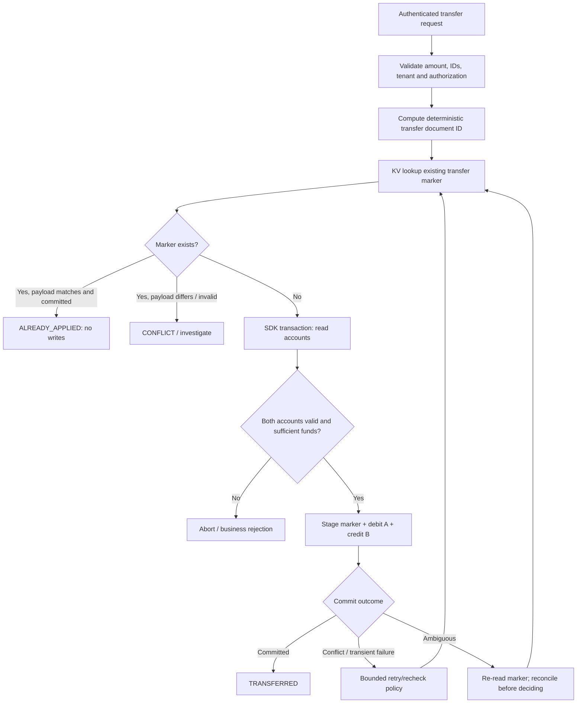

# Thực hiện giao dịch chuyển tiền giữa nhiều tài liệu trong Spring Data Couchbase

## 1. Bối cảnh bài thực hành

Giả sử hệ thống nội bộ có hai ví tiền được biểu diễn bằng **hai document độc lập** trong Couchbase. Người dùng yêu cầu chuyển 250.000 VND từ ví A sang ví B. Nếu chương trình trừ tiền A trước rồi cộng tiền B ở một thao tác KV khác, lỗi mạng hoặc crash giữa hai bước có thể khiến A bị trừ nhưng B chưa được cộng. Nếu client timeout rồi gửi lại cùng yêu cầu, chương trình có thể trừ tiền thêm một lần nữa.

Để xử lý tình huống này, bài lab dùng **Couchbase transactions** thực hiện trong cùng một giao dịch: đọc hai Account, kiểm tra quy tắc nghiệp vụ, cập nhật cả hai số dư và tạo một **transfer record có ID xác định** nhằm giúp nhận diện yêu cầu trùng. Khi giao dịch không thể commit, không được báo “đã chuyển tiền”. Khi kết quả commit không rõ ràng vì timeout/mất kết nối, không được bắt đầu một giao dịch chuyển mới với ID khác; phải kiểm tra trạng thái giao dịch cũ và giải quyết theo chính sách.

Bài thuộc chương **Bài thực hành** của module **SPRING_DATA_COUCHBASE**: xây dựng tầng truy cập Couchbase bằng document mapping, repository, `CouchbaseTemplate` và SQL++, đồng thời học bucket/scope/collection, chỉ mục, TTL, CAS, giao dịch, lựa chọn synchronous/reactive API, tính nhất quán và khả năng vận hành. Để quan sát cơ chế nhiều document rõ nhất, đường ghi chính sẽ dùng **Couchbase Java SDK Transactions API**; phần cuối phân tích ranh giới tích hợp với Spring Data.

> **Phạm vi an toàn:** Đây là bài lab **chuyển số dư nội bộ giả lập**, không phải thiết kế đủ điều kiện sử dụng cho hệ thống ngân hàng, ví điện tử thực tế, thanh toán liên ngân hàng hay một sổ cái kế toán tuân thủ quy định. Các hệ thống ấy cần thêm double-entry ledger bất biến, đối soát độc lập, quy định kế toán, AML/fraud, kiểm toán, phục hồi và đánh giá bảo mật. Không thực hiện thử nghiệm phá lỗi hoặc chuyển tiền trên dữ liệu tài chính thật.

Mọi dòng “kỳ vọng” là kết quả toán học từ dữ liệu mẫu, **không** phải kết quả đã chạy trên cluster. Tên class/method/options thay đổi theo tổ hợp Couchbase Server, Java SDK và Spring Data; cần đối chiếu tài liệu chính thức của phiên bản đang dùng trước khi copy code.

## 2. Mục tiêu học tập

Sau bài thực hành, bạn cần làm được:

1. Mô tả rõ vì sao hai lệnh KV `replace` liên tiếp **không tạo ra một giao dịch chuyển tiền nguyên tử**.
2. Xác định các bất biến: số tiền phải dương, cùng tenant và currency, đủ số dư, đúng trạng thái tài khoản, tổng tiền được bảo toàn, một yêu cầu không thực thi trùng.
3. Thiết kế ba document `Account A`, `Account B`, `Transfer` và ID có quy tắc rõ trong bucket/scope/collection.
4. Viết callback `cluster.transactions().run(ctx -> ...)` để đọc/cập nhật hai Account và tạo transfer marker **trong cùng transaction**.
5. Tách validation nghiệp vụ, conflict/retry, transaction failure và **commit ambiguous**; không bắt mọi lỗi rồi gửi lại tiền.
6. Giải thích vì sao callback transaction có thể được SDK chạy lại, và tác dụng phụ bên ngoài callback (email, payment API, message broker) cần outbox/idempotency.
7. Phân biệt CAS/`@Version` trên một Account với transaction đảm bảo một tập mutation nhiều document.
8. Thử hai giao dịch đồng thời trừ cùng Account, bảo đảm không chi vượt mức theo business rule khi mọi writer dùng đúng protocol.
9. Kiểm tra trước/sau bằng KV, SQL++ và số liệu đối soát; hiểu giới hạn GSI consistency và các phép đọc tại thời điểm khác nhau.
10. Thiết kế retry an toàn, kiểm thử mất kết nối, hoạt động idempotent, phục hồi sự cố, rollback/compensation và giám sát.

### 2.1. Bài cần nộp

| Artefact | Bằng chứng cần có |
| --- | --- |
| Mô hình dữ liệu | JSON Account A/B và Transfer, document ID, tenant/currency |
| Baseline | Số dư từng account, tổng tiền và transfer record trước thao tác |
| Anti-pattern | Kịch bản ghi hai document rời rạc và cửa sổ lỗi |
| Transaction source | Code callback + validation + ID ổn định |
| Happy path | Hai số dư cuối, transfer record, bất biến tổng tiền |
| Idempotency | Gửi lại cùng request ID không trừ/cộng tiền thêm |
| Failure tests | Thiếu tiền, sai tenant, cùng account, conflict, timeout |
| Concurrent transfers | Hai request cùng nguồn, một test tranh chấp có kiểm soát |
| Đối soát | SQL++/KV, metrics, anomaly/report |
| Runbook | Quy trình canary, dừng, xử lý ambiguous và cleanup lab |

**Definition of Done:** Chỉ đánh dấu PASS khi hai account và transfer record đạt trạng thái nhất quán, tổng tiền được bảo toàn, request trùng không làm chuyển thêm, dữ liệu tenant khác không bị ảnh hưởng, và các tình huống lỗi được phân loại rõ. Không đạt chỉ vì chương trình chạy hết mà không ném exception.

## 3. Điều kiện môi trường và quyền hạn

### 3.1. Chuẩn bị lab

- Couchbase Server hỗ trợ **distributed ACID transactions** của Java SDK phiên bản được chọn. Xác minh phiên bản/edition, tính năng và cấu hình giao dịch trên cluster trước khi thực hành.
- Bucket `commerce`, scope `banking_lab`, collection `accounts` và `transfers` trong một **workspace thử nghiệm**; tùy môi trường dùng tên khác, thay đồng bộ tất cả câu lệnh.
- Java 17+ và Couchbase Java SDK 3.x phiên bản tương thích; nếu dùng Spring Boot/Spring Data, chọn BOM/driver version nhất quán.
- Service account có quyền KV cần thiết trên cả hai collection, quyền/phạm vi transactions và quyền Query/Index cho phần đối soát.
- Một client Query Workbench/SQL++ để seed và xem kế hoạch truy vấn; không bắt buộc SQL++ khi cập nhật account theo document ID.
- Có quy trình backup/restore lab, dữ liệu riêng, khả năng reset **đúng ID lab**, logging đã che thông tin nhạy cảm.

Các thao tác transaction cần cấu hình thời gian tối đa, khả năng truy cập metadata/transaction ATR và yêu cầu durability đúng theo SDK/Server. Nếu thiếu quyền hoặc không hỗ trợ Transactions API, ghi `BLOCKED_BY_ENVIRONMENT` trong bảng thực hành; **không thay bằng hai KV replace rồi tự gọi đó là giao dịch**.

### 3.2. Phiếu phiên bản

| Thành phần | Giá trị cần điền trước khi chạy |
| --- | --- |
| Couchbase Server/edition | Chưa xác minh |
| Couchbase Java SDK | Chưa xác minh |
| Spring Boot/Spring Data | Chưa xác minh |
| Bucket/scope/collections | `commerce.banking_lab.accounts` và `commerce.banking_lab.transfers` |
| Transaction metadata location | Chưa xác minh theo SDK/config |
| Transaction timeout/durability | Chưa cấu hình trong lab |
| Số luồng concurrent | Chưa đo |
| Có writer ngoài transaction? | Phải kiểm kê |
| Người chịu trách nhiệm cleanup | Chưa chỉ định |

### 3.3. Nguyên tắc thao tác

1. Chỉ dùng tenant `LAB-TRANSFER-A` và document giả có tiền tố `account::LAB-TRANSFER-A::`, `transfer::LAB-TRANSFER-A::`.
2. Không tạo/ghi đè tài khoản thật hoặc dùng credential của hệ thống thanh toán.
3. Không `DELETE FROM accounts` trên một collection dùng chung; chỉ cleanup ID lab theo danh sách đã lưu.
4. Tách quyền **khởi tạo chuyển tiền**, **xem số dư**, **đối soát** và **thực hiện DDL**.
5. Không in raw token, thông tin định danh cá nhân, credentials hoặc nội dung giao dịch thật vào logs.
6. Không đặt TTL ngắn lên Account hoặc transfer idempotency marker, vì expiration có thể làm hỏng lịch sử và cho phép chuyển trùng.
7. Không tuyên bố “đã chuyển thành công” từ một result ambiguous chỉ vì retry không ném lỗi.

## 4. Mô hình dữ liệu và bất biến giao dịch

### 4.1. Tài khoản nguồn

ID `account::LAB-TRANSFER-A::A`, collection `accounts`:

```json
{
  "_class": "walletAccount",
  "tenantId": "LAB-TRANSFER-A",
  "accountCode": "A",
  "currency": "VND",
  "balanceMinor": 1500000,
  "state": "ACTIVE",
  "ownerRef": "owner::LAB-TRANSFER-A::USER-1"
}
```

### 4.2. Tài khoản đích

ID `account::LAB-TRANSFER-A::B`, cùng collection:

```json
{
  "_class": "walletAccount",
  "tenantId": "LAB-TRANSFER-A",
  "accountCode": "B",
  "currency": "VND",
  "balanceMinor": 400000,
  "state": "ACTIVE",
  "ownerRef": "owner::LAB-TRANSFER-A::USER-2"
}
```

Hai account cùng currency VND và tenant A. `balanceMinor` là **số nguyên theo đơn vị tiền nhỏ nhất đã thống nhất cho VND trong lab**, không dùng `double` hoặc tự nhân/chia 100. Nếu hệ thống hỗ trợ nhiều currency, phải dùng quy tắc định lượng/rounding chính xác theo từng currency; **không** làm conversion trong giao dịch demo.

### 4.3. Transfer record sẽ được tạo khi commit

ID `transfer::LAB-TRANSFER-A::REQ-0001`, collection `transfers`:

```json
{
  "_class": "internalTransfer",
  "tenantId": "LAB-TRANSFER-A",
  "requestId": "REQ-0001",
  "sourceAccountId": "account::LAB-TRANSFER-A::A",
  "destinationAccountId": "account::LAB-TRANSFER-A::B",
  "amountMinor": 250000,
  "currency": "VND",
  "state": "COMMITTED",
  "createdAt": "2026-11-25T03:00:00Z"
}
```

`createdAt` là mốc **minh họa**. Trong code, thời gian do application cấp một lần cho **logical request**, không gọi đồng hồ tùy tiện trong callback có thể retry.

Transfer document ở đây kiêm **receipt/idempotency record**: nó chỉ xuất hiện cùng hai cập nhật số dư nếu transaction commit hoàn tất. Trong hệ thống tài chính thực, thường cần thêm **immutable double-entry journal** (ít nhất hai posting cân bằng debit/credit) để làm nguồn chân lý kế toán, không xem mỗi current balance + một receipt là sổ cái đầy đủ.

### 4.4. Định nghĩa yêu cầu chuyển tiền

```text
tenantId      = LAB-TRANSFER-A       (từ context đáng tin cậy)
requestId     = REQ-0001             (ổn định qua mọi retry)
sourceId      = account::LAB-TRANSFER-A::A
destinationId = account::LAB-TRANSFER-A::B
amountMinor   = 250000
currency      = VND
```

Không lấy tenant từ JSON do client tự khai để suy quyền. Trong hệ thống thật, principal được xác thực và policy định nghĩa **ai được phép debit** tài khoản nguồn; biết document ID hoặc CAS không đồng nghĩa được quyền chuyển tiền.

### 4.5. Bất biến cần giữ

| Bất biến | Công thức/điều kiện | Mức cần kiểm |
| --- | --- | --- |
| Số tiền hợp lệ | `amountMinor > 0` | Trước transaction |
| Không tự chuyển cho mình | `sourceId != destinationId` | Trước transaction |
| Cùng tenant | `source.tenantId = dest.tenantId = trustedTenant` | Trong transaction |
| Cùng currency | Cả hai là VND và request currency VND | Trong transaction |
| Trạng thái cho phép | `source.state = dest.state = ACTIVE` | Trong transaction |
| Không âm số dư nguồn | `source.balanceMinor >= amountMinor` | Trong transaction |
| Bảo toàn tiền | `A_after + B_after = A_before + B_before` | Hậu kiểm |
| Tránh overflow | `Math.addExact`/`subtractExact` | Trong transaction |
| Không chuyển trùng | Mỗi `tenantId+requestId` chỉ một logical transfer | Marker ID + xử lý retry |
| Mutation đồng bộ | Hai Account và transfer record commit/abort như một đơn vị | SDK transaction |
| Không trộn ngoài giao thức | Tất cả writer quan trọng dùng protocol được kiểm soát | Kiểm kê writer |

Khi dữ liệu đang có nhiều transfer đồng thời, invariant tổng tiền chỉ áp dụng cho **phạm vi dòng tiền mà bạn đang đo**; account có thể nhận/gửi tiền từ các nguồn khác. Trong lab cô lập không có deposit/withdrawal khác, tổng A+B là một baseline hữu ích.

## 5. Bảng tính kỳ vọng trước/sau

Đối với một lần chuyển 250.000 VND từ A sang B:

| Chỉ số | Trước | Sau thành công | Thay đổi |
| --- | ---: | ---: | ---: |
| Số dư A | 1.500.000 | 1.250.000 | −250.000 |
| Số dư B | 400.000 | 650.000 | +250.000 |
| Tổng A+B | **1.900.000** | **1.900.000** | **0** |
| Transfer record REQ-0001 | Không tồn tại | Có, `COMMITTED` | +1 |

Nếu request lặp lại **cùng `REQ-0001` với payload giống nhau**, kỳ vọng A vẫn 1.250.000, B vẫn 650.000, và chỉ có **một** logical transfer record.

Nếu request lặp lại `REQ-0001` với amount khác, đó là **tái sử dụng sai idempotency key**, phải trả conflict/reject, không tự hiểu như yêu cầu chuyển bổ sung.

## 6. Seed dữ liệu trong collection lab

### 6.1. Tạo hai Account

Trong Query Workbench được cấp quyền:

```sql
INSERT INTO `commerce`.`banking_lab`.`accounts` (KEY, VALUE)
VALUES (
  "account::LAB-TRANSFER-A::A",
  {
    "_class": "walletAccount",
    "tenantId": "LAB-TRANSFER-A",
    "accountCode": "A",
    "currency": "VND",
    "balanceMinor": 1500000,
    "state": "ACTIVE",
    "ownerRef": "owner::LAB-TRANSFER-A::USER-1"
  }
), (
  "account::LAB-TRANSFER-A::B",
  {
    "_class": "walletAccount",
    "tenantId": "LAB-TRANSFER-A",
    "accountCode": "B",
    "currency": "VND",
    "balanceMinor": 400000,
    "state": "ACTIVE",
    "ownerRef": "owner::LAB-TRANSFER-A::USER-2"
  }
);
```

`INSERT` bảo vệ khỏi việc ghi đè ID đã có. Nếu bài đã chạy một lần, **không đổi `INSERT` thành `UPSERT` và ghi đè dữ liệu thật**; chọn tenant/ID test mới hoặc dùng quy trình reset được quản lý.

### 6.2. Không seed transfer record REQ-0001

Trước khi chạy giao dịch, document ID `transfer::LAB-TRANSFER-A::REQ-0001` phải **không tồn tại**. Nếu đã có record từ lần chạy trước, đó là trường hợp **idempotent replay**: chạy lại cùng request nên không chuyển nữa. Muốn thực hành từ đầu, dùng một run ID mới, không xóa dấu vết tiền mà chưa kiểm tra/điều chỉnh số dư đồng bộ.

### 6.3. Kiểm tra Account theo ID bằng KV

```java
import com.couchbase.client.java.Cluster;
import com.couchbase.client.java.Collection;

// cluster do môi trường Spring Boot/lab cấu hình.
Collection accounts = cluster.bucket("commerce")
    .scope("banking_lab")
    .collection("accounts");

Collection transfers = cluster.bucket("commerce")
    .scope("banking_lab")
    .collection("transfers");

var a = accounts.get("account::LAB-TRANSFER-A::A");
var b = accounts.get("account::LAB-TRANSFER-A::B");

System.out.println("A=" + a.contentAsObject());
System.out.println("B=" + b.contentAsObject());
```

Đây là hai GET riêng. Ở thời điểm **không có writer khác**, chúng đủ để chụp baseline lab. Trong hệ thống concurrent thật, hai lần GET độc lập **không bảo đảm ảnh chụp nguyên tử chung**; muốn đối soát theo thời điểm cần giải pháp snapshot/ledger/watermark tương ứng.

### 6.4. Nếu query SQL++ chưa chạy vì thiếu index

Đường KV GET theo **ID** không cần primary/GSI. Nếu bạn dùng SQL++ `SELECT` theo field tenant/currency trong phần đối soát, Query Service có thể cần secondary index phù hợp. Đừng tạo một primary index rộng trên production chỉ để bài thực hành chạy.

## 7. Anti-pattern: trừ tiền rồi cộng tiền bằng hai KV mutation

### 7.1. Luồng sai

```text
T0  Account A = 1.500.000, Account B = 400.000
T1  GET A; kiểm tra đủ tiền
T2  REPLACE A.balanceMinor = 1.250.000  -> thành công
T3  Process crash / mất mạng trước khi ghi B
T4  B vẫn 400.000
----------------------------------------------
Tổng A+B giảm từ 1.900.000 xuống 1.650.000
```

Mỗi KV mutation riêng có thể được thực hiện thành công, nhưng **đơn vị nghiệp vụ “chuyển tiền” chưa được hoàn tất**.

### 7.2. Ví dụ Java không an toàn — chỉ để đọc/phân tích

```java
// PSEUDOCODE KHÔNG CHẠY TRÊN DỮ LIỆU THẬT:
//
// var a = accounts.get(sourceId);
// accounts.replace(sourceId, debit(a, amount));
// // crash/timeout tại đây => A bị trừ, B chưa được cộng
// var b = accounts.get(destinationId);
// accounts.replace(destinationId, credit(b, amount));
//
// Không có distributed transaction bao cả hai replace.
```

Ngay cả nếu cả hai lệnh đều dùng CAS, bạn chỉ bảo vệ từng Account khỏi **lost update trên chính document đó**; CAS không biến hai mutation rời rạc thành commit/abort một đơn vị.

### 7.3. Retry có thể nhân đôi chuyển tiền

```text
Request REQ-0001 -> debit A thành công
                    credit B thành công
                    response từ server bị mất
Client không biết kết quả, gửi lại REQ-0001
Server không kiểm tra idempotency -> debit A, credit B lần nữa
```

Vì vậy, “bọc hai write trong transaction” là **cần thiết nhưng chưa đủ** cho hợp đồng API: phải gắn request ID ổn định và quy tắc xử lý khi client retry.

## 8. Transaction của Couchbase: phạm vi và những gì không tự có

### 8.1. Transaction đọc/ghi nhiều document

Trong Java SDK có Transactions API, callback transaction có thể:

1. `ctx.get` Account A trong collection `accounts`.
2. `ctx.get` Account B.
3. Validate số dư, currency, tenant và trạng thái.
4. `ctx.insert` transfer marker ID xác định trong `transfers`.
5. `ctx.replace` Account A với số dư giảm.
6. `ctx.replace` Account B với số dư tăng.
7. Transaction engine thực hiện quy trình commit/rollback theo khả năng cấu hình và retry khi cần.

**Không** lấy một object account bằng KV ngoài transaction rồi cho rằng `ctx.replace` trên object đó tự bảo vệ cùng snapshot; hãy dùng result từ `ctx.get` trong giao dịch đang thực hiện.

### 8.2. Atomicity không đồng nghĩa toàn bộ thế giới bất động

Một transaction nhiều document bảo vệ tập mutation tham gia theo cơ chế được hỗ trợ, nhưng:

- Không có foreign key check tự động.
- Không tự xác thực quyền debit tài khoản của user.
- Không tự ngăn một writer khác **cố ý bỏ qua business protocol**.
- Không tự rollback lệnh gọi ngân hàng/broker/email bên ngoài.
- Không tạo một snapshot nguyên tử xuyên **hai GET riêng ở client ngoài transaction**.
- Không tự làm mọi query GSI có độ mới tức thời ngoài yêu cầu consistency của chúng.

Vì vậy cần kết hợp **transaction + validation + idempotency + quyền + đối soát**.

### 8.3. Isolation và conflict theo phiên bản

Transaction dùng optimistic conflict handling và cơ chế isolation/visibility được Server/SDK hỗ trợ. Trong một trường hợp cạnh tranh, callback có thể bị retry hoặc transaction thất bại. Đừng thiết kế logic phụ thuộc callback **chỉ chạy đúng một lần**, cũng đừng suy chắc một loại exception cụ thể trên mọi release.

Đối với account nóng, cần đo conflict/attempts và đặt ngân sách thời gian. “Bật transaction” không làm contention biến mất; nó chuyển failure mode từ **mất tiền im lặng** sang **conflict/retry có thể quan sát**.

## 9. Thiết kế idempotency record

### 9.1. Tại sao marker phải cùng transaction?

Nếu tạo marker sau khi đã debit/credit:

```text
transfer accounts commit -> success
crash before insert marker
retry sees no marker -> transfers again
```

Nếu tạo marker trước rồi transaction tài khoản thất bại:

```text
insert marker -> success
debit/credit failure
retry sees marker -> falsely reports complete
```

Do đó **marker xác nhận đã chuyển phải commit cùng hai số dư**. Không xem một marker `PENDING` được ghi ngoài transaction là bằng chứng tiền đã chuyển.

### 9.2. Khóa idempotency có phạm vi

```text
transfer::<trustedTenant>::<requestId>
```

Trong lab:

```text
transfer::LAB-TRANSFER-A::REQ-0001
```

`requestId` phải ổn định khi client retry, nhưng không mang PII hoặc có ký tự/format gây va chạm. Trong production, chuẩn hóa/encode ID và kiểm soát chiều dài, phạm vi tenant/operation, collision và lifecycle.

### 9.3. So request cũ và mới

Nếu marker đã tồn tại, cần so với request hiện tại:

| Trường | Chính sách |
| --- | --- |
| `tenantId` | Phải cùng tenant đã xác thực |
| `requestId` | Cùng logical request |
| `sourceAccountId` | Phải giống |
| `destinationAccountId` | Phải giống |
| `amountMinor` | Phải giống |
| `currency` | Phải giống |
| `state` | Chỉ `COMMITTED` đáng tin theo hợp đồng lab |

Nếu dữ liệu khớp, trả `ALREADY_APPLIED` hoặc trả kết quả đã lưu **không mutate Account**. Nếu cùng key nhưng payload khác, trả `IDEMPOTENCY_KEY_REUSED`/conflict.

### 9.4. Idempotency retention

Transfer record phải sống đủ lâu cho các retry, audit và quy định nghiệp vụ. **Không đặt TTL vài phút** cho marker nếu client vẫn có thể retry sau vài giờ/ngày. Nếu retention bắt buộc phải xóa, cần một cơ chế chống replay khác hoặc hợp đồng giới hạn thời gian chặt, được đánh giá theo rủi ro.

## 10. Giao thức tổng thể khi nhận một yêu cầu



Kiểm tra marker bằng KV ở đầu **giúp phát hiện replays nhanh**, nhưng **không khóa** tất cả request song song cùng key. Hai request có thể cùng thấy marker chưa tồn tại. Chính `ctx.insert` marker **với ID xác định bên trong transaction** và conflict handling là phần làm cho nhiều writer cùng key phải tranh chấp một document, thay vì tự tạo hai transfer receipts.

Một failure transaction **không chứng minh** có marker; một marker không khớp **không được** coi thành công. Mọi kết quả ambiguous cần kiểm tra lại và/hoặc đưa vào hàng đợi đối soát có thời hạn, không mù quáng chạy lại với request ID mới.

## 11. Tách domain request và validation trước transaction

### 11.1. Request DTO

```java
public record InternalTransferCommand(
    String requestId,
    String sourceAccountId,
    String destinationAccountId,
    long amountMinor,
    String currency
) {}
```

`tenantId` **không** lấy từ command chưa được tin cậy; service nhận nó từ security context hoặc job context được phê duyệt.

### 11.2. Validation không cần I/O

```java
import java.util.Objects;

public static void validateCommand(InternalTransferCommand c) {
    Objects.requireNonNull(c, "command");

    if (c.requestId() == null || c.requestId().isBlank()) {
        throw new IllegalArgumentException("Missing requestId");
    }
    if (c.sourceAccountId() == null
            || c.destinationAccountId() == null
            || c.sourceAccountId().isBlank()
            || c.destinationAccountId().isBlank()) {
        throw new IllegalArgumentException("Missing account ID");
    }
    if (c.sourceAccountId().equals(c.destinationAccountId())) {
        throw new IllegalArgumentException(
            "Source and destination must differ"
        );
    }
    if (c.amountMinor() <= 0L) {
        throw new IllegalArgumentException("Amount must be positive");
    }
    if (!"VND".equals(c.currency())) {
        throw new IllegalArgumentException("Unsupported currency");
    }
}
```

Với production, bổ sung giới hạn amount/velocity, allowlist định danh, xác nhận nguồn tài khoản/role, chống fraud, hạn mức theo ngày, policy privacy và request signature nếu cần. Validation ở ngoài transaction chỉ loại đầu vào không hợp lệ; **account state và balance phải được đọc/validate bên trong** transaction vì có thể thay đổi.

## 12. Chuẩn bị cấu hình transaction

### 12.1. Cluster và collection

```java
import com.couchbase.client.java.Cluster;
import com.couchbase.client.java.Collection;

// Trong ứng dụng Spring Boot, lấy Cluster từ bean cấu hình.
Cluster cluster = configuredCluster;
Collection accounts = cluster.bucket("commerce")
    .scope("banking_lab")
    .collection("accounts");
Collection transfers = cluster.bucket("commerce")
    .scope("banking_lab")
    .collection("transfers");
```

`configuredCluster` là biến biểu diễn kết nối đã được tạo và cấu hình bảo mật ở môi trường lab; đây **không phải** một biến Java có sẵn. Không tạo/đóng Cluster cho mỗi lần chuyển tiền. Không hardcode username/password trong bài hay source code.

### 12.2. Kiểm tra Transactions API của phiên bản thật

Ví dụ dùng mẫu API Java SDK 3.x:

```java
cluster.transactions().run(ctx -> {
    // ctx.get(collection, id)
    // ctx.insert(collection, id, json)
    // ctx.replace(transactionGetResult, newJson)
});
```

Trước khi chạy, đối chiếu Javadoc/hướng dẫn Transactions của **đúng SDK** và kiểm tra cấu hình transactions, timeout, durability, quyền metadata/ATR, giới hạn số operation và behavior khi callback bị retry.

Nếu ứng dụng còn dùng Spring Data repository, **không coi** annotation `@Transactional` bất kỳ trên một method gồm hai `repository.save` là bằng chứng các thao tác đang tham gia Couchbase transaction. Phải xác minh transaction manager và đường gọi được framework hỗ trợ, hoặc dùng SDK Transaction Context rõ ràng.

## 13. Mã Java: chuyển tiền trong một SDK transaction

Ví dụ dưới đây cố ý dùng hai document Account và một transfer record, tất cả ở **hai collection cùng bucket/scope lab**. Mã dựa trên kiểu API Java SDK 3.x phổ biến; hãy xác minh chữ ký, loại exception và version ở dự án thật. Những phần HTTP, quản trị connection, dependency injection và persistence cho job state được lược bớt.

### 13.1. Class mô tả lỗi nghiệp vụ

```java
public final class TransferRejectedException
        extends RuntimeException {
    public TransferRejectedException(String reason) {
        super(reason);
    }
}
```

Trong ứng dụng thật, dùng **reason code** ổn định thay vì text nội bộ để ánh xạ API và metrics. Không trả toàn bộ nội dung lỗi SDK/transaction metadata ra client.

### 13.2. Service minh họa

```java
import java.math.BigDecimal;
import java.time.Instant;
import java.util.Optional;

import com.couchbase.client.core.error.DocumentNotFoundException;
import com.couchbase.client.java.Cluster;
import com.couchbase.client.java.Collection;
import com.couchbase.client.java.json.JsonObject;

public final class LabTransferService {
    public enum TransferOutcome {
        TRANSFERRED,
        ALREADY_APPLIED
    }

    private final Cluster cluster;
    private final Collection accounts;
    private final Collection transfers;
    private final String trustedTenant;

    public LabTransferService(
            Cluster cluster, String trustedTenant) {
        this.cluster = cluster;
        this.trustedTenant = trustedTenant;
        this.accounts = cluster.bucket("commerce")
            .scope("banking_lab")
            .collection("accounts");
        this.transfers = cluster.bucket("commerce")
            .scope("banking_lab")
            .collection("transfers");
    }

    public TransferOutcome transfer(InternalTransferCommand c) {
        requireValidCommand(c);
        final String receiptId = "transfer::" + trustedTenant
            + "::" + c.requestId();

        // Fast path cho retry sau lần commit đã được xác nhận.
        Optional<JsonObject> oldReceipt = findReceipt(receiptId);
        if (oldReceipt.isPresent()) {
            return classifyReplay(oldReceipt.get(), c);
        }

        // Giá trị stable cho một logical attempt.
        final String createdAt = Instant.now().toString();

        cluster.transactions().run(ctx -> {
            // Luôn đọc hai Account trong transaction context.
            var sourceResult = ctx.get(
                accounts, c.sourceAccountId()
            );
            var destinationResult = ctx.get(
                accounts, c.destinationAccountId()
            );

            JsonObject source = JsonObject.fromJson(
                sourceResult.contentAsObject().toString()
            );
            JsonObject destination = JsonObject.fromJson(
                destinationResult.contentAsObject().toString()
            );

            validateAccount(source, trustedTenant, c.currency());
            validateAccount(destination, trustedTenant, c.currency());

            long fromBalance = requiredLong(
                source, "balanceMinor"
            );
            long toBalance = requiredLong(
                destination, "balanceMinor"
            );

            if (fromBalance < c.amountMinor()) {
                throw new TransferRejectedException(
                    "INSUFFICIENT_FUNDS"
                );
            }

            final long newFrom;
            final long newTo;
            try {
                newFrom = Math.subtractExact(
                    fromBalance, c.amountMinor()
                );
                newTo = Math.addExact(
                    toBalance, c.amountMinor()
                );
            } catch (ArithmeticException overflow) {
                throw new TransferRejectedException(
                    "BALANCE_OVERFLOW"
                );
            }

            JsonObject receipt = JsonObject.create()
                .put("_class", "internalTransfer")
                .put("tenantId", trustedTenant)
                .put("requestId", c.requestId())
                .put("sourceAccountId", c.sourceAccountId())
                .put("destinationAccountId",
                     c.destinationAccountId())
                .put("amountMinor", c.amountMinor())
                .put("currency", c.currency())
                .put("state", "COMMITTED")
                .put("createdAt", createdAt);

            // Cả ba mutation tham gia CÙNG transaction.
            // ID receipt ổn định là điểm tranh chấp khi replay.
            ctx.insert(transfers, receiptId, receipt);

            source.put("balanceMinor", newFrom);
            destination.put("balanceMinor", newTo);

            ctx.replace(sourceResult, source);
            ctx.replace(destinationResult, destination);

            // Không gửi email, gọi payment gateway hoặc publish
            // message broker bên trong callback có thể retry này.
        });

        // Chỉ trả success khi SDK xác nhận transaction thành công.
        return TransferOutcome.TRANSFERRED;
    }

    private Optional<JsonObject> findReceipt(String id) {
        try {
            return Optional.of(
                transfers.get(id).contentAsObject()
            );
        } catch (DocumentNotFoundException absent) {
            return Optional.empty();
        }
    }

    private TransferOutcome classifyReplay(
            JsonObject receipt, InternalTransferCommand c) {
        if (!trustedTenant.equals(receipt.getString("tenantId"))
                || !c.requestId().equals(
                    receipt.getString("requestId"))
                || !c.sourceAccountId().equals(
                    receipt.getString("sourceAccountId"))
                || !c.destinationAccountId().equals(
                    receipt.getString("destinationAccountId"))
                || !c.currency().equals(
                    receipt.getString("currency"))
                || requiredLong(receipt, "amountMinor")
                    != c.amountMinor()) {
            throw new TransferRejectedException(
                "IDEMPOTENCY_KEY_REUSED"
            );
        }
        if (!"COMMITTED".equals(receipt.getString("state"))) {
            throw new TransferRejectedException(
                "RECEIPT_NOT_COMMITTED_REVIEW"
            );
        }
        return TransferOutcome.ALREADY_APPLIED;
    }

    private static void validateAccount(
            JsonObject account,
            String tenant,
            String currency) {
        if (!tenant.equals(account.getString("tenantId"))) {
            throw new TransferRejectedException(
                "ACCOUNT_TENANT_MISMATCH"
            );
        }
        if (!currency.equals(account.getString("currency"))) {
            throw new TransferRejectedException(
                "ACCOUNT_CURRENCY_MISMATCH"
            );
        }
        if (!"ACTIVE".equals(account.getString("state"))) {
            throw new TransferRejectedException(
                "ACCOUNT_NOT_ACTIVE"
            );
        }
        long balance = requiredLong(account, "balanceMinor");
        if (balance < 0) {
            throw new TransferRejectedException(
                "INVALID_NEGATIVE_BALANCE"
            );
        }
    }

    private static long requiredLong(
            JsonObject obj, String field) {
        Object raw = obj.get(field);
        if (!(raw instanceof Number number)) {
            throw new TransferRejectedException(
                "MISSING_OR_INVALID_NUMBER_" + field
            );
        }
        try {
            return new BigDecimal(number.toString())
                .longValueExact();
        } catch (ArithmeticException malformed) {
            throw new TransferRejectedException(
                "NON_INTEGRAL_OR_OVERFLOW_" + field
            );
        }
    }

    private static void requireValidCommand(
            InternalTransferCommand c) {
        if (c == null
                || c.requestId() == null
                || c.requestId().isBlank()
                || !c.requestId().matches("[A-Za-z0-9_-]{1,64}")
                || c.sourceAccountId() == null
                || c.destinationAccountId() == null
                || c.sourceAccountId().isBlank()
                || c.destinationAccountId().isBlank()
                || c.sourceAccountId().equals(
                    c.destinationAccountId())
                || c.amountMinor() <= 0
                || !"VND".equals(c.currency())) {
            throw new TransferRejectedException(
                "INVALID_TRANSFER_REQUEST"
            );
        }
    }
}
```

**Giới hạn triển khai cần bổ sung:** Ví dụ là **lõi transaction**, không phải một dịch vụ thanh toán hoàn chỉnh. `trustedTenant` phải đến từ context đáng tin; cần kiểm quyền debit/credit trên Account ID, chuẩn hóa ID nguồn/đích, giới hạn amount, fraud rules, chống rate abuse, log có phân quyền. Việc nhận diện transaction failure hoặc ambiguous outcome và kiểm tra lại receipt **ở lớp gọi** cần triển khai theo exception model đúng phiên bản SDK. Không được coi mọi exception từ `run` đều là “chuyển thất bại chắc chắn”.

### 13.3. Vì sao đọc Account trong callback?

Source/destination có thể đổi số dư hoặc trạng thái giữa request chuẩn bị và callback được SDK retry. Mỗi attempt cần đọc trạng thái hợp lệ của chính attempt và tính `newFrom`/`newTo` từ đó. Nếu tính số dư mới **trước** transaction từ dữ liệu stale, transaction không thể sửa phép tính nghiệp vụ đã sai.

### 13.4. Vì sao dùng `Math.addExact`?

Nếu `balanceMinor` là `long`, phép cộng bình thường có thể overflow và trở thành số âm/dữ liệu sai. `Math.addExact`/`subtractExact` ném lỗi khi vượt phạm vi nguyên 64 bit. Với tiền, nên dùng integer minor units hoặc `BigDecimal` chuẩn hóa theo currency/business constraints, **không dùng `double`**.

### 13.5. Tại sao marker được stage trước hai replace?

Không quan trọng thứ tự **stage** của ba operation bằng cách nào khi tất cả nằm trong cùng transaction được hỗ trợ; chúng phải commit/abort theo transaction. Stage marker đầu tiên giúp thấy điểm tranh chấp ID rõ trong code; không có chuyện marker được phép ghi durable độc lập rồi mới cập nhật số dư.

### 13.6. Tại sao không catch mọi lỗi trong callback?

Không bao:

```java
try {
    // ctx.get/insert/replace
} catch (Exception ignored) {
    // Sai: tiếp tục callback hoặc trả success giả.
}
```

Nếu validation hoặc thao tác transaction fail, phải để cơ chế transaction abort/retry theo contract. Chỉ catch và dịch những lỗi domain/runtime được phân biệt rõ ở **ranh giới service**, không che mất trạng thái commit.

## 14. Chạy một giao dịch từ command mẫu

### 14.1. Đường gọi

```java
LabTransferService service = new LabTransferService(
    cluster, "LAB-TRANSFER-A"
);

InternalTransferCommand command = new InternalTransferCommand(
    "REQ-0001",
    "account::LAB-TRANSFER-A::A",
    "account::LAB-TRANSFER-A::B",
    250000L,
    "VND"
);

var outcome = service.transfer(command);
System.out.println("outcome=" + outcome);
```

`cluster` là kết nối từ ứng dụng lab. Khi chạy lần đầu thành công, expected outcome là `TRANSFERRED`. Nếu transfer record `REQ-0001` đã tồn tại với payload khớp từ lần chạy trước, expected outcome là `ALREADY_APPLIED`.

### 14.2. Kiểm tra trực tiếp bằng KV

```java
var afterA = accounts.get(
    "account::LAB-TRANSFER-A::A"
).contentAsObject();

var afterB = accounts.get(
    "account::LAB-TRANSFER-A::B"
).contentAsObject();

var receipt = transfers.get(
    "transfer::LAB-TRANSFER-A::REQ-0001"
).contentAsObject();

System.out.println("A=" + afterA.getLong("balanceMinor"));
System.out.println("B=" + afterB.getLong("balanceMinor"));
System.out.println("Transfer=" + receipt.getString("state"));
```

Trong môi trường lab **đã cô lập writers**, sau transaction thành công kỳ vọng:

```text
A=1250000
B=650000
Transfer=COMMITTED
```

Đây là expected output, không phải kết quả thực thi. Nếu có hai transfer đồng thời khác, tổng số dư cuối có thể khác theo các giao dịch bổ sung; sử dụng transfer receipt và nhật ký đối soát để giải thích thay vì dựa duy nhất vào snapshot một lần.

### 14.3. Bảng ghi nhận sau lượt đầu

| Hạng mục | Expected | Observed |
| --- | --- | --- |
| Account A.balanceMinor | 1.250.000 | Chưa đo |
| Account B.balanceMinor | 650.000 | Chưa đo |
| Sum A+B | 1.900.000 | Chưa đo |
| Receipt ID | `transfer::LAB-TRANSFER-A::REQ-0001` | Chưa kiểm |
| Receipt state | `COMMITTED` | Chưa kiểm |
| Source/Destination/Currency | Khớp command | Chưa kiểm |
| Ghi ngoài tenant lab | Không có | Chưa kiểm |

## 15. Thử request lặp: idempotency không phải lời hứa suông

### 15.1. Gửi lại chính command cũ

```java
var firstOrReplay = service.transfer(command);
System.out.println(firstOrReplay);
```

Khi `REQ-0001` đã commit và marker còn tồn tại, expected outcome `ALREADY_APPLIED`. **Không có mutation mới** trên hai Account.

Kiểm tra:

1. CAS của Account A/B trước và sau replay không đổi **do lần replay**, nếu không có writer khác.
2. Số dư không trừ/cộng lần hai.
3. Transfer record vẫn đúng một ID, không tạo `REQ-0001-RETRY`.
4. Side effects (nếu có) không được thực hiện lại chỉ vì client gửi request lần nữa.

### 15.2. Gửi cùng ID với amount khác

```java
var conflictCommand = new InternalTransferCommand(
    "REQ-0001",
    "account::LAB-TRANSFER-A::A",
    "account::LAB-TRANSFER-A::B",
    300000L,
    "VND"
);

// Kỳ vọng bị từ chối vì cùng requestId nhưng payload khác.
service.transfer(conflictCommand);
```

Đây là test **phải bắt/kiểm tra exception trong runner**; không để một exception dự kiến làm hỏng toàn bộ suite. Outcome có thể là domain exception `IDEMPOTENCY_KEY_REUSED` ánh xạ 409, không phải lệnh chuyển thêm 300.000.

### 15.3. Hai request cùng ID được gửi đồng thời

Hai client có thể đồng thời kiểm tra marker và đều thấy vắng. Cả hai không được tự coi mình độc quyền. Vì callback dùng `ctx.insert` **chung ID marker** trong transaction, một luồng phải xử lý xung đột/transaction failure. Sau đó:

- Re-read marker bằng KV có quyền hợp lệ.
- Nếu `COMMITTED` và payload khớp, xử lý như một replay thành công.
- Nếu marker khác payload, trả conflict.
- Nếu marker chưa xuất hiện và trạng thái commit không rõ, **không báo thất bại chắc chắn hoặc chuyển lại bằng ID khác**; theo luồng resolve/reconciliation.

SDK có thể tự retry một số transaction conflicts; không assert số lần callback đã chạy mà chỉ assert **trạng thái nghiệp vụ cuối**.

## 16. Tranh chấp tiền: hai giao dịch debit cùng Account A

### 16.1. Kịch bản thử thiếu tiền

Reset bộ dữ liệu lab về số dư A=1.500.000, B=400.000; tạo thêm Account C (ID `account::LAB-TRANSFER-A::C`) với số dư 0. Hai request khác nhau:

```text
REQ-0101: A -> B, amountMinor=1000000
REQ-0102: A -> C, amountMinor=1000000
```

Nếu cả hai dựa trên cùng snapshot A=1.500.000, từng request riêng lẻ đều có vẻ đủ tiền. Nhưng **cả hai không thể được commit** khi quy tắc không cho A âm: tổng debit mong muốn 2.000.000 vượt 1.500.000.

### 16.2. Điều phải bảo đảm

Khi mọi writer đi qua transaction protocol:

1. Một giao dịch có thể commit và đưa A còn 500.000.
2. Giao dịch còn lại phải đọc lại/được retry theo cơ chế transaction, rồi thấy không đủ tiền hoặc kết thúc conflict có thể phân loại.
3. Không có trạng thái cuối A = −500.000.
4. Không có receipt `COMMITTED` cho một request mà debit/credit của request ấy không hoàn tất.
5. Không có tiền “sinh thêm” ở B hoặc C.

Không assert **REQ-0101 luôn thắng**: lịch thực thi không cố định. Nếu kết quả thực đều fail vì conflict/timeout, cần phân loại và retry có giới hạn rồi mới kết luận đúng/sai của invariant.

### 16.3. Mẫu test harness có barrier

Một cách kiểm thử hai request được phát gần đồng thời:

```java
import java.util.concurrent.CountDownLatch;
import java.util.concurrent.Executors;
import java.util.concurrent.TimeUnit;

var start = new CountDownLatch(1);
var pool = Executors.newFixedThreadPool(2);

try {
    var future1 = pool.submit(() -> {
        start.await(5, TimeUnit.SECONDS);
        return service.transfer(command101);
    });
    var future2 = pool.submit(() -> {
        start.await(5, TimeUnit.SECONDS);
        return service.transfer(command102);
    });

    start.countDown();
    // Runner thực cần thu cả success và exception từng future,
    // deadline có giới hạn; không giả định cả hai đều success.
    var outcome1 = future1.get(15, TimeUnit.SECONDS);
    var outcome2 = future2.get(15, TimeUnit.SECONDS);
} finally {
    start.countDown();
    pool.shutdownNow();
}
```

`command101`/`command102` là request tương ứng ở đầu mục. **Đây là mẫu điều phối**: nếu một future ném exception, lệnh `get` có thể ném `ExecutionException`; runner thực nên thu từng outcome độc lập, không để mất báo cáo của future còn lại. Barrier tại điểm phát request **không buộc** hai transaction cùng đọc Account A trước commit; muốn chủ động kiểm thử interleaving sâu, cần hook/test-double được hỗ trợ trong lab, không chèn side effect/busy wait vào callback transaction production.

### 16.4. Phép cộng bảo toàn

Nếu REQ-0101 thắng, tài khoản sẽ có:

```text
A=500000, B=1400000, C=0
Total A+B+C = 1900000
```

Nếu REQ-0102 thắng:

```text
A=500000, B=400000, C=1000000
Total A+B+C = 1900000
```

Hai trạng thái đều hợp lệ; trạng thái A âm hoặc tổng tiền thay đổi là **FAIL**. Mô hình trước/sau cần được cô lập; không trộn với transfer `REQ-0001` còn tồn tại nếu chưa reset/đổi run ID.

## 17. Failure semantics: transaction thất bại, đã abort hay commit chưa rõ?

### 17.1. Ba lớp kết quả

| Outcome | Bằng chứng | Ứng xử |
| --- | --- | --- |
| **COMMITTED confirmed** | SDK trả transaction success, receipt/balances phù hợp | Trả chuyển thành công |
| **BUSINESS REJECTED** | Invalid amount, thiếu tiền, frozen, currency/tenant mismatch | Không chuyển; trả lý do nghiệp vụ được phép |
| **UNKNOWN/AMBIGUOUS** | Timeout, network, transaction commit ambiguity | Không tự báo success/failure chắc; kiểm marker và đối soát |

Ở SDK có thể có nhiều loại exception cho failure, expired, commit ambiguous, conflict hoặc transient error. **Phân loại dựa trên exception model của phiên bản thật**; không suy từ tên một exception rằng transaction chắc chắn rollback nếu tài liệu SDK không xác nhận.

### 17.2. Callback transaction có thể được chạy lại

SDK transactions có cơ chế retry trong những tình huống được hỗ trợ. Vì thế callback:

```java
cluster.transactions().run(ctx -> {
    // KHÔNG gửi email / chuyển tiền ngoài Couchbase ở đây.
    // KHÔNG tăng counter in-memory dùng để kết luận một lần.
    // KHÔNG tạo requestId mới ở mỗi attempt.
});
```

phải tránh tác dụng phụ không idempotent nằm ngoài transaction. Có thể log kỹ thuật theo attempt nhưng không dùng số lần log callback làm số lần chuyển tiền.

### 17.3. Ambiguous commit không được giải quyết bằng request ID mới

Sai:

```text
REQ-0001 timeout -> không thấy 200
client gửi REQ-0002 với cùng amount
server commit cả REQ-0001 và REQ-0002 -> chuyển hai lần
```

Đúng về mặt hợp đồng:

```text
REQ-0001 timeout/ambiguous
   |
   +--> lưu trạng thái "PENDING_RESOLUTION" ở lớp API/workflow
   +--> KV GET transfer::tenant::REQ-0001 theo deadline
   +--> nếu COMMITTED + đúng payload -> trả kết quả cũ
   +--> nếu chưa tìm thấy -> KHÔNG tự kết luận chắc abort
   +--> tra transaction SDK outcome/telemetry và retry/resolution policy
   +--> nếu quá deadline -> queue review/reconciliation
```

Không in một marker `PENDING_RESOLUTION` vào cùng ID `transfer::...` như là receipt `COMMITTED` khi chưa phân biệt namespace và nguồn dữ liệu. Có thể lưu **request tracking record riêng** (ví dụ `transfer_request::<...>`) với trạng thái chờ; nội dung tracker không được khiến service nhầm rằng tiền đã chuyển.

### 17.4. Transaction failure trong một số trường hợp không có marker

Nếu `ctx.insert` marker bị conflict với request khác cùng ID, SDK có thể trả transaction failure theo đường retry/conflict riêng. **Không tự động** diễn giải mọi failure thành duplicate. Phải re-read marker:

- Nếu marker có và payload khớp, có bằng chứng request đã áp dụng.
- Nếu marker có nhưng payload khác, conflict khóa idempotency.
- Nếu không có marker, chỉ có bằng chứng **chưa thấy** ở lần đọc đó; thêm phân loại/đợi/resolution trước khi quyết định retry cùng ID.

Nếu một service **ngoài protocol** hard delete marker, trạng thái idempotency có thể bị phá; cần giới hạn quyền và retention.

## 18. Phân biệt rollback transaction và giao dịch đảo ngược

### 18.1. Abort trước commit

Khi business validation thất bại trong transaction và SDK thực hiện abort đúng quy trình, không có debit/credit/transfer receipt được commit như một logical transfer.

Ví dụ A còn 100.000, yêu cầu chuyển 250.000: phải bị từ chối; không được tạo một record `COMMITTED` và không trừ A. Kiểm tra trên data lab sau khi lỗi thực sự được xử lý và trạng thái transaction đã rõ.

### 18.2. Đã commit không thể “rollback bằng sửa JSON”

Sau khi transfer thành công, nghiệp vụ muốn hoàn tiền/đảo chiều:

- Đó là **một logical transaction mới** có request ID riêng, lý do/phê duyệt riêng.
- Có thể chuyển B → A, nhưng phải kiểm tra B hiện còn đủ tiền và policy cho phép.
- Lưu liên kết tới transfer gốc (`reversalOf`) và đảm bảo không đảo nhiều lần ngoài chính sách.
- Không xóa transfer receipt ban đầu để giả như giao dịch chưa xảy ra.
- Với hệ thống tài chính thực, dùng bút toán điều chỉnh có kiểm toán thay vì sửa lịch sử.

### 18.3. Restore từ backup không phải compensation

Phục hồi cả collection từ backup cũ có thể làm mất những mutation hợp lệ sau snapshot. RPO/RTO, danh sách giao dịch đã commit, journal và event replay phải được xác định trước. Không dùng restore production để “hủy” một lần chuyển tiền đã được chấp nhận.

## 19. TTL, CAS và durability trong bài chuyển tiền

### 19.1. Tại sao không đặt TTL lên Account/Transfer?

Nếu Account có TTL, nó có thể biến mất khi đang được sử dụng. Nếu transfer marker hết TTL trước thời hạn retry, cùng request ID có thể bị chuyển lại như request mới.

Vì vậy trong lab này:

- Account và `COMMITTED` transfer receipt **không đặt TTL ngắn**.
- Nếu phải có retention theo chính sách, quy tắc xóa/anonymize phải được thiết kế toàn diện với nguồn chứng cứ chống replay khác.
- Một transaction sửa Account không được vô tình thay expiry do mutation options/collection policy.
- Không dùng CAS làm cách “gia hạn” Account.

### 19.2. CAS ở đâu trong SDK transaction?

Với một KV `replace` thông thường, lập trình viên có thể truyền `ReplaceOptions.cas(result.cas())` để bảo vệ một document. Trong **transaction context**, SDK quản lý concurrency/staged mutations theo API của nó; không tự thêm một CAS token lấy từ đường KV bên ngoài vào `ctx.replace` khi API không yêu cầu.

CAS không thay transaction nhiều document, và transaction không xóa nhu cầu thiết kế optimistic concurrency/lock conflict cho các writer khác. Nếu có một import job `upsert` Account ngoài protocol, phải kiểm kê và hạn chế quyền/hoạt động của nó.

### 19.3. Durability level

Durability giúp xác định điều kiện xác nhận mutation trước failure theo năng lực cluster/version. Đây là **yêu cầu tính bền vững**, không phải validation nghiệp vụ hay chứng minh “số dư A+B không đổi”. Các giao dịch quan trọng cần đánh giá durability/timeout/replication/availability theo SLA; không chọn cấu hình nhẹ chỉ vì lab benchmark chạy nhanh hơn.

### 19.4. Expiry preservation

Nếu app có chính sách expiry thực sự, xác minh transaction mutation bảo toàn/thiết lập expiry theo behavior của API và phiên bản. Không giả định `ctx.replace` có các option giống `Collection.replace` hoặc tự tiện gọi `preserveExpiry(true)` bên trong transaction nếu SDK không hỗ trợ chữ ký đó.

## 20. Spring Data Couchbase: mapping và ranh giới transaction

### 20.1. Mapping Account

```java
import org.springframework.data.annotation.Id;
import org.springframework.data.annotation.TypeAlias;
import org.springframework.data.annotation.Version;
import org.springframework.data.couchbase.core.mapping.Document;
import org.springframework.data.couchbase.core.mapping.Scope;
import org.springframework.data.couchbase.core.mapping.Collection;

@Document
@TypeAlias("walletAccount")
@Scope("banking_lab")
@Collection("accounts")
public class WalletAccount {
    @Id
    private String id;

    @Version
    private Long casVersion;

    private String tenantId;
    private String accountCode;
    private String currency;
    private long balanceMinor;
    private String state;
    private String ownerRef;

    // Constructor/getters/setters được lược bỏ.
}
```

`@Version` ánh xạ optimistic locking/CAS theo cơ chế Spring Data Couchbase được hỗ trợ. Nó **không** thay thế trạng thái tài khoản, không tự tạo ledger, và không có nghĩa hai lời gọi repository `save(accountA)`/`save(accountB)` độc lập sẽ commit nguyên tử.

### 20.2. Repository mẫu

```java
import org.springframework.data.couchbase.repository.CouchbaseRepository;

public interface WalletAccountRepository
        extends CouchbaseRepository<WalletAccount, String> {
}
```

Repository hữu ích cho nhiều tác vụ đọc/ghi domain, nhưng **đường transfer** trong lab chủ động dùng SDK transaction context và JSON để bảo vệ hai Account + receipt trong một transaction. Không lấy hai entity bằng repository ngoài context rồi dùng hai `save` và gọi đó là “transfer atomic”.

### 20.3. `@Transactional` phải được xác minh cụ thể

Đoạn pseudocode sau **không phải chứng minh** tính atomic:

```java
@Transactional
public void transferWithRepositories(...) {
    accountRepository.save(accountA);
    accountRepository.save(accountB);
}
```

Annotation `@Transactional` chỉ có tác dụng khi transaction manager, resource binding và đường thực thi đúng với stack/version được cấu hình. Có thể app đang dùng transaction manager cho một database khác, hoặc repository operations không tham gia Couchbase SDK transaction đã tạo.

Nếu muốn dùng Spring transaction abstraction, phải:

1. Xác định manager hỗ trợ Couchbase transactions trên version đang chạy.
2. Kiểm tra tất cả repository/template calls thực sự tham gia **cùng** transaction.
3. Test ép lỗi sau debit A để xem B có được rollback đồng bộ không.
4. Kiểm tra retry/ambiguous semantics và side effects.
5. So kết quả với đường SDK `ctx.get/insert/replace` đã biết.

### 20.4. `CouchbaseTemplate` và `@Query`

`CouchbaseTemplate`, `ReactiveCouchbaseTemplate`, repository và native SQL++ có thể dùng các đường thao tác khác nhau. Một custom `@Query` `UPDATE` không tự suy diễn rằng nó tham gia cùng Java SDK Transactions Context với hai KV writes. Kiểm tra API, transaction binding, consistency và integration test thật, **không** trộn đường ghi chỉ vì cùng bucket.

### 20.5. `schemaVersion` và CAS là hai vấn đề khác

Nếu account JSON có `schemaVersion = 2`, field đó mô tả định dạng, không phải token optimistic lock. `casVersion` từ `@Version` quản lý concurrency và thường được ánh xạ metadata CAS theo Spring Data. Không gán `schemaVersion` + 1 mỗi lần chuyển tiền hay coi cùng schema version là cùng document revision.

## 21. Reactive và transaction nhiều document

### 21.1. Reactive không tự chuyển hai operation thành atomic

Mã:

```java
return reactiveAccountRepository.findById(sourceId)
    .flatMap(source -> {
        source.debit(amount);
        return reactiveAccountRepository.save(source);
    })
    .then(reactiveAccountRepository.findById(destinationId))
    .flatMap(dest -> {
        dest.credit(amount);
        return reactiveAccountRepository.save(dest);
    });
```

là **pseudocode rút gọn** để nhận diện sai lầm: Reactor `then/flatMap` sắp thứ tự xử lý trong pipeline, **không tự tạo transaction xuyên hai document**. Nếu bước debit đã commit và bước credit lỗi, nghiệp vụ vẫn bị dở.

### 21.2. Lựa chọn triển khai

- **Lab đồng bộ:** dùng `cluster.transactions().run(ctx -> ...)` theo API được hỗ trợ, dễ quan sát từng thao tác.
- **Reactive transaction SDK:** nếu Java SDK version có Transactions reactive API, dùng đúng callback/reactive context của nó, không tự bọc hai `save` độc lập.
- **Spring reactive transaction abstraction:** chỉ sử dụng nếu phiên bản Spring Data/transaction manager thực sự hỗ trợ việc tham gia cùng transaction, đã qua integration test failure injection.

`Mono.defer` và `retryWhen` không thay thế transaction. Chúng chỉ giúp mô hình resubscribe/retry; cần bảo đảm mỗi retry giữ **cùng requestId**, xử lý ambiguous và không nhân side effect.

### 21.3. Backpressure và cancellation

Với nhiều transfer chạy đồng thời, giới hạn `flatMap` concurrency, timeout và resource usage. Client hủy HTTP request sau khi đã gửi transaction **không chứng minh server đã abort**. Transaction có thể vẫn tiếp tục/commit theo semantics SDK. Phải dùng request tracking/receipt để biết outcome, không suy từ cancellation là tiền chưa chuyển.

## 22. Kiểm tra bằng SQL++ và giới hạn GSI consistency

### 22.1. Index cho báo cáo — không phải cho KV transfer

Transfer transaction truy cập Account theo **document ID**, nên không cần secondary index cho `ctx.get(accounts,id)` hoặc `ctx.replace`. Nhưng nếu muốn liệt kê tài khoản/receipt theo tenant bằng SQL++, cần đường query/index phù hợp:

```sql
CREATE INDEX ix_accounts_lab_tenant_currency
ON `commerce`.`banking_lab`.`accounts`(
    `tenantId`, `currency`
);

CREATE INDEX ix_transfers_lab_tenant_request
ON `commerce`.`banking_lab`.`transfers`(
    `tenantId`, `requestId`
);
```

Đây là DDL **chỉ cho lab** khi được cấp quyền. Cần kiểm tên/index đang tồn tại, tránh tạo trùng và chờ `online` trước query. **GSI index không tự tạo unique constraint** cho `requestId` và không thay `ctx.insert` marker.

### 22.2. Chờ index sẵn sàng

```sql
SELECT name, state, index_key, condition,
       bucket_id, scope_id, keyspace_id
FROM system:indexes
WHERE bucket_id = "commerce"
  AND scope_id = "banking_lab"
  AND keyspace_id IN ["accounts", "transfers"];
```

Nếu tên/schema khác trong môi trường lab, chỉnh keyspace đúng trước khi chạy. Không dùng Query/index endpoint thay KV receipt lookup trong bước giải quyết outcome mơ hồ nếu chưa kiểm soát scan consistency và thời điểm commit.

### 22.3. Báo cáo số dư

```sql
SELECT META(a).id AS accountId,
       a.tenantId,
       a.currency,
       a.balanceMinor,
       a.state
FROM `commerce`.`banking_lab`.`accounts` AS a
WHERE a.tenantId = "LAB-TRANSFER-A"
  AND a.currency = "VND"
ORDER BY accountId;
```

### 22.4. Báo cáo tổng số dư

```sql
SELECT a.tenantId,
       a.currency,
       COUNT(1) AS accountCount,
       SUM(a.balanceMinor) AS sumBalanceMinor
FROM `commerce`.`banking_lab`.`accounts` AS a
WHERE a.tenantId = "LAB-TRANSFER-A"
  AND a.currency = "VND"
GROUP BY a.tenantId, a.currency;
```

Khi chỉ có A/B và một transfer như phần 5, expected `sumBalanceMinor = 1900000`. Nếu lab đang thêm Account C hoặc reset chưa đồng bộ, phải tính lại baseline theo **tập Account được kiểm**.

### 22.5. Kiểm tra transfer marker

```sql
SELECT META(t).id AS transferId,
       t.requestId,
       t.sourceAccountId,
       t.destinationAccountId,
       t.amountMinor,
       t.currency,
       t.state
FROM `commerce`.`banking_lab`.`transfers` AS t
WHERE t.tenantId = "LAB-TRANSFER-A"
ORDER BY transferId;
```

SQL++ report là một công cụ hậu kiểm, không thay thế việc xác định commit outcome bằng transaction response + KV receipt read có chính sách đúng.

### 22.6. `NOT_BOUNDED`, `REQUEST_PLUS` và snapshot

| Chế độ/đường đọc | Ý nghĩa | Giới hạn |
| --- | --- | --- |
| KV GET theo account ID | Đọc document hiện hành trực tiếp | Hai GET riêng vẫn có thể ở hai thời điểm |
| SQL++ GSI `NOT_BOUNDED` | Không yêu cầu chờ index bắt kịp mutation | Có thể tạm không thấy mới ghi |
| SQL++ `REQUEST_PLUS` | Yêu cầu index bắt kịp mutation liên quan trước truy vấn | Có thể tăng latency; không khóa các writer tương lai |
| Transaction context reads | Đọc trong phạm vi isolation/visibility của transaction được hỗ trợ | Không thay một ledger/audit toàn hệ thống |

Với dữ liệu đang thay đổi liên tục, một SELECT sum ngoài transaction có thể phản ánh các thời điểm/ảnh chụp khác nhau theo semantics query/Server. Không dựa vào một SELECT sum và tuyên bố tài khoản không mất tiền trong mọi race. Đối soát tài chính cần journal/watermark/batch consistency và bằng chứng transaction, được thiết kế riêng.

## 23. Mở rộng: journal hai bút toán và đối soát từng transfer

### 23.1. Vì sao số dư cộng dồn chưa đủ?

Một số dư Account hiện tại là **trạng thái đã tổng hợp**. Khi tìm một giao dịch sai, chỉ biết A có bao nhiêu tiền không giải thích **tại sao**. Với hệ thống tài chính thật, cần nhật ký bút toán bất biến, thời điểm nghiệp vụ, transaction ID, nguồn phát sinh và cơ chế chống sửa/xóa trái phép.

Trong bài lab, một bản ghi `Transfer` đã giúp biết source/destination/amount và idempotency. Bài nâng cao có thể bổ sung:

```text
ledger::<tenantId>::<requestId>::DEBIT
ledger::<tenantId>::<requestId>::CREDIT
```

Ví dụ:

```json
{
  "_class": "ledgerPosting",
  "tenantId": "LAB-TRANSFER-A",
  "requestId": "REQ-0001",
  "accountId": "account::LAB-TRANSFER-A::A",
  "currency": "VND",
  "amountMinor": -250000,
  "side": "DEBIT"
}
```

```json
{
  "_class": "ledgerPosting",
  "tenantId": "LAB-TRANSFER-A",
  "requestId": "REQ-0001",
  "accountId": "account::LAB-TRANSFER-A::B",
  "currency": "VND",
  "amountMinor": 250000,
  "side": "CREDIT"
}
```

Đây là **định dạng bút toán minh họa**. Tên debit/credit, dấu dương/âm và cách hạch toán thực phải theo chính sách kế toán của sản phẩm. Trong lab, invariant đơn giản là:

\[
\text{debit.amountMinor}+\text{credit.amountMinor}=0.
\]

### 23.2. Nếu bổ sung ledger, thêm nó vào cùng transaction

Không ghi hai posting sau khi Account đã commit bằng các KV insert rời rạc rồi gọi đó là journal nguyên tử. Nếu bài mở rộng yêu cầu cả Account balances và postings cùng nhất quán, phải cân nhắc:

- Stage hai posting bằng ID xác định **trong cùng SDK transaction**, theo giới hạn/tính năng đã kiểm chứng.
- Mọi writer đều giữ cùng transaction protocol hoặc một workflow kế toán có nguồn chân lý duy nhất.
- Không sửa/xóa posting đã commit bằng API người dùng thông thường; reversal là posting mới.
- Có reconciliation phát hiện bất đối xứng posting/receipt/balance.
- Bảo vệ retention, audit log, metadata, quyền sửa và backup.

Trong các sản phẩm lớn, **ledger thường là nguồn chân lý**, balance là materialized view được đối soát; bài chính dùng Account balances để giải thích ACID, không ngầm khẳng định đó là kiến trúc sổ cái chuẩn.

### 23.3. Quy tắc phân loại sự cố

| Quan sát | Đánh giá |
| --- | --- |
| Hai posting cân bằng, Account balances khớp | Kỳ vọng trong lab nếu mọi dữ liệu đã commit |
| Receipt `COMMITTED` nhưng thiếu một posting | Lỗi dữ liệu/workflow nếu ledger là invariant bắt buộc |
| Hai posting có cùng ID được tạo lặp | Phải ngăn bằng ID xác định/idempotency |
| Tổng posting bằng 0 nhưng balance sai | Cần đối soát tăng/giảm số dư và lịch sử |
| Balance đúng nhưng receipt trùng logical request | Dữ liệu/idempotency không đạt |

## 24. Kiểm thử lỗi có chủ đích: fail trước khi commit

### 24.1. Throw sau khi stage debit nhưng trước credit

Với **phiên bản code thử riêng trong lab**, đặt một exception trước khi callback hoàn tất:

```java
cluster.transactions().run(ctx -> {
    var a = ctx.get(accounts, sourceId);
    var b = ctx.get(accounts, destinationId);

    // Stage debit và receipt theo logic lab.
    ctx.replace(a, debitBody);

    // Chỉ dùng cho phép thử rollback.
    throw new IllegalStateException("LAB_FORCE_ABORT");

    // Không có bước credit được stage sau dòng này.
});
```

`debitBody` là JSON được dựng/validate trong đoạn code test; snippet trên là **pseudocode điều khiển lỗi**, không phải một class Java độc lập compile nguyên vẹn vì dòng `throw` làm phần sau không truy cập. Ý nghĩa là: nếu callback abort trước commit, mutation đã stage không được trở thành một lần debit được công nhận thành công.

### 24.2. Expected state

| Thành phần | Trước test | Sau transaction abort được xác nhận |
| --- | ---: | ---: |
| A | 1.500.000 | 1.500.000 |
| B | 400.000 | 400.000 |
| Tổng | 1.900.000 | 1.900.000 |
| Receipt test ID | Không có | Không có `COMMITTED` |

Đừng dùng cùng `REQ-0001` đang có receipt từ test trước; chọn ID mới/seed mới để tách case.

### 24.3. Không giả lập network ambiguity bằng cách throw business exception

`throw new IllegalStateException("LAB_FORCE_ABORT")` mô phỏng abort **trước commit** chứ không mô phỏng mất kết nối sau khi Server đã commit. Để thử ambiguous outcome cần một công cụ fault injection hoặc môi trường có kiểm soát theo SDK/cluster version, quan sát transaction metadata/receipt và yêu cầu khôi phục. Không cắt mạng production hoặc kill cluster bừa bãi.

## 25. Kiểm thử đủ tiền, âm tiền, overflow và dữ liệu hỏng

### 25.1. Thiếu số dư

Tạo A=100.000, B=400.000, command chuyển 250.000. Kỳ vọng:

- Domain validation báo `INSUFFICIENT_FUNDS`.
- Không có transfer record `COMMITTED` của request ấy.
- Hai số dư không đổi.

Đừng cố “cho âm tạm rồi cộng sau” nếu domain quy định không được âm. Nếu sản phẩm có hạn mức thấu chi, đó là invariant khác phải được định nghĩa và kiểm thử.

### 25.2. Amount bằng 0 hoặc âm

```text
amountMinor=0   -> reject
amountMinor=-10 -> reject
```

Chuyển âm có thể đảo hướng debit/credit và bị lợi dụng nếu validation thiếu. Số âm cần được xử lý bằng **một loại nghiệp vụ riêng** có authorization/audit, không phải payload chuyển tiền bình thường.

### 25.3. Destination overflow

Cho B có `balanceMinor` gần `Long.MAX_VALUE`, chuyển thêm tiền khiến phép cộng vượt phạm vi. `Math.addExact` phải từ chối trước khi stage transfer được commit; không lưu số âm do overflow hoặc làm tròn qua `double`.

### 25.4. Dữ liệu JSON sai kiểu

Ví dụ `balanceMinor = "400000"` dạng chuỗi, hoặc `balanceMinor = 100.5` trong JSON. Migrator/domain validator không được âm thầm cast và coi số nguyên hợp lệ. Đưa case lỗi vào dữ liệu cần review; không “sửa” số dư chỉ để test qua.

### 25.5. Account bị khóa

Nếu `state = FROZEN`, transfer phải bị từ chối theo rule. Khi transaction retry do xung đột, phải **đọc lại state**; request không được dùng snapshot ACTIVE cũ để chuyển tiền sau khi account đã bị khóa.

### 25.6. Sai tenant/currency

Tạo Account `account::LAB-TRANSFER-B::Z` trong tenant khác với currency VND, hoặc Account C trong tenant A nhưng currency USD. Request tenant A trỏ tới B/Z hoặc A/C:

- Không debit/credit bất kỳ Account nào.
- Không xuất số dư/ownerRef của tenant khác ra API.
- Không tự convert currency theo tỷ giá tùy ý.
- Log audit có reason code, không chứa PII.

## 26. Kiểm thử nhiều request đồng thời: case matrix

| Case | Setup | Kỳ vọng nghiệp vụ |
| --- | --- | --- |
| Happy path | A 1.500.000, B 400.000, chuyển 250.000 | A 1.250.000, B 650.000, receipt COMMITTED |
| Request replay | Cùng `REQ-0001`/payload | Không thay số dư lần hai |
| Reuse ID sai payload | `REQ-0001` nhưng 300.000 | Conflict, không chuyển |
| Hai request cùng ID chạy cùng lúc | Cùng key và payload | Chỉ một logical transfer |
| Hai request ID khác, cùng nguồn | Mỗi request 1.000.000 từ A 1.500.000 | Không âm số dư; tối đa một được áp dụng |
| Thiếu tiền | A 100.000, chuyển 250.000 | Abort/reject |
| Amount 0/âm | 0 hoặc −1 | Reject trước I/O |
| Source=destination | Cùng document ID | Reject |
| Cross-tenant | A trỏ Account của tenant B | Chặn, không lộ thông tin |
| Currency mismatch | VND vs USD | Reject, không exchange ngầm |
| Account frozen | State nguồn bị đổi | Reject, không dùng state cũ |
| Overflow | B gần `Long.MAX_VALUE` | Reject, không wrap |
| Invalid JSON amount | String/double không integral | Quarantine/reject |
| Abort có chủ đích trước commit | Throw trong callback | Không có chuyển nửa chừng |
| SDK retry callback | Conflict transient | Không lặp side effect, marker ID ổn định |
| Timeout trước commit | Operation failure rõ theo SDK | Resolve theo semantics, không chuyển trùng |
| Lost response sau commit | Commit có thể đã xảy ra | Re-read receipt, không dùng ID mới |
| Transfer record bị mất | Marker bị xóa ngoài protocol | Phát hiện/khóa dữ liệu, điều tra |
| GSI lag | Query ngay sau commit | Không kết luận chưa chuyển từ SELECT stale |
| Concurrent writer bypass | Import sửa balance trực tiếp | Phát hiện bằng policy/audit, sửa giao thức |
| Reactive cancellation | Client hủy request giữa operation | Không suy cancellation là abort |

### 26.1. Một test pass cần nhiều hơn response code

Với mỗi case:

1. Lưu **initial balances** và transfer IDs.
2. Chạy request trong lab.
3. Thu outcome (bao gồm exception chain đã phân loại).
4. Đọc Account/receipt theo đường KV/consistency phù hợp.
5. Kiểm tra tổng tiền và receipt khớp **cùng một logical request**.
6. Đối chiếu CAS/trace/version nếu cần, không suy diễn CAS như số đếm.
7. Ghi trạng thái **PASS/FAIL/BLOCKED/NOT_RUN** cùng lý do.

Nếu test được thực hiện trên dataset có writer đồng thời ngoài kiểm soát, không kết luận invariant toàn hệ thống chỉ dựa một SELECT sum; cần cách quy chiếu mutation/watermark.

## 27. Kịch bản thực hành theo trạm

### Trạm A — Preflight môi trường

1. Ghi phiên bản Couchbase/SDK/Spring Data và quyền.
2. Xác nhận `commerce.banking_lab.accounts/transfers` đúng scope/collection.
3. Xác nhận Transactions API và metadata/ATR được cấu hình, timeout/durability phù hợp.
4. Chuẩn bị tenant ID riêng và backup/cleanup plan.
5. Chỉ tiếp tục nếu mọi điều kiện tài nguyên/thẩm quyền được đáp ứng.

### Trạm B — Seed và baseline

1. Insert hai Account như mục 6.
2. KV GET cả hai và ghi số dư/CAS.
3. Xác nhận không có transfer receipt `REQ-0001`.
4. Ghi tổng A+B=1.900.000.
5. Không thay đổi dữ liệu trong lúc chạy happy path.

### Trạm C — Phân tích anti-pattern

1. Vẽ hai thao tác `debit A` và `credit B` tách rời.
2. Xác định chính xác lỗi xảy ra giữa hai mutation.
3. Tính tổng tiền sau khi chỉ debit thành công.
4. Giải thích vì sao CAS trên mỗi document vẫn chưa đủ.
5. Không cần chạy anti-pattern phá dữ liệu nếu môi trường không có reset an toàn.

### Trạm D — Viết transaction SDK

1. Tạo `InternalTransferCommand` và service như mục 11–13.
2. Đọc Account **trong** callback.
3. Validate tenant/currency/state/amount đủ tiền.
4. Tính số dư bằng integer exact arithmetic.
5. Stage marker cùng hai replace bằng context.
6. Chạy một request `REQ-0001`.
7. Ghi transaction outcome và hai KV reads hậu kiểm.

### Trạm E — Idempotency/replay

1. Gửi lại cùng `REQ-0001` và payload.
2. Xác minh trả `ALREADY_APPLIED`, không mutate Account.
3. Dùng cùng ID với amount khác, xác minh conflict.
4. Thử hai request cùng ID gần đồng thời ở lab cô lập.
5. Kiểm chứng không có hai logical receipts/transfer cho cùng key.

### Trạm F — Insufficient funds và validation

1. Chọn một run ID mới với A=100.000.
2. Thử chuyển 250.000: bị từ chối.
3. Thử 0/âm, same source/destination, sai tenant/currency.
4. Thử overflow và account `FROZEN` nếu có quyền seed tương ứng.
5. Ghi nguyên nhân được phân loại, kiểm tra không có receipt COMMITTED.

### Trạm G — Concurrent spend

1. Reset bộ account A/B/C theo mục 16.
2. Phát `REQ-0101` và `REQ-0102` đồng thời.
3. Thu cả success và exceptions, không bỏ mất outcome của future thứ hai.
4. Đợi transaction outcome rõ/resolve đúng chính sách.
5. Kiểm tổng A+B+C=1.900.000 và A không âm.
6. Kiểm receipts phù hợp với transfer thực sự được chấp nhận.

### Trạm H — Fault injection an toàn

1. Trên bản code lab có riêng run ID, gây lỗi **trước** commit.
2. Xác minh abort không debit/credit nửa chừng.
3. Nếu có fault injection hỗ trợ, mô phỏng mất response/ambiguous commit.
4. Quan sát workflow `PENDING_RESOLUTION` và resolve bằng cùng ID/receipt.
5. Không gửi request mới với ID khác, không kill production cluster.

### Trạm I — SQL++ và đối soát

1. Tạo index chỉ khi được phép trong môi trường lab.
2. Đợi index online; chạy query Accounts/Transfers.
3. Ghi consistency và thời điểm query.
4. So kết quả SQL++ với KV theo ID.
5. Kiểm source/destination/amount mỗi receipt; ghi anomaly.
6. Nếu dùng ledger postings mở rộng, kiểm tổng postings=0.

### Trạm J — Báo cáo, runbook và cleanup

1. Điền bảng kết quả mục 32, rubric mục 33.
2. Ghi các trường hợp chưa test do version/permission.
3. Xác định policy retry/timeout/ambiguous của phiên bản thật.
4. Nêu hạn chế về sổ cái, quyền và quy định tài chính.
5. Cleanup đúng tài nguyên lab sau khi đối soát và được phép, không xóa marker trước khi đã xử lý số dư.

## 28. Observability: theo dõi commit, conflict và chống chuyển trùng

### 28.1. Metric gợi ý

| Metric | Ý nghĩa |
| --- | --- |
| `transfer.request.attempts` | Số request logic nhận được |
| `transfer.committed` | Số logical transfers xác nhận commit |
| `transfer.already_applied` | Số retry khớp marker |
| `transfer.idempotency_conflict` | Cùng key nhưng payload khác |
| `transfer.rejected_insufficient_funds` | Không đủ tiền |
| `transfer.rejected_invalid` | Amount/tenant/state/currency sai |
| `transfer.transaction_conflict` | Conflict transaction/concurrent mutation |
| `transfer.transaction_retry_attempts` | Những lần retry được SDK/app báo |
| `transfer.transaction_expired` | Transaction quá thời hạn theo SDK |
| `transfer.commit_ambiguous` | Kết quả commit chưa xác định |
| `transfer.pending_resolution_age` | Tuổi backlog cần resolve |
| `transfer.invariant_violations` | Phát hiện tổng tiền/journal sai |
| `transfer.latency` | p50/p95/p99 end-to-end |
| `transfer.kv_latency` | GET/replace staging/commit theo tracing |
| `transfer.outbox_delivery_lag` | Độ trễ phát event sau commit |

Không gắn request ID, Account ID, ownerRef hay raw currency amount vào metric labels có cardinality cao. Nếu cần điều tra, dùng trace/correlation ID trong hệ thống log có quyền, chỉ lưu các field được phép.

### 28.2. Một callback nhiều lần không phải nhiều transfer

SDK có thể retry callback. Metrics đếm `callback_attempts` phải khác `logical_transfers_committed`. Khi hai request cùng ID chạy song song, một marker được commit là một logical transfer; không cộng các lần fail/retry thành doanh số.

### 28.3. Cảnh báo theo rủi ro

Với dữ liệu tài chính thực, **một invariant violation xác nhận** đã là nghiêm trọng; không chờ tỷ lệ 5% mới báo. Các cảnh báo khác theo baseline/SLA có thể dựa trên backlog ambiguous, latency, retries, conflict rate và error rate.

## 29. Rollout, khả năng khôi phục và quyền thay đổi

### 29.1. Chỉ công bố success sau commit

API điều phối:

```text
POST /internal/transfers
  authenticate/authorize
  validate request + stable idempotency key
  check existing transfer marker
  execute SDK transaction
    -> confirmed committed: return success + receipt ID
    -> business rejected: return policy error
    -> transient/conflict: bounded retry by same request ID
    -> ambiguous: return pending + reconciliation reference
```

Với HTTP, các status như `200/201` (confirmed/replay), `400/409` (validation/business conflict), `403/404` (authorization), `202` (pending resolution theo contract) hoặc `503` (unavailable) tùy API. **Không trả `200 success` khi commit chưa được xác nhận.** Không tiết lộ account existence/amount cho caller không có quyền.

### 29.2. Canary chuyển đổi từ code cũ

Nếu một hệ thống đang dùng hai KV replace không transaction:

1. Kiểm kê toàn bộ writer Account (API, consumer, batch, admin script).
2. Chuẩn hóa request ID và ID marker, xác định retention.
3. Bổ sung validation/transaction code, integration tests và telemetry.
4. Dùng feature flag/canary theo tenant lab hoặc nhóm có quyền.
5. Giám sát conflict/ambiguous/latency/invariants, không vội bật toàn traffic.
6. Fence/tắt writer cũ có thể ghi Account ngoài protocol.
7. Đối soát lịch sử nếu từng có cửa sổ lost update/partial transfer.

### 29.3. Rollback feature không đồng nghĩa rollback tiền

Nếu canary có lỗi, có thể dừng **nhận lệnh mới** hoặc trả pending/reject có kiểm soát; không rollback về đường ghi hai KV replace không an toàn. Những transfer đã commit phải được giữ/đối soát. Một lỗi giao dịch đã commit cần reversal/compensation được phê duyệt, không sửa lại balance tùy tiện.

### 29.4. Quyền tối thiểu

| Vai trò | Được phép | Không được |
| --- | --- | --- |
| Transfer service | Đọc/ghi Account + transfer receipt qua protocol | DDL rộng, thao tác tenant khác |
| Query/report service | Đọc dữ liệu được phép | Sửa số dư |
| Reconciliation worker | Đối soát, tạo case và sửa theo phê duyệt | Xóa marker/xóa ledger vô điều kiện |
| DDL operator | Quản lý index theo quy trình | Chuyển tiền |
| Test runner | Seed/cleanup **ID lab** | Đụng tài khoản thật |

Trong hệ thống nghiêm ngặt, có thể cần phân tách người kiểm toán và người sửa, lưu dấu phê duyệt và chứng cứ phục hồi. Đừng để một admin script `UPSERT` Account ngoài protocol trở thành lỗ hổng vòng đời.

## 30. Cleanup môi trường lab

### 30.1. Phạm vi được phép xóa

Chỉ khi môi trường là lab riêng và người thực hành đã được cấp phép, thu hồi tài nguyên do **chính bài thực hành** tạo:

```text
account::LAB-TRANSFER-A::A
account::LAB-TRANSFER-A::B
account::LAB-TRANSFER-A::C      (nếu đã tạo)
transfer::LAB-TRANSFER-A::REQ-0001
transfer::LAB-TRANSFER-A::REQ-0101
transfer::LAB-TRANSFER-A::REQ-0102
... các ID lab được ghi rõ trong run manifest
```

**Không** xóa transfer markers riêng trong khi giữ accounts đã chuyển rồi chạy lại yêu cầu. Điều đó phá idempotency. Nếu cần reset, hãy cô lập lab, lưu report, khôi phục Account và receipts thành **một bộ test state nhất quán** hoặc dùng run ID mới.

### 30.2. Thu hồi index tùy chọn

Nếu bạn tự tạo hai index lab trong mục 22 và không còn query/report phụ thuộc:

```sql
DROP INDEX `commerce`.`banking_lab`.`accounts`.`ix_accounts_lab_tenant_currency`;
DROP INDEX `commerce`.`banking_lab`.`transfers`.`ix_transfers_lab_tenant_request`;
```

Kiểm tra **đúng collection, name, owner** và cú pháp DROP INDEX theo Server version. Không drop index do người khác tạo hoặc bất kỳ index production nào. Việc drop index không xóa Account JSON, nhưng có thể làm report SQL++ mất đường query.

### 30.3. Bằng chứng cleanup

Ghi tên tenant/run ID lab, danh sách tài nguyên đã tạo, trạng thái cleanup và người có quyền xác nhận. Không để một script reset tài khoản thật được tái sử dụng chỉ bằng thay tham số tenant từ command line.

## 31. Chẩn đoán lỗi thường gặp

| Triệu chứng | Nguyên nhân có thể | Hướng điều tra/khắc phục |
| --- | --- | --- |
| A bị trừ nhưng B chưa cộng | Hai KV mutation rời, không transaction | Thiết kế lại cùng SDK transaction, đối soát dữ liệu cũ |
| Callback `run` thành công nhưng thiếu transfer receipt | Receipt ghi ngoài transaction hoặc bị xóa | Bảo vệ ID/collection/protocol và audit |
| Gửi lại cùng request làm chuyển lần hai | Mỗi retry tạo requestId mới hoặc marker hết TTL | Stable ID + marker commit cùng transfer, retention |
| `REQ-0001` payload khác vẫn được chấp nhận | Chỉ kiểm marker tồn tại, không so payload | Kiểm source/dest/amount/currency/tenant |
| Hai request cùng ID đều chạy qua precheck | Precheck không phải lock | `ctx.insert` marker với ID chung và resolve conflict |
| Account âm sau hai transfer | Validation ngoài transaction hoặc writer bypass | Đọc/validate trong ctx, conflict protocol, audit writers |
| Tổng số dư biến đổi | Mutation thiếu hoặc bên ngoài phát sinh | So journal/receipts, xác định phạm vi/ảnh chụp |
| Transfer có hai Account khác tenant | Không kiểm tenant trên cả hai document | Validate trong transaction, RBAC/app authorization |
| Transfer từ VND sang USD mà không đổi tỷ giá | Không kiểm currency | Reject khác currency; FX workflow riêng |
| Số dư thành âm lớn do overflow | Dùng `long +` không kiểm tràn hoặc `double` | `Math.addExact`, integer units/domain validation |
| Transaction nhiều lần gọi email | Side effect nằm trong callback được retry | Outbox/idempotent consumer sau commit |
| Timeout nhưng service báo chuyển chưa xảy ra | Nhầm ambiguous với definite abort | Tra trạng thái/receipt/transaction SDK, pending resolution |
| SQL++ không thấy transfer mới | GSI chưa bắt kịp | KV lookup receipt, `REQUEST_PLUS` nếu cần report mới |
| Query SUM thay đổi trong lúc chạy | Writers đồng thời, đọc không cùng snapshot | Đo theo watermark/ledger, cô lập lab |
| `@Transactional` không rollback cả hai `save` | Transaction manager/operations không tham gia đúng | Kiểm version/config và integration test |
| Transaction fail do quyền | Thiếu quyền collection/metadata/ATR | Kiểm RBAC/cấu hình theo SDK Server version |
| Conflict tăng đột biến | Account nóng, retry, nhiều writers | Giới hạn concurrency, điều chỉnh data model, observability |
| Test concurrent thỉnh thoảng fail | Test không reset/timeout/tập writer chưa cô lập | Run ID riêng, barrier/deadline và thu cả hai outcomes |
| Transfer record bị xóa khi cleanup | Cleanup lẫn với state đang dùng | Reset account+receipts nhất quán, không xóa marker riêng |
| Restore backup làm mất transfer mới | Snapshot quá cũ | RPO/RTO, journal/event replay, restore rehearsal |
| Reversal ghi trực tiếp balance | Không có bút toán/record reversal | Tạo nghiệp vụ mới có phê duyệt và idempotency |
| API trả 200 cho transaction ambiguous | Handler coi mọi kết thúc là success | Ánh xạ pending/error rõ, resolve trước confirmed |
| Trùng logical transfer khác IDs | Key không được tái sử dụng qua retry | Idempotency-Key bắt buộc và quản trị ở API boundary |
| Account khóa trong khi chuyển | State bị đọc từ snapshot cũ hoặc callback không validate lại | Kiểm state từ `ctx.get` trong mỗi attempt |
| Transaction không kết thúc trong SLA | Timeout/capacity/metadata/compaction | Metrics/trace, giới hạn tải và cơ chế resolve |

## 32. Phiếu ghi kết quả và đối soát

### 32.1. Kết quả theo từng trạm

| Trạm | Tiêu chí | Expected | Actual | Status |
| --- | --- | --- | --- | --- |
| A | Transactions API + quyền sẵn sàng | PASS | Chưa kiểm | NOT_RUN |
| B | A/B/marker baseline | 1.500.000 / 400.000 / absent | Chưa đo | NOT_RUN |
| C | Phân tích hai KV writes rời | Có partial-write risk | Chưa phân tích | NOT_RUN |
| D | Transaction REQ-0001 | A=1.250.000, B=650.000 | Chưa đo | NOT_RUN |
| D | Tổng sau commit | 1.900.000 | Chưa đo | NOT_RUN |
| D | Transfer receipt | COMMITTED, đúng payload | Chưa kiểm | NOT_RUN |
| E | Replay cùng key | ALREADY_APPLIED, không ghi lại | Chưa đo | NOT_RUN |
| E | Reuse key sai payload | CONFLICT | Chưa đo | NOT_RUN |
| F | Insufficient funds | Abort/reject, không thay balance | Chưa đo | NOT_RUN |
| F | Cross-tenant/currency | Reject | Chưa đo | NOT_RUN |
| G | Hai transfer cùng nguồn | Không âm, tối đa một đủ tiền | Chưa đo | NOT_RUN |
| H | Force abort trước commit | Không có partial debit | Chưa đo | NOT_RUN |
| H | Ambiguous commit | Pending/resolution, không double debit | Chưa đo | NOT_RUN |
| I | SQL++ vs KV | Không lệch trong điều kiện đo | Chưa đo | NOT_RUN |
| J | Cleanup lab | Chỉ ID/index thuộc lab | Chưa kiểm | NOT_RUN |

Học viên phải thay **Actual** bằng dữ liệu thật, link tới run log/trace phù hợp và trạng thái PASS/FAIL/BLOCKED. Không dùng `PASS` cho một case chỉ được giải thích bằng lý thuyết.

### 32.2. Bảng mẫu hậu kiểm hai Account

| Account | Trước | Sau REQ-0001 | Sau replay | Sai lệch ngoài chủ đích |
| --- | ---: | ---: | ---: | --- |
| A | 1.500.000 | 1.250.000 (kỳ vọng) | 1.250.000 (kỳ vọng) | Chưa đo |
| B | 400.000 | 650.000 (kỳ vọng) | 650.000 (kỳ vọng) | Chưa đo |
| Tổng | 1.900.000 | 1.900.000 (kỳ vọng) | 1.900.000 (kỳ vọng) | Chưa đo |

### 32.3. Mẫu báo cáo kết luận case

> Trong lượt thực hành `RUN-ID`, request `REQ-0001` được gửi với source A, destination B, amount 250.000 VND. Transaction outcome: **[điền kết quả thật]**. KV hậu kiểm thấy số dư A **[điền]**, B **[điền]**, receipt **[điền]**. Tổng tiền của tập tài khoản cô lập bằng **[điền]**. Khi gửi lại cùng idempotency key, outcome **[điền]** và Account balances **[có/không]** thay đổi thêm. Mọi timeout/conflict đã được phân loại, các case chưa thực hiện được ghi rõ.

Khuôn này là hướng dẫn ghi nhận, **không** thể được dùng để tuyên bố kết quả thực nghiệm khi chưa chạy cluster.

## 33. Checklist nghiệm thu và rubric

### 33.1. Checklist từng điểm

- [ ] Dùng đúng bucket/scope/collection và tenant lab riêng.
- [ ] Xác minh Couchbase Server/Java SDK hỗ trợ Transactions API, quyền metadata/ATR.
- [ ] Không dùng hai KV `replace` rời như một giao dịch.
- [ ] Source/destination khác nhau, amount dương, không overflow.
- [ ] Validate tenant/currency/state/số dư **trong transaction**.
- [ ] Debit A, credit B và receipt được stage/commit cùng transaction.
- [ ] Có request ID xác định, ổn định qua mọi retry.
- [ ] Replay cùng payload không chuyển thêm; replay sai payload bị từ chối.
- [ ] Không có email/payment API/message broker side effect trong callback được retry.
- [ ] Có cơ chế nhận diện commit ambiguous, không suy từ timeout rằng chắc abort.
- [ ] Test thiếu tiền, frozen, tenant khác, currency khác, amount sai.
- [ ] Test hai transfer cùng nguồn, không cho số dư âm.
- [ ] Test abort chủ đích trước commit và hậu kiểm dữ liệu.
- [ ] Phân biệt CAS/`@Version` một document với ACID transaction nhiều document.
- [ ] Tách Spring Data repository calls khỏi SDK transaction nếu chưa có binding được kiểm chứng.
- [ ] Không gán TTL ngắn cho Account/transfer marker hoặc hết hạn guard.
- [ ] Chạy KV verify và SQL++ report với consistency phù hợp; giải thích GSI lag.
- [ ] Có journal/reconciliation plan cho hệ thống tài chính cần audit.
- [ ] Có metrics/trace/retry budgets và runbook xử lý pending.
- [ ] Có canary/rollback feature và phương án reversal giao dịch đã commit.
- [ ] Số liệu thật được ghi rõ; chưa chạy thì để `NOT_RUN`, không tạo số giả.
- [ ] Cleanup chỉ đúng ID/index lab, không xóa marker còn dùng.

### 33.2. Rubric 100 điểm gợi ý

| Hạng mục | Điểm tối đa | Tiêu chí |
| --- | ---: | --- |
| Mô hình dữ liệu và invariant | 15 | Tenant/currency/amount/total/idempotency rõ |
| Transaction SDK | 25 | Hai account + receipt cùng transaction, validation trong ctx |
| Replay/idempotency | 15 | Cùng key không double debit, payload khác conflict |
| Concurrency và failure injection | 15 | Test đủ tiền/chồng chéo/abort/ambiguous có bằng chứng |
| Hậu kiểm và đối soát | 10 | KV/SQL++ consistency, total/receipt khớp |
| Spring Data/Reactive boundaries | 5 | Không nhầm `@Version` hoặc `flatMap` với transaction |
| Security/operability | 10 | RBAC/TTL/retry/monitoring/rollback |
| Báo cáo/cleanup | 5 | Evidence rõ, lab an toàn |
| **Tổng** | **100** | |

Không cộng điểm cho một transaction “nhanh nhất” nếu nó bỏ idempotency hoặc validation. Với bài tài chính giả lập, **correctness đứng trước benchmark**.

## 34. Câu hỏi tự kiểm tra

1. Vì sao hai `replace` KV liên tiếp có thể làm tổng tiền giảm khi một bước thất bại?
2. Dùng CAS riêng trên A và B có làm hai mutation thành atomic không?
3. Vì sao account balance phải dùng integer minor units hoặc số thập phân chính xác?
4. Với A=1.500.000, B=400.000, chuyển 250.000, kết quả đúng và tổng là bao nhiêu?
5. Vì sao receipt/idempotency marker phải commit cùng debit/credit?
6. Nếu transfer marker được tạo trước nhưng debit thất bại, lỗi gì xảy ra khi retry?
7. Nếu receipt được tạo sau commit nhưng crash trước insert, lỗi gì có thể xảy ra?
8. Vì sao phải dùng ID marker xác định theo tenant + request ID?
9. Tại sao precheck marker ngoài transaction không phải khóa chống hai request đồng thời?
10. `ctx.insert` cùng transfer ID giúp tạo điểm tranh chấp như thế nào?
11. Khi receipt tồn tại nhưng amount khác, nên làm gì?
12. Vì sao callback transaction cần tránh gửi email hoặc gọi payment gateway?
13. Khi callback được SDK retry, có được lấy timestamp/request ID mới không?
14. Vì sao validation số dư/trạng thái phải ở bên trong transaction?
15. Trong hai request cùng muốn debit 1.000.000 từ A có 1.500.000, có thể cả hai thành công và vẫn không âm không?
16. Nếu Account A đang ACTIVE lúc chuẩn bị request nhưng bị FROZEN trước retry, điều gì cần kiểm tra?
17. `Math.addExact` giúp phòng lỗi nào trên số dư?
18. Khi source và destination thuộc hai tenant khác nhau, vì sao chỉ kiểm CAS không đủ?
19. CAS từ một KV GET bên ngoài có được dùng thay `ctx.get` của transaction không?
20. Sự khác nhau giữa business rejection, transaction failure chắc chắn và ambiguous commit?
21. Vì sao timeout response không đồng nghĩa tiền chưa chuyển?
22. Retry với request ID mới sau ambiguous có thể gây điều gì?
23. Khi marker chưa thấy qua KV sau timeout, có được kết luận chắc chắn abort không?
24. `@Version` trên Spring Data entity có tự biến hai repository `save` thành distributed transaction không?
25. Vì sao `@Transactional` trên một method không đủ chứng minh đã bind đúng Couchbase transaction manager?
26. `Mono.then`/`flatMap` có mang lại atomicity giữa hai document không?
27. Vì sao client cancellation không chắc chắn làm abort transaction đang chạy?
28. KV GET theo document ID cần GSI không?
29. GSI `REQUEST_PLUS` giúp gì trong báo cáo transfer, và không thay thế điều gì?
30. Vì sao hai GET Account ở client riêng không tự tạo một snapshot nguyên tử?
31. Trong hệ thống tài chính thật, vì sao ledger hai bút toán có thể cần làm nguồn chân lý?
32. Đảo ngược một transfer đã commit khác abort trước commit như thế nào?
33. Vì sao restore backup cũ không nên dùng làm cách hoàn tiền một transaction?
34. Tại sao không đặt TTL ngắn cho transfer receipt?
35. Có nên đếm số callback attempts làm số giao dịch đã chuyển không?
36. Một write path dùng `upsert` ngoài protocol có thể làm hỏng những bất biến nào?
37. Khi conflict rate tăng nhưng không có sai số dư, đó là thất bại hay tín hiệu nào cần phân tích?
38. Những metrics quan trọng nhất khi pending resolution backlog tăng?
39. Tại sao query SQL++ trả 0 transfer vừa commit chưa đủ kết luận chuyển thất bại?
40. Ba điều kiện nào phải có trước khi công bố bước lab đã PASS?

## 35. Bài tập mở rộng

### A. Sổ cái bất biến theo transaction

Thêm collection `ledger_postings` và tạo hai posting debit/credit có ID xác định trong cùng transaction với hai Account + receipt. Viết query đối soát mỗi `requestId` có tổng posting bằng 0; kiểm tra đúng tenant/currency và không có posting trùng.

### B. Nhiều currency

Tạo Account VND và USD, nhưng **không chuyển trực tiếp** bằng cách copy amount. Thiết kế workflow FX có tỷ giá từ nguồn tin cậy, quote expiration, rounding quy định, audit và risk approval. So sánh khác biệt với chuyển cùng currency trong bài.

### C. Retry after ambiguous với request tracker

Thiết kế `transfer_request::<tenant>::<requestId>` ở namespace **khác** với receipt COMMITTED, trạng thái `PENDING/RESOLVING/CONFIRMED/REJECTED`. Viết job đối soát lấy receipt, phân loại conflict/unknown, retry có giới hạn và không chuyển hai lần khi actor restart.

### D. Thử hai debit cạnh tranh trong reactive service

Thiết kế Reactor pipeline gọi **Transactions reactive API được SDK hỗ trợ**, giới hạn concurrency và đo p95/conflict. Không dùng hai `ReactiveCouchbaseRepository.save` độc lập. Thử client cancellation sau khi request bắt đầu.

### E. Audit writer cũ

Giả lập một import job viết trực tiếp `accounts.upsert` ngoài protocol. Quan sát các khả năng làm lệch số dư khi transaction đang chạy, rồi thiết kế RBAC, writer fencing, runbook và metric phát hiện. Chỉ làm trên dataset lab được phép.

## 36. Tài liệu tham khảo và lưu ý theo phiên bản

Trước khi triển khai trên môi trường thực, đối chiếu tài liệu chính thức theo **đúng phiên bản** SDK/Server/framework:

- [Couchbase Java SDK — Transactions](https://docs.couchbase.com/java-sdk/current/howtos/distributed-acid-transactions-from-the-sdk.html): callback `transactions().run`, `ctx.get/insert/replace`, retry, failure và durability.
- [Couchbase Java SDK — KV Operations](https://docs.couchbase.com/java-sdk/current/howtos/kv-operations.html): `get`, `insert`, `replace`, document ID, CAS và expiry.
- [Couchbase Server — Transactions](https://docs.couchbase.com/server/current/learn/data/transactions.html): nguyên lý giao dịch, giới hạn và quản trị.
- [Couchbase Server SQL++ — CREATE INDEX](https://docs.couchbase.com/server/current/n1ql/n1ql-language-reference/createindex.html): GSI dùng cho query/report và chi phí duy trì.
- [Couchbase Server SQL++ — EXPLAIN](https://docs.couchbase.com/server/current/n1ql/n1ql-language-reference/explain.html): kiểm tra plan của truy vấn đối soát.
- [Spring Data Couchbase — Reference](https://docs.spring.io/spring-data/couchbase/reference/): document mapping, `@Version`, repository/operations và ranh giới tích hợp.
- [Spring Data Couchbase — Repositories](https://docs.spring.io/spring-data/couchbase/reference/couchbase/repository.html): truy cập theo ID và query semantics.

Những cú pháp SDK dùng trong bài là **mẫu cần compile/integration test** trên tổ hợp phiên bản có thật. Đặc biệt xác minh transaction retry/exception classes, commit ambiguity, Java SDK API, metadata/ATR RBAC, tính năng transactions trên Server/edition, isolation và câu SQL++ quản trị index. **Không tự coi tài liệu hướng dẫn lab là bằng chứng triển khai tài chính production đã được kiểm định.**

## 37. Kết luận

Chuyển tiền giữa hai Account trong Couchbase là ví dụ điển hình cho việc **một nghiệp vụ không thể được bảo vệ bằng hai KV mutation độc lập**, dù mỗi mutation đều thành công. Một thiết kế có kiểm soát phải kiểm tra số dư, tenant, currency và trạng thái trong transaction, stage cả debit, credit và transfer receipt trong **cùng transaction**, dùng request ID xác định để chống replay và có quy trình giải quyết commit ambiguous.

**CAS/`@Version`** giúp phát hiện ghi cạnh tranh trên một document; **Transactions API** cung cấp cơ chế commit/abort cho một tập thao tác theo phạm vi hỗ trợ; **ledger/idempotency/outbox** bổ sung lịch sử, chống trùng và tích hợp bên ngoài; **SQL++/GSI** giúp báo cáo nhưng không thay thế KV receipt lookup và đối soát đúng thời điểm. Trong Spring Data Couchbase, tuyệt đối không giả định hai repository `save` hoặc một reactive pipeline đã tự tham gia distributed transaction chỉ vì có `@Transactional` hoặc `flatMap`.

Bài lab chỉ đạt khi người học có **bằng chứng số dư được bảo toàn, không chi vượt mức, không chuyển trùng, không phát success khi commit chưa rõ và có khả năng kiểm tra–phục hồi an toàn sau tranh chấp hoặc sự cố**. Những bất biến đó, cùng phân quyền, giám sát và nhật ký đối soát, là nền tảng để tiến tới thiết kế giao dịch nhiều document đáng tin cậy.
