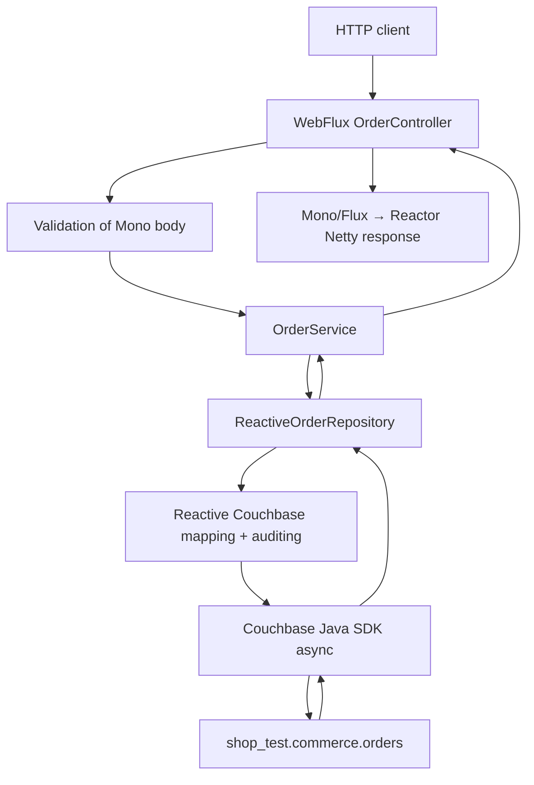
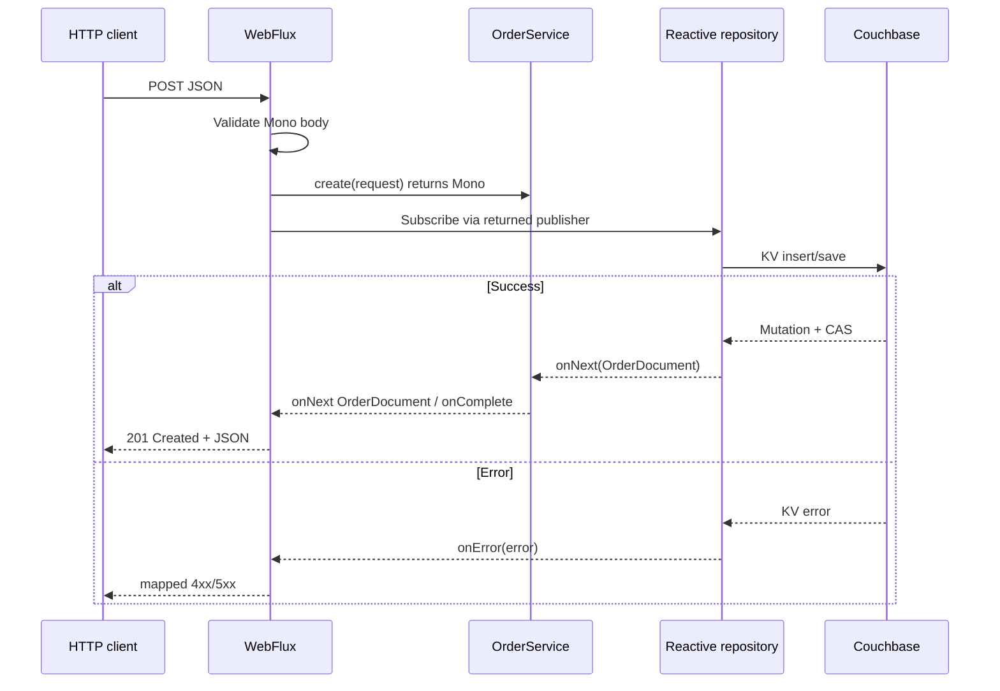
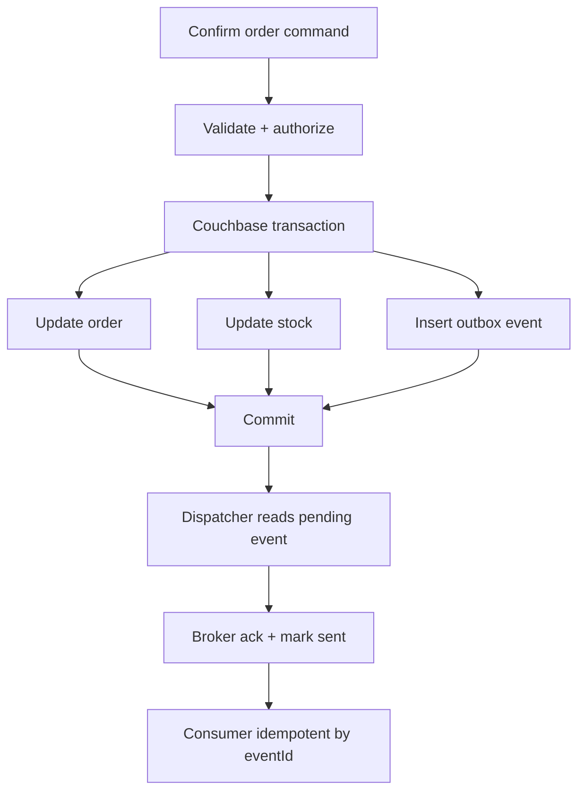

# Xây dựng API WebFlux truy cập Couchbase theo chuỗi phản ứng

Bài thực hành này thuộc chương **Bài thực hành** của module **SPRING_DATA_COUCHBASE**. Bạn sẽ xây một dịch vụ REST nhỏ quản lý đơn hàng bằng **Spring WebFlux + Spring Data Couchbase Reactive**, từ HTTP request tới Couchbase và quay lại client mà không chuyển sang lời gọi blocking trong đường xử lý.

Khác với bài học chỉ nói về `Mono`, `Flux` hoặc repository, kết quả ở đây là **một API có luồng dữ liệu hoàn chỉnh**: tạo đơn, đọc theo ID, liệt kê theo trạng thái, xác nhận đơn với optimistic locking (CAS), xóa đơn trong giới hạn của ví dụ; kèm validation, auditing, query index, kiểm thử controller và integration test. Bài còn chỉ rõ các bẫy thường gặp: repository KV khác truy vấn SQL++, thiếu index/quyền, trộn tenant, `block()` trên event loop, retry tạo đơn trùng và kết quả mutation không rõ sau timeout.

## 1. Sản phẩm cuối bài

Xây dựng endpoint ở đường dẫn `/api/orders`:

| HTTP | Endpoint | Chức năng | Tín hiệu reactive |
| --- | --- | --- | --- |
| `POST` | `/api/orders` | Tạo order ở trạng thái `NEW` | `Mono<ResponseEntity<OrderResponse>>` |
| `GET` | `/api/orders/{id}` | Đọc order theo key | `Mono<OrderResponse>` |
| `GET` | `/api/orders?status=NEW` | Liệt kê order theo trạng thái | `Flux<OrderResponse>` |
| `PATCH` | `/api/orders/{id}/confirm` | Chuyển `NEW → CONFIRMED` | `Mono<OrderResponse>` |
| `DELETE` | `/api/orders/{id}` | Xóa order trong phạm vi demo | `Mono<Void>` |

Ví dụ phản hồi từ POST:

```json
{
  "id": "order::ca21a8d5-89d4-4b4f-9ec9-564ec365a371",
  "tenantId": "tenant-demo",
  "sku": "BOOK-100",
  "quantity": 2,
  "status": "NEW",
  "cas": 1718108352145190912,
  "createdAt": "2026-11-25T03:00:00Z",
  "updatedAt": "2026-11-25T03:00:00Z",
  "createdBy": "service:demo-webflux",
  "updatedBy": "service:demo-webflux"
}
```

Giá trị `id`, CAS, timestamps thực tế **khác mỗi lần chạy**; đây chỉ là mẫu schema. CAS là opaque server token, không phải số thứ tự tăng 1. Việc tạo order chưa đồng nghĩa gửi event hoặc email; tích hợp liên hệ thống cần transaction/outbox riêng.

### Tiêu chí đạt

- HTTP thực sự nhận JSON và trả mã `201/200/204` hoặc lỗi `400/404/409` phù hợp.
- Tất cả phương thức controller/service đi qua `Mono`/`Flux`, không `block()`/`subscribe()` thủ công.
- Document được lưu tại đúng `shop_test.commerce.orders`.
- `findById` qua KV và finder theo status qua SQL++ đều hoạt động.
- Hai writer dùng CAS cũ không được âm thầm ghi đè nhau.
- Auditing metadata được điền khi đi qua Spring Data reactive mapping.
- Có unit/slice tests và ít nhất một integration test có Couchbase thật.

## 2. Kiến trúc và hành trình một request



Khi gọi `POST /api/orders`:

1. Spring WebFlux đọc request body và deserialize thành `CreateOrderRequest`.
2. Jakarta Bean Validation kiểm tra `sku` và `quantity`.
3. Controller gọi service trả `Mono<OrderDocument>`.
4. Service xây entity mới khi publisher được subscribe và gọi reactive repository.
5. Spring Data convert entity sang Couchbase JSON, điền auditing và sử dụng `@Version` để quản lý CAS.
6. SDK thực hiện mutation bất đồng bộ; publisher phát entity hoặc lỗi.
7. Controller ánh xạ sang `OrderResponse` và Spring WebFlux ghi HTTP response.

Không có thread bị giữ để đợi database như khi gọi `Thread.sleep`/`block()`. **Reactive không làm Couchbase nhanh hơn một cách thần kỳ**: vẫn cần index, đúng quyền và query tốt.

## 3. Chọn phiên bản và chuẩn bị công cụ

Để ví dụ nhất quán, bài dùng:

| Thành phần | Lựa chọn bài thực hành |
| --- | --- |
| Java | JDK 17+ |
| Spring Boot | **3.5.6** — một release 3.5.x cụ thể, ví dụ để tái lập |
| Spring WebFlux | BOM của Spring Boot 3.5.6 |
| Spring Data Couchbase Reactive | Starter được BOM quản lý, dòng Spring Data Couchbase 5.5.x |
| Couchbase Java SDK | Do Spring Boot BOM/Spring Data quản lý |
| Couchbase Server | Một release hỗ trợ collections và Query Service, ví dụ Server 7.x được hỗ trợ |
| Build | Gradle Groovy DSL |
| Test | JUnit 5, `WebTestClient`, `StepVerifier`, Couchbase Testcontainers |

**Không lấy bảng này làm ma trận tương thích vĩnh viễn.** Khi học trên Boot 4.x, API test/config/package và dependency versions có thể khác. Trước khi đổi release, đối chiếu Spring Boot BOM, Spring Data Couchbase reference, Java SDK–Server compatibility matrix và chạy lại integration tests.

Cần có:

- JDK/Gradle wrapper tương thích với Boot 3.5.
- Docker + Testcontainers **hoặc** Couchbase local/test cluster.
- Bucket/Scope/Collection/Query Index được tạo theo phần dưới.
- Tài khoản Couchbase có KV read/write và quyền SQL++ SELECT trên target collection.
- HTTP client như `curl` hoặc Postman.

## 4. Cấu trúc project

```text
couchbase-webflux-lab/
├── build.gradle
├── settings.gradle
└── src/
    ├── main/
    │   ├── java/com/example/couchbasewebflux/
    │   │   ├── CouchbaseWebfluxApplication.java
    │   │   ├── config/
    │   │   │   └── DemoAuditingConfig.java
    │   │   └── order/
    │   │       ├── OrderStatus.java
    │   │       ├── OrderDocument.java
    │   │       ├── ReactiveOrderRepository.java
    │   │       ├── CreateOrderRequest.java
    │   │       ├── OrderResponse.java
    │   │       ├── OrderService.java
    │   │       └── OrderController.java
    │   └── resources/
    │       └── application.yml
    └── test/
        └── java/com/example/couchbasewebflux/
            ├── order/OrderControllerWebFluxTest.java
            ├── order/OrderServiceTest.java
            └── OrderApiIntegrationTest.java
```

Tất cả Java classes ở package con của `com.example.couchbasewebflux` để `@SpringBootApplication` mặc định component/repository scan được. Nếu thực tế đặt entity/repository ngoài package này, cần cấu hình scanning đúng thay vì kết luận repository không có.

## 5. Tạo build.gradle

```groovy
plugins {
    id 'java'
    id 'org.springframework.boot' version '3.5.6'
    id 'io.spring.dependency-management' version '1.1.7'
}

group = 'com.example'
version = '0.0.1-SNAPSHOT'

java {
    toolchain {
        languageVersion = JavaLanguageVersion.of(17)
    }
}

repositories {
    mavenCentral()
}

dependencies {
    implementation 'org.springframework.boot:spring-boot-starter-webflux'
    implementation 'org.springframework.boot:spring-boot-starter-data-couchbase-reactive'
    implementation 'org.springframework.boot:spring-boot-starter-validation'

    testImplementation 'org.springframework.boot:spring-boot-starter-test'
    testImplementation 'io.projectreactor:reactor-test'

    // Spring Boot 3.5 thường quản lý Testcontainers 1.x:
    testImplementation 'org.springframework.boot:spring-boot-testcontainers'
    testImplementation 'org.testcontainers:couchbase'
    testImplementation 'org.testcontainers:junit-jupiter'
}

tasks.named('test') {
    useJUnitPlatform()
}
```

Tạo `settings.gradle`:

```groovy
rootProject.name = 'couchbase-webflux-lab'
```

Hai starter rất quan trọng:

- `spring-boot-starter-webflux` đưa WebFlux, Reactor và server HTTP reactive vào project.
- `spring-boot-starter-data-couchbase-reactive` đưa Spring Data Couchbase Reactive và SDK tương thích theo BOM.

**Không** thêm `spring-boot-starter-web` vào ví dụ này: khi WebMVC và WebFlux cùng hiện diện, Boot có thể mặc định chọn ứng dụng servlet, làm kiến trúc/thử nghiệm không còn như dự kiến.

`reactor-test` cần ở test scope, không phải dependency runtime. Boot 3.5 dùng Testcontainers 1.x theo BOM tương ứng; với Testcontainers 2.x, artifact/module names có thể thay đổi và phải cập nhật đồng bộ, không copy imports của 2.x sang 1.x.

## 6. Tạo keyspace và Query Index trên Couchbase

Trong Couchbase Query Workbench (dùng một **setup/admin identity** tại test environment), tạo:

```sql
CREATE SCOPE `shop_test`.`commerce`;

CREATE COLLECTION `shop_test`.`commerce`.`orders`;

CREATE INDEX `ix_orders_tenant_status`
ON `shop_test`.`commerce`.`orders`
    (tenantId, status, `_class`);
```

Bucket `shop_test` phải **tồn tại trước**, đã được provision với KV, Query/Index Services theo cấu hình cluster. Các câu DDL trên dùng cho **lần setup đầu tiên**; khi scope/collection/index đã tồn tại, hãy kiểm tra trước hoặc dùng cơ chế migration idempotent tương ứng version, không chạy lại bừa bãi.

Tại sao cần index? `findById(id)` thường là KV lookup theo document key, nhưng `findByTenantIdAndStatus(...)` thường chạy SQL++ query và cần index. Mặc định Spring Data Couchbase có thể thêm type discriminator như `_class` vào điều kiện truy vấn; index có `tenantId`, `status`, `_class` là một điểm bắt đầu, không thay kiểm tra Query Plan khi production.

**Không tạo PRIMARY INDEX rộng chỉ để “mọi query đều chạy” trong production**. Hãy quan sát truy vấn thực tế và điều chỉnh index theo workload.

### Phân quyền tối thiểu

Tài khoản ứng dụng cần quyền KV read/write trên `shop_test.commerce.orders` và `query_select` nếu dùng finder SQL++. Tài khoản tạo index nên là **migration/setup identity khác**, không phải tài khoản REST service dùng hằng ngày.

| Đường code | Dịch vụ | Quyền thường cần |
| --- | --- | --- |
| `repository.findById(id)` | KV | `data_reader` |
| `repository.save(entity)` | KV | `data_writer` và các quyền cần thiết cho lookup |
| `repository.findByTenantIdAndStatus` | SQL++ Query | `query_select` |
| `CREATE INDEX` trong setup | Query Index | `query_manage_index` |
| `DELETE` qua repository | KV | Quyền ghi/xóa theo RBAC |

Role và scopes phải đối chiếu với Couchbase Server version được dùng; không dùng Admin credentials cho application runtime chỉ để tránh lỗi Query.

## 7. application.yml và biến môi trường

```yaml
server:
  port: 8080

spring:
  couchbase:
    connection-string: ${CB_CONN_STR:couchbase://127.0.0.1}
    username: ${CB_USER:orders_app}
    password: ${CB_PASSWORD}
  data:
    couchbase:
      bucket-name: ${CB_BUCKET:shop_test}
```

Trong YAML trên, `${...}` là **Spring property placeholders** khi lưu file thật với dấu `$`; giá trị mặc định `couchbase://127.0.0.1` chỉ dành local. Khi kết nối Couchbase Capella hoặc cluster yêu cầu TLS, dùng `couchbases://...` và trust config theo hướng dẫn SDK/Boot đang sử dụng.

Thiết lập biến môi trường trước khi chạy:

```bash
export CB_CONN_STR="couchbase://127.0.0.1"
export CB_USER="orders_app"
export CB_PASSWORD="replace-with-test-secret"
export CB_BUCKET="shop_test"

./gradlew bootRun
```

Đây là lệnh **cho người học** chạy trên máy có shell và Gradle wrapper; trong nhiệm vụ viết bài STEP 4 này không chạy build. Trên Windows PowerShell, thiết lập bằng `$env:CB_USER = "orders_app"` và tương tự cho các biến còn lại.

Không commit credentials, không print password ra logs, và không dùng production bucket trong bài thực hành.

## 8. Lớp khởi động ứng dụng

```java
package com.example.couchbasewebflux;

import org.springframework.boot.SpringApplication;
import org.springframework.boot.autoconfigure.SpringBootApplication;

@SpringBootApplication
public class CouchbaseWebfluxApplication {
    public static void main(String[] args) {
        SpringApplication.run(
            CouchbaseWebfluxApplication.class, args
        );
    }
}
```

Nếu bạn đặt file đúng package gốc, Boot sẽ scan các controller/service/repositories trong `order` và configuration trong `config`. Không cần tự extends `AbstractCouchbaseConfiguration` khi dùng auto-configuration cơ bản của Boot; nếu tự cấu hình `CouchbaseClientFactory` hoặc nhiều buckets, phải hiểu precedence giữa các bean custom và auto-config.

## 9. Định nghĩa trạng thái Order

```java
package com.example.couchbasewebflux.order;

public enum OrderStatus {
    NEW,
    CONFIRMED
}
```

Chúng ta chỉ cho phép chuyển từ `NEW` sang `CONFIRMED`. Mục tiêu không phải triển khai đầy đủ order domain, mà minh họa một **read–validate–mutate–save** reactive chain có CAS.

## 10. Entity OrderDocument và mapping Couchbase

```java
package com.example.couchbasewebflux.order;

import java.time.Instant;

import org.springframework.data.annotation.CreatedBy;
import org.springframework.data.annotation.CreatedDate;
import org.springframework.data.annotation.Id;
import org.springframework.data.annotation.LastModifiedBy;
import org.springframework.data.annotation.LastModifiedDate;
import org.springframework.data.annotation.Version;
import org.springframework.data.couchbase.core.mapping.Document;
import org.springframework.data.couchbase.repository.Collection;
import org.springframework.data.couchbase.repository.Scope;

@Document
@Scope("commerce")
@Collection("orders")
public class OrderDocument {

    @Id
    private String id;

    @Version
    private Long version;

    private String tenantId;
    private String sku;
    private int quantity;
    private OrderStatus status;

    @CreatedDate
    private Instant createdAt;

    @LastModifiedDate
    private Instant updatedAt;

    @CreatedBy
    private String createdBy;

    @LastModifiedBy
    private String updatedBy;

    protected OrderDocument() {
        // Spring Data mapping constructor.
    }

    public OrderDocument(
            String id, String tenantId,
            String sku, int quantity) {
        this.id = id;
        this.tenantId = tenantId;
        this.sku = sku;
        this.quantity = quantity;
        this.status = OrderStatus.NEW;
    }

    public String getId() { return id; }
    public Long getVersion() { return version; }
    public String getTenantId() { return tenantId; }
    public String getSku() { return sku; }
    public int getQuantity() { return quantity; }
    public OrderStatus getStatus() { return status; }
    public void setStatus(OrderStatus value) { status = value; }

    public Instant getCreatedAt() { return createdAt; }
    public Instant getUpdatedAt() { return updatedAt; }
    public String getCreatedBy() { return createdBy; }
    public String getUpdatedBy() { return updatedBy; }
}
```

Những điểm cần hiểu:

- `@Document` đánh dấu entity Couchbase; `@Scope`/`@Collection` chọn keyspace **trong bucket đã cấu hình**.
- `@Id` là key: `order::<UUID>`.
- `@Version Long` dùng CAS để optimistic locking. Với entity mới, `version == null` hỗ trợ state detection; không tự tăng version.
- `@CreatedDate/@LastModifiedDate` và auditor fields được điền khi reactive auditing đã bật và document đi qua entity mapping lifecycle.
- Java entity có thêm metadata field nhưng raw JSON có thể không chứa `id`/`version` như field bình thường: ID/CAS là metadata Couchbase. Kiểm tra bằng SDK raw GET.
- Dùng `Instant` cho thời gian; representation JSON thực tế tùy converter/version.

**Đây là entity cho demo**, không phải schema thương mại điện tử production. Một hệ thống thật cần validate domain invariants, currency, inventory, tenancy, audit history, transaction/outbox và schema migration.

## 11. ReactiveCouchbaseRepository

```java
package com.example.couchbasewebflux.order;

import reactor.core.publisher.Flux;
import org.springframework.data.couchbase.repository.ReactiveCouchbaseRepository;

public interface ReactiveOrderRepository
        extends ReactiveCouchbaseRepository<OrderDocument, String> {

    Flux<OrderDocument> findByTenantIdAndStatus(
        String tenantId, OrderStatus status);
}
```

Các method sẵn có (theo repository abstraction):

- `Mono<OrderDocument> save(OrderDocument entity)`.
- `Mono<OrderDocument> findById(String id)`.
- `Mono<Boolean> existsById(String id)`.
- `Mono<Void> delete(OrderDocument entity)` / `deleteById(String id)`.
- Derived finder `Flux<OrderDocument> findByTenantIdAndStatus(...)`.

Đường biết key thường dùng KV; derived query thường dùng SQL++. Đừng bỏ index/query privilege chỉ vì `findById` chạy tốt.

## 12. Request DTO và Bean Validation

```java
package com.example.couchbasewebflux.order;

import jakarta.validation.constraints.Min;
import jakarta.validation.constraints.NotBlank;

public record CreateOrderRequest(
    @NotBlank String sku,
    @Min(1) int quantity
) {}
```

Ví dụ hợp lệ:

```json
{"sku":"BOOK-100","quantity":2}
```

Ví dụ không hợp lệ:

```json
{"sku":"  ","quantity":0}
```

Spring WebFlux hỗ trợ `@Valid @RequestBody Mono<CreateOrderRequest>`. Khi validation lỗi, mặc định phản hồi HTTP `400 Bad Request` (thường qua `WebExchangeBindException`); với method-level constraints có thể gặp `HandlerMethodValidationException`.

**Không deserialize trực tiếp request body vào `OrderDocument`**: client có thể cố gửi `id`, `tenantId`, `createdBy` hoặc CAS để vượt qua policy ứng dụng. DTO chỉ chứa những trường client được phép điều khiển.

## 13. Response DTO và tách entity khỏi API

```java
package com.example.couchbasewebflux.order;

import java.time.Instant;

public record OrderResponse(
    String id,
    String tenantId,
    String sku,
    int quantity,
    OrderStatus status,
    Long cas,
    Instant createdAt,
    Instant updatedAt,
    String createdBy,
    String updatedBy
) {
    public static OrderResponse from(OrderDocument doc) {
        return new OrderResponse(
            doc.getId(),
            doc.getTenantId(),
            doc.getSku(),
            doc.getQuantity(),
            doc.getStatus(),
            doc.getVersion(),
            doc.getCreatedAt(),
            doc.getUpdatedAt(),
            doc.getCreatedBy(),
            doc.getUpdatedBy()
        );
    }
}
```

Việc đưa CAS vào response hỗ trợ quan sát trong bài lab. **Trong production**, có thể dùng ETag/If-Match hoặc một concurrency token riêng, đồng thời kiểm soát lượng metadata trả về client. Không nhận CAS mà user tự nhập rồi tin rằng nó thay quyền truy cập.

## 14. Bật reactive auditing cho môi trường demo

```java
package com.example.couchbasewebflux.config;

import org.springframework.context.annotation.Bean;
import org.springframework.context.annotation.Configuration;
import org.springframework.data.domain.ReactiveAuditorAware;
import org.springframework.data.couchbase.repository.auditing.EnableReactiveCouchbaseAuditing;
import reactor.core.publisher.Mono;

@Configuration
@EnableReactiveCouchbaseAuditing(
    auditorAwareRef = "demoAuditor"
)
public class DemoAuditingConfig {

    @Bean("demoAuditor")
    ReactiveAuditorAware<String> demoAuditor() {
        return () -> Mono.just("service:demo-webflux");
    }
}
```

Bean auditor cố định chỉ phù hợp **demo single-tenant**. Nó không có nghĩa mọi request thực sự do một người dùng đã được xác thực gửi. Ở production, `ReactiveAuditorAware` cần lấy actor từ `ReactiveSecurityContextHolder`/trusted job context; không tin một header `X-Actor` do public client tự gửi.

Auditing actor/time là metadata của entity save, **không** thay authorization hay bất biến nghiệp vụ. Nếu ghi trực tiếp bằng SDK/SQL++ DML, các callback auditing của Spring Data không tự chạy.

## 15. Service xử lý đơn hàng bằng chuỗi reactive

Đây là phần quan trọng nhất của bài. Service giữ **demo tenant** cố định và không lấy tenant từ request body hoặc header do client tự đặt.

```java
package com.example.couchbasewebflux.order;

import java.util.Objects;
import java.util.UUID;

import org.springframework.dao.OptimisticLockingFailureException;
import org.springframework.http.HttpStatus;
import org.springframework.stereotype.Service;
import org.springframework.web.server.ResponseStatusException;

import reactor.core.publisher.Flux;
import reactor.core.publisher.Mono;

@Service
public class OrderService {

    static final String DEMO_TENANT = "tenant-demo";

    private final ReactiveOrderRepository orders;

    public OrderService(ReactiveOrderRepository orders) {
        this.orders = orders;
    }

    public Mono<OrderDocument> create(CreateOrderRequest input) {
        return Mono.defer(() -> {
            if (input == null ||
                    input.sku() == null ||
                    input.sku().isBlank() ||
                    input.quantity() < 1) {

                return Mono.error(
                    new ResponseStatusException(
                        HttpStatus.BAD_REQUEST,
                        "Invalid order data"
                    )
                );
            }

            OrderDocument entity = new OrderDocument(
                "order::" + UUID.randomUUID(),
                DEMO_TENANT,
                input.sku().trim(),
                input.quantity()
            );

            return orders.save(entity);
        });
    }

    public Mono<OrderDocument> get(String id) {
        return orders.findById(id)
            .filter(order ->
                DEMO_TENANT.equals(order.getTenantId())
            )
            .switchIfEmpty(Mono.error(
                new ResponseStatusException(
                    HttpStatus.NOT_FOUND,
                    "Order not found"
                )
            ));
    }

    public Flux<OrderDocument> list(OrderStatus status) {
        return orders.findByTenantIdAndStatus(
            DEMO_TENANT, Objects.requireNonNull(status)
        );
    }

    public Mono<OrderDocument> confirm(String id) {
        return get(id)
            .flatMap(current -> {
                if (current.getStatus() != OrderStatus.NEW) {
                    return Mono.error(
                        new ResponseStatusException(
                            HttpStatus.CONFLICT,
                            "Only NEW orders can be confirmed"
                        )
                    );
                }

                current.setStatus(OrderStatus.CONFIRMED);

                return orders.save(current)
                    .onErrorMap(
                        OptimisticLockingFailureException.class,
                        error -> new ResponseStatusException(
                            HttpStatus.CONFLICT,
                            "Order was modified concurrently",
                            error
                        )
                    );
            });
    }

    public Mono<Void> delete(String id) {
        return get(id)
            .flatMap(orders::delete);
    }
}
```

### Đọc kỹ từng operator

- `Mono.defer(...)` chỉ tạo UUID/entity khi có subscription. Đây là **lazy construction**, nhưng nếu publisher bị resubscribe/retry sau timeout, nó có thể tạo UUID khác. Bài demo chưa triển khai idempotent POST.
- `orders.findById(id)` trả `Mono<OrderDocument>` khi có dữ liệu và thường `Mono.empty()` khi key vắng.
- `filter(...)` là **hàng rào tenant ở service** cho demo. Một ứng dụng đa tenant phải xác thực principal/tenant trước đó và enforce đúng mọi đường Query/SDK, không chỉ dựa filter này.
- `switchIfEmpty(Mono.error(...))` chuyển kết quả không tìm thấy (hoặc không thuộc tenant demo) thành HTTP 404.
- `flatMap(...)` nối lệnh đọc với lệnh ghi tiếp theo, không thực hiện đồng thời như `Mono.zip(read, write)`.
- `onErrorMap(OptimisticLockingFailureException.class, ...)` đổi conflict CAS thành HTTP 409, không catch mọi database error.
- `delete(current)` minh họa delete sau khi load và kiểm tra tenant; **không khẳng định mọi version/API đều thực hiện CAS-conditional delete**. Khi nghiệp vụ yêu cầu chống race nghiêm ngặt, dùng conditional remove/transaction phù hợp và kiểm thử.

### Không tự retry optimistic lock một cách mù quáng

Nếu cả A và B cùng confirm:

1. A và B load order `NEW` cùng CAS.
2. A save `CONFIRMED` thành công.
3. B save với CAS cũ thất bại hoặc B đọc lại thấy `CONFIRMED`.
4. B nhận `409 Conflict` theo demo.

Không thêm `retry(10)` cho mọi lỗi: nếu retry lại publisher create, có thể sinh đơn trùng; nếu retry stale save mà không load/validate state, có thể làm sai business transition. Với API idempotent thật, cần stable command ID/idempotency key.

## 16. OrderController: chỉ nối publisher, không block

```java
package com.example.couchbasewebflux.order;

import java.net.URI;

import jakarta.validation.Valid;

import org.springframework.http.HttpStatus;
import org.springframework.http.ResponseEntity;
import org.springframework.web.bind.annotation.*;

import reactor.core.publisher.Flux;
import reactor.core.publisher.Mono;

@RestController
@RequestMapping("/api/orders")
public class OrderController {

    private final OrderService service;

    public OrderController(OrderService service) {
        this.service = service;
    }

    @PostMapping
    public Mono<ResponseEntity<OrderResponse>> create(
            @Valid @RequestBody Mono<CreateOrderRequest> body) {

        return body
            .flatMap(service::create)
            .map(saved ->
                ResponseEntity.created(
                    URI.create("/api/orders/" + saved.getId())
                ).body(OrderResponse.from(saved))
            );
    }

    @GetMapping("/{id}")
    public Mono<OrderResponse> get(@PathVariable String id) {
        return service.get(id)
            .map(OrderResponse::from);
    }

    @GetMapping
    public Flux<OrderResponse> list(
            @RequestParam OrderStatus status) {

        return service.list(status)
            .map(OrderResponse::from);
    }

    @PatchMapping("/{id}/confirm")
    public Mono<OrderResponse> confirm(
            @PathVariable String id) {

        return service.confirm(id)
            .map(OrderResponse::from);
    }

    @DeleteMapping("/{id}")
    @ResponseStatus(HttpStatus.NO_CONTENT)
    public Mono<Void> delete(@PathVariable String id) {
        return service.delete(id);
    }
}
```

**Không có `subscribe()` hoặc `block()`**. Framework sẽ subscribe vào publisher khi xử lý HTTP response. Phương thức HTTP có thể trả error signal; WebFlux ánh xạ `ResponseStatusException` thành HTTP status tương ứng.

### Khi request body trống

`@RequestBody` mặc định required; WebFlux có cơ chế báo 400 khi thiếu body. Với `Mono<CreateOrderRequest>`, annotation `@Valid` kích hoạt validation khi body được deserialize. Nếu thêm method-level constraint trên parameters, loại validation exception có thể thay đổi; kiểm tra `WebExchangeBindException` và `HandlerMethodValidationException` theo Spring Framework version.

### Vì sao không trả entity trực tiếp?

DTO response giúp tránh tình cờ lộ fields nội bộ khi thêm schema fields/credentials sau này. Nó cũng tạo hợp đồng API độc lập với tên field Couchbase như `_class` hoặc CAS.

## 17. Chạy ứng dụng và thử POST

Sau khi đã tạo bucket/scope/collection/index, quyền và môi trường ở trên:

```bash
./gradlew bootRun
```

Gửi request:

```bash
curl -i -X POST "http://localhost:8080/api/orders" \
  -H "Content-Type: application/json" \
  -d '{"sku":"BOOK-100","quantity":2}'
```

Kỳ vọng:

- `HTTP/1.1 201 Created`.
- Header `Location: /api/orders/order::<uuid>`.
- Body có `status: "NEW"`, `tenantId: "tenant-demo"`.
- `createdBy`/`updatedBy` là `service:demo-webflux` nếu auditing hoạt động.
- `cas` có giá trị non-null. Không assert một con số CAS cố định.

Nếu API trả 500 do connection/index/permission, **không** thay lỗi thành empty response; xem phần chẩn đoán cuối bài.

## 18. Đọc theo ID và 404

Dùng ID nhận từ POST:

```bash
curl -i "http://localhost:8080/api/orders/order::ca21a8d5-89d4-4b4f-9ec9-564ec365a371"
```

Trong ví dụ, UUID trong URL là **minh họa**; phải thay bằng ID thực tế của request POST. Kỳ vọng HTTP 200 và entity được trả đúng.

Kiểm tra missing key:

```bash
curl -i "http://localhost:8080/api/orders/order::missing-test"
```

Kỳ vọng HTTP 404. Vì repository `findById` thường dùng KV, test này không chứng minh SQL++ Query Service/index đã sẵn sàng.

### Xác nhận trực tiếp bằng SDK KV

Trong test code, sau khi POST complete có thể gọi Java SDK:

```java
var result = sdkCluster.bucket("shop_test")
    .scope("commerce")
    .collection("orders")
    .get(orderId);

var raw = result.contentAsObject();

assertEquals("BOOK-100", raw.getString("sku"));
assertEquals("tenant-demo", raw.getString("tenantId"));
```

Đây là **mảnh integration test**, không phải Java standalone; cần `sdkCluster` và `orderId` của fixture. Mục đích: xác nhận dữ liệu nằm ở **đúng keyspace**, không chỉ save/find cùng nhầm collection.

## 19. Liệt kê theo status: đây là SQL++, không phải KV GET

```bash
curl -i "http://localhost:8080/api/orders?status=NEW"
```

Kỳ vọng JSON array gồm những order `NEW` của tenant demo. Về bản chất, repository derived query thường sinh SQL++ tương đương:

```sql
SELECT o.*
FROM `shop_test`.`commerce`.`orders` AS o
WHERE o.tenantId = "tenant-demo"
  AND o.status = "NEW";
```

Đây là câu SQL++ **minh họa ý nghĩa filter**, không phải câu lệnh Spring Data tạo nguyên văn. Framework có thể thêm metadata ID/CAS và type discriminator. Nếu thiếu `query_select` hoặc index, `findById` vẫn có thể thành công nhưng `GET ?status=NEW` thất bại.

### Read-after-write và index lag

SQL++ secondary index có thể cập nhật bất đồng bộ. POST đã trả 201 không có nghĩa một SQL++ SELECT với consistency mặc định luôn thấy document **ngay lập tức**. Trong bài lab, nên:

- Xác minh raw KV GET ngay sau POST.
- Khi test API list, chờ Query Index ONLINE và dùng consistency phù hợp (ví dụ `REQUEST_PLUS` trong Template query) hoặc bounded polling theo đúng contract.
- Không viết `Thread.sleep(100)` rồi cho rằng mọi CI environments giống nhau.

### Đừng trả không giới hạn ở production

Endpoint list trong demo trả toàn bộ matching rows. Production nên có paging/limit/sort/tenant filters và giới hạn kết quả. Một `Flux` không làm việc query hàng triệu rows trở nên “miễn phí”; Query Service vẫn tiêu thụ tài nguyên.

## 20. PATCH confirm: chuỗi read–validate–save và CAS

```bash
curl -i -X PATCH \
  "http://localhost:8080/api/orders/order::<real-uuid>/confirm"
```

Thay `<real-uuid>` bằng UUID thực. Kỳ vọng lần đầu `HTTP 200`, status `CONFIRMED` và CAS thay đổi so với trước.

Gọi lại lần hai:

```bash
curl -i -X PATCH \
  "http://localhost:8080/api/orders/order::<real-uuid>/confirm"
```

Kỳ vọng `409 Conflict` do business rule: chỉ order `NEW` được confirm. Nếu hai request chạy **cùng lúc** sau khi cả hai load trạng thái NEW, một request có thể bị 409 do optimistic lock CAS; HTTP status giống nhưng nguyên nhân khác.

### CAS không phải trường JSON thông thường

Spring Data Couchbase sử dụng metadata CAS cho `@Version`. Không viết:

```java
// Sai: CAS không phải revision counter.
order.setVersion(order.getVersion() + 1);
```

Trong ví dụ entity không có setter cho version. CAS token do SDK/server cấp và được Spring Data dùng khi lưu entity đã tồn tại.

### Response status khác nhau tùy nguyên nhân

| Tình huống | HTTP |
| --- | --- |
| ID không tồn tại / không thuộc demo tenant | 404 |
| Đã CONFIRMED, gọi confirm lần nữa | 409 |
| Stale CAS khi save | 409 |
| Validation body tạo đơn không hợp lệ | 400 |
| Thất bại network/Query Service | Thường 5xx, phải quan sát nguyên nhân |

Không trả 404 cho mọi lỗi Couchbase. Nếu Query Service thiếu quyền/index, đó là lỗi vận hành hoặc cấu hình, không phải “order không tồn tại”.

## 21. DELETE: ví dụ giới hạn và lỗi TOCTOU

```bash
curl -i -X DELETE \
  "http://localhost:8080/api/orders/order::<real-uuid>"
```

Kỳ vọng 204 nếu service tìm thấy order thuộc demo tenant và deletion hoàn tất. Gọi lại có thể nhận 404 do service `get(id)` kiểm tra tồn tại trước.

Nhưng lưu ý luồng:

```text
findById -> verify tenant -> delete(entity)
```

không tự là một transaction xuyên mọi thời điểm. Một writer khác có thể thay document giữa đọc và xóa (**time-of-check to time-of-use**). Với use case cần conditional deletion, dùng SDK `collection.remove(key, removeOptions().cas(expectedCas))` hoặc transaction, kiểm tra quyền/owner và mapping exception theo version. Bài demo đặt trọng tâm vào **reactive chain**, không coi `delete(entity)` là cơ chế authorization/CAS tuyệt đối.

## 22. Đọc bằng ReactiveCouchbaseTemplate thay repository

Khi cần chủ động chọn scope/collection hoặc QueryScanConsistency, dùng Template:

```java
package com.example.couchbasewebflux.order;

import org.springframework.data.couchbase.core.ReactiveCouchbaseTemplate;
import org.springframework.stereotype.Component;
import reactor.core.publisher.Mono;

@Component
public class OrderTemplateLookup {

    private final ReactiveCouchbaseTemplate template;

    public OrderTemplateLookup(
            ReactiveCouchbaseTemplate template) {
        this.template = template;
    }

    public Mono<OrderDocument> getById(String id) {
        return template
            .findById(OrderDocument.class)
            .inScope("commerce")
            .inCollection("orders")
            .one(id);
    }
}
```

`ReactiveCouchbaseTemplate` cũng trả publisher; không gọi `block()` chỉ vì Template có fluent API. Nó sử dụng converter/mapping tương ứng được cấu hình cho Template.

Lưu ý: `inScope("commerce")` và `inCollection("orders")` không tự thay bucket của `CouchbaseClientFactory`. Nếu ứng dụng nhiều bucket, phải chọn đúng Template/factory ở cấp bucket và kiểm thử raw KV.

## 23. Template SQL++ với REQUEST_PLUS

Một truy vấn cần đọc dữ liệu vừa ghi trong integration test có thể dùng `REQUEST_PLUS`:

```java
package com.example.couchbasewebflux.order;

import com.couchbase.client.java.query.QueryScanConsistency;
import org.springframework.data.couchbase.core.ReactiveCouchbaseTemplate;
import org.springframework.data.couchbase.core.query.Query;
import org.springframework.data.couchbase.core.query.QueryCriteria;
import org.springframework.stereotype.Component;
import reactor.core.publisher.Flux;

@Component
public class OrderTemplateQuery {

    private final ReactiveCouchbaseTemplate template;

    public OrderTemplateQuery(
            ReactiveCouchbaseTemplate template) {
        this.template = template;
    }

    public Flux<OrderDocument> list(
            String tenantId, OrderStatus status) {

        Query criteria = Query.query(
            QueryCriteria.where("tenantId").is(tenantId)
                .and("status").is(status.name())
        );

        return template
            .findByQuery(OrderDocument.class)
            .consistentWith(QueryScanConsistency.REQUEST_PLUS)
            .matching(criteria)
            .all();
    }
}
```

Đây là **phương án thay thế** cho repository finder để điều khiển query consistency. `REQUEST_PLUS` có thể tăng latency; **không** sửa thiếu index, thiếu quyền hoặc sai keyspace. Trong test production-like, đo p95/p99 query latency và dùng scan consistency phù hợp từng use case.

Với Template được config khác repository, hãy kiểm thử callbacks/auditing và mapping ngay trên Template; đừng mặc định mọi bean có cùng converter.

## 24. Tập hợp toàn bộ các chuỗi phản ứng

| API | Chuỗi operator | Kết quả |
| --- | --- | --- |
| Tạo đơn | `body.flatMap(service::create).map(toResponse)` | Một response khi KV mutation thành công. |
| Đọc key | `findById.filter(tenant).switchIfEmpty(error).map` | 200 hoặc 404. |
| List | `findByTenantIdAndStatus.map(toResponse)` | 0..N onNext, rồi onComplete/error. |
| Confirm | `get.flatMap(validate → save).onErrorMap(CAS)` | Trạng thái mới hoặc 409. |
| Delete | `get.flatMap(delete)` | `Mono<Void>` complete hoặc error. |
| Query Template | `findByQuery.consistentWith.matching.all` | SQL++ result với index consistency mong muốn. |

Sơ đồ tín hiệu:



Diagram thể hiện **logic**, không coi một producer trả `Mono` là đã thực thi. Trong ứng dụng WebFlux, framework subscribe để tạo HTTP response; khi test service độc lập, cần StepVerifier để subscribe/verify.

## 25. Kiểm thử controller nhanh bằng @WebFluxTest

Để kiểm tra HTTP mapping, JSON và validation mà **không cần Couchbase**, dùng WebFlux test slice và mock service.

```java
package com.example.couchbasewebflux.order;

import org.junit.jupiter.api.Test;
import org.springframework.beans.factory.annotation.Autowired;
import org.springframework.boot.test.autoconfigure.web.reactive.WebFluxTest;
import org.springframework.http.MediaType;
import org.springframework.test.context.bean.override.mockito.MockitoBean;
import org.springframework.test.web.reactive.server.WebTestClient;
import reactor.core.publisher.Mono;

import static org.mockito.ArgumentMatchers.any;
import static org.mockito.Mockito.*;
import static org.junit.jupiter.api.Assertions.*;

@WebFluxTest(OrderController.class)
class OrderControllerWebFluxTest {

    @Autowired
    WebTestClient client;

    @MockitoBean
    OrderService service;

    @Test
    void postValidOrderReturns201() {
        OrderDocument saved = new OrderDocument(
            "order::test-1",
            "tenant-demo",
            "BOOK-100",
            2
        );

        when(service.create(any(CreateOrderRequest.class)))
            .thenReturn(Mono.just(saved));

        client.post()
            .uri("/api/orders")
            .contentType(MediaType.APPLICATION_JSON)
            .bodyValue("""
                {"sku":"BOOK-100","quantity":2}
                """)
            .exchange()
            .expectStatus().isCreated()
            .expectHeader()
                .valueEquals("Location", "/api/orders/order::test-1")
            .expectBody()
                .jsonPath("$.id").isEqualTo("order::test-1")
                .jsonPath("$.status").isEqualTo("NEW");

        verify(service).create(any(CreateOrderRequest.class));
    }

    @Test
    void postInvalidOrderReturns400() {
        client.post()
            .uri("/api/orders")
            .contentType(MediaType.APPLICATION_JSON)
            .bodyValue("""
                {"sku":" ","quantity":0}
                """)
            .exchange()
            .expectStatus().isBadRequest();

        verifyNoInteractions(service);
    }
}
```

Boot 3.5 dùng `@MockitoBean` của Spring Test; trước đó `@MockBean` của Boot đã được dùng phổ biến nhưng bị deprecated ở các release mới. Đây là **test slice**: không có repository/Couchbase server, không chứng minh auditing hay index đã hoạt động.

Lưu ý trong mock response, `createdAt/cas` có thể null vì entity chưa được persist. Test chỉ assert HTTP contract liên quan. Không biến slice-test xanh thành kết luận backend đã ghi document.

### Test thêm cho GET/404

Có thể stub:

```java
when(service.get("order::missing"))
    .thenReturn(Mono.error(
        new org.springframework.web.server.ResponseStatusException(
            org.springframework.http.HttpStatus.NOT_FOUND,
            "Order not found"
        )
    ));

client.get()
    .uri("/api/orders/order::missing")
    .exchange()
    .expectStatus().isNotFound();
```

Đây là fragment đặt trong class test ở trên. Nếu endpoint có security filter thực, cần import/test security configuration tương ứng hoặc test ở `@SpringBootTest`; `@WebFluxTest` không tự mang toàn bộ application security stack.

## 26. Unit test cho OrderService với StepVerifier

Unit test quan trọng nhất là **không block**, quan sát publisher và lỗi nghiệp vụ:

```java
package com.example.couchbasewebflux.order;

import org.junit.jupiter.api.Test;
import org.springframework.http.HttpStatus;
import org.springframework.web.server.ResponseStatusException;
import reactor.core.publisher.Mono;
import reactor.test.StepVerifier;

import static org.junit.jupiter.api.Assertions.*;
import static org.mockito.ArgumentMatchers.any;
import static org.mockito.Mockito.*;

class OrderServiceTest {

    private final ReactiveOrderRepository repository =
        mock(ReactiveOrderRepository.class);

    private final OrderService service =
        new OrderService(repository);

    @Test
    void createIsLazyAndEmitsOneOrder() {
        when(repository.save(any(OrderDocument.class)))
            .thenAnswer(invocation ->
                Mono.just(invocation.getArgument(0))
            );

        Mono<OrderDocument> publisher =
            service.create(
                new CreateOrderRequest("BOOK-100", 2)
            );

        // Mono.defer: chưa subscribe, repo chưa được gọi.
        verifyNoInteractions(repository);

        StepVerifier.create(publisher)
            .assertNext(order -> {
                assertEquals("tenant-demo", order.getTenantId());
                assertEquals(OrderStatus.NEW, order.getStatus());
                assertEquals("BOOK-100", order.getSku());
            })
            .expectComplete()
            .verify(java.time.Duration.ofSeconds(3));

        verify(repository).save(any(OrderDocument.class));
    }

    @Test
    void missingOrderMapsTo404() {
        when(repository.findById("order::missing"))
            .thenReturn(Mono.empty());

        StepVerifier.create(
                service.get("order::missing")
            )
            .expectErrorSatisfies(error -> {
                assertInstanceOf(
                    ResponseStatusException.class, error
                );

                ResponseStatusException responseError =
                    (ResponseStatusException) error;

                assertEquals(
                    HttpStatus.NOT_FOUND,
                    responseError.getStatusCode()
                );
            })
            .verify(java.time.Duration.ofSeconds(3));
    }

    @Test
    void cannotConfirmAlreadyConfirmedOrder() {
        OrderDocument order = new OrderDocument(
            "order::done", "tenant-demo", "BOOK-100", 1
        );
        order.setStatus(OrderStatus.CONFIRMED);

        when(repository.findById("order::done"))
            .thenReturn(Mono.just(order));

        StepVerifier.create(service.confirm("order::done"))
            .expectErrorSatisfies(error -> {
                assertInstanceOf(
                    ResponseStatusException.class, error
                );
                assertEquals(
                    HttpStatus.CONFLICT,
                    ((ResponseStatusException) error)
                        .getStatusCode()
                );
            })
            .verify(java.time.Duration.ofSeconds(3));

        verify(repository, never())
            .save(any(OrderDocument.class));
    }
}
```

Những test trên **không dùng Couchbase thật**. Chúng xác minh Reactor chain, state transition và failure mapping; không chứng minh converters/CASE/Query Index/RBAC. Dùng test integration ở phần sau để kiểm chứng database.

### Vì sao không gọi service rồi assertNotNull(Mono)?

`service.create(...)` trả một `Mono<OrderDocument>` dù không có subscription. Chỉ `StepVerifier.create(...).verify(...)` (hoặc WebFlux runtime) mới consume publisher và kiểm tra terminal signal.

## 27. Chuẩn bị integration test với Testcontainers

Trong Spring Boot 3.5, `@ServiceConnection` có thể tự tạo `CouchbaseConnectionDetails` từ `CouchbaseContainer`. Ví dụ test class skeleton (Testcontainers **1.x**, phù hợp starter/BOM của Boot 3.5):

```java
package com.example.couchbasewebflux;

import com.couchbase.client.java.Cluster;
import com.couchbase.client.java.Bucket;
import com.couchbase.client.java.manager.collection.CollectionSpec;

import java.time.Duration;

import org.junit.jupiter.api.AfterAll;
import org.junit.jupiter.api.BeforeAll;
import org.junit.jupiter.api.Test;

import org.springframework.beans.factory.annotation.Autowired;
import org.springframework.boot.test.autoconfigure.web.reactive.AutoConfigureWebTestClient;
import org.springframework.boot.test.context.SpringBootTest;
import org.springframework.boot.testcontainers.service.connection.ServiceConnection;
import org.springframework.test.web.reactive.server.WebTestClient;

import org.testcontainers.couchbase.BucketDefinition;
import org.testcontainers.couchbase.CouchbaseContainer;
import org.testcontainers.junit.jupiter.Container;
import org.testcontainers.junit.jupiter.Testcontainers;
import org.testcontainers.utility.DockerImageName;

@SpringBootTest(
    webEnvironment = SpringBootTest.WebEnvironment.RANDOM_PORT,
    properties = "spring.data.couchbase.bucket-name=shop_test"
)
@AutoConfigureWebTestClient
@Testcontainers
class OrderApiIntegrationTest {

    @Container
    @ServiceConnection
    static CouchbaseContainer couchbase =
        new CouchbaseContainer(
            DockerImageName.parse("couchbase/server:7.6.2")
        ).withBucket(new BucketDefinition("shop_test"));

    static Cluster setupCluster;

    @Autowired
    WebTestClient client;

    @BeforeAll
    static void prepareSchema() {
        setupCluster = Cluster.connect(
            couchbase.getConnectionString(),
            couchbase.getUsername(),
            couchbase.getPassword()
        );

        Bucket bucket = setupCluster.bucket("shop_test");
        bucket.waitUntilReady(Duration.ofSeconds(60));

        var manager = bucket.collections();

        // Với test bucket mới ở container riêng.
        manager.createScope("commerce");
        manager.createCollection(
            CollectionSpec.create("orders", "commerce")
        );

        setupCluster.query("""
            CREATE INDEX ix_orders_tenant_status
            ON `shop_test`.`commerce`.`orders`
                (tenantId, status, `_class`)
            """);
    }

    @AfterAll
    static void stopSetupClient() {
        if (setupCluster != null) {
            setupCluster.disconnect();
        }
    }

    // Các @Test ở phần sau.
}
```

**Đọc kỹ trước khi copy:**

- `couchbase/server:7.6.2` là một image tag có thực, nhưng CI/production-like tests nên dùng image release được tổ chức hỗ trợ và pin digest khi cần.
- JUnit `@Container` static được khởi chạy theo Testcontainers extension; `@BeforeAll` tạo scope, collection và index trên **test bucket mới**.
- `CollectionSpec.create("orders","commerce")` là API tương thích nhiều dòng SDK 3.x; ở một số SDK mới nó đã deprecated để nhường overload `createCollection(scope, collection)`. Dùng Javadoc của version được resolve.
- Nếu container được reuse hoặc test setup chạy nhiều lần, `createScope/createCollection/CREATE INDEX` có thể báo already exists. Dùng provisioning idempotent/kiểm tra trước trong suite thực tế; **không bắt mọi exception và coi setup PASS**.
- Index có thể cần thời gian chuyển sang ONLINE. Đừng dùng sleep cứng và giả định Query Service đã sẵn sàng ngay sau `CREATE INDEX`; hãy có bounded readiness probe trước test derived query.
- `@ServiceConnection` có thể override property credentials thông thường. Mặc định container test có setup/admin credential; **không coi các test này là bằng chứng least-privilege RBAC**. Muốn test RBAC, tạo limited user riêng rồi dùng kết nối đó.

**Không chạy provisioning/index DDL ở runtime REST application**. Đây là setup test do tài khoản đã được ủy quyền thực hiện.

## 28. Integration test: WebTestClient POST → GET → SDK oracle

Thêm method vào `OrderApiIntegrationTest` sau khi schema đã sẵn sàng:

```java
@Test
void createAndReadUsesExpectedKeyspace() {
    var created = client.post()
        .uri("/api/orders")
        .header("Content-Type", "application/json")
        .bodyValue("""
            {"sku":"BOOK-100","quantity":2}
            """)
        .exchange()
        .expectStatus().isCreated()
        .expectBody(
            com.example.couchbasewebflux.order.OrderResponse.class
        )
        .returnResult()
        .getResponseBody();

    org.junit.jupiter.api.Assertions.assertNotNull(created);

    String id = created.id();

    try {
        client.get()
            .uri("/api/orders/{id}", id)
            .exchange()
            .expectStatus().isOk()
            .expectBody()
            .jsonPath("$.sku").isEqualTo("BOOK-100")
            .jsonPath("$.status").isEqualTo("NEW");

        var raw = setupCluster.bucket("shop_test")
            .scope("commerce")
            .collection("orders")
            .get(id)
            .contentAsObject();

        org.junit.jupiter.api.Assertions.assertEquals(
            "tenant-demo",
            raw.getString("tenantId")
        );

        org.junit.jupiter.api.Assertions.assertEquals(
            "service:demo-webflux",
            raw.getString("createdBy")
        );

    } finally {
        setupCluster.bucket("shop_test")
            .scope("commerce")
            .collection("orders")
            .remove(id);
    }
}
```

Đây là **method bổ sung vào class integration test** ở phần trên. Nó dùng `WebTestClient` để kiểm tra HTTP contract, rồi SDK đọc **raw KV tại đúng bucket.scope.collection** để phát hiện trường hợp repository save/read cùng route nhầm chỗ.

### Những giới hạn và đề phòng cleanup

- Nếu POST đã ghi thành công nhưng response bị mất do timeout, client không biết ID do server tạo. Đây là lý do production nên có idempotency key, test setup/test-only key prefix hoặc fixture ledger.
- `finally remove(id)` chỉ phù hợp với **dedicated test bucket** đã kiểm tra đúng environment. Không dùng trong production.
- Với concurrent CI tests, phải có run IDs/owners và cleanup guard thay vì xóa key từ nguồn không đáng tin.
- Index readiness không ảnh hưởng KV POST/GET trực tiếp, nhưng tác động đến GET list.

## 29. Integration test: GET list theo status

Sau khi đã seed order(s), test endpoint:

```java
@Test
void listByStatusReturnsOrderFromTest() {
    var created = client.post()
        .uri("/api/orders")
        .header("Content-Type", "application/json")
        .bodyValue("""
            {"sku":"PENCIL-200","quantity":1}
            """)
        .exchange()
        .expectStatus().isCreated()
        .expectBody(
            com.example.couchbasewebflux.order.OrderResponse.class
        )
        .returnResult()
        .getResponseBody();

    org.junit.jupiter.api.Assertions.assertNotNull(created);

    try {
        // Yêu cầu đã có Query Index ONLINE.
        client.get()
            .uri("/api/orders?status=NEW")
            .exchange()
            .expectStatus().isOk()
            .expectBodyList(
                com.example.couchbasewebflux.order.OrderResponse.class
            )
            .value(rows ->
                org.junit.jupiter.api.Assertions.assertTrue(
                    rows.stream().anyMatch(
                        row -> created.id().equals(row.id())
                    )
                )
            );
    } finally {
        setupCluster.bucket("shop_test")
            .scope("commerce")
            .collection("orders")
            .remove(created.id());
    }
}
```

**Giới hạn quan trọng:** với derived repository method dùng SQL++ consistency mặc định, test này có thể flaky **ngay sau KV write** do index lag, dù dữ liệu đúng. Trước khi coi test là deterministic, hãy:

1. Đợi index ONLINE.
2. Dùng API/query configuration hỗ trợ `REQUEST_PLUS` hoặc mutation-state consistency.
3. Hoặc dùng bounded eventual assertion/polling trong integration test, có deadline và error classification.

Đừng `Thread.sleep(100)` cố định hoặc đổi assertion thành “list có thể rỗng” chỉ để CI xanh.

Ngoài ra, test chạy song song có thể có nhiều order NEW thuộc demo tenant. Vì vậy assert `anyMatch(id)`, **không assert list size bằng 1** trừ khi mỗi test có tenant/keyspace riêng.

## 30. Integration test: confirm và CAS thực tế

Gieo order mới, đọc hai snapshots độc lập bằng repository rồi cố tình lưu bằng CAS cũ. Có thể giữ **toàn bộ test reactive** mà không cần `block()`:

```java
// Mảnh method trong @SpringBootTest đã seed key id:
Mono<OrderDocument> staleWrite = Mono.zip(
        repository.findById(id),
        repository.findById(id)
    )
    .flatMap(pair -> {
        OrderDocument first = pair.getT1();
        OrderDocument second = pair.getT2();

        org.junit.jupiter.api.Assertions.assertEquals(
            first.getVersion(), second.getVersion()
        );

        first.setStatus(OrderStatus.CONFIRMED);
        second.setStatus(OrderStatus.CONFIRMED);

        // Lưu tuần tự: second vẫn mang CAS cũ.
        return repository.save(first)
            .then(repository.save(second));
    });

reactor.test.StepVerifier.create(staleWrite)
    .expectErrorMatches(this::isOptimisticLockConflict)
    .verify(java.time.Duration.ofSeconds(10));

reactor.test.StepVerifier.create(repository.findById(id))
    .assertNext(stored ->
        org.junit.jupiter.api.Assertions.assertEquals(
            OrderStatus.CONFIRMED, stored.getStatus()
        )
    )
    .expectComplete()
    .verify(java.time.Duration.ofSeconds(10));
```

**Đây là fragment thiết kế test**, không phải method đầy đủ: cần `repository`, `id` được seed, cleanup, `Mono` imports và matcher `isOptimisticLockConflict`. Hai truy vấn trong `Mono.zip` phải tạo **hai instance entity độc lập** cùng CAS; `flatMap` chỉ bắt đầu các saves khi cả hai reads đã xong, và `.then(...)` buộc hai saves chạy theo thứ tự. Điều cốt lõi là cả hai snapshots phải được load **trước** save đầu tiên.

### Không assert CAS tăng 1

CAS của Couchbase là opaque. Chỉ so sánh expected stale vs fresh, không tính `version++`. Với `@Version Long`, Spring Data có thể translate CAS mismatch thành `OptimisticLockingFailureException` hoặc exception có cause SDK tùy release. Matcher phải nhận diện đúng optimistic locking, không match mọi exception.

### Test PATCH qua WebTestClient

Thêm HTTP test:

```java
client.patch()
    .uri("/api/orders/{id}/confirm", id)
    .exchange()
    .expectStatus().isOk()
    .expectBody()
    .jsonPath("$.status").isEqualTo("CONFIRMED");

client.patch()
    .uri("/api/orders/{id}/confirm", id)
    .exchange()
    .expectStatus().isEqualTo(409);
```

Đây là kiểm thử domain state transition, **khác** test stale CAS cạnh tranh ở cấp repository.

## 31. Kiểm thử ReactiveCouchbaseTemplate bằng StepVerifier

Trong một test đã inject `ReactiveCouchbaseTemplate template`:

```java
String id = "order::" + java.util.UUID.randomUUID();

OrderDocument sample = new OrderDocument(
    id, "tenant-demo", "NOTE-300", 3
);

reactor.test.StepVerifier.create(
        template.upsertById(OrderDocument.class)
            .inScope("commerce")
            .inCollection("orders")
            .one(sample)
            .flatMap(saved ->
                template.findById(OrderDocument.class)
                    .inScope("commerce")
                    .inCollection("orders")
                    .one(saved.getId())
            )
    )
    .assertNext(found -> {
        org.junit.jupiter.api.Assertions.assertEquals(
            "NOTE-300", found.getSku()
        );
    })
    .expectComplete()
    .verify(java.time.Duration.ofSeconds(10));
```

Cần cleanup test-only key sau verification. `upsertById` có semantics create-or-replace: không dùng nó thay `insertById` khi cần chặn duplicate key.

**Không gọi `assertNotNull(template...one(entity))` rồi kết luận DB đã mutate.** Một publisher object tồn tại chưa đủ; StepVerifier phải subscribe và assert completion.

## 32. Test validation và lỗi vận hành

| Kịch bản | Cách test | Kỳ vọng |
| --- | --- | --- |
| `sku=""`, `quantity=0` | WebTestClient POST | HTTP 400; repository không được gọi. |
| GET key không tồn tại | WebTestClient GET | HTTP 404. |
| Confirm order đã CONFIRMED | PATCH hai lần | Lần hai 409. |
| Hai writer stale CAS | StepVerifier repository save | Optimistic locking error; final document đúng. |
| Thiếu Query Index | GET list khi index không tồn tại | Query error có phân loại; không đổi thành 404. |
| Thiếu `query_select` | Credential KV-only chạy finder | Authorization failure, không phải empty list. |
| Sai bucket/scope/collection | SDK raw oracle | Không thấy document đúng keyspace; test fail. |
| Couchbase unavailable | Integration test / fault injection | Timeout/connection error được báo, không swallow. |
| Auditing không bật | Raw SDK GET sau POST | Created/updated fields thiếu; test fail nếu contract yêu cầu. |
| Query Index lag | List ngay sau POST | Cần consistency/polling; không tự coi data mất. |

Trong production, nên dùng `@RestControllerAdvice`/ProblemDetail để chuẩn hóa lỗi và logging; demo dùng mặc định `ResponseStatusException` để tập trung vào reactive access. Không log credentials hoặc toàn bộ request chứa dữ liệu nhạy cảm.

## 33. Bảo mật: từ demo actor đến người dùng được xác thực

Trong bài lab, `DemoAuditingConfig` trả actor cố định `service:demo-webflux` và `OrderService.DEMO_TENANT` cố định. Điều này giúp học reactive flow nhưng **không phải hệ thống đa tenant an toàn**.

Với ứng dụng thực tế:

1. Tích hợp Spring Security WebFlux và authentication (ví dụ OAuth2/JWT).
2. Lấy actor/tenant từ **principal hoặc token đã được xác minh chữ ký, issuer, audience và claims**, không lấy từ body/header công khai.
3. Truyền tenant context vào service theo request, tránh singleton mutable `currentTenant`.
4. Kiểm tra quyền thao tác với tenant/resource.
5. Ràng buộc finder/query theo tenant; với KV get, kiểm tra `tenantId` của document trước khi trả/ghi.
6. Dùng Couchbase RBAC để giới hạn credential kỹ thuật ở bucket/scope/collection cho phép.

Ví dụ nguồn auditor reactive:

```java
import org.springframework.context.annotation.Bean;
import org.springframework.data.domain.ReactiveAuditorAware;
import org.springframework.security.authentication.AnonymousAuthenticationToken;
import org.springframework.security.core.Authentication;
import org.springframework.security.core.context.ReactiveSecurityContextHolder;
import reactor.core.publisher.Mono;

@Bean("securityAuditor")
ReactiveAuditorAware<String> securityAuditor() {
    return () -> ReactiveSecurityContextHolder.getContext()
        .flatMap(ctx ->
            Mono.justOrEmpty(ctx.getAuthentication())
        )
        .filter(Authentication::isAuthenticated)
        .filter(auth ->
            !(auth instanceof AnonymousAuthenticationToken)
        )
        .map(Authentication::getName);
}
```

Đây là **phần nâng cao riêng**: khi triển khai, thêm Spring Security starter và cấu hình `SecurityWebFilterChain`/JWT validation đúng, rồi đổi `auditorAwareRef` từ `demoAuditor` sang `securityAuditor`. Nếu thêm Spring Security starter mà chưa cấu hình, API lab có thể bị bảo vệ bởi default security; không coi HTTP 401 lúc đó là lỗi Couchbase.

Không tạo cả hai auditor có tên giống nhau hoặc dựa vào principal từ một request đã qua proxy nhưng chưa được xác thực.

## 34. Vì sao Reactor Context khác ThreadLocal?

Một WebFlux request có thể chuyển thread khi sử dụng asynchronous operators. Vì vậy:

```java
// Anti-pattern, KHÔNG làm:
public static String currentUserId;
```

Một global mutable field sẽ khiến requests A/B có thể ghi sai actor. `ThreadLocal` cũng không tự mang đầy đủ ngữ nghĩa subscriber context trong Reactor.

Reactor cho phép truyền context theo subscription:

```java
Mono<String> actor =
    Mono.deferContextual(ctx ->
        Mono.just(ctx.get("actorId"))
    );

reactor.test.StepVerifier.create(
        actor.contextWrite(context ->
            context.put("actorId", "user:alice")
        )
    )
    .expectNext("user:alice")
    .verifyComplete();
```

Đây là **unit test Reactor Context**, không phải authentication. Một giá trị `actorId` tự đưa vào Reactor context vẫn cần đến từ trusted security boundary mới có ý nghĩa bảo mật.

### Hai requests đồng thời

Một integration test tốt tạo hai publishers với principals A và B, lưu hai orders có IDs khác nhau rồi assert `createdBy`/`updatedBy` không bị trộn. Không viết test chỉ chạy tuần tự rồi kết luận context propagation an toàn khi concurrency cao.

## 35. Không block event loop: nhận diện các lỗi nguy hiểm

| Anti-pattern trong controller/service | Hậu quả | Thay bằng |
| --- | --- | --- |
| `repo.findById(id).block()` | Giữ thread chờ I/O, có thể vi phạm nonblocking thread | Trả `Mono` và dùng `flatMap/map`. |
| `repo.save(entity).subscribe()` rồi trả HTTP 200 | Fire-and-forget, lỗi và commit tách khỏi response | Trả publisher đến WebFlux. |
| `Thread.sleep(1000)` | Chặn event-loop thread | Reactor time operators hoặc scheduler phù hợp. |
| `Future.get()`/`join()` trên DB result | Blocking | Dùng reactive SDK/WebClient. |
| `Mono.zip(save, read)` để read-after-write | Hai nhánh được subscribe song song | `save.flatMap(saved -> read(saved.getId()))`. |
| `doOnNext(sendEmail)` trong transaction/retry | Side effect có thể bị lặp hoặc chạy trước commit | Transactional outbox. |
| `onErrorResume(e -> Mono.empty())` cho mọi lỗi | Che Query/RBAC/CAS/timeout thành “không có data” | Phân loại lỗi và trả status phù hợp. |
| `retry()` vô hạn | Lặp conflict/validation/unauthorized và tăng load | Retry có filter, backoff, idempotency. |
| `publishOn(parallel())` để “tăng tốc DB” | Không tự làm Query/index nhanh hơn | Đo latency, tối ưu query/index/connection config. |
| `findAll().collectList()` trên dataset lớn | Dồn data vào memory | Pagination/limit/streaming phù hợp. |

### Có được phép dùng blocking trong test?

Có thể dùng `block()` ở test setup thread để đọc oracle khi đã có timeout rõ, **nhưng không** chuyển cách đó vào production WebFlux service. Ngay trong unit/integration test, `StepVerifier` và `WebTestClient` giúp thể hiện rõ hợp đồng reactive hơn.

### Khi phải tích hợp thư viện blocking

Một thư viện bên ngoài chưa có reactive API có thể được bọc bằng `Mono.fromCallable(...).subscribeOn(Schedulers.boundedElastic())` nếu không tránh được, nhưng đó là **phương án giới hạn tác hại**, không phải lý do biến mọi truy cập Couchbase thành blocking. Dùng Couchbase reactive repository/SDK sẵn có cho DB.

## 36. Retry, timeout và idempotency của API

Có hai cấp retry cần tách:

- **Transport/SDK retry:** SDK xử lý một số failure transient theo retry strategy/protocol.
- **Application/business retry:** service quyết định đọc lại entity, kiểm tra business state và thử command lại.

Không dùng một `retryWhen(Retry.backoff(...))` chung cho mọi publisher:

- Một POST tạo `UUID.randomUUID()` trong `Mono.defer` sẽ sinh **ID mới mỗi subscription**. Nếu client/backend retry sau timeout ambiguous, có thể tạo **hai orders**.
- Một confirm có thể đã commit nhưng HTTP response bị mất. Retry có thể thấy trạng thái `CONFIRMED` và trả 409; điều đó không chứng minh lần đầu thất bại.
- Một SDK CAS mismatch cần reload/revalidate theo domain rule; lặp save cùng stale CAS sẽ tiếp tục lỗi.
- Retry lỗi validation/authn/authz không giúp hệ thống phục hồi và có thể tạo load.

### Mở rộng: idempotency key cho POST

Production có thể chấp nhận header `Idempotency-Key`:

```text
POST /api/orders
Idempotency-Key: client-request-123
```

Thiết kế:

1. Xác thực tenant và caller.
2. Tạo key deterministic từ **tenant + idempotency key** với namespace giới hạn.
3. Insert-only order hoặc command-result record cùng dữ liệu cần thiết.
4. Với duplicate key, đọc kết quả cũ; nếu payload khác, trả conflict theo contract.
5. Khi timeout ambiguous, reconcile bằng deterministic key.
6. Giữ retention của idempotency record lâu đủ theo business retry window.

Không dùng raw client input làm Couchbase key không kiểm soát độ dài/charset; canonicalize và hash để tránh collision giữa tenant. Ví dụ lab ban đầu chưa triển khai extension này, vì vậy **không khẳng định POST exactly once**.

## 37. CAS, độ bền ghi và consistency là các trục khác nhau

| Khái niệm | Câu hỏi | API/thiết kế |
| --- | --- | --- |
| **CAS** | Có writer khác sửa document sau khi tôi đọc không? | `@Version Long`/conditional mutation. |
| **Durability** | Mutation được xác nhận với độ bền nào? | SDK durability options / `@Document` mapping theo version. |
| **Query scan consistency** | Query Index đã nhìn thấy những KV writes cần thiết chưa? | `REQUEST_PLUS`, mutation-state consistency. |
| **Transaction** | Nhiều document có commit/rollback cùng nhau không? | Couchbase transaction API. |
| **Idempotency** | Cùng command retry có tạo bản ghi/side effect trùng không? | Stable ID + command-result/outbox. |

Một `200 OK` từ `findById` không chứng minh secondary indexes đã bắt kịp. Một CAS được cấp không chứng minh transaction ngoài DB đã commit. Một callback auditing chạy không chứng minh message broker đã nhận event.

### Chọn consistency cho list API

Dùng `REQUEST_PLUS` trong demo Template query khi cần đọc ngay sau create, nhưng production cần đánh đổi latency. Một số endpoint có thể chấp nhận eventual consistency, một số cần read-your-writes. Quyết định theo business contract, không dùng một cấu hình mạnh nhất cho mọi query mà không đo hiệu năng.

## 38. TTL, soft-delete và phiên bản document

Order demo không đặt TTL vì đơn hàng thường cần lưu lâu dài. Nếu muốn làm extension về expiration:

1. Tạo một collection test dành riêng cho ephemeral documents.
2. Đặt expiry bằng API Template/SDK hoặc annotation đúng version Spring Data.
3. Kiểm tra document còn tồn tại ngay sau insert.
4. Poll KV state với deadline cho đến khi server xem document expired.
5. Kiểm tra replace/upsert có preserve expiry theo policy.
6. Không dùng `StepVerifier.withVirtualTime` để tua đồng hồ Couchbase Server.

**TTL không phải business delete event**: khi document hết hạn phía server, Spring `@LastModifiedBy` không tự chuyển thành “system” và không có HTTP controller hay callback lưu entity nào tự chạy để ghi audit trail.

Nếu cần lịch sử xóa, cân nhắc soft-delete fields hoặc outbox/tombstone event trong transaction phù hợp.

## 39. Khi cần transaction và outbox

Hiện tại confirm chỉ sửa **một** document Order. KV mutation có tính nguyên tử ở **một document** và CAS giúp tránh lost update.

Nếu nghiệp vụ mở rộng cần:

```text
Confirm order
  + reserve stock document
  + append outbox event
  + update payment status
```

thì nhiều document có thể cần Couchbase transaction. Không đơn giản gọi `orders.save(order)` rồi `stock.save(stock)` rồi nghĩ hai lệnh đã atomic với nhau.

**Mẫu transaction + outbox:**



Transaction body có thể được retry; không gửi email/payment trong lambda. Ghi outbox event bền vững trong cùng transaction, sau đó dispatcher gửi ít nhất một lần, consumer dedupe. Với commit ambiguous, reconciliation cần commandId/eventId ổn định.

Spring Data Couchbase có transaction manager/operator ở những release được hỗ trợ và Couchbase SDK có transaction API riêng. **Không tự suy SDK transaction chạy Spring `@TransactionalEventListener(AFTER_COMMIT)`**. Đây là bài mở rộng, không bắt buộc với core API single-document.

## 40. Quan sát hiệu năng và lỗi reactive

Những metrics/logs có ích:

| Tín hiệu | Cần quan sát |
| --- | --- |
| HTTP latency | p50/p95/p99 theo endpoint; POST/GET/list/PATCH khác nhau. |
| Couchbase KV latency | Per-key operation, timeouts, CAS conflicts. |
| SQL++ Query latency | Query service, index usage, retry/scan consistency. |
| Reactor errors | Terminal `onError` không bị swallow. |
| Reactor event loop | Blocking calls, thread starvation, queueing. |
| Connection errors | DNS/TLS/authentication/bucket scope/routing. |
| Retry attempts | Rate, reasons, idempotency correlation. |
| Auditing | Missing actor/date fields; cross-request context contamination. |

Không log mật khẩu/credentials hoặc nguyên payload chứa thông tin nhạy cảm. `orderId`/`requestId` có thể được lưu trong structured log nhưng tránh dùng làm Prometheus labels có cardinality vô hạn.

### Test nhỏ xác minh không có blocking trong service

Đọc code cho `block()`, `subscribe()`, `Thread.sleep()`, `Future.get()`; có thể dùng BlockHound trong test ở môi trường tương thích hoặc thread profiling, nhưng không mặc định một static search là bằng chứng toàn bộ downstream SDK/libraries không blocking. WebFlux và Couchbase reactive operations là con đường chính.

## 41. Runbook chẩn đoán khi bài lab không chạy

| Triệu chứng | Nguyên nhân thường gặp | Hướng xử lý |
| --- | --- | --- |
| Startup thất bại vì `CB_PASSWORD` | Chưa cung cấp secret | Set env, kiểm tra property binding. |
| Không tạo được `ReactiveOrderRepository` bean | Sai starter/package scan/repository config | Kiểm tra starter reactive, package gốc và bean graph. |
| `Bucket not found` | Bucket chưa tạo hoặc quyền thiếu | Provision bucket và RBAC riêng. |
| `CollectionNotFoundException` | Scope/collection chưa tạo hoặc route sai | Query Workbench/SDK xác minh keyspace. |
| `GET by ID` thành công, list thất bại | Thiếu `query_select` hoặc index | Provision index, kiểm tra Query RBAC. |
| POST xong list trả rỗng | Index lag, consistency/type filter | SDK KV GET, Index online, REQUEST_PLUS/polling. |
| `@CreatedBy` rỗng | Reactive auditing chưa bật hoặc auditor không ra giá trị | Kiểm tra config, entity annotations, subscription. |
| PATCH không phát hiện lost update | `@Version` bị bỏ/mapping sai hoặc direct SDK upsert | CAS integration test. |
| POST trả 201 nhưng body null metadata | Mock test chưa persist hoặc callback không chạy | Phân biệt test slice với integration thật. |
| Controller block event loop | `block()` hoặc blocking SDK trong reactive chain | Dùng repository reactive/WebClient. |
| Retry tạo orders trùng | ID sinh lại ở Mono.defer khi retry | Idempotency key/deterministic command ID. |
| WebTestClient 400 cho request hợp lệ | DTO/validation/content-type sai | Kiểm tra JSON, `@Valid`, headers. |
| WebTestClient 401 sau thêm Security | Default security active | Cấu hình WebFlux Security/test authentication. |
| Testcontainers chạy nhưng finder fail | Bucket được tạo, scope/index chưa provision | Setup schema, wait index ONLINE. |
| CAS test pass bằng “bất kỳ lỗi nào” | Test predicate quá yếu | Assert optimistic-lock cause, final raw JSON. |
| Code compile sai sau Boot major upgrade | API/test packages/BOM đã đổi | Đối chiếu version-specific docs/Javadocs. |

### Thứ tự kiểm tra lỗi Query

```text
KV GET đúng keyspace?
  -> Query Service reachable?
  -> RBAC query_select đúng?
  -> Index tồn tại/ONLINE?
  -> Query type discriminator/field names đúng?
  -> Consistency đã đáp ứng?
  -> Tenant filter có đúng?
```

Đừng cấp Full Admin cho runtime app chỉ để che lỗi. Điều chỉnh đúng role nhỏ nhất cần thiết.

## 42. Cleanup và kiểm thử trong CI

Testcontainers giải quyết isolation ở mức container khi không bị share ngoài ý muốn, nhưng **các test methods trong cùng container vẫn có thể chia sẻ collection**.

Quy tắc:

- Dùng key độc nhất cho mỗi test như `order::it::<UUID>`.
- Nếu test chạy parallel, dùng test-specific tenant/owner marker và fixture ledger.
- Cleanup chỉ các key do test tạo, tại đúng `shop_test.commerce.orders`.
- Không dùng `repository.deleteAll()` trên collection dùng chung.
- Không dùng `DROP COLLECTION/INDEX` trong `@AfterEach` nếu tài nguyên được các test khác dùng.
- Đợi publisher hoàn tất trước cleanup; `subscribe()` fire-and-forget có thể ghi sau khi cleanup đã chạy.
- Với timeout ambiguous, planned key/idempotency key giúp readback và cleanup an toàn.
- CI không có Docker phải báo integration tests skipped/fail theo policy, không coi là đã kiểm chứng database.

Mỗi lần chạy CI nên ghi **JDK, Spring Boot, Spring Data Couchbase, SDK, Server image version, Testcontainers version, index manifest** và test profile, nhưng không ghi secrets.

## 43. Bảng tiêu chí nghiệm thu

| Tiêu chí | Điểm gợi ý | Bằng chứng |
| --- | ---: | --- |
| Build/config/bucket/scope/index đúng | 15 | App start và SDK oracle đọc đúng keyspace. |
| Entity/repository/reactive auditing | 15 | CAS và timestamp/auditor persisted. |
| HTTP endpoints + DTO validation | 20 | WebTestClient 201/200/204/400/404/409. |
| Chuỗi reactive không blocking | 15 | Service trả Mono/Flux; test subscription/error. |
| SQL++ query/consistency | 10 | Finder chạy với index/RBAC và test index lag. |
| CAS và domain transition | 10 | Hai writer concurrency test + final raw state. |
| Test slice + integration | 10 | @WebFluxTest, StepVerifier, Testcontainers. |
| Cleanup, logs, security caveats | 5 | Không broad delete, tenant/isolation rõ. |
| **Tổng** | **100** | Core API và failure paths đều có bằng chứng. |

Để đạt mức **hoàn thành**, yêu cầu tối thiểu:

- Có mã nguồn cấu trúc như các phần 4–16.
- Có một bộ request thủ công thực sự chạy trên Couchbase test.
- Có test validation 400, missing 404, conflict 409.
- Có ít nhất một test integration SDK raw GET, không chỉ mock repo.
- Không có blocking call trong đường HTTP/service.
- Không có credentials production hardcoded.

## 44. Bài tập mở rộng

### Bài A — Idempotent POST

Thêm `Idempotency-Key` và stable document ID. Gửi cùng request hai lần: không được tạo hai orders khác nhau. Gửi cùng key với payload khác: trả lỗi conflict theo contract. Test timeout ambiguous qua readback.

### Bài B — API đa tenant có xác thực

Thay `DEMO_TENANT` bằng tenant từ principal được xác thực; test user A không đọc/confirm order B và không chuyển route sang collection ngoài quyền. Không tin `X-Tenant` tự gửi.

### Bài C — Paging và giới hạn query

Bổ sung endpoint list có limit/cursor, query index phù hợp, ORDER BY tường minh nếu cần thứ tự. Test dataset lớn không `collectList()` vô hạn và không query toàn bucket.

### Bài D — Audit actor từ Reactor Context

Thay demoAuditor bằng `ReactiveAuditorAware` đọc `ReactiveSecurityContextHolder`. Chạy hai publishers song song với Alice/Bob; metadata phải đúng actor riêng, không trộn.

### Bài E — TTL

Tạo endpoint lưu temporary draft ở collection riêng với expiry policy. Test server expiry bằng polling có deadline. Giải thích vì sao virtual time của Reactor không xóa document thật.

### Bài F — Transaction + outbox

Mở rộng confirm thành cập nhật order+inventory và insert outbox event trong một transaction. Test rollback và restart dispatcher, eventId/commandId ổn định, consumer dedupe. Không publish broker bên trong transaction callback có thể retry.

## 45. Câu hỏi tự kiểm tra

**1. Vì sao controller không gọi `subscribe()`?**

Vì WebFlux sẽ subscribe publisher mà controller trả. Tự subscribe khiến side effect/error/completion tách khỏi HTTP response và khó kiểm soát cancel.

**2. Vì sao `findById` pass nhưng `findByTenantIdAndStatus` fail?**

`findById` thường dùng KV; finder dùng SQL++ cần Query Service, quyền `query_select` và index.

**3. `Mono.defer` có bảo đảm POST idempotent không?**

Không. Nó khiến construction lazy, nhưng mỗi resubscription có thể tạo UUID mới; cần command/idempotency key ổn định.

**4. Tại sao `@Version Long` hữu ích?**

Nó giúp Spring Data dùng CAS và nhận diện entity mới với null version; stale writer không nên overwrite silently.

**5. Nếu order đã được CONFIRMED, PATCH confirm lần hai sẽ thế nào?**

Demo trả 409 vì domain rule. Trong một cuộc đua concurrency, 409 cũng có thể đến từ CAS mismatch.

**6. `@CreatedBy` có được điền khi gọi SDK `collection.upsert` trực tiếp không?**

Không tự động. Spring Data auditing callback chỉ tham gia pipeline entity mapping tương ứng.

**7. `REQUEST_PLUS` có sửa thiếu index không?**

Không. Nó kiểm soát mức scan consistency khi Query Service sử dụng index đã tồn tại.

**8. Có nên trả `Mono.empty()` khi query lỗi permission?**

Không. Đó là operational/security error; trả empty sẽ che lỗi và gây nhầm “không có dữ liệu”.

**9. Tại sao test chỉ gọi repository.save rồi repository.findById chưa đủ?**

Hai operation có thể cùng nhắm nhầm collection và vẫn pass. SDK raw oracle phải đọc đúng bucket/scope/collection.

**10. WebFlux có tự giúp giao event ra broker exactly once không?**

Không. Reactor/HTTP response không có transaction chung với broker. Cần outbox, stable IDs và consumer idempotency khi business yêu cầu.

## 46. Kết luận

Bạn đã tạo một **REST API Spring WebFlux truy cập Couchbase theo chuỗi phản ứng**: `POST/GET/GET list/PATCH/DELETE`, domain entity có `@Version` và auditing, repository trả `Mono/Flux`, service ghép `flatMap/map/filter/switchIfEmpty/onErrorMap` và controller trả publisher thẳng cho WebFlux.

Điểm quyết định không phải “mọi method đều trả Mono” mà là **ngữ nghĩa của toàn chuỗi**: request được validate, actor/tenant đáng tin, Query Service có index/quyền, CAS chống stale save, terminal error được xử lý đúng và test xác minh document thực tại đúng keyspace. Chạy reactive không có nghĩa mọi yêu cầu consistency/durability/transaction/retry tự được giải quyết; mỗi trục phải được lựa chọn và kiểm thử riêng.

Sau khi hoàn thành core API, hãy mở rộng theo thứ tự **idempotent POST → multi-tenant security → paging/query plan → transaction/outbox → observability** để tiến dần từ lab tới hệ thống có thể vận hành.

## Tài liệu tham khảo

1. [Spring Boot 3.5 — Couchbase Auto-configuration](https://docs.spring.io/spring-boot/3.5/reference/data/nosql.html): starter reactive, connection settings, bucket và repository scan.
2. [Spring Boot 3.5 — Testing Spring Boot Applications](https://docs.spring.io/spring-boot/3.5/reference/testing/spring-boot-applications.html): `@WebFluxTest`, `@MockitoBean` và `WebTestClient`.
3. [Spring Boot 3.5 — Testcontainers](https://docs.spring.io/spring-boot/3.5/reference/testing/testcontainers.html): `@ServiceConnection` và `CouchbaseConnectionDetails`.
4. [Spring Data Couchbase 5.5 — Repositories](https://docs.spring.io/spring-data/couchbase/reference/5.5/couchbase/repository.html): KV/SQL++ repository semantics, query derivation, index và consistency.
5. [Spring Data Couchbase 5.5 — Collection Support](https://docs.spring.io/spring-data/couchbase/reference/5.5/couchbase/collections.html): scope/collection annotations và Template fluent routing.
6. [Spring Data Couchbase 5.5 — Entity Modeling](https://docs.spring.io/spring-data/couchbase/reference/5.5/couchbase/entity.html): `@Id`, `@Version`/CAS và auditing metadata.
7. [Spring Data Couchbase 5.5 — Template Operations](https://docs.spring.io/spring-data/couchbase/reference/5.5/couchbase/template.html): `ReactiveCouchbaseTemplate`, QueryScanConsistency và fluent APIs.
8. [Spring Data Couchbase — EnableReactiveCouchbaseAuditing](https://docs.spring.io/spring-data/couchbase/docs/5.5.x/api/org/springframework/data/couchbase/repository/auditing/EnableReactiveCouchbaseAuditing.html): auditing reactive configuration.
9. [Spring Framework — WebFlux @RequestBody](https://docs.spring.io/spring-framework/reference/web/webflux/controller/ann-methods/requestbody.html): `@Valid @RequestBody Mono<...>` và validation errors.
10. [Spring Framework — WebFlux Validation](https://docs.spring.io/spring-framework/reference/web/webflux/controller/ann-validation.html): Bean Validation và status 400.
11. [Project Reactor — Reference Guide](https://projectreactor.io/docs/core/release/reference/): Publisher, operators, context, error handling và backpressure.
12. [Project Reactor — Testing](https://projectreactor.io/docs/core/release/reference/testing.html): `StepVerifier`, TestPublisher/PublisherProbe và virtual time.
13. [Couchbase Java SDK — KV Operations](https://docs.couchbase.com/java-sdk/current/howtos/kv-operations.html): insert/replace/CAS, expiry, durability.
14. [Couchbase Java SDK — SQL++ Queries](https://docs.couchbase.com/java-sdk/current/howtos/n1ql-queries-with-sdk.html): SQL++ query, index và scan consistency.
15. [Couchbase Java SDK — Scope/Collection Management](https://docs.couchbase.com/java-sdk/current/howtos/managing-collections.html): tạo scope/collection và SDK manager.
16. [Testcontainers Java — Couchbase Module](https://java.testcontainers.org/modules/databases/couchbase/): `CouchbaseContainer`, `BucketDefinition` và container lifecycle.
17. [Couchbase Server — Indexes](https://docs.couchbase.com/server/current/learn/services-and-indexes/indexes/indexes.html): query/index design và operational readiness.
18. [Couchbase Java SDK — Compatibility Matrix](https://docs.couchbase.com/java-sdk/current/project-docs/compatibility.html): các cặp SDK/Server được support.


