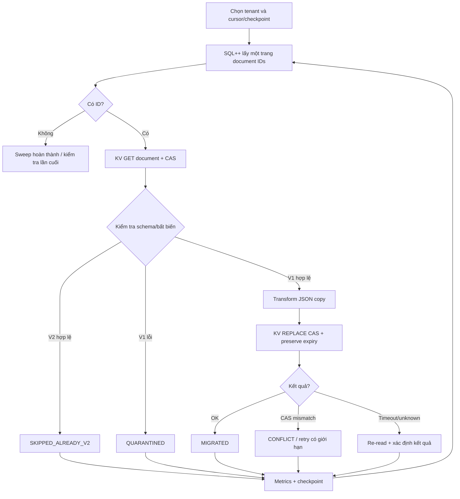
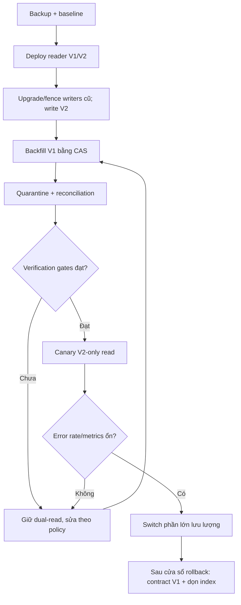

# Di trú tài liệu sang phiên bản mới và xác minh dữ liệu sau chuyển đổi

## 1. Bối cảnh bài thực hành và kết quả đầu ra

Một ứng dụng Spring Data Couchbase đã lưu hàng triệu document đơn hàng ở cấu trúc **V1**. Phiên bản ứng dụng mới muốn thay các field phẳng bằng cấu trúc **V2**: nhóm thông tin khách hàng thành `customerSnapshot`, nhóm tiền thành `total`, chuẩn hóa các item, và gắn `schemaVersion`. Ứng dụng vẫn phải đọc được đơn hàng cũ trong suốt quá trình triển khai; mỗi document có thể bị một request khác cập nhật khi job migration đang chạy.

Đây không chỉ là việc đổi tên field. Một cuộc di trú an toàn phải trả lời các câu hỏi:

- Document nào đủ điều kiện chuyển đổi? Document lỗi được đưa đi đâu?
- Làm sao **không mất dữ liệu, không đổi ID, không đổi tenant, không đặt lại TTL** ngoài ý muốn?
- Làm sao tránh ghi đè thay đổi mới bằng một bản V1 đã đọc trước đó?
- Có thể chạy lại job sau crash, retry, restart hoặc deploy hai phiên bản ứng dụng không?
- Đo và xác minh **số lượng, tổng tiền, phân bố trạng thái, phép tính từng đơn**, cũng như phản hồi API như thế nào?
- Khi nào có thể ngừng đọc V1, và rollback khác gì với “đổi `schemaVersion` từ 2 về 1”?

Bài thực hành thuộc chương **Bài thực hành** của module **SPRING_DATA_COUCHBASE**. Phạm vi bao gồm document mapping, repository, `CouchbaseTemplate`, Java SDK, SQL++, bucket/scope/collection, chỉ mục, TTL, CAS, giao dịch và lựa chọn reactive API để bảo đảm hiệu năng, tính nhất quán và khả năng vận hành.

**Kết quả cần bàn giao:** bộ dữ liệu lab V1/V2, đặc tả chuyển đổi, chương trình Java chuyển từng document bằng KV/CAS, cách batch và checkpoint, các câu SQL++ kiểm tra trước/sau, bảng test idempotency/concurrency, tiêu chí cutover và phương án khôi phục. Tất cả thao tác trong bài là hướng dẫn chạy ở **môi trường lab**, không phải bằng chứng rằng đã có cluster được truy cập hoặc benchmark được thực thi.

## 2. Mục tiêu và tiêu chí hoàn thành

Sau khi thực hành, người học phải làm được:

1. Thiết kế migration theo giai đoạn **expand → dual-read → backfill → verify → switch → contract**.
2. Viết rõ quy tắc ánh xạ V1 → V2, giá trị không được suy diễn và dữ liệu nào phải giữ nguyên.
3. Thử chuyển một document bằng KV `get`/`replace` với **CAS**, validate trước khi ghi và bảo toàn expiry theo API được hỗ trợ.
4. Chạy job theo các trang ID nhỏ, có checkpoint, xử lý retry/conflict và không phá dữ liệu V2 có sẵn.
5. Tìm document chưa chuyển, lỗi schema, tổng tiền không khớp, bản ghi trùng theo nghiệp vụ và tài liệu bị bỏ sót.
6. Đối chiếu counts/tổng tiền/trạng thái theo tenant và các bất biến bên trong từng document.
7. Kiểm thử app đọc đồng thời V1/V2 qua repository/DTO; không cắt hỗ trợ V1 trước khi dữ liệu sạch.
8. Diễn tập thất bại giữa chừng, CAS conflict, timeout, TTL, deployment rollback và re-run.

### 2.1. Definition of Done cho lab

| Cổng | Điều kiện phải chứng minh |
| --- | --- |
| C1 — Scope | Chỉ tài liệu `commerce.sales.orders` của tenant được phép, không đụng collection khác |
| C2 — Mapping | V2 giữ nguyên ID, tenant, orderNumber, status, createdAt, field không thuộc mapping |
| C3 — Money | `total.amountMinor` và tổng `quantity × unitPriceMinor` đúng theo quy tắc lab |
| C4 — Concurrency | Không ghi đè document đã đổi CAS giữa `get` và `replace` |
| C5 — Idempotency | Chạy lại không tiếp tục tăng `schemaVersion`, không làm đổi dữ liệu V2 hợp lệ |
| C6 — Errors | Document sai được quarantine/review, không tự sửa số tiền bằng suy đoán |
| C7 — TTL | Expiry không vô tình bị reset/làm dài thời hạn trong mutation |
| C8 — Verification | Có số liệu before/after, diff theo ID và kiểm tra mẫu cả hai schema |
| C9 — Cutover | App đọc V2 chính xác, còn đường đọc V1 cho tới khi kiểm chứng hoàn tất |
| C10 — Rollback | Có phương án phục hồi/roll-forward và bản sao an toàn; không chỉ sửa version flag |

**Nguyên tắc:** “Job chạy không có exception” chưa đủ để đánh dấu hoàn thành. Phải kiểm tra **đúng dữ liệu** và **đúng hành vi API**.

## 3. Chuẩn bị môi trường và quản lý rủi ro

### 3.1. Điều kiện lab

Sử dụng:

- Couchbase Server có Query Service, Index Service và bucket/scope/collection; phiên bản tương thích với Spring Data và Java SDK.
- Bucket `commerce`, scope `sales`, collection `orders` do lab cấp sẵn hoặc tạo theo hướng dẫn của quản trị viên.
- User lab có quyền KV read/write trên collection và quyền SQL++/index cần thiết; **không** dùng tài khoản production.
- Một dự án Java 17+ sử dụng Java SDK 3.x, Spring Data Couchbase tương thích; version cụ thể lấy từ dependency graph/BOM thực tế.
- Công cụ Query Workbench/`cbq` hoặc client SQL++ được phép chạy truy vấn.
- Snapshot/backup lab trước khi thử ghi, và một tenant thử có tiền tố ID dễ nhận diện.

Chạy DDL/seed trong database thử nghiệm. Nếu bucket `commerce` đã có dữ liệu, **không dùng tên document ID trong bài để ghi đè**, không thực hiện `DELETE WHERE tenantId = ...` trên dữ liệu dùng chung; hãy chọn namespace lab riêng được cấp.

### 3.2. Phân quyền theo nguyên tắc tối thiểu

| Thành phần | Quyền mong đợi | Hạn chế |
| --- | --- | --- |
| Application runtime | Đọc/ghi collection được cấp | Không tự tạo/xóa index production |
| Migration worker | Đọc/replace document Orders theo phạm vi được phê duyệt | Không mutate Customer/Shipment ngoài kế hoạch |
| DDL operator | Tạo/build/kiểm tra index cần thiết | Có phê duyệt và readiness gate |
| Audit/verification | Read/query/report, dữ liệu nhạy cảm được che | Không sửa dữ liệu khi đo |

Việc có quyền Query trên một collection không cho phép bỏ kiểm tra **tenant scope**. Tenant được lấy từ context job đã phê duyệt, không nhận danh sách ID tùy ý từ người dùng cuối.

### 3.3. Hồ sơ version bắt buộc

| Thành phần | Phiên bản thực | Cách chứng minh |
| --- | --- | --- |
| Spring Boot/BOM | Chưa xác định | Dependency/build report |
| Spring Data Couchbase | Chưa xác định | Dependency graph và docs đúng version |
| Couchbase Java SDK | Chưa xác định | Dependency graph và Javadoc |
| Couchbase Server/edition | Chưa xác định | Cluster metadata được cấp quyền |
| Scope/collection | `commerce.sales.orders` (lab) | Query/SDK kiểm tra |
| TTL policy | Chưa xác định | Settings/SDK metadata khi được phép |
| Backup/restore test | Chưa thực hiện | Phiếu khôi phục ở lab |

Đặc biệt xác minh trên SDK bản dùng rằng `ReplaceOptions.preserveExpiry(true)` có mặt và được Server hỗ trợ. Đừng bỏ qua expiry chỉ vì bài lab ngắn.

## 4. Đặc tả dữ liệu V1 và V2

### 4.1. V1 — cấu trúc cũ

ID `order::TENANT-A::1001`:

```json
{
  "_class": "salesOrder",
  "tenantId": "TENANT-A",
  "orderNumber": "ORD-1001",
  "customerName": "Nguyen An",
  "status": "PAID",
  "createdAt": "2026-11-20T08:15:00Z",
  "totalVnd": 1500000,
  "items": [
    { "sku": "SKU-42", "qty": 2, "unitPriceVnd": 350000 },
    { "sku": "SKU-18", "qty": 1, "unitPriceVnd": 800000 }
  ],
  "sourceSystem": "checkout"
}
```

V1 có thể **không có `schemaVersion`** vì ứng dụng cũ chưa dùng versioning; khi nhận diện legacy, không được mặc định mọi document thiếu version đều là V1. Job chỉ được xử lý nếu nhận diện đúng **dấu vết schema V1** và các field bắt buộc.

### 4.2. V2 — cấu trúc mục tiêu

ID **vẫn là** `order::TENANT-A::1001`:

```json
{
  "_class": "salesOrder",
  "tenantId": "TENANT-A",
  "orderNumber": "ORD-1001",
  "customerSnapshot": { "displayName": "Nguyen An" },
  "status": "PAID",
  "createdAt": "2026-11-20T08:15:00Z",
  "total": { "currency": "VND", "amountMinor": 1500000 },
  "items": [
    { "sku": "SKU-42", "quantity": 2, "unitPriceMinor": 350000 },
    { "sku": "SKU-18", "quantity": 1, "unitPriceMinor": 800000 }
  ],
  "sourceSystem": "checkout",
  "schemaVersion": 2,
  "migratedAt": "2026-11-25T03:00:00Z"
}
```

`migratedAt` trên đây chỉ minh họa trường metadata do job ghi; thời gian thực sẽ khác. VND trong lab là số nguyên theo **đơn vị nhỏ nhất được nghiệp vụ quy định cho VND**, không có thao tác nhân/chia 100; số tiền được giữ chính xác.

### 4.3. Bảng mapping bất biến

| V1 | V2 | Quy tắc |
| --- | --- | --- |
| Document key | Document key | **Giữ nguyên tuyệt đối** |
| `_class` | `_class` | Giữ alias đã dùng để Spring Data mapping |
| `tenantId` | `tenantId` | Giữ nguyên, không lấy từ đầu vào không tin cậy |
| `orderNumber` | `orderNumber` | Giữ nguyên |
| `customerName` | `customerSnapshot.displayName` | Chỉ chuyển khi là chuỗi hợp lệ |
| `totalVnd` | `total.currency = "VND"`, `total.amountMinor` | Giữ số nguyên chính xác, không đổi đơn vị |
| `items[].qty` | `items[].quantity` | Số nguyên dương |
| `items[].unitPriceVnd` | `items[].unitPriceMinor` | Số nguyên không âm, không nhân/chia |
| `items[].sku` | `items[].sku` | Giữ nguyên |
| `status` | `status` | Giữ nguyên giá trị hợp lệ |
| `createdAt` | `createdAt` | Giữ chuỗi ISO 8601 nguyên vẹn trong lab |
| `sourceSystem`, field mở rộng | Chính field đó | Giữ nguyên nếu không nằm trong mapping cần xóa |
| Chưa có `schemaVersion` hoặc `1` | `schemaVersion = 2` | Chỉ sau khi chuyển đổi và validate thành công |
| Metadata expiry/CAS | Expiry được giữ; CAS mới sau replace | CAS là metadata concurrency, không sao chép thành JSON |

**Đừng bỏ toàn bộ field chưa biết** chỉ vì tạo V2 bằng constructor mới. Bài thực hành sẽ copy JSON hiện có, sửa đúng các trường có trong đặc tả, rồi xóa những tên V1 đã được thay thế. Việc giữ field mở rộng được kiểm tra riêng.

### 4.4. Bất biến tổng tiền cho lab

Trong bộ dữ liệu *không có giảm giá/phí/thuế độc lập*, quy tắc là:

\[
\text{totalVnd}=\sum_{i\in items}\text{qty}_i\times\text{unitPriceVnd}_i
\]

Sau chuyển:

\[
\text{total.amountMinor}=\sum_{i\in items}\text{quantity}_i\times\text{unitPriceMinor}_i
\]

Ứng dụng thực có voucher, thuế, shipping fee, refund hoặc currency conversion thì phải **mở rộng công thức theo domain**. Không áp dụng công thức demo để “sửa” hóa đơn có chiết khấu thật. Với dữ liệu tài chính, tuyệt đối tránh làm tròn bằng `double`.

### 4.5. Những field tuyệt đối không suy đoán

Không tự suy `customerId` từ `customerName` (tên có thể trùng). Không suy `PAID` từ việc có tổng tiền. Không chuyển một số float thành số nguyên chỉ bằng cast, không đổi timezone tùy tiện và không đặt TTL mặc định chỉ vì doc thiếu trường version.

Nếu thiếu một field bắt buộc hoặc không chứng minh được đơn vị tiền, đánh dấu **quarantine** để kiểm tra thay vì tạo V2 sai nghĩa.

## 5. Bộ dữ liệu khởi tạo trong lab

Các câu SQL++ sau giả định collection lab `commerce.sales.orders` đã có. Nếu tên keyspace khác, sửa **đúng** các câu SQL++/SDK trong bài và ghi vào bảng môi trường; không sửa nhầm collection production.

### 5.1. Ba đơn hàng V1 của TENANT-A

```sql
INSERT INTO `commerce`.`sales`.`orders` (KEY, VALUE)
VALUES (
  "order::TENANT-A::1001",
  {
    "_class": "salesOrder",
    "tenantId": "TENANT-A",
    "orderNumber": "ORD-1001",
    "customerName": "Nguyen An",
    "status": "PAID",
    "createdAt": "2026-11-20T08:15:00Z",
    "totalVnd": 1500000,
    "items": [
      {"sku":"SKU-42","qty":2,"unitPriceVnd":350000},
      {"sku":"SKU-18","qty":1,"unitPriceVnd":800000}
    ],
    "sourceSystem": "checkout"
  }
), (
  "order::TENANT-A::1002",
  {
    "_class": "salesOrder",
    "tenantId": "TENANT-A",
    "orderNumber": "ORD-1002",
    "customerName": "Le Binh",
    "status": "PENDING",
    "createdAt": "2026-11-21T09:00:00Z",
    "totalVnd": 100000,
    "items": [
      {"sku":"SKU-77","qty":1,"unitPriceVnd":100000}
    ],
    "sourceSystem": "mobile-app",
    "campaignTag": "NOV"
  }
), (
  "order::TENANT-A::1003",
  {
    "_class": "salesOrder",
    "tenantId": "TENANT-A",
    "orderNumber": "ORD-1003",
    "customerName": "Pham Chau",
    "status": "PAID",
    "createdAt": "2026-11-22T09:00:00Z",
    "totalVnd": 999000,
    "items": [
      {"sku":"SKU-19","qty":2,"unitPriceVnd":100000}
    ],
    "sourceSystem": "import"
  }
);
```

Order 1003 **cố tình sai tổng tiền**: 2 × 100.000 = 200.000, khác 999.000. Bài lab yêu cầu job không tự sửa, không chuyển document này sang V2 khi chưa có quyết định nghiệp vụ.

### 5.2. Một đơn hàng đã ở V2

```sql
INSERT INTO `commerce`.`sales`.`orders` (KEY, VALUE)
VALUES (
  "order::TENANT-A::1004",
  {
    "_class": "salesOrder",
    "tenantId": "TENANT-A",
    "orderNumber": "ORD-1004",
    "customerSnapshot": {"displayName":"Do Dung"},
    "status": "PAID",
    "createdAt": "2026-11-23T10:00:00Z",
    "total": {"currency":"VND","amountMinor":300000},
    "items": [
      {"sku":"SKU-20","quantity":3,"unitPriceMinor":100000}
    ],
    "sourceSystem": "checkout",
    "schemaVersion": 2
  }
);
```

Job migration phải **bỏ qua việc replace** document này nếu V2 hợp lệ. Không tự thêm `migratedAt` vào V2 đã có chỉ để đồng nhất bề ngoài, vì điều đó làm thay CAS và tăng workload không cần thiết.

### 5.3. Một đơn hàng V1 của tenant khác

```sql
INSERT INTO `commerce`.`sales`.`orders` (KEY, VALUE)
VALUES (
  "order::TENANT-B::2001",
  {
    "_class":"salesOrder",
    "tenantId":"TENANT-B",
    "orderNumber":"ORD-2001",
    "customerName":"Tenant B Customer",
    "status":"PAID",
    "createdAt":"2026-11-23T11:00:00Z",
    "totalVnd":500000,
    "items":[
      {"sku":"SKU-90","qty":1,"unitPriceVnd":500000}
    ],
    "sourceSystem":"checkout"
  }
);
```

Job chỉ xử lý `TENANT-A` **không được** thay đổi document 2001 của `TENANT-B`.

### 5.4. Dữ liệu kỳ vọng ban đầu

| Document | Tenant | Schema | Total | Kỳ vọng chạy migration TENANT-A |
| --- | --- | --- | ---: | --- |
| 1001 | A | V1, thiếu version | 1.500.000 | Chuyển V2 |
| 1002 | A | V1, thiếu version | 100.000 | Chuyển V2; giữ `campaignTag` |
| 1003 | A | V1, sai total | 999.000 | Quarantine, **không sửa** |
| 1004 | A | V2 | 300.000 | Validate, bỏ qua replace |
| 2001 | B | V1 | 500.000 | Không chạm trong lượt A |

**Dự báo** sau một lượt migrate TENANT-A chưa remediation: 4 Order A tổng cộng; 3 V2 hợp lệ và 1 V1 bị quarantine; TENANT-B vẫn có một V1. Đây là expected output của dataset minh họa, không phải kết quả thực thi.

## 6. Chụp baseline và ghi nhận backup

Trước bất kỳ mutation nào, lưu một **backup/snapshot theo quy trình của môi trường lab**; nếu có yêu cầu audit nghiêm ngặt, snapshot phải có cách phục hồi đã kiểm tra chứ không chỉ có file export chưa thử. Không ghi PII thực vào báo cáo bài học.

### 6.1. Kiểm tra số lượng theo tenant và version

```sql
SELECT o.tenantId,
       CASE
         WHEN o.schemaVersion IS MISSING THEN "legacy"
         ELSE TO_STRING(o.schemaVersion)
       END AS versionLabel,
       COUNT(1) AS docs
FROM `commerce`.`sales`.`orders` AS o
WHERE o.tenantId IN ["TENANT-A", "TENANT-B"]
GROUP BY o.tenantId,
         CASE
           WHEN o.schemaVersion IS MISSING THEN "legacy"
           ELSE TO_STRING(o.schemaVersion)
         END
ORDER BY o.tenantId, versionLabel;
```

Nếu Query Service trong phiên bản đang dùng không chấp nhận alias trong `ORDER BY` cho biểu thức trên, có thể bỏ `ORDER BY` hoặc dùng biểu thức tương đương; giữ nguyên logic group.

### 6.2. Tổng tiền tương thích cả hai schema

```sql
SELECT o.tenantId,
       COUNT(1) AS documentCount,
       SUM(
         CASE
           WHEN o.schemaVersion = 2
             THEN o.total.amountMinor
           ELSE o.totalVnd
         END
       ) AS totalAmountMinor
FROM `commerce`.`sales`.`orders` AS o
WHERE o.tenantId IN ["TENANT-A", "TENANT-B"]
GROUP BY o.tenantId;
```

Với seed:

- TENANT-A: 1.500.000 + 100.000 + 999.000 + 300.000 = **2.899.000**.
- TENANT-B: **500.000**.

Việc dữ liệu A có tổng 2.899.000 **không có nghĩa số tiền đúng nghiệp vụ**: Order 1003 bị cố ý sai. Nó là baseline cần **không tự thay đổi** khi chạy job chuyển schema. Khi quyết định sửa Order 1003 sau điều tra, ghi một thay đổi nghiệp vụ riêng và chụp baseline mới.

### 6.3. Phân bố trạng thái và ID

```sql
SELECT o.tenantId, o.status,
       COUNT(1) AS documentCount
FROM `commerce`.`sales`.`orders` AS o
WHERE o.tenantId IN ["TENANT-A", "TENANT-B"]
GROUP BY o.tenantId, o.status
ORDER BY o.tenantId, o.status;
```

```sql
SELECT META(o).id AS documentId,
       o.tenantId, o.orderNumber,
       IFMISSINGORNULL(o.schemaVersion, 1) AS effectiveVersion,
       o.sourceSystem
FROM `commerce`.`sales`.`orders` AS o
WHERE o.tenantId IN ["TENANT-A", "TENANT-B"]
ORDER BY documentId;
```

Lưu `documentId` ở nơi kiểm soát; với dữ liệu thật, nên so hash/tập ID trong môi trường audit phù hợp, không in toàn bộ ID/PII vào log công khai.

### 6.4. Tránh so tổng sai khi dữ liệu vẫn thay đổi

Nếu nhiều writer vẫn hoạt động, baseline và hậu kiểm có thể khác **vì nghiệp vụ phát sinh mutation**, không phải migration. Để kiểm chứng chặt:

1. Chạy lab khi không có writer khác, hoặc dùng một tập document ID ổn định và thời điểm đối chiếu.
2. Với production, xác định mutation window, watermark/event log và cách đối chiếu incremental.
3. So số lượng và tiền **trên cùng tập ID** hoặc theo sự kiện đã chốt.
4. Đừng đưa ra kết luận “không mất dữ liệu” chỉ vì hai câu `COUNT(*)` cách nhau vài phút bằng nhau.

## 7. Chuẩn bị index phục vụ quét ứng viên

### 7.1. Index theo tenant và version

Ở lab có thể tạo một GSI:

```sql
CREATE INDEX ix_orders_migration_tenant_version
ON `commerce`.`sales`.`orders`(
  `tenantId`,
  `schemaVersion`
);
```

Index này là **ứng viên** cho query tìm Order theo tenant/schemaVersion. Vì document V1 có thể thiếu `schemaVersion`, cần xác minh plan cho điều kiện `IS MISSING`; đừng mặc định optimizer dùng mọi index như mong muốn.

Nếu index tồn tại với tên đó, đừng chạy `CREATE` lặp gây lỗi; kiểm tra catalog trước. Việc tạo/bảo trì index tăng chi phí ghi, nên phải lên lịch và có quyền DDL phù hợp.

### 7.2. Xem catalog

```sql
SELECT name, state, index_key, condition,
       bucket_id, scope_id, keyspace_id
FROM system:indexes
WHERE bucket_id = "commerce"
  AND scope_id = "sales"
  AND keyspace_id = "orders";
```

Đợi index có trạng thái phục vụ truy vấn (thường `online`) trước khi bắt đầu scan nhiều document. Với cluster lớn, có thể dùng quy trình defer/build theo chính sách ops.

### 7.3. Xem `EXPLAIN`

```sql
EXPLAIN
SELECT RAW META(o).id
FROM `commerce`.`sales`.`orders` AS o
WHERE o.tenantId = "TENANT-A"
  AND (
    o.schemaVersion IS MISSING
    OR o.schemaVersion = 1
  )
ORDER BY META(o).id
LIMIT 100;
```

Kiểm tra `IndexScan`/`Fetch`/`Order`, số entry ước tính, dải `spans` và filter. Query này có thể cần sort hoặc scan nhiều hơn `LIMIT`, tùy plan. Chỉ số Index Service cũng cần được giám sát khi job chạy.

**Không bắt buộc scan phải dùng GSI này** nếu lab ít dữ liệu hoặc phương án `range scan`/`KV scan` được SDK/phiên bản hỗ trợ phù hợp hơn. Nhưng tất cả đường scan cần có chiến lược checkpoint, giới hạn tốc độ và tenant isolation.

## 8. Thiết kế job: discover ID rồi migrate bằng KV/CAS

Job có hai phần tách biệt:



Phân tách **candidate discovery** qua SQL++ và **mutation** qua KV mang lại một nguyên tắc an toàn: **không replace bằng nguyên row cũ vừa SELECT từ GSI**. Luôn KV GET mới nhất ngay trước chuyển và dùng CAS nhận được ở lượt GET đó.

### 8.1. Vì sao không `UPDATE` hàng loạt ngay?

SQL++ `UPDATE` rất hữu ích cho biến đổi đơn giản và được kiểm soát. Nhưng với các quy tắc có nhiều validation theo item, yêu cầu quarantine từng ID, giữ field mở rộng và xử lý lỗi có phân loại, một job Java đọc–validate–CAS–replace thường dễ kiểm tra logic hơn.

Một câu `UPDATE WHERE schemaVersion != 2` chạy trên hàng triệu document có thể sửa sai nếu field thiếu, giá trị không hợp lệ hoặc mutation đang xảy ra. Không dùng `UPDATE` toàn bộ chỉ để tránh viết chương trình migration mà bỏ qua validation.

### 8.2. Candidate scan với cursor ID

Ví dụ truy vấn mỗi lần:

```sql
SELECT RAW META(o).id
FROM `commerce`.`sales`.`orders` AS o
WHERE o.tenantId = $tenantId
  AND META(o).id > $lastId
  AND (
    o.schemaVersion IS MISSING
    OR o.schemaVersion = 1
  )
ORDER BY META(o).id
LIMIT $batchSize;
```

`$lastId` ban đầu là chuỗi rỗng trong lab, vì ID seed đều có prefix `order::...`; nên dùng cursor loại chuỗi theo thứ tự ID thống nhất. `$batchSize` là số nguyên nhỏ đã được validation.

**Caveat:** Sau khi chuyển, document ra khỏi predicate V1; một document V1 được tạo **sau khi cursor đã vượt qua ID của nó** có thể bị bỏ sót trong lượt sweep hiện tại. Vì vậy:

- Giữ dual-write/dual-read hoặc chặn writer tạo V1 mới ở giai đoạn phù hợp.
- Chạy **sweep xác minh toàn dải** sau mỗi đợt; không dựa một cursor để chứng minh đã hết V1.
- Dùng event/watermark nếu hệ thống có writer hoạt động liên tục.
- Nếu query dùng index cập nhật bất đồng bộ, kiểm tra scan consistency/read path thích hợp; KV GET mới nhất vẫn là bước trước mutation.

### 8.3. Checkpoint không chỉ là `lastId`

Lưu trong hệ thống vận hành có kiểm soát:

```json
{
  "jobId": "orders-v2-TENANT-A-2026-11-25",
  "tenantId": "TENANT-A",
  "schemaTarget": 2,
  "lastScannedId": "order::TENANT-A::1002",
  "scanned": 2,
  "migrated": 2,
  "alreadyV2": 0,
  "quarantined": 0,
  "casConflicts": 0,
  "retryPending": 0,
  "state": "RUNNING"
}
```

Checkpoint có thể được lưu ngoài file bài học; trong **lab học viên tự chọn nơi lưu**. Không ghi checkpoint vào tên file nội dung Knowledge. Checkpoint phải được cập nhật idempotent, tương thích retry và không xác nhận “xử lý xong” cho một ID còn pending retry. Không chứa email hay document đầy đủ không cần thiết.

## 9. Mã Java SDK: chuyển một document một cách có kiểm soát

Đây là phần lõi của lab. Đoạn code sử dụng Java 17+ và Couchbase Java SDK 3.x với các API `JsonObject`/`JsonArray`/`Collection`, `GetResult` và CAS; cần dùng đúng dependency thực và kiểm tra hỗ trợ `preserveExpiry` trước khi chạy. Constructor nhận **collection Orders đã kết nối**. Mục tiêu là minh họa một bước migration có thể review, không thay thế cấu hình ứng dụng/runner/telemetry của dự án.

### 9.1. Trạng thái kết quả theo từng ID

```java
public enum MigrationOutcome {
    MIGRATED,
    ALREADY_V2,
    INVALID_DATA,
    UNSUPPORTED_VERSION,
    CAS_CONFLICT,
    NOT_FOUND
}
```

Lỗi timeout, không đủ quyền, serialize/deserialize failure và các tình huống chưa được phân loại **không** tự chuyển thành `INVALID_DATA` hoặc `NOT_FOUND`. Chúng phải đi theo nhánh retry/alert theo chính sách worker.

### 9.2. Chuyển theo bản copy và CAS

```java
import java.math.BigDecimal;
import java.time.Instant;
import java.time.format.DateTimeParseException;
import java.util.Set;

import com.couchbase.client.core.error.CasMismatchException;
import com.couchbase.client.core.error.DocumentNotFoundException;
import com.couchbase.client.java.Collection;
import com.couchbase.client.java.json.JsonArray;
import com.couchbase.client.java.json.JsonObject;
import com.couchbase.client.java.kv.GetResult;

import static com.couchbase.client.java.kv.ReplaceOptions.replaceOptions;

public final class OrderV2Migrator {
    private static final Set<String> ALLOWED_STATES =
        Set.of("PAID", "PENDING", "CANCELLED");

    private final Collection orders;
    private final String allowedTenant;

    public OrderV2Migrator(
            Collection orders,
            String allowedTenant) {
        this.orders = orders;
        this.allowedTenant = allowedTenant;
    }

    public MigrationOutcome migrateOne(String id) {
        final GetResult current;
        try {
            current = orders.get(id);
        } catch (DocumentNotFoundException notFound) {
            return MigrationOutcome.NOT_FOUND;
        }

        JsonObject source = current.contentAsObject();
        // Không chỉ tin prefix ID. Kiểm tra tenant trong body.
        if (!allowedTenant.equals(source.getString("tenantId"))) {
            throw new SecurityException(
                "Cross-tenant migration blocked"
            );
        }

        Object rawVersion = source.get("schemaVersion");
        if (rawVersion != null && !(rawVersion instanceof Number)) {
            return MigrationOutcome.UNSUPPORTED_VERSION;
        }

        Integer version = null;
        if (rawVersion instanceof Number number) {
            try {
                version = new BigDecimal(number.toString())
                    .intValueExact();
            } catch (ArithmeticException invalidVersion) {
                return MigrationOutcome.UNSUPPORTED_VERSION;
            }
        }

        // null tường minh không được coi là phiên bản V1.
        if (source.containsKey("schemaVersion")
                && rawVersion == null) {
            return MigrationOutcome.UNSUPPORTED_VERSION;
        }

        try {
            if (Integer.valueOf(2).equals(version)) {
                validateV2(source);
                return MigrationOutcome.ALREADY_V2;
            }

            if (version != null && version != 1) {
                return MigrationOutcome.UNSUPPORTED_VERSION;
            }

            JsonObject target = convertV1(source);
            validateV2(target);

            try {
                orders.replace(
                    id,
                    target,
                    replaceOptions()
                        .cas(current.cas())
                        .preserveExpiry(true)
                );
                return MigrationOutcome.MIGRATED;
            } catch (CasMismatchException changedMeanwhile) {
                return MigrationOutcome.CAS_CONFLICT;
            }
        } catch (IllegalArgumentException | ArithmeticException invalid) {
            // Ghi reason mã hóa/được lọc ở runner; không log PII.
            return MigrationOutcome.INVALID_DATA;
        }
    }

    private static JsonObject convertV1(JsonObject source) {
        // Chỉ nhận V1 khi đủ dấu vết schema cũ.
        if (source.containsKey("customerSnapshot")
                || source.containsKey("total")) {
            throw new IllegalArgumentException(
                "Ambiguous mixed V1/V2 document"
            );
        }

        String name = requiredString(source, "customerName");
        String orderNumber = requiredString(source, "orderNumber");
        String status = requiredString(source, "status");
        String createdAt = requiredString(source, "createdAt");
        String tenant = requiredString(source, "tenantId");

        if (!ALLOWED_STATES.contains(status)) {
            throw new IllegalArgumentException("Unknown status");
        }
        // Với bài lab, timestamp phải parse được theo ISO 8601.
        try {
            Instant.parse(createdAt);
        } catch (DateTimeParseException invalidTime) {
            throw new IllegalArgumentException(
                "Invalid createdAt timestamp", invalidTime
            );
        }
        if (name.isBlank() || orderNumber.isBlank() || tenant.isBlank()) {
            throw new IllegalArgumentException("Blank required field");
        }

        long total = requiredLong(source, "totalVnd");
        if (total < 0) {
            throw new IllegalArgumentException("Negative total");
        }
        JsonArray items = requiredArray(source, "items");
        if (items.size() == 0) {
            throw new IllegalArgumentException("Empty order items");
        }

        long computed = 0L;
        JsonArray mappedItems = JsonArray.create();
        for (int index = 0; index < items.size(); index++) {
            Object rawItem = items.get(index);
            if (!(rawItem instanceof JsonObject item)) {
                throw new IllegalArgumentException("Item is not an object");
            }
            if (item.containsKey("quantity")
                    || item.containsKey("unitPriceMinor")) {
                throw new IllegalArgumentException(
                    "Invalid or ambiguous item shape"
                );
            }
            String sku = requiredString(item, "sku");
            long quantity = requiredLong(item, "qty");
            long price = requiredLong(item, "unitPriceVnd");
            if (sku.isBlank() || quantity <= 0 || price < 0) {
                throw new IllegalArgumentException("Invalid item values");
            }

            computed = Math.addExact(computed,
                Math.multiplyExact(quantity, price));

            JsonObject itemV2 = JsonObject.fromJson(item.toString());
            itemV2.put("quantity", quantity);
            itemV2.put("unitPriceMinor", price);
            itemV2.removeKey("qty");
            itemV2.removeKey("unitPriceVnd");
            mappedItems.add(itemV2);
        }
        if (computed != total) {
            throw new IllegalArgumentException("Total mismatch");
        }

        // Copy nguyên document để giữ field mở rộng hợp lệ.
        JsonObject target = JsonObject.fromJson(source.toString());
        target.put("customerSnapshot",
            JsonObject.create().put("displayName", name));
        target.put("total", JsonObject.create()
            .put("currency", "VND")
            .put("amountMinor", total));
        target.put("items", mappedItems);
        target.put("schemaVersion", 2);
        target.put("migratedAt", Instant.now().toString());
        target.removeKey("customerName");
        target.removeKey("totalVnd");
        return target;
    }

    private static void validateV2(JsonObject doc) {
        if (!Integer.valueOf(2).equals(
                new BigDecimal(
                    String.valueOf(doc.get("schemaVersion"))
                ).intValueExact())) {
            throw new IllegalArgumentException("Not V2");
        }
        JsonObject snapshot = requiredObject(
            doc, "customerSnapshot");
        if (requiredString(snapshot, "displayName").isBlank()) {
            throw new IllegalArgumentException("Blank customer snapshot");
        }
        JsonObject total = requiredObject(doc, "total");
        if (!"VND".equals(requiredString(total, "currency"))) {
            throw new IllegalArgumentException("Currency mismatch");
        }
        long actual = requiredLong(total, "amountMinor");
        JsonArray items = requiredArray(doc, "items");
        if (items.size() == 0) {
            throw new IllegalArgumentException("Empty V2 items");
        }
        long expected = 0L;
        for (int i = 0; i < items.size(); i++) {
            Object rawItem = items.get(i);
            if (!(rawItem instanceof JsonObject item)
                    || requiredString(item, "sku").isBlank()) {
                throw new IllegalArgumentException("Invalid SKU");
            }
            long quantity = requiredLong(item, "quantity");
            long price = requiredLong(item, "unitPriceMinor");
            if (quantity <= 0 || price < 0) {
                throw new IllegalArgumentException("Invalid item");
            }
            expected = Math.addExact(expected,
                Math.multiplyExact(quantity, price));
        }
        if (actual != expected) {
            throw new IllegalArgumentException("Invalid V2 total");
        }
        requiredString(doc, "tenantId");
        requiredString(doc, "orderNumber");
        try {
            Instant.parse(requiredString(doc, "createdAt"));
        } catch (DateTimeParseException invalidTime) {
            throw new IllegalArgumentException(
                "Invalid V2 createdAt timestamp", invalidTime
            );
        }
        if (!ALLOWED_STATES.contains(requiredString(doc, "status"))) {
            throw new IllegalArgumentException("Unknown V2 status");
        }
    }

    private static String requiredString(
            JsonObject obj, String field) {
        Object value = obj.get(field);
        if (!(value instanceof String text)) {
            throw new IllegalArgumentException("Missing string: " + field);
        }
        return text;
    }

    private static long requiredLong(
            JsonObject obj, String field) {
        Object value = obj.get(field);
        if (!(value instanceof Number number)) {
            throw new IllegalArgumentException("Missing number: " + field);
        }
        return new BigDecimal(number.toString()).longValueExact();
    }

    private static JsonArray requiredArray(
            JsonObject obj, String field) {
        Object raw = obj.get(field);
        if (!(raw instanceof JsonArray array)) {
            throw new IllegalArgumentException("Missing array: " + field);
        }
        return array;
    }

    private static JsonObject requiredObject(
            JsonObject obj, String field) {
        Object raw = obj.get(field);
        if (!(raw instanceof JsonObject nested)) {
            throw new IllegalArgumentException("Missing object: " + field);
        }
        return nested;
    }
}
```

**Quan trọng về snippet:** `ReplaceOptions.preserveExpiry(true)` và các API JSON/KV cần được đối chiếu với version SDK thực. Kiểm tra hỗ trợ phía Server đối với preserve expiry và chạy compile/integration test trước khi dùng; bài không tuyên bố đã build code.

### 9.2.1. Gọi thử trên các ID seed

Với `cluster` là kết nối SDK đã được cấu hình trong ứng dụng lab:

```java
Collection orderCollection = cluster.bucket("commerce")
    .scope("sales")
    .collection("orders");

OrderV2Migrator migrator = new OrderV2Migrator(
    orderCollection, "TENANT-A"
);

System.out.println(migrator.migrateOne("order::TENANT-A::1001"));
System.out.println(migrator.migrateOne("order::TENANT-A::1002"));
System.out.println(migrator.migrateOne("order::TENANT-A::1003"));
System.out.println(migrator.migrateOne("order::TENANT-A::1004"));
```

Kỳ vọng theo seed là `MIGRATED`, `MIGRATED`, `INVALID_DATA`, `ALREADY_V2`. Đây chỉ là **thử nghiệm một lượt theo ID đã biết**, chưa phải runner production với cursor, checkpoint, retry hay giám sát. Không gọi ID của TENANT-B khi migrator được cấp tenant A; kiểm thử ranh giới tenant bằng trường hợp riêng có bắt lỗi an toàn.

### 9.3. Những quyết định an toàn trong code

1. **Không `upsert`:** chỉ `replace` trên ID đã đọc; không tạo document mới khi ID không tồn tại.
2. **CAS từ KV GET:** nếu writer khác sửa document trước replace, trả `CAS_CONFLICT`; runner sẽ đọc lại và quyết định retry.
3. **Không coi V2 nào cũng tốt:** `validateV2` trước khi bỏ qua; V2 sai schema bị báo `INVALID_DATA`.
4. **Không đoán version:** `schemaVersion` lạ, số thập phân, `null` tường minh → `UNSUPPORTED_VERSION`.
5. **Không drop field ngoài mapping:** copy source sang target, chỉ xóa `customerName`/`totalVnd` và field item V1 đã được thay.
6. **Không sửa tổng tiền sai:** Order 1003 bị quarantine.
7. **Không thay tenant/ID:** tenant kiểm tra trước; document key được truyền riêng và giữ nguyên.
8. **Bảo toàn expiry:** dùng tùy chọn preserve expiry theo phiên bản, không ghi TTL mới tùy tiện.
9. **Không log PII:** runner chỉ log ID đã che/hash, outcome, reason code, trace ID theo policy.
10. **Không nuốt lỗi hạ tầng:** timeout/RBAC/network cần được quản lý ở tầng job, không biến thành `NOT_FOUND`.

### 9.4. Độ chặt validation cần điều chỉnh theo domain

Code trên giới hạn `status` trong `PAID/PENDING/CANCELLED` chỉ vì lab dùng những trạng thái đó. Ứng dụng thực có `REFUNDED`/`PARTIALLY_PAID`, discount, shipping fee... thì phải cập nhật đặc tả trước khi chạy migration. **Không xếp document nghiệp vụ hợp lệ vào invalid chỉ vì code lab thiếu trạng thái.**

`requiredLong` dùng `BigDecimal(...).longValueExact()` để từ chối số thập phân hoặc vượt phạm vi `long`. Nếu hệ thống lưu tiền không theo integer minor units, phải viết converter riêng theo domain thay vì ép kiểu.

### 9.5. Tránh “bỏ qua” những field V2 hỏng

`ALREADY_V2` chỉ có nghĩa **V2 hợp lệ theo validator**. Một document chứa `schemaVersion=2` nhưng thiếu `total.currency` là **schema corruption**; job không được xem version number như bằng chứng đã chuyển đổi đúng.

## 10. Runner theo batch, retry và checkpoint

Không đặt toàn bộ vòng lặp trong một transaction khổng lồ. Đọc danh sách ID từng trang nhỏ, migrate từng document có giới hạn đồng thời; ghi checkpoint sau khi outcome đã được ghi nhận bền vững.

### 10.1. Pseudocode runner

```text
tenant = TENANT-A
cursor = checkpoint.lastScannedId or ""
batchSize = 100

repeat:
    ids = queryCandidateIds(tenant, cursor, batchSize)
    if ids.empty:
        break
    for id in ids:
        result = migrator.migrateOne(id)
        if result == MIGRATED or result == ALREADY_V2:
            recordSuccess(id, result)
        else if result == CAS_CONFLICT:
            enqueueBoundedRetry(id, reReadFresh=true)
        else if result == INVALID_DATA or UNSUPPORTED_VERSION:
            quarantine(id, reasonCode, noPayloadInLogs)
        else if result == NOT_FOUND:
            recordDisappearedCandidate(id)
        else:
            stopOrRetryByErrorPolicy(id)
        persistProgressAndCheckpointSafely(id)
    cursor = ids.lastId

runFinalFullSweepAndReconciliation()
```

Đây là mã giả thuật toán. `recordSuccess`, `quarantine` và `persistProgressAndCheckpointSafely` là trách nhiệm của runner, không phải API SDK có sẵn.

### 10.2. Quản lý xung đột CAS

Khi outcome là `CAS_CONFLICT`:

1. Không replace lại bằng target vừa tính từ source cũ.
2. KV GET lại document hiện tại.
3. Nếu nó đã là V2 hợp lệ, ghi nhận `ALREADY_V2`.
4. Nếu vẫn là V1 và hợp lệ, tính lại target từ **body mới** và CAS mới.
5. Retry theo giới hạn/backoff; nếu vẫn tranh chấp, đưa vào queue kiểm tra.

Không tăng số retry vô hạn khiến CPU/KV Service quá tải; đừng ép overwrite bằng cách bỏ CAS.

### 10.3. Phân loại timeout và trạng thái commit không rõ

Nếu `replace` timeout, request có thể đã được Server áp dụng hay chưa. **Không đoán thất bại rồi upsert lại**. Đọc lại ID:

- Nếu V2 hợp lệ, có thể ghi nhận kết quả cuối đã đạt.
- Nếu vẫn V1, thử lại theo giới hạn.
- Nếu tài liệu có thay đổi nghiệp vụ khác, xét CAS/version và validation mới.
- Nếu không thể đọc vì hạ tầng chưa sẵn sàng, tạm dừng/retry theo SLA.

Do việc `migratedAt` có thời điểm động, không dựa so byte-for-byte vào bản target trong bộ nhớ để quyết định thành công; xem bất biến và trạng thái hiện tại.

### 10.4. Checkpoint, duplicate work và idempotency

Một job có thể crash ngay sau khi replace thành công nhưng **trước khi checkpoint được lưu**. Khi restart, nó gặp lại ID đó; `validateV2` và `ALREADY_V2` giúp re-run không làm thay đổi document.

Nếu checkpoint được lưu **trước** khi replace hoàn tất, job có thể đánh dấu đã xử lý nhầm. Vì vậy checkpoint và danh sách retry/quarantine phải được tổ chức để không bỏ mất work chưa xác nhận. Với production, cần durable job state, alert và đối soát.

### 10.5. Giới hạn concurrency và rate

Bắt đầu ở lab với một worker tuần tự hoặc concurrency nhỏ, đo KV operation latency, CAS conflicts, Query/Index Service và tốc độ ghi. Nếu chạy nhiều worker:

- Chia partition ID/tenant tránh hai worker cùng migrate một ID.
- Vẫn giữ CAS vì partition không bảo vệ khỏi mutation từ ứng dụng.
- Có pause/resume và ngưỡng dừng khi error rate/latency tăng.
- Có quota/batchSize/timeout/circuit breaker.
- Không gửi toàn bộ document 10 MB qua log/metrics.

## 11. Chiến lược triển khai ứng dụng trong lúc migration chạy

### 11.1. Giai đoạn Expand: đọc cả V1 và V2

Ứng dụng mới nên đọc:

```text
Read order
   |
   +-- schemaVersion == 2
   |      -> map V2 and validate
   |
   +-- schemaVersion missing or == 1
   |      -> V1 legacy adapter -> domain model
   |
   +-- other / ambiguous
          -> reject/quarantine/alert
```

Một mô hình Java domain có thể luôn expose:

```java
public record OrderView(
    String id,
    String tenantId,
    String orderNumber,
    String customerName,
    long totalAmountMinor,
    String status
) {}
```

Adapter V1 lấy `customerName`/`totalVnd`; adapter V2 lấy `customerSnapshot.displayName`/`total.amountMinor`. Không nhất thiết phải lưu cả hai format cùng lúc trong một class persistence; chọn mapping/codec theo version và kiểm thử.

### 11.2. Repository và `_class`

Spring Data Couchbase có thể sử dụng discriminator `_class` hoặc `@TypeAlias` cho entity mapping. Bài giữ `_class: "salesOrder"` qua migration để tránh làm thay đổi kiểu entity ngoài yêu cầu. Nếu project cũ dùng tên class đầy đủ hoặc alias khác, **không tự ép sang `salesOrder`** mà chưa kiểm tra query/mapping phiên bản thật.

Ví dụ entity V2 (rút gọn):

```java
import java.time.Instant;
import java.util.List;
import org.springframework.data.annotation.Id;
import org.springframework.data.annotation.Version;
import org.springframework.data.annotation.TypeAlias;
import org.springframework.data.couchbase.core.mapping.Document;
import org.springframework.data.couchbase.core.mapping.Scope;
import org.springframework.data.couchbase.core.mapping.Collection;

@Document
@TypeAlias("salesOrder")
@Scope("sales")
@Collection("orders")
public class SalesOrderV2 {
    @Id private String id;
    @Version private Long casVersion;
    private String tenantId;
    private String orderNumber;
    private int schemaVersion;
    private String status;
    private Instant createdAt;
    private CustomerSnapshot customerSnapshot;
    private TotalAmount total;
    private List<OrderItemV2> items;
    // Constructor/getters/setters omitted.
}
```

Tên class và nested classes chỉ là ví dụ mapping; `CustomerSnapshot`, `TotalAmount`, `OrderItemV2` phải được định nghĩa theo domain. Việc dùng `@Version` để ánh xạ CAS trên entity là riêng với `schemaVersion`; **đừng lấy schemaVersion 2 làm optimistic-lock version**.

### 11.3. Giai đoạn Dual-write hoặc V2-only write

Có hai phương án:

- **Ưu tiên khi kiểm soát được writer:** phiên bản app mới **ghi V2**, nhưng vẫn **đọc V1/V2**; sau đó backfill V1. Mọi writer cũ phải được nâng/loại khỏi đường ghi trước contract.
- **Khi cần rolling deployment dài:** writer phải có giao thức tương thích. Có thể giữ field V1 trong giai đoạn chuyển tiếp hoặc đưa write qua một service chuẩn hóa duy nhất; cần quy tắc rõ về nguồn chân lý và tránh hai bộ field lệch nhau.

Không cho phiên bản cũ ghi lại toàn bộ object V1 lên một document đã chuyển sang V2; nó có thể làm mất field V2 hoặc hạ cấp schema. Cần test mixed-version writer và chặn đường ghi lỗi bằng feature flag/authorization/version check.

### 11.4. Lộ trình Cutover



Không cắt hỗ trợ V1 khi còn quarantine, khi writer cũ chưa được chặn hoặc khi job chưa chứng minh không bỏ sót document.

## 12. Truy vấn hậu kiểm: count, money, trạng thái và version

### 12.1. Đếm tất cả document theo tenant

```sql
SELECT o.tenantId,
       COUNT(1) AS documentCount
FROM `commerce`.`sales`.`orders` AS o
WHERE o.tenantId IN ["TENANT-A", "TENANT-B"]
GROUP BY o.tenantId;
```

Nếu chạy trên bộ seed không có writer khác: TENANT-A vẫn **4**, TENANT-B vẫn **1**. Nếu count giảm, nghi ngờ lỡ xóa document/đổi tenant/filter, hết TTL hoặc dữ liệu bị thay đổi ngoài ý muốn. Không kết luận chắc nguyên nhân trước khi so ID/log.

### 12.2. Đếm version sau lượt di trú

```sql
SELECT o.tenantId,
       CASE
         WHEN o.schemaVersion IS MISSING THEN "legacy"
         ELSE TO_STRING(o.schemaVersion)
       END AS versionLabel,
       COUNT(1) AS docs
FROM `commerce`.`sales`.`orders` AS o
WHERE o.tenantId IN ["TENANT-A", "TENANT-B"]
GROUP BY o.tenantId,
         CASE
           WHEN o.schemaVersion IS MISSING THEN "legacy"
           ELSE TO_STRING(o.schemaVersion)
         END
ORDER BY o.tenantId, versionLabel;
```

**Kỳ vọng sau migrate TENANT-A khi 1003 vẫn quarantine:**

| Tenant | V1/legacy | V2 | Tổng |
| --- | ---: | ---: | ---: |
| TENANT-A | 1 | 3 | 4 |
| TENANT-B | 1 | 0 | 1 |

Đây là **expected result**, không phải số đã đo. V2 count gồm hai document mới chuyển và một document đã V2 trước đó.

### 12.3. Tổng tiền trước/sau giữ nguyên khi chỉ đổi schema

```sql
SELECT o.tenantId,
       COUNT(1) AS documentCount,
       SUM(
         CASE WHEN o.schemaVersion = 2
              THEN o.total.amountMinor
              ELSE o.totalVnd
         END
       ) AS amountSum
FROM `commerce`.`sales`.`orders` AS o
WHERE o.tenantId IN ["TENANT-A", "TENANT-B"]
GROUP BY o.tenantId;
```

Kỳ vọng khi **chưa sửa nghiệp vụ** Order 1003: TENANT-A vẫn 2.899.000, TENANT-B vẫn 500.000. Tại sao vẫn có số tiền sai? Bởi schema migration **không được tự quyết định thay số tiền hóa đơn**; vấn đề cần một quy trình nghiệp vụ/audit riêng.

### 12.4. Phân bố trạng thái

```sql
SELECT o.tenantId, o.status,
       COUNT(1) AS docs
FROM `commerce`.`sales`.`orders` AS o
WHERE o.tenantId IN ["TENANT-A", "TENANT-B"]
GROUP BY o.tenantId, o.status
ORDER BY o.tenantId, o.status;
```

Status phải giữ nguyên đối với những ID được migration xử lý. Nếu số lượng theo status đổi trong khoảng có writer đồng thời, xem event/transaction log thay vì quy tất cả cho job.

### 12.5. Kiểm tra field cũ còn sót trong V2

```sql
SELECT META(o).id AS documentId,
       o.schemaVersion,
       o.customerName,
       o.totalVnd
FROM `commerce`.`sales`.`orders` AS o
WHERE o.tenantId = "TENANT-A"
  AND o.schemaVersion = 2
  AND (
    o.customerName IS NOT MISSING
    OR o.totalVnd IS NOT MISSING
  );
```

Theo đặc tả lab, query này phải trả **0 row** sau migration. Nếu có, khả năng code vừa set V2 vừa quên xóa field cũ, hoặc một writer cũ đã ghi lại field V1; cần điều tra thay vì đơn giản bỏ qua.

### 12.6. Kiểm tra field V2 bắt buộc bị thiếu

```sql
SELECT META(o).id AS documentId
FROM `commerce`.`sales`.`orders` AS o
WHERE o.tenantId = "TENANT-A"
  AND o.schemaVersion = 2
  AND (
    o.customerSnapshot IS MISSING
    OR o.customerSnapshot.displayName IS MISSING
    OR o.total IS MISSING
    OR o.total.currency IS MISSING
    OR o.total.amountMinor IS MISSING
    OR o.items IS MISSING
  );
```

Đây là kiểm tra tối thiểu, không thay thế validation kiểu dữ liệu/giá trị trong Java. Một field tồn tại nhưng có kiểu sai vẫn cần bị phát hiện.

## 13. Kiểm chứng tính đúng ở cấp từng đơn hàng

### 13.1. Tổng từ mảng items

```sql
SELECT META(o).id AS documentId,
       o.total.amountMinor AS storedTotal,
       ARRAY_SUM(
         ARRAY i.quantity * i.unitPriceMinor
         FOR i IN o.items END
       ) AS computedTotal
FROM `commerce`.`sales`.`orders` AS o
WHERE o.tenantId = "TENANT-A"
  AND o.schemaVersion = 2;
```

Với sample:

| Order V2 | Stored total | Sum items | Kỳ vọng |
| --- | ---: | ---: | --- |
| 1001 | 1.500.000 | 1.500.000 | Khớp |
| 1002 | 100.000 | 100.000 | Khớp |
| 1004 | 300.000 | 300.000 | Khớp |

Để lọc mismatch:

```sql
SELECT META(o).id AS documentId,
       o.total.amountMinor AS storedTotal,
       ARRAY_SUM(
         ARRAY i.quantity * i.unitPriceMinor
         FOR i IN o.items END
       ) AS computedTotal
FROM `commerce`.`sales`.`orders` AS o
WHERE o.tenantId = "TENANT-A"
  AND o.schemaVersion = 2
  AND o.total.amountMinor != ARRAY_SUM(
        ARRAY i.quantity * i.unitPriceMinor
        FOR i IN o.items END
      );
```

**Lưu ý:** Query SQL++ chỉ là một lớp đối chiếu. Nếu item/amount thiếu hoặc `NULL`, phép tính có thể trả `MISSING`/`NULL`, khiến điều kiện `!=` không chọn row. Vì vậy phải kết hợp **kiểm tra field bắt buộc, kiểu dữ liệu và validator Java**; không kết luận mọi V2 hợp lệ chỉ vì mismatch query trả 0.

### 13.2. Tìm tổng sai của V1 (quarantine candidates)

```sql
SELECT META(o).id AS documentId,
       o.totalVnd AS storedTotal,
       ARRAY_SUM(
         ARRAY i.qty * i.unitPriceVnd
         FOR i IN o.items END
       ) AS computedTotal
FROM `commerce`.`sales`.`orders` AS o
WHERE o.tenantId = "TENANT-A"
  AND (
    o.schemaVersion IS MISSING
    OR o.schemaVersion = 1
  );
```

Ở seed ban đầu, Order 1003 có stored 999.000 và computed 200.000. Đây là **candidate cần review**, không được dùng `UPDATE SET totalVnd = computedTotal` một cách mù quáng.

### 13.3. Giữ field mở rộng

```sql
SELECT META(o).id AS documentId,
       o.sourceSystem,
       o.campaignTag
FROM `commerce`.`sales`.`orders` AS o
WHERE META(o).id IN [
  "order::TENANT-A::1001",
  "order::TENANT-A::1002"
];
```

Sau migrate, Order 1002 vẫn phải có `campaignTag = "NOV"`. Nếu field này biến mất, code “tạo V2 từ những field đã biết” có thể đã làm mất dữ liệu không thuộc mapping.

### 13.4. Kiểm tra ID và một bản ghi cụ thể

```sql
SELECT META(o).id AS documentId,
       o.tenantId,
       o.orderNumber,
       o.customerSnapshot,
       o.total,
       o.items,
       o.schemaVersion,
       o.migratedAt
FROM `commerce`.`sales`.`orders` AS o
WHERE META(o).id = "order::TENANT-A::1001";
```

Kiểm tra bằng JSON/KV thực, không chỉ giao diện Spring Data vì custom converter có thể làm sai cách giải mã dù dữ liệu JSON đúng.

## 14. Kiểm chứng tất cả ID — không chỉ tổng COUNT

### 14.1. Vì sao COUNT bằng nhau vẫn có thể mất dữ liệu?

Ví dụ trước migration có ID A, B, C; sau có A, C, D. Cả hai đều `COUNT=3` nhưng **B đã mất** và D xuất hiện. Tương tự, hai đơn có tổng tiền bị đổi ngược chiều có thể giữ `SUM` không đổi.

Do đó, cần so:

1. Tập ID trước và sau trong một snapshot hoặc khoảng không có writer.
2. Những field bất biến theo từng ID.
3. Giá trị tiền/status/tenant trên cùng ID.
4. Schema version và validation item cho mọi document đã chuyển.
5. Các document phát sinh giữa hai mốc thời gian được giải thích bởi mutation log.

### 14.2. Dùng fingerprint bất biến khi data lớn

Với cluster lớn, có thể xuất ra một inventory kiểm soát gồm:

```text
documentId
tenantId
orderNumber
status
createdAt
amountMinorCompatible
sourceSystem
snapshotWatermark
```

Tính hash trên canonical representation theo chính sách audit, **đảm bảo thứ tự field và encoding ổn định**, rồi so diff. Không xem hash của toàn JSON là bất biến vì những field được phép thay tên/đường dẫn sẽ thay đổi theo schema.

**Bảo mật:** inventory này có thể là dữ liệu nhạy cảm. Chỉ lưu trong nơi được phê duyệt; không xuất full Customer name/PII vào báo cáo học tập.

### 14.3. Cẩn thận với dữ liệu bị sửa đồng thời

Nếu document Order được cập nhật khi migration đang chạy, fingerprint trước/sau khác có thể là thay đổi **hợp pháp** của nghiệp vụ. Cần log/mutation watermark hoặc tạm đóng writer cho tập lab trước khi so sánh; không đổ mọi khác biệt cho job.

## 15. Thử chạy lại: idempotency và CAS

### 15.1. Chạy lần thứ nhất

Chạy runner trên `TENANT-A`:

```text
Expected outcomes on seeded IDs:
1001 -> MIGRATED
1002 -> MIGRATED
1003 -> INVALID_DATA (quarantine: total mismatch)
1004 -> ALREADY_V2
2001 -> not scanned (TENANT-B)
```

Chạy query kiểm chứng ở phần 12–13. Không coi “2 MIGRATED” là toàn bộ tenant đã hoàn thành; vẫn có 1003 cần review.

### 15.2. Chạy lần thứ hai

Sau khi xác nhận V2 của 1001/1002/1004 hợp lệ:

- Không replace lại những document này.
- `migratedAt` của 1001/1002 không thay đổi.
- `CAS` của chúng không đổi **do migration chạy lần hai**, giả sử không có writer khác.
- 1003 vẫn quarantine cho tới khi có quyết định nghiệp vụ.
- 2001 vẫn V1 khi chỉ chạy tenant A.

Kiểm tra bằng KV GET; không suy “idempotent” chỉ vì status của job là success. Một job có thể âm thầm replace V2 lần nữa, khiến CAS và TTL thay đổi dù nội dung nhìn giống nhau.

### 15.3. Thử CAS conflict có chủ đích

Trong lab:

1. Job A KV GET Order 1002 và giữ CAS.
2. Writer B cập nhật `status`/`sourceSystem` theo policy, ghi thành công, tạo CAS mới.
3. Job A thử replace bằng CAS cũ.
4. Kỳ vọng: bị `CAS_CONFLICT`; không đè lên cập nhật mới của B.
5. Job A re-read, tính lại transform từ body mới, retry giới hạn.
6. Kiểm tra V2 giữ field đã cập nhật của B.

Không bỏ CAS “để cho bài chạy qua”. Đây chính là mục tiêu của bài thực hành về di trú an toàn khi có traffic.

### 15.4. Thử crash ngay sau commit

Giả lập:

```text
REPLACE V2 -> success
process crashes before checkpoint
restart -> scan ID again -> detect V2 -> ALREADY_V2
```

Phải chứng minh document không bị ghi lại/làm sai. Nếu checkpoint đã lưu nhưng mutation chưa xác nhận, job phải có retry queue/full sweep để không bỏ ID.

## 16. TTL, CAS và độ bền: không làm thay đổi vòng đời vô tình

### 16.1. Vì sao `replace` có thể nguy hiểm với expiry?

Document có thể có expiry trên KV metadata, không hiện trong JSON body. Nếu code đọc JSON rồi `upsert/replace` bằng option mặc định không giữ expiry theo phiên bản SDK/Server, thời gian sống có thể thay đổi.

Trong lab:

1. Insert một Order V1 tạm thời với TTL, **khác ID seed chính**.
2. Đọc metadata expiry bằng API hỗ trợ ở version đang dùng hoặc công cụ được phép.
3. Chạy migrate dùng `preserveExpiry(true)`.
4. Kiểm tra expiry không bị gia hạn/xóa ngoài chính sách.
5. Chờ TTL qua thời gian thử có timeout giới hạn và xác minh document hết hạn như dự kiến.

Không khẳng định “CAS bảo toàn TTL”: CAS chỉ phục vụ concurrency. Expiry cần xử lý riêng.

### 16.2. CAS bảo vệ gì?

CAS từ `GetResult.cas()` giúp thao tác replace phát hiện **document đã thay đổi kể từ lần GET**. CAS không bảo đảm:

- V1 mapping đúng nghiệp vụ (phải validate).
- Các document Customer/Shipment khác cùng đổi nguyên tử.
- Mọi writer tuân thủ version.
- Không có object mới được tạo trong lúc SQL++ scan.

Nếu migration phải thay đồng thời **nhiều document** như Order + read model/claim, cân nhắc transaction hoặc saga/outbox với idempotency theo yêu cầu; không tự dùng CAS trên Order rồi tuyên bố toàn bộ hệ thống atomic.

### 16.3. Durability khác validation

Tùy SDK/Couchbase Server, mutation có thể cấu hình durability level. Durability tăng điều kiện xác nhận ghi nhưng không đảm bảo JSON đã được map đúng, các field cần được chuyển và các tổng tiền khớp.

Do đó cần thiết lập **durability SLA** riêng và vẫn thực hiện hậu kiểm nội dung. Không coi “durable write success” là thay thế bất biến business.

### 16.4. GSI scan consistency

Query lấy candidate IDs có thể dùng GSI cập nhật bất đồng bộ:

| Chế độ | Tác động |
| --- | --- |
| `NOT_BOUNDED` | Không đợi index bắt kịp mutation trước query; có thể thấy candidate list tạm cũ |
| `REQUEST_PLUS` | Yêu cầu chờ index bắt kịp mutation tại thời điểm query; có thể làm tăng latency |

`REQUEST_PLUS` không khóa mọi writer tạo V1 mới sau lần quét; vì vậy **final full sweep**, version-aware writers và watermark vẫn quan trọng.

## 17. Dữ liệu lỗi: quarantine không phải “chuyển tạm cho đủ 100%”

### 17.1. Order 1003 sai tổng tiền

```text
stored totalVnd = 999000
calculated items = 2 * 100000 = 200000
difference = 799000
```

Không thể biết liệu `totalVnd` sai, `qty` sai, `unitPriceVnd` sai, hay một discount chưa được model hóa trong V1. Job phải ghi reason `TOTAL_MISMATCH`, giữ document V1 không bị sửa và đưa vào queue kiểm tra.

### 17.2. Hồ sơ quarantine mẫu

```json
{
  "jobId": "orders-v2-TENANT-A",
  "documentId": "order::TENANT-A::1003",
  "tenantId": "TENANT-A",
  "reasonCode": "TOTAL_MISMATCH",
  "sourceVersion": "legacy",
  "targetVersion": 2,
  "attempts": 1,
  "reviewState": "OPEN"
}
```

Không lưu toàn bộ document hoặc tên Customer trong message queue/log chỉ để debug nếu không được phép. Ghi ID đủ để quay lại dữ liệu nguồn trong kho kiểm soát.

### 17.3. Quy trình remediation riêng

1. Đối chiếu source of truth/biên lai/import log.
2. Xác định thật sự thiếu điều kiện tính tiền hay một field bị hỏng.
3. Có phê duyệt nghiệp vụ cho việc sửa tiền (nếu cần).
4. Ghi thay đổi bằng operation có CAS/transaction phù hợp, có audit trail.
5. Chụp baseline mới sau remediation được phê duyệt.
6. Re-run migration trên ID đó, verify V2 và đóng case quarantine.

Nếu lab chọn sửa 1003 thành 200.000, tổng tiền TENANT-A sẽ chuyển từ 2.899.000 thành **2.100.000** do **một nghiệp vụ sửa dữ liệu**, không phải do chuyển schema. Báo cáo phải tách hai thay đổi; nếu không, hậu kiểm có thể “báo mất 799.000” dù migration đã giữ đúng giá trị lúc chạy.

## 18. Rollback: code, schema và dữ liệu là ba việc khác nhau

### 18.1. Rollback code không tự khôi phục V1

Sau khi 1001 đã chuyển sang V2 và xóa `customerName`/`totalVnd`, một binary ứng dụng cũ **chỉ đọc V1** có thể không hiểu document ấy. Deploy lại binary cũ mà không có **đường đọc V2** có thể làm API lỗi.

Vì vậy khi planning:

- Giữ app dual-read trong cửa sổ rollback.
- Không xóa adapter V1 quá sớm.
- Có phương án restore từ backup hoặc **reverse migration** được thiết kế và validate.
- Với writer cũ, dùng fence/version checks để không overwrite V2.

### 18.2. Reverse migration không phải sửa flag

Sai:

```sql
UPDATE `commerce`.`sales`.`orders` AS o
SET o.schemaVersion = 1
WHERE o.schemaVersion = 2;
```

Câu này chỉ đổi cờ, để nguyên `customerSnapshot`/`total`/`items.quantity`; document sẽ **không** biến thành V1 hợp lệ.

Một reverse migration thật phải map:

```text
customerSnapshot.displayName -> customerName
total.amountMinor -> totalVnd
items[].quantity -> items[].qty
items[].unitPriceMinor -> items[].unitPriceVnd
remove V2-only fields theo policy
validate & CAS replace & preserve expiry
```

Nếu trong thời gian V2 có tính năng mới ghi field không thể biểu diễn ở V1, reverse mapping có thể **không còn lossless**; khi đó restore/roll-forward cần một kế hoạch khác và không được giả vờ rollback an toàn.

### 18.3. Khôi phục từ backup có thể ghi đè mutation hợp lệ

Một restore toàn collection từ snapshot cũ có thể làm mất những đơn hàng được tạo/sửa sau backup. Cần xác định **RPO/RTO, dữ liệu nào được phép mất, phương pháp khôi phục chọn lọc và event replay**, kiểm thử trên lab trước. Không chạy restore production chỉ vì một bài lab thất bại.

### 18.4. Roll-forward nhiều khi phù hợp hơn

Nếu phần lớn V2 đã đúng và lỗi chỉ ở một số document, có thể:

1. Giữ ứng dụng dual-read.
2. Dừng worker khi lỗi vượt ngưỡng.
3. Sửa converter/validation.
4. Chạy lại những ID chưa hoàn thành bằng CAS.
5. Verify lại và tiếp tục canary.

Phương án này vẫn đòi backup, checkpoint và kiểm thử; không thể “cứ chạy lại là xong” nếu converter có bug làm mất dữ liệu.

## 19. Những lỗi thường gặp và cách điều tra

| Triệu chứng | Nguyên nhân có thể | Hướng xử lý |
| --- | --- | --- |
| Count V1 không giảm dù worker chạy | Scan sai keyspace/tenant, query không dùng index, writer tiếp tục tạo V1 | Xem statement thực, `EXPLAIN`, version của writers |
| Một số ID bị bỏ sót | Cursor/partition sai hoặc GSI chưa cập nhật | Final full sweep, watermark/retry queue |
| V2 bị ghi lại lần hai | Runner không kiểm tra version/validator | `ALREADY_V2` không replace, kiểm CAS |
| Field mở rộng biến mất | Rebuild JSON từ subset thay vì copy | So invariant fields, copy rồi chỉ xóa fields đã map |
| Tổng tiền sai sau migration | Làm tròn/nhầm đơn vị hoặc converter sai | BigDecimal/long exact, sums và audit |
| Invalid 1003 vẫn chuyển V2 | Chạy replace trước validation | Validate trước, quarantine |
| Writer mới bị mất status | CAS bị bỏ qua hoặc replace từ source cũ | Re-read sau CAS conflict |
| TTL bị kéo dài | Replace không preserve expiry | Verify SDK option/metadata, test TTL |
| Query hậu kiểm không thấy V2 vừa ghi | GSI lag | Consistency theo SLA, đối chiếu KV |
| Một V2 có field V1 lẫn V2 | Writer cũ/dual-write lệch | Fence writer và mixed-schema validation |
| Query Spring Data không map document | `_class`/converter/schema version khác | Kiểm tra JSON thật và mapping dual-read |
| Cắt V1 rồi API lỗi | Vẫn còn quarantine/V1 hoặc writer cũ | Giữ dual-read, gate cutover |
| COUNT bằng nhưng một ID mất | Chỉ so aggregate, không so tập ID | Inventory/fingerprint theo ID |
| Job timeout sau nhiều replace | KV/Index Service quá tải | Giảm batch/concurrency, backoff, capacity |
| Cache hiện data cũ | Cache key/invalidation không theo schema | Version cache hoặc invalidate |
| Reactive job bắn quá nhiều request | `flatMap` concurrency không giới hạn | Bounded concurrency/backpressure |
| Retry tạo dữ liệu trùng | `upsert`/ID mới mỗi lần retry | Giữ document ID, dùng replace CAS |
| Rollback chỉ sửa version flag | JSON vẫn V2 | Reverse mapping thật/restore có kiểm soát |

## 20. Reactive migration và giới hạn tải

Với Reactor, có thể điều phối một tập ID bằng `Flux`:

```java
Flux.fromIterable(ids)
    .flatMap(id ->
        Mono.fromCallable(() -> migrator.migrateOne(id))
            .subscribeOn(Schedulers.boundedElastic()),
        8
    );
```

Đây là ví dụ **chỉ để minh họa phối hợp code synchronous SDK trên scheduler dành cho blocking**. Nó chưa tự subscribe hoặc commit checkpoint, chưa phân loại mọi lỗi và không phải giải pháp non-blocking thuần. Từ `Mono.fromCallable` bọc sync KV, mỗi task vẫn thực hiện I/O synchronous; nếu muốn reactive thực sự, dùng SDK reactive/`ReactiveCouchbaseRepository` với một pipeline tương ứng, giữ logic validation/CAS/error handling.

**Quan trọng:**

- `flatMap(..., 8)` chỉ giới hạn concurrency ví dụ, không làm mỗi mutation rẻ hơn.
- Có thể cần `flatMapSequential` nếu muốn giữ thứ tự output, nhưng checkpoint vẫn dựa trên **ID đã hoàn tất**, không dựa thứ tự phát kết quả một cách mù quáng.
- Không gọi `subscribe()` rồi báo job hoàn thành trước khi stream kết thúc.
- Không biến mọi lỗi thành `Mono.empty()`; phải có retry/quarantine/alert.
- Kiểm tra memory, cancellation, deadline và CAS conflicts.
- Có thể giữ runner đồng bộ/tuần tự ở lab trước; tối ưu concurrency sau khi có benchmark.

## 21. Vận hành: giám sát, canary và gate dừng

### 21.1. Các metric cần có

| Metric gợi ý | Ý nghĩa |
| --- | --- |
| `migration.documents.scanned` | Tổng document được kiểm tra |
| `migration.documents.migrated` | Thành công chuyển V1 → V2 |
| `migration.documents.already_v2` | Đã ở V2 hợp lệ, không ghi |
| `migration.documents.invalid` | Không thỏa dữ liệu/shape |
| `migration.documents.conflict` | CAS conflict |
| `migration.documents.not_found` | ID biến mất sau scan |
| `migration.retry.pending` | Số ID còn chờ xử lý |
| `migration.quarantine.open` | Case cần quyết định |
| `migration.elapsed` | Thời gian chạy toàn job |
| `migration.kv.replace.latency` | Độ trễ mutation |
| `migration.query.scan.latency` | Độ trễ candidate scan |
| `migration.verification.mismatch` | Số lệch dữ liệu phát hiện hậu kiểm |

Không đưa raw `orderId`, `customerName` hoặc email vào metric labels. Dùng trace/correlation ID, outcome codes và các nhóm tenant được phép.

### 21.2. Gate tạm dừng job

Dừng/pause migration và đánh giá nếu:

- Tỷ lệ `INVALID_DATA` tăng bất ngờ so với baseline.
- Thấy V2 total sai hoặc field mở rộng bị mất ở mẫu kiểm tra.
- CAS conflict rate quá cao, gợi ý áp lực concurrent writers.
- KV/Query/Index Service có latency/error vượt budget.
- Có V1 mới được tạo bởi writer cũ sau khi được tuyên bố write-V2-only.
- TTL bị thay đổi ngoài chính sách.
- Không còn đảm bảo phục hồi/backup.

Không đặt một ngưỡng “5%” như chuẩn chung; xác định theo độ nghiêm trọng và khối lượng nghiệp vụ thật. Một lỗi làm sai tiền có thể là lý do dừng ngay dù chỉ trên một document.

### 21.3. Canary theo tenant hoặc nhóm ID

Chạy từ 5–10 ID lab, rồi một tenant nhỏ, sau đó nhóm dữ liệu lớn hơn. Ở mỗi bước, verify:

1. Chuyển đúng/sai được phân loại.
2. Số liệu aggregate và bất biến từng document.
3. API đọc V1/V2 và quyền tenant.
4. CAS/TTL/transaction behavior dưới tải.
5. Kế hoạch rollback vẫn thực hiện được.

Đừng chạy toàn bộ keyspace vì một batch 10 document đã thành công. Độ biến thiên data legacy thường lớn hơn dataset demo.

## 22. Ma trận kiểm thử bắt buộc

| Test | Setup | Kỳ vọng |
| --- | --- | --- |
| Happy path V1 | 1001 hợp lệ, thiếu version | V2 đúng, ID giữ nguyên |
| V1 có field mở rộng | 1002 có `campaignTag` | Field còn sau migration |
| Tổng tiền sai | 1003 | Quarantine, document không đổi |
| Đã V2 | 1004 | `ALREADY_V2`, không replace |
| Khác tenant | 2001 trong lượt TENANT-A | Không migrate, không đọc/sửa trái phạm vi |
| Schema version không hỗ trợ | `schemaVersion=99` | `UNSUPPORTED_VERSION` |
| Version `null` tường minh | Field tồn tại, giá trị null | Quarantine/unsupported, không đoán V1 |
| Thiếu `customerName` | V1 thiếu field bắt buộc | `INVALID_DATA` |
| Số tiền thập phân | `totalVnd=12.5` | Từ chối, không truncate |
| Tổng tiền overflow | Giá/trọng lượng vượt `long` | Từ chối overflow |
| `items=[]` | Mảng rỗng | Từ chối theo contract lab |
| Field item mở rộng | Item có `giftMessage` | Giữ field khi chuyển |
| Concurrent writer | Status đổi sau GET | CAS conflict và re-read |
| Timeout sau replace | Trạng thái commit không chắc | Re-read để xác định outcome |
| Crash trước checkpoint | Replace đã commit | Re-run thấy V2 và không ghi lại |
| TTL ngắn | V1 có expiry | Expiry được giữ theo version |
| GSI lag | V2 vừa ghi nhưng scan chưa thấy | Consistency/reconciliation phù hợp |
| Spring Data mapping | V1/V2 qua adapter | DTO cùng nghĩa |
| Old writer | Writer cũ cố ghi V1 lên V2 | Bị chặn/phát hiện |
| Rollback test | V2-only dữ liệu mới | Không đổi version flag rồi coi là V1 |

### 22.1. Bài tập lỗi giả lập

Yêu cầu học viên cố tình:

1. Bỏ `cas(current.cas())` trong lab và chạy concurrent writer để quan sát nguy cơ lost update.
2. Tạo V1 với `totalVnd` không khớp, so job có quarantine hay âm thầm chuyển.
3. Thử `replace` không preserve expiry **trên document lab có TTL**, đo trước/sau, rồi khôi phục code an toàn.
4. Giữ worker cũ ghi V1 sau khi backfill, quan sát mixed schema và phương án fence.
5. Tắt job sau một ID đã commit nhưng trước checkpoint, chạy lại.

Không thử gây lỗi trên dữ liệu production, không dùng một `UPDATE` hàng loạt có thể phá hoại dữ liệu thật.

## 23. Checklist trước khi tuyên bố migration hoàn thành

- [ ] Có backup/restore lab và bản ghi RPO/RTO phù hợp.
- [ ] Mọi writer mới đã ghi V2 hoặc có protocol tương thích; writer cũ bị kiểm soát.
- [ ] Bộ mapping đã được review và không tự đoán các field nhạy cảm/tiền tệ.
- [ ] Validation tài liệu V1 và V2 đủ cho schema thật; document lỗi được quarantine.
- [ ] CAS, retry, timeout, TTL và conflict được integration test.
- [ ] Job có checkpoint, resume, stop conditions và final sweep.
- [ ] GSI/index trên đúng scope/collection; `EXPLAIN` và readiness được kiểm chứng.
- [ ] Không mất ID; cùng tập ID có count/amount/status/tenant bất biến hoặc diff nghiệp vụ đã được phê duyệt.
- [ ] V2 không còn legacy fields theo contract; không mất field mở rộng.
- [ ] Mọi `items` V2 có quantity/price hợp lệ, computed total phù hợp domain.
- [ ] Không còn V1 chưa giải quyết, hoặc có quyết định trì hoãn cutover rõ ràng.
- [ ] API Spring Data đọc hai schema đúng, `_class` mapping không đổi ngoài kế hoạch.
- [ ] Canary đạt SLA và không lộ dữ liệu khác tenant.
- [ ] Rollback/roll-forward/backup restore có phương án đã thử.
- [ ] Tài liệu vận hành, người phê duyệt, mốc cutover và audit trail đã được lưu.

Nếu Order 1003 vẫn bị quarantine, **không đánh dấu C10 “đã chuyển hết”**. Có thể báo “backfill các record hợp lệ đã xong, một case chờ remediation”, chứ chưa tuyên bố toàn tenant đã ở V2.

## 24. Câu hỏi tự kiểm tra và nhiệm vụ mở rộng

1. Vì sao di trú schema không được tự ý sửa `totalVnd` khi tổng line item không khớp?
2. `schemaVersion` khác `@Version`/CAS ở điểm nào?
3. Vì sao query chọn ID qua GSI rồi replace bằng toàn row đã SELECT có nguy cơ lost update?
4. `CAS_CONFLICT` cần được xử lý thế nào để không đè thay đổi của writer khác?
5. Vì sao `upsert` không phù hợp khi mong đợi chỉ sửa một document đã tồn tại?
6. Điều kiện nào cho phép coi document thiếu `schemaVersion` là V1?
7. Vì sao `schemaVersion=2` không tự chứng minh V2 hợp lệ?
8. Tại sao không đưa `customerId` vào V2 bằng cách suy từ `customerName`?
9. Vì sao phải bảo toàn `_class` và mọi field mở rộng?
10. `total.amountMinor` đang dùng đơn vị nào trong lab? Có nhân 100 không?
11. Khi nào tổng COUNT và SUM bằng nhau nhưng vẫn mất dữ liệu?
12. Vì sao final full sweep quan trọng nếu cursor đã quét xong?
13. GSI `REQUEST_PLUS` giúp gì và không ngăn được trường hợp nào?
14. Tại sao retry từ checkpoint có thể gặp lại ID đã chuyển?
15. Vì sao không replace V2 chỉ để thêm `migratedAt` trong lần chạy lại?
16. Có thể khôi phục V1 chỉ bằng `UPDATE schemaVersion = 1` không?
17. Rollback code khác rollback dữ liệu thế nào?
18. Vì sao restore từ backup cũ có thể làm mất những Order được tạo sau snapshot?
19. Khi nào nên giữ dual-read lâu hơn dự định?
20. Nếu ứng dụng reactive dùng `flatMap` concurrency lớn, cần đo chỉ số nào?

### Nhiệm vụ mở rộng A — schemaVersion=3

Thiết kế V3 bổ sung `taxMinor` hoặc `discountMinor` nhưng không giả định mọi V2 có khoản đó. Hãy viết migration path **V1 → V2 → V3**, validator cho từng bước, checkpoint và khả năng skip V3 đã có. Chỉ nâng target khi tất cả code đọc/ghi và kiểm thử tương thích.

### Nhiệm vụ mở rộng B — chia bucket hoặc collection

Chuyển document từ `commerce.sales.orders` sang một collection mới, trong khi document ID giữ hoặc đổi theo policy. Khác với bài hiện tại, đây có thể là **copy-verify-switch-delete**, nhiều document/keyspace và race/dual-write phức tạp hơn. Hãy thiết kế idempotency, read routing, data verification, rollback và quá trình xử lý reference từ Shipment trước khi triển khai.

### Nhiệm vụ mở rộng C — đối chiếu dưới traffic thật

Thiết kế snapshot/watermark và event replay để so aggregate trên cùng tập ID khi mutation vẫn diễn ra. Phải mô tả rõ cách phân biệt **thay đổi nghiệp vụ hợp lệ** với **thay đổi do converter**; không được yêu cầu đóng toàn bộ sản phẩm production chỉ để chạy một query đếm.

## 25. Tài liệu tham khảo và giới hạn ví dụ

Tham khảo tài liệu chính thức **theo phiên bản thực dùng**:

- [Spring Data Couchbase Reference](https://docs.spring.io/spring-data/couchbase/reference/): mapping, repositories, `@Version`, operations, configuration.
- [Couchbase Java SDK — KV Operations](https://docs.couchbase.com/java-sdk/current/howtos/kv-operations.html): `get`, `replace`, CAS, expiry và error types.
- [Couchbase Java SDK — Query](https://docs.couchbase.com/java-sdk/current/howtos/n1ql-queries-with-sdk.html): SQL++ parameters và query options.
- [Couchbase Java SDK — Transactions](https://docs.couchbase.com/java-sdk/current/howtos/distributed-acid-transactions-from-the-sdk.html): giới hạn và semantics của nhiều document mutation.
- [Couchbase Server SQL++ — CREATE INDEX](https://docs.couchbase.com/server/current/n1ql/n1ql-language-reference/createindex.html): index cho scan/validation và chi phí.
- [Couchbase Server SQL++ — EXPLAIN](https://docs.couchbase.com/server/current/n1ql/n1ql-language-reference/explain.html): kế hoạch truy vấn.

Các API như `preserveExpiry`, enum lỗi CAS, cursor scan, Query Profile hoặc entity mapping có thể khác theo phiên bản. Mã Java là ví dụ cho một đường migrate **mỗi lần một document**, chưa bao gồm cấu hình `Cluster`, hệ thống phân quyền, runner bền vững và thử nghiệm compilation. Người học phải chạy compile/integration test trong lab trước khi áp dụng.

## 26. Kết luận

**Di trú document là một quy trình thay đổi dữ liệu có kiểm chứng, không phải một lệnh đổi tên field.** Với Spring Data Couchbase, ứng dụng phải tách schema version khỏi CAS, định nghĩa mapping giữ nguyên ý nghĩa nghiệp vụ, validation trước replace, dùng KV GET mới nhất cùng CAS, bảo toàn TTL, và xử lý xung đột/retry/timeout có thể lặp lại. Quá trình đọc V1/V2, backfill, quarantine, hậu kiểm và cutover cần được điều phối như một release có cổng chất lượng.

Một bài thực hành chỉ hoàn thành khi người học chứng minh được **không mất document, không đổi tiền/tenant/trạng thái ngoài chủ đích, không ghi đè update mới, không bỏ qua dữ liệu lỗi và có thể tiếp tục an toàn sau sự cố**. Đếm số document chỉ là điểm bắt đầu: phải kiểm tra từng bất biến, tình trạng index, API mapping, TTL, checkpoint và phương án phục hồi. Khi tất cả những bằng chứng ấy được lưu, việc chuyển đổi mới thực sự **đúng, có thể lặp lại và đủ tin cậy để vận hành lâu dài**.
