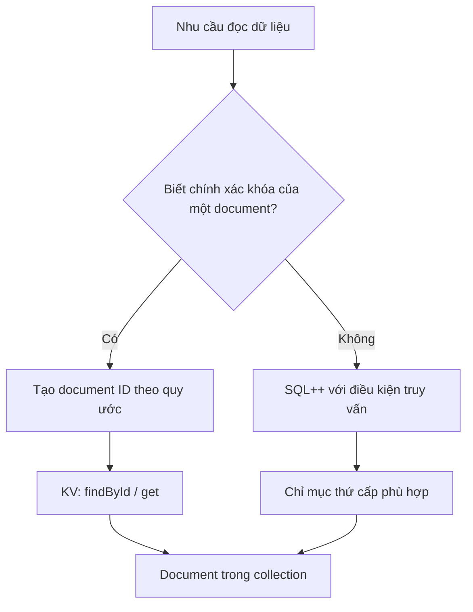

# Thiết kế khóa duy nhất theo nhu cầu truy cập trong Spring Data Couchbase

## 1. Vì sao document key là quyết định thiết kế quan trọng?

Trong Couchbase, mỗi document có một **document ID (document key)** do ứng dụng cung cấp hoặc tạo ra. ID xác định duy nhất document **trong một collection**: hai collection khác nhau có thể chứa cùng một ID, nhưng một collection không thể chứa đồng thời hai document có cùng ID. Khóa được dùng trực tiếp cho các thao tác key-value (KV) như lấy, thêm, thay thế và xóa document.

Với Spring Data Couchbase, thuộc tính gắn `@Id` ánh xạ đến document ID. Một lời gọi như `repository.findById(id)` có thể truy xuất document bằng khóa đã biết, không cần chạy SQL++ qua chỉ mục thứ cấp. Vì vậy, thiết kế khóa tốt bắt đầu từ câu hỏi **ứng dụng biết thông tin gì tại thời điểm đọc hoặc ghi?**

Ví dụ, hệ thống bán hàng đa tenant thường cần:

- Lấy một đơn hàng khi đã biết `tenantId` và `orderId`.
- Mở giỏ hàng hiện tại khi đã biết `tenantId` và `customerId`.
- Liệt kê 20 đơn gần nhất của khách hàng.
- Tìm đơn theo trạng thái và khoảng ngày.

Hai nhu cầu đầu phù hợp với truy cập KV bằng khóa xác định được. Hai nhu cầu sau cần truy vấn SQL++ và chỉ mục phù hợp; chỉ thay đổi mẫu document key sẽ không biến việc lọc hoặc liệt kê thành thao tác KV.



## 2. Nguyên tắc lựa chọn khóa

| Nguyên tắc | Lý do | Ví dụ |
| --- | --- | --- |
| **Duy nhất trong collection** | Hai thực thể không được vô tình ghi đè nhau | `order::acme::550e8400-e29b-41d4-a716-446655440000` |
| **Xác định được từ dữ liệu có sẵn khi đọc** | Cho phép KV lookup mà không phải tìm ID bằng một truy vấn khác | Giỏ hàng theo `tenantId + customerId` |
| **Ổn định trong vòng đời document** | Thay ID thường đồng nghĩa tạo document mới và xử lý tham chiếu cũ | Không ghép `status` hoặc tên khách hàng vào ID |
| **Có namespace rõ ràng** | Tránh nhầm loại thực thể khi dùng chung collection và hỗ trợ vận hành | Tiền tố `order::`, `cart::`, `customer::` |
| **Chuẩn hóa và không nhập nhằng** | Tránh hai cách viết tạo ra hai khóa cho một thực thể | Quy định chữ thường cho tenant, UUID dạng chuẩn |
| **Không làm lộ dữ liệu nhạy cảm** | Khóa có thể xuất hiện trong log, trace, công cụ quản trị | Dùng ID vô nghĩa thay cho email/số điện thoại |
| **Có giới hạn độ dài và bộ ký tự** | Document ID có giới hạn tối đa 250 byte; UTF-8 nhiều byte có thể vượt giới hạn | Ưu tiên thành phần ASCII ngắn và kiểm tra đầu vào |

> **Phân biệt quan trọng:** ID duy nhất giúp Couchbase định vị document; nó không tự bảo đảm quyền truy cập. Ứng dụng vẫn phải xác thực người dùng và kiểm tra tenant được phép truy cập trước khi tạo hoặc sử dụng khóa.

### 2.1. Khóa tự nhiên, khóa nghiệp vụ và khóa sinh ra

- **Khóa tự nhiên**: một giá trị sẵn có, ví dụ email. Dễ tra cứu nhưng có thể thay đổi, chứa dữ liệu cá nhân và cần quy tắc chuẩn hóa phức tạp; thường không nên dùng trực tiếp làm document ID.
- **Khóa nghiệp vụ ổn định**: mã đơn hàng, mã sản phẩm bất biến do hệ thống quản lý. Phù hợp nếu thật sự không tái sử dụng và có phạm vi duy nhất rõ ràng.
- **Khóa sinh ra**: UUID hoặc định danh phân tán. Phù hợp khi không có khóa nghiệp vụ bất biến; phải lưu lại ID để tái sử dụng khi đọc và retry.
- **Khóa ghép xác định (composite key)**: kết hợp loại thực thể, tenant và mã nghiệp vụ, ví dụ `cart::<tenantId>::<customerId>`. Hữu ích với quan hệ một-một hoặc khi API đã có tất cả thành phần khóa.

Không cần mã hóa mọi cột truy vấn vào document ID. Nếu đổi địa chỉ giao hàng, trạng thái hoặc ngày cập nhật làm đổi khóa, các tham chiếu, cache và quy trình retry sẽ trở nên khó kiểm soát.

## 3. Xây dựng quy ước khóa nhất quán

Một mẫu dễ đọc cho ứng dụng nhiều loại document là:

```text
<document-type>::<tenant-id>::<stable-business-id>
```

Ví dụ:

```text
customer::acme::c-1042
order::acme::550e8400-e29b-41d4-a716-446655440000
cart::acme::c-1042
inventory::acme::sku-001::warehouse-hcm
```

Các phần của khóa cần có hợp đồng cụ thể:

1. `document-type` lấy từ tập giá trị cố định, không lấy tùy ý từ request.
2. `tenant-id` sử dụng định danh nội bộ đã chuẩn hóa; không tin tenant do client tự khai báo khi chưa kiểm tra quyền.
3. `stable-business-id` phải duy nhất trong phạm vi đã chọn. Nếu `orderId` chỉ duy nhất theo tenant, luôn đưa tenant vào khóa hoặc tách tenant bằng collection theo chính sách vận hành.
4. Ký tự phân tách `::` không được xuất hiện nguyên dạng trong thành phần động, hoặc phải có quy tắc escape/encode **một-một** rõ ràng.
5. Không cắt cụt một khóa dài để vừa giới hạn: cắt cụt có thể tạo va chạm. Thay vào đó, giới hạn đầu vào hoặc dùng định danh/hash được thiết kế và kiểm soát va chạm phù hợp.

Tiền tố loại document hữu ích khi nhiều loại cùng ở một collection; nếu hệ thống đã tách `orders`, `carts`, `customers` thành các collection riêng, tiền tố vẫn có thể được dùng để dễ theo dõi, nhưng không thay thế cấu hình bucket/scope/collection. Tính duy nhất của ID được xét trong collection thực sự lưu document.

### 3.1. Hàm tạo khóa tập trung trong Java

Đặt việc chuẩn hóa và ghép khóa vào một nơi dùng chung cho lệnh ghi, đọc và xóa:

```java
import java.util.Locale;
import java.util.Objects;
import java.util.UUID;
import java.util.regex.Pattern;

public final class DocumentKeys {
    private static final Pattern TENANT_ID =
            Pattern.compile("[a-z0-9-]{1,32}");

    private DocumentKeys() {}

    public static String order(String tenantId, UUID orderId) {
        String tenant = normalizedTenant(tenantId);
        Objects.requireNonNull(orderId, "orderId");
        return "order::" + tenant + "::" + orderId;
    }

    public static String cart(String tenantId, String customerId) {
        String tenant = normalizedTenant(tenantId);
        Objects.requireNonNull(customerId, "customerId");
        if (!customerId.matches("[a-zA-Z0-9-]{1,64}")) {
            throw new IllegalArgumentException("customerId không hợp lệ");
        }
        return "cart::" + tenant + "::" + customerId;
    }

    private static String normalizedTenant(String tenantId) {
        Objects.requireNonNull(tenantId, "tenantId");
        String value = tenantId.toLowerCase(Locale.ROOT);
        if (!TENANT_ID.matcher(value).matches()) {
            throw new IllegalArgumentException("tenantId không hợp lệ");
        }
        return value;
    }
}
```

Đây là quy ước minh họa với ID nội bộ chỉ gồm chữ cái ASCII, số và dấu gạch nối. Một hệ thống khác có thể cho phép thêm ký tự, nhưng phải thống nhất cách chuẩn hóa/escape, giới hạn độ dài và các kiểm thử va chạm. Nếu ID nghiệp vụ phân biệt chữ hoa và chữ thường, **không** tự chuyển về chữ thường: cách chuẩn hóa phải đúng với ý nghĩa duy nhất của ID đó.

**Bẫy thường gặp:** sinh `UUID.randomUUID()` mỗi lần xử lý lại cùng một yêu cầu tạo đơn. Khi retry sau timeout, yêu cầu có thể tạo đơn thứ hai. Muốn retry an toàn, hãy tạo và giữ `orderId` một lần, hoặc dùng một `requestId`/idempotency key ổn định với cơ chế kiểm tra trùng lặp riêng.

## 4. Ánh xạ document và truy cập bằng Spring Data Couchbase

Ví dụ sau dùng `@Id` cho document key, các trường còn lại để phục vụ nghiệp vụ và truy vấn. Giả sử repository đã được cấu hình truy cập đúng collection `orders` trong bucket/scope của ứng dụng.

```java
import java.time.Instant;
import org.springframework.data.annotation.Id;
import org.springframework.data.annotation.Version;
import org.springframework.data.couchbase.core.mapping.Document;
import org.springframework.data.couchbase.core.mapping.Field;

@Document
public class OrderDocument {
    @Id
    private String id;

    @Field
    private String docType;

    @Field
    private String tenantId;

    @Field
    private String orderId;

    @Field
    private String customerId;

    @Field
    private Instant createdAt;

    @Version
    private Long version;

    protected OrderDocument() {} // Dành cho cơ chế ánh xạ

    public OrderDocument(String id, String tenantId, String orderId,
                         String customerId, Instant createdAt) {
        this.id = id;
        this.docType = "order";
        this.tenantId = tenantId;
        this.orderId = orderId;
        this.customerId = customerId;
        this.createdAt = createdAt;
    }
}
```

```java
import org.springframework.data.couchbase.repository.CouchbaseRepository;

public interface OrderRepository
        extends CouchbaseRepository<OrderDocument, String> {
}
```

```java
import java.time.Instant;
import java.util.Optional;
import java.util.UUID;

public class OrderService {
    private final OrderRepository orders;

    public OrderService(OrderRepository orders) {
        this.orders = orders;
    }

    public OrderDocument create(String tenantId, UUID orderId,
                                String customerId) {
        String key = DocumentKeys.order(tenantId, orderId);
        OrderDocument doc = new OrderDocument(
                key, tenantId, orderId.toString(), customerId, Instant.now());
        return orders.save(doc);
    }

    public Optional<OrderDocument> get(String tenantId, UUID orderId) {
        return orders.findById(DocumentKeys.order(tenantId, orderId));
    }
}
```

`@Id` biểu diễn **khóa document trong metadata Couchbase**; không nên giả định rằng truy vấn SQL++ sẽ có sẵn một trường JSON `id` nếu ứng dụng không lưu trường đó riêng. Trong SQL++, dùng `META(alias).id` để lấy document ID. Các trường `tenantId`, `orderId`, `customerId` được giữ trong body nhằm phục vụ lọc, hiển thị, kiểm tra nghiệp vụ và xây dựng chỉ mục.

`@Version` cho phép Spring Data Couchbase áp dụng cơ chế kiểm soát phiên bản dựa trên CAS khi lưu document theo vòng đời entity phù hợp. Tuy vậy, **đừng coi `save` là một API bảo đảm giữ chỗ duy nhất cho mọi cách sử dụng**: hành vi thêm mới/cập nhật còn phụ thuộc trạng thái entity và chiến lược lưu. Nếu yêu cầu là *chỉ tạo khi khóa chưa tồn tại*, hãy chọn thao tác `insert` có điều kiện tồn tại rõ ràng và xử lý tình huống trùng khóa.

### 4.1. Tạo document mới mà không ghi đè khóa đã có

Couchbase Java SDK cung cấp KV `insert`: thành công khi khóa chưa có, còn khóa đã tồn tại sẽ gây `DocumentExistsException`. Ví dụ rút gọn dưới đây minh họa thao tác ở tầng SDK khi nghiệp vụ cần bảo đảm tạo-mới:

```java
import com.couchbase.client.java.Collection;
import com.couchbase.client.java.json.JsonObject;
import com.couchbase.client.core.error.DocumentExistsException;

public void insertNewOrder(Collection collection, String key,
                           String tenantId, String orderId) {
    JsonObject body = JsonObject.create()
            .put("docType", "order")
            .put("tenantId", tenantId)
            .put("orderId", orderId);
    try {
        collection.insert(key, body);
    } catch (DocumentExistsException ex) {
        throw new IllegalStateException("Đơn hàng đã tồn tại: " + key, ex);
    }
}
```

Đoạn SDK là minh họa độc lập; khi ứng dụng sử dụng Spring Data cho cùng entity, cần giữ nhất quán định dạng document và đường ghi. Đặc biệt, `insert` chống việc **hai document cùng chiếm một ID**, nhưng không tự chứng minh rằng hai lần retry có cùng payload/ngữ nghĩa. Với idempotency, cần so sánh yêu cầu đã ghi hoặc lưu hồ sơ idempotency tương ứng.

## 5. Khi nào khóa không đủ: SQL++ và chỉ mục thứ cấp

Giả sử cần hiển thị 20 đơn gần nhất của khách hàng `c-1042`. Khóa `order::acme::<orderId>` không cho phép liệt kê mọi đơn của khách hàng bằng một lệnh KV; Couchbase không cung cấp truy xuất KV theo tiền tố hay theo trường `customerId`.

Giải pháp là giữ các thuộc tính cần lọc trong document và tạo index phù hợp với truy vấn thường xuyên:

```sql
-- Giả sử bucket=commerce, scope=sales, collection=orders.
CREATE INDEX ix_orders_tenant_customer_date
ON `commerce`.`sales`.`orders`(tenantId, customerId, createdAt DESC)
WHERE docType = "order";
```

```sql
SELECT META(o).id AS documentId, o.*
FROM `commerce`.`sales`.`orders` AS o
WHERE o.docType = "order"
  AND o.tenantId = $tenantId
  AND o.customerId = $customerId
ORDER BY o.createdAt DESC
LIMIT 20;
```

Tên bucket/scope/collection là giả định minh họa, cần thay bằng keyspace thật. Các tham số `$tenantId`, `$customerId` cần được bind qua API query, không nối chuỗi SQL++ từ đầu vào người dùng. Việc tối ưu thực tế phải kiểm tra `EXPLAIN`, độ chọn lọc, khả năng bao phủ và dữ liệu; với những truy vấn theo `status` hoặc khoảng ngày có thể cần chỉ mục khác.

| Yêu cầu truy cập | Hướng thiết kế | API phù hợp |
| --- | --- | --- |
| `GET /orders/{orderId}` khi đã biết tenant | `order::<tenant>::<orderId>` | `findById` / KV get |
| `GET /customers/{id}/cart` | `cart::<tenant>::<customerId>` | `findById` / KV get |
| Liệt kê đơn theo khách và ngày | Lưu `tenantId`, `customerId`, `createdAt`; thiết kế index | SQL++ |
| Lọc đơn theo trạng thái | Lưu `status` trong body; đánh giá index theo bộ lọc | SQL++ |
| Tìm khách theo email | Truy vấn có index, hoặc document ánh xạ/giữ chỗ riêng nếu cần tra cứu KV | SQL++ hoặc KV cho khóa phụ |

Không nên sử dụng `LIKE "order::acme::%"` trên `META().id` như một sự thay thế mặc định cho truy vấn nghiệp vụ. Tiền tố khóa phục vụ định danh và tổ chức; việc tìm kiếm theo trường vẫn cần mô hình dữ liệu và index tương ứng. Đối với dữ liệu vừa ghi, chú ý mức nhất quán của truy vấn SQL++ và chỉ mục; đọc lại bằng KV theo ID là một đường truy cập khác với truy vấn qua index.

## 6. Những tình huống cần quyết định rõ

### 6.1. Quan hệ một-một và một-nhiều

Nếu mỗi khách có đúng một giỏ hàng hoạt động, `cart::<tenant>::<customerId>` là khóa xác định tốt. Nếu mỗi khách có nhiều giỏ hàng lịch sử, cấu trúc đó sẽ đụng khóa; cần `cart::<tenant>::<cartId>` và trường `customerId` để truy vấn, hoặc một document con trỏ đến giỏ hiện hành được duy trì riêng.

Tương tự, dùng `order_item::<tenant>::<orderId>::<lineId>` giúp lấy **một dòng hàng đã biết `lineId`**, nhưng không tự giúp lấy **tất cả dòng hàng** của một đơn bằng KV. Có thể nhúng các dòng hàng nhỏ vào document đơn hàng hoặc tổ chức truy vấn/index cho chúng tùy kích thước và cách cập nhật.

### 6.2. Tính duy nhất của email hoặc mã ngoài

Nếu email phải duy nhất theo tenant nhưng có thể đổi, không nên biến email thành ID chính của customer. Có thể giữ ID ổn định `customer::<tenant>::<customerId>` và tạo một document giữ chỗ cho email đã chuẩn hóa, chẳng hạn:

```text
customer::acme::c-1042
email-reservation::acme::<opaque-email-token>
```

`opaque-email-token` nên là mã dẫn xuất phù hợp để tránh hiển thị email trong khóa (với dữ liệu dễ đoán, hash thường không đủ che giấu; có thể cân nhắc HMAC bằng khóa bí mật). Việc tạo reservation dùng `insert` để phát hiện trùng. Nếu cần tạo/cập nhật customer và reservation như một thao tác nghiệp vụ nguyên tử, thiết kế transaction hoặc quy trình bù trừ phù hợp; chỉ sinh hai key không tự tạo ra ràng buộc duy nhất liên-document.

### 6.3. TTL, CAS và tính ổn định của ID

TTL quyết định **thời điểm hết hạn** document, còn CAS/`@Version` giúp phát hiện **xung đột cập nhật**. Cả hai là mối quan tâm riêng với ID:

- Không nhúng thời điểm hết hạn hoặc giá trị CAS vào khóa. TTL thay đổi theo chính sách lưu trữ; CAS thay đổi sau các lần ghi.
- Sau khi document hết hạn hoặc bị xóa, cùng ID có thể được tạo lại. Vì vậy, "ID đã từng tồn tại" khác với "ID đang được sử dụng".
- Nếu một document bị cập nhật đồng thời, `@Version` và chiến lược xử lý lỗi ghi xung đột là cần thiết; khóa duy nhất không loại bỏ lost update.

### 6.4. Đổi quy tắc khóa trên hệ thống đang chạy

Đổi từ `order::<orderId>` sang `order::<tenant>::<orderId>` là **thay định danh**. Không thể chỉ sửa trường `@Id` của document hiện tại và chờ dữ liệu cũ tự chuyển sang khóa mới. Kế hoạch chuyển đổi thường gồm: tạo document theo khóa mới, cập nhật các tham chiếu, hỗ trợ đọc tương thích trong giai đoạn chuyển tiếp, xác minh dữ liệu rồi loại bỏ khóa cũ. Phải xem xét ghi đồng thời, retry, TTL và transaction/bù trừ trước khi xóa bản cũ.

## 7. Quy trình thiết kế và kiểm thử trước khi triển khai

1. **Ghi lại các truy cập chính**: cái nào đã biết đủ thành phần khóa, cái nào cần tìm kiếm, phân trang hoặc sắp xếp?
2. **Xác định phạm vi duy nhất**: trong collection nào, có bao nhiêu tenant, mã nghiệp vụ có thể tái sử dụng hay đổi không?
3. **Chọn thành phần bất biến**: loại document, tenant (nếu phù hợp) và ID nghiệp vụ ổn định.
4. **Định nghĩa chuẩn hóa**: bộ ký tự, phân cách, escape, cách xử lý chữ hoa/thường, giới hạn byte UTF-8.
5. **Đồng bộ đường ghi và đọc**: mọi luồng phải gọi chung hàm tạo key; không tự ghép string ở nhiều chỗ.
6. **Chọn ngữ nghĩa ghi**: tạo mới bằng `insert`, cập nhật có CAS khi cần, quy tắc idempotency và xử lý trùng khóa.
7. **Thiết kế truy vấn còn lại**: lưu trường lọc trong body, tạo index theo workload, kiểm tra kế hoạch thực thi và mức nhất quán cần thiết.

Các kiểm thử tối thiểu cho `DocumentKeys` và đường ghi/đọc nên bao gồm:

- Cùng một bộ đầu vào hợp lệ luôn tạo ra **đúng một** chuỗi khóa; bộ đầu vào khác nhau trong phạm vi duy nhất cho khóa khác nhau.
- `tenantId` không hợp lệ, ký tự phân cách lạ, ID rỗng, ID quá dài hoặc giá trị `null` được từ chối theo quy tắc.
- Hai yêu cầu tạo document đồng thời với cùng ID: chỉ một lần `insert` thành công; request còn lại được xử lý như trùng khóa.
- Đọc lại bằng `findById` với đúng key thành công; dùng key của tenant khác không thể vượt qua bước kiểm tra phân quyền.
- Thay đổi status, thời gian hết hạn hoặc tên hiển thị không làm đổi ID.

### Bài tập tình huống

Một nền tảng học tập dùng Couchbase để lưu `CourseProgress`: mỗi học viên có **một** tiến độ cho mỗi khóa học trong cùng tenant. API nhận `tenantId`, `learnerId`, `courseId` và thường xuyên đọc/ghi tiến độ của một cặp học viên–khóa học; trang quản trị còn cần liệt kê học viên chưa hoàn thành khóa.

**Gợi ý thiết kế:** dùng `course-progress::<tenant>::<learnerId>::<courseId>` sau khi kiểm soát tính hợp lệ của từng thành phần. Lưu `tenantId`, `learnerId`, `courseId`, `completionStatus`, `updatedAt` trong document để phục vụ quản trị. API đọc/ghi một tiến độ dùng KV; màn hình liệt kê chưa hoàn thành dùng SQL++ và chỉ mục theo điều kiện thực tế. Nếu tên khóa học thay đổi, document key vẫn ổn định vì dùng `courseId` bất biến.

## Kết luận

Khi thiết kế tầng truy cập Couchbase bằng Spring Data, hãy xem **document key là hợp đồng định danh cho những lần truy cập đã biết ID**. Chọn key duy nhất, ổn định, dễ tái tạo và an toàn; đặt logic tạo key tập trung; dùng `@Id`/repository cho thao tác KV, `insert` cho trường hợp cần giữ chỗ khóa và CAS khi cần kiểm soát cập nhật. Những nhu cầu lọc, liệt kê, sắp xếp vẫn phải được giải bằng cấu trúc document và chỉ mục SQL++ phù hợp. Sự phân chia rõ ràng này giúp hệ thống vừa truy cập nhanh vừa giữ được tính nhất quán khi dữ liệu và số lượng tenant tăng lên.
