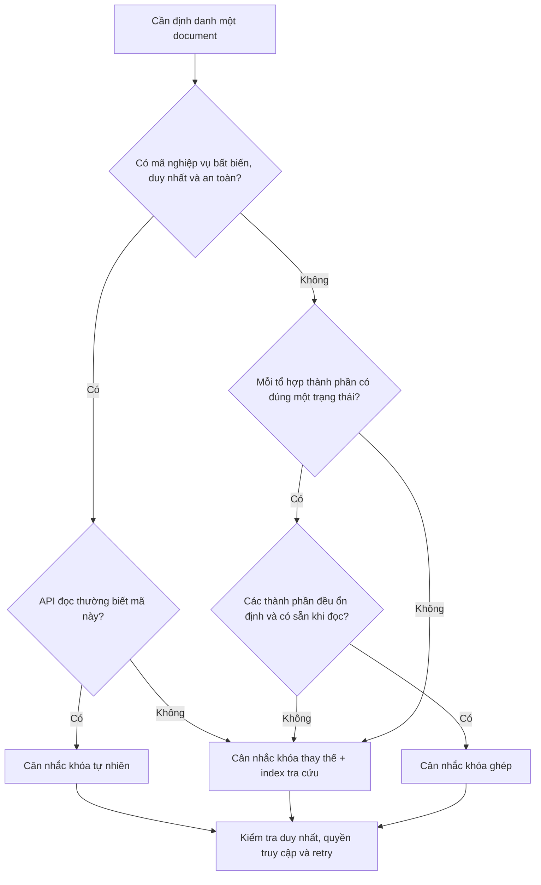

# Khóa tự nhiên, khóa thay thế và khóa ghép trong Spring Data Couchbase

## 1. Ba cách định danh document giải quyết ba bài toán khác nhau

Trong Couchbase, mỗi document có một **document ID (key)** duy nhất trong phạm vi **collection**. Các thao tác key-value (KV) như `get`, `insert`, `replace` và `remove` nhận ID đó để truy cập trực tiếp document. Với Spring Data Couchbase, thuộc tính gắn `@Id` là nơi ánh xạ document ID; `CouchbaseRepository<T, String>.findById(id)` cho phép đọc theo ID đã biết.

Khi thiết kế khóa, ta thường gặp ba lựa chọn:

1. **Khóa tự nhiên (natural key):** dùng một định danh có sẵn trong nghiệp vụ, ví dụ mã quốc gia hoặc mã sản phẩm được cam kết không đổi.
2. **Khóa thay thế (surrogate key):** dùng định danh kỹ thuật độc lập với thông tin nghiệp vụ, ví dụ UUID được sinh một lần khi tạo khách hàng.
3. **Khóa ghép (composite key):** kết hợp nhiều thành phần cùng xác định một document, ví dụ `tenantId + learnerId + courseId` cho tiến độ học tập.

Đây là những **chiến lược thiết kế khóa ở tầng ứng dụng**. Dù chọn loại nào, Couchbase vẫn nhận một document ID đơn lẻ (thường là chuỗi), chứ không có một khóa chính nhiều cột giống cách diễn đạt trong cơ sở dữ liệu quan hệ. Một document có thể sử dụng **khóa thay thế bên trong khóa ghép**: `order::<tenantId>::<orderUuid>` là khóa ghép theo cấu trúc chuỗi, trong đó `orderUuid` là định danh thay thế.

> **Câu hỏi đầu tiên:** Khi ứng dụng gọi API đọc một document, nó có sẵn những thông tin nào để tính ra **chính xác một ID**? Sau đó mới xét tính ổn định, phạm vi duy nhất và chi phí thay đổi khóa.

## 2. Khóa tự nhiên: khi định danh nghiệp vụ đủ tin cậy

Khóa tự nhiên lấy từ thuộc tính vốn đã phân biệt thực thể trong miền nghiệp vụ. Ví dụ, collection danh mục tiền tệ có thể dùng `currency::VND`, `currency::USD`; ứng dụng đọc trực tiếp bằng mã ISO đã biết, không cần lookup qua một trường khác.

```text
currency::VND
currency::USD
product::acme::sku-2026-001
```

Ở ví dụ sản phẩm, `product::acme::sku-2026-001` chỉ thật sự là khóa tự nhiên tốt nếu hệ thống **cam kết SKU không đổi, không tái sử dụng và duy nhất trong tenant `acme`**. Nhiều doanh nghiệp cho phép đổi SKU, gộp sản phẩm hoặc tái sử dụng mã: nếu vậy SKU không đủ ổn định làm khóa chính.

### Khi nào nên dùng?

- Thuộc tính đã có trước khi tạo document và luôn có mặt trong API đọc.
- Định danh **bất biến hoặc có chính sách thay đổi rất hiếm, được kiểm soát**.
- Phạm vi duy nhất được định nghĩa rõ: toàn bộ collection, theo tenant hay theo nguồn dữ liệu.
- Giá trị ngắn, chuẩn hóa được, không chứa thông tin nhạy cảm.

### Rủi ro cần đánh giá

| Rủi ro | Hệ quả | Cách xử lý |
| --- | --- | --- |
| Mã nghiệp vụ đổi | Đổi document ID có thể làm hỏng liên kết và cache | Dùng khóa thay thế nếu mã có thể đổi |
| Mã chỉ duy nhất trong tenant | Hai tenant tạo cùng key | Kết hợp `tenantId` hoặc tách collection theo kiến trúc |
| Mã bị tái sử dụng | Dễ liên kết nhầm dữ liệu cũ và mới | Bổ sung định danh không tái sử dụng |
| Chuẩn hóa không thống nhất | `SKU-1`, `sku-1` tạo hai document khác nhau | Có quy ước canonical rõ ràng cho từng loại mã |
| Email, số điện thoại làm ID | Lộ thông tin cá nhân trong log và phải đổi ID khi dữ liệu thay đổi | Lưu thuộc tính đó trong body; dùng khóa thay thế |

Khóa tự nhiên thuận tiện cho KV lookup nhưng không tự làm cho thuộc tính khác của document trở thành khóa truy cập. Ví dụ dùng SKU làm ID không giúp tìm mọi sản phẩm thuộc danh mục `electronics` bằng một KV lookup.

## 3. Khóa thay thế: ưu tiên định danh bền vững

Khóa thay thế (còn gọi là khóa nhân tạo) do hệ thống cấp và **không mang ý nghĩa nghiệp vụ trực tiếp**. Với Couchbase, một mẫu phổ biến là UUID:

```text
customer::acme::c9da286b-4fce-4a73-a3b7-9e23d8ac6764
order::acme::67f82002-d746-4f75-8a24-96727c901c97
```

Ưu điểm:

- Khóa giữ nguyên khi khách đổi email, tên hiển thị, số điện thoại hoặc mã bên ngoài.
- Có thể sinh ID từ ứng dụng mà không cần gọi cơ sở dữ liệu để cấp số tăng dần.
- Không buộc nhiều hệ thống tích hợp đồng ý về một mã nghiệp vụ duy nhất.
- Thuận tiện làm tham chiếu ổn định từ document khác, sự kiện và cache.

Đánh đổi: nếu đầu vào là email hoặc mã khách hàng bên ngoài, ứng dụng **chưa biết UUID**, nên phải tra cứu bằng SQL++ với chỉ mục thích hợp, hoặc duy trì một ánh xạ khóa phụ có quy tắc nhất quán.

```text
Đầu vào API: tenantId + email
           │
           ▼
Tra cứu customer theo tenantId + normalizedEmail (SQL++ và index)
           │
           ▼
Nhận document ID: customer::<tenantId>::<uuid>
           │
           ▼
Các thao tác sau dùng KV theo ID đã biết
```

**Không sinh UUID mới mỗi lần retry.** Nếu yêu cầu tạo đơn gặp timeout, sinh ID mới ở lần gửi lại có thể tạo thêm đơn. Cần dùng lại ID được cấp trước đó hoặc triển khai idempotency key ổn định và cơ chế chống xử lý trùng. UUID cũng không thay thế cơ chế kiểm tra trùng email hoặc mã nghiệp vụ.

### Chọn dạng định danh thay thế

- **UUID ngẫu nhiên:** dễ sinh phân tán, ít phụ thuộc hạ tầng; lưu ý độ dài và việc truyền ID nguyên vẹn.
- **UUID có thứ tự thời gian hoặc ULID:** có thể hữu ích cho sắp xếp theo thời gian tạo ở tầng ứng dụng, nhưng cần thư viện/quy ước nhất quán, xử lý đồng hồ và tính duy nhất; **không nên suy ra thứ tự truy vấn SQL++ hoặc hiệu năng scan KV chỉ từ thứ tự ID**.
- **Số tăng dần:** dễ đọc nhưng cần cơ chế cấp phát an toàn khi có nhiều instance; tránh tự đọc giá trị lớn nhất rồi cộng một vì có thể đụng độ khi ghi đồng thời.

Đối với ứng dụng Spring Data, việc tạo khóa tường minh tại service giúp giữ rõ **ai cấp ID và ID được tái sử dụng thế nào**. `@Id` không đồng nghĩa với việc Couchbase sẽ tự sinh UUID cho mọi document.

## 4. Khóa ghép: định danh một quan hệ hoặc một trạng thái duy nhất

Khóa ghép kết hợp các thuộc tính tạo nên tính duy nhất. Ví dụ, mỗi học viên chỉ có **một** document tiến độ cho từng khóa học trong một tenant:

```text
course-progress::acme::learner-17::course-42
```

Một mô hình kho hàng có **một** số dư hiện tại cho mỗi cặp kho và SKU:

```text
stock-balance::acme::warehouse-hcm::sku-07
```

Với hai mô hình này, các API đã biết toàn bộ thành phần có thể tính ID để đọc hoặc cập nhật trực tiếp. Khóa ghép đặc biệt phù hợp khi tổ hợp các thành phần mô tả **một trạng thái hiện tại** hoặc một quan hệ một-một theo tổ hợp.

Tuy nhiên, cùng một học viên có thể có **nhiều lần thi** một bài kiểm tra. Nếu khóa chỉ là `examAttempt::<tenant>::<learner>::<exam>`, các lần thi sẽ dùng chung ID. Cần bổ sung một `attemptId` bất biến hoặc dùng khóa thay thế cho mỗi attempt:

```text
exam-attempt::acme::74f1d1d8-d42e-44d8-ab1c-883fc670c692
```

### Các vấn đề riêng của khóa ghép

1. **Thiếu thành phần:** muốn lấy tiến độ nhưng chỉ biết `learnerId` thì chưa thể xây dựng đúng khóa cho từng `courseId`; phải truy vấn/index hoặc duy trì danh sách liên kết.
2. **Thành phần thay đổi:** đổi `courseId` hoặc `warehouseId` làm đổi document ID; cần quy trình chuyển dữ liệu và cập nhật tham chiếu.
3. **Ghép chuỗi nhập nhằng:** `a::bc` và `ab::c` phải được biểu diễn bằng quy tắc phân cách/escape rõ ràng, không ghép trần `a + b + c`.
4. **Ký tự phân cách bên trong dữ liệu:** nếu cho phép `::` trong ID thành phần, phải escape/encode theo cách **một-một**; hoặc giới hạn bộ ký tự từ đầu.
5. **Khóa quá dài:** document ID Couchbase có giới hạn **250 byte**; byte UTF-8 không đồng nghĩa với số ký tự hiển thị. Không cắt cụt khóa tùy tiện vì có thể gây va chạm.

Đừng nhầm **khóa ghép** với **chỉ mục ghép**. `course-progress::tenant::learner::course` là một chuỗi ID. Còn index `(tenantId, learnerId, courseId)` là cấu trúc truy vấn SQL++ trên các trường bên trong document. Hai khái niệm phục vụ các đường truy cập khác nhau.

## 5. Bảng lựa chọn nhanh theo đặc tính dữ liệu

| Tiêu chí | Khóa tự nhiên | Khóa thay thế | Khóa ghép |
| --- | --- | --- | --- |
| Nguồn định danh | Giá trị nghiệp vụ | Giá trị kỹ thuật hệ thống sinh | Tổ hợp nhiều giá trị |
| Ví dụ | `currency::VND` | `customer::acme::<uuid>` | `progress::acme::learner-17::course-42` |
| KV lookup | Tốt nếu API biết mã nghiệp vụ | Tốt khi API đã có ID kỹ thuật | Tốt khi API biết **đủ** các thành phần |
| Đổi thuộc tính nghiệp vụ | Có nguy cơ phải đổi ID | Thường không ảnh hưởng ID | Nếu thay thành phần khóa thì phải đổi ID |
| Phạm vi duy nhất | Theo quy tắc miền nghiệp vụ | Theo cơ chế cấp ID và namespace | Theo tổ hợp được chọn |
| Phù hợp | Danh mục có mã bất biến | Khách hàng, đơn hàng, sự kiện | Giỏ hàng hiện tại, tiến độ theo cặp, số dư theo cặp |
| Khó khăn chính | Đảm bảo mã thực sự không đổi | Cần lookup bổ sung theo mã nghiệp vụ | Chuẩn hóa, giới hạn độ dài và xử lý thay thành phần |

Ba loại có thể kết hợp: `order::<tenantId>::<orderUuid>` vừa có **namespace ghép** vừa sử dụng **surrogate ID** cho thực thể đơn hàng. Nên phân biệt câu hỏi "ID nghiệp vụ hay ID kỹ thuật?" với câu hỏi "có những thành phần nào trong chuỗi document key?".



## 6. Ví dụ Spring Data Couchbase: biểu diễn cả ba loại khóa

Giả sử ứng dụng có bucket/scope/collection được cấu hình phù hợp cho mỗi repository. Các ví dụ dưới đây dùng Java và Spring Data Couchbase với ID do service tạo, giúp nhìn thấy rõ quyết định định danh.

### 6.1. Tập trung chuẩn hóa và tạo ID

```java
import java.util.Objects;
import java.util.UUID;
import java.util.regex.Pattern;

public final class Keys {
    // Quy ước minh họa: ID nội bộ đã chuẩn hóa thành chữ thường ASCII.
    private static final Pattern COMPONENT =
            Pattern.compile("[a-z0-9][a-z0-9_-]{0,39}");

    private Keys() {}

    private static String checked(String value, String name) {
        Objects.requireNonNull(value, name);
        if (!COMPONENT.matcher(value).matches()) {
            throw new IllegalArgumentException(name + " không hợp lệ");
        }
        return value;
    }

    // Khóa tự nhiên: mã tiền tệ chuẩn do ứng dụng xác thực trước.
    public static String currency(String isoCode) {
        Objects.requireNonNull(isoCode, "isoCode");
        if (!isoCode.matches("[A-Z]{3}")) {
            throw new IllegalArgumentException("Mã tiền tệ không hợp lệ");
        }
        return "currency::" + isoCode;
    }

    // Khóa thay thế có namespace tenant.
    public static String customer(String tenantId, UUID customerId) {
        Objects.requireNonNull(customerId, "customerId");
        return "customer::" + checked(tenantId, "tenantId")
                + "::" + customerId;
    }

    // Khóa ghép cho một trạng thái duy nhất trên mỗi tổ hợp.
    public static String courseProgress(String tenantId,
                                        String learnerId,
                                        String courseId) {
        return "course-progress::" + checked(tenantId, "tenantId")
                + "::" + checked(learnerId, "learnerId")
                + "::" + checked(courseId, "courseId");
    }
}
```

Hàm ví dụ **từ chối** dữ liệu chưa chuẩn hóa thay vì âm thầm đổi chữ hoa/thường. Ứng dụng cần chuẩn hóa định danh tại ranh giới dữ liệu theo chính sách cụ thể, đặc biệt khi mã nghiệp vụ phân biệt chữ hoa và chữ thường. Quy ước `COMPONENT` cũng chủ động loại ký tự `:` để tránh nhập nhằng dấu phân cách. Độ dài đã giới hạn trong ví dụ; nếu dùng quy ước khác phải kiểm tra giới hạn byte của toàn bộ key.

### 6.2. Ánh xạ entity với `@Id`

Với khóa ghép `courseProgress(...)`, Spring Data Couchbase vẫn chỉ cần **một** trường `@Id`:

```java
import java.time.Instant;
import org.springframework.data.annotation.Id;
import org.springframework.data.annotation.Version;
import org.springframework.data.couchbase.core.mapping.Document;
import org.springframework.data.couchbase.core.mapping.Field;

@Document
public class CourseProgressDocument {
    @Id
    private String id;

    @Field
    private String tenantId;

    @Field
    private String learnerId;

    @Field
    private String courseId;

    @Field
    private int completedPercent;

    @Field
    private Instant updatedAt;

    @Version
    private Long version;

    protected CourseProgressDocument() {}

    public CourseProgressDocument(String id, String tenantId,
                                  String learnerId, String courseId,
                                  int completedPercent) {
        this.id = id;
        this.tenantId = tenantId;
        this.learnerId = learnerId;
        this.courseId = courseId;
        this.completedPercent = completedPercent;
        this.updatedAt = Instant.now();
    }

    public String getId() { return id; }
}
```

```java
import org.springframework.data.couchbase.repository.CouchbaseRepository;

public interface CourseProgressRepository
        extends CouchbaseRepository<CourseProgressDocument, String> {
}
```

```java
import java.util.Optional;

public class CourseProgressService {
    private final CourseProgressRepository repository;

    public CourseProgressService(CourseProgressRepository repository) {
        this.repository = repository;
    }

    public Optional<CourseProgressDocument> load(String tenantId,
                                                  String learnerId,
                                                  String courseId) {
        String key = Keys.courseProgress(tenantId, learnerId, courseId);
        return repository.findById(key);
    }

    public CourseProgressDocument create(String tenantId,
                                         String learnerId,
                                         String courseId) {
        String key = Keys.courseProgress(tenantId, learnerId, courseId);
        CourseProgressDocument doc = new CourseProgressDocument(
                key, tenantId, learnerId, courseId, 0);
        return repository.save(doc);
    }
}
```

`findById` dùng document ID. `@Version` hỗ trợ cơ chế kiểm soát phiên bản dựa trên CAS khi ghi các entity được quản lý phù hợp. Đoạn `create` tập trung minh họa **cách tạo key**; `save` không nên được xem là hợp đồng "chỉ được thêm khi key chưa tồn tại" trong mọi tình huống. Nếu nghiệp vụ yêu cầu giữ chỗ duy nhất khi ghi đồng thời, cần thao tác insert có điều kiện tồn tại (xem phần 7).

Với entity khách hàng dùng **khóa thay thế**, service tạo `UUID customerId = UUID.randomUUID()` **một lần** tại thời điểm chấp nhận lệnh tạo rồi gọi `Keys.customer(tenantId, customerId)`. ID đó phải được trả cho caller hoặc lưu trong trạng thái xử lý để các lần đọc, cập nhật và retry tiếp theo dùng lại. Các thuộc tính như `email` và `displayName` nằm trong body document; cập nhật chúng không cần thay ID.

## 7. Tính duy nhất và concurrency: khóa không thay cho quy tắc ghi

### 7.1. Tạo mới bằng thao tác KV `insert`

Couchbase đảm bảo chỉ một document tồn tại với cùng ID trong một collection ở một thời điểm. Để hai lệnh tạo đồng thời không vô tình ghi đè, có thể dùng KV `insert` của Java SDK; nếu key đã tồn tại, SDK báo `DocumentExistsException`:

```java
import com.couchbase.client.core.error.DocumentExistsException;
import com.couchbase.client.java.Collection;
import com.couchbase.client.java.json.JsonObject;

public void insertProgress(Collection collection, String tenantId,
                           String learnerId, String courseId) {
    String key = Keys.courseProgress(tenantId, learnerId, courseId);
    JsonObject body = JsonObject.create()
            .put("tenantId", tenantId)
            .put("learnerId", learnerId)
            .put("courseId", courseId)
            .put("completedPercent", 0);

    try {
        collection.insert(key, body);
    } catch (DocumentExistsException ex) {
        throw new IllegalStateException("Tiến độ đã tồn tại", ex);
    }
}
```

Đây là ví dụ độc lập ở tầng SDK để làm rõ ngữ nghĩa *insert-if-absent*. Khi kết hợp thao tác SDK trực tiếp với entity do Spring Data quản lý, cần đảm bảo định dạng JSON, thông tin kiểu entity và đường cập nhật nhất quán; không mặc định rằng body tối giản ở trên có thể đọc bằng mọi repository đã cấu hình. Ở một ứng dụng hoàn chỉnh, hãy chọn cơ chế ghi phù hợp với stack đang dùng, ánh xạ lỗi trùng key thành kết quả nghiệp vụ và kiểm tra retry/idempotency.

### 7.2. Khóa thay thế không tự bảo đảm duy nhất theo email

Ví dụ customer có ID `customer::acme::<uuid>` nhưng hệ thống yêu cầu **mỗi email chỉ thuộc một customer trong tenant**. Hai request khác nhau có thể sinh hai UUID, vì vậy `insert` customer thành công cả hai nếu không có thêm cơ chế kiểm soát email.

Một cách là tạo **document giữ chỗ duy nhất** theo email đã chuẩn hóa:

```text
customer::acme::<customerUuid>
email-reservation::acme::<opaque-email-identifier>
```

Trong đó `opaque-email-identifier` cần được tạo theo cơ chế ổn định và tránh lộ email trong ID/log; dữ liệu dễ đoán không được bảo vệ hiệu quả chỉ bằng hash thông thường. Dùng `insert` reservation để chỉ một request giữ được quyền dùng email. Nếu yêu cầu customer và reservation phải xuất hiện/cập nhật đồng thời như một hành động nguyên tử, cần thiết kế transaction được hỗ trợ hoặc quy trình bù trừ và phục hồi. Việc đặt tên key phụ **không tự tạo transaction**.

Một truy vấn SQL++ có index trên `normalizedEmail` giúp tìm customer nhanh, nhưng **chỉ mục thứ cấp thông thường không tự thực thi ràng buộc duy nhất** giống unique constraint ở cơ sở dữ liệu quan hệ.

### 7.3. CAS, TTL và đổi khóa

- **CAS / `@Version`:** xử lý xung đột cập nhật cùng document. Dù document key là tự nhiên, thay thế hay ghép, key duy nhất vẫn không loại bỏ lost update.
- **TTL:** quyết định vòng đời document; sau khi hết hạn hoặc xóa, một ID có thể được dùng lại. Phải phân biệt "đã từng sử dụng ID" và "ID hiện đang tồn tại".
- **Đổi key:** Couchbase không tự chuyển mọi tham chiếu khi ứng dụng thay quy tắc document ID. Thường cần tạo document mới theo key mới, điều chỉnh các tham chiếu/luồng đọc, xác minh rồi mới dọn key cũ.

## 8. Truy vấn SQL++ khi không biết document key

Giả sử khóa thay thế của customer là `customer::acme::<uuid>`, trong khi API chỉ nhận `externalCustomerCode`. Giữ `tenantId` và `externalCustomerCode` thành trường riêng trong body rồi tạo index phù hợp:

```sql
-- Tên bucket/scope/collection chỉ là ví dụ.
CREATE INDEX ix_customer_tenant_external_code
ON `commerce`.`sales`.`customers`(tenantId, externalCustomerCode);
```

```sql
SELECT META(c).id AS documentId, c.*
FROM `commerce`.`sales`.`customers` AS c
WHERE c.tenantId = $tenantId
  AND c.externalCustomerCode = $externalCustomerCode;
```

Ứng dụng bind giá trị tham số qua API SQL++ thay vì nối trực tiếp chuỗi truy vấn. Với khóa ghép cho tiến độ, nếu trang quản trị cần liệt kê tất cả tiến độ của một học viên, dùng index theo `tenantId`, `learnerId` và thuộc tính sắp xếp thay vì giả định KV có thể liệt kê document theo tiền tố ID.

Các truy vấn qua index có đặc tính nhất quán khác với thao tác KV trực tiếp. Nếu luồng nghiệp vụ yêu cầu đọc ngay dữ liệu vừa ghi bằng SQL++, cần lựa chọn mức nhất quán query thích hợp và kiểm tra chi phí; khi đã biết key thì KV `findById` thường là đường đọc đơn giản hơn. Dù dùng repository, `CouchbaseTemplate` hay API reactive, **chiến lược key và phạm vi duy nhất vẫn giữ nguyên**; khác biệt chính nằm ở cách gọi và xử lý kết quả bất đồng bộ.

## 9. Tình huống thiết kế thực tế

Một nền tảng thương mại điện tử đa tenant dùng Couchbase có các thực thể:

| Thực thể | Yêu cầu nghiệp vụ | Phương án đề xuất | Lý do |
| --- | --- | --- | --- |
| `Currency` | Tra cứu bằng mã tiền tệ chuẩn, hiếm thay đổi | `currency::<isoCode>` | Mã nghiệp vụ ổn định và có sẵn khi đọc |
| `Customer` | Khách có thể đổi email/số điện thoại | `customer::<tenant>::<uuid>` | ID độc lập thuộc tính thay đổi |
| `ShoppingCart` hiện tại | Mỗi khách có một giỏ hiện tại trong tenant | `cart::<tenant>::<customerUuid>` | Tổ hợp xác định đúng một document |
| `Order` | Mỗi lần đặt hàng là thực thể mới; cần retry an toàn | `order::<tenant>::<orderUuid>` | UUID cấp một lần, giữ lại qua retry |
| `StockBalance` | Một số dư hiện tại cho mỗi kho và mặt hàng | `balance::<tenant>::<warehouseId>::<productId>` | Tổ hợp bất biến xác định một trạng thái |
| `OrderEvent` | Một đơn có nhiều sự kiện | `order-event::<tenant>::<eventUuid>` | Không bị đụng key giữa các sự kiện |

Chú ý rằng `cart::<tenant>::<customerUuid>` là một khóa ghép **chứa surrogate ID**. `StockBalance` có thể gặp vấn đề nếu `warehouseId` hoặc `productId` không ổn định; phải quyết định đổi key hay chuyển sang ID kỹ thuật trước khi thiết kế API.

### Bài tập vận dụng

Thiết kế lưu thông tin `UserSubscription` cho ứng dụng SaaS với ba điều kiện: một người dùng có nhiều gói trong lịch sử, **tại một thời điểm có nhiều nhất một gói đang hoạt động**, và API cần tìm nhanh theo `(tenantId, userId)`.

**Phân tích:** dùng `subscription::<tenant>::<subscriptionUuid>` cho từng bản ghi lịch sử vì một người dùng có thể có nhiều gói. Có thể duy trì `active-subscription::<tenant>::<userId>` làm document con trỏ/trạng thái hiện tại nếu cần KV lookup trực tiếp. Không nên chỉ sử dụng `subscription::<tenant>::<userId>` cho lịch sử vì các gói sẽ dùng chung key. Bảo đảm "nhiều nhất một gói hoạt động" cần quy tắc ghi có điều kiện và phối hợp transaction hoặc cơ chế xử lý đồng thời thích hợp; chỉ dùng query kiểm tra trước khi insert có thể bị race condition.

## 10. Checklist trước khi chốt document key

1. **Phạm vi:** ID phải duy nhất trong collection nào? Tenant có nằm trong khóa không? Collection đã tách tenant thì có cần tiền tố nữa không?
2. **Ổn định:** mọi thành phần có thể thay đổi, được tái sử dụng hoặc do bên ngoài cấp lại không?
3. **Đường truy cập:** API đọc đã biết đủ thành phần để tính key hay cần SQL++/index?
4. **Quy ước:** có quy tắc bộ ký tự, canonicalization, dấu phân cách, kiểm tra giới hạn 250 byte và xử lý ký tự không hợp lệ không?
5. **Bảo mật:** key có làm lộ email, số điện thoại, bí mật nghiệp vụ hay dữ liệu cần ẩn khỏi log không? Tenant có được xác thực trước khi truy cập không?
6. **Ghi đồng thời:** create dùng ngữ nghĩa insert-if-absent ở đâu; cập nhật dùng CAS khi cần; retry có tái sử dụng ID/idempotency key không?
7. **Mô hình truy vấn:** các trường cần lọc/sắp xếp có trong body và chỉ mục SQL++ thích hợp chưa?
8. **Vận hành:** thay key, xóa, TTL, sự kiện và tham chiếu liên-document sẽ được quản lý thế nào?

## Kết luận

Trong Spring Data Couchbase, **khóa tự nhiên** phù hợp khi mã nghiệp vụ bền vững và có sẵn lúc đọc; **khóa thay thế** giúp thực thể giữ định danh khi thông tin nghiệp vụ đổi; **khóa ghép** diễn tả một tổ hợp xác định duy nhất một trạng thái hoặc quan hệ. Ba lựa chọn không loại trừ nhau: có thể dùng surrogate ID bên trong một chuỗi key ghép có namespace tenant. Dù chọn cách nào, hãy đặt `@Id` ổn định, chuẩn hóa key tại một nơi, phân biệt KV lookup với truy vấn SQL++ qua index và thiết kế riêng ngữ nghĩa ghi đồng thời, CAS, TTL và idempotency. Đây là nền tảng để tầng truy cập Couchbase giữ tính nhất quán khi ứng dụng và dữ liệu mở rộng.
