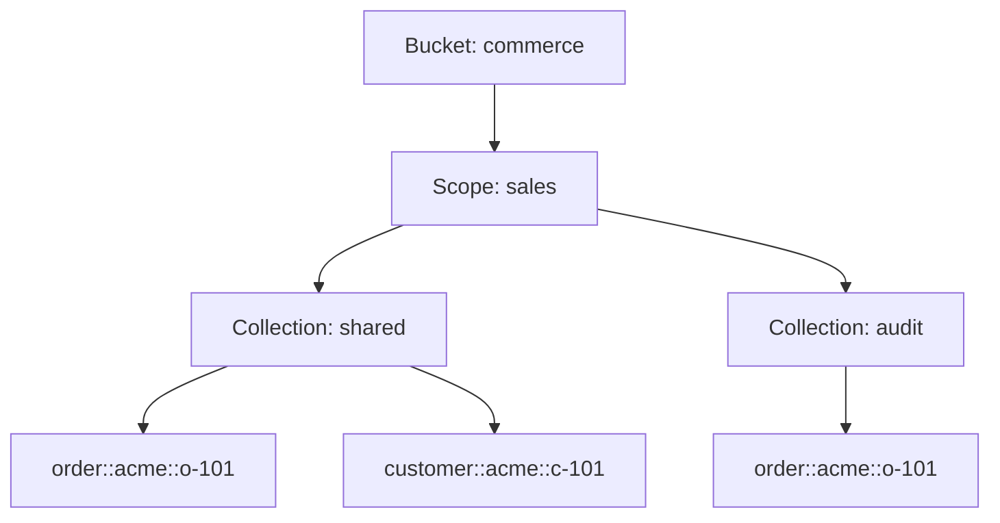

# Tiền tố phân loại, namespace và quy tắc tránh va chạm trong Spring Data Couchbase

## 1. Một document key cần nói rõ nó thuộc về ai

Trong Couchbase, **document ID (document key)** định danh duy nhất một document **bên trong một collection**. Khi ứng dụng gọi KV `get`, `insert`, `replace` hoặc `remove`, Couchbase xác định document bằng ID cùng với collection được chọn. Spring Data Couchbase ánh xạ ID này thông qua trường `@Id` và cho phép truy cập bằng `CouchbaseRepository.findById(id)`.

Khi số lượng loại document, tenant và dịch vụ tăng lên, chỉ dùng các mã ngắn như `12345` hoặc `current` dễ dẫn đến **va chạm khóa**: hai thực thể khác nhau vô tình tạo cùng một ID trong collection. Một quy ước có **tiền tố phân loại** và **namespace** giúp diễn đạt phạm vi định danh ngay trong chuỗi khóa.

Ví dụ ứng dụng thương mại đa tenant có các document:

```text
order::acme::9b2e4b42-8d6c-42a0-b495-2cf33f8e5d7e
cart::acme::customer-17
order::globex::9b2e4b42-8d6c-42a0-b495-2cf33f8e5d7e
customer::acme::customer-17
```

Bốn khóa trên khác nhau theo **loại thực thể**, **tenant** hoặc **định danh ổn định**, kể cả khi một số thành phần trùng nhau.

Bài học tập trung vào việc thiết kế chuỗi document key cho tầng truy cập Couchbase bằng Spring Data: chọn cấu trúc prefix, phân biệt namespace ứng dụng và namespace Couchbase, phát hiện va chạm, viết hàm tạo khóa và vận hành quy ước khi hệ thống thay đổi.

## 2. Phân biệt namespace vật lý và namespace trong document ID

Couchbase tổ chức dữ liệu theo phân cấp **bucket → scope → collection → document**. Cấu trúc này là namespace do Couchbase quản lý. Tính duy nhất của document ID được xét trong **collection**, không trải trên toàn bộ cluster.



Trong sơ đồ, document ID `order::acme::o-101` có thể tồn tại ở cả `shared` và `audit` vì chúng là hai collection riêng. Ngược lại, trong cùng `shared`, không thể có hai document đang tồn tại cùng ID đó.

| Cấp phân loại | Ai quản lý? | Vai trò |
| --- | --- | --- |
| Bucket | Couchbase / vận hành | Vùng chứa dữ liệu, cấu hình tài nguyên và chính sách vận hành |
| Scope | Couchbase / vận hành | Nhóm collection có liên quan |
| Collection | Couchbase / ứng dụng | Đơn vị định danh ID và nhiều cấu hình truy cập, chỉ mục |
| Prefix `order::` | Quy ước ứng dụng | Phân biệt loại document khi đặt chung một collection |
| Namespace `acme::` | Quy ước ứng dụng | Bổ sung phạm vi tenant hoặc miền nghiệp vụ vào ID |
| ID `o-101` | Quy ước nghiệp vụ | Nhận diện một thực thể cụ thể |

**Prefix không tạo collection mới.** `order::acme::o-101` và `customer::acme::o-101` vẫn ở cùng collection nếu cấu hình lưu như vậy.

**Collection khác nhau không cần prefix để đạt tính duy nhất vật lý**. Tuy nhiên, prefix có thể hữu ích cho log, migration và quy ước chung. Cân nhắc mức độ lặp lại: nếu repository đã lưu `Order` vào collection `orders` thì tiền tố `order::` là lựa chọn tổ chức, không phải bắt buộc của Couchbase.

### 2.1. Chọn phần nào nên xuất hiện trong khóa?

Một mẫu thường dùng với **collection chia sẻ nhiều loại document và nhiều tenant** là:

```text
<kind>::<tenant-id>::<stable-entity-id>
```

Trong một hệ thống khác, có thể chọn:

```text
<tenant-id>::<kind>::<stable-entity-id>
```

Thứ tự nào cũng có thể hợp lệ nếu được **định nghĩa một lần và dùng nhất quán**. Chọn dựa trên cách vận hành, debug, tạo khóa trong các service và khả năng tương thích; đừng xem vị trí prefix là cơ chế lọc dữ liệu tự động.

Không nhất thiết nhúng mọi mức bucket, scope hoặc collection vào ID. Đặc biệt, môi trường `dev`/`prod` thường đã được tách bằng cấu hình hạ tầng. Nếu thêm chúng vào key, phải có lý do rõ ràng vì thay một thành phần sẽ làm thay đổi ID.

## 3. Tiền tố phân loại (type prefix)

Tiền tố loại document thường là tên ngắn, cố định cho **một loại thực thể hoặc vai trò document**:

```text
customer::acme::c-17
order::acme::o-88
cart::acme::c-17
payment::acme::p-88
idempotency::acme::create-order-req-456
```

Tiền tố có ba lợi ích chính:

1. **Tránh va chạm chéo loại:** `order::acme::17` và `customer::acme::17` không vô tình dùng chung ID.
2. **Đọc hiểu log và công cụ vận hành:** người kiểm tra có thể nhận diện loại document bằng ID.
3. **Chuẩn hóa giữa nhiều service:** các đội cùng dùng hợp đồng định danh rõ ràng, tránh mỗi nơi tự ghép một kiểu.

Tuy vậy, tiền tố không phải bằng chứng duy nhất về kiểu dữ liệu. Một chuỗi có prefix `order::` vẫn có thể được ghi kèm body sai cấu trúc nếu tầng ghi không kiểm soát. Khi nhiều loại document dùng chung collection, nên lưu thêm trường kiểu như `docType` để phục vụ validation, truy vấn và index phù hợp.

### 3.1. Đặt tên prefix

| Nên | Tránh | Vì sao |
| --- | --- | --- |
| `order`, `customer`, `cart` | Tên viết tắt không có hợp đồng như `o`, `x` | Dễ hiểu khi theo dõi log và debug |
| Giá trị cố định trong code | Nhận trực tiếp `kind` tùy ý từ request | Hạn chế người gọi tạo namespace ngoài dự kiến |
| Tên phản ánh thực thể ổn định | Tên màn hình hoặc endpoint tạm thời | UI/API có thể đổi mà document vẫn là cùng thực thể |
| Quy tắc thống nhất chữ thường | Chỗ dùng `Order`, chỗ dùng `order` | Tránh sinh hai ID khác nhau theo hoa/thường |
| Phân biệt document nghiệp vụ và khóa phụ | Mọi đối tượng đều tiền tố `user` | Tránh nhầm customer thật với reservation hoặc idempotency record |

Ví dụ document giữ chỗ email nên dùng `email-reservation::...`, không dùng `customer::...` nếu document đó không phải entity customer thực sự.

## 4. Namespace tenant và miền nghiệp vụ

Trong ứng dụng đa tenant, cùng một ID nghiệp vụ có thể xuất hiện ở nhiều khách hàng:

```text
order::tenant-a::ord-204
order::tenant-b::ord-204
```

Nếu cả hai cùng nằm trong một collection, việc đặt tenant vào khóa bảo đảm hai thực thể có ID khác nhau. Với dữ liệu có vùng định danh khác, namespace có thể là tổ chức, cửa hàng, vùng nghiệp vụ hoặc nguồn dữ liệu, miễn là **phạm vi duy nhất** được ghi thành quy tắc rõ ràng.

| Bối cảnh | Thiết kế đáng cân nhắc | Lưu ý |
| --- | --- | --- |
| Một collection lưu nhiều tenant và nhiều kiểu | `<kind>::<tenant>::<id>` | Dùng tenant nội bộ đã xác thực |
| Một collection cho từng tenant | `<kind>::<id>` hoặc vẫn có tenant | ID đã duy nhất theo collection; tenant trong key là lựa chọn |
| Một collection cho từng kiểu entity | `<tenant>::<id>` | Loại entity đã phân biệt bởi collection |
| Một tenant có nhiều cửa hàng, mã chỉ duy nhất trong cửa hàng | `<kind>::<tenant>::<store>::<id>` | Chỉ thêm `store` nếu thực sự là phần bất biến của định danh |
| Dữ liệu tổng hợp từ các hệ thống có ID trùng nhau | `<kind>::<source>::<id>` | Định nghĩa rõ `source` là vùng định danh ổn định |

**Namespace không phải cơ chế phân quyền.** ID có chứa `tenant-a` không chứng minh người dùng được đọc tenant đó. Dịch vụ phải lấy tenant từ ngữ cảnh xác thực/ủy quyền và kiểm tra quyền truy cập trước khi tạo hoặc dùng key; không tin chuỗi tenant do client gửi mà chưa xác minh.

**Namespace cũng không bảo đảm cùng tenant được lưu gần nhau về mặt vật lý.** Couchbase phân phối document dựa trên cơ chế băm khóa đầy đủ; một prefix chung không bảo đảm dữ liệu cùng tenant nằm cùng partition, và không tạo API KV để liệt kê toàn bộ khóa của tenant.

## 5. Quy tắc hình thức: làm cho phép ghép khóa không nhập nhằng

Một quy ước tốt có thể viết thành grammar:

```text
document-key = kind "::" tenant "::" stable-id

kind       = một giá trị trong danh mục do ứng dụng định nghĩa
tenant     = định danh tenant nội bộ đã chuẩn hóa
stable-id  = định danh bất biến trong phạm vi tenant và kind
```

Cần quy định đồng thời **bộ ký tự**, **độ dài**, **chữ hoa/thường**, **Unicode**, **dấu phân cách** và **quy tắc tạo key**.

### 5.1. Va chạm do dấu phân cách

Giả sử các thành phần được nối bằng `::` nhưng người dùng có thể đặt `::` trong chính thành phần đó:

```text
["order", "acme::sales", "o-12"] -> order::acme::sales::o-12
["order", "acme", "sales::o-12"] -> order::acme::sales::o-12
```

Hai bộ dữ liệu khác nhau sinh **cùng chuỗi khóa**. Cách đơn giản là giới hạn mỗi thành phần động ở bộ ký tự an toàn, ví dụ chữ thường ASCII, chữ số, `-` và `_`. Nếu nghiệp vụ buộc phải hỗ trợ dấu phân cách hoặc Unicode tự do, cần dùng encoding không nhập nhằng, chẳng hạn Base64 URL-safe áp dụng nhất quán cho từng thành phần, hoặc biểu diễn có độ dài tường minh. Không thể chỉ thay `::` bằng `:` rồi coi vấn đề đã được giải quyết.

### 5.2. Va chạm do chuẩn hóa sai

Các tình huống cần quyết định:

- `Acme` và `acme` có cùng tenant hay khác tenant? Nếu cùng tenant, chuẩn hóa tại nguồn bằng một quy tắc duy nhất; nếu khác, không tự lower-case.
- `a-b` và `ab` có khác nhau không? Không xóa dấu phân cách một cách tùy tiện.
- Hai chuỗi Unicode trông giống nhau có thể có biểu diễn byte khác nhau. Nếu chấp nhận Unicode, xác định dạng chuẩn hóa Unicode và áp dụng trước khi tạo key.
- Không cắt bớt ID quá dài. Hai chuỗi khác nhau có thể trùng nhau sau khi cắt.
- Không dùng hash quá ngắn hoặc không kiểm soát va chạm để đại diện cho ID nghiệp vụ quan trọng.

Couchbase giới hạn document ID tối đa **250 byte**, vì vậy kích thước UTF-8 của toàn bộ chuỗi mới là yếu tố cần kiểm tra, không chỉ số ký tự trong Java.

### 5.3. Không đưa thuộc tính biến động vào namespace định danh

Nếu ID chứa `status`, `updatedAt`, tên hiển thị hoặc địa chỉ, mỗi lần dữ liệu đổi có thể tạo ra key mới. Một namespace phải dựa trên **ranh giới định danh bền vững**.

```text
Nên:   order::acme::9b2e4b42-8d6c-42a0-b495-2cf33f8e5d7e
Tránh: order::acme::pending::2026-11-25::9b2e4b42-8d6c-42a0-b495-2cf33f8e5d7e
```

Ngày tạo chỉ nên nằm trong key nếu ngày đó là **thành phần bất biến được yêu cầu để định danh** (ví dụ tổng hợp theo ngày), không phải vì muốn lọc tất cả document theo ngày bằng KV.

## 6. Một KeyFactory tập trung cho ứng dụng Java

Ví dụ dưới đây sử dụng một **danh mục prefix cố định**, từ chối thành phần chưa được chuẩn hóa và kiểm soát độ dài bằng UTF-8. Điều kiện regex là quy ước minh họa cho **định danh nội bộ ASCII**; hệ thống sử dụng ID quốc tế hóa sẽ cần policy khác.

```java
import java.nio.charset.StandardCharsets;
import java.util.Objects;
import java.util.UUID;
import java.util.regex.Pattern;

public final class DocumentKeyFactory {

    private static final int MAX_KEY_BYTES = 250;
    private static final Pattern TENANT =
            Pattern.compile("[a-z0-9][a-z0-9-]{0,39}");
    private static final Pattern BUSINESS_ID =
            Pattern.compile("[a-z0-9][a-z0-9_-]{0,79}");

    public enum Kind {
        ORDER("order"),
        CART("cart"),
        CUSTOMER("customer"),
        EMAIL_RESERVATION("email-reservation");

        private final String prefix;

        Kind(String prefix) {
            this.prefix = prefix;
        }
    }

    private DocumentKeyFactory() {}

    public static String order(String tenantId, UUID orderId) {
        Objects.requireNonNull(orderId, "orderId");
        return key(Kind.ORDER, tenantId, orderId.toString());
    }

    public static String cart(String tenantId, String customerId) {
        return key(Kind.CART, tenantId, customerId);
    }

    public static String key(Kind kind, String tenantId, String stableId) {
        Objects.requireNonNull(kind, "kind");
        String tenant = requirePart(tenantId, TENANT, "tenantId");
        String id = requirePart(stableId, BUSINESS_ID, "stableId");

        String value = kind.prefix + "::" + tenant + "::" + id;
        if (value.getBytes(StandardCharsets.UTF_8).length > MAX_KEY_BYTES) {
            throw new IllegalArgumentException("Document key quá 250 byte");
        }
        return value;
    }

    private static String requirePart(String value, Pattern pattern,
                                      String fieldName) {
        Objects.requireNonNull(value, fieldName);
        if (!pattern.matcher(value).matches()) {
            throw new IllegalArgumentException(fieldName + " không hợp lệ");
        }
        return value;
    }
}
```

Ví dụ sử dụng:

```java
UUID orderId = UUID.fromString(
        "9b2e4b42-8d6c-42a0-b495-2cf33f8e5d7e");

String orderKey = DocumentKeyFactory.order("acme", orderId);
// order::acme::9b2e4b42-8d6c-42a0-b495-2cf33f8e5d7e

String cartKey = DocumentKeyFactory.cart("acme", "customer-17");
// cart::acme::customer-17
```

Hàm `key` không tự lower-case input: nếu upstream có quy tắc canonicalization thì phải áp dụng nhất quán **trước** khi gọi. Việc từ chối dữ liệu chưa đạt hợp đồng thường an toàn hơn việc âm thầm biến nhiều ID khác nhau thành một ID.

Để xử lý email hoặc mã ngoài có ký tự tùy ý, **không** ép chúng vào regex trên bằng thao tác loại ký tự. Hãy chuyển sang định danh thay thế ổn định, hoặc thiết kế phép encoding một-một được dùng chung trên toàn hệ thống.

## 7. Ánh xạ Spring Data Couchbase và sử dụng ID đúng collection

Giả sử repository của ứng dụng đã được cấu hình truy cập bucket `commerce`, scope `sales`, collection `shared`; cùng collection này lưu nhiều loại document, nên `docType` nằm trong body để phục vụ truy vấn.

```java
import org.springframework.data.annotation.Id;
import org.springframework.data.annotation.Version;
import org.springframework.data.couchbase.core.mapping.Document;
import org.springframework.data.couchbase.core.mapping.Field;

@Document
public class OrderDocument {
    @Id
    private String id;

    @Field
    private String docType;

    @Field
    private String tenantId;

    @Field
    private String orderId;

    @Version
    private Long version;

    protected OrderDocument() {}

    public OrderDocument(String id, String tenantId, String orderId) {
        this.id = id;
        this.docType = "order";
        this.tenantId = tenantId;
        this.orderId = orderId;
    }

    public String getId() {
        return id;
    }
}
```

```java
import org.springframework.data.couchbase.repository.CouchbaseRepository;

public interface OrderRepository
        extends CouchbaseRepository<OrderDocument, String> {
}
```

```java
import java.util.Optional;
import java.util.UUID;

public class OrderReader {
    private final OrderRepository repository;

    public OrderReader(OrderRepository repository) {
        this.repository = repository;
    }

    public Optional<OrderDocument> getOrder(String authorizedTenantId,
                                            UUID orderId) {
        String documentId =
                DocumentKeyFactory.order(authorizedTenantId, orderId);
        return repository.findById(documentId);
    }
}
```

Trong ví dụ, `authorizedTenantId` là ID tenant đã được xác nhận bởi tầng phân quyền. **Đúng key nhưng sai collection vẫn không trỏ tới cùng một document**: repository và `CouchbaseTemplate` phải được cấu hình đúng bucket/scope/collection, hoặc dùng annotation collection/scope theo phiên bản Spring Data đang triển khai.

Tương tự với Couchbase SDK, thao tác phải thực hiện trên `Collection` chính xác:

```java
// Ví dụ SDK: bucket "commerce", scope "sales", collection "shared".
com.couchbase.client.java.Collection shared =
        cluster.bucket("commerce").scope("sales").collection("shared");

String key = DocumentKeyFactory.order("acme", orderId);
var result = shared.get(key);
```

Về mặt định danh, một document được xác định bởi **(bucket, scope, collection, key)** trong ngữ cảnh cluster/endpoint. Chỉ log mỗi `key` có thể gây nhầm lẫn nếu cùng ID xuất hiện ở nhiều collection; nên log thêm ngữ cảnh collection khi điều tra sự cố.

## 8. Chặn va chạm lúc ghi: key đúng vẫn cần thao tác đúng

Có hai loại lỗi thường bị đánh đồng:

- **Va chạm định danh:** hai thực thể khác nhau được tính thành cùng chuỗi key vì quy tắc thiết kế sai, thiếu namespace hoặc chuẩn hóa sai.
- **Tạo lặp cùng thực thể:** hai yêu cầu đồng thời hoặc một request được retry tạo cùng key vì cùng nhắm đến một thực thể. Đây có thể là sự kiện hợp lệ cần xử lý idempotency, hoặc lỗi nghiệp vụ.

Với thao tác **tạo mới và không cho ghi đè**, dùng KV `insert` để phát hiện key đã tồn tại:

```java
import com.couchbase.client.core.error.DocumentExistsException;
import com.couchbase.client.java.Collection;
import com.couchbase.client.java.json.JsonObject;

public void createIfAbsent(Collection collection, String key,
                           String tenantId, String orderId) {
    JsonObject body = JsonObject.create()
            .put("docType", "order")
            .put("tenantId", tenantId)
            .put("orderId", orderId);

    try {
        collection.insert(key, body);
    } catch (DocumentExistsException e) {
        throw new IllegalStateException("Document ID đã tồn tại: " + key, e);
    }
}
```

Đây là đoạn SDK độc lập minh họa ngữ nghĩa `insert-if-absent`. Khi kết hợp SDK với Spring Data, cần đảm bảo định dạng body và metadata ánh xạ nhất quán với entity; không giả định mọi document do SDK ghi tối giản đều đọc được bằng mọi repository đã cấu hình.

**Không** sử dụng quy trình `findById(key)` → nếu rỗng thì `save(...)` để đảm bảo chỉ một creator thành công: hai request có thể cùng thấy rỗng trước khi một trong hai ghi. Và không coi mọi lời gọi `repository.save(...)` là cam kết insert-if-absent độc lập với trạng thái entity.

Quy tắc xử lý khi `insert` trả về document đã tồn tại:

1. Nếu đang tạo **một thực thể khác** nhưng trùng ID, đây là lỗi định danh hoặc xung đột cần chặn.
2. Nếu đây là **retry của cùng một yêu cầu**, cần kiểm tra idempotency key hoặc dữ liệu đã lưu để trả kết quả có nghĩa, thay vì tạo một ID mới rồi lặp lại nghiệp vụ.
3. Khi cập nhật document hiện hữu, dùng cơ chế **CAS / `@Version`** nếu cần phát hiện xung đột ghi. CAS xử lý phiên bản, không thay thế sự duy nhất của ID.

Nếu ID có TTL và document đã hết hạn, `insert` với ID cũ có thể thành công lại. Vì vậy, `insert-if-absent` ràng buộc trạng thái **đang tồn tại**, không ràng buộc lịch sử vĩnh viễn của ID.

## 9. Prefix không phải chỉ mục hoặc cơ chế liệt kê theo khóa

Một hiểu nhầm phổ biến là có thể dùng KV để truy xuất mọi document `order::acme::*`. KV API của Couchbase tối ưu cho **một key chính xác**; tiền tố theo quy ước không tạo thao tác KV liệt kê khóa theo wildcard.

Ví dụ cần lấy 20 đơn gần nhất của tenant `acme`. Hãy lưu các thuộc tính cần lọc và sắp xếp trong body, rồi thiết kế **chỉ mục SQL++** cho workload:

```sql
-- Bucket commerce, scope sales, collection shared chỉ là ví dụ.
CREATE INDEX ix_shared_order_tenant_created
ON `commerce`.`sales`.`shared`(tenantId, createdAt DESC)
WHERE docType = "order";
```

```sql
SELECT META(d).id AS documentId, d.orderId, d.createdAt
FROM `commerce`.`sales`.`shared` AS d
WHERE d.docType = "order"
  AND d.tenantId = $tenantId
ORDER BY d.createdAt DESC
LIMIT 20;
```

Ở ví dụ này, các dấu ` quanh tên keyspace là **backtick của cú pháp SQL++** sau khi hiện thực. Tham số `$tenantId` phải được bind qua API truy vấn; không đưa thẳng giá trị client vào SQL++ bằng phép nối chuỗi.

Lưu ý đoạn entity ở phần 7 chưa định nghĩa `createdAt` vì đang minh họa ánh xạ ID. Để chạy truy vấn này, document thực tế **phải lưu `createdAt`**, đồng thời tạo index phù hợp và kiểm tra kế hoạch `EXPLAIN` cùng đặc tính nhất quán index. Nếu cần đọc ngay một document mới ghi khi đã biết ID, đường đọc KV trực tiếp thường thích hợp hơn.

Không nên lấy việc dùng `LIKE "order::acme::%"` trên `META().id` làm mặc định cho mọi danh sách đơn hàng. Cú pháp SQL++ vẫn là truy vấn qua hệ thống query/index và cần kế hoạch chỉ mục tương ứng; nó không biến thành phép quét prefix của KV.

## 10. Quản lý thay đổi namespace qua các phiên bản

Đổi từ `order::o-101` sang `order::acme::o-101` là **thay document ID**, không chỉ đổi một nhãn trong body. Cùng logic như vậy, thêm `v2::` vào đầu khóa sẽ tạo định danh mới.

Một lộ trình chuyển đổi có kiểm soát:

1. **Định nghĩa quy tắc mới** và công bố những service nào ghi/đọc key.
2. **Chặn ghi mới theo quy tắc cũ** hoặc thiết kế chiến lược phối hợp ghi phù hợp, tránh hai bản dữ liệu độc lập phát sinh.
3. **Sao chép/di chuyển dữ liệu** sang key mới; xác minh payload, TTL cần duy trì và các tham chiếu.
4. **Chuyển đường đọc** theo lịch triển khai, có thể hỗ trợ đọc key cũ tạm thời khi cần tương thích.
5. **Xác minh đầy đủ** các liên kết, cache, sự kiện, retry và lượng dữ liệu trước khi xóa key cũ.

Tùy nhu cầu tính nguyên tử, có thể cần transaction được hỗ trợ hoặc quy trình bù trừ vì đổi key thường gồm nhiều thao tác. Không giả định sửa `@Id` của một entity là thao tác rename document được Couchbase thực hiện tự động.

Nếu chỉ thay **cấu trúc JSON bên trong document**, hãy cân nhắc trường `schemaVersion` trong body; đừng tự động đổi prefix/ID chỉ vì model Java có thêm trường. Namespace của key nên ổn định lâu hơn những thay đổi schema thông thường.

## 11. Kiểm thử hợp đồng tạo khóa

Các trường hợp nên được kiểm thử bằng unit test cho factory và integration test cho đường KV:

| Kiểm thử | Kỳ vọng |
| --- | --- |
| Tạo `order` và `customer` với cùng ID nghiệp vụ | Hai key khác nhau khi cùng collection |
| Cùng order ID ở hai tenant | Hai key khác nhau |
| Cùng input hợp lệ qua nhiều lần gọi | Chính xác cùng một key |
| Thành phần chứa `::` hoặc ký tự không hợp lệ | Bị từ chối hoặc encode đúng quy tắc |
| Tenant viết hoa trong hệ thống chỉ chấp nhận chữ thường | Bị từ chối tại key factory; chuẩn hóa xảy ra tại nơi đã thống nhất |
| Giá trị rỗng, `null`, key quá 250 byte | Bị từ chối |
| Hai `insert` đồng thời cho cùng key | Một lần thành công, lần kia nhận xung đột tồn tại |
| Repository chỉ vào sai collection | Không thể đọc cùng document dù key trùng |
| Đọc danh sách theo tenant | Có query/index và không kỳ vọng KV wildcard |
| Thay đổi status, cập nhật timestamp | Không làm thay document ID |

Ví dụ ý tưởng kiểm thử ngắn:

```java
UUID sameId = UUID.fromString(
        "9b2e4b42-8d6c-42a0-b495-2cf33f8e5d7e");

String acmeOrder = DocumentKeyFactory.order("acme", sameId);
String globexOrder = DocumentKeyFactory.order("globex", sameId);

assert !acmeOrder.equals(globexOrder);
assert acmeOrder.equals(DocumentKeyFactory.order("acme", sameId));
```

Câu lệnh `assert` trong Java chỉ chạy khi JVM bật assertions; với test tự động thực tế nên dùng assertions của JUnit. Unit test factory đảm bảo tính xác định của chuỗi key, còn hành vi tranh chấp ghi cần được xác minh ở integration test với Couchbase.

### Bài tập vận dụng

Một nền tảng học tập lưu chung `Course`, `Enrollment` và `Progress` trong collection `learning`. Mỗi tenant có thể dùng cùng mã khóa học như `JAVA-101`. Mỗi học viên chỉ có một bản tiến độ cho mỗi khóa học, nhưng có thể đăng ký lại khóa học nhiều lần. API thường biết `tenantId`, `learnerId` và `courseId`.

**Yêu cầu:** đề xuất prefix/namespace cho ba loại document; chỉ ra loại nào cần thêm định danh phát sinh để tránh trùng; nêu một truy vấn không thể giải bằng KV prefix.

**Gợi ý:**

```text
course::acme::java-101
enrollment::acme::<enrollmentUuid>
progress::acme::<learnerId>::<courseId>
```

Với `Enrollment`, mỗi lần đăng ký là một thực thể riêng nên dùng `enrollmentUuid` bất biến. Với `Progress`, mẫu ghép là hợp lý nếu nghiệp vụ duy trì một tiến độ tổng hợp cho từng cặp learner–course; cần kiểm soát encoding của các thành phần. Để liệt kê **mọi học viên chưa hoàn thành** một course, lưu `tenantId`, `courseId` và `completionStatus` trong body, rồi dùng SQL++ và index phù hợp.

## Kết luận

**Tiền tố phân loại** giúp phân biệt kiểu document; **namespace** làm rõ tenant hoặc miền định danh; **quy tắc tạo khóa** phải chống nhập nhằng, chuẩn hóa sai và va chạm khi ghi đồng thời. Trong Spring Data Couchbase, chúng là hợp đồng ở tầng ứng dụng được biểu diễn bằng chuỗi `@Id`, hoạt động bên trong phạm vi collection thật của Couchbase. Thiết kế tốt có factory dùng chung, key ổn định, phạm vi phân quyền rõ ràng, thao tác `insert` đúng ngữ nghĩa và các truy vấn SQL++/index riêng cho nhu cầu liệt kê. Nhờ vậy, thêm tenant, dịch vụ và loại document không khiến các ID hiện tại mất ý nghĩa hoặc ghi đè dữ liệu của nhau.
