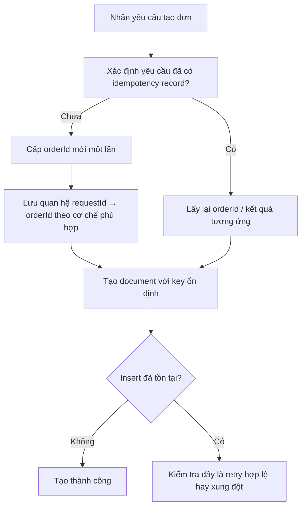

# Tạo khóa bằng UUID hoặc thuộc tính nghiệp vụ trong Spring Data Couchbase

## 1. Bài toán: document ID được tạo từ đâu?

Trong Couchbase, mỗi document có một **document ID** dùng cho các thao tác key-value (KV) như lấy, thêm, thay thế và xóa. ID phải duy nhất trong **collection** đang chứa document. Với Spring Data Couchbase, thuộc tính gắn `@Id` ánh xạ sang ID này; repository có thể đọc trực tiếp bằng `findById(id)` khi ứng dụng đã biết khóa.

Khi xây dựng tầng truy cập, có hai nguồn định danh phổ biến:

- **UUID do hệ thống sinh**: tạo một giá trị kỹ thuật ổn định, ít phụ thuộc thuộc tính nghiệp vụ. Ví dụ `order::acme::cf54fb9b-9cfa-4ab1-81b9-7a025cd53b10`.
- **Thuộc tính nghiệp vụ**: dùng mã đã tồn tại và đủ ổn định, chẳng hạn `currency::VND` hoặc `product::acme::SKU-001`.

Lựa chọn này ảnh hưởng trực tiếp đến cách **tạo mới**, **đọc lại**, **xử lý retry**, **kiểm soát trùng lặp** và **đổi thông tin nghiệp vụ**. UUID giúp một thực thể giữ ID khi dữ liệu thay đổi; thuộc tính nghiệp vụ cho phép tính ID ngay từ một mã mà API đã biết. Cả hai đều cần quy ước phạm vi duy nhất và cách ghi đúng.

> **Mục tiêu:** xác định trường nào được phép làm định danh lâu dài, cách sinh ID đúng một lần và cách ánh xạ với `@Id`, repository, KV API và truy vấn SQL++ trong ứng dụng Spring Data Couchbase.

## 2. Nguyên tắc chung trước khi chọn nguồn khóa

Bất kể khóa bắt nguồn từ UUID hay thuộc tính nghiệp vụ, nên thỏa mãn những điều sau:

| Tiêu chí | Ý nghĩa | Ví dụ |
| --- | --- | --- |
| Duy nhất trong collection | Hai thực thể khác nhau không được có cùng document ID | `order::acme::<uuid>` |
| Ổn định | Sửa tên, email, trạng thái không làm đổi ID | Không đưa `status` vào khóa đơn hàng |
| Có thể truy xuất | API đọc biết ID hoặc có đường tra cứu ID | `findById` khi biết ID; SQL++ khi chỉ có email |
| Có phạm vi rõ ràng | Phân biệt loại document và tenant khi dùng chung collection | `product::acme::SKU-001` |
| Chuẩn hóa nhất quán | Cùng một định danh tạo ra cùng chuỗi key | SKU viết hoa theo hợp đồng |
| Không làm lộ thông tin nhạy cảm | ID có thể xuất hiện trong log, trace, URL, công cụ vận hành | Không nhúng email/số điện thoại trực tiếp |
| Kiểm soát độ dài | Couchbase giới hạn document ID tối đa 250 byte | Kiểm tra UTF-8 và từ chối key quá dài |

Trong ví dụ, `order`, `product` là **prefix phân loại**; `acme` là namespace tenant. Chúng là quy ước ứng dụng, không phải scope hoặc collection tự động được tạo bởi Couchbase. Cùng một ID có thể tồn tại trong **hai collection khác nhau**, còn trong một collection chỉ có một document đang tồn tại với ID đó.

Không sử dụng document key như cơ chế phân quyền: trước khi xây dựng key có chứa `tenantId`, service phải xác minh người gọi được phép truy cập tenant tương ứng.

## 3. Phát sinh khóa bằng UUID

UUID (*Universally Unique Identifier*) là định danh 128 bit. Cách tạo UUID phù hợp khi ứng dụng không có mã nghiệp vụ đáng tin cậy, hoặc khi thực thể cần giữ nguyên danh tính dù thuộc tính nghiệp vụ thay đổi.

Một UUID phiên bản 4 thường hiển thị dưới dạng chuỗi 36 ký tự:

```text
cf54fb9b-9cfa-4ab1-81b9-7a025cd53b10
```

Trong Java, `UUID.randomUUID()` sinh một UUID kiểu ngẫu nhiên (version 4). Xác suất hai ID độc lập vô tình trùng là cực nhỏ khi nguồn ngẫu nhiên hoạt động đúng, nhưng UUID **không thay thế thao tác ghi kiểm tra tồn tại** và không phải chứng minh tuyệt đối rằng không bao giờ có va chạm.

### 3.1. Khi nào UUID là lựa chọn tốt?

- Một khách hàng có thể đổi email, số điện thoại hoặc mã hiển thị.
- Mỗi đơn hàng, lần thanh toán, bản ghi lịch sử hoặc sự kiện là một thực thể mới.
- ID được cấp trong nhiều instance ứng dụng, không muốn phụ thuộc một bộ đếm tập trung.
- Hệ thống cần trả ID ổn định cho các service, sự kiện và liên kết tham chiếu.
- Mã nghiệp vụ do bên thứ ba cấp có thể thiếu, trùng, đổi hoặc được tái sử dụng.

Ví dụ hai đơn cùng một khách nhưng là hai lần mua hàng phải mang hai UUID khác nhau:

```text
order::acme::cf54fb9b-9cfa-4ab1-81b9-7a025cd53b10
order::acme::d21ed76d-6a48-4faf-9151-f7b394e6a35f
```

Trường `customerId` của cả hai đơn có thể giống nhau, vì khách hàng không phải là định danh duy nhất cho một **đơn hàng**.

### 3.2. Cấp ID đúng một lần, giữ ID xuyên suốt vòng đời

Một quy trình tạo đơn an toàn cần phân biệt **yêu cầu tạo đơn** với **mỗi lần thực thi lại yêu cầu**:



Nếu một request timeout sau khi document đã được ghi, đoạn code sau là **không idempotent** khi chạy lại nguyên phương thức:

```java
public String createOrderWithoutIdempotency(String tenantId) {
    UUID orderId = UUID.randomUUID();
    String key = "order::" + tenantId + "::" + orderId;
    // Mỗi lần retry tạo một ID khác nhau.
    return key;
}
```

Để xử lý retry, caller hoặc tầng điều phối cần duy trì một `orderId` đã cấp trước đó; hoặc dùng `requestId`/idempotency key cố định và cơ chế lưu/kiểm tra ánh xạ yêu cầu đến kết quả. **Không** chỉ đặt cùng `customerId` vào khóa: một khách có thể đặt nhiều đơn hợp lệ.

### 3.3. UUID có thứ tự thời gian có cần thiết không?

Ngoài UUID v4, nhiều hệ thống cân nhắc UUID v7 hoặc ULID để ID mang thông tin thời gian và dễ sắp xếp theo quy ước mã hóa. Chúng có thể hữu ích khi ứng dụng cần ID có xu hướng tăng theo thời gian.

Tuy nhiên, việc chọn UUID v7/ULID **không tự làm truy vấn Couchbase theo thời gian nhanh hơn**: Couchbase phân phối document bằng khóa; muốn tìm hoặc phân trang đơn hàng mới nhất, vẫn cần trường thời gian trong body, điều kiện SQL++ và chỉ mục tương ứng. Chỉ chọn định dạng ID mới khi toàn bộ hệ thống và thư viện cùng tuân theo một hợp đồng tạo và biểu diễn ID.

## 4. Tạo khóa từ thuộc tính nghiệp vụ

**Khóa nghiệp vụ** lấy từ giá trị vốn có ý nghĩa trong miền ứng dụng, ví dụ mã tiền tệ ISO, mã lớp học được cam kết bất biến, hoặc mã sản phẩm ổn định.

```text
currency::VND
currency::USD
product::acme::SKU-001
course::acme::JAVA-101
```

Ưu điểm chính là ứng dụng **đã biết khóa khi biết mã nghiệp vụ**. Ví dụ API lấy sản phẩm theo `tenantId` và `sku` có thể tạo `product::<tenantId>::<sku>` rồi gọi KV `findById`. Không cần thực hiện SQL++ chỉ để tìm UUID của sản phẩm.

### 4.1. Điều kiện để thuộc tính nghiệp vụ làm ID

Nên dùng một mã nghiệp vụ làm document ID khi có thể trả lời chắc chắn:

1. **Duy nhất trong phạm vi nào?** `SKU-001` có thể tồn tại ở hai tenant. Nếu chung collection, cần namespace tenant hoặc một chính sách tách collection tương đương.
2. **Có bất biến không?** Mã có thể đổi do quy trình kinh doanh, đổi chuẩn đặt tên hay tích hợp hệ thống khác?
3. **Có bị tái sử dụng không?** Sau khi xóa một sản phẩm, mã SKU có được cấp cho sản phẩm khác không?
4. **Có luôn có sẵn khi đọc không?** API thường nhận mã này, hay chỉ nhận email, tên hiển thị, bộ lọc?
5. **Chuẩn hóa thế nào?** Mã có phân biệt hoa/thường, dấu cách, ký tự Unicode, ký tự phân tách không?
6. **Có lộ thông tin nhạy cảm không?** Không đưa dữ liệu cá nhân hoặc bí mật vào khóa dễ bị ghi log.

**Ví dụ phù hợp:** mã `VND` thuộc danh mục tiền tệ chuẩn, ổn định và thường có mặt khi tra cứu.

**Ví dụ cần cân nhắc:** email của khách hàng. Email có thể đổi, nhập khác kiểu chữ, chứa dữ liệu cá nhân và không nhất thiết duy nhất mãi mãi. Nên dùng ID kỹ thuật cho customer, lưu email trong body, rồi thiết kế tra cứu và ràng buộc duy nhất riêng.

**Ví dụ rủi ro:** SKU sản phẩm. Một số doanh nghiệp bảo đảm SKU không bao giờ thay đổi, số khác cho phép sửa SKU. Không thể quyết định từ tên trường `sku`; phải dựa vào **hợp đồng nghiệp vụ thật**.

### 4.2. Khóa từ nhiều thuộc tính nghiệp vụ

Khi một thuộc tính không duy nhất nhưng tổ hợp nhiều thuộc tính là duy nhất, có thể tạo khóa ghép dạng chuỗi:

```text
progress::acme::learner-17::course-42
balance::acme::warehouse-hcm::SKU-001
```

Trong đó mỗi thành phần phải ổn định và được phân tách/escape không nhập nhằng. Hai biến thể sau là **hai khóa khác nhau** dù có thể mô tả cùng thực thể nếu ứng dụng không chuẩn hóa:

```text
product::acme::SKU-001
product::acme::sku-001
```

Cần thận trọng với việc đưa kho, cửa hàng, trạng thái hoặc mã ngoại vào khóa ghép. Nếu nghiệp vụ cho phép di chuyển một sản phẩm từ kho này sang kho khác mà vẫn coi cùng một bản ghi, `warehouseId` không nên là thành phần bất biến của ID cho bản ghi đó. Ngược lại, với mô hình **một số dư hiện tại cho mỗi cặp kho–sản phẩm**, `warehouseId + productId` lại là tổ hợp định danh hợp lý.

## 5. So sánh trực tiếp UUID và khóa nghiệp vụ

| Tiêu chí | UUID | Thuộc tính nghiệp vụ |
| --- | --- | --- |
| Nguồn ID | Hệ thống sinh | Dữ liệu nghiệp vụ đã có |
| Ví dụ | `order::acme::<uuid>` | `product::acme::SKU-001` |
| Khi tạo | Cấp một UUID và giữ lại | Kiểm tra tính hợp lệ, chuẩn hóa mã |
| Khi đọc bằng KV | Cần biết UUID | Có thể tính trực tiếp từ mã đã biết |
| Khi mã nghiệp vụ đổi | ID thường không đổi | Có thể phải chuyển document sang ID mới |
| Khi retry | Phải tái sử dụng UUID hoặc idempotency key | Key có thể xác định lại, nhưng vẫn cần kiểm soát replay |
| Tránh trùng theo quy tắc nghiệp vụ | Cần cơ chế riêng nếu có unique email/SKU | Key giúp tranh chấp cùng mã, nếu mã đúng phạm vi |
| Phạm vi đa tenant | Prefix/namespace khi cần | Prefix/namespace thường rất quan trọng |
| Khả năng đoán ID | UUID v4 khó đoán hơn mã liên tiếp | Mã có thể đoán; phân quyền vẫn bắt buộc |
| Nhược điểm chính | Cần tra cứu ID khi chỉ biết thuộc tính ngoài | Phụ thuộc tính bất biến và chính sách tái sử dụng mã |

Có thể **kết hợp cả hai**: `order::acme::<uuid>` là key ghép prefix/namespace với UUID, còn `progress::acme::<learnerUuid>::<courseUuid>` là một key ghép hai định danh thay thế. “UUID hay nghiệp vụ?” chỉ nói đến **nguồn của phần định danh**, không cấm dùng prefix và namespace.

## 6. Viết KeyFactory cho cả hai cách trong Java

Một nơi duy nhất tạo key giúp service, repository, API và job nền dùng cùng quy tắc. Ví dụ này cố tình yêu cầu tenant và SKU đã ở dạng chuẩn; nếu ứng dụng chấp nhận dạng khác, hãy chuẩn hóa ở đầu vào và kiểm tra không biến hai mã hợp lệ khác nhau thành cùng một mã.

```java
import java.nio.charset.StandardCharsets;
import java.util.Objects;
import java.util.UUID;
import java.util.regex.Pattern;

public final class DocumentKeys {
    private static final int MAX_KEY_BYTES = 250;

    private static final Pattern TENANT =
            Pattern.compile("[a-z0-9][a-z0-9-]{0,39}");
    private static final Pattern SKU =
            Pattern.compile("[A-Z0-9][A-Z0-9._-]{0,63}");

    private DocumentKeys() {}

    // UUID được cấp một lần ở use case tạo mới.
    public static String order(String tenantId, UUID orderId) {
        Objects.requireNonNull(orderId, "orderId");
        String value = "order::" + tenant(tenantId) + "::" + orderId;
        return checkLength(value);
    }

    // Thuộc tính nghiệp vụ: SKU do hệ thống cam kết bất biến.
    public static String productBySku(String tenantId, String sku) {
        Objects.requireNonNull(sku, "sku");
        if (!SKU.matcher(sku).matches()) {
            throw new IllegalArgumentException("SKU chưa chuẩn hóa hoặc không hợp lệ");
        }
        String value = "product::" + tenant(tenantId) + "::" + sku;
        return checkLength(value);
    }

    private static String tenant(String value) {
        Objects.requireNonNull(value, "tenantId");
        if (!TENANT.matcher(value).matches()) {
            throw new IllegalArgumentException("tenantId không hợp lệ");
        }
        return value;
    }

    private static String checkLength(String value) {
        int bytes = value.getBytes(StandardCharsets.UTF_8).length;
        if (bytes > MAX_KEY_BYTES) {
            throw new IllegalArgumentException("Document ID vượt 250 byte");
        }
        return value;
    }
}
```

Sử dụng:

```java
UUID id = UUID.randomUUID(); // Cấp một lần cho một thực thể.
String orderKey = DocumentKeys.order("acme", id);

String productKey = DocumentKeys.productBySku("acme", "SKU-001");

// Nếu key đã cấp ở lần tạo, các lần đọc/ghi sau dùng lại cùng UUID.
String sameOrderKey = DocumentKeys.order("acme", id);
assert orderKey.equals(sameOrderKey);
```

Các điểm cần nhớ:

- Không gọi `UUID.randomUUID()` bên trong hàm `order(tenantId, orderId)`, vì hàm tạo key dùng chung phải **thuần và xác định** với một bộ đầu vào.
- Nếu API chưa có `orderId`, phải quyết định **nơi sinh và nơi lưu giữ** nó ở tầng use case.
- Không lấy SKU làm ID bằng cách tự xóa khoảng trắng/dấu đặc biệt một cách tùy tiện; thao tác đó có thể biến hai mã khác nhau thành một mã.
- Với ký tự ngoài ASCII, cần encoding/escaping không nhập nhằng và vẫn kiểm soát độ dài theo **byte UTF-8** của toàn bộ document ID.
- Một prefix như `product::` không tự tạo collection `products`; cấu hình bucket/scope/collection vẫn là phần riêng.

## 7. Spring Data Couchbase: `@Id` nhận khóa đã được tạo

Giả sử ứng dụng đã cấu hình repository đúng bucket/scope/collection lưu các đơn hàng. Entity có ID dạng chuỗi, còn UUID và thuộc tính nghiệp vụ được giữ trong body để thuận tiện truy vấn hoặc hiển thị.

```java
import java.time.Instant;
import org.springframework.data.annotation.Id;
import org.springframework.data.annotation.Version;
import org.springframework.data.couchbase.core.mapping.Document;
import org.springframework.data.couchbase.core.mapping.Field;

@Document
public class OrderDocument {
    @Id
    private String id;

    @Field
    private String tenantId;

    @Field
    private String orderId;

    @Field
    private String customerId;

    @Field
    private String externalOrderCode;

    @Field
    private Instant createdAt;

    @Version
    private Long version;

    protected OrderDocument() {}

    public OrderDocument(String id, String tenantId, String orderId,
                         String customerId, String externalOrderCode) {
        this.id = id;
        this.tenantId = tenantId;
        this.orderId = orderId;
        this.customerId = customerId;
        this.externalOrderCode = externalOrderCode;
        this.createdAt = Instant.now();
    }

    public String getId() {
        return id;
    }
}
```

Repository:

```java
import org.springframework.data.couchbase.repository.CouchbaseRepository;

public interface OrderRepository
        extends CouchbaseRepository<OrderDocument, String> {
}
```

Service lấy UUID đã cấp và tạo ID theo một quy ước:

```java
import java.util.Optional;
import java.util.UUID;

public class OrderService {
    private final OrderRepository orders;

    public OrderService(OrderRepository orders) {
        this.orders = orders;
    }

    // orderId được cấp ở ranh giới nghiệp vụ và được giữ qua retry.
    public OrderDocument create(String authorizedTenantId, UUID orderId,
                                String customerId, String externalOrderCode) {
        String key = DocumentKeys.order(authorizedTenantId, orderId);
        OrderDocument order = new OrderDocument(
                key, authorizedTenantId, orderId.toString(),
                customerId, externalOrderCode);
        return orders.save(order);
    }

    public Optional<OrderDocument> findById(String authorizedTenantId,
                                            UUID orderId) {
        return orders.findById(
                DocumentKeys.order(authorizedTenantId, orderId));
    }
}
```

Trong ví dụ, `authorizedTenantId` giả định đã được xác minh từ ngữ cảnh đăng nhập. `@Id` là document ID; **không mặc định có trường JSON `id` trong body**. Nếu cần lấy ID khi chạy SQL++, dùng `META(alias).id` hoặc lưu một thuộc tính nghiệp vụ riêng.

Đoạn code dùng `save` để minh họa cách ánh xạ entity và repository. **Không được mặc định `save` luôn mang ngữ nghĩa chỉ tạo nếu chưa tồn tại.** Khi hai request có cùng key cùng tạo mới, cần thao tác insert có điều kiện tồn tại và cơ chế xử lý lỗi trùng (phần 8). `@Version` hỗ trợ kiểm soát phiên bản dựa trên CAS trong các thao tác Spring Data phù hợp, nhưng không thay thế kiểm tra duy nhất khi tạo mới.

### 7.1. Khi dùng khóa nghiệp vụ với Spring Data

Một document sản phẩm có thể sử dụng chính SKU bất biến đã được chuẩn hóa làm một phần ID:

```java
import org.springframework.data.annotation.Id;
import org.springframework.data.couchbase.core.mapping.Document;
import org.springframework.data.couchbase.core.mapping.Field;

@Document
public class ProductDocument {
    @Id
    private String id;

    @Field
    private String tenantId;

    @Field
    private String sku;

    @Field
    private String displayName;

    protected ProductDocument() {}

    public ProductDocument(String tenantId, String sku, String displayName) {
        this.id = DocumentKeys.productBySku(tenantId, sku);
        this.tenantId = tenantId;
        this.sku = sku;
        this.displayName = displayName;
    }

    public String getId() {
        return id;
    }
}
```

Đọc bằng repository khi biết `tenantId` và `sku`:

```java
String key = DocumentKeys.productBySku("acme", "SKU-001");
var product = productRepository.findById(key);
```

Ở đây `productRepository` biểu thị một repository `CouchbaseRepository<ProductDocument, String>` đã được cấu hình tương ứng. Nếu nghiệp vụ cho phép thay SKU, mô hình này cần kế hoạch đổi khóa; phương án thường bền vững hơn là `product::<tenant>::<productUuid>` và giữ SKU trong body.

## 8. Tạo mới an toàn: UUID không thay cho `insert-if-absent`

Với cả hai nguồn key, **trùng ID khi tạo mới** phải được xử lý rõ.

Couchbase Java SDK có KV `insert(key, value)`: thao tác thêm chỉ thành công khi document ID chưa tồn tại trong collection đã chọn. Nếu ID đã tồn tại, SDK trả lỗi `DocumentExistsException`.

```java
import com.couchbase.client.core.error.DocumentExistsException;
import com.couchbase.client.java.Collection;
import com.couchbase.client.java.json.JsonObject;

public void insertOrderIfAbsent(Collection collection, String key,
                                String tenantId, String orderId) {
    JsonObject body = JsonObject.create()
            .put("tenantId", tenantId)
            .put("orderId", orderId)
            .put("docType", "order");

    try {
        collection.insert(key, body);
    } catch (DocumentExistsException e) {
        throw new IllegalStateException("Document ID đã tồn tại: " + key, e);
    }
}
```

Đây là ví dụ **độc lập ở tầng SDK** để thể hiện ngữ nghĩa ghi; nếu ứng dụng kết hợp SDK và Spring Data cho cùng entity, phải duy trì body và metadata ánh xạ thống nhất. Không giả định body tối giản này có thể được mọi repository đọc mà không cần cấu hình/field tương ứng.

Không nên dùng quy trình `existsById(key)` → `save(document)` để làm ràng buộc chỉ có một creator: hai yêu cầu song song đều có thể thấy document chưa tồn tại trước khi một trong hai ghi. `upsert` cũng không phù hợp nếu mục tiêu là **chặn ghi đè key có sẵn**.

### 8.1. Chống va chạm UUID và trùng yêu cầu

UUID v4 có khả năng va chạm ngẫu nhiên cực nhỏ. Tuy nhiên, hệ thống vẫn cần:

- Chặn ghi đè khi cần tạo-mới bằng insert có kiểm tra tồn tại.
- Xử lý lỗi duplicate ID một cách rõ ràng, có thể phát sinh do lỗi sinh ID, trùng cấu hình, hoặc một request được retry.
- Với các luồng cần idempotency, xác định `requestId` ổn định và kiểm tra kết quả đã thực hiện; chỉ sinh UUID mới khi biết chắc đây là **một thực thể mới**.

**Đừng coi cùng ID là cùng yêu cầu về mặt nghiệp vụ.** Nếu hai request cố ý mang cùng key nhưng body hoặc quyền truy cập khác nhau, ứng dụng phải nhận diện và xử lý xung đột.

### 8.2. Thuộc tính nghiệp vụ có thật sự duy nhất?

Nếu dùng `product::acme::SKU-001`, hai lần tạo sản phẩm với cùng SKU sẽ tranh chấp **cùng một key**; `insert` giúp chỉ một lần tạo thành công ở collection đó.

Nếu dùng `customer::acme::<uuid>` nhưng email phải duy nhất theo tenant, hai UUID khác nhau vẫn có thể được tạo với cùng email. Khi đó cần cơ chế bảo đảm unique theo email độc lập, ví dụ:

```text
customer::acme::<customerUuid>
email-reservation::acme::<opaque-email-token>
```

Document reservation được tạo bằng `insert` theo giá trị email đã chuẩn hóa; `opaque-email-token` cần tránh để lộ email trong ID/log (hash thông thường có thể bị dò nếu miền giá trị nhỏ; cân nhắc HMAC có khóa bí mật khi phù hợp). Nếu việc tạo customer và reservation phải nguyên tử, thiết kế transaction được hỗ trợ hoặc quy trình bù trừ/khôi phục. Chỉ tạo thêm một khóa phụ không tự mang lại tính nguyên tử liên document.

Một chỉ mục SQL++ thông thường phục vụ tra cứu nhanh, **không tự tạo ràng buộc unique** như một unique index trong hệ quản trị quan hệ.

## 9. Đọc theo thuộc tính nghiệp vụ khi document key là UUID

Nếu API chỉ biết `tenantId` và `externalOrderCode`, trong khi document key dùng `orderUuid`, ứng dụng chưa thể gọi `findById`. Cần tìm ID bằng SQL++ và chỉ mục:

```sql
-- Ví dụ bucket commerce, scope sales, collection orders.
CREATE INDEX ix_orders_tenant_external_code
ON `commerce`.`sales`.`orders`(tenantId, externalOrderCode);
```

```sql
SELECT META(o).id AS documentId, o.orderId, o.externalOrderCode
FROM `commerce`.`sales`.`orders` AS o
WHERE o.tenantId = $tenantId
  AND o.externalOrderCode = $externalOrderCode;
```

Ứng dụng bind tham số `$tenantId` và `$externalOrderCode` qua API query, không nối trực tiếp dữ liệu người dùng vào chuỗi SQL++. Query này phụ thuộc chỉ mục, có thể chịu độ trễ đồng bộ chỉ mục tùy mức nhất quán; nếu đã có document ID và cần đọc một document ngay sau ghi, KV thường đơn giản hơn.

Nếu `externalOrderCode` phải unique theo tenant, query trên chỉ giúp **tra cứu**, không tự chống race tạo trùng. Cần ràng buộc duy nhất ở luồng ghi như reservation hoặc quy ước key dựa trên mã nghiệp vụ bất biến.

### 9.1. Liệt kê và sắp xếp vẫn cần chỉ mục

Có UUID hay dùng mã nghiệp vụ làm ID cũng không biến KV thành API liệt kê theo prefix. Ví dụ để liệt kê 20 đơn mới nhất:

```sql
CREATE INDEX ix_orders_tenant_created
ON `commerce`.`sales`.`orders`(tenantId, createdAt DESC);
```

```sql
SELECT META(o).id AS documentId, o.createdAt, o.customerId
FROM `commerce`.`sales`.`orders` AS o
WHERE o.tenantId = $tenantId
ORDER BY o.createdAt DESC
LIMIT 20;
```

Cần lưu `createdAt` trong body và kiểm tra `EXPLAIN`/hiệu năng trên dữ liệu thật. Không dựa vào thứ tự từ điển của UUID hay quy ước prefix để suy ra kết quả sắp xếp của thao tác KV.

Trong Spring Data, `CouchbaseTemplate`, repository query và Reactive API có thể phục vụ những đường truy cập này theo phong cách khác nhau, nhưng **quyết định nguồn khóa, tính ổn định và phạm vi duy nhất không thay đổi**. Một luồng reactive cần đặc biệt chú ý không sinh UUID mới mỗi lần subscription/retry làm lặp nghiệp vụ.

## 10. Mô hình thực tế: chọn đúng nguồn khóa cho từng loại document

Giả sử hệ thống học tập có nhiều tenant và một số collection dùng chung:

| Document | Dữ liệu có sẵn | Khóa đề xuất | Lý do |
| --- | --- | --- | --- |
| `Currency` | ISO currency code | `currency::VND` | Mã tiêu chuẩn, ổn định |
| `Course` | Mã khóa học có thể đổi | `course::<tenant>::<courseUuid>` | Giữ ID khi đổi mã marketing |
| `Customer` | Email và số điện thoại có thể đổi | `customer::<tenant>::<customerUuid>` | Tách định danh khỏi PII |
| `Enrollment` | Một học viên đăng ký lại nhiều lần | `enrollment::<tenant>::<enrollmentUuid>` | Mỗi lần đăng ký là thực thể riêng |
| `CourseProgress` | Một trạng thái hiện tại cho cặp learner–course | `progress::<tenant>::<learnerId>::<courseId>` | Tổ hợp ổn định, có đủ khi đọc |
| `InventoryBalance` | Một số dư cho mỗi kho–mặt hàng | `balance::<tenant>::<warehouseId>::<productId>` | Tổ hợp bất biến mô tả một trạng thái |
| `Order` | Một đơn mới, có retry | `order::<tenant>::<orderUuid>` | UUID được cấp một lần, có idempotency |

Các đề xuất trên phụ thuộc giả định: mỗi mã dùng trong khóa ghép phải **bất biến** và cùng một cặp khóa chỉ đại diện một document. Nếu courseId hoặc warehouseId có thể đổi, cần thiết kế lại mô hình định danh thay vì chỉ đổi mẫu nối chuỗi.

### 10.1. Bài tập: mã đơn từ đối tác

Một nền tảng thanh toán nhận đơn hàng từ hai đối tác: `partnerA` và `partnerB`. Cả hai có thể gửi cùng `externalOrderCode = 10001`. Cùng một đối tác có thể gửi lại request khi timeout. Người dùng cần tìm đơn theo mã đối tác, nhưng cũng cần cho phép hai đối tác có đơn riêng.

Hãy cân nhắc hai phương án:

**Phương án A — khóa nghiệp vụ ghép:**

```text
order::<tenant>::<partnerId>::<externalOrderCode>
```

Phương án này hợp lý nếu đối tác cam kết mã đơn không đổi và không tái sử dụng trong phạm vi đối tác, mọi request đọc có đủ bộ ba giá trị. Ghi mới dùng `insert`; retry cùng key phải được đối chiếu nội dung yêu cầu hoặc hồ sơ idempotency.

**Phương án B — UUID làm khóa chính:**

```text
order::<tenant>::<orderUuid>
external-order-reservation::<tenant>::<partnerId>::<externalOrderCode>
```

Phương án này giữ khóa chính ổn định khi tích hợp đối tác đổi mã, nhưng cần quản lý reservation/ánh xạ mã ngoài và tính nhất quán khi tạo hai document. Với cả hai phương án, phải có quy tắc kiểm tra quyền tenant và chính sách xử lý khi đối tác gửi cùng mã nhưng payload khác.

## 11. Checklist thiết kế, thử nghiệm và vận hành

1. **Xác định danh tính thực thể:** một `order`, `cart`, `progress` hoặc `event` được xem là cùng thực thể khi những thuộc tính nào giống nhau?
2. **Phân biệt nguồn khóa:** chọn UUID khi mã nghiệp vụ biến động; chọn thuộc tính nghiệp vụ khi có hợp đồng duy nhất, bất biến và API biết mã.
3. **Xác định phạm vi:** tenant, loại document, collection; không chỉ nhìn mỗi `id` mà bỏ qua collection thật.
4. **Định nghĩa chuẩn hóa:** phân biệt hoa/thường, cho phép ký tự nào, escape dấu phân cách như thế nào, kiểm tra tổng độ dài 250 byte.
5. **Đặt nơi sinh ID:** UUID cấp một lần theo thực thể; key factory nhận UUID đã được cấp và hoạt động xác định.
6. **Thiết kế create/retry:** chọn insert-if-absent khi cần; có idempotency nếu request có thể chạy lại; xử lý duplicate một cách có ý nghĩa.
7. **Kiểm soát thay đổi:** mã nghiệp vụ có thể đổi hay bị tái sử dụng không; nếu có, cân nhắc khóa thay thế và migration rõ ràng.
8. **Kiểm soát update:** CAS hoặc `@Version` khi cần tránh lost update; TTL có thể cho phép ID từng tồn tại được sử dụng lại sau khi hết hạn.
9. **Thiết kế truy vấn:** khi API không biết ID, lưu trường tìm kiếm trong body, tạo chỉ mục SQL++ thích hợp và kiểm tra mức nhất quán.
10. **Kiểm soát bảo mật:** không để key chứa PII/bí mật; ID khó đoán không thay thế phân quyền.
11. **Kiểm thử:** cùng input ra cùng key, khác tenant/loại ra khác key; hai `insert` đồng thời cho cùng ID có xử lý xung đột; retry không tạo thực thể mới; đổi thuộc tính không làm thay ID nếu dùng UUID.

Một kiểm thử đơn vị tối thiểu cho `DocumentKeys`:

```java
UUID id = UUID.fromString("cf54fb9b-9cfa-4ab1-81b9-7a025cd53b10");

String first = DocumentKeys.order("acme", id);
String repeated = DocumentKeys.order("acme", id);
String otherTenant = DocumentKeys.order("globex", id);

assert first.equals(repeated);
assert !first.equals(otherTenant);
assert DocumentKeys.productBySku("acme", "SKU-001")
        .equals("product::acme::SKU-001");
```

Đoạn `assert` minh họa kiểm tra tính xác định; trong unit test Java thật, nên sử dụng assertion của JUnit. Việc tranh chấp `insert` và đọc dữ liệu qua repository cần integration test với Couchbase, không chỉ dựa trên unit test tạo chuỗi.

## Kết luận

Đối với Spring Data Couchbase, **UUID** thích hợp khi một thực thể cần định danh độc lập với thuộc tính nghiệp vụ hoặc được tạo nhiều lần; **khóa theo thuộc tính nghiệp vụ** thích hợp khi mã có sẵn, được chuẩn hóa, duy nhất và ổn định trong đúng phạm vi. Dù chọn nguồn nào, tạo ID bằng một key factory nhất quán, ánh xạ qua `@Id`, lưu ID đã cấp để đọc và retry, dùng insert-if-absent khi cần chống ghi đè và thiết kế SQL++/index riêng cho các cách tìm kiếm không biết document ID. Các quyết định này liên quan trực tiếp đến CAS, TTL, giao dịch, mô hình collection và khả năng vận hành lâu dài của hệ thống Couchbase.
