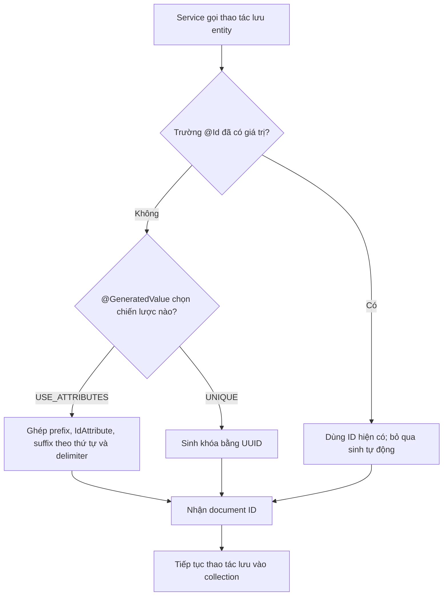

# @GeneratedValue và lựa chọn chiến lược sinh khóa trong Spring Data Couchbase

## 1. Vì sao việc sinh khóa cần được thiết kế ngay từ đầu?

Couchbase dùng **document ID (document key)** để xác định một document trong **collection**. Spring Data Couchbase ánh xạ ID này thông qua thuộc tính gắn `@Id`, cho phép đọc một document đã biết khóa bằng `CouchbaseRepository.findById(id)` hoặc các thao tác KV tương ứng của `CouchbaseTemplate` và Couchbase Java SDK.

Khi tạo document mới, ứng dụng phải giải quyết câu hỏi: **Ai cấp ID, cấp vào lúc nào, và làm thế nào để lần xử lý lại cùng một yêu cầu tiếp tục dùng đúng ID?**

Spring Data Couchbase có annotation **`@GeneratedValue`** để sinh document ID trong quá trình ánh xạ/lưu entity. Tuy nhiên, ứng dụng cũng có thể **tự tạo ID** từ UUID hoặc thuộc tính nghiệp vụ rồi gán cho `@Id`. Việc chọn cách nào phụ thuộc vào khả năng biết trước khóa, độ ổn định của định danh, dữ liệu đa tenant, quy tắc chống trùng và idempotency.

Ví dụ nền tảng học tập có hai thực thể:

- **CourseProgress:** mỗi tenant có đúng một tiến độ tổng hợp cho một cặp `learnerId + courseId`. Khóa có thể xác định trực tiếp từ các thuộc tính cố định.
- **Enrollment:** một học viên có thể đăng ký cùng khóa học nhiều lần. Mỗi lần đăng ký là một thực thể mới, cần định danh riêng và thường nên được cấp UUID một lần khi tiếp nhận yêu cầu.

Hai tình huống này đòi hỏi hai cách tạo khóa khác nhau dù đều được lưu bằng Spring Data Couchbase.

## 2. Hiểu đúng `@GeneratedValue` của Couchbase

### 2.1. Annotation và hai chiến lược có sẵn

Với Spring Data Couchbase, các import liên quan là:

```java
import org.springframework.data.annotation.Id;
import org.springframework.data.couchbase.core.mapping.Document;
import org.springframework.data.couchbase.core.mapping.id.GeneratedValue;
import org.springframework.data.couchbase.core.mapping.id.GenerationStrategy;
import org.springframework.data.couchbase.core.mapping.id.IdAttribute;
import org.springframework.data.couchbase.core.mapping.id.IdPrefix;
import org.springframework.data.couchbase.core.mapping.id.IdSuffix;
```

Lưu ý: `@GeneratedValue` ở đây thuộc package **`org.springframework.data.couchbase.core.mapping.id`**, không phải `jakarta.persistence.GeneratedValue` của JPA. Hai annotation này có hợp đồng khác nhau.

Trong API Spring Data Couchbase, enum `GenerationStrategy` có hai giá trị:

| Chiến lược | Cách hoạt động | Trường hợp phù hợp |
| --- | --- | --- |
| `USE_ATTRIBUTES` | Ghép các giá trị được chú thích `@IdAttribute` cùng prefix/suffix được khai báo trên entity | Khóa nghiệp vụ hoặc khóa ghép có các thành phần ổn định |
| `UNIQUE` | Dùng bộ sinh UUID của framework | Minh họa và dựng dữ liệu thử nghiệm; với nghiệp vụ sản xuất nên cân nhắc cấp ID rõ ràng |

**Mặc định của `@GeneratedValue` là `USE_ATTRIBUTES`** và **dấu phân cách mặc định là dấu chấm `.`**. Có thể đổi qua tham số `delimiter`, ví dụ:

```java
@Id
@GeneratedValue(strategy = GenerationStrategy.USE_ATTRIBUTES,
                delimiter = "::")
private String id;
```

Tài liệu chính thức nêu rõ: **nếu giá trị ID đã có, framework bỏ qua việc sinh ID tự động**. Quy tắc này rất quan trọng khi cập nhật entity đã tồn tại hoặc khi caller chủ động cung cấp khóa.

### 2.2. Ba annotation tạo thành phần khóa

- `@IdPrefix(order = n)`: đánh dấu giá trị tham gia phần **tiền tố**.
- `@IdAttribute(order = n)`: đánh dấu thuộc tính tham gia phần **định danh chính**.
- `@IdSuffix(order = n)`: đánh dấu giá trị tham gia phần **hậu tố**.

Tham số `order` chỉ thứ tự kết hợp các thành phần. Mặc định mỗi annotation có `order = 0`. Khi dùng nhiều prefix hoặc nhiều thành phần cùng nhóm, cần chỉ định thứ tự **không trùng nhau**. Theo tài liệu Spring Data Couchbase, nhiều prefix không khai báo thứ tự riêng có nguy cơ **ghi đè giá trị trước đó** khi xây dựng khóa.

Các giá trị prefix và suffix dùng để tạo key **không được persist như trường dữ liệu JSON** chỉ nhờ vai trò prefix/suffix. Nếu nghiệp vụ cần truy vấn theo `tenantId`, `docType` hoặc nguồn dữ liệu, hãy giữ các trường đó trong body document bằng thuộc tính được ánh xạ phù hợp, thay vì coi ID có chứa chuỗi ấy là đủ.

### 2.3. Quy trình sinh khóa



`@GeneratedValue` là cơ chế xác định **khóa document**, không tự quyết định collection, chỉ mục, TTL, CAS, transaction hay phân quyền. Nó cũng không thay thế quy tắc xử lý trùng khóa trong các lệnh tạo mới chạy đồng thời.

## 3. `USE_ATTRIBUTES`: tạo khóa từ thuộc tính entity

Giả sử hệ thống quy định một tiến độ tổng hợp cho mỗi bộ ba `tenantId + learnerId + courseId`. Một khóa có thể là:

```text
progress::acme::learner-17::course-42
```

Với `USE_ATTRIBUTES`, có thể mô tả các thành phần này ngay trên entity:

```java
import java.time.Instant;
import org.springframework.data.annotation.Id;
import org.springframework.data.annotation.Version;
import org.springframework.data.couchbase.core.mapping.Document;
import org.springframework.data.couchbase.core.mapping.id.GeneratedValue;
import org.springframework.data.couchbase.core.mapping.id.GenerationStrategy;
import org.springframework.data.couchbase.core.mapping.id.IdAttribute;
import org.springframework.data.couchbase.core.mapping.id.IdPrefix;

@Document
public class CourseProgressDocument {

    @Id
    @GeneratedValue(strategy = GenerationStrategy.USE_ATTRIBUTES,
                    delimiter = "::")
    private String id;

    @IdPrefix(order = 0)
    private String kind = "progress";

    @IdAttribute(order = 0)
    private String tenantId;

    @IdAttribute(order = 1)
    private String learnerId;

    @IdAttribute(order = 2)
    private String courseId;

    private String docType = "progress";
    private int completedPercent;
    private Instant updatedAt = Instant.now();

    @Version
    private Long version;

    protected CourseProgressDocument() {}

    public CourseProgressDocument(String tenantId,
                                  String learnerId,
                                  String courseId) {
        this.tenantId = tenantId;
        this.learnerId = learnerId;
        this.courseId = courseId;
    }

    public String getId() { return id; }
}
```

Trong ví dụ, khi `id` chưa có giá trị, framework xây dựng khóa từ prefix `progress` và ba thuộc tính theo thứ tự đã khai báo. Trường `docType` tách biệt với prefix để truy vấn, phân loại và lập chỉ mục. Kết quả dự kiến theo quy ước `delimiter = "::"` là:

```text
progress::acme::learner-17::course-42
```

**Giả định bắt buộc:** các giá trị `tenantId`, `learnerId`, `courseId` đã chuẩn hóa, không chứa `::` và không thay đổi trong vòng đời định danh của tiến độ. `@GeneratedValue` không tự kiểm tra các điều kiện nghiệp vụ đó.

### 3.1. Repository và lần lưu đầu tiên

```java
import org.springframework.data.couchbase.repository.CouchbaseRepository;

public interface CourseProgressRepository
        extends CouchbaseRepository<CourseProgressDocument, String> {
}
```

```java
CourseProgressDocument progress =
        new CourseProgressDocument("acme", "learner-17", "course-42");

CourseProgressDocument saved = progressRepository.save(progress);
String generatedKey = saved.getId();

// Đường đọc về sau sử dụng ID chính xác đã được tạo.
var sameProgress = progressRepository.findById(generatedKey);
```

Ví dụ giả định `progressRepository` là repository đã được cấu hình đúng collection. `save` minh họa quá trình ánh xạ và lưu, **không nên xem là cam kết insert-if-absent cho mọi trường hợp**. Nếu use case đòi hỏi chỉ một lời gọi tạo mới được phép thành công, hãy chọn thao tác ghi có điều kiện tồn tại và xử lý cạnh tranh (phần 7).

### 3.2. Dùng `@IdSuffix` có hợp lý không?

Có thể bổ sung hậu tố nếu nó thực sự thuộc **định danh bất biến**. Ví dụ một loại document có hai biến thể được quản lý độc lập, và biến thể được biết ngay lúc đọc:

```java
@Id
@GeneratedValue(strategy = GenerationStrategy.USE_ATTRIBUTES,
                delimiter = "::")
private String id;

@IdPrefix(order = 0)
private String kind = "report";

@IdAttribute(order = 0)
private String tenantId;

@IdAttribute(order = 1)
private String reportId;

@IdSuffix(order = 0)
private String stableVariant;
```

Hãy xác nhận biến thể có được phép đổi sau khi tạo không. Nếu `stableVariant` là `draft`/`published` hoặc `status` có thể thay đổi, dùng nó trong document key sẽ gây việc đổi ID khi chuyển trạng thái. Với dữ liệu đổi thường xuyên, lưu trong body thay vì ghép vào key.

### 3.3. Phân cách và va chạm

Dấu phân cách chỉ có ích khi không nhập nhằng. Ví dụ với `::`:

```text
["progress", "a::b", "c"] -> progress::a::b::c
["progress", "a", "b::c"] -> progress::a::b::c
```

Hai bộ thành phần khác nhau có thể cho cùng chuỗi. Cách phòng tránh gồm:

1. Chỉ cho phép bộ ký tự định danh nội bộ cố định (ví dụ chữ, số, dấu gạch nối) và từ chối `:` khi dùng `::`.
2. Hoặc encode từng thành phần bằng quy ước không nhập nhằng và được áp dụng thống nhất bởi mọi service.
3. Kiểm tra độ dài **toàn bộ ID theo byte UTF-8**; Couchbase có giới hạn **250 byte**.
4. Không cắt bớt key hoặc tự lower-case mã có phân biệt chữ hoa/chữ thường để “sửa” input không hợp lệ.

`USE_ATTRIBUTES` phù hợp nhất khi các thành phần có sẵn lúc đọc, ổn định, có thể chuẩn hóa và xác định duy nhất một document.

## 4. `UNIQUE`: framework tự sinh khóa bằng UUID

Chiến lược thứ hai là:

```java
import org.springframework.data.annotation.Id;
import org.springframework.data.couchbase.core.mapping.Document;
import org.springframework.data.couchbase.core.mapping.id.GeneratedValue;
import org.springframework.data.couchbase.core.mapping.id.GenerationStrategy;

@Document
public class DemoEnrollmentDocument {

    @Id
    @GeneratedValue(strategy = GenerationStrategy.UNIQUE)
    private String id;

    private String tenantId;
    private String learnerId;
    private String courseId;

    protected DemoEnrollmentDocument() {}

    public DemoEnrollmentDocument(String tenantId,
                                  String learnerId,
                                  String courseId) {
        this.tenantId = tenantId;
        this.learnerId = learnerId;
        this.courseId = courseId;
    }

    public String getId() { return id; }
}
```

Khi tạo entity mới với `id == null` và lưu qua cơ chế Spring Data, framework có thể sinh một key dựa trên UUID. Đây là cách ít cấu hình cho tình huống **không có khóa tự nhiên**.

**Điểm cần chú ý:** tài liệu tham khảo Spring Data Couchbase mô tả `UNIQUE` và ghi rõ cơ chế này **chỉ được khuyến nghị cho việc dựng dữ liệu kiểm thử (test scaffolding)**. Với nghiệp vụ sản xuất có retry, giao dịch hoặc quan hệ giữa document, nên cân nhắc chủ động cấp và giữ ID trước khi thực hiện ghi, để caller và các service khác biết định danh ngay từ đầu.

Đừng suy diễn rằng `UNIQUE` tương đương:

- Cơ chế cấp dãy số tự tăng của JPA hoặc một `SEQUENCE` trên Couchbase.
- Ràng buộc unique theo email, mã đơn hay mã người dùng.
- Giao thức idempotency: mỗi lần tạo entity mới với `id` rỗng có thể dẫn đến một ID khác.
- Việc tạo chỉ mục SQL++ cho tìm kiếm theo nội dung.

UUID giảm khả năng trùng ngẫu nhiên nhưng không thay thế thao tác ghi chống ghi đè hay kiểm tra yêu cầu trùng lặp.

## 5. So sánh hai chiến lược với ID do ứng dụng tự cấp

Ngoài hai lựa chọn của `@GeneratedValue`, ứng dụng hoàn toàn có thể không dùng annotation này và **gán trực tiếp chuỗi ID** lên trường `@Id`.

| Phương án | Nguồn document ID | Ưu điểm | Rủi ro/đánh đổi |
| --- | --- | --- | --- |
| `@GeneratedValue(USE_ATTRIBUTES)` | Thuộc tính và prefix/suffix từ entity | Không phải ghép key thủ công ở từng service | Phải chuẩn hóa và đảm bảo tính ổn định của các thành phần |
| `@GeneratedValue(UNIQUE)` | UUID do framework tạo | Tiện cho ví dụ và dữ liệu thử nghiệm | Cần kiểm soát ID và retry; tài liệu chỉ khuyến nghị cho test scaffolding |
| `@Id` gán thủ công từ UUID | UUID cấp một lần ở tầng use case | Có thể trả ID trước khi ghi, tái sử dụng qua retry | Phải quản lý vòng đời ID/idempotency rõ ràng |
| `@Id` gán thủ công từ mã nghiệp vụ | Mã bất biến đã chuẩn hóa | API có mã có thể tạo key để KV lookup | Mã đổi hoặc tái sử dụng sẽ làm yếu hợp đồng định danh |
| `@Id` gán thủ công từ key ghép | Nhiều thành phần cố định | Linh hoạt với namespace tenant và prefix | Cần codec/escape và kiểm thử tránh va chạm |

**Lựa chọn dựa trên đường truy cập:** một giỏ hàng hiện tại của khách có thể dùng khóa xác định `cart::<tenantId>::<customerId>`; mỗi lần thanh toán hoặc mỗi lần đăng ký mới cần ID riêng. Không nên dùng `UNIQUE` chỉ vì “tự động” nếu ứng dụng cần tái tạo key từ `tenantId + customerId` khi đọc.

### 5.1. Cấp UUID tường minh trong use case

```java
import java.util.Objects;
import java.util.UUID;

public final class EnrollmentKeys {
    private EnrollmentKeys() {}

    public static String key(String tenantId, UUID enrollmentId) {
        Objects.requireNonNull(enrollmentId, "enrollmentId");
        if (tenantId == null ||
            !tenantId.matches("[a-z0-9][a-z0-9-]{0,39}")) {
            throw new IllegalArgumentException("tenantId không hợp lệ");
        }
        return "enrollment::" + tenantId + "::" + enrollmentId;
    }
}
```

Entity khi ứng dụng tự cấp ID:

```java
import org.springframework.data.annotation.Id;
import org.springframework.data.couchbase.core.mapping.Document;

@Document
public class EnrollmentDocument {
    @Id
    private String id; // Không cần @GeneratedValue.

    private String tenantId;
    private String learnerId;
    private String courseId;

    protected EnrollmentDocument() {}

    public EnrollmentDocument(String id, String tenantId,
                              String learnerId, String courseId) {
        this.id = id;
        this.tenantId = tenantId;
        this.learnerId = learnerId;
        this.courseId = courseId;
    }

    public String getId() { return id; }
}
```

Service nhận UUID đã cấp trong một ngữ cảnh yêu cầu:

```java
public EnrollmentDocument newEnrollment(
        String authorizedTenantId,
        UUID enrollmentId,
        String learnerId,
        String courseId) {

    String key = EnrollmentKeys.key(authorizedTenantId, enrollmentId);

    return new EnrollmentDocument(
            key, authorizedTenantId, learnerId, courseId);
}
```

Ưu điểm của cách này: khi request được gửi lại sau timeout, tầng điều phối có thể **truyền lại đúng `enrollmentId`**. Nếu cần tự sinh UUID ở server, server phải gắn ID ấy với một idempotency key ổn định trước khi chạy các bước có thể bị lặp, chứ không sinh UUID mới trên mỗi lần retry.

### 5.2. Tránh hiểu nhầm về JPA

Không dùng các thuộc tính JPA như:

```java
// Ví dụ KHÔNG áp dụng để sinh Couchbase document ID.
@jakarta.persistence.GeneratedValue(
        strategy = jakarta.persistence.GenerationType.IDENTITY)
```

Couchbase không có bảng quan hệ với cột tự tăng theo cách trên. Với Spring Data Couchbase, `GenerationStrategy` cho `@GeneratedValue` là enum của **chính Spring Data Couchbase**, gồm `USE_ATTRIBUTES` và `UNIQUE`. Nếu một dự án dùng cả JPA và Couchbase, hãy kiểm tra đúng import tại nơi khai báo entity.

## 6. Tạo ID tự động và cập nhật entity đã tồn tại

Giả sử một document được tải từ repository:

```java
CourseProgressDocument progress =
        progressRepository.findById(existingId).orElseThrow();

// Thay đổi nội dung tiến độ...
progressRepository.save(progress);
```

Trong trường hợp bình thường, entity đã có `@Id`; cơ chế sinh tự động không cần tạo key mới. Đó là lý do **không nên chủ động đặt `id = null` khi cập nhật**. Một lần lưu lại entity thiếu ID có thể bị xem là tạo entity khác hoặc dẫn đến lỗi ánh xạ, tùy chiến lược và tình huống.

Khi dùng `USE_ATTRIBUTES`, tránh thay `tenantId`, `learnerId` hoặc `courseId` trong một entity đã tồn tại mà vẫn giữ key cũ: ID ở metadata và các trường trong body sẽ không còn phản ánh cùng một quy tắc. Nếu nghiệp vụ cần thay thành phần định danh, phải xem đó là **di chuyển sang ID khác** và xử lý tham chiếu, cache, sự kiện và các thao tác ghi liên quan.

Tương tự, trường `@Version` phục vụ **kiểm soát cập nhật đồng thời bằng CAS**. CAS là giá trị phiên bản thay đổi theo lần ghi; không đưa vào document ID. TTL quy định thời hạn tồn tại của document, cũng không nên ghép vào key trừ khi chính thời điểm ấy được quy định là thành phần định danh bất biến.

## 7. Chống trùng khóa và tạo mới trong môi trường đồng thời

Tạo key đúng là một phần của tính nhất quán; **thao tác ghi** mới quyết định có cho ghi đè document đã tồn tại hay không.

Ví dụ hai request cùng tạo tiến độ cho `acme + learner-17 + course-42`. Chiến lược `USE_ATTRIBUTES` làm cho cả hai request sinh **cùng một ID**. Đây là điều tốt vì chúng đang nhắm cùng một thực thể, nhưng để chỉ một request tạo được document mới, cần thao tác **insert-if-absent**.

Couchbase Java SDK hỗ trợ `Collection.insert(key, value)`. Nếu key đã tồn tại, SDK báo `DocumentExistsException`:

```java
import com.couchbase.client.core.error.DocumentExistsException;
import com.couchbase.client.java.Collection;
import com.couchbase.client.java.json.JsonObject;

public void insertProgressIfAbsent(Collection collection,
                                   String key,
                                   String tenantId,
                                   String learnerId,
                                   String courseId) {
    JsonObject body = JsonObject.create()
            .put("docType", "progress")
            .put("tenantId", tenantId)
            .put("learnerId", learnerId)
            .put("courseId", courseId)
            .put("completedPercent", 0);

    try {
        collection.insert(key, body);
    } catch (DocumentExistsException ex) {
        throw new IllegalStateException(
                "Tiến độ đã tồn tại cho bộ khóa này", ex);
    }
}
```

Đây là **ví dụ SDK độc lập** minh họa ngữ nghĩa insert. Khi kết hợp thao tác SDK trực tiếp với Spring Data, cần đảm bảo định dạng JSON, metadata kiểu entity và cách ánh xạ phù hợp. Không giả định body tối giản do SDK ghi luôn được mọi repository đọc được.

**Không dùng `existsById(key)` rồi `save(document)` như một ràng buộc duy nhất.** Hai request song song có thể cùng thấy “chưa tồn tại” trước khi một trong hai ghi. Cũng không nên coi `save` hoặc `upsert` là lựa chọn mặc định khi nghiệp vụ yêu cầu **chỉ tạo mới, không ghi đè**.

Nếu API có idempotency, `DocumentExistsException` không đủ để kết luận đây là retry hợp lệ. Cần so sánh requestId hoặc hồ sơ kết quả đã lưu để phân biệt:

- Cùng một yêu cầu chạy lại sau timeout: trả lại kết quả thích hợp.
- Hai yêu cầu khác nhau tranh chấp cùng định danh: trả lỗi nghiệp vụ hoặc xử lý xung đột.
- Hai entity khác nhau vô tình được ghép thành cùng key: xem lại chuẩn hóa, namespace và cấu trúc key.

Nếu document có TTL và đã hết hạn, cùng key có thể được tạo lại; unique theo key tại thời điểm ghi **không** có nghĩa ID chưa từng tồn tại trong lịch sử.

## 8. Tra cứu theo thuộc tính khi key không chứa dữ liệu tìm kiếm

Chiến lược `UNIQUE` hoặc ID UUID tự cấp tạo ra key mà client chưa chắc biết trước. Ví dụ document `Enrollment` có ID UUID nhưng màn hình cần liệt kê mọi lần đăng ký của một người học. Khi đó:

- Lưu `tenantId`, `learnerId`, `courseId`, `createdAt` trong body.
- Tạo chỉ mục SQL++ theo điều kiện tìm kiếm và sắp xếp thường dùng.
- Dùng query có tham số để lấy danh sách và document ID.

```sql
-- Các tên bucket/scope/collection chỉ mang tính minh họa.
CREATE INDEX ix_enrollment_tenant_learner_created
ON `learning`.`academy`.`enrollments`(
    tenantId, learnerId, createdAt DESC
);
```

```sql
SELECT META(e).id AS documentId,
       e.learnerId,
       e.courseId,
       e.createdAt
FROM `learning`.`academy`.`enrollments` AS e
WHERE e.tenantId = $tenantId
  AND e.learnerId = $learnerId
ORDER BY e.createdAt DESC
LIMIT 20;
```

Trong hai câu SQL++ trên, các dấu ` quanh tên keyspace là dấu backtick hợp lệ của SQL++. Phải bind `$tenantId` và `$learnerId` qua API query thay vì nối trực tiếp chuỗi do client cung cấp. Document thực tế phải có `createdAt`, và index cần được kiểm tra bằng `EXPLAIN` cùng dữ liệu và tải thật.

**Không có truy vấn KV theo wildcard prefix** chỉ nhờ key `enrollment::acme::*`. Trong Couchbase, KV lookup tối ưu cho **một ID chính xác**; SQL++ và chỉ mục xử lý danh sách, bộ lọc và sắp xếp.

Với một document vừa được ghi, truy vấn qua chỉ mục và đọc KV theo ID có thể khác nhau về đặc tính nhất quán; chọn mức scan consistency phù hợp nếu cần đọc ngay bằng SQL++. Khi đã biết ID, truy cập KV thường là con đường đơn giản hơn.

## 9. Repository, `CouchbaseTemplate` và reactive: chọn nơi sinh key

Trong Spring Data Couchbase, có nhiều lớp API thao tác document:

| Lớp API | Vai trò chính | Điều cần nhớ về key |
| --- | --- | --- |
| `CouchbaseRepository` | CRUD, tìm kiếm theo ID và query method | `@Id` và `@GeneratedValue` thuộc cơ chế mapping entity |
| `CouchbaseTemplate` | Thao tác dữ liệu và truy vấn linh hoạt hơn | Chọn đúng bucket/scope/collection và đúng hợp đồng sinh ID |
| `ReactiveCouchbaseRepository` | CRUD và luồng bất đồng bộ dựa trên reactive | Cần giữ ID ổn định qua retry/resubscription |
| Couchbase Java SDK KV | Truy cập trực tiếp collection và ngữ nghĩa `insert`, `replace`, `upsert` | SDK thao tác trực tiếp bằng key được truyền vào, không tự thực hiện annotation mapping của Spring Data |

**Không sinh UUID mới bên trong nhánh xử lý được thực thi lại bởi retry reactive.** Ví dụ `Mono.defer(() -> createWithRandomUuid())` có thể tạo ID mới mỗi lần subscription; nếu cơ chế retry đăng ký lại luồng sau timeout, nghiệp vụ có nguy cơ tạo trùng thực thể. Hãy xác định idempotency và vòng đời ID ở tầng use case, rồi truyền cùng ID xuống mọi đường ghi.

Nếu dùng `USE_ATTRIBUTES`, cả repository blocking và reactive đều cần một quy ước chung về cách chuẩn hóa các thành phần tạo khóa. Thay đổi delimiter trong một nơi mà các đường đọc ở nơi khác vẫn ghép khóa kiểu cũ sẽ làm `findById` không tìm thấy document dù dữ liệu còn tồn tại.

Với hệ thống có nhiều bucket/scope/collection, ID chỉ duy nhất **trong một collection**. Hai collection khác nhau có thể cùng chứa key `progress::acme::learner-17::course-42` mà không xung đột. Repository/Template cần được cấu hình đúng collection thật; prefix trong ID không tự chọn collection.

## 10. Lỗi thường gặp và cách tránh

| Triệu chứng | Nguyên nhân có thể | Hướng xử lý |
| --- | --- | --- |
| `@GeneratedValue` không tạo khóa mới | `@Id` đã có giá trị | Đây là hành vi bỏ qua sinh tự động theo hợp đồng; kiểm tra ai gán ID |
| Key tạo ra không theo quy ước | Quên `strategy`, dùng mặc định `USE_ATTRIBUTES` hoặc sai delimiter `.` | Chỉ rõ chiến lược và delimiter trong entity |
| Key thiếu prefix mong muốn | Nhiều `@IdPrefix` cùng `order=0`, prefix chưa khởi tạo | Gán order rõ ràng, xác minh dữ liệu trước khi lưu |
| Các key bị nhập nhằng | Thành phần chứa delimiter hoặc chuẩn hóa không nhất quán | Kiểm tra đầu vào hoặc encoding không nhập nhằng |
| Lưu hai enrollment cho một request | UUID mới được sinh ở mỗi retry | Cấp/giữ UUID hoặc idempotency record ổn định |
| Trùng email dù đã dùng `UNIQUE` | UUID chỉ giúp tạo ID khác nhau, không ràng buộc email | Cơ chế giữ chỗ email duy nhất hoặc giao dịch phù hợp |
| Cập nhật bị mất | Nhiều writer dùng cùng ID nhưng không kiểm soát phiên bản | CAS/`@Version` và xử lý xung đột |
| Không tìm được bằng `findById` | Sai collection hoặc key factory khác quy tắc lưu | Kiểm tra cấu hình collection và cách tạo key |
| Tìm kiếm theo tên/email chậm | Không có index cho thuộc tính tìm kiếm | Thiết kế SQL++ và chỉ mục phù hợp |
| Dùng `GenerationType.IDENTITY` | Nhầm annotation và enum của JPA | Import `org.springframework.data.couchbase.core.mapping.id.*` |

## 11. Tình huống lựa chọn chiến lược

Giả sử nền tảng đào tạo đa tenant có:

**A. Tiến độ học tập hiện tại:** mỗi cặp học viên–khóa học chỉ có một document tiến độ tổng hợp.

- Có thể dùng `USE_ATTRIBUTES` với `@IdPrefix` trên field có giá trị `"progress"`, cùng `@IdAttribute` cho tenant, learner và course.
- Chọn delimiter và chuẩn hóa rõ ràng để các service tính cùng một key.
- Khi tạo lần đầu, cần ghi có kiểm tra tồn tại nếu không cho phép ghi đè.
- Khi cập nhật, dùng `@Version`/CAS nếu nhiều worker có thể sửa cùng tiến độ.

**B. Lịch sử các lần đăng ký:** mỗi lần học viên đăng ký lại tạo một bản ghi mới.

- Dùng UUID riêng cho mỗi enrollment.
- `@GeneratedValue(strategy = UNIQUE)` thuận tiện khi minh họa; với use case sản xuất có retry, nên cân nhắc cấp UUID tường minh, lưu quan hệ requestId → enrollmentId và giữ ID xuyên suốt vòng đời yêu cầu.
- Để liệt kê mọi enrollment theo học viên, lưu thuộc tính trong body và tạo index tương ứng.

**C. Danh mục ngôn ngữ giao diện:** mỗi ngôn ngữ có mã chuẩn, ví dụ `vi`, `en`.

- Có thể dùng khóa nghiệp vụ `language::vi`, `language::en`.
- Nếu ID quá đơn giản, cấp tường minh thường dễ kiểm soát hơn `@GeneratedValue`.
- Không cần UUID chỉ vì repository có tính năng sinh key.

**D. Lượt thi (ExamAttempt):** một học viên được thi cùng bài nhiều lần.

- Không dùng key chỉ gồm `learnerId + examId`, vì sẽ ghi đè/đụng ID giữa các lần thi.
- Mỗi attempt phải có `attemptId` riêng, có thể là UUID; retry cùng lần thi phải giữ `attemptId`.
- Các báo cáo theo bài thi hoặc ngày thi cần query và index; ID chỉ phục vụ truy xuất chính xác attempt.

### Bài tập tự kiểm tra

Một service xử lý webhook từ đối tác thanh toán. Mỗi webhook có `partnerId` và `externalEventId`. Đối tác có thể gửi lại cùng sự kiện nhiều lần; hai đối tác khác nhau có thể dùng chung `externalEventId`.

1. Nên dùng `UNIQUE` để mỗi lần nhận webhook tự tạo một ID mới không?
2. Nếu dùng `USE_ATTRIBUTES`, các trường nào phải được đưa vào ID?
3. Vì sao chỉ gọi `findById` rồi `save` chưa đủ để đảm bảo xử lý đúng một lần?
4. Nếu cần tra cứu sự kiện theo thời gian, cần bổ sung những gì?

**Gợi ý:** chọn ID ổn định dạng `payment-event::<partnerId>::<externalEventId>` khi mã ngoài thật sự duy nhất theo đối tác và không tái sử dụng; có thể tự ghép hoặc dùng `USE_ATTRIBUTES`. Ghi ban đầu với ngữ nghĩa insert-if-absent; nếu key đã tồn tại, kiểm tra kết quả đã xử lý và quyết định cách hồi đáp. Lưu `createdAt`, `partnerId`, `status` trong body, tạo chỉ mục SQL++ cho các báo cáo. Nếu event và tác động thanh toán phải nhất quán qua nhiều document, cần giao dịch hoặc cơ chế xử lý idempotent/bù trừ phù hợp.

## 12. Checklist trước khi chốt thiết kế

1. Đã chọn **ai sinh ID**: framework hay service?
2. `@GeneratedValue` được import từ **Spring Data Couchbase** chứ không nhầm JPA?
3. Nếu dùng `USE_ATTRIBUTES`: đã chỉ rõ `@IdAttribute`, thứ tự, prefix/suffix, delimiter, chuẩn hóa và giới hạn byte?
4. Nếu dùng `UNIQUE`: đã cân nhắc khuyến nghị sử dụng cho test scaffolding, nhu cầu giữ ID xuyên retry và các tham chiếu chưa?
5. Khi ID đã tồn tại, đã hiểu sinh tự động bị bỏ qua và không chủ động đặt ID về null lúc update?
6. Đã định nghĩa **phạm vi duy nhất theo collection** và tenant, loại document?
7. Đã bảo đảm không có hai bộ giá trị khác nhau sinh **cùng chuỗi key**?
8. Với create đồng thời, đã chọn ngữ nghĩa `insert` thích hợp thay vì suy diễn từ `save`?
9. Đã thiết kế idempotency, xử lý trùng, CAS và TTL tương ứng với nhu cầu nghiệp vụ?
10. Khi tìm theo thuộc tính khác ID, đã lưu trường trong body, tạo SQL++ index và kiểm tra tính nhất quán?
11. Đã kiểm thử luồng retry, trường hợp key dài, sai delimiter, prefix trùng order và đổi thuộc tính định danh?
12. Đã kiểm tra cấu hình bucket/scope/collection khi chuyển từ repository sang `CouchbaseTemplate` hoặc SDK KV?

## Tài liệu tham khảo

- [Spring Data Couchbase — Auto generating keys](https://docs.spring.io/spring-data/couchbase/reference/couchbase/autokeygeneration.html): mô tả `USE_ATTRIBUTES`, `UNIQUE`, `delimiter`, `@IdPrefix`, `@IdAttribute`, `@IdSuffix` và hành vi khi đã có ID.
- [Javadoc `GeneratedValue`](https://docs.spring.io/spring-data/couchbase/docs/current/api/org/springframework/data/couchbase/core/mapping/id/GeneratedValue.html): thuộc tính `strategy` và `delimiter`.
- [Javadoc `GenerationStrategy`](https://docs.spring.io/spring-data/couchbase/docs/current/api/org/springframework/data/couchbase/core/mapping/id/GenerationStrategy.html): hai giá trị enum `USE_ATTRIBUTES`, `UNIQUE`.

## Kết luận

Trong Spring Data Couchbase, **`@GeneratedValue` là cơ chế sinh document ID của framework**. `USE_ATTRIBUTES` phù hợp khi ID có thể được xây dựng từ các thuộc tính bất biến và được chuẩn hóa; `UNIQUE` dùng UUID và được tài liệu khuyến nghị chủ yếu cho dựng dữ liệu thử nghiệm. Với nghiệp vụ cần retry an toàn, tham chiếu chéo service hoặc kiểm soát idempotency, **cấp ID tường minh và giữ ID theo vòng đời yêu cầu** thường giúp luồng ghi dễ kiểm soát hơn. Dù chọn cách nào, `@Id` vẫn xác định document trong collection, còn ngữ nghĩa ghi có điều kiện, CAS, TTL, SQL++ index, giao dịch và quyền truy cập phải được thiết kế riêng.
