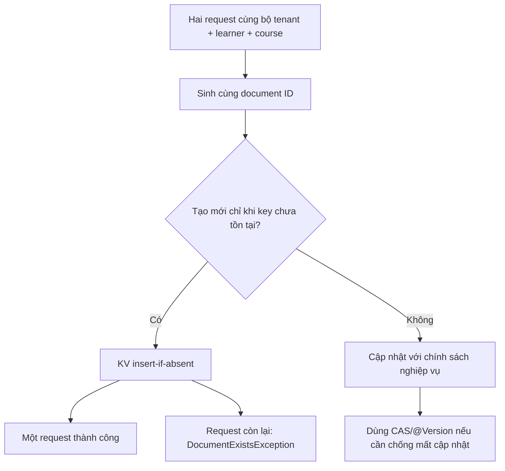

# @IdPrefix, @IdSuffix và @IdAttribute trong ghép khóa Spring Data Couchbase

## 1. Mục tiêu của bộ annotation ghép khóa

Trong Couchbase, mỗi document có một **document ID** duy nhất trong phạm vi **collection** mà document được lưu. Spring Data Couchbase ánh xạ document ID bằng thuộc tính `@Id`. Khi một entity chưa có ID, framework có thể tạo ID dựa trên những thuộc tính được khai báo bằng `@GeneratedValue(strategy = GenerationStrategy.USE_ATTRIBUTES)`.

Ba annotation phục vụ việc ghép các thành phần định danh:

- **`@IdPrefix`:** đặt một hoặc nhiều thành phần ở **đầu** document key, thường để phân loại entity hoặc xác định namespace.
- **`@IdAttribute`:** chọn các **thuộc tính chính** tạo định danh của document.
- **`@IdSuffix`:** đặt một hoặc nhiều thành phần ở **cuối** document key khi hậu tố là một phần bền vững của định danh.

Ví dụ một nền tảng đào tạo đa tenant có **đúng một bản tiến độ hiện hành** cho mỗi bộ `tenantId + learnerId + courseId`. Hợp đồng ID có thể là:

```text
progress::acme::learner-17::course-42::current
│        │     │           │          └─ hậu tố: loại bản ghi ổn định
│        │     │           └──────────── thuộc tính: courseId
│        │     └──────────────────────── thuộc tính: learnerId
│        └────────────────────────────── thuộc tính: tenantId
└─────────────────────────────────────── tiền tố: loại document
```

Khi API đã biết `tenantId`, `learnerId` và `courseId`, ứng dụng có thể tính chính xác key để đọc bằng KV, không cần truy vấn SQL++ chỉ để tìm document ID.

**Cần phân biệt:** các annotation này thuộc **Spring Data Couchbase**, không phải các annotation ghép khóa của JPA. Chúng ghép ra **một chuỗi document ID**; Couchbase không tạo khóa chính nhiều cột ở tầng lưu trữ.

## 2. Điều kiện kích hoạt: `@Id` và `@GeneratedValue`

Để dùng các thành phần ghép khóa, entity cần khai báo trường `@Id` kèm `@GeneratedValue` của đúng package:

```java
import org.springframework.data.annotation.Id;
import org.springframework.data.couchbase.core.mapping.Document;
import org.springframework.data.couchbase.core.mapping.id.GeneratedValue;
import org.springframework.data.couchbase.core.mapping.id.GenerationStrategy;
import org.springframework.data.couchbase.core.mapping.id.IdAttribute;
import org.springframework.data.couchbase.core.mapping.id.IdPrefix;
import org.springframework.data.couchbase.core.mapping.id.IdSuffix;

@Document
public class ExampleDocument {
    @Id
    @GeneratedValue(strategy = GenerationStrategy.USE_ATTRIBUTES,
                    delimiter = "::")
    private String id;

    // Các trường @IdPrefix, @IdAttribute, @IdSuffix ở đây.
}
```

`@GeneratedValue` có hai chiến lược do Spring Data Couchbase cung cấp:

| Chiến lược | Nguồn ID | Quan hệ với ba annotation |
| --- | --- | --- |
| `USE_ATTRIBUTES` | Ghép các thành phần được đánh dấu trên entity | **Chiến lược cần dùng** trong bài này |
| `UNIQUE` | Sinh khóa UUID | Không dùng các trường nghiệp vụ làm thành phần ghép của ID |

Nếu không khai báo `strategy`, mặc định là **`USE_ATTRIBUTES`**. Nếu không khai báo `delimiter`, mặc định là **dấu chấm `.`**. Nên khai báo rõ cả hai trong hệ thống có nhiều service để các nơi không vô tình tạo hai định dạng khóa khác nhau.

**Nếu `@Id` đã có giá trị, framework bỏ qua sinh khóa tự động.** Điều này hỗ trợ việc cập nhật entity đang tồn tại, nhưng đồng nghĩa annotation sẽ không tự sửa một ID đã được gán sai quy ước. Đường ghi và đường đọc phải thống nhất hợp đồng ID ngay từ đầu.

## 3. Vai trò và thứ tự của từng annotation

### 3.1. `@IdPrefix`: phân loại và namespace phía trước

Prefix thường diễn tả **loại document** hoặc vùng định danh ổn định:

```text
progress::acme::...
order::acme::...
customer::acme::...
```

Ví dụ:

```java
@IdPrefix(order = 0)
private String typePrefix = "progress";
```

Giá trị `progress` được đặt trước các `@IdAttribute`. Nếu có nhiều prefix, cần chỉ định `order` khác nhau:

```java
@IdPrefix(order = 0)
private String applicationPrefix = "learning";

@IdPrefix(order = 1)
private String typePrefix = "progress";
```

Hai trường này mô tả phần đầu dạng `learning::progress` khi delimiter là `::`.

Theo tài liệu Spring Data Couchbase, `order` mặc định bằng **0** và **nhiều prefix không có order riêng có thể ghi đè nhau** trong quá trình xây dựng chuỗi. Vì vậy, tuyệt đối không dựa vào thứ tự khai báo field trong mã Java để thay thế `order`.

### 3.2. `@IdAttribute`: thuộc tính xác định document

`@IdAttribute` đánh dấu giá trị nghiệp vụ hoặc định danh ổn định tham gia vào phần chính của key:

```java
@IdAttribute(order = 0)
private String tenantId;

@IdAttribute(order = 1)
private String learnerId;

@IdAttribute(order = 2)
private String courseId;
```

Trong ví dụ, thứ tự chủ đích là `tenantId` rồi đến `learnerId` và `courseId`. Thứ tự này **không** tự tạo chỉ mục ghép hay hỗ trợ tìm kiếm theo một phần key bằng KV.

Các trường này là dữ liệu có ý nghĩa trong body entity, giúp ứng dụng lọc theo tenant, học viên hoặc khóa học khi thiết kế truy vấn SQL++. Việc dùng `@IdAttribute` để tạo document ID không thay cho việc chọn index theo truy vấn.

### 3.3. `@IdSuffix`: hậu tố cho một biến thể bất biến

Hậu tố phù hợp khi cùng một tập thuộc tính định danh có **những loại document riêng biệt** mà ứng dụng luôn biết lúc đọc:

```java
@IdSuffix(order = 0)
private String recordVariant = "current";
```

Ví dụ key:

```text
progress::acme::learner-17::course-42::current
progress::acme::learner-17::course-42::summary
```

Hai key chỉ hợp lệ nếu nghiệp vụ thực sự lưu **hai loại bản ghi riêng** và có quy tắc ổn định về từng biến thể. Nếu `current` là trạng thái sẽ chuyển thành `completed` khi học xong, **không nên** dùng `status` làm suffix. Đổi status sẽ kéo theo đổi document ID, trong khi bản tiến độ vẫn là cùng một thực thể.

Với nhiều hậu tố, hãy dùng `order = 0, 1, ...` và mô tả rõ vì sao cả hai đều thuộc định danh.

### 3.4. Thứ tự của các nhóm

Khi dùng `USE_ATTRIBUTES`, hợp đồng ghép có thể được đọc theo cấu trúc:

```text
(prefix theo order) + (IdAttribute theo order) + (suffix theo order)
```

Giữa các giá trị dùng dấu phân cách `delimiter` của `@GeneratedValue`. Mỗi nhóm có thứ tự riêng; việc một prefix và một attribute cùng mang `order = 0` **không** có nghĩa chúng cạnh tranh vị trí với nhau. Vấn đề cần tránh là các thành phần *cùng nhóm* có thứ tự không được định nghĩa duy nhất.

| Annotation | Vị trí trong key | Giá trị ví dụ | Thứ tự |
| --- | --- | --- | --- |
| `@IdPrefix(order=0)` | Đầu | `progress` | Prefix thứ nhất |
| `@IdAttribute(order=0)` | Sau prefix | `acme` | Attribute thứ nhất |
| `@IdAttribute(order=1)` | Sau `acme` | `learner-17` | Attribute thứ hai |
| `@IdAttribute(order=2)` | Sau `learner-17` | `course-42` | Attribute thứ ba |
| `@IdSuffix(order=0)` | Cuối | `current` | Suffix thứ nhất |

## 4. Ví dụ end-to-end: tiến độ học tập theo tenant và khóa học

Giả sử module Spring Data Couchbase đã được cấu hình để ghi `CourseProgressDocument` vào đúng bucket, scope và collection. Entity có cấu trúc sau:

```java
import java.time.Instant;
import org.springframework.data.annotation.Id;
import org.springframework.data.annotation.Version;
import org.springframework.data.couchbase.core.mapping.Document;
import org.springframework.data.couchbase.core.mapping.id.GeneratedValue;
import org.springframework.data.couchbase.core.mapping.id.GenerationStrategy;
import org.springframework.data.couchbase.core.mapping.id.IdAttribute;
import org.springframework.data.couchbase.core.mapping.id.IdPrefix;
import org.springframework.data.couchbase.core.mapping.id.IdSuffix;

@Document
public class CourseProgressDocument {

    @Id
    @GeneratedValue(
        strategy = GenerationStrategy.USE_ATTRIBUTES,
        delimiter = "::"
    )
    private String id;

    @IdPrefix(order = 0)
    private String kind = "progress";

    @IdAttribute(order = 0)
    private String tenantId;

    @IdAttribute(order = 1)
    private String learnerId;

    @IdAttribute(order = 2)
    private String courseId;

    @IdSuffix(order = 0)
    private String variant = "current";

    // Trường riêng trong body để phục vụ truy vấn, báo cáo.
    private String docType = "progress";
    private int completedPercent;
    private Instant updatedAt;

    @Version
    private Long version;

    protected CourseProgressDocument() {}

    public CourseProgressDocument(String tenantId,
                                  String learnerId,
                                  String courseId) {
        this.tenantId = tenantId;
        this.learnerId = learnerId;
        this.courseId = courseId;
        this.completedPercent = 0;
        this.updatedAt = Instant.now();
    }

    public String getId() {
        return id;
    }
}
```

Khi lưu một entity có `id == null`, một ID dự kiến theo hợp đồng trên là:

```text
progress::acme::learner-17::course-42::current
```

Entity không cần tự nối chuỗi ID trong constructor. Cơ chế mapping của Spring Data xử lý phần ghép khi nó thực hiện sinh ID. Tuy nhiên, **cần xác nhận output thực tế bằng integration test với đúng phiên bản Spring Data Couchbase đang dùng** trước khi coi chuỗi này là hợp đồng chung giữa nhiều dịch vụ.

### 4.1. Repository và thao tác tạo/lấy document

```java
import org.springframework.data.couchbase.repository.CouchbaseRepository;

public interface CourseProgressRepository
    extends CouchbaseRepository<CourseProgressDocument, String> {
}
```

Lưu entity mới:

```java
CourseProgressDocument draft =
    new CourseProgressDocument("acme", "learner-17", "course-42");

CourseProgressDocument saved = repository.save(draft);
String actualId = saved.getId();

System.out.println(actualId);
// Dự kiến: progress::acme::learner-17::course-42::current
```

Đọc theo chính ID nhận được:

```java
var result = repository.findById(actualId);
```

Đây là minh họa cho cách ánh xạ và lấy ID. `repository.save(...)` **không nên được suy diễn là luôn có ngữ nghĩa chỉ tạo mới khi key chưa tồn tại**. Nếu nghiệp vụ yêu cầu chống ghi đè khi tạo tiến độ lần đầu, cần thao tác insert có kiểm tra tồn tại.

### 4.2. Đường đọc có sẵn các thành phần nhưng chưa có ID

Một API thường nhận `tenantId`, `learnerId`, `courseId` và muốn đọc trực tiếp bằng key:

```text
GET /tenants/acme/learners/learner-17/courses/course-42/progress
```

Vì `findById` nhận **ID hoàn chỉnh**, không phải entity để tự ghép, ứng dụng cần một **hợp đồng dựng key thống nhất**. Ví dụ hàm xác định trước theo quy ước của entity:

```java
import java.nio.charset.StandardCharsets;
import java.util.Objects;
import java.util.regex.Pattern;

public final class ProgressKeys {
    private static final Pattern COMPONENT =
        Pattern.compile("[a-z0-9][a-z0-9-]{0,63}");

    private ProgressKeys() {}

    public static String current(String tenantId,
                                 String learnerId,
                                 String courseId) {
        String tenant = component(tenantId);
        String learner = component(learnerId);
        String course = component(courseId);

        String key = "progress::" + tenant + "::" + learner
                   + "::" + course + "::current";

        if (key.getBytes(StandardCharsets.UTF_8).length > 250) {
            throw new IllegalArgumentException(
                "Document ID vượt quá 250 byte");
        }
        return key;
    }

    private static String component(String value) {
        Objects.requireNonNull(value, "key component");
        if (!COMPONENT.matcher(value).matches()) {
            throw new IllegalArgumentException(
                "Thành phần ID chưa chuẩn hóa hoặc không hợp lệ");
        }
        return value;
    }
}
```

```java
String authorizedTenantId = "acme"; // Lấy từ ngữ cảnh đã xác thực.
String key = ProgressKeys.current(
    authorizedTenantId, "learner-17", "course-42");

var progress = repository.findById(key);
```

**Rủi ro cần kiểm soát:** nếu sau này đổi prefix, suffix, thứ tự `@IdAttribute` hoặc delimiter mà không đổi `ProgressKeys`, đường đọc sẽ không còn khớp đường ghi. Tổ chức nên chọn một hợp đồng key có test chung hoặc một thành phần tạo key được dùng nhất quán cho cả lúc lưu và lúc đọc. Khóa trả về từ `saved.getId()` là nguồn đáng tin cậy để xác minh quy tắc mapping ở runtime.

## 5. Prefix và suffix có được lưu trong JSON không?

Theo tài liệu Spring Data Couchbase, các giá trị prefix/suffix khai báo trên entity phục vụ **sinh ID** và **không được lưu vào body chỉ vì chúng là prefix/suffix**.

Đó là sự khác biệt quan trọng:

| Thông tin | Trong document ID | Cần có trong body để query? |
| --- | --- | --- |
| `kind = "progress"` với `@IdPrefix` | Có, nếu được dùng khi sinh ID | Có thể lưu trường `docType` riêng nếu cần lọc theo loại |
| `tenantId` với `@IdAttribute` | Có | Nên lưu thuộc tính ánh xạ để lọc tenant bằng SQL++ |
| `learnerId` và `courseId` với `@IdAttribute` | Có | Nên giữ trong body nếu cần báo cáo hoặc lập chỉ mục |
| `variant = "current"` với `@IdSuffix` | Có | Lưu `recordVariant` riêng nếu cần query theo biến thể |
| `id` với `@Id` | Là metadata ID | Không mặc định có trường JSON `id` trong body |

Nếu cần truy vấn:

```sql
SELECT META(p).id AS documentId,
       p.learnerId,
       p.courseId,
       p.completedPercent
FROM `learning`.`academy`.`progress` AS p
WHERE p.tenantId = $tenantId
  AND p.courseId = $courseId;
```

thì các thuộc tính lọc phải có mặt trong body và chỉ mục SQL++ phù hợp. Việc chuỗi ID chứa `acme` hoặc `course-42` **không tự tạo index** cho `tenantId` hay `courseId`.

Sau khi đọc lại entity, cũng không nên dựa vào các field prefix/suffix như dữ liệu đã được Couchbase persist: nếu cần chúng như thuộc tính nghiệp vụ, hãy khai báo và lưu riêng một trường tương ứng.

## 6. Thứ tự `order` và `delimiter`: các lỗi khó thấy

### 6.1. Không khai báo `order` cho nhiều field cùng nhóm

Sai lầm:

```java
@IdPrefix
private String application = "learning";

@IdPrefix
private String docType = "progress";
```

Vì `order` mặc định là `0`, framework có thể ghi đè giá trị prefix khi nhiều trường cùng thứ tự. Điều này có thể làm hai loại document vốn cần prefix khác nhau bị tạo thành khóa cùng dạng.

Nên dùng:

```java
@IdPrefix(order = 0)
private String application = "learning";

@IdPrefix(order = 1)
private String docTypePrefix = "progress";
```

Tương tự, với nhiều `@IdAttribute` hoặc `@IdSuffix`, hãy gán thứ tự tường minh và kiểm tra output ID, thay vì tin vào thứ tự trường trong mã nguồn.

### 6.2. Dấu phân cách mặc định là dấu chấm

Nếu bỏ tham số `delimiter`:

```java
@Id
@GeneratedValue(strategy = GenerationStrategy.USE_ATTRIBUTES)
private String id;
```

quy tắc ghép dùng dấu phân cách mặc định **`.`**, không phải `::`. Chỉ một service dùng `.` trong khi nơi khác tự dựng ID bằng `::` đủ khiến `findById` không tìm thấy tài liệu.

**Đổi delimiter là thay hợp đồng ID**, cần phương án migration cho dữ liệu đang tồn tại. Không đổi delimiter như một refactor “chỉ ảnh hưởng style”.

### 6.3. Hai bộ thành phần có thể cho cùng một chuỗi

Giả sử cho phép dữ liệu chứa chính delimiter:

```text
["acme::school", "learner-17"] -> acme::school::learner-17
["acme", "school::learner-17"] -> acme::school::learner-17
```

Hai bộ ID nghiệp vụ khác nhau bị ánh xạ thành **cùng document ID**. Không thể sửa bằng cách đặt thêm một `@IdPrefix` nếu các thành phần vẫn không được chuẩn hóa.

Hướng kiểm soát:

1. Xác định tập ký tự hợp lệ, tốt nhất từ định danh nội bộ đã được chuẩn hóa; không cho chứa delimiter.
2. Khi thực sự phải nhận dữ liệu tự do, encode từng thành phần bằng một phép ánh xạ **không nhập nhằng và dùng chung** trên mọi service.
3. Cấm cắt cụt ID quá dài, vì hai ID khác nhau có thể cùng rơi về một chuỗi sau khi cắt.
4. Kiểm tra giới hạn **250 byte** của toàn bộ document ID, không chỉ độ dài ký tự Java.
5. Không âm thầm lower-case nếu mã nghiệp vụ thực sự phân biệt chữ hoa và chữ thường.

### 6.4. Thành phần `null`, rỗng hoặc biến động

Một trường `@IdAttribute` chưa có giá trị có thể khiến ID không hoàn chỉnh, lỗi sinh khóa hoặc hành vi không phù hợp yêu cầu. Không dựa vào việc framework tự xác minh ý nghĩa nghiệp vụ; service nên validate **đầy đủ các thành phần bắt buộc** trước khi lưu.

Đặc biệt, không đưa `status`, `updatedAt`, tên hiển thị, địa chỉ giao hàng hoặc CAS vào `@IdAttribute`/`@IdSuffix` nếu chúng có thể thay đổi. Một key nên biểu diễn **danh tính** document, không phụ thuộc vào trạng thái hiện tại.

## 7. Quy tắc khóa và ranh giới tenant

Với hệ thống đa tenant, nếu nhiều tenant cùng lưu vào một collection và đều có learner `learner-17`, khóa chỉ gồm `learnerId + courseId` là chưa đủ để phân biệt document. `tenantId` phải xuất hiện trong namespace định danh, hoặc dữ liệu phải được tách qua collection theo kiến trúc đã chọn.

Ví dụ:

```text
progress::acme::learner-17::course-42::current
progress::globex::learner-17::course-42::current
```

Dù các giá trị học viên và khóa học trùng nhau, hai key khác nhau vì tenant khác nhau.

**Điều này không cấp quyền truy cập.** Tenant trong key phải được lấy từ ngữ cảnh đã xác thực/ủy quyền, không tin tenant ID bất kỳ do client cung cấp mà chưa kiểm soát. Nếu người dùng thuộc tenant `acme` đoán được key `globex`, tầng service vẫn phải ngăn truy cập trái phép.

Ngoài namespace trong chuỗi key, Couchbase còn có namespace thật: **bucket → scope → collection**. Tính duy nhất của document ID được xét trong collection. Hai collection có thể chứa cùng key nhưng là hai document khác nhau; cấu hình repository/`CouchbaseTemplate` phải chỉ đúng collection cần đọc hoặc ghi. Prefix trong ID không tự chuyển collection.

## 8. Tạo mới có cạnh tranh: ghép cùng ID chưa đủ

Giả sử hai request tạo tiến độ cho cùng `acme + learner-17 + course-42` đồng thời. `@GeneratedValue(USE_ATTRIBUTES)` có thể tạo **cùng ID** cho cả hai. Đây là đúng về định danh, nhưng vẫn cần quy tắc ghi để tránh ghi đè:



Để thể hiện rõ ngữ nghĩa tạo mới, Couchbase Java SDK có `Collection.insert(key, body)`:

```java
import com.couchbase.client.core.error.DocumentExistsException;
import com.couchbase.client.java.Collection;
import com.couchbase.client.java.json.JsonObject;

public void insertNewProgress(Collection collection, String key,
                              String tenantId, String learnerId,
                              String courseId) {
    JsonObject body = JsonObject.create()
        .put("docType", "progress")
        .put("tenantId", tenantId)
        .put("learnerId", learnerId)
        .put("courseId", courseId)
        .put("completedPercent", 0);

    try {
        collection.insert(key, body);
    } catch (DocumentExistsException exception) {
        throw new IllegalStateException(
            "Tiến độ đã tồn tại", exception);
    }
}
```

Đây là ví dụ **SDK độc lập**. Khi dùng Spring Data mapping cho cùng entity, phải đảm bảo body/metadata tương thích với cách repository đọc document; không mặc định JSON tối giản do SDK ghi luôn deserialize thành một entity Spring Data đầy đủ.

Không coi chuỗi thao tác `existsById(key)` → `save(entity)` là giải pháp chống tạo trùng: hai request có thể đồng thời thấy chưa tồn tại. Cũng không suy diễn rằng `save` luôn có ngữ nghĩa *insert-if-absent* trong mọi trạng thái entity.

- Với thao tác **create**, cần insert có kiểm tra tồn tại và xử lý trường hợp key đã có.
- Với thao tác **update**, cần chính sách cập nhật; `@Version`/CAS giúp phát hiện thay đổi đồng thời khi được dùng đúng đường mapping.
- Với **retry** sau timeout, cần nhận diện cùng request qua idempotency key hoặc trạng thái đã lưu để tránh xử lý nghiệp vụ lặp; trùng document key không tự chứng minh hai request hoàn toàn giống nhau.
- Với **TTL**, document có thể hết hạn rồi cùng key được tạo lại; ID duy nhất tại thời điểm lưu không đồng nghĩa chưa từng tồn tại trong lịch sử.

## 9. Truy vấn SQL++ không thay thế hợp đồng document key

Khóa dạng `progress::acme::learner-17::course-42::current` giúp truy cập **một document biết đủ thành phần**, nhưng không tạo lệnh KV để liệt kê mọi tiến độ của một khóa học.

Ví dụ để lấy các học viên chưa hoàn thành khóa `course-42`:

```sql
-- Bucket/scope/collection được dùng minh họa.
CREATE INDEX ix_progress_tenant_course_completed
ON `learning`.`academy`.`progress`(
    tenantId, courseId, completedPercent
);
```

```sql
SELECT META(p).id AS documentId,
       p.learnerId,
       p.completedPercent
FROM `learning`.`academy`.`progress` AS p
WHERE p.tenantId = $tenantId
  AND p.courseId = $courseId
  AND p.completedPercent < 100;
```

Trong ví dụ này, `tenantId`, `courseId` và `completedPercent` phải có mặt trong body. Các tham số phải được bind qua API query. Cần kiểm tra kế hoạch `EXPLAIN`, chỉ mục và mức nhất quán phù hợp với luồng nghiệp vụ; truy vấn SQL++ dùng index khác với đọc KV trực tiếp theo ID.

Khi ghép khóa từ `@IdAttribute`, **đừng nhầm thứ tự `order` với thứ tự cột index**. `@IdAttribute(order = 0)` chỉ quyết định thứ tự trong chuỗi ID; thứ tự trường trong chỉ mục phải dựa trên mẫu truy vấn thực tế.

Dù dùng `CouchbaseRepository`, `CouchbaseTemplate` hay `ReactiveCouchbaseRepository`, cùng một document cần thống nhất quy ước ID. Với API reactive có thể retry/resubscribe, các thành phần ID phải được cố định trước khi tạo document; không sinh thành phần ngẫu nhiên mới trong mỗi lần thực thi lại.

## 10. Migration khi đổi prefix, suffix hoặc thứ tự thuộc tính

Thay một trong những điều sau sẽ tạo **ID mới** cho cùng dữ liệu đầu vào:

- Đổi `kind` từ `progress` thành `course-progress`.
- Thêm `applicationPrefix` hoặc `@IdSuffix`.
- Đổi thứ tự `tenantId`, `learnerId`, `courseId`.
- Chuyển delimiter từ `.` sang `::`.
- Đổi quy ước hoa/thường hoặc encode một thành phần.

Spring Data Couchbase không tự rename document cũ khi chỉ sửa annotation trong source code. Kế hoạch chuyển đổi cần bao gồm:

1. Định nghĩa định dạng ID mới và đưa vào kiểm thử hồi quy.
2. Có phương án đọc dữ liệu cũ trong giai đoạn chuyển tiếp nếu ứng dụng đã có dữ liệu thật.
3. Sao chép/chuyển document sang key mới và xác minh TTL, body, CAS, liên kết hoặc ID được lưu ở nơi khác.
4. Phối hợp các service đang ghi để không phát sinh hai bản dữ liệu được cập nhật độc lập.
5. Chỉ dọn document cũ sau khi kiểm tra đường đọc, cache, sự kiện và xử lý retry.

Nếu chỉ thay đổi schema trong body, cân nhắc `schemaVersion` thay vì thay document key; namespace định danh nên ổn định hơn các thay đổi cấu trúc JSON thông thường.

## 11. Kiểm thử hợp đồng sinh khóa

Nên có **unit test cho cách chuẩn hóa input và tính key dự kiến** và **integration test với phiên bản Spring Data Couchbase thực tế** để xác nhận ID framework tạo ra.

| Kiểm thử | Kết quả mong đợi |
| --- | --- |
| Entity mới, `@Id` rỗng, đủ thuộc tính | Tạo key đúng cấu trúc prefix → attributes → suffix |
| Entity đã có `@Id` | Không sinh lại ID tự động |
| Hai tenant có cùng learner/course | Khóa khác nhau |
| Cùng bộ tenant/learner/course | Key xác định, tái tạo được |
| Đổi `@IdAttribute(order=1)` sang `order=2` | Test phát hiện key khác hợp đồng cũ |
| Nhiều prefix/suffix cùng thứ tự mặc định | Cấu hình bị test cảnh báo hoặc output sai bị phát hiện |
| Dữ liệu chứa `::` | Bị validate từ chối hoặc encode an toàn |
| Dữ liệu rỗng, null, quá dài | Bị từ chối trước khi ghi |
| Đổi `completedPercent` | Không làm đổi document ID |
| Hai `insert` đồng thời cùng key | Một request thành công, request kia báo key đã tồn tại |
| Đọc lại từ đúng collection | `findById` tìm được document theo key |
| Đọc từ collection khác dù key trùng | Không giả định là cùng document |

Ví dụ ý tưởng kiểm thử Java/JUnit:

```java
import static org.junit.jupiter.api.Assertions.*;

String expected = ProgressKeys.current(
    "acme", "learner-17", "course-42");

assertEquals(
    "progress::acme::learner-17::course-42::current",
    expected);

String otherTenant = ProgressKeys.current(
    "globex", "learner-17", "course-42");

assertNotEquals(expected, otherTenant);

// Integration test: saved.getId() phải trùng expected
// sau khi repository thực hiện lưu entity với @GeneratedValue.
```

Hai assertion đầu chỉ kiểm tra helper tự ghép khóa; **không xác nhận framework thực sự sinh đúng key**. Assertion so sánh `saved.getId()` với `expected` trong integration test mới phát hiện độ lệch giữa cách tạo ID của Spring Data và hợp đồng đọc của ứng dụng.

### Bài tập vận dụng

Một nền tảng quản lý kho có document `StockBalance`: mỗi tenant có nhiều kho; mỗi kho có đúng một số dư hiện tại cho mỗi SKU. Hệ thống còn có các bản chốt số dư theo kỳ tháng.

**Yêu cầu:**

1. Đề xuất cấu trúc key cho **số dư hiện tại**.
2. Đề xuất cấu trúc key cho **bản chốt tháng**; xác định phần nào làm prefix, `@IdAttribute` và suffix.
3. Nêu lý do không đưa `quantity`, `updatedAt` hoặc CAS vào key.
4. Chỉ ra truy vấn cần SQL++ thay vì KV.

**Gợi ý:** số dư hiện tại có thể dùng `balance::<tenant>::<warehouseId>::<sku>::current`; bản chốt tháng có thể dùng `balance::<tenant>::<warehouseId>::<sku>::<yyyymm>` nếu tháng là thành phần định danh bất biến. Có thể đặt `@IdPrefix(order = 0)` trên một trường mang giá trị `"balance"` như ví dụ trên, `@IdAttribute` cho tenant/kho/SKU, `@IdSuffix` cho loại hoặc kỳ chốt và `delimiter = "::"`. Truy vấn “liệt kê mọi SKU có số dư dưới ngưỡng tại một kho” cần các thuộc tính trong body và chỉ mục SQL++ tương ứng; chỉ prefix không cung cấp tính năng scan KV theo wildcard.

## 12. Checklist trước khi triển khai

1. Đã import `@GeneratedValue`, `@IdPrefix`, `@IdAttribute`, `@IdSuffix` từ đúng package Spring Data Couchbase?
2. `@Id` là một trường document ID; `USE_ATTRIBUTES` được cấu hình rõ?
3. Prefix, attribute và suffix đã được chọn từ **các thành phần bất biến**?
4. Mỗi nhóm nhiều field đều có `order` tường minh, không trùng?
5. `delimiter` đã được ấn định thành hợp đồng và tất cả dịch vụ dùng giống nhau?
6. Thành phần key có được validate hoặc encode để tránh nhập nhằng delimiter?
7. Tổng ID có nằm trong giới hạn **250 byte UTF-8**?
8. Đã phân biệt prefix/suffix phục vụ sinh ID với các trường cần lưu để query?
9. Tenant trong key đã được kiểm tra phân quyền và cấu hình collection đã đúng?
10. Luồng create có ngữ nghĩa ghi chống trùng và xử lý retry/idempotency?
11. Luồng update có CAS/`@Version` khi cần tránh lost update?
12. SQL++ index đã được thiết kế riêng cho nhu cầu lọc, phân trang, báo cáo?
13. Có integration test so sánh key do framework tạo với key mong đợi của đường đọc?
14. Có kế hoạch migration nếu cần thay prefix, suffix, order hoặc delimiter trên dữ liệu đang chạy?

## Tài liệu tham khảo

- [Spring Data Couchbase Reference — Auto generating keys](https://docs.spring.io/spring-data/couchbase/reference/couchbase/autokeygeneration.html): quy tắc `@GeneratedValue`, `@IdPrefix`, `@IdSuffix`, `@IdAttribute`, `order` và `delimiter`.
- [Spring Data Couchbase Javadoc — IdPrefix](https://docs.spring.io/spring-data/couchbase/reference/api/java/org/springframework/data/couchbase/core/mapping/id/IdPrefix.html): vai trò và thuộc tính `order`.
- [Spring Data Couchbase Javadoc — IdAttribute](https://docs.spring.io/spring-data/couchbase/reference/api/java/org/springframework/data/couchbase/core/mapping/id/IdAttribute.html): các thuộc tính định danh chính của key.
- [Spring Data Couchbase Javadoc — IdSuffix](https://docs.spring.io/spring-data/couchbase/reference/api/java/org/springframework/data/couchbase/core/mapping/id/IdSuffix.html): vai trò của hậu tố và thuộc tính `order`.

## Kết luận

Trong Spring Data Couchbase, **`@IdPrefix`**, **`@IdAttribute`** và **`@IdSuffix`** giúp khai báo cấu trúc document ID gồm tiền tố, thành phần định danh chính và hậu tố khi kết hợp với `@GeneratedValue(strategy = USE_ATTRIBUTES)`. Thiết kế hiệu quả cần **thứ tự `order` rõ ràng**, delimiter thống nhất, thành phần khóa bất biến và chuẩn hóa chống va chạm. Framework hỗ trợ ghép chuỗi ID, còn ứng dụng vẫn chịu trách nhiệm về namespace tenant, phân quyền, tạo mới an toàn, CAS, TTL, idempotency và truy vấn SQL++ với chỉ mục phù hợp. Một hợp đồng key được kiểm thử xuyên suốt đường ghi và đọc sẽ giúp các repository, template và reactive API truy xuất cùng document một cách nhất quán.
