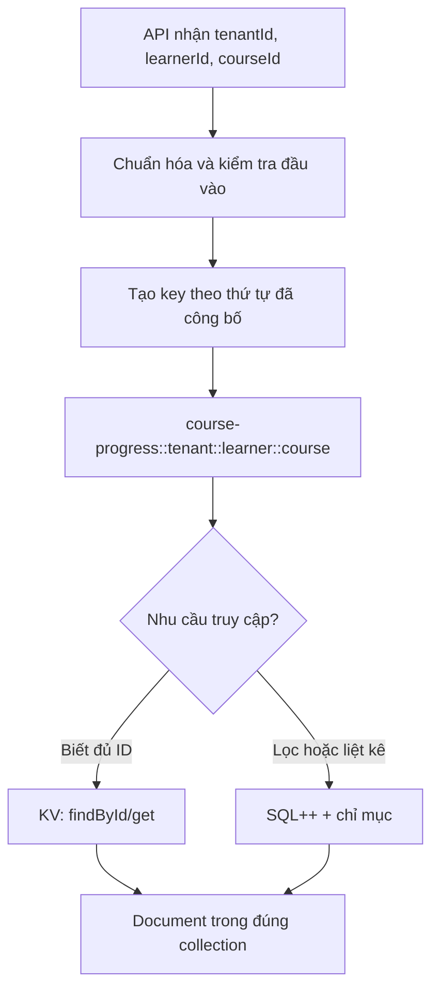

# Thứ tự thành phần, dấu phân cách và tính ổn định của khóa trong Spring Data Couchbase

## 1. Vì sao cùng dữ liệu có thể tạo ra hai document key khác nhau?

Trong Couchbase, **document key (document ID)** là định danh duy nhất của một document **bên trong một collection**. Các thao tác KV như đọc, thêm, thay thế và xóa sử dụng ID chính xác để tìm document. Trong Spring Data Couchbase, thuộc tính được đánh dấu `@Id` ánh xạ tới ID này; `CouchbaseRepository.findById(id)` đọc theo ID đã biết.

Một ứng dụng quản lý đào tạo đa tenant cần lưu **một tiến độ hiện hành** cho mỗi cặp học viên–khóa học. Tại thời điểm gọi API, hệ thống có:

```text
tenantId  = acme
learnerId = learner-17
courseId  = course-42
```

Từ cùng ba giá trị, hai service có thể tạo ra hai chuỗi:

```text
progress::acme::learner-17::course-42
acme::progress::course-42::learner-17
```

Chúng biểu diễn cùng một thực thể theo nghiệp vụ nhưng là **hai ID hoàn toàn khác nhau** đối với Couchbase. Service ghi theo mẫu thứ nhất rồi đọc theo mẫu thứ hai sẽ nhận kết quả không tìm thấy, dù document vẫn tồn tại. Tương tự, chỉ cần thay dấu `::` thành `.` cũng tạo ID khác.

Vì vậy, thiết kế khóa phải là một **hợp đồng định danh ổn định** gồm thứ tự thành phần, dấu phân cách, quy tắc chuẩn hóa, phạm vi duy nhất và chính sách thay đổi về sau.

Sau bài này, người học có thể:

- Chọn và tài liệu hóa thứ tự của loại document, tenant và ID nghiệp vụ.
- Nhận diện lỗi va chạm do phép ghép chuỗi hoặc chuẩn hóa không nhất quán.
- Triển khai một hàm tạo key xác định, giới hạn độ dài và kiểm tra đầu vào.
- Sử dụng `@Id` và cơ chế `@GeneratedValue(USE_ATTRIBUTES)` của Spring Data Couchbase đúng với hợp đồng đọc/ghi.
- Phân biệt tính ổn định của ID với CAS, TTL, giao dịch và truy vấn SQL++.

## 2. Thứ tự thành phần: định nghĩa một ngữ pháp duy nhất

### 2.1. Khóa thường gồm những gì?

Một mẫu rõ ràng cho collection lưu chung nhiều loại document của nhiều tenant:

```text
<entity-type>::<tenant-id>::<stable-id>
```

Ví dụ:

```text
customer::acme::c-100
order::acme::8f242056-8b1d-498b-a20a-215b5fe2fa66
course-progress::acme::learner-17::course-42
cart::acme::c-100
```

Các thành phần đóng vai trò khác nhau:

| Thành phần | Vai trò | Điều kiện cần |
| --- | --- | --- |
| `entity-type` | Phân biệt customer, order, cart, progress | Danh mục cố định trong ứng dụng |
| `tenant-id` | Phân biệt vùng định danh tenant khi dùng chung collection | Giá trị nội bộ đã chuẩn hóa và xác minh quyền |
| `stable-id` | Nhận diện đúng thực thể hoặc một tổ hợp bất biến | Không đổi trong suốt vòng đời định danh |
| `::` | Dấu phân cách làm cấu trúc dễ nhận biết | Không gây nhập nhằng với dữ liệu thành phần |

Có thể dùng `<tenant>::<type>::<id>` thay cho `<type>::<tenant>::<id>`, miễn là **mọi đường tạo, đọc, xóa và tham chiếu** đều thống nhất. Không có thứ tự nào tự động hiệu quả hơn chỉ vì Couchbase thấy chung một prefix.

### 2.2. Vì sao đổi thứ tự là đổi định danh?

So sánh:

```text
course-progress::acme::learner-17::course-42
course-progress::acme::course-42::learner-17
```

Dù hai key chứa cùng tập giá trị, Couchbase không hiểu ý nghĩa của `learnerId` hay `courseId` trong chuỗi. Với KV, đó là hai khóa khác nhau. Do đó:

1. Không tự đổi thứ tự các thành phần khi refactor Java class.
2. Không để các service tự ghép ID bằng nhiều quy ước khác nhau.
3. Không giả định thứ tự viết các field trong source code là thứ tự ghép key.
4. Nếu một key đã được sử dụng trong dữ liệu thực, đổi cấu trúc phải có kế hoạch migration.



### 2.3. Thứ tự trong ID không phải thứ tự trong chỉ mục

Chuỗi `course-progress::acme::learner-17::course-42` **không** tạo một chỉ mục cho tất cả tiến độ của `learner-17`. Couchbase KV tra cứu theo **khóa đầy đủ**, không cung cấp API KV wildcard như `course-progress::acme::learner-17::*`.

Để lọc theo tenant, học viên hoặc ngày tạo, lưu các trường tương ứng trong JSON body và tạo **chỉ mục SQL++** cho mẫu truy vấn. Thứ tự trường của chỉ mục là một quyết định riêng dựa trên điều kiện lọc, sắp xếp và kế hoạch thực thi.

## 3. Dấu phân cách: dễ đọc nhưng phải không nhập nhằng

Dấu phân cách thường gặp là `::`, `:`, `|`, `/` hoặc `.`. Với Spring Data Couchbase, tham số `delimiter` của `@GeneratedValue` quyết định chuỗi phân cách khi ghép khóa theo thuộc tính; nếu không chỉ rõ, **mặc định là dấu chấm `.`**.

Chẳng hạn cùng thành phần tạo:

```text
delimiter = "::"  -> progress::acme::learner-17::course-42
delimiter = "."   -> progress.acme.learner-17.course-42
```

Hai ID khác nhau hoàn toàn. Dấu phân cách được chọn phải được **ghi trong hợp đồng ID** và giữ nhất quán giữa service tạo key, entity mapping, repository reader, job nền, cache và dữ liệu được ghi trong sự kiện.

### 3.1. Va chạm khi thành phần chứa dấu phân cách

Nếu hệ thống chấp nhận `::` bên trong thành phần động, hai bộ giá trị khác nhau có thể sinh cùng một key:

```text
["progress", "acme::school", "learner-17"]
    -> progress::acme::school::learner-17

["progress", "acme", "school::learner-17"]
    -> progress::acme::school::learner-17
```

Đó là **va chạm do cách mã hóa thành phần**, không liên quan đến khả năng UUID trùng ngẫu nhiên. Việc thêm tiền tố loại document không giải quyết được nếu các thành phần vẫn có thể chứa delimiter.

Ba phương án phổ biến:

| Phương án | Cách làm | Khi nào hợp lý |
| --- | --- | --- |
| **Giới hạn bộ ký tự** | Chỉ cho phép ID nội bộ gồm chữ, số, `-`, `_`; từ chối `:` | Phù hợp với tenantId/UUID/mã nội bộ |
| **Encode từng thành phần** | Base64 URL-safe UTF-8 hoặc encoding một-một, với quy ước cố định | Khi ID nguồn có Unicode/dấu phân cách |
| **Định dạng có độ dài** | Ví dụ `4:acme`, `10:learner-17` với bộ giải mã rõ ràng | Khi cần hỗ trợ dữ liệu tự do và tự giải mã |

Một chuỗi đơn giản như `a + b + c` **không có dấu phân cách** cũng có thể va chạm: `["ab", "c"]` và `["a", "bc"]` cùng tạo `abc`. Đổi sang một ký tự phân cách khác chỉ là giải pháp khi ký tự ấy được **cấm hoặc escape** trong mọi thành phần.

### 3.2. Chuẩn hóa không được làm mất tính duy nhất

Cần xác định trước:

- `ACME` và `acme` có là cùng một tenant không?
- `SKU-1` và `sku-1` có mang cùng nghĩa không?
- Dấu cách trước/sau ID có được chấp nhận không?
- Unicode có được chuẩn hóa NFC/NFKC hay không, và chính sách đó ảnh hưởng dữ liệu ra sao?
- Có được phép đưa email hoặc số điện thoại vào ID không?

Nếu mã nghiệp vụ phân biệt hoa/thường, việc tự chuyển sang chữ thường có thể tạo **va chạm**. Nếu chúng tương đương về nghiệp vụ, phải có **một bước chuẩn hóa duy nhất** được áp dụng trước cả lưu và đọc. Không “sửa” key bằng cách xóa mọi ký tự không hợp lệ: thao tác đó có thể khiến `a-b` và `ab` trở thành cùng giá trị.

Đối với dữ liệu cá nhân như email và số điện thoại, ưu tiên dùng **định danh thay thế** trong key rồi lưu thuộc tính cần tìm kiếm trong body. Document ID thường xuất hiện trong URL, log hoặc công cụ vận hành.

### 3.3. Giới hạn 250 byte của document ID

Couchbase giới hạn document ID tối đa **250 byte**, không phải 250 ký tự Unicode. Một chuỗi Java có ký tự nhiều byte có thể vượt giới hạn dù trông ngắn.

Kiểm tra toàn bộ key bằng UTF-8:

```java
import java.nio.charset.StandardCharsets;

String key = "progress::acme::learner-17::course-42";
int bytes = key.getBytes(StandardCharsets.UTF_8).length;
if (bytes > 250) {
    throw new IllegalArgumentException("Document ID vượt 250 byte");
}
```

**Không cắt cụt** key dài để vừa giới hạn: hai khóa khác nhau có thể trở thành cùng một khóa sau khi cắt. Hãy giới hạn đầu vào hoặc chọn định danh ngắn, ổn định; nếu dùng digest cần xác định độ dài và cách kiểm soát rủi ro va chạm phù hợp.

## 4. Tính ổn định của khóa trong vòng đời document

Một document key nên gắn với **danh tính thực thể**, không gắn với trạng thái hay thông tin dễ đổi. Với hệ thống đơn hàng:

```text
Nên:
order::acme::8f242056-8b1d-498b-a20a-215b5fe2fa66

Tránh:
order::acme::pending::2026-11-25::8f242056-8b1d-498b-a20a-215b5fe2fa66
```

Trạng thái `pending` có thể thành `paid`, `shipped` hay `cancelled`. Nếu status nằm trong key, mỗi lần chuyển trạng thái sẽ đổi định danh, buộc ứng dụng chuyển document hoặc xử lý tham chiếu cũ.

| Thành phần | Đưa vào ID? | Lý do |
| --- | --- | --- |
| UUID cấp một lần cho order | Thường có | Bất biến, không phụ thuộc nghiệp vụ |
| Tenant ID bất biến trong mô hình nhiều tenant cùng collection | Có thể | Phân biệt phạm vi duy nhất |
| Learner ID và course ID cho **một tiến độ hiện hành của mỗi cặp** | Có thể | Tổ hợp bền vững xác định một document |
| Email/tên hiển thị | Thường không | Có thể đổi và chứa dữ liệu cá nhân |
| `status`, `updatedAt` | Không | Thường xuyên thay đổi |
| CAS/`@Version` | Không | Thay đổi sau mỗi thao tác ghi |
| Thời hạn TTL | Không | Chính sách lưu trữ có thể đổi |
| Ngày tháng | Chỉ khi là phần **bất biến của định danh** | Ví dụ bản chốt một kỳ cố định |

Lưu ý: việc dùng `tenantId`, `warehouseId` hoặc `courseId` trong key chỉ an toàn nếu các giá trị ấy thực sự ổn định theo mô hình. Nếu một document có thể **chuyển tenant hoặc đổi courseId mà vẫn được xem là cùng thực thể**, phải cân nhắc dùng surrogate ID thay vì ghép các thuộc tính đó.

### 4.1. ID cố định, nội dung thay đổi: CAS và TTL xử lý phần nào?

- **CAS/`@Version`:** kiểm soát xung đột khi hai writer cùng cập nhật một document; không tạo ra một ID mới.
- **TTL:** xác định thời điểm document hết hạn. Khi document hết hạn hoặc bị xóa, **cùng ID có thể được tạo lại**; vì vậy key có tính ổn định không đồng nghĩa “đã tồn tại vĩnh viễn”.
- **Transaction:** hữu ích khi cần điều phối thay đổi nhiều document hoặc document chính với document giữ chỗ, nhưng bản thân key không tự tạo transaction.
- **Phân quyền:** không được dựa vào chuỗi tenant xuất hiện trong key để cho phép truy cập; phải xác minh quyền theo ngữ cảnh người gọi.

### 4.2. Tại sao đổi ID có chi phí cao?

Couchbase không có thao tác “đổi tên document ID” tự động chỉ vì Java cập nhật trường `@Id`. Đổi ID thường tương đương **ghi một document theo ID mới** và quản lý việc xóa/thu hồi document cũ.

Các ràng buộc chịu ảnh hưởng có thể gồm: tham chiếu trong document khác, cache, sự kiện bất đồng bộ, idempotency record, TTL, luồng đọc cũ và những request đang ghi đồng thời. Vì thế, một thay đổi tưởng như nhỏ ở delimiter hoặc thứ tự thành phần có thể trở thành **migration dữ liệu**.

## 5. Thực hành Spring Data Couchbase: thứ tự trong `@GeneratedValue`

Spring Data Couchbase hỗ trợ `@GeneratedValue` cùng các thành phần `@IdPrefix`, `@IdAttribute` và `@IdSuffix` khi dùng chiến lược `GenerationStrategy.USE_ATTRIBUTES`.

Ví dụ một document tiến độ:

```java
import java.time.Instant;
import org.springframework.data.annotation.Id;
import org.springframework.data.annotation.Version;
import org.springframework.data.couchbase.core.mapping.Document;
import org.springframework.data.couchbase.core.mapping.id.GeneratedValue;
import org.springframework.data.couchbase.core.mapping.id.GenerationStrategy;
import org.springframework.data.couchbase.core.mapping.id.IdAttribute;
import org.springframework.data.couchbase.core.mapping.id.IdPrefix;
import org.springframework.data.couchbase.core.mapping.id.IdSuffix;

@Document
public class CourseProgressDocument {
    @Id
    @GeneratedValue(
        strategy = GenerationStrategy.USE_ATTRIBUTES,
        delimiter = "::")
    private String id;

    @IdPrefix(order = 0)
    private String kind = "course-progress";

    @IdAttribute(order = 0)
    private String tenantId;

    @IdAttribute(order = 1)
    private String learnerId;

    @IdAttribute(order = 2)
    private String courseId;

    @IdSuffix(order = 0)
    private String recordVariant = "current";

    private String docType = "course-progress";
    private int completedPercent;
    private Instant updatedAt;

    @Version
    private Long version;

    protected CourseProgressDocument() {}

    public CourseProgressDocument(String tenantId,
                                  String learnerId,
                                  String courseId) {
        this.tenantId = tenantId;
        this.learnerId = learnerId;
        this.courseId = courseId;
        this.updatedAt = Instant.now();
    }

    public String getId() {
        return id;
    }
}
```

Với các giá trị `tenantId = "acme"`, `learnerId = "learner-17"`, `courseId = "course-42"` và ID rỗng lúc tạo mới, cấu trúc key **dự kiến** là:

```text
course-progress::acme::learner-17::course-42::current
```

Các điểm cần nắm vững:

1. `@IdPrefix` tạo thành phần đầu, `@IdAttribute` tạo phần định danh chính, `@IdSuffix` bổ sung phần cuối.
2. `order` dùng để sắp thứ tự **bên trong từng nhóm annotation**; với nhiều trường cùng nhóm, hãy gán thứ tự tường minh và khác nhau.
3. `delimiter = "::"` phải đúng với quy tắc các service dùng để đọc.
4. Nếu `@Id` đã có giá trị, cơ chế sinh tự động được bỏ qua; annotation không sửa ID đã có.
5. Prefix/suffix dùng để sinh ID không nên được giả định sẽ luôn được lưu thành trường JSON. Nếu cần truy vấn theo loại document hay variant, hãy có trường body được ánh xạ phù hợp.
6. Thử nghiệm với **phiên bản Spring Data Couchbase đang triển khai** để xác minh chính xác kết quả và metadata ánh xạ.

> `@GeneratedValue` ở đây phải import từ `org.springframework.data.couchbase.core.mapping.id`. Đừng nhầm với `jakarta.persistence.GeneratedValue` của JPA; các cơ chế cấp khóa có hợp đồng khác nhau.

### 5.1. Sai thứ tự `order`

Giả sử hai annotation sau có thứ tự khác bản hợp đồng:

```java
@IdAttribute(order = 0)
private String courseId;

@IdAttribute(order = 1)
private String learnerId;
```

Document ID tạo ra có thể đảo vị trí `courseId` và `learnerId`. Dữ liệu cũ theo thứ tự trước vẫn tồn tại dưới key cũ; framework không tự cập nhật lại các document đã ghi.

**Không dựa vào thứ tự khai báo field** để thay `order`. Đặc biệt, khi nhiều `@IdPrefix` cùng mang `order = 0` (giá trị mặc định), việc ghép có thể không giữ mọi prefix như mong muốn; cần khai báo `order` rõ ràng và kiểm tra output.

### 5.2. Sai delimiter

Giả sử entity dùng:

```java
@GeneratedValue(strategy = GenerationStrategy.USE_ATTRIBUTES)
```

Dấu phân cách mặc định là `.`. Trong khi đó, service đọc lại tự tạo `course-progress::acme::...`. Kết quả là `findById` không tìm thấy vì hai ID khác nhau. Do đó, với dữ liệu đã được tạo, thay đổi delimiter cần migration tương tự đổi định dạng ID.

## 6. Một KeyFactory xác định cho mọi đường truy cập

Ngay cả khi dùng annotation để tự sinh ID lúc ghi, code đọc bằng `findById` thường chỉ biết các thành phần từ API. Một **hàm tạo khóa dùng chung** giúp:

- Diễn đạt hợp đồng ID rõ ràng.
- Kiểm tra đầu vào trước khi tạo hoặc truy vấn.
- Dùng cùng quy tắc ở repository, template, job và sự kiện.
- Kiểm thử nhanh khi thay đổi thứ tự hoặc delimiter.

Ví dụ lựa chọn các thành phần chỉ gồm ASCII chữ thường, số, `-` và `_`, loại bỏ hoàn toàn ký tự `:` để `::` không thể xuất hiện bên trong thành phần động:

```java
import java.nio.charset.StandardCharsets;
import java.util.Objects;
import java.util.regex.Pattern;

public final class ProgressKeys {
    private static final Pattern PART =
            Pattern.compile("[a-z0-9][a-z0-9_-]{0,63}");
    private static final int MAX_KEY_BYTES = 250;

    private ProgressKeys() {}

    public static String current(String tenantId,
                                 String learnerId,
                                 String courseId) {
        String tenant = validated(tenantId, "tenantId");
        String learner = validated(learnerId, "learnerId");
        String course = validated(courseId, "courseId");

        String key = "course-progress::" + tenant
                + "::" + learner + "::" + course + "::current";

        int bytes = key.getBytes(StandardCharsets.UTF_8).length;
        if (bytes > MAX_KEY_BYTES) {
            throw new IllegalArgumentException(
                    "Document key vượt 250 byte");
        }
        return key;
    }

    private static String validated(String value, String field) {
        Objects.requireNonNull(value, field);
        if (!PART.matcher(value).matches()) {
            throw new IllegalArgumentException(
                    field + " chưa chuẩn hóa hoặc không hợp lệ");
        }
        return value;
    }
}
```

Hàm này là **hàm thuần**: với cùng bộ đầu vào hợp lệ, luôn trả về cùng một ID. Nó không sử dụng `Instant.now()`, `UUID.randomUUID()` hoặc trạng thái toàn cục.

Ví dụ:

```java
String key = ProgressKeys.current(
        "acme", "learner-17", "course-42");

// course-progress::acme::learner-17::course-42::current
```

**Lưu ý thiết kế:** regex chỉ phù hợp khi ứng dụng định nghĩa ID nội bộ theo chính bộ ký tự đó. Nếu learnerId hoặc courseId có thể là mã Unicode hoặc dấu đặc biệt, cần encode/escape **một-một** theo một hợp đồng rõ ràng. Đừng thay thế bộ kiểm tra bằng xóa mọi ký tự khác regex vì có thể làm hai ID khác nhau trở thành trùng nhau.

### 6.1. Repository sử dụng key hoàn chỉnh

```java
import org.springframework.data.couchbase.repository.CouchbaseRepository;

public interface CourseProgressRepository
        extends CouchbaseRepository<CourseProgressDocument, String> {
}
```

```java
import java.util.Optional;

public final class ProgressReader {
    private final CourseProgressRepository repository;

    public ProgressReader(CourseProgressRepository repository) {
        this.repository = repository;
    }

    public Optional<CourseProgressDocument> findCurrent(
            String authorizedTenantId,
            String learnerId,
            String courseId) {
        String key = ProgressKeys.current(
                authorizedTenantId, learnerId, courseId);
        return repository.findById(key);
    }
}
```

`authorizedTenantId` ở ví dụ đã được lấy từ ngữ cảnh xác thực và kiểm tra quyền. Trường hợp đọc qua `CouchbaseTemplate` hoặc KV Java SDK, cũng phải dùng **đúng key** và **đúng collection**.

### 6.2. Đồng bộ cách framework tạo với cách service đọc

Nếu một service tạo ID bằng `@GeneratedValue(USE_ATTRIBUTES)`, còn service khác dùng `ProgressKeys.current(...)`, cần **integration test** kiểm tra hai cách tạo cho cùng dữ liệu ra **đúng một chuỗi**. Một hàm helper giống về mặt lý thuyết không đủ chứng minh framework của phiên bản đang dùng sinh cùng kết quả.

Đối với ứng dụng có nhiều team và ngôn ngữ lập trình, cân nhắc mô tả key grammar như một hợp đồng phiên bản hóa kèm test vectors. Không buộc các team sao chép mã Java; yêu cầu là **cùng input → cùng byte string**.

## 7. Ghi đồng thời, retry và tính duy nhất

Cùng một key có thể xuất hiện vì hai nguyên nhân khác nhau:

- **Cùng thực thể** được tạo lại do retry hoặc hai request đồng thời.
- **Hai thực thể khác nhau** va chạm do thiếu tenant, đảo thứ tự, chuẩn hóa sai hoặc cắt cụt ID.

Để tạo document mới mà không ghi đè document đã tồn tại, Couchbase Java SDK cung cấp `Collection.insert(key, body)`. Nếu key đã tồn tại trong collection, thao tác trả về `DocumentExistsException`.

```java
import com.couchbase.client.core.error.DocumentExistsException;
import com.couchbase.client.java.Collection;
import com.couchbase.client.java.json.JsonObject;

public void insertNewProgress(
        Collection collection,
        String authorizedTenantId,
        String learnerId,
        String courseId) {
    String key = ProgressKeys.current(
            authorizedTenantId, learnerId, courseId);

    JsonObject body = JsonObject.create()
            .put("docType", "course-progress")
            .put("tenantId", authorizedTenantId)
            .put("learnerId", learnerId)
            .put("courseId", courseId)
            .put("completedPercent", 0);

    try {
        collection.insert(key, body);
    } catch (DocumentExistsException ex) {
        throw new IllegalStateException(
                "Tiến độ đã tồn tại", ex);
    }
}
```

Đoạn SDK là minh họa **độc lập** cho ngữ nghĩa tạo mới. Khi trộn thao tác SDK trực tiếp và Spring Data mapping, phải đảm bảo body và metadata tương thích với entity được repository đọc. Không giả định một JSON tối giản tự tương thích với mọi cấu hình Spring Data.

Lệnh `insert` giúp kiểm soát key đang tồn tại; nó không tự chứng minh hai request có cùng payload hay cùng ý nghĩa nghiệp vụ. Muốn retry an toàn cần idempotency key hoặc cách đối chiếu yêu cầu đã xử lý.

**Không** dùng `existsById(key)` rồi `save(document)` như một cơ chế chống tạo trùng trong cạnh tranh: hai luồng có thể đều thấy “chưa tồn tại” trước khi ghi. Khi cập nhật document đã có, dùng CAS/`@Version` và xử lý xung đột nếu nghiệp vụ cần bảo vệ khỏi ghi đè.

### 7.1. Điều gì xảy ra nếu key chứa một UUID ngẫu nhiên?

Với các thực thể như lần đăng ký học mới, UUID là lựa chọn hợp lý. Nhưng UUID phải được cấp **một lần cho một thực thể**, rồi giữ qua retry. Nếu sinh một UUID mới mỗi lần xử lý lại webhook/request, hệ thống có thể tạo hai document khác key dù đây vẫn là một sự kiện nghiệp vụ.

```text
Lần đầu: order::acme::uuid-A
Retry:   order::acme::uuid-B   <- có nguy cơ tạo đơn thứ hai
```

Dùng ID nghiệp vụ ổn định, idempotency key hoặc ánh xạ requestId → UUID để duy trì danh tính; không đưa “thời điểm retry” vào khóa.

## 8. SQL++ và chỉ mục: thứ tự key không thay thế truy vấn

Giả sử cần hiển thị mọi tiến độ của `course-42` trong tenant `acme` có tỷ lệ hoàn thành dưới 100%. Key đã biết kiểu `course-progress::<tenant>::<learner>::<course>::current`, nhưng API **chưa biết learnerId của từng document**, nên không thể gọi `findById` cho cả danh sách.

Thiết kế query và index tách khỏi hợp đồng key:

```sql
-- Bucket/scope/collection sau đây chỉ là ví dụ.
CREATE INDEX ix_progress_tenant_course_percent
ON `learning`.`academy`.`progress`(
    tenantId, courseId, completedPercent
);
```

```sql
SELECT META(p).id AS documentId,
       p.learnerId,
       p.courseId,
       p.completedPercent
FROM `learning`.`academy`.`progress` AS p
WHERE p.tenantId = $tenantId
  AND p.courseId = $courseId
  AND p.completedPercent < 100;
```

Giá trị `$tenantId` và `$courseId` được **bind bằng tham số**, không nối input người dùng vào SQL++. Các thuộc tính `tenantId`, `courseId`, `completedPercent` phải có trong JSON body. Khi phân tích hiệu năng, kiểm tra `EXPLAIN`, độ chọn lọc và độ nhất quán của query theo workload thực.

Một tiền tố chung `course-progress::acme::` không đảm bảo các document được đặt cùng partition; Couchbase phân phối key theo cơ chế băm. Không thể lấy thứ tự thành phần của document key để suy ra thứ tự lưu trữ vật lý hay kết quả `ORDER BY` của SQL++.

Với luồng đọc một document vừa ghi khi đã biết ID, truy cập KV thường là đường đơn giản hơn query qua chỉ mục. Khi cần SQL++ nhìn thấy ngay các thay đổi, lựa chọn mức scan consistency phù hợp với yêu cầu và chi phí vận hành.

## 9. Migration nếu cần đổi thứ tự, delimiter hoặc namespace

Giả sử phiên bản ban đầu dùng:

```text
v1: progress.acme.learner-17.course-42
```

Sau đó nhóm phát triển muốn đổi sang:

```text
v2: course-progress::acme::learner-17::course-42::current
```

Dữ liệu đã lưu theo v1 **không tự chuyển sang ID v2** khi đổi annotation hoặc helper. Một quy trình chuyển đổi cẩn trọng:

1. **Công bố hợp đồng v2** (loại, thứ tự, delimiter, chuẩn hóa, byte encoding), kèm test vectors.
2. **Xác định thời điểm chuyển ghi** hoặc cơ chế phối hợp dual-write; tránh hai nguồn sự thật được cập nhật độc lập.
3. **Đọc dữ liệu cũ và ghi dưới key mới**, giữ nguyên các trường nghiệp vụ cần thiết; xử lý TTL, CAS và liên kết đến document khác.
4. **Chuyển các đường đọc**, có thể hỗ trợ fallback đọc v1 trong thời gian ngắn nếu cần tương thích.
5. **Theo dõi kết quả**: số document chuyển, xung đột ID, lỗi đọc, sự kiện và cache tham chiếu key cũ.
6. **Loại bỏ key cũ** sau khi xác minh dữ liệu, đồng bộ writer và tính đầy đủ của các tham chiếu.

Nếu việc đổi ID liên quan nhiều document, cần cân nhắc transaction hoặc quy trình bù trừ và khôi phục. Không nên chỉ sửa `@Id` của một entity đang tồn tại rồi gọi `save` và giả định mọi tham chiếu tự cập nhật.

**Nguyên tắc versioning:** nếu chỉ thay cấu trúc body JSON, có thể dùng trường `schemaVersion` thay vì đổi key. Chỉ đổi quy ước key khi thực sự cần thay danh tính hoặc namespace.

## 10. Kiểm thử hợp đồng khóa

Các trường hợp nên kiểm thử trước khi triển khai:

| Trường hợp | Kỳ vọng |
| --- | --- |
| Cùng bộ `tenantId, learnerId, courseId` | Cùng key ở mọi lần gọi |
| Đảo `learnerId` và `courseId` | Key khác; test phát hiện thay đổi cấu trúc ngoài ý muốn |
| Khác tenant, cùng learner/course | Khác key nếu dùng chung collection |
| Khác entity type, cùng mã | Khác key nhờ prefix |
| Input chứa `::` hoặc ký tự ngoài chính sách | Bị từ chối hoặc encode một-một |
| Input rỗng/`null` | Bị từ chối |
| Chuỗi vượt giới hạn byte | Bị từ chối, không cắt cụt |
| Entity mới với `@GeneratedValue` | Framework sinh đúng key dự kiến |
| Entity đã có `@Id` | Không tự thay key khi cập nhật |
| Hai `insert` cùng key | Một thành công, một bị báo tồn tại |
| Update `completedPercent` | ID không thay đổi |
| Đọc bằng repository ở collection khác | Không coi cùng ID là cùng document |
| Query theo course | Có index thích hợp; không dựa vào KV wildcard |

Ví dụ kiểm thử đơn vị cho helper:

```java
import static org.junit.jupiter.api.Assertions.*;
import org.junit.jupiter.api.Test;

class ProgressKeysTest {
    @Test
    void keyUsesStableOrderAndDelimiter() {
        String actual = ProgressKeys.current(
                "acme", "learner-17", "course-42");

        assertEquals(
                "course-progress::acme::learner-17::course-42::current",
                actual);
        assertEquals(actual, ProgressKeys.current(
                "acme", "learner-17", "course-42"));
    }

    @Test
    void keyRejectsAmbiguousParts() {
        assertThrows(IllegalArgumentException.class,
                () -> ProgressKeys.current(
                        "acme::school", "learner-17", "course-42"));
    }

    @Test
    void tenantChangesKey() {
        assertNotEquals(
                ProgressKeys.current("acme", "learner-17", "course-42"),
                ProgressKeys.current("globex", "learner-17", "course-42"));
    }
}
```

Các unit test trên chỉ xác minh **helper**; để biết `@GeneratedValue(USE_ATTRIBUTES)` sinh đúng ID, cần integration test lưu entity vào Couchbase bằng repository rồi so sánh `saved.getId()` với `ProgressKeys.current(...)`. Đồng thời kiểm tra phép đọc theo ID đó và collection thực được cấu hình.

## 11. Bài tập tình huống: bản ghi điểm theo kỳ

Một nền tảng giáo dục lưu `GradeReport` cho mỗi học viên, khóa học và học kỳ. Mỗi học viên chỉ có **một bản chốt điểm** cho mỗi bộ `tenantId + learnerId + courseId + termId`. Điểm số có thể điều chỉnh, tên học kỳ có thể đổi cách hiển thị, nhưng `termId` nội bộ là bất biến.

**Yêu cầu:**

1. Đề xuất thứ tự và dấu phân cách của document key.
2. Xác định trường nào là thành phần định danh, trường nào chỉ lưu trong body.
3. Giải thích điều gì xảy ra nếu đổi `termId` từ vị trí cuối sang vị trí đầu.
4. Đề xuất cách tra cứu tất cả báo cáo điểm của một học viên trong một năm.
5. Nêu cách xử lý khi hai service cùng tạo bản chốt điểm cho một bộ thành phần.

**Gợi ý thiết kế:**

```text
grade-report::<tenantId>::<learnerId>::<courseId>::<termId>
```

Giữ `score`, `grade`, `displayTermName` và `updatedAt` trong body; không ghép chúng vào key vì có thể thay đổi. Với `@GeneratedValue(USE_ATTRIBUTES)`, dùng `@IdPrefix(order=0)` cho `grade-report`, rồi `@IdAttribute(order=0..3)` theo thứ tự tenant, learner, course, term và `delimiter="::"`.

Đổi thứ tự `termId` là đổi key của toàn bộ các bản ghi đã lưu; không áp dụng chỉ bằng cách sửa annotation. Để tìm tất cả báo cáo điểm trong năm học, lưu `year` hoặc thông tin phân loại cần thiết trong body và dùng SQL++ với index thích hợp. Khi hai service cùng tạo một bản chốt, thao tác `insert-if-absent` giúp chống ghi đè và ứng dụng phải xử lý trùng key hoặc retry theo nghiệp vụ.

## 12. Checklist thiết kế trước khi đưa vào production

1. Đã xác định **phạm vi duy nhất** theo collection, tenant và loại entity?
2. Đã viết một **grammar key** có thứ tự cố định, ví dụ `kind::tenant::stable-id`?
3. Đã chỉ rõ dấu phân cách và chính sách cấm/escape dấu đó trong mỗi thành phần?
4. Cùng một input có tạo cùng **chuỗi byte** ở mọi service và mọi lần retry?
5. Các thành phần có bất biến trong vòng đời thực thể, không chứa status/time/CAS?
6. Đã tránh đưa thông tin cá nhân, bí mật và tên hiển thị dễ thay đổi vào key?
7. Đã kiểm tra **giới hạn 250 byte UTF-8**, từ chối ID quá dài thay vì cắt?
8. Đã đặt `order` tường minh cho các `@IdAttribute`/prefix/suffix và cấu hình đúng `delimiter`?
9. Đã kiểm chứng key do Spring Data tự sinh khớp với key helper đọc lại?
10. Repository, `CouchbaseTemplate` và SDK KV có cùng cấu hình bucket/scope/collection?
11. Đã chọn ngữ nghĩa `insert` cho create và CAS/`@Version` cho update khi cần?
12. Retry/idempotency đã được xử lý để không sinh bản ghi nghiệp vụ trùng?
13. Các nhu cầu lọc/liệt kê đã có trường body và chỉ mục SQL++ tương ứng?
14. Có kế hoạch migration rõ ràng nếu đổi thứ tự, prefix, suffix, delimiter hoặc canonicalization?

## Tài liệu tham khảo

- [Spring Data Couchbase Reference — Auto generating keys](https://docs.spring.io/spring-data/couchbase/reference/couchbase/autokeygeneration.html): chiến lược `USE_ATTRIBUTES` và cách sử dụng `@IdPrefix`, `@IdAttribute`, `@IdSuffix`, `order`, `delimiter`.
- [Spring Data Couchbase Javadoc — GeneratedValue](https://docs.spring.io/spring-data/couchbase/docs/current/api/org/springframework/data/couchbase/core/mapping/id/GeneratedValue.html): khai báo `strategy` và `delimiter`.
- [Couchbase Java SDK — Key-Value Operations](https://docs.couchbase.com/java-sdk/current/howtos/kv-operations.html): thao tác KV theo document key, trong đó có `insert`, `get` và CAS.

## Kết luận

Trong Spring Data Couchbase, **thứ tự thành phần**, **dấu phân cách** và **tính ổn định của key** phải được thiết kế như một hợp đồng định danh thống nhất. Một thay đổi nhỏ trong thứ tự, delimiter hoặc chuẩn hóa có thể tạo ra document ID mới, khiến đường ghi và đọc lệch nhau và phải migration dữ liệu. Hãy dùng thành phần bất biến, kiểm tra va chạm và giới hạn byte, cấu hình `@GeneratedValue(USE_ATTRIBUTES)`/`order`/`delimiter` nhất quán hoặc áp dụng một KeyFactory xác định; đồng thời tách bài toán truy cập KV khỏi SQL++/index và xử lý riêng concurrency, CAS, TTL, idempotency và phân quyền tenant.
