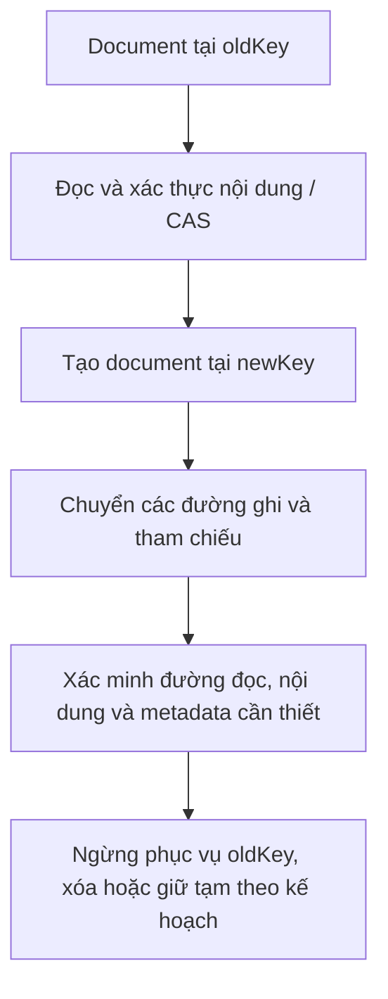

# Khóa bất biến, đổi khóa và di chuyển tài liệu trong Spring Data Couchbase

## 1. Vấn đề: đổi thuộc tính khác với đổi danh tính document

Trong Couchbase, một document được nhận diện bằng **document ID (key)** trong một **collection**. Với Spring Data Couchbase, thuộc tính gắn `@Id` ánh xạ sang document ID và các thao tác như `CouchbaseRepository.findById(id)` sử dụng chính ID đó.

Giả sử một nền tảng thương mại dùng key:

```text
order::acme::ORD-2026-0007
```

Sau vài tháng, doanh nghiệp muốn đổi mã hiển thị của đơn từ `ORD-2026-0007` thành `WEB-0007`. Nếu mã hiển thị cũng là thành phần của document ID, một thay đổi nghiệp vụ sẽ dẫn đến **đổi khóa**:

```text
Trước: order::acme::ORD-2026-0007
Sau:   order::acme::WEB-0007
```

Với Couchbase, đây là **hai ID khác nhau**. Thay giá trị thuộc tính `@Id` trong Java không tự khiến Couchbase đổi tên document cũ, chuyển các tham chiếu hay bảo toàn mọi metadata.

Vì thế, nguyên tắc thiết kế quan trọng là:

> **Một khi document ID đã được công bố cho các dịch vụ khác, hãy coi nó là định danh bất biến.** Nếu cần chuyển từ key cũ sang key mới, hãy thực hiện như một quy trình migration có kiểm soát.

Bài học giải thích vì sao cần khóa bất biến, các lựa chọn khi định danh nghiệp vụ thay đổi, quy trình di chuyển document trong cùng hoặc khác collection và cách kiểm soát CAS, TTL, transaction, repository, SQL++ và hoạt động của ứng dụng trong thời gian chuyển đổi.

## 2. “Bất biến” có nghĩa gì?

**Khóa bất biến** là document ID được xác định tại thời điểm tạo thực thể và được giữ nguyên trong suốt vòng đời của *cùng thực thể*. Điều này không có nghĩa document body bất biến: thuộc tính nội dung vẫn có thể được cập nhật nhiều lần.

Ví dụ:

```text
document ID: customer::acme::a9eaee95-5d6c-4776-b1fa-d0126b63106b

email:       old@example.com   -> new@example.com
displayName: Lan                -> Lan Anh
status:      active             -> suspended

document ID: giữ nguyên
```

Lợi ích của khóa bất biến:

1. **Liên kết ổn định:** document khác, cache, URL nội bộ, event và audit log có thể tiếp tục tham chiếu cùng ID.
2. **KV lookup rõ ràng:** không phải tìm ID mới sau mỗi lần đổi mã nghiệp vụ.
3. **Giảm rủi ro race condition:** cập nhật dữ liệu không phải tạo document mới và xóa document cũ.
4. **Đơn giản hóa idempotency:** request được retry có thể dùng lại ID của cùng thực thể.
5. **Phân tách danh tính và thuộc tính:** email, tên, mã hiển thị, trạng thái hoặc đơn vị tổ chức có thể thay đổi độc lập.

### 2.1. Chọn thành phần nào cho một khóa bền vững?

| Thành phần ứng viên | Có nên nằm trong key? | Lý do |
| --- | --- | --- |
| UUID cấp một lần cho thực thể | Thường nên | Không phụ thuộc tên/mã có thể đổi |
| Mã nghiệp vụ được cam kết không đổi và không tái sử dụng | Có thể | Hữu ích nếu API luôn biết mã |
| Tenant ID | Có thể | Phân biệt định danh khi nhiều tenant dùng chung collection; cần xét khả năng chuyển tenant |
| Email, số điện thoại, tên hiển thị | Thường không | Dễ đổi và có thể lộ dữ liệu cá nhân |
| Trạng thái đơn hàng, `updatedAt` | Không | Là dữ liệu biến động |
| CAS, phiên bản `@Version` | Không | Thay đổi theo thao tác ghi |
| Thời hạn TTL | Không | Là chính sách vòng đời, không phải danh tính |
| `warehouseId` hoặc `courseId` | Tùy mô hình | Phù hợp nếu tổ hợp xác định một trạng thái và các thành phần thật sự bất biến |

Điều kiện “bất biến” phải dựa vào **hợp đồng nghiệp vụ**, không phải tên trường. Một `sku` có thể không đổi ở công ty này nhưng được phép sửa ở công ty khác.

### 2.2. Phân biệt ID bất biến và khóa được tính lại

Khóa `progress::<tenant>::<learner>::<course>` hợp lý nếu mỗi bộ ba chỉ có **một document tiến độ hiện hành**. Khi người học đổi sang course khác, đó thường là **tiến độ của một tổ hợp khác**, tức thực thể khác, chứ không phải đổi ID của tiến độ cũ.

Ngược lại, nếu nghiệp vụ khẳng định “hồ sơ đăng ký” vẫn là một thực thể khi đổi course, không nên dùng `courseId` làm thành phần bất biến của hồ sơ ấy. Khi đó surrogate ID như `enrollment::<tenant>::<uuid>` bền vững hơn.

## 3. Namespace và phạm vi duy nhất: key không tồn tại một mình

Couchbase tổ chức dữ liệu theo **bucket → scope → collection → document**. Document ID phải duy nhất **trong collection**, không phải trên toàn bộ cluster.

Ví dụ:

```text
commerce.sales.orders / order::acme::o-101
commerce.audit.events / order::acme::o-101
```

Hai giá trị ID giống nhau không có nghĩa đây là cùng document vì chúng ở **hai collection khác nhau**.

Một định danh vật lý cần được hiểu trong ngữ cảnh collection đích. Đổi key trong cùng collection và chuyển document sang collection khác là **hai tình huống khác nhau**, nhưng cả hai cần xem xét đường đọc, quyền truy cập và tham chiếu.

**Prefix `order::` hoặc tenant `acme::` bên trong ID là quy ước ứng dụng**, không tự tạo collection hoặc kiểm soát quyền. Service phải xác thực và ủy quyền tenant trước khi đọc hay di chuyển dữ liệu. Với việc chuyển tenant, hãy kiểm soát cả quyền ở tenant nguồn và tenant đích.

## 4. Couchbase có thao tác “rename document key” không?

Trong các thao tác KV thông thường, Couchbase cho phép `insert`, `get`, `replace`, `upsert`, `remove` theo ID; **không có một thao tác KV rename ID tại chỗ đơn giản** giống đổi tên tệp trên filesystem.

Về mặt dữ liệu, đổi từ `oldKey` sang `newKey` thường cần:



Các bước đó không tự động là **một hành động nguyên tử**. Nếu hệ thống tiếp tục ghi vào document cũ trong lúc copy, bản mới có thể nhanh chóng lỗi thời. Nếu tạo mới thành công nhưng xóa cũ thất bại, hai document sẽ cùng tồn tại. Nếu xóa cũ trước khi tạo mới thành công, người dùng có thể mất khả năng truy cập.

**Không sửa `@Id` của một entity đang được quản lý rồi gọi `save` để giả định rằng document cũ sẽ biến mất.** Việc lưu entity mang một ID khác có thể nhắm đến một document khác; nó không tự cập nhật mọi tham chiếu đến ID cũ.

## 5. Ba chiến lược khi thông tin nghiệp vụ đổi

Trước khi thực hiện một cuộc migration, hãy xác định liệu bạn thực sự có cần đổi document ID không.

### 5.1. Giữ nguyên ID và cập nhật thuộc tính — lựa chọn ưu tiên

Giả sử customer dùng:

```text
customer::acme::<customerUuid>
```

Email đổi từ `first@example.com` sang `second@example.com`. Chỉ cần cập nhật các trường email trong body; document key không đổi.

Nếu API tìm customer theo email, dùng một trong hai cơ chế:

- Tra cứu SQL++ bằng index trên `tenantId` và `normalizedEmail`.
- Duy trì một document ánh xạ/giữ chỗ email → customer ID nếu có yêu cầu duy nhất và đường đọc KV.

Với cách giữ chỗ, thay email có thể cần transaction hoặc quy trình bù trừ để cập nhật các document liên quan. **Unique email là ràng buộc nghiệp vụ, không tự xuất hiện chỉ vì customer có UUID.**

### 5.2. Giữ khóa chính, bổ sung alias cho mã cũ hoặc mã mới

Nếu nhiều client vẫn biết `legacyOrderCode` nhưng hệ thống đã dùng UUID, có thể xây dựng một ánh xạ:

```text
order::acme::12e40c58-3f8e-4c57-bf68-49def12844b7
order-code-alias::acme::OLD-1007
order-code-alias::acme::WEB-1007
```

Nội dung alias có thể trỏ tới cùng `orderId`:

```json
{
  "docType": "order-code-alias",
  "tenantId": "acme",
  "orderId": "12e40c58-3f8e-4c57-bf68-49def12844b7"
}
```

Khi đổi mã hiển thị, thay đổi alias liên quan mà **không đổi khóa chính của Order**. Đây là dạng *indirection*: ID hiển thị thay đổi nhưng định danh nội bộ bất biến.

Cần quản lý vòng đời alias: không giải quyết bằng vòng lặp alias vô hạn, tránh tái sử dụng mã gây trỏ nhầm, thiết kế thời hạn alias nếu cần và kiểm soát tính nhất quán khi thêm/xóa ánh xạ.

### 5.3. Di chuyển sang ID mới — khi thay đổi không thể tránh

Di chuyển thực sự cần thiết khi:

- Quy ước ID cũ thiếu namespace tenant và có nguy cơ va chạm.
- Chuyển từ key nghiệp vụ sang UUID hoặc thay đổi prefix/delimiter.
- Chuyển collection do thay đổi mô hình bucket/scope/collection.
- Gộp hoặc tách miền dữ liệu khiến một document phải được nhận diện theo khóa khác.
- Cần đổi mã nghiệp vụ từng được dùng trực tiếp làm key và không thể giữ alias làm lớp tương thích.

Lúc này phải lập **kế hoạch di chuyển dữ liệu** thay vì coi đó là một lần cập nhật trường Java.

## 6. Quy trình di chuyển an toàn: chuẩn bị trước khi copy

Trước khi bắt đầu, cần xác định rõ:

| Câu hỏi | Tại sao quan trọng? |
| --- | --- |
| Document cũ nằm trong collection nào? | Hai collection có thể dùng cùng ID |
| Document mới sẽ nằm ở đâu? | Cần quyền RBAC và cấu hình repository/template phù hợp |
| Ai đang ghi vào key cũ? | Tránh lost update và bản sao lỗi thời |
| Có document khác lưu ID cũ không? | Cần thay tham chiếu hoặc giữ alias |
| TTL có đang áp dụng không? | Copy thiếu expiry có thể giữ dữ liệu quá lâu hoặc làm nó hết hạn sớm |
| Có XATTR, binary payload, metadata đặc biệt không? | Copy riêng JSON body có thể bỏ sót dữ liệu |
| Có yêu cầu giao dịch nguyên tử không? | Copy, đổi tham chiếu và xóa thường là nhiều thao tác |
| Có client/service phiên bản cũ không? | Đường đọc cũ có thể tiếp tục phụ thuộc key cũ |
| Retry và rollback thực hiện thế nào? | Tránh tạo bản sao mới sai hoặc xóa dữ liệu khi xảy ra lỗi |

### 6.1. Chia migration thành các pha có điểm kiểm soát

1. **Khảo sát:** xác định quy tắc ID hiện tại, số lượng document, dữ liệu nhạy cảm, TTL và các hệ thống tham chiếu.
2. **Định nghĩa hợp đồng v2:** prefix/namespace, delimiter, canonicalization, version, chính sách collision và test vectors.
3. **Chuẩn bị đường đọc mới:** hỗ trợ đọc v2; trong giai đoạn chuyển tiếp có thể fallback đọc v1 sau khi đã xác minh quyền.
4. **Kiểm soát writer:** tạm dừng ghi, chuyển writer về một luồng được kiểm soát hoặc dùng transaction/điều phối cập nhật phù hợp.
5. **Copy có điều kiện:** đọc document nguồn và tạo document đích với chính sách chống ghi đè.
6. **Xác minh:** so sánh dữ liệu, tham chiếu, quyền, TTL và đường đọc.
7. **Cutover:** chuyển mọi writer/reader sang v2, theo dõi lỗi và độ lệch.
8. **Dọn v1:** chỉ xóa sau khi dữ liệu đã được xác minh, các service cũ đã ngừng sử dụng hoặc còn lớp tương thích phù hợp.

Nếu không thể dừng ghi, bài toán trở nên khó hơn: cần bảo toàn **thứ tự thay đổi** và giải quyết cập nhật xảy ra sau lúc copy. Chỉ bật dual-write ở hai nơi mà không có cơ chế phối hợp lỗi/rollback có thể làm hai bản diverge.

## 7. Ví dụ Java SDK: copy rồi remove trong cửa sổ ngừng ghi

Giả sử ứng dụng đang bảo trì, **không còn writer nào cập nhật document nguồn**, source và target đều chứa JSON thông thường và tác vụ di chuyển được xác nhận chỉ áp dụng cho document không TTL, không XATTR cần chuyển.

Mã sau minh họa các thao tác KV cơ bản; đây **không phải** giao thức migration đủ an toàn cho hệ thống đang có ghi đồng thời.

```java
import com.couchbase.client.java.Collection;
import com.couchbase.client.java.kv.GetResult;
import com.couchbase.client.java.json.JsonObject;
import static com.couchbase.client.java.kv.RemoveOptions.removeOptions;

public final class BasicKeyMove {

    private BasicKeyMove() {}

    public static void moveJsonDuringMaintenance(
            Collection source,
            Collection target,
            String oldKey,
            String newKey) {

        if (oldKey.equals(newKey) && source == target) {
            throw new IllegalArgumentException(
                    "Không được di chuyển sang cùng key trong cùng collection");
        }

        // 1. Đọc document nguồn và CAS hiện tại.
        GetResult found = source.get(oldKey);
        JsonObject content = found.contentAsObject();

        // 2. Chỉ tạo mới nếu key đích chưa tồn tại.
        // DocumentExistsException phải được xử lý ở tầng điều phối.
        target.insert(newKey, content);

        // 3. Chỉ xóa nguồn nếu CAS vẫn đúng.
        // Nếu CAS thay đổi, remove thất bại: phải xử lý bản sao đích
        // đang tồn tại, tuyệt đối không xóa mù hay ghi đè dữ liệu.
        source.remove(oldKey, removeOptions().cas(found.cas()));
    }
}
```

**Giới hạn cố ý của ví dụ:**

- Không tự đảm bảo copy và remove là **atomic**.
- Không giữ nguyên CAS: document mới có CAS mới.
- Không chuyển TTL/expiry, XATTR hoặc mọi metadata khác một cách tự động.
- `contentAsObject()` chỉ phù hợp khi nguồn là JSON object tương thích.
- Nếu `target.insert` thành công nhưng `source.remove` thất bại, cả hai document có thể cùng tồn tại.
- Nếu mất kết nối sau `insert`, lần retry thấy key đích tồn tại nhưng chưa biết có phải kết quả lần trước hay là document của thực thể khác; phải đối chiếu một identity/migration record ổn định.
- Thử `source == target` chỉ so sánh object reference trong Java; ứng dụng thực tế phải xác minh **định danh collection vật lý** theo cấu hình, không dùng phép so sánh này như bảo vệ đầy đủ.

Để giảm rủi ro trên production, dùng quy trình điều phối có log migration, kiểm tra content/identity, khả năng retry có idempotency, và — khi đáp ứng yêu cầu — transaction Couchbase.

### 7.1. Vì sao cần kiểm tra CAS của nguồn?

CAS là giá trị phiên bản do Couchbase cung cấp để phát hiện document bị thay đổi sau khi đọc. Với một writer khác:

```text
T0: Migrator đọc oldKey (CAS = 100)
T1: Writer cập nhật oldKey (CAS = 101)
T2: Migrator insert newKey với dữ liệu từ T0
T3: Migrator cố remove oldKey với CAS = 100 -> xung đột
```

Việc `remove` thất bại giúp tránh xóa nhầm bản mới ở oldKey, nhưng **không tự sửa newKey vừa copy từ dữ liệu cũ**. Tác vụ di chuyển phải ghi nhận và hòa giải trạng thái, không chỉ bắt lỗi rồi coi như thành công.

Trong Spring Data Couchbase, `@Version` thường tích hợp cơ chế kiểm soát phiên bản/CAS khi cập nhật entity. Không nhầm `@Version` với phiên bản quy tắc document key (v1/v2) và không cố giữ nguyên CAS giữa hai document khác ID.

## 8. Giao dịch khi cần nhiều thao tác cùng thành công

Couchbase hỗ trợ **distributed ACID transactions** trong những điều kiện và API được tài liệu hóa. Một luồng di chuyển có thể cần đọc document cũ, tạo document mới và xóa document cũ **trong cùng transaction** nếu đó là ranh giới nguyên tử bắt buộc và các thao tác/collection tham gia được hỗ trợ.

Tuy nhiên, không nên suy luận rằng “bật transaction” là xong toàn bộ migration:

- Chỉ những thao tác **tham gia transaction** mới nằm trong ranh giới nguyên tử đó; event ngoài, cache, các hệ thống khác và các client cũ không tự được cập nhật.
- Một số thuộc tính như expiry/TTL, XATTR, thao tác KV đặc biệt hoặc cấu hình durability có giới hạn/đường xử lý riêng cần kiểm tra theo phiên bản SDK.
- Transaction có thể bị retry do xung đột; phần callback không được thực hiện side effect ngoài transaction một cách không-idempotent.
- Nếu document đích đã tồn tại, cần xác định đó là kết quả retry hợp lệ hay va chạm với thực thể khác; không ghi đè mù.
- Đối với chuyển đổi hàng loạt trên nhiều thực thể, một transaction khổng lồ thường không phù hợp. Cần chia batch và có điểm ghi nhận tiến độ.

Trong ứng dụng Spring Data Couchbase, hãy chọn API giao dịch tương thích với **phiên bản Spring Data và Couchbase SDK thực tế**. Tài liệu này không giả định annotation transaction của JPA hay `@Transactional` bất kỳ sẽ tự biến chuỗi `findById` → `save` → `delete` thành một cuộc di chuyển nguyên tử.

### 8.1. Khi nào cần bù trừ (compensation)?

Nếu không thể dùng transaction cho toàn bộ phạm vi, thiết kế quy trình kiểu *saga* hoặc migration state machine:

```text
PLANNED
  -> TARGET_CREATED
  -> REFERENCES_SWITCHED
  -> SOURCE_RETIRED
  -> VERIFIED
```

Mỗi trạng thái cần quy tắc retry rõ ràng. Ví dụ:

- `TARGET_CREATED` nhưng chưa đổi tham chiếu: reader tiếp tục ưu tiên source; tác vụ có thể kiểm tra target rồi chạy tiếp.
- `REFERENCES_SWITCHED` nhưng source còn tồn tại: không xóa vội nếu client cũ vẫn cần đọc; có thể giữ alias hoặc read fallback.
- `SOURCE_RETIRED` nhưng phát hiện lỗi body: rollback chỉ an toàn nếu còn nguồn/bản sao/backup hợp lệ và writer đã được kiểm soát.

Lưu trạng thái ở nơi đủ bền vững và có định danh công việc `migrationId`; cùng một batch chạy lại không được ngẫu nhiên tạo một key mới.

## 9. Spring Data Couchbase: giữ `@Id` bất biến trong entity

Một mẫu entity gắn khóa thay thế ổn định:

```java
import java.time.Instant;
import org.springframework.data.annotation.Id;
import org.springframework.data.annotation.Version;
import org.springframework.data.couchbase.core.mapping.Document;

@Document
public class OrderDocument {

    @Id
    private String id;

    private String tenantId;
    private String orderId;
    private String displayOrderCode;
    private String status;
    private Instant updatedAt;

    @Version
    private Long version;

    protected OrderDocument() {}

    public OrderDocument(String id, String tenantId, String orderId,
                         String displayOrderCode) {
        this.id = id;
        this.tenantId = tenantId;
        this.orderId = orderId;
        this.displayOrderCode = displayOrderCode;
        this.status = "NEW";
        this.updatedAt = Instant.now();
    }

    public String getId() { return id; }

    public void renameDisplayCode(String newCode) {
        this.displayOrderCode = newCode;
        this.updatedAt = Instant.now();
    }
}
```

ID **không có setter**, còn mã hiển thị có phương thức cập nhật riêng. Điều này không ngăn hoàn toàn mọi hình thức can thiệp qua reflection/mapping, nhưng giúp thiết kế object model thể hiện đúng ý định.

Repository:

```java
import org.springframework.data.couchbase.repository.CouchbaseRepository;

public interface OrderRepository
        extends CouchbaseRepository<OrderDocument, String> {
}
```

Đọc và đổi mã hiển thị:

```java
public void updateDisplayCode(OrderRepository repository,
                              String authorizedOrderId,
                              String newCode) {
    OrderDocument order = repository.findById(authorizedOrderId)
            .orElseThrow();

    order.renameDisplayCode(newCode);
    repository.save(order);
}
```

Đoạn code giả định tầng gọi đã xác minh quyền truy cập document và `newCode` hợp lệ. Cơ chế `@Version` có thể phát hiện xung đột cập nhật trên entity được Spring Data quản lý; ứng dụng phải xử lý lỗi phiên bản và retry có kiểm soát nếu cần. Nếu mã hiển thị phải duy nhất theo tenant, chỉ `save` body mới **không tự đảm bảo** điều đó: phải có quy tắc ghi độc lập để quản lý uniqueness.

### 9.1. Cách không nên làm

```java
// Không nên coi thay @Id là thao tác rename document.
order.setId("order::acme::NEW-CODE"); // giả định có setter
repository.save(order);
```

Đoạn trên minh họa **anti-pattern**, không phải code được khuyến nghị. Document cũ không tự bị xóa; bộ nhớ cache, tham chiếu, sự kiện và các writer khác vẫn có thể trỏ tới oldKey.

Nếu cần đổi ID thật sự, tạo một **entity mới** hoặc document mới ở đích và dùng một workflow migration có kiểm soát.

## 10. Bản ghi phụ: alias/redirect để giảm ảnh hưởng với client cũ

Một cách chuyển đổi ít phá vỡ là giữ **stable ID** và cung cấp ánh xạ từ mã cũ hoặc key cũ:

```text
Client cũ -> key alias -> stable document ID -> Order
Client mới -------------------------------> Order
```

Ví dụ JSON alias:

```json
{
  "docType": "key-alias",
  "tenantId": "acme",
  "oldKey": "order::acme::ORD-2026-0007",
  "targetKey": "order::acme::12e40c58-3f8e-4c57-bf68-49def12844b7",
  "migrationId": "move-order-code-v2"
}
```

Quy tắc vận hành:

1. Alias phải trỏ một cách có chủ đích đến **ID mục tiêu được xác thực**; không cho phép người gọi tùy ý cung cấp `targetKey` để vượt kiểm tra tenant.
2. Tránh chuỗi alias chồng lên nhau như `A → B → C → D`; ưu tiên alias trỏ trực tiếp tới stable ID.
3. Có chính sách TTL/giữ lại alias dựa trên tuổi đời client, log và mục tiêu tương thích.
4. Không coi alias là một bản sao dữ liệu nghiệp vụ đầy đủ.
5. Nếu xóa/thay target, cập nhật hoặc vô hiệu hóa alias phù hợp; không để alias trỏ đến tài liệu không còn hợp lệ.
6. Đo lường tần suất client vẫn gọi key cũ để biết khi nào có thể dừng hỗ trợ.

Nếu dùng alias để bảo đảm mã nghiệp vụ duy nhất, thao tác cấp alias phải có ngữ nghĩa chống ghi đè (thường dùng `insert`) và việc đồng bộ alias–document cần transaction hoặc cơ chế bù trừ thích hợp.

## 11. Đổi collection khác với đổi document key

Một tài liệu có thể chuyển từ `commerce.sales.orders` sang `commerce.archive.orders` mà **giữ nguyên chuỗi ID**, nhưng đó vẫn là hai document vật lý khác nhau:

```text
SOURCE: commerce.sales.orders   / order::acme::o-101
TARGET: commerce.archive.orders / order::acme::o-101
```

Với Spring Data Couchbase:

- Repository gắn với collection nguồn sẽ không tự nhìn thấy document ở collection đích.
- `CouchbaseTemplate`/SDK cần chỉ rõ bucket, scope, collection của từng thao tác.
- Quyền đọc/ghi trên collection đích phải được cấp phù hợp.
- Các query SQL++ và chỉ mục được thiết kế cho collection nguồn **không tự chuyển** sang collection đích.
- Chính sách TTL, backup, lifecycle hoặc chức năng operational khác có thể khác giữa hai collection.

Nếu đồng thời đổi cả collection và key, cần theo dõi đầy đủ bộ `(sourceCollection, oldKey) → (targetCollection, newKey)`. Chỉ lưu hai chuỗi key không đủ cho một sổ migration chính xác.

### 11.1. Di chuyển tenant

Nếu key chứa tenant, ví dụ `order::acme::o-101`, việc chuyển một đơn sang tenant khác có thể đòi đổi key thành `order::globex::o-101`. Nhưng đây còn là thay đổi ranh giới quyền sở hữu dữ liệu.

Trước khi di chuyển phải xác nhận:

- Nghiệp vụ thực sự cho phép thay tenant của thực thể.
- Caller được phép thao tác trên cả nguồn và đích.
- Tài liệu liên quan, audit và các tham chiếu không bị “mồ côi”.
- Truy vấn SQL++ và dữ liệu body không còn gắn tenant cũ ngoài ý muốn.

Trong nhiều hệ thống, **không nên** cho phép một đơn hàng chuyển tenant; có thể cần tạo một thực thể mới theo quy tắc nghiệp vụ thay vì đổi định danh.

## 12. TTL, CAS, XATTR và metadata khi copy

Di chuyển một document không chỉ là copy JSON:

| Thành phần | Điều cần làm rõ |
| --- | --- |
| **Body** | JSON object, array hay binary? Copy bằng đúng kiểu dữ liệu |
| **CAS** | CAS thuộc phiên bản của document; document đích nhận CAS mới |
| **TTL/expiry** | Lấy expiry nguồn khi cần và áp dụng chính sách tương đương cho đích |
| **XATTR** | Nếu ứng dụng dựa vào extended attributes, phải có bước chuyển phù hợp |
| **Trường `@Version`** | Không nhầm giá trị CAS của source với metadata cho target |
| **Indexes** | Chỉ mục thuộc collection và dữ liệu body, không tự copy cùng document |
| **Durability** | Tùy mức đảm bảo ghi/xóa yêu cầu; không suy ra tất cả bước bền vững như nhau |
| **Tham chiếu ngoại** | ID cũ có thể xuất hiện trong body của document khác, cache, event |
| **Bảo mật** | Quyền đọc source và ghi target phải phù hợp RBAC, tránh lộ dữ liệu giữa tenant |

Ví dụ document nguồn còn 30 phút TTL. Nếu code chỉ `get(oldKey)` và `insert(newKey, body)` mà không truyền expiry, document đích có thể tồn tại theo chính sách mặc định khác hoàn toàn. Nếu chỉ đặt TTL “30 phút từ bây giờ” sau một quá trình copy kéo dài, thời điểm hết hạn cũng có thể bị kéo dài ngoài dự kiến.

Để giữ đúng thời điểm hết hạn, cần **đọc và bảo toàn expiry thực tế** qua API phù hợp, rồi chọn cách thiết lập trên target tương ứng. Cũng phải kiểm tra document có thể hết hạn trong lúc migration hay không. Không mặc định các tùy chọn preserve-expiry của cập nhật **cùng document** áp dụng nguyên xi cho việc insert một key mới.

## 13. SQL++ khi cần truy xuất theo mã đã đổi

Nếu chọn document ID là UUID bất biến, những mã nghiệp vụ có thể đổi vẫn cần được truy vấn.

Ví dụ document Order lưu:

```json
{
  "docType": "order",
  "tenantId": "acme",
  "orderId": "12e40c58-3f8e-4c57-bf68-49def12844b7",
  "displayOrderCode": "WEB-0007",
  "status": "PAID"
}
```

Tạo chỉ mục minh họa:

```sql
-- Bucket commerce, scope sales, collection orders.
CREATE INDEX ix_order_tenant_display_code
ON `commerce`.`sales`.`orders`(
    tenantId, displayOrderCode
);
```

Tra cứu qua SQL++:

```sql
SELECT META(o).id AS documentId,
       o.displayOrderCode, o.status
FROM `commerce`.`sales`.`orders` AS o
WHERE o.tenantId = $tenantId
  AND o.displayOrderCode = $displayOrderCode;
```

Ứng dụng **bind tham số** `$tenantId`, `$displayOrderCode` bằng query API, không nối trực tiếp dữ liệu client vào câu SQL++. Index cho phép truy vấn theo mã nhưng **không tự tạo unique constraint** như một unique index quan hệ.

Chọn mức scan consistency phù hợp nếu truy vấn phải nhìn thấy thay đổi ngay sau ghi; khi đã biết ID, KV `findById` thường là đường đọc trực tiếp hơn. Khi chuyển document sang collection khác, phải tạo/điều chỉnh chỉ mục ở đúng collection đích và cập nhật đường query tương ứng.

## 14. Zero-downtime migration: đừng đánh giá thấp writer cũ

Nếu ứng dụng không thể dừng ghi, cần tính đến trường hợp:

```text
T0: copy oldKey -> newKey
T1: service phiên bản cũ ghi oldKey
T2: service phiên bản mới ghi newKey
T3: hai bản chứa dữ liệu khác nhau
```

Chỉ cho phép *dual-read* không giải quyết được **dual-write divergence**. Có một số chiến lược thiết kế cần cân nhắc:

- **Chuyển writer về một điểm chính** trước khi copy; mọi cập nhật sau đó đi qua lớp điều phối để ghi đúng phiên bản authoritative.
- **Đọc tương thích:** reader ưu tiên newKey, fallback oldKey trong giai đoạn chuyển đổi, nhưng cần quy tắc xác định nguồn sự thật.
- **Change capture/đồng bộ thay đổi:** chỉ sử dụng khi có cơ chế theo dõi phiên bản, thứ tự và xử lý trùng/mất event đáng tin cậy; không chép mù các cập nhật đến muộn.
- **Transaction cho nhóm thao tác đủ nhỏ:** nếu đáp ứng giới hạn và API hỗ trợ, có thể giữ một số thay đổi cùng ranh giới nguyên tử.
- **Maintenance window:** giải pháp đơn giản và dễ chứng minh hơn khi lượng dữ liệu không lớn hoặc không đòi hoàn toàn liên tục.

Giải pháp tốt nhất phụ thuộc SLA, lượng dữ liệu, số dịch vụ và khả năng điều phối writer. Một “script copy nhanh” không đủ để chứng minh migration không mất dữ liệu.

### 14.1. Reactive API và retry

Với `ReactiveCouchbaseRepository` hoặc Reactor, phép retry/resubscription có thể làm callback được thực thi lại. Nếu quy trình migration tạo ngẫu nhiên `newKey` bên trong mỗi lần chạy lại, cùng một migration có thể sinh ra nhiều document đích.

Cần xác định `newKey` **một lần theo migrationId**, truyền lại cùng giá trị qua retry, và làm mỗi trạng thái có thể chạy lại an toàn. Đây là bài toán idempotency ở cấp workflow, không tự được giải quyết khi đổi từ API blocking sang reactive.

## 15. Các tình huống lựa chọn phương án

| Tình huống | Phương án thường hợp lý | Cần đặc biệt chú ý |
| --- | --- | --- |
| Customer đổi email | Giữ UUID làm ID; cập nhật body và ánh xạ email | Uniqueness email, PII và giao dịch |
| Đơn hàng đổi mã hiển thị | Giữ stable ID; query/alias theo mã | Client cũ và cache theo mã |
| Key v1 thiếu tenant | Migration sang v2 có namespace | Va chạm khi hai tenant từng dùng cùng key |
| Chuyển document sang archive collection | Copy/move có điều phối | TTL, RBAC, chỉ mục và đường đọc mới |
| Cập nhật courseProgress có khóa ghép bất biến | Giữ key, cập nhật nội dung với CAS | Không đổi `courseId` nếu đó là danh tính tiến độ |
| Chuyển owner tenant | Quyết định nghiệp vụ trước, sau đó migration hoặc tạo thực thể mới | Quyền truy cập, audit và tham chiếu |
| Chuyển key nghiệp vụ sang UUID | Tạo ID bền vững, alias và migration | Retry, tương thích API, giữ mã cũ |
| Đổi delimiter `.` thành `::` | Migration versioned key format | Reader/writer chạy hai phiên bản |

### 15.1. Ví dụ kế hoạch chuyển key v1 sang v2

Bản cũ:

```text
v1 = order.<tenant>.<externalCode>
```

Bản mới:

```text
v2 = order::<tenant>::<orderUuid>
```

Một kế hoạch phù hợp có thể là:

1. Cấp một `orderUuid` bất biến cho từng order, lưu trong body và mapping v1→v2.
2. Xác minh không có hai document v1 khác nhau bị ánh xạ vào cùng UUID/ID v2.
3. Triển khai reader hỗ trợ cả hai định dạng; không tự coi bất kỳ oldKey nào là an toàn nếu chưa kiểm tra quyền.
4. Đóng hoặc điều phối writer v1, chuyển dữ liệu sang v2 có ghi trạng thái.
5. Chuyển những hệ thống tham chiếu hoặc mã hóa oldKey; dùng alias khi cần.
6. Xác minh số lượng, nội dung, expiry, đọc thực tế và lỗi qua các service.
7. Loại bỏ v1 khi đã đủ điều kiện; lưu nhật ký audit và kế hoạch phục hồi.

## 16. Kiểm thử migration và khả năng rollback

| Kiểm thử | Kỳ vọng |
| --- | --- |
| Target chưa tồn tại, source ổn định | Tạo target đúng và xác minh được |
| Target đã tồn tại từ migration hợp lệ | Nhận diện cùng thực thể; retry tiếp tục an toàn |
| Target tồn tại nhưng thuộc thực thể khác | Dừng và báo collision, không overwrite |
| Source thay đổi sau lúc đọc | CAS phát hiện xung đột; không xóa source |
| Lỗi mạng sau `target.insert` | Có thể xác định target đã được tạo mà không sinh key ngẫu nhiên mới |
| Lỗi trước khi xóa source | Có trạng thái xử lý lại; không cho hai writer độc lập |
| TTL còn rất ngắn | Có chính sách copy/skip/expiry chính xác |
| JSON chứa XATTR hoặc payload đặc biệt | Có cơ chế chuyển phù hợp, không chỉ copy body |
| Client cũ tiếp tục truy cập key cũ | Có fallback/alias hoặc thông báo lỗi được kiểm soát |
| Di chuyển qua collection | Repo/query/RBAC/index trỏ đúng đích |
| Thay mã nghiệp vụ nhưng stable ID giữ nguyên | Chỉ cập nhật body và ánh xạ, không thay ID |
| Rollback sau cutover | Có bản sao/backup và cơ chế hòa giải thay đổi sau cutover |

### 16.1. Bài tập thực hành

Một ứng dụng SaaS dùng key:

```text
customer::<tenantId>::<email>
```

Ứng dụng muốn chuyển thành:

```text
customer::<tenantId>::<customerUuid>
```

Trong lúc chuyển đổi, khách hàng vẫn có thể đổi email, một số service chỉ biết key cũ và hai tenant có thể cùng một địa chỉ email.

**Yêu cầu:**

1. Chỉ ra vì sao dùng email làm document ID kém ổn định và có rủi ro lộ thông tin.
2. Thiết kế cơ chế cấp UUID bất biến cho từng customer, xử lý retry.
3. Đề xuất alias `email → customerUuid` và cách chống hai customer cùng email trong một tenant.
4. Nêu các pha migration để không mất cập nhật khi khách đổi email trong lúc copy.
5. Quy định kiểm tra TTL, CAS, tham chiếu, index và rollback.

**Gợi ý:** cấp và lưu UUID ổn định; dùng tenant làm namespace theo collection đã chọn; xây dựng alias/giữ chỗ email bằng dạng định danh an toàn, tránh lộ PII. Điều phối writer trước cutover hoặc dùng transaction/protocol phù hợp; không chỉ sao chép JSON rồi xóa source. Hỗ trợ reader cũ có kiểm soát trong thời gian chuyển đổi, đối chiếu identity của target và chỉ loại bỏ key cũ sau khi xác minh.

## 17. Checklist trước khi đổi key trên dữ liệu thật

1. Đã chứng minh **không thể chỉ sửa thuộc tính trong body** mà giữ nguyên ID?
2. Hợp đồng key v2 có phạm vi duy nhất, delimiter, chuẩn hóa và kiểm soát byte length rõ ràng?
3. Đã kiểm tra quyền tenant và bucket/scope/collection nguồn–đích?
4. Đã biết toàn bộ writer, reader, job, event và document tham chiếu ID cũ?
5. Đã chọn một nguồn sự thật, tránh hai writer độc lập trong thời gian chuyển?
6. Tác vụ copy có `migrationId` ổn định, kiểm tra identity và `insert-if-absent` tại target?
7. Có xử lý source thay đổi sau lúc đọc, lỗi CAS và target tạo thành công nhưng source chưa xóa?
8. Có kế hoạch giữ nguyên hoặc điều chỉnh có chủ đích TTL, XATTR, loại body, durability?
9. Có giải pháp giao dịch hoặc bù trừ phù hợp với số document và SLA?
10. Đã cập nhật repository, `CouchbaseTemplate`, reactive reader và query SQL++ ở đích?
11. Đã cập nhật alias/lookup, cache, event, URL hoặc các tham chiếu cần thiết?
12. Đã thử retry, mất mạng giữa hai bước, collision key đích và rollback?
13. Đã thiết lập quan sát: số lượng copy, lỗi đọc, số writer cũ, data mismatch và tần suất fallback?
14. Có tiêu chí cụ thể để ngừng hỗ trợ oldKey và xóa dữ liệu cũ?
15. Đã kiểm tra backup/khả năng khôi phục trước khi thay đổi hàng loạt?

## Kết luận

Trong Spring Data Couchbase, document ID nên được xem là **bất biến trong vòng đời của thực thể**. Khi một email, SKU hay mã hiển thị thay đổi, ưu tiên giữ stable ID và cập nhật thuộc tính nghiệp vụ hoặc ánh xạ alias. Nếu buộc phải đổi key hoặc chuyển collection, hãy coi đó là **migration gồm nhiều thao tác**, không phải sửa `@Id` rồi gọi `save`. Quy trình đúng cần kiểm soát writer, xác minh identity, ngữ nghĩa `insert`, CAS, TTL, tham chiếu, giao dịch hoặc bù trừ, truy vấn SQL++ và khả năng retry/rollback. Thiết kế này giúp tầng dữ liệu Couchbase ổn định ngay cả khi quy tắc đặt tên và cấu trúc hệ thống thay đổi.
