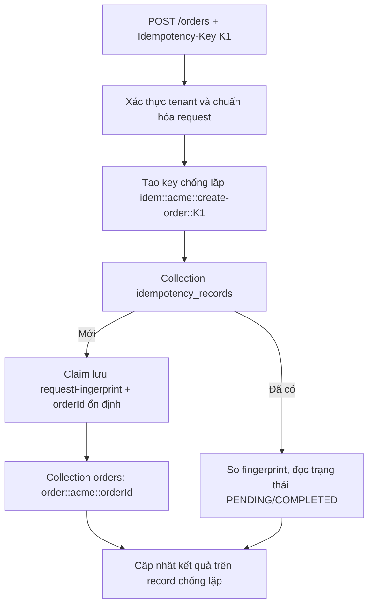
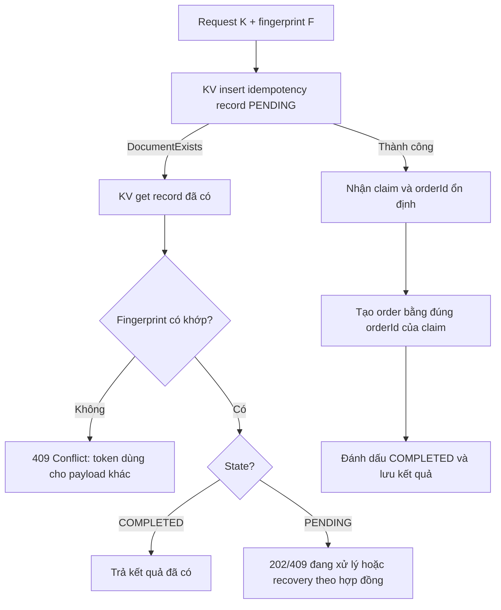

# Idempotency key và xử lý yêu cầu tạo dữ liệu lặp trong Spring Data Couchbase

## 1. Vấn đề: một yêu cầu có thể được thực thi nhiều lần

Một ứng dụng Spring Boot nhận yêu cầu tạo đơn hàng:

```http
POST /api/orders
Idempotency-Key: 9c2e8f27-1d59-495b-b8b5-3f38a679fc19
Content-Type: application/json

{"customerId":"c-17","sku":"JAVA-101","quantity":1}
```

Server ghi đơn vào Couchbase, nhưng kết nối mạng bị ngắt trước khi client nhận phản hồi. Client không biết đơn đã được tạo hay chưa nên gửi lại **cùng yêu cầu**. Nếu server sinh một UUID mới rồi tạo đơn lần nữa, hệ thống có thể lưu hai đơn, gửi hai thông báo, thậm chí thu tiền hai lần.

```text
Lần 1: POST -> order::acme::uuid-A -> đã ghi thành công -> mất phản hồi
Lần 2: POST -> order::acme::uuid-B -> lại ghi thành công -> trùng nghiệp vụ
```

Đây là bài toán **idempotency**: thực thi lại cùng một yêu cầu tạo dữ liệu phải cho ra **một kết quả nghiệp vụ tương ứng**, thay vì nhân đôi tác dụng.

Trong Spring Data Couchbase, cần phân biệt ba thứ:

1. **Document ID**: khóa của một document nghiệp vụ, chẳng hạn `order::acme::<orderUuid>`, được ánh xạ qua `@Id`.
2. **Idempotency key**: token đại diện **một ý định/yêu cầu cụ thể** mà client hoặc hệ thống điều phối phải giữ ổn định qua retry.
3. **Khóa tra cứu record chống lặp**: document ID mà server tự xây dựng từ tenant, thao tác và idempotency key, dùng để lưu trạng thái xử lý yêu cầu.

Idempotency key không mặc nhiên là document ID của Order. Hai giá trị có thể liên hệ với nhau nhưng phục vụ **hai mục tiêu khác nhau**: một cái nhận diện yêu cầu, cái còn lại nhận diện thực thể.

> **Mục tiêu:** thiết kế xử lý tạo dữ liệu lặp bằng Couchbase KV và Spring Data, hiểu tính nguyên tử của `insert-if-absent`, lưu dấu yêu cầu, tái sử dụng business ID, xử lý timeout/CAS/TTL và phân biệt chống lặp trong database với xử lý side effect bên ngoài.

## 2. Idempotent có nghĩa gì — và không có nghĩa gì?

Với một API tạo mới, hợp đồng idempotent thường là: nếu cùng principal/tenant, cùng loại thao tác, cùng idempotency key và cùng nội dung có ý nghĩa nghiệp vụ được gửi nhiều lần trong cửa sổ hiệu lực, hệ thống xử lý như **một yêu cầu logic**. Các lần gọi sau nhận lại kết quả đã có hoặc trạng thái đang xử lý, không tạo thêm thực thể.

Ví dụ:

```text
K1 + payload A  -> tạo order O1 -> trả O1
K1 + payload A  -> phát lại kết quả O1
K1 + payload B  -> báo xung đột: token đã dùng cho payload khác
K2 + payload A  -> yêu cầu logic mới; có thể tạo O2 nếu nghiệp vụ cho phép
```

**Giới hạn quan trọng:**

- Idempotency **không** ngăn hai yêu cầu có **token khác nhau** tạo cùng một thực thể theo quy tắc nghiệp vụ. Nếu SKU, email hoặc externalOrderId phải duy nhất, cần thêm ràng buộc duy nhất riêng.
- Idempotency không bảo đảm “chỉ một lần thực thi vật lý” của mọi đoạn code. Với retry và lỗi phân tán, một bước có thể bị thử lại; điều cần bảo đảm là **không lặp tác dụng nghiệp vụ ngoài dự kiến**.
- Không thể hứa “exactly once” cho thanh toán, email, Kafka hoặc dịch vụ ngoài chỉ nhờ một document Couchbase. Các side effect phải có cơ chế idempotency hoặc giao dịch/outbox tương ứng.
- Khi record chống lặp hết TTL hoặc bị xóa, hệ thống có thể không còn nhớ token cũ. Phạm vi bảo đảm vì thế phụ thuộc **thời gian lưu dấu** và kiến trúc lưu trữ.

## 3. Phân biệt ba lớp khóa

Giả sử đơn O1 thuộc tenant `acme` và được tạo từ request token `K1`:

```text
Client token:  K1 = 9c2e8f27-1d59-495b-b8b5-3f38a679fc19

KV idempotency record:
idem::acme::create-order::9c2e8f27-1d59-495b-b8b5-3f38a679fc19

KV business document:
order::acme::a8f0fc49-0c60-4c07-83f4-ab73a64dfed3
```

Có thể bố trí hai loại document ở hai collection riêng:



Cấu trúc trên là **một lựa chọn kiến trúc**, không phải yêu cầu Couchbase bắt buộc phải có hai collection. Điều bắt buộc là tính duy nhất của document ID được đánh giá **theo collection**, cùng với khả năng xử lý race khi nhiều request đến đồng thời.

### 3.1. Phạm vi của idempotency key

Không nên dùng trực tiếp token `K1` như khóa toàn cục nếu hai tenant có thể tự phát sinh cùng token. Một mẫu thực tế:

```text
idem::<tenant-id>::<operation>::<opaque-client-token>
```

Ví dụ:

```text
idem::acme::create-order::K1
idem::globex::create-order::K1
idem::acme::refund-order::K1
```

Trong hệ thống có nhiều chủ thể thao tác dưới cùng tenant, đôi khi còn phải đưa `authorizedClientId` hoặc phạm vi ứng dụng vào namespace, tùy hợp đồng API. Không được lấy tenant/principal từ header không tin cậy rồi cho phép tra cứu kết quả của người khác.

### 3.2. Token phải ổn định nhưng không nên chứa thông tin nhạy cảm

Client có thể sinh UUID ngẫu nhiên và **dùng lại chính UUID ấy khi retry**. Không nên dùng email, số thẻ, password hay toàn bộ payload làm idempotency key. Token có thể xuất hiện trong log, URL nội bộ hoặc công cụ theo dõi.

Idempotency key phải được kiểm tra giới hạn độ dài và bộ ký tự. Với Couchbase, document ID có giới hạn **250 byte UTF-8**; khi ghép token với `idem::tenant::operation::`, phải kiểm tra **độ dài toàn bộ ID**, không chỉ token.

Khó đoán token giúp giảm nguy cơ đoán thử, nhưng **không thay thế xác thực và phân quyền**. Không phản hồi nội dung order của tenant khác chỉ vì client cung cấp đúng token.

## 4. Thiết kế record chống lặp

Một record minh họa cho yêu cầu tạo đơn hàng:

```json
{
  "schemaVersion": 1,
  "tenantId": "acme",
  "operation": "create-order",
  "state": "PENDING",
  "requestFingerprint": "b43f...sha256...",
  "orderId": "a8f0fc49-0c60-4c07-83f4-ab73a64dfed3",
  "createdAt": "2026-11-25T03:30:00Z",
  "updatedAt": "2026-11-25T03:30:00Z"
}
```

Khi hoàn tất:

```json
{
  "schemaVersion": 1,
  "tenantId": "acme",
  "operation": "create-order",
  "state": "COMPLETED",
  "requestFingerprint": "b43f...sha256...",
  "orderId": "a8f0fc49-0c60-4c07-83f4-ab73a64dfed3",
  "httpStatus": 201,
  "createdAt": "2026-11-25T03:30:00Z",
  "updatedAt": "2026-11-25T03:30:01Z"
}
```

Các trường có vai trò:

| Trường | Vai trò | Lưu ý |
| --- | --- | --- |
| `state` | Trạng thái xử lý: `PENDING`, `COMPLETED` hoặc thất bại theo hợp đồng | Không coi lỗi tạm thời là kết quả cuối vĩnh viễn |
| `requestFingerprint` | So sánh yêu cầu hiện tại với yêu cầu dùng cùng token trước đó | Canonicalization phải ổn định |
| `orderId` | ID nghiệp vụ được cấp **một lần** khi claim | Retry dùng lại ID này |
| `httpStatus`/response | Hỗ trợ trả lại kết quả nhất quán | Không lưu dữ liệu nhạy cảm không cần thiết |
| `schemaVersion` | Cho phép triển khai thay đổi định dạng record | Không trộn với CAS của Couchbase |
| `createdAt`/`updatedAt` | Quan sát và xử lý record lâu không hoàn tất | Thời gian do server tạo, thống nhất UTC |

Nếu API cần tái phát đầy đủ phản hồi gốc, có thể lưu status và một phần body phản hồi đã được loại bỏ bí mật. Nếu có thể tái tạo từ `orderId` và contract không yêu cầu response byte-for-byte giống hệt, có thể đọc business document để dựng response; **phải định nghĩa rõ API sẽ replay kết quả thế nào**.

**Tránh lưu raw request body** không cần thiết trong record vì rủi ro PII và kích thước. Một fingerprint có mục đích phát hiện “cùng token nhưng payload khác” thường phù hợp hơn.

## 5. Fingerprint: chống dùng lại một token cho hai yêu cầu khác nhau

Giả sử lần đầu gửi:

```json
{"customerId":"c-17","sku":"JAVA-101","quantity":1}
```

Lần sau dùng cùng idempotency key nhưng `quantity = 5`. Nếu server chỉ thấy token đã có rồi phát lại order cũ mà không kiểm tra payload, client có thể không biết yêu cầu thứ hai bị bỏ qua. Vì vậy, server cần **fingerprint của ý nghĩa nghiệp vụ**.

### 5.1. Không hash JSON thô một cách tùy tiện

Hai JSON sau có thể mang cùng ý nghĩa:

```json
{"sku":"JAVA-101","quantity":1}
```

```json
{"quantity":1,"sku":"JAVA-101"}
```

Hash thẳng byte của JSON sẽ khác nhau do thứ tự field. Các biến thể khoảng trắng, số dạng `1`/`1.0` hoặc default field bị lược cũng có thể dẫn đến kết quả khác.

Cách làm đúng phụ thuộc hợp đồng API:

1. Parse request thành DTO đã kiểm tra.
2. Chuẩn hóa những giá trị **được nghiệp vụ quy định tương đương**, không tự xóa dấu/lower-case một cách tùy tiện.
3. Chọn toàn bộ field có ảnh hưởng đến kết quả: tenant, operation, customer, SKU, quantity, currency, giá đã chốt hoặc những đầu vào khác.
4. Encode thành biểu diễn **không nhập nhằng và versioned**.
5. Hash biểu diễn đó bằng thuật toán phù hợp, chẳng hạn SHA-256.

Nếu thứ tự các item trong đơn hàng có ý nghĩa, fingerprint phải giữ thứ tự; nếu không, định nghĩa sắp xếp canonical trước khi hash. Không chọn logic chuẩn hóa dựa trên vẻ ngoài của JSON mà không có hợp đồng nghiệp vụ.

### 5.2. Ví dụ Java tạo fingerprint xác định

Ví dụ dùng Java 17+ và một DTO đơn giản gồm ba trường. Đầu vào đã được validate và canonicalize ở tầng API.

```java
import java.nio.ByteBuffer;
import java.nio.charset.StandardCharsets;
import java.security.MessageDigest;
import java.security.NoSuchAlgorithmException;
import java.util.HexFormat;

public final class RequestFingerprints {
    private RequestFingerprints() {}

    public static String createOrder(String authorizedTenantId,
                                     String customerId,
                                     String sku,
                                     int quantity) {
        if (quantity <= 0) {
            throw new IllegalArgumentException("quantity phải dương");
        }
        try {
            MessageDigest sha = MessageDigest.getInstance("SHA-256");
            addPart(sha, "create-order:v1");
            addPart(sha, authorizedTenantId);
            addPart(sha, customerId);
            addPart(sha, sku);
            addPart(sha, Integer.toString(quantity));
            return HexFormat.of().formatHex(sha.digest());
        } catch (NoSuchAlgorithmException ex) {
            throw new IllegalStateException("SHA-256 không khả dụng", ex);
        }
    }

    private static void addPart(MessageDigest digest, String part) {
        if (part == null) {
            throw new IllegalArgumentException("Fingerprint part không được null");
        }
        byte[] bytes = part.getBytes(StandardCharsets.UTF_8);
        digest.update(ByteBuffer.allocate(4).putInt(bytes.length).array());
        digest.update(bytes);
    }
}
```

Mỗi phần được ghi kèm **độ dài** nên không gặp va chạm kiểu `("ab","c")` và `("a","bc")` khi nối chuỗi. Chuỗi `create-order:v1` phân biệt phiên bản hợp đồng; nếu đổi canonicalization, cần kế hoạch tương thích với idempotency record chưa hết hiệu lực.

**Giới hạn ví dụ:** hàm chưa thể hiện mọi field của một đơn hàng thực tế như giá, chiết khấu, currency hoặc item list. Trong production phải tính đủ những input quyết định tác dụng nghiệp vụ. Fingerprint SHA-256 chỉ để **so yêu cầu**, không phải ràng buộc unique toàn cục và không nên coi là cơ chế bảo vệ bí mật cho dữ liệu dễ đoán.

## 6. Tạo khóa chống lặp an toàn trong Java

Một factory tập trung giúp mọi instance xử lý cùng token giống nhau:

```java
import java.nio.charset.StandardCharsets;
import java.util.Objects;
import java.util.regex.Pattern;

public final class IdempotencyKeys {
    private static final Pattern TENANT =
        Pattern.compile("[a-z0-9][a-z0-9-]{0,39}");
    private static final Pattern TOKEN =
        Pattern.compile("[A-Za-z0-9_-]{16,128}");

    private IdempotencyKeys() {}

    public static String forCreateOrder(
            String authorizedTenantId,
            String clientToken) {
        Objects.requireNonNull(authorizedTenantId, "tenantId");
        Objects.requireNonNull(clientToken, "clientToken");

        if (!TENANT.matcher(authorizedTenantId).matches()) {
            throw new IllegalArgumentException("tenantId không hợp lệ");
        }
        if (!TOKEN.matcher(clientToken).matches()) {
            throw new IllegalArgumentException(
                "Idempotency-Key phải gồm 16-128 ký tự an toàn");
        }

        String id = "idem::" + authorizedTenantId
                  + "::create-order::" + clientToken;

        if (id.getBytes(StandardCharsets.UTF_8).length > 250) {
            throw new IllegalArgumentException("Document ID quá 250 byte");
        }
        return id;
    }
}
```

Mẫu này dành cho token ASCII ngắn, đủ ngẫu nhiên và không chứa thông tin nhạy cảm. Nếu hệ thống chấp nhận token Unicode hoặc định dạng khác, phải có chính sách mã hóa/escape không nhập nhằng và kiểm tra byte sau khi ghép.

Tầng HTTP nhận header `Idempotency-Key`, xác thực tenant rồi gọi factory. Không nên chấp nhận một token khác trong header cho mỗi lần retry nếu client muốn giữ cùng ý định.

## 7. Dùng KV `insert-if-absent` để nhận quyền xử lý đầu tiên

Trong một collection, Couchbase KV `Collection.insert(documentId, content)` chỉ tạo document khi ID **chưa tồn tại**. Nếu hai request đồng thời gọi `insert` cho cùng key, chỉ một request có thể tạo thành công document đó; request còn lại thấy `DocumentExistsException`.

Đây là nền tảng để thực hiện **claim idempotency**:



**Điểm mấu chốt:** claim không được chỉ lưu một cờ `locked=true` rồi bỏ qua kết quả. Cần lưu **định danh business document ổn định** (ví dụ `orderId`) để sau timeout/crash có thể tiếp tục thực hiện cùng công việc mà không tạo đơn mới.

### 7.1. Ví dụ claim bằng Couchbase Java SDK

Ví dụ dưới đây chọn TTL 24 giờ để minh họa; đây **không phải** giá trị mặc định hay một khuyến nghị chung. Chính sách retention phải dựa trên retry window và quy tắc nghiệp vụ.

```java
import java.time.Duration;
import java.time.Instant;
import java.util.UUID;

import com.couchbase.client.core.error.DocumentExistsException;
import com.couchbase.client.java.Collection;
import com.couchbase.client.java.json.JsonObject;
import com.couchbase.client.java.kv.GetResult;
import static com.couchbase.client.java.kv.InsertOptions.insertOptions;

public final class IdempotencyClaims {
    public record ClaimResult(boolean created,
                              String orderId,
                              String state) {}

    public static ClaimResult claimOrRead(
            Collection idempotencyCollection,
            String idempotencyDocumentKey,
            String authorizedTenantId,
            String fingerprint) {

        // UUID sinh cho lần thử claim; chỉ ID của claim THẮNG mới được dùng.
        String proposedOrderId = UUID.randomUUID().toString();
        String now = Instant.now().toString();

        JsonObject pending = JsonObject.create()
            .put("schemaVersion", 1)
            .put("tenantId", authorizedTenantId)
            .put("operation", "create-order")
            .put("state", "PENDING")
            .put("requestFingerprint", fingerprint)
            .put("orderId", proposedOrderId)
            .put("createdAt", now)
            .put("updatedAt", now);

        try {
            idempotencyCollection.insert(
                idempotencyDocumentKey,
                pending,
                insertOptions().expiry(Duration.ofHours(24)));

            return new ClaimResult(true, proposedOrderId, "PENDING");
        } catch (DocumentExistsException alreadyExists) {
            GetResult found = idempotencyCollection.get(
                idempotencyDocumentKey);
            JsonObject previous = found.contentAsObject();

            if (!authorizedTenantId.equals(previous.getString("tenantId"))) {
                throw new IllegalStateException("Sai phạm vi tenant");
            }
            if (!fingerprint.equals(previous.getString("requestFingerprint"))) {
                throw new IllegalArgumentException(
                    "Idempotency-Key đã dùng cho payload khác");
            }

            return new ClaimResult(
                false,
                previous.getString("orderId"),
                previous.getString("state"));
        }
    }
}
```

Ví dụ chủ ý chỉ trình bày **claim hoặc đọc record đã có**. Nó chưa bao gồm authorization HTTP, ghi order, recovery, xử lý lỗi mạng không xác định và completion. Khi một request thua cuộc `insert`, UUID mới nó vừa đề xuất phải được **bỏ đi**; chỉ `orderId` đang nằm trong record đã được tạo thành công mới có hiệu lực.

Trong thực tế, giữa `DocumentExistsException` và `get`, record có thể hết hạn hoặc bị xóa. Handler phải phân biệt `DocumentNotFoundException`, lỗi tạm thời và thời gian giữ dấu, rồi thử lại theo một chính sách an toàn thay vì kết luận đơn chắc chắn chưa từng được tạo.

**Không dùng `get(key)` → thấy rỗng → `upsert(record)` để claim.** Hai request song song có thể cùng thấy rỗng, và `upsert` có thể ghi đè claim của request kia. Đặc tính atomic của `insert-if-absent` tại **một document ID** mới phù hợp cho thao tác tranh chấp này.

## 8. Tạo Order bằng ID đã được claim và hoàn tất record

Sau khi claim thành công, service lấy **đúng** `orderId` trong idempotency record:

```java
String orderKey = "order::" + authorizedTenantId
                + "::" + claimResult.orderId();
```

Nếu request đầu tiên đã tạo order nhưng chết trước khi cập nhật idempotency record, lần retry đọc `PENDING`, lấy lại `orderId` và tiếp tục dựa trên **cùng orderKey**. Khi đó một lần `insert` order nữa không thể tạo đơn thứ hai dưới ID khác.

Ví dụ thao tác KV độc lập:

```java
import com.couchbase.client.core.error.DocumentExistsException;
import com.couchbase.client.java.Collection;
import com.couchbase.client.java.json.JsonObject;

public void insertOrderUsingClaim(
        Collection ordersCollection,
        String authorizedTenantId,
        String orderId,
        String idempotencyDocumentKey,
        String customerId,
        String sku,
        int quantity) {

    String orderKey = "order::" + authorizedTenantId + "::" + orderId;
    JsonObject order = JsonObject.create()
        .put("docType", "order")
        .put("tenantId", authorizedTenantId)
        .put("orderId", orderId)
        .put("idempotencyRecordId", idempotencyDocumentKey)
        .put("customerId", customerId)
        .put("sku", sku)
        .put("quantity", quantity);

    try {
        ordersCollection.insert(orderKey, order);
    } catch (DocumentExistsException alreadyCreated) {
        // Đây có thể là retry hoặc collision thật.
        // PHẢI đọc lại và kiểm tra tenantId, orderId,
        // idempotencyRecordId và dữ liệu/identity có liên quan.
        throw alreadyCreated;
    }
}
```

Nhánh `DocumentExistsException` **cố ý không tự coi là thành công**: production code phải đọc document đã lưu, đối chiếu marker/identity và xác định đây có phải đơn của **cùng yêu cầu** không. Mã trên chỉ minh họa đường ghi có điều kiện tồn tại, không phải service hoàn chỉnh.

### 8.1. Đánh dấu `COMPLETED` bằng CAS

Sau khi chắc chắn order được tạo (hoặc đã tồn tại đúng cho retry), idempotency record có thể được chuyển sang `COMPLETED`.

Couchbase dùng **CAS (Compare-and-Swap)** để tránh lost update khi hai worker cùng sửa một document. Với SDK, có thể đọc record cùng CAS rồi `replace` có điều kiện:

```java
import java.time.Instant;

import com.couchbase.client.java.Collection;
import com.couchbase.client.java.json.JsonObject;
import com.couchbase.client.java.kv.GetResult;
import static com.couchbase.client.java.kv.ReplaceOptions.replaceOptions;

public void completeIdempotencyRecord(
        Collection idempotencyCollection,
        String recordKey,
        String expectedOrderId) {

    GetResult found = idempotencyCollection.get(recordKey);
    JsonObject record = found.contentAsObject();

    if (!expectedOrderId.equals(record.getString("orderId"))) {
        throw new IllegalStateException("Claim đã đổi identity");
    }
    if ("COMPLETED".equals(record.getString("state"))) {
        return; // Thực tế còn phải kiểm tra kết quả đã lưu.
    }
    if (!"PENDING".equals(record.getString("state"))) {
        throw new IllegalStateException("State không hợp lệ");
    }

    record.put("state", "COMPLETED")
          .put("httpStatus", 201)
          .put("updatedAt", Instant.now().toString());

    // CAS ngăn worker này ghi đè một cập nhật đồng thời.
    // preserveExpiry tránh vô tình xóa/đặt lại TTL khi replace.
    idempotencyCollection.replace(
        recordKey,
        record,
        replaceOptions().cas(found.cas()).preserveExpiry(true));
}
```

Nếu CAS không khớp, xử lý lỗi, đọc lại record và xác minh outcome trước khi retry. Không dùng vòng retry vô hạn; cần backoff và giới hạn. Cũng phải kiểm tra phiên bản SDK hỗ trợ các tùy chọn expiry đúng như mong muốn.

Đối với API cần phát lại nguyên kết quả gốc, có thể lưu thêm một response summary đã được kiểm soát dữ liệu nhạy cảm. Đảm bảo lưu trạng thái `COMPLETED` **chỉ khi** tác dụng nghiệp vụ được xác nhận thành công.

### 8.2. Vì sao chỉ có `PENDING` vẫn chưa đủ?

Nếu worker chết ngay sau khi tạo `PENDING`, các request sau có thể nhìn thấy trạng thái này mãi mãi cho tới khi TTL hết. Cần một **chính sách recovery**:

- Xác định record đang được xử lý bởi worker nào, có lease/deadline hoặc cách phát hiện công việc quá lâu.
- Khi recovery, luôn dùng lại **orderId đã cấp trong record**.
- Nếu order đã tồn tại, xác minh identity rồi hoàn tất record; nếu chưa có và điều kiện an toàn, tạo lại đúng orderKey ấy.
- Nếu có nhiều recovery worker, cần claim quyền xử lý qua CAS/lease hoặc thiết kế mọi bước ghi có điều kiện để không lặp side effect.
- Khi kết quả **không xác định** (mạng mất trước khi biết server đã commit), kiểm tra trạng thái bền vững trước khi thử tạo mới.

Nếu công việc tạo đơn kéo theo thanh toán/email, một lease hết hạn không đủ bảo đảm worker cũ đã ngừng chạy. Cần fencing hoặc thao tác downstream idempotent để chống side effect trùng.

## 9. Chọn transaction hay state machine?

Trong ví dụ không transaction, có thể xảy ra chuỗi:

```text
T1: insert idempotency PENDING       -> thành công
T2: insert order                     -> thành công
T3: mất kết nối trước mark COMPLETED -> không biết kết quả T3
T4: client retry K1                  -> đọc PENDING
T5: kiểm tra orderKey cố định        -> đã tồn tại đúng order
T6: mark COMPLETED và replay O1
```

Đây là lý do giữ `orderId` **ngay từ claim** giúp recovery.

Nếu tạo Order và ghi nhận idempotency record phải nguyên tử, có thể cân nhắc **Couchbase distributed transactions** với các thao tác/collection được hỗ trợ, theo API của phiên bản SDK/Spring Data đang dùng. Trong một transaction thích hợp, bước đọc/ghi record chống lặp và tạo order có thể được phối hợp cùng ranh giới commit, giảm trạng thái nửa chừng.

Nhưng transaction có giới hạn:

1. Chỉ các thao tác **thực sự tham gia transaction** được bảo vệ bởi transaction đó.
2. Không tự bảo vệ email, payment gateway, message broker hoặc dịch vụ ngoài Couchbase.
3. Transaction có thể retry callback do xung đột: callback không được sinh side effect ngoài transaction một cách không-idempotent.
4. Khi response bị mất sau commit, client vẫn cần cơ chế tra cứu lại kết quả theo cùng idempotency key.
5. Cần kiểm tra thời hạn transaction, quyền truy cập, consistency và hỗ trợ tính năng theo phiên bản đang chạy.

Với quy trình gồm nhiều bước và side effect ngoài database, **state machine + outbox + downstream idempotency** thường phù hợp hơn giả định có một giao dịch bao trùm mọi hệ thống.

### 9.1. Atomic trong một key không có nghĩa atomic giữa nhiều key

`Collection.insert(idempotencyKey, pending)` là atomic về việc **tạo một document**. Nó không đồng thời tạo `orderKey`. Các trạng thái trung gian là thật, cần được thiết kế và giám sát.

Đây là điểm phân biệt giữa:

- **Dedup claim:** có một document idempotency duy nhất cho cùng token.
- **Business effect:** order, payment và các thay đổi khác được thực hiện nhất quán.
- **Result replay:** client nhận lại outcome của cùng yêu cầu.

Một hệ thống cần cả ba nếu muốn API tạo mới hoạt động đáng tin cậy khi có retry.

## 10. Hợp đồng HTTP nên trả gì?

Một API có idempotency nên công bố rõ phản hồi cho từng tình huống thay vì chỉ phụ thuộc HTTP framework.

| Tình huống | Cách phản hồi khả dĩ | Ý nghĩa |
| --- | --- | --- |
| Token mới, tạo thành công | `201 Created` và ID/Location | Đã tạo một order |
| Token cũ, fingerprint trùng, đã hoàn tất | Trả lại status/body đã quy định (có thể replay `201`) | Không tạo order khác |
| Token cũ, fingerprint trùng, đang xử lý | `202 Accepted` hoặc `409 Conflict` với hướng dẫn retry | Không tự động tạo luồng độc lập |
| Token cũ nhưng fingerprint khác | `409 Conflict` | Không dùng một token cho hai ý định |
| Token sai định dạng | `400 Bad Request` | Không tạo record |
| Chưa xác thực/không có quyền tenant | `401/403` theo chính sách API | Không tiết lộ outcome của tenant khác |
| Lỗi hệ thống không xác định commit | Trả lỗi tạm thời và cho phép tra cứu/retry an toàn | Không đoán “chưa tạo” |

Đây là **ví dụ hợp đồng** chứ không phải danh sách status code duy nhất bắt buộc. Cần quy định cách client giữ token, thời hạn hiệu lực, thời điểm nên retry, có dùng header `Retry-After` hay API tra cứu trạng thái hay không.

Đối với một token đang xử lý, có thể trả một `operationId`/URL trạng thái để client theo dõi. Không cấp UUID order mới ở mỗi lần kiểm tra tiến độ.

### 10.1. Phân biệt retry cùng request và thao tác “tạo thêm”

Hai lần mua cùng SKU với cùng số lượng **có thể là hai đơn hoàn toàn hợp lệ**. Client phải dùng hai idempotency key khác nhau nếu đó là hai lần đặt đơn độc lập. Ngược lại, khi timeout rồi gửi lại cùng một lần đặt hàng, phải giữ nguyên key.

Do đó, không được lấy `hash(payload)` làm **toàn bộ idempotency key** cho mọi lần tạo đơn: hai đơn hợp lệ có cùng payload sẽ bị gộp sai. Fingerprint là công cụ **so payload của cùng token**, không phải token thay thế.

## 11. TTL và thời gian lưu dấu: tránh “quên” quá sớm

Couchbase cho phép document có **expiration/TTL**. Với idempotency record, TTL giúp giới hạn dung lượng lưu trữ, nhưng cũng tạo một ranh giới bảo đảm.

Giả sử lưu record 24 giờ:

```text
10:00 ngày D:  K1 tạo O1
10:05 ngày D:  retry K1 -> replay O1
10:00 ngày D+1: record K1 hết hạn
10:01 ngày D+1: retry K1 -> có thể được coi là token mới
```

Nếu business order còn tồn tại nhưng record K1 đã biến mất, một lần replay sau TTL có thể cấp UUID khác và tạo O2. Vì vậy:

- Chọn TTL dài hơn cửa sổ retry và xử lý bất đồng bộ thực tế.
- Không cho record đang `PENDING` hết hạn khi công việc có thể vẫn đang chạy mà không có quy trình recovery rõ ràng.
- Khi yêu cầu “không bao giờ tạo trùng theo externalOrderId”, cần một **ràng buộc nghiệp vụ bền vững hơn TTL**, ví dụ document reservation khóa theo externalOrderId đã chuẩn hóa.
- Cân nhắc lưu mapping request → order lâu dài nếu dữ liệu có rủi ro tài chính hoặc audit cao.
- Xác định chính sách khi nhận lại một token sau thời hạn: báo lỗi quá hạn, coi là yêu cầu mới, hoặc tra cứu theo business ID. Không để hành vi này phát sinh tình cờ.

**Expiry không phải một lời hứa về chính xác thời điểm xóa vật lý.** Quyết định idempotency không nên dựa vào giả định document sẽ biến mất đúng một mili-giây dự kiến.

### 11.1. CAS, `@Version` và TTL giải quyết các việc khác nhau

| Cơ chế | Bảo vệ điều gì? | Không tự bảo vệ điều gì? |
| --- | --- | --- |
| KV `insert` | Không ghi đè document có cùng key đang tồn tại | Không ràng buộc giữa hai key khác nhau |
| CAS hoặc Spring Data `@Version` | Không ghi đè thay đổi mới hơn khi cập nhật một document | Không ngăn lặp side effect ngoài DB |
| TTL | Giới hạn thời gian lưu document | Không bảo đảm idempotency sau khi record mất |
| Transaction | Atomic cho các thao tác hỗ trợ tham gia | Không bao trùm dịch vụ ngoài Couchbase |
| Fingerprint | Phát hiện reuse cùng token với payload khác | Không tự tạo unique theo email/order code |
| Authorization | Ngăn truy cập sai tenant/user | Không thay thế claim chống lặp |

## 12. Spring Data Couchbase: đặt idempotency ở tầng nào?

Trong module Spring Data Couchbase, nên phân định trách nhiệm:

- **Controller/API layer:** lấy `Idempotency-Key`, xác thực người dùng và chọn tenant hợp lệ.
- **Application service:** chuẩn hóa request, tạo fingerprint, quản lý trạng thái yêu cầu và kết quả replay.
- **Idempotency store:** dùng KV `insert-if-absent`, `get`, `replace` với CAS trên collection record.
- **Order repository/`CouchbaseTemplate`:** đọc/ghi business document theo ID ổn định.
- **Outbox/worker nếu có:** gửi event hoặc thực hiện side effect ngoài Couchbase với cơ chế lặp an toàn.

Mô hình entity nghiệp vụ Spring Data:

```java
import org.springframework.data.annotation.Id;
import org.springframework.data.annotation.Version;
import org.springframework.data.couchbase.core.mapping.Document;

@Document
public class OrderDocument {
    @Id
    private String id;

    private String tenantId;
    private String orderId;
    private String customerId;
    private String sku;
    private int quantity;
    private String idempotencyRecordId;

    @Version
    private Long version;

    protected OrderDocument() {}

    public OrderDocument(String id, String tenantId, String orderId,
                         String customerId, String sku, int quantity,
                         String idempotencyRecordId) {
        this.id = id;
        this.tenantId = tenantId;
        this.orderId = orderId;
        this.customerId = customerId;
        this.sku = sku;
        this.quantity = quantity;
        this.idempotencyRecordId = idempotencyRecordId;
    }

    public String getId() { return id; }
}
```

```java
import org.springframework.data.couchbase.repository.CouchbaseRepository;

public interface OrderRepository
        extends CouchbaseRepository<OrderDocument, String> {
}
```

**Lưu ý khi trộn SDK trực tiếp với Spring Data:** những ví dụ SDK ghi JSON tối giản phía trên minh họa ngữ nghĩa KV, không phải bằng chứng repository sẽ ánh xạ chúng thành `OrderDocument` trong mọi cấu hình. Metadata loại entity, converter và collection phải tương thích. Trong production, chọn một cách ghi nhất quán hoặc đảm bảo body do SDK tạo đáp ứng đúng mapping của Spring Data.

### 12.1. Vì sao `repository.save(...)` chưa phải một giải pháp idempotency hoàn chỉnh?

Một số sai lầm thường gặp:

```java
// Sai về mặt ý tưởng nếu mong chống lặp cùng yêu cầu.
String orderId = UUID.randomUUID().toString();
OrderDocument order = new OrderDocument(
    "order::acme::" + orderId,
    "acme", orderId, "c-17", "JAVA-101", 1, null);

orderRepository.save(order);
```

Nếu phương thức này được chạy lại vì retry, nó sinh `orderId` mới. Và `save` không cung cấp sẵn hợp đồng HTTP “cùng token → cùng kết quả”.

Tương tự, `existsById(key)` rồi `save(order)` có race giữa hai request. Để đạt idempotency cần **claim record bằng thao tác ghi có điều kiện**, lưu order ID ổn định, bảo vệ cập nhật bằng CAS/transaction khi cần và lưu/replay kết quả.

### 12.2. Reactive API: tránh tạo UUID mỗi lần resubscribe

Trong Reactor, một publisher có thể được subscribe lại hoặc retry. Nếu mã sinh UUID nằm trong phần được thực thi lại, một yêu cầu logic có thể có nhiều ID.

```java
// Minh họa ý tưởng rủi ro: mỗi subscription lại cấp UUID.
Mono.defer(() -> {
    String orderId = UUID.randomUUID().toString();
    return writeOrder(orderId);
});
```

Mã trên chỉ minh họa rủi ro, không phải một service đầy đủ: `writeOrder` đại diện cho thao tác trả về publisher.

Cách tư duy an toàn là xác lập idempotency key từ request, claim/recover **orderId đã được lưu bền vững**, rồi truyền cùng orderId xuống toàn bộ chuỗi reactive. `retryWhen(...)` không phải cơ chế chống trùng; nó có thể làm lại publisher, vì thế mọi side effect phải an toàn khi retry.

**Blocking hay reactive không thay đổi hợp đồng định danh và transaction.** Chỉ thay cách biểu diễn luồng xử lý.

## 13. Idempotency với hệ thống bên ngoài: payment và event

Giả sử sau khi lưu order, service gọi payment gateway:

```text
Claim K1 -> Tạo Order O1 -> Charge 100.000đ -> timeout khi nhận response
```

Lúc này Couchbase có thể biết O1 đã tồn tại, nhưng **không biết chắc** payment gateway đã charge hay chưa. Nếu gọi charge lần nữa mà không có idempotency riêng ở gateway, khách hàng có thể bị thu tiền hai lần.

Các biện pháp cần cân nhắc:

1. Nếu provider hỗ trợ idempotency key, truyền **một khóa ổn định** cho cùng payment operation, không sinh token mới khi retry.
2. Dùng business payment ID/transaction ID bất biến để tra cứu kết quả.
3. Với event bất đồng bộ, dùng **transactional outbox** trong phạm vi lưu trữ được hỗ trợ hoặc cơ chế phát sự kiện có retry an toàn; consumer cũng cần idempotency.
4. Không thực hiện gửi email, charge hoặc publish một lần không-thể-thu-hồi bên trong callback transaction có khả năng bị thực thi lại.
5. Thiết kế trạng thái `UNKNOWN`/`RECONCILING` khi không thể xác minh outcome ngay, thay vì tùy tiện retry thao tác không idempotent.

Không có một KV `insert` đơn lẻ nào đảm bảo nguyên tử giữa Couchbase và hệ thống thanh toán ngoài. Cần hợp đồng giao tiếp riêng cho từng side effect.

## 14. Kịch bản lỗi và cách phản ứng

| Kịch bản | Trạng thái quan sát | Xử lý an toàn |
| --- | --- | --- |
| Hai request K1 đến đồng thời | Cùng tranh `idem::...::K1` | KV `insert` cho một claim thành công; bên còn lại đọc state |
| K1 gửi lại với payload khác | Fingerprint khác | Từ chối theo hợp đồng, ví dụ 409 |
| Mất response sau claim | Record `PENDING`, chưa chắc đã tạo Order | Đọc claim, dùng lại orderId, phục hồi |
| Mất response sau tạo Order | Claim `PENDING`, orderKey có thể tồn tại | Kiểm tra orderKey/identity rồi hoàn tất |
| Hai worker cùng cố complete | CAS của record có thể đổi | Đọc lại, kiểm tra outcome, chỉ retry an toàn |
| Record hết hạn trước lúc request cũ chạy xong | Claim có thể được tạo lại với ID mới | TTL/recovery/fencing phải ngăn tình huống này |
| Token khác nhưng cùng externalOrderId | Hai record idem khác nhau | Ràng buộc unique nghiệp vụ riêng |
| Timeout của payment provider | Outcome bên ngoài không xác định | Dùng provider idempotency hoặc reconciliation |
| Key chứa PII hoặc quá dài | Log nhạy cảm, lỗi Couchbase | Validate token; dùng opaque token an toàn |
| Sai collection cho idempotency store | Không thấy claim cũ | Cấu hình thống nhất bucket/scope/collection |
| Hệ thống chạy hai cluster độc lập | Mỗi cluster có thể chấp nhận claim | Cần điều phối/routing hoặc cơ chế duy nhất xuyên cluster phù hợp |
| Service mới đổi quy tắc key/fingerprint | Claim cũ không được nhận ra | Versioning, tương thích và migration |

### 14.1. Tránh ghi log dữ liệu nhạy cảm

Có thể log `requestId`, tenant đã được cho phép, operation, trạng thái, thời gian xử lý, mã lỗi và một token đã được băm/HMAC hoặc rút gọn theo chính sách. Không log raw payment payload, secret hoặc idempotency key có dữ liệu cá nhân. Tracing cần phân biệt một **lần gửi HTTP** với **một yêu cầu logic** để nhìn được retry của cùng key.

## 15. Quan sát và vận hành

Một giải pháp idempotency đáng tin cậy cần đo lường:

- Số claim mới và tỷ lệ request trùng token.
- Số lần dùng lại token với fingerprint khác.
- Số record `PENDING` vượt ngưỡng xử lý dự kiến.
- Số lần recovery thành công và số lần phát hiện order đã được tạo nhưng claim chưa `COMPLETED`.
- CAS conflict và lỗi KV timeout/temporary failure.
- Số record hết TTL khi vẫn còn công việc hoặc retry trong hàng đợi.
- Số lỗi khác tenant/permission và sai collection.
- Tỷ lệ side effect ngoài DB bị thử lại, từ chối hoặc cần reconciliation.

Chỉ số **“DocumentExistsException tăng”** không nhất thiết là sự cố: đó có thể là tín hiệu nhiều retry hợp lệ. Cần phân loại duplicate hợp lệ, payload conflict và collision dữ liệu.

Về hiệu năng, đường xử lý một idempotency key đã biết nên dùng **KV lookup chính xác**, tránh SQL++ không cần thiết. Nếu muốn lập dashboard các claim treo theo `tenantId`, `state` và `createdAt`, có thể lưu các trường ấy trong body và tạo chỉ mục SQL++ riêng:

```sql
CREATE INDEX ix_idem_state_created
ON `commerce`.`sales`.`idempotency_records`(
    state, createdAt
);
```

```sql
SELECT META(r).id AS recordId, r.tenantId, r.operation,
       r.state, r.createdAt
FROM `commerce`.`sales`.`idempotency_records` AS r
WHERE r.state = "PENDING"
  AND r.createdAt < $cutoff;
```

Query vận hành phụ thuộc trạng thái index và mức consistency; không dùng một query index có thể trễ làm cơ chế khóa cạnh tranh chính. **Claim bằng KV `insert`**, còn SQL++ phục vụ quan sát hoặc tìm kiếm hàng loạt.

## 16. Bài tập: webhook tạo subscription

Một SaaS nhận webhook từ hai đối tác `partner-a` và `partner-b`. Mỗi đối tác phát `eventId` duy nhất trong phạm vi của mình; họ có thể gửi lại một event sau timeout. Khi nhận event, hệ thống tạo Subscription trong Couchbase, gửi email xác nhận và cập nhật một hệ thống thanh toán khác.

**Yêu cầu:**

1. Thiết kế idempotency document key để hai đối tác dùng cùng `eventId` vẫn không đụng nhau.
2. Chọn những trường đưa vào fingerprint và cách xử lý cùng eventId nhưng payload khác.
3. Mô tả trạng thái xử lý khi Subscription đã tạo nhưng tiến trình chết trước khi cập nhật claim.
4. Nêu vì sao TTL 1 giờ có thể chưa đủ nếu đối tác retry trong 7 ngày.
5. Giải thích tại sao không thể đảm bảo email/thanh toán đúng một lần chỉ bằng `insert` Couchbase.

**Gợi ý lời giải:** dùng `idem::<tenant>::subscription-webhook::<partnerId>::<eventId>` với encoding thành phần không nhập nhằng; tenant xác định từ kết nối/ủy quyền, không chỉ từ nội dung webhook. Fingerprint chứa phiên bản operation và các trường ảnh hưởng thực sự đến subscription. Claim lưu `subscriptionId` bất biến để recovery. Khi đã tạo Subscription mà record vẫn `PENDING`, đọc theo subscriptionId, xác minh identity, rồi complete. Giữ record ít nhất theo chính sách retry của đối tác hoặc duy trì mapping nghiệp vụ lâu dài. Email/payment phải có idempotency riêng, outbox/consumer dedup hoặc reconciliation.

## 17. Checklist triển khai API tạo mới idempotent

1. **Phạm vi key** có tenant, operation và principal/client khi nghiệp vụ yêu cầu?
2. Header/token có giới hạn định dạng, độ dài và không chứa PII?
3. Document ID của record idempotency được kiểm tra giới hạn **250 byte UTF-8**?
4. Client giữ **cùng token qua retry của cùng ý định** và dùng token mới cho ý định độc lập?
5. Fingerprint xây từ input đã validate, canonicalization versioned, đủ field có ý nghĩa?
6. Cùng token/payload khác được xử lý như conflict, không âm thầm phát lại kết quả sai?
7. Claim sử dụng thao tác KV `insert-if-absent` thay vì `get` → `upsert`?
8. Record claim lưu **business ID ổn định** để phục hồi sau crash/timeout?
9. Mọi retry tạo business document dùng đúng ID đã claim, không tự sinh UUID mới?
10. Có xử lý `PENDING` treo, owner/lease và cạnh tranh recovery; không lặp side effect?
11. Completion bảo vệ bằng CAS hoặc transaction phù hợp?
12. Có đối chiếu document đã tồn tại trước khi coi lỗi `DocumentExistsException` là retry hợp lệ?
13. Có kế hoạch cho lỗi không biết commit, record hết TTL và các request đến muộn?
14. Có ràng buộc nghiệp vụ riêng nếu hai token khác nhau vẫn có thể tạo trùng email/externalOrderId?
15. Replay HTTP status/response đã được định nghĩa và kiểm soát thông tin nhạy cảm?
16. Spring Data `@Id`, repository, `CouchbaseTemplate` và SDK dùng đúng collection, cùng mapping?
17. Reactive retry không sinh ID mới và callback transaction không phát side effect không-idempotent?
18. Payment, email, event ngoài DB có downstream idempotency/outbox/reconciliation riêng?
19. Có test hai request song song, mất kết nối sau commit, CAS conflict, timeout, TTL và restart?
20. Có dashboard record `PENDING` lâu, tỷ lệ duplicate/conflict và cảnh báo sự cố?

## 18. Tài liệu tham khảo

- [Couchbase Java SDK — Key-Value Operations](https://docs.couchbase.com/java-sdk/current/howtos/kv-operations.html): thao tác `insert`, `get`, `replace`, expiry và CAS.
- [Couchbase Java SDK — Distributed ACID Transactions](https://docs.couchbase.com/java-sdk/current/howtos/distributed-acid-transactions-from-the-sdk.html): mô hình transaction đa document trong Couchbase SDK.
- [Spring Data Couchbase Reference](https://docs.spring.io/spring-data/couchbase/reference/): ánh xạ document, `@Id`, repository, template và thao tác dữ liệu.
- [Couchbase SQL++ Reference](https://docs.couchbase.com/server/current/n1ql/n1ql-language-reference/index.html): truy vấn và chỉ mục phục vụ điều tra, báo cáo các record chống lặp.

## Kết luận

**Idempotency key nhận diện một yêu cầu logic, không nhất thiết là document ID của thực thể nghiệp vụ.** Trong Spring Data Couchbase, cách tiếp cận thực tế là xây dựng một document ID chống lặp theo tenant/operation/token, dùng Couchbase KV `insert-if-absent` để claim, lưu fingerprint và business ID **bất biến**, rồi hoàn tất kết quả với kiểm soát CAS hoặc transaction phù hợp. Khi retry xảy ra, ứng dụng phải đọc lại trạng thái đã lưu thay vì sinh UUID và tạo dữ liệu mới. TTL, chính sách replay, xử lý record treo, kiểm tra quyền, ràng buộc unique nghiệp vụ và idempotency cho hệ thống ngoài Couchbase là các phần không thể thiếu nếu muốn API tạo dữ liệu hoạt động nhất quán dưới timeout, cạnh tranh và lỗi phân tán.
