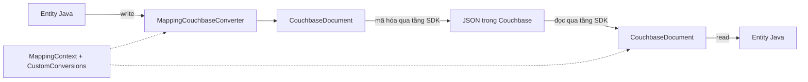

# Cơ chế đọc và ghi entity của `MappingCouchbaseConverter`

## 1. Vì sao cần một tầng chuyển đổi?

Trong Spring Data Couchbase, ứng dụng làm việc với **entity Java** còn Couchbase lưu **document JSON** trong bucket, scope và collection. Hai biểu diễn này không tương đương hoàn toàn: Java có class, enum, object lồng nhau, kiểu thời gian, constructor và các thuộc tính nghiệp vụ; JSON chủ yếu có object, array, string, number, boolean và `null`. `MappingCouchbaseConverter` là thành phần ánh xạ qua lại giữa hai thế giới đó.

Khi sử dụng `CouchbaseRepository`, `CouchbaseTemplate` hoặc các API tương ứng trong luồng reactive để lưu và đọc **entity được mapping**, Spring Data dựa trên cơ chế chuyển đổi này. Lập trình viên thường không cần tự gọi converter cho mỗi thao tác. Tuy nhiên, hiểu đường đi của dữ liệu giúp giải thích vì sao tên field trong JSON khác tên thuộc tính Java, vì sao có trường `_class`, vì sao ID/CAS không nằm trong JSON và tại sao một document đọc được bằng SQL++ vẫn có thể không dựng được entity.

**Mục tiêu của bài**: theo dõi một entity từ Java sang biểu diễn Couchbase và ngược lại; nhận diện vai trò của metadata ánh xạ, conversion, type information và metadata của document; chẩn đoán lỗi đọc/ghi phổ biến.

## 2. `MappingCouchbaseConverter` nằm ở đâu?

`MappingCouchbaseConverter` là implementation của `CouchbaseConverter`, đồng thời cung cấp hai thao tác lõi:

- `write(Object source, CouchbaseDocument target)`: đọc dữ liệu từ object Java và ghi thành biểu diễn document.
- `read(Class<R> clazz, CouchbaseDocument source)`: dựng object thuộc kiểu yêu cầu từ biểu diễn document.

`CouchbaseDocument` là **đối tượng trung gian trong Spring Data**, chứa các field có thể chuyển thành JSON cùng metadata như ID và thời hạn hết hạn. Nó không đồng nghĩa với chuỗi JSON thô. Bước mã hóa/giải mã với Couchbase Java SDK diễn ra ở lớp tích hợp thấp hơn.

`CouchbaseMappingContext` cung cấp metadata về entity và từng thuộc tính; converter dùng metadata này để quyết định đọc field nào, tên lưu trữ của chúng và cách khởi tạo object. `CouchbaseCustomConversions` và `ConversionService` hỗ trợ chuyển đổi kiểu khi giá trị Java không thể biểu diễn trực tiếp trong JSON.



Ở đây, **converter xử lý ánh xạ dữ liệu**, còn chọn bucket/scope/collection, gọi KV hay SQL++, chỉ mục, độ bền ghi, transaction và điều phối reactive thuộc các tầng khác. Converter không tự tạo index và không tự bảo đảm tính nhất quán của truy vấn.

## 3. Metadata nào quyết định cách mapping?

| Thành phần | Ý nghĩa khi đọc và ghi |
| --- | --- |
| `@Document` | Đánh dấu kiểu dữ liệu miền là một document Couchbase; có thể khai báo expiry và một số thiết lập document. |
| `@Id` | Ánh xạ khóa định danh document. Khóa được quản lý như metadata của document, không phải một field JSON thông thường. |
| `@Field` | Khai báo property được lưu và có thể đổi tên field bằng `@Field("stored_name")`. Có thể mapping một số property không gắn annotation, nhưng khai báo tường minh giúp rõ hợp đồng dữ liệu. |
| `@Transient` | Loại property khỏi quá trình lưu/đọc của Spring Data. |
| `@TypeAlias` | Cho phép dùng alias cho thông tin kiểu khi converter ghi type discriminator; cần quản lý tương thích khi thay đổi alias. |
| `@Version` | Gắn property với giá trị CAS phục vụ optimistic locking khi đi qua template/repository; không phải bộ đếm phiên bản phải tự tăng trong JSON. |
| Constructor, factory, record | Quy định Spring Data tạo instance khi đọc document, nhất là với entity bất biến. |

Lưu ý hai cấp thông tin khác nhau:

1. **Field nằm trong body JSON**, ví dụ `customer_name`, `status`, `lines` và, theo cấu hình mặc định, `_class`.
2. **Metadata Couchbase**, gồm document key (ID), CAS và expiry/TTL. Chúng gắn với document trên server nhưng không phải các field nghiệp vụ trong body JSON.

Một property Java tên `customerName` được đánh dấu `@Field("customer_name")` sẽ xuất hiện dưới khóa `customer_name`. Các lệnh SQL++ và index trên field này cần dùng **tên đã lưu**. Không nên xem mọi annotation của Jackson, như `@JsonProperty`, là tương đương với annotation mapping của Spring Data Couchbase; đây là các cơ chế có phạm vi riêng.

## 4. Ví dụ xuyên suốt: lưu một đơn hàng

Giả sử hệ thống có đơn hàng gồm mã document, người mua, trạng thái và danh sách dòng hàng. Dùng Java record để thể hiện một entity bất biến; Spring Data hỗ trợ constructor chuẩn của record để dựng lại object.

```java
import java.util.List;
import org.springframework.data.annotation.Id;
import org.springframework.data.couchbase.core.mapping.Document;
import org.springframework.data.couchbase.core.mapping.Field;

@Document
public record OrderDocument(
    @Id String id,
    @Field("customer_name") String customerName,
    @Field Status status,
    @Field List<OrderLine> lines
) {
    public enum Status { CREATED, PAID }

    public record OrderLine(String sku, int quantity) {}
}
```

Một instance minh họa:

```java
OrderDocument order = new OrderDocument(
    "order::42",
    "Lan",
    OrderDocument.Status.PAID,
    List.of(
        new OrderDocument.OrderLine("BOOK-01", 2),
        new OrderDocument.OrderLine("PEN-02", 3)
    )
);
```

Body JSON dự kiến, với type key mặc định và giả sử class có package `com.example.orders`:

```json
{
  "_class": "com.example.orders.OrderDocument",
  "customer_name": "Lan",
  "status": "PAID",
  "lines": [
    { "sku": "BOOK-01", "quantity": 2 },
    { "sku": "PEN-02", "quantity": 3 }
  ]
}
```

Khóa Couchbase là `order::42` và **không cần** một field `"id": "order::42"` trong body. Tên `_class` và giá trị class minh họa hành vi mặc định; ứng dụng có thể đổi cấu hình type key hoặc dùng alias. Thứ tự các key JSON không có ý nghĩa nghiệp vụ.

Đọc/ghi ở mức converter có thể hình dung trực tiếp như sau:

```java
// converter là bean MappingCouchbaseConverter do Spring cấu hình.
CouchbaseDocument stored = new CouchbaseDocument();
converter.write(order, stored);

Object documentKey = stored.getId();       // metadata document key
var jsonReady = stored.export();            // payload có cấu trúc map/list

OrderDocument restored =
    converter.read(OrderDocument.class, stored);
```

Đoạn trên minh họa **mapping trong bộ nhớ**, không gọi server, không thực hiện `upsert` và không chứng minh document đã được lưu bền vững. Trong ứng dụng thực tế, `repository.save(order)` hoặc `CouchbaseTemplate` sẽ phối hợp converter với thao tác Couchbase tương ứng.

## 5. Luồng ghi: từ entity Java đến Couchbase

Khi ghi một entity, quá trình về mặt khái niệm gồm:

1. **Xác định entity và metadata**: converter tra `CouchbaseMappingContext` để biết kiểu gốc, thuộc tính persist, tên field và các annotation.
2. **Lấy ID và thông tin document**: giá trị từ `@Id` trở thành document key. Cấu hình expiry (chẳng hạn `@Document(expiry = 3600)`) được chuyển thành metadata hết hạn; nó không tạo field JSON `expiry`.
3. **Duyệt các property cần lưu**: property có `@Transient` bị bỏ qua; `@Field` quyết định tên JSON. Giá trị `null` theo quy tắc mapping mặc định thường không được ghi thành field trong document.
4. **Chuyển giá trị**: kiểu đơn giản dùng biểu diễn JSON tương ứng; enum, ngày giờ và value object có thể đi qua converter mặc định hoặc custom converter. Object con được duyệt đệ quy, collection và map trở thành array/object.
5. **Ghi thông tin kiểu khi cần**: type mapper có thể đưa discriminator, thường là `_class`, vào body để hỗ trợ xác định kiểu trong lúc đọc, nhất là trường hợp đa hình.
6. **Tạo biểu diễn trung gian**: kết quả được đặt vào `CouchbaseDocument`; tầng tích hợp tiếp theo mã hóa payload và thực hiện thao tác ghi phù hợp.

Ví dụ `List<OrderLine>` được chuyển thành JSON array chứa các object con; Java enum `PAID` được thể hiện bằng giá trị chuỗi tương ứng. Những biến đổi này có thể thay đổi nếu ứng dụng đã đăng ký custom converter.

**Điểm dễ nhầm**: gọi `write` không tương đương gọi `save`. Nó chưa giao tiếp với cluster, chưa xử lý retry, durability hay điều kiện CAS; các mối quan tâm đó thuộc pipeline lưu trữ.

## 6. Luồng đọc: từ Couchbase trở lại entity

Ở chiều đọc, tầng truy cập dữ liệu lấy JSON cùng metadata trả về rồi xây dựng biểu diễn `CouchbaseDocument`. Sau đó converter:

1. **Xác định kiểu đích** từ kiểu Java được yêu cầu và metadata kiểu trong document (nếu có). Discriminator có thể ảnh hưởng tới kiểu cụ thể được dựng trong một quan hệ kế thừa/đa hình.
2. **Giải quyết constructor/factory**: Spring Data ưu tiên cách khởi tạo được xác định bởi metadata persistence, ví dụ constructor duy nhất, constructor đánh dấu `@PersistenceCreator` hoặc constructor chuẩn của Java record.
3. **Ghép tham số và property** theo tên thuộc tính Java và cấu hình `@Field`; các field có mặt trong JSON được chuyển thành giá trị Java phù hợp.
4. **Đọc đệ quy object lồng nhau và collection**; enum, thời gian và kiểu miền đặc biệt được chuyển bằng đường đọc tương ứng.
5. **Đưa metadata trở lại entity**: ID được phục hồi từ document key. Khi đọc bằng repository/template có hỗ trợ versioning, trường `@Version` được điền bằng giá trị CAS mà server trả về.

Việc tạo instance và điền property là hai bước logic khác nhau. Với Java class có constructor rỗng, Spring Data thường tạo instance rồi gán field. Với class bất biến hoặc record, các tham số cần có trong constructor, và hệ thống có thể cần cơ chế tạo bản sao để điền property ngoài constructor.

### Constructor của entity bất biến

Ví dụ dạng record ở mục 4 thuận lợi vì tên component gắn trực tiếp với dữ liệu cần đọc. Nếu viết class có nhiều constructor, hãy chọn constructor persistence một cách tường minh khi cần:

```java
@PersistenceCreator
public Customer(String id, String name) {
    this.id = id;
    this.name = name;
}
```

Khi dùng class immutable, cần chú ý tên tham số constructor, thông tin tên được giữ lúc biên dịch, khả năng mapping các field bắt buộc và cách xử lý document cũ thiếu trường. Constructor với kiểu nguyên thủy `int` không thể nhận `null` như kiểu tham chiếu `Integer`; nếu dữ liệu lịch sử có thể thiếu field, phải có chiến lược default/migration rõ ràng.

### Thiếu field, `null` và thay đổi schema

Một document JSON thiếu `customer_name` khác về mặt cấu trúc với document có `"customer_name": null`, nhưng cả hai có thể đưa tới giá trị Java `null` khi đọc. Nếu đối tượng cần constructor nghiêm ngặt hoặc một quy tắc kiểm tra không cho phép `null`, lỗi có thể xảy ra lúc dựng entity. Vì vậy, tránh giả định rằng thêm một property `non-null` vào class sẽ tự tương thích với tất cả document đã lưu.

Thay đổi tên Java property nhưng giữ nguyên `@Field("customer_name")` thường giúp bảo toàn hợp đồng lưu trữ; thay đổi cả tên JSON phải đi kèm quá trình đọc tương thích, chuyển dữ liệu hoặc migration.

## 7. Bảng quy tắc chuyển đổi thường gặp

| Giá trị Java | Biểu diễn lưu trữ thường thấy | Điểm cần kiểm soát |
| --- | --- | --- |
| `String`, `boolean` | JSON string, boolean | Bảo đảm tên field nhất quán. |
| `byte`, `short`, `int`, `long`, `float`, `double` | JSON number | Chú ý phạm vi giá trị, độ chính xác và kiểu số thu được khi đọc qua SQL++. |
| `enum` | Thường là tên hằng enum dưới dạng string | Đổi tên enum có thể làm document cũ không đọc được. |
| `List<T>`, mảng, `Map<String,T>` | JSON array, object | Kiểu của phần tử và cấu trúc lồng nhau phải tương thích. |
| Entity/POJO lồng nhau | JSON object lồng nhau | Constructor và metadata của kiểu con vẫn có vai trò. |
| `Date`, `Calendar` và các kiểu `java.time` | Dạng số hoặc chuỗi qua converter tương ứng | Quy ước đơn vị thời gian, timezone và converter mặc định phụ thuộc kiểu/phiên bản; cần kiểm chứng bằng round-trip. |
| Value object như `EmailAddress` | Kiểu JSON đơn giản hoặc cấu trúc tùy custom converter | Đăng ký cả chiều ghi lẫn chiều đọc nếu muốn round-trip ổn định. |
| `null` | Thường bị bỏ qua khi ghi | Cần quy ước phân biệt thiếu field, `null` và giá trị mặc định. |

**Với tiền và thời gian**, tránh suy ra độ chính xác, đơn vị mili giây/giây hay múi giờ từ tên kiểu Java. Hãy định nghĩa hợp đồng lưu trữ cụ thể và kiểm tra chính xác output thực tế của phiên bản đang sử dụng. Một giá trị ngày giờ được ghi bằng số có thể gây sai lệch lớn nếu phía đọc diễn giải sai đơn vị.

## 8. `_class`, type alias và khả năng đọc ngược

Thông tin kiểu giúp converter phục hồi class cụ thể khi Java type khai báo là một class cha/interface hoặc một giá trị lồng nhau có thể thuộc nhiều subtype. Trong cấu hình thông dụng, type mapper dùng khóa `_class`; giá trị có thể là tên class đầy đủ hoặc alias.

Ví dụ:

```java
import org.springframework.data.annotation.TypeAlias;

@TypeAlias("order")
@Document
public class OrderDocument {
    // Các property được mapping.
}
```

Khi type mapper hỗ trợ alias và entity đã được nhận biết trong mapping context, type hint có thể dùng `"order"` thay cho tên class dài. Điều này giúp giảm phụ thuộc trực tiếp vào tên package, nhưng **alias cũng là một phần của hợp đồng dữ liệu**: đổi alias cần xét đến document đã lưu. Không tự xóa `_class` nếu ứng dụng dựa vào nó để đọc đa hình hoặc tạo truy vấn phân biệt loại entity.

Type key là thông tin do Spring Data quản lý ở **body JSON**, khác với document key trong Couchbase metadata. Một truy vấn SQL++ tự xây cần bảo đảm giữ các thông tin mà pipeline mapping yêu cầu; nếu chỉ lấy vài field rời rạc hay `SELECT RAW`, kết quả có thể phù hợp với DTO/projection hơn là một entity đầy đủ.

## 9. Custom converter can thiệp ở bước nào?

Khi một kiểu miền không có biểu diễn JSON phù hợp, có thể đăng ký converter theo **hai chiều**. Ví dụ đối tượng giá trị `SkuCode` luôn được lưu bằng một string:

```java
public record SkuCode(String value) {}

@WritingConverter
public class SkuWriteConverter implements Converter<SkuCode, String> {
    @Override
    public String convert(SkuCode source) {
        return source.value();
    }
}

@ReadingConverter
public class SkuReadConverter implements Converter<String, SkuCode> {
    @Override
    public SkuCode convert(String source) {
        return new SkuCode(source);
    }
}
```

Các import cần thiết: `org.springframework.core.convert.converter.Converter`, `org.springframework.data.convert.ReadingConverter` và `org.springframework.data.convert.WritingConverter`. Trong cấu hình dựa trên `AbstractCouchbaseConfiguration`, có thể đăng ký theo API bổ sung converter của phiên bản đang dùng, ví dụ:

```java
@Override
protected void additionalConverters(List<Object> converters) {
    converters.add(new SkuWriteConverter());
    converters.add(new SkuReadConverter());
}
```

Một cấu hình khác có thể cung cấp `CouchbaseCustomConversions` trực tiếp. Điều quan trọng là converter **phải được đăng ký**; chỉ gắn annotation lên class converter hoặc đặt nó trong classpath chưa đủ. Dùng `@WritingConverter` và `@ReadingConverter` giúp loại bỏ nhập nhằng hướng xử lý, nhất là khi cả hai kiểu nguồn/đích đều là kiểu đơn giản.

Không nên đăng ký converter quá rộng làm mọi giá trị `String` hoặc `Map` bị biến đổi ngoài ý muốn. Chuyển đổi toàn entity cũng cần thận trọng vì có thể ảnh hưởng tới mapping field, type discriminator và xử lý các thuộc tính metadata. Khi chỉ một field cần định dạng đặc biệt, hãy xem xét property converter hoặc value object chuyên biệt thay vì thay thế cách ghi cả entity.

## 10. ID, TTL và CAS liên quan tới converter như thế nào?

Ba thứ này dễ bị nhầm với field JSON:

| Thành phần | Nguồn dữ liệu | Ảnh hưởng thực tế |
| --- | --- | --- |
| ID | `@Id` / Couchbase document key | Định danh duy nhất document trong collection; sử dụng ở thao tác KV và khi materialize entity. |
| TTL / expiry | Cấu hình `@Document` hoặc tùy chọn thao tác lưu | Xác định thời gian tồn tại document do Couchbase quản lý; không phải mặc định một field tên `ttl`. |
| CAS | Metadata phiên bản từ server | Hỗ trợ compare-and-swap và `@Version` để tránh ghi đè cập nhật đồng thời. |

Ví dụ, với entity có:

```java
@Id
private String id;

@Version
private long version;
```

`version` nhận CAS khi đọc entity qua template/repository và được dùng khi lưu lại với kiểm tra optimistic locking. Khi một tác vụ khác đã cập nhật document, thao tác lưu dựa trên CAS cũ có thể thất bại với `OptimisticLockingFailureException`. Cách xử lý thường là đọc lại, áp dụng lại thay đổi nghiệp vụ và thử lưu lại có kiểm soát; tuyệt đối không coi CAS là một counter có thể tự tăng.

Với `@Document(expiry = 3600)`, đơn vị của tham số ví dụ là giây; expiry là trách nhiệm của Couchbase. Việc thiết lập expiry trên từng lần ghi, cách cập nhật TTL và các chính sách giữ TTL còn phụ thuộc API thao tác và phiên bản SDK, vì thế cần kiểm thử riêng nếu đây là yêu cầu nghiệp vụ.

## 11. Cùng một converter, nhưng các đường đọc dữ liệu có khác biệt

- **Repository** cung cấp API làm việc với entity và khai thác metadata mapping. Phương thức dẫn xuất truy vấn thường cần index phù hợp cho SQL++.
- **CouchbaseTemplate** cho phép kiểm soát trực tiếp hơn các thao tác truy cập, trong khi các phép đọc/ghi entity được mapping vẫn sử dụng converter của Spring Data.
- **ReactiveCouchbaseTemplate / ReactiveRepository** thay đổi cách điều phối bất đồng bộ và backpressure; nguyên tắc chuyển entity sang document và ngược lại về cơ bản vẫn tương tự.
- **Câu SQL++ tùy biến** có thể trả một document đầy đủ, một projection hoặc scalar. Converter không thể tự khôi phục các field đã bị loại khỏi kết quả hay tự bổ sung metadata mà truy vấn không mang theo.
- **SDK `JsonObject` / raw JSON** làm việc trực tiếp với payload; khi dùng SDK thuần, không nên mặc định các annotation `@Field`, `@Id`, `@TypeAlias` sẽ được áp dụng như trong Spring Data.

Chẳng hạn, nếu `customerName` được ánh xạ sang `customer_name`, truy vấn tự viết theo `customerName` có thể không khớp dữ liệu. Nếu chỉ cần một báo cáo tổng hợp số đơn hàng, dùng projection/DTO phù hợp sẽ rõ ràng hơn là cố dựng đầy đủ `OrderDocument` từ một hàng chỉ chứa `COUNT(*)`.

## 12. Các lỗi thường gặp và cách chẩn đoán

| Hiện tượng | Nguyên nhân cần kiểm tra | Hướng xử lý |
| --- | --- | --- |
| Field đọc lên thành `null` | Sai tên field đã lưu, field bị bỏ khỏi projection, document cũ thiếu dữ liệu, hoặc converter đọc không phù hợp | So sánh JSON thực với `@Field`; kiểm tra hình dạng kết quả query và converter đã đăng ký. |
| Không dựng được entity | Constructor không phù hợp; tên tham số không khớp; thiếu field bắt buộc; kiểu bất biến không có đường khởi tạo hợp lệ | Chọn constructor persistence rõ ràng, xem xét record/default và khả năng tương thích document cũ. |
| Lỗi chuyển số/ngày giờ | Sai biểu diễn, sai đơn vị thời gian, overflow hoặc tùy biến converter một chiều | Ghi rõ định dạng lưu trữ; kiểm thử cả dữ liệu cũ và mới theo hai chiều. |
| Không giải được type từ `_class` | Đổi package/class, đổi alias, kiểu chưa được nhận biết hoặc discriminator sai | Kiểm tra type mapper, alias và chiến lược migration; tránh sửa hàng loạt `_class` thiếu kiểm soát. |
| Ghi đè đồng thời bị từ chối | CAS của entity không còn hợp lệ | Đọc lại và thực hiện lại logic cập nhật hoặc trả xung đột cho lớp gọi. |
| SQL++ không thấy field / query chậm | Query dùng tên property Java thay tên JSON; index chưa phục vụ predicate | Kiểm tra field name thực; bổ sung index theo truy vấn, tránh quy lỗi cho converter. |
| Kết quả SDK khác kết quả repository | SDK thao tác trực tiếp JSON, bỏ qua pipeline mapping Spring Data | Định nghĩa rõ tầng chịu trách nhiệm chuyển đổi và dùng API nhất quán. |

Một quy trình debug hữu ích là đối chiếu **bốn lớp dữ liệu**: (1) entity Java đầu vào, (2) `CouchbaseDocument.export()` ở chiều ghi, (3) body JSON cộng metadata thật trên server và (4) entity Java sau đọc. Khi chỉ sai ở bước (2), xem mapping/custom conversion; khi sai giữa (2) và (3), xem thao tác lưu/SDK; khi chỉ sai ở bước (4), xem constructor, type hint và dữ liệu truy vấn trả về.

## 13. Bài thực hành tự kiểm chứng

1. Tạo `OrderDocument` trong mục 4 với hai dòng hàng, ghi qua converter vào một `CouchbaseDocument` mới và kiểm tra `getId()` cùng `export()`.
2. Xác nhận JSON chứa `customer_name` nhưng không chứa field `customerName`; so sánh `status` và mảng `lines` với entity gốc.
3. Dùng `read(OrderDocument.class, stored)` rồi kiểm tra ID, tên khách hàng, trạng thái, số lượng dòng hàng. Đây là phép kiểm tra **round-trip mapping**, không yêu cầu cluster.
4. Thêm một field mới vào entity. Thử đọc một `CouchbaseDocument` cũ không có field đó, ghi nhận hành vi với kiểu tham chiếu và kiểu nguyên thủy.
5. Thử đổi tên lưu trữ bằng `@Field("buyer")`, rồi đối chiếu document trước/sau. Nhận xét vì sao đổi field lưu trữ là một thay đổi schema dù class Java vẫn có thể biên dịch.
6. Với môi trường Couchbase thử nghiệm, kiểm tra thêm `@Version`/CAS và expiry qua repository hoặc template, vì những tính năng này cần có metadata và thao tác thực trên server.

### Câu hỏi tự kiểm tra

1. Vì sao `CouchbaseDocument` không thể được hiểu đơn giản là một chuỗi JSON?
2. Khi lưu `@Id String id`, vì sao ID có thể không xuất hiện trong body JSON?
3. `@Field("customer_name")` tác động như thế nào tới cả ghi dữ liệu và đọc truy vấn?
4. Khi nào type hint `_class` quan trọng và rủi ro khi đổi package hoặc alias là gì?
5. Vì sao custom converter cần bảo đảm chiều `write` lẫn `read`?
6. Tại sao `MappingCouchbaseConverter.write` không thể thay thế hoàn toàn `repository.save`?

## Tài liệu tham khảo

- [Spring Data Couchbase — Modeling Entities](https://docs.spring.io/spring-data/couchbase/reference/couchbase/entity.html): mapping entity, constructor, `@Field`, JSON types, converter và `@Version`.
- [`MappingCouchbaseConverter` API](https://docs.spring.io/spring-data/couchbase/reference/api/java/org/springframework/data/couchbase/core/convert/MappingCouchbaseConverter.html): chữ ký `read`/`write` và các điểm mở rộng.
- [`CouchbaseDocument` API](https://docs.spring.io/spring-data/couchbase/reference/api/java/org/springframework/data/couchbase/core/mapping/CouchbaseDocument.html): payload, ID, expiry và phương thức `export`.
- [Spring Data — Custom Conversions](https://docs.spring.io/spring-data/couchbase/reference/data-commons/custom-conversions.html): đăng ký converter và phân biệt chiều đọc/ghi.

> Nội dung tập trung vào cơ chế đọc/ghi entity của Spring Data Couchbase. Các lựa chọn riêng về bucket, scope, collection, chỉ mục SQL++, TTL/CAS, giao dịch và API reactive cần được kiểm tra thêm ở tầng truy cập tương ứng.
