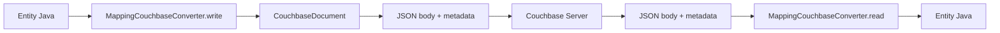

# Kiểu số, boolean, chuỗi và biểu diễn JSON trong Spring Data Couchbase

## 1. Mục tiêu và bối cảnh

Trong module **SPRING_DATA_COUCHBASE**, tầng truy cập Couchbase được xây dựng bằng document mapping, repository, `CouchbaseTemplate` và truy vấn SQL++. Dù entity Java có nhiều kiểu dữ liệu, nội dung document JSON chỉ có một tập kiểu cơ bản. Sự khác biệt này ảnh hưởng trực tiếp đến kết quả ghi/đọc dữ liệu, tính đúng đắn của truy vấn, thiết kế index và khả năng tương thích với các client khác.

Sau bài học, bạn cần:

1. Phân biệt kiểu số, boolean và chuỗi trong Java với biểu diễn JSON tương ứng.
2. Giải thích việc `MappingCouchbaseConverter` chuyển field của entity sang JSON và đọc lại theo kiểu Java đã khai báo.
3. Chọn kiểu dữ liệu phù hợp cho số đếm, tiền, tỷ lệ, cờ trạng thái và mã định danh.
4. Phân biệt `null`, field không tồn tại (`MISSING`) và giá trị mặc định của kiểu nguyên thủy.
5. Nhận diện lỗi sai kiểu, mất độ chính xác số và khó khăn khi query bằng SQL++.

Nội dung tập trung vào **kiểu đơn giản và biểu diễn JSON**; các cơ chế tùy biến converter phức tạp, CAS, TTL, giao dịch và reactive access chỉ được liên hệ khi cần làm rõ đường đi dữ liệu.

## 2. JSON có những kiểu giá trị nào?

JSON có sáu nhóm giá trị: `string`, `number`, `boolean`, `null`, `array` và `object`.

```json
{
  "name": "Lan",
  "age": 29,
  "conversionRate": 0.125,
  "verified": false,
  "nickname": null,
  "tags": ["vip", "mobile"],
  "address": {"city": "Đà Nẵng"}
}
```

Ở ví dụ này:

- `"Lan"` thuộc **string**; mọi chuỗi JSON phải được đặt trong dấu nháy kép.
- `29` và `0.125` đều thuộc **number**. JSON không gắn nhãn `int`, `long`, `float` hay `double`.
- `false` là **boolean**; `"false"` lại là **string**.
- `null` biểu diễn một giá trị rỗng đã được ghi tường minh.
- `tags` là array, `address` là object. Array/object có thể chứa các kiểu đơn giản ở nhiều cấp lồng nhau.

JSON chuẩn viết literal `true`, `false` và `null` bằng **chữ thường**. JSON không cho phép token `NaN`, `Infinity`, `undefined`, dấu phẩy thừa, comment, hay số nguyên viết `007` với số 0 ở đầu. Các giá trị kiểu `007` cần được lưu thành chuỗi `"007"` nếu số 0 có ý nghĩa.

**Phân biệt phạm vi**: SQL++ trên Couchbase có thêm khái niệm `MISSING` và cách viết literal tương tự ngôn ngữ truy vấn. `MISSING` **không phải một literal hợp lệ trong JSON đã lưu**.

## 3. Từ kiểu Java đến JSON qua `MappingCouchbaseConverter`

Bảng sau mô tả ánh xạ đơn giản được Spring Data Couchbase hỗ trợ mặc định:

| Kiểu thuộc tính Java | Kiểu JSON | Ví dụ trong JSON | Lưu ý |
| --- | --- | --- | --- |
| `byte`, `Byte` | `number` | `12` | Giới hạn giá trị Java nhỏ; phải kiểm tra overflow khi đọc. |
| `short`, `Short` | `number` | `1200` | JSON không nhớ đây vốn là `short`. |
| `int`, `Integer` | `number` | `29` | Dùng cho số đếm trong phạm vi 32-bit. |
| `long`, `Long` | `number` | `125000` | Cân nhắc độ chính xác khi dữ liệu đi qua hệ thống dùng JavaScript Number. |
| `float`, `Float` | `number` | `0.125` | Số thực dấu phẩy động có sai số nhị phân. |
| `double`, `Double` | `number` | `0.125` | Phù hợp đại lượng gần đúng, không phù hợp tính toán tiền chính xác. |
| `boolean`, `Boolean` | `boolean` | `true` | Không phải số `1` và không phải chuỗi `"true"`. |
| `String` | `string` | `"00042"` | Giữ nguyên cách viết mã, kể cả số 0 đầu và ký tự Unicode. |
| Giá trị Java `null` của field | Thường không ghi field | Không có khóa tương ứng | Hành vi mặc định khi **ghi entity bằng Spring Data Couchbase**; khác với JSON có `"key": null`. |

Với kiểu nguyên thủy `int`, `long`, `double`, `boolean`, Java luôn có một giá trị mặc định khi object được khởi tạo theo cách thông thường: `0`, `0.0`, `false`. Các **wrapper** như `Integer`, `Long`, `Double`, `Boolean` có thể nhận `null`. Khi schema thay đổi và document cũ thiếu field, lựa chọn primitive hay wrapper ảnh hưởng đến khả năng dựng lại entity.

`Character`/`char`, `BigInteger` và `BigDecimal` không nằm trong bảng primitive được tài liệu Couchbase liệt kê. Nếu dùng chúng, hãy xác minh biểu diễn trong phiên bản ứng dụng hoặc đăng ký cơ chế chuyển đổi rõ ràng. Nếu dữ liệu là ký tự hay mã gồm một chữ, `String` kèm validation độ dài thường là hợp đồng JSON dễ hiểu nhất.

## 4. Ví dụ xuyên suốt: entity chỉ chứa kiểu đơn giản

Giả sử một hệ thống bán hàng cần lưu số lần giao dịch, trạng thái xác minh, số tiền nhỏ nhất theo đơn vị đồng và tỷ lệ giảm giá.

```java
package com.example.metrics;

import org.springframework.data.annotation.Id;
import org.springframework.data.couchbase.core.mapping.Document;
import org.springframework.data.couchbase.core.mapping.Field;

@Document
public record CustomerMetrics(
    @Id String id,
    @Field("customer_code") String customerCode,
    @Field int attempts,
    @Field Boolean verified,
    @Field long balanceDong,
    @Field double discountRate,
    @Field String note
) {}
```

Tạo một entity:

```java
CustomerMetrics metrics = new CustomerMetrics(
    "metrics::00042",
    "00042",
    3,
    false,
    125000L,
    0.125,
    null
);
```

Body JSON minh họa mà tầng mapping thông thường tạo ra:

```json
{
  "_class": "com.example.metrics.CustomerMetrics",
  "customer_code": "00042",
  "attempts": 3,
  "verified": false,
  "balanceDong": 125000,
  "discountRate": 0.125
}
```

Giải thích từng điểm:

- `@Id String id` trở thành **document key** `metrics::00042` do Couchbase quản lý; ID không cần xuất hiện như field `id` trong body.
- `@Field("customer_code")` đổi tên field JSON từ `customerCode` thành `customer_code`.
- `attempts` và `balanceDong` đều lưu thành JSON number, dù Java dùng `int` và `long`.
- `verified: false` là trạng thái **có giá trị**, không tương đương với không có field.
- `"00042"` phải là chuỗi để bảo toàn số 0 đầu.
- `note == null` nên field `note` được bỏ qua trong hành vi ghi mặc định.
- `_class` là type hint của Spring Data trong cấu hình thông dụng. Tên class được minh họa theo package ở ví dụ; cấu hình type mapper/alias có thể làm biểu diễn khác đi.

Đối với bài học này, hãy phân biệt **giá trị JSON trong body** với **document key, CAS, expiry/TTL** là metadata của Couchbase. CAS và TTL không tự nhiên trở thành JSON number chỉ vì bản chất của chúng có giá trị số.

## 5. Đọc và ghi diễn ra như thế nào?

Khi ứng dụng gọi `repository.save(metrics)` hoặc thao tác lưu entity tương ứng của `CouchbaseTemplate`, luồng khái quát là:



Ở chiều **ghi**, converter dùng metadata của entity để xác định property nào được persist, lấy tên lưu trữ từ `@Field`, phân loại các giá trị số/boolean/chuỗi, xử lý field `null` rồi tạo biểu diễn `CouchbaseDocument`. Sau đó tầng Couchbase SDK mới gửi dữ liệu đến server.

Ở chiều **đọc**, SDK lấy payload và metadata, converter áp dụng kiểu Java đích để dựng object. Ví dụ số JSON `3` có thể được chuyển về `int attempts`, còn `0.125` được chuyển về `double discountRate`. Kiểu Java đích, custom conversions và hình dạng JSON quyết định việc đọc có thành công hay không.

Vì JSON chỉ có kiểu `number`, **không nên dựa vào JSON để đoán lại Java field là `Integer`, `Long` hay `Double`**. Khi cần đọc document thành entity, hãy cung cấp kiểu đích rõ ràng. Với `Map<String, Object>` không khai báo kiểu cụ thể cho các giá trị, loại `Number` thu được phụ thuộc vào đường giải mã và cấu hình serializer.

Một round-trip ở mức ánh xạ có thể minh họa bằng:

```java
// converter là bean đã được Spring cấu hình.
CouchbaseDocument intermediate = new CouchbaseDocument();
converter.write(metrics, intermediate);

CustomerMetrics restored =
    converter.read(CustomerMetrics.class, intermediate);
```

Lưu ý: `write`/`read` của converter là thao tác chuyển đổi **trong bộ nhớ**; đoạn này không thực hiện ghi mạng, không kiểm chứng index và cũng không phát sinh transaction.

## 6. Kiểu nguyên và wrapper: đặc biệt với field thiếu dữ liệu

Hãy xét hai phiên bản entity:

```java
// Phiên bản A
@Field int retryCount;

// Phiên bản B
@Field Integer retryCount;
```

Khi một document cũ không có `retryCount`, mã ứng dụng phải xử lý sự thiếu dữ liệu theo cách hợp lệ với constructor và kiểu Java. `Integer` có thể đại diện cho trạng thái chưa biết bằng `null`; `int` thì không. Với constructor bất biến bắt buộc một tham số `int`, không được mặc định rằng mọi document thiếu field đều đọc thành `0` một cách an toàn: cách khởi tạo và cơ chế chuyển đổi của phiên bản cụ thể cần được kiểm thử.

Gợi ý thiết kế:

- Dùng `int`/`long` cho các trường luôn có giá trị hợp lệ và được bảo đảm bằng hợp đồng schema/migration.
- Dùng `Integer`/`Long` khi cần phân biệt “chưa biết” với số `0`.
- Dùng `Boolean` khi nghiệp vụ thực sự có ba trạng thái: `true`, `false` và “chưa xác định”.
- Dùng `boolean` khi yêu cầu nghiệp vụ là hai trạng thái rõ ràng và tất cả document phải có chính sách mặc định nhất quán.

**Ví dụ sai về mặt nghiệp vụ**: hệ thống kiểm duyệt dùng `boolean approved` và coi mọi field bị thiếu là `false`. Dữ liệu cũ chưa được kiểm duyệt sẽ bị hiểu nhầm thành “đã từ chối”. `Boolean approved` cộng quy tắc xử lý `null` có thể phản ánh đúng hơn trạng thái “chưa đánh giá”.

## 7. Số nguyên: phạm vi, mất độ chính xác và mã định danh

### 7.1. JSON number không ghi nhớ độ rộng của kiểu Java

Một object có `int quantity = 12` và `long total = 12L` đều có giá trị JSON là `12`. Đó là biểu diễn hợp lệ; Spring Data sử dụng kiểu thuộc tính để khôi phục. Tuy nhiên, không nên tùy ý đổi field từ `long` thành `int` nếu dữ liệu cũ có thể vượt phạm vi `int` (`-2_147_483_648` đến `2_147_483_647`).

```json
{
  "smallCounter": 12,
  "largeCounter": 3000000000
}
```

`largeCounter` không thể nhét nguyên vẹn vào Java `int`. Tùy đường chuyển đổi, lỗi tràn số hoặc lỗi mapping có thể xuất hiện. Khuyến nghị là **chọn kiểu từ giới hạn nghiệp vụ**, không từ các giá trị mẫu đang còn nhỏ.

### 7.2. Số nguyên lớn và ranh giới JavaScript

Java `long` là số nguyên có dấu 64 bit. Trong khi đó, `Number` của JavaScript chỉ biểu diễn **chính xác mọi số nguyên trong khoảng từ `-(2^53 - 1)` đến `2^53 - 1`**. Do đó, giá trị như:

```json
{
  "eventSequence": 9007199254740993
}
```

có thể bị làm tròn nếu JSON được đọc rồi ghi lại bởi một client dùng JavaScript `Number`. Đây là **rủi ro xuyên hệ thống**; không nên kết luận rằng mọi server hoặc mọi client Couchbase đều làm tròn theo cùng cách.

Đối với mã giao dịch, mã khách hàng, số định danh tài liệu hoặc số thứ tự lớn chỉ dùng để so sánh bằng nhau, cân nhắc lưu dạng string:

```json
{
  "externalEventId": "9007199254740993",
  "customerCode": "00042"
}
```

Khi dùng string, các so sánh và sắp xếp là theo chuỗi, không tự nhiên là số. Chẳng hạn `"100"` có thể đứng trước `"20"` khi sắp xếp từ điển. Cần chọn kiểu dựa vào mục đích sử dụng thực tế.

## 8. Số thực: `float` và `double` không phải số thập phân chính xác

`float` và `double` dùng biểu diễn dấu phẩy động nhị phân theo IEEE 754. Một số giá trị thập phân như `0.1` không thể được mã hóa chính xác hữu hạn dưới dạng nhị phân:

```java
double a = 0.1;
double b = 0.2;
boolean exact = (a + b == 0.3); // thường là false
```

Điều này không phải lỗi của Couchbase. JSON có thể hiển thị `0.3`, nhưng phép tính trong bộ nhớ vẫn phải tuân theo độ chính xác của kiểu số và bộ máy tính toán.

**Chọn kiểu theo mục đích**:

| Nhu cầu | Cách biểu diễn đề xuất | Lý do |
| --- | --- | --- |
| Số lượng sản phẩm | `int` hoặc `long` | Là số đếm nguyên, cần kiểm soát overflow. |
| Số tiền VND nguyên đơn vị đồng | `long amountDong`, nếu giới hạn nghiệp vụ cho phép | Không phát sinh sai số nhị phân do số lẻ. |
| Số tiền có phần thập phân cố định | Số nguyên ở đơn vị nhỏ nhất hoặc hợp đồng decimal rõ ràng | Tránh cộng/trừ tiền bằng `double`. |
| Tỷ lệ, dữ liệu cảm biến gần đúng | `double` | Chấp nhận sai số do biểu diễn dấu phẩy động, nhưng phải quy định tolerance. |
| Mã khách hàng gồm chữ số | `String` | Không nên làm mất số 0 đầu hoặc áp dụng phép toán số học. |

Nếu dùng `BigDecimal`, hãy xác định và kiểm thử **hợp đồng lưu trữ**: JSON number có thể không bảo toàn độ chính xác xuyên mọi codec/ngôn ngữ và các phép toán truy vấn; JSON string bảo toàn dạng thập phân nhưng không có sẵn thứ tự/so sánh số; một số nguyên theo đơn vị nhỏ nhất cho phép tính toán chính xác trong phạm vi của kiểu số đã chọn. Đừng giả định `BigDecimal` được xử lý giống `double` chỉ vì cả hai đều là số trong Java.

JSON chuẩn cũng **không hỗ trợ** `Double.NaN`, `Double.POSITIVE_INFINITY` hay `Double.NEGATIVE_INFINITY`. Trước khi lưu:

```java
if (!Double.isFinite(metrics.discountRate())) {
    throw new IllegalArgumentException("discountRate phải là số hữu hạn");
}
```

Cách serializer phản ứng với các giá trị không hữu hạn có thể phụ thuộc cấu hình. Validation ở tầng nghiệp vụ giúp hợp đồng JSON ổn định.

## 9. Boolean: `true`, `false` và chuỗi trông giống boolean

Các biểu diễn dưới đây khác nhau về kiểu:

```json
{
  "enabled": true,
  "verified": false,
  "legacyEnabled": "true",
  "numericEnabled": 1,
  "pending": null
}
```

- `enabled`/`verified` là JSON boolean.
- `legacyEnabled` là string; không nên giả định converter tự hiểu mọi biến thể như `"TRUE"`, `"yes"`, `"1"`.
- `numericEnabled` là number; chuyển từ kiểu lưu cũ sang boolean cần quy tắc migration/tùy biến rõ ràng.
- `pending` có giá trị `null`, khác hoàn toàn với `false`.

Trong SQL++, việc lọc entity theo một boolean nên dùng điều kiện đúng kiểu, ví dụ `WHERE d.verified = TRUE`, với `verified` thực sự được lưu là JSON boolean. Không sử dụng `WHERE d.verified = "true"` trừ khi trường này có hợp đồng lưu kiểu string từ trước.

Đừng chuyển cờ nghiệp vụ thành `"Y"`/`"N"` hoặc `0`/`1` chỉ để tiết kiệm vài ký tự nếu không có lý do tương thích cụ thể. JSON boolean thể hiện ý nghĩa rõ và giảm nguy cơ query nhầm kiểu.

## 10. Chuỗi: ký tự, Unicode, escape và mã mang hình dạng số

JSON string đặt trong **dấu nháy kép** và hỗ trợ ký tự Unicode. Ví dụ:

```json
{
  "displayName": "Nguyễn Ánh",
  "customerCode": "00042",
  "line": "Dòng 1\nDòng 2",
  "quoted": "Khách nói: \"đồng ý\"",
  "contact": "lan@example.com"
}
```

`\n` và `\"` là các escape trong văn bản JSON; khi giải mã thành Java `String`, chúng lần lượt tương ứng với xuống dòng và dấu nháy kép. JSON không đặt giới hạn độ dài chuỗi theo một kiểu Java `char`; nếu chỉ chấp nhận một ký tự mã, hãy kiểm tra độ dài/Unicode theo yêu cầu nghiệp vụ.

Một số lưu ý khi thiết kế:

1. **Giữ mã định danh dưới dạng string**: số điện thoại, mã bưu chính, mã khách hàng, số tài khoản hoặc SKU có thể chứa số 0 đầu, dấu `+`, gạch nối hay chữ cái.
2. **Phân biệt rỗng và thiếu**: `""` là string có độ dài 0; `null` là giá trị rỗng; không có field là `MISSING` khi query.
3. **Thống nhất quy ước so sánh**: chữ hoa/chữ thường, khoảng trắng ở đầu/cuối và Unicode normalization là chính sách của ứng dụng, không phải trách nhiệm tự động của `MappingCouchbaseConverter`.
4. **Không giả định `toString()` là JSON serializer**: dữ liệu cần được xử lý qua tầng mapping/serializer phù hợp, đặc biệt khi chứa dấu nháy, xuống dòng và ký tự đặc biệt.

Với dữ liệu cần tìm kiếm, so khớp hay lập chỉ mục, hãy nhất quán giữa giá trị lúc ghi, lúc xây query và lúc chuẩn hóa. Việc đổi định dạng string đã lưu có thể làm các truy vấn SQL++ hiện hữu không còn khớp dù kiểu Java vẫn là `String`.

## 11. `null`, field vắng mặt và giá trị mặc định

Hãy xét ba JSON body:

```json
{"verified": false}
```

```json
{"verified": null}
```

```json
{}
```

Ba trường hợp có ý nghĩa khác nhau:

| JSON | `verified` khi query SQL++ | Ý nghĩa thường dùng |
| --- | --- | --- |
| `{"verified": false}` | Boolean `FALSE` | Đã có kết luận phủ định. |
| `{"verified": null}` | `NULL` | Field tồn tại nhưng chưa có giá trị. |
| `{}` | `MISSING` | Field không tồn tại trong document. |

Tài liệu Spring Data Couchbase ghi rõ giá trị Java `null` **được bỏ qua ở chiều ghi mặc định** cho các thuộc tính kiểu đơn giản. Tuy nhiên, document có thể chứa JSON `null` nếu được ghi bằng SDK, import hoặc một luồng dữ liệu khác. Ở chiều đọc sang `Boolean`, cả trường hợp `NULL` và field vắng mặt có thể đưa đến giá trị Java `null`, tùy constructor và mapping, nên không mặc định suy ngược được tình trạng gốc chỉ từ entity.

Với SQL++, có thể chủ động truy vấn trạng thái của một field:

```sql
-- Field tồn tại và có giá trị null
SELECT META(d).id
FROM `shop`.`crm`.`customers` AS d
WHERE d.verified IS NULL;

-- Field hoàn toàn không tồn tại
SELECT META(d).id
FROM `shop`.`crm`.`customers` AS d
WHERE d.verified IS MISSING;

-- Field tồn tại và không null
SELECT META(d).id
FROM `shop`.`crm`.`customers` AS d
WHERE d.verified IS VALUED;
```

Các ví dụ trên giả định bucket `shop`, scope `crm`, collection `customers` và index phù hợp đã tồn tại. Các biểu thức `IS NULL`, `IS MISSING`, `IS VALUED` phục vụ ba trường hợp khác nhau; đặc biệt `IS NULL` không thay thế được `IS MISSING`.

Khi cần lưu tường minh cả trạng thái “không có” và “chưa xử lý”, cân nhắc một field trạng thái nghiệp vụ, ví dụ `"verificationState": "PENDING"`, kết hợp migration. Không buộc toàn bộ ý nghĩa nghiệp vụ vào khác biệt `NULL` và `MISSING` nếu hệ thống có nhiều luồng ghi JSON.

## 12. Các phép kiểm tra kiểu bằng SQL++

SQL++ cung cấp `TYPE(expression)` để nhận diện kiểu của biểu thức trong dữ liệu Couchbase.

```sql
SELECT TYPE(42)      AS integerValue,
       TYPE(0.125)   AS decimalValue,
       TYPE("42")    AS stringValue,
       TYPE(TRUE)    AS booleanValue,
       TYPE(NULL)    AS nullValue,
       TYPE(MISSING) AS missingValue;
```

Các giá trị trả về tương ứng là `"number"`, `"number"`, `"string"`, `"boolean"`, `"null"` và `"missing"`. `TYPE(42)` và `TYPE(0.125)` cùng là `number`, vì SQL++ không trả về nhãn `int`/`double` trong hàm này.

Một ví dụ kiểm tra document thực:

```sql
SELECT META(d).id AS docId,
       TYPE(d.customer_code) AS codeType,
       TYPE(d.balanceDong) AS balanceType,
       TYPE(d.verified) AS verifiedType
FROM `shop`.`crm`.`customers` AS d
WHERE META(d).id = "metrics::00042";
```

Với body ở mục 4, giá trị mong đợi theo thứ tự là `"string"`, `"number"` và `"boolean"`. Nếu kết quả khác, nên kiểm tra dữ liệu nguồn hoặc migration trước khi nghi ngờ converter.

Các truy vấn thực tế cần xem xét **index trên field dùng để lọc**, kiểm soát tham số SQL++ và bảo đảm tên field JSON nhất quán. Tên `customer_code` trong câu truy vấn phải là tên đã lưu, không nhất thiết trùng `customerCode` trong class Java.

## 13. Array, object và giá trị số/chuỗi lồng nhau

Tuy trọng tâm là kiểu đơn giản, chúng thường nằm trong `List` và `Map`. Spring Data Couchbase có thể mapping các collection chứa kiểu được hỗ trợ theo cấu trúc JSON tự nhiên:

```java
@Field
List<String> tags;

@Field
Map<String, Integer> quantities;

@Field
List<Boolean> auditFlags;
```

Biểu diễn JSON:

```json
{
  "tags": ["vip", "app"],
  "quantities": {"sku-A": 2, "sku-B": 5},
  "auditFlags": [true, false]
}
```

Các key của JSON object là string; các phần tử của array có thể mang nhiều kiểu JSON khác nhau. Với dữ liệu có cấu trúc rõ, ưu tiên kiểu Java cụ thể như `Map<String, Integer>` hoặc `List<String>` để giảm nhập nhằng khi giải mã. Với `Map<String, Object>` từ dữ liệu tùy ý, việc nhận lại `Integer`, `Long`, `Double` hay một kiểu `Number` khác không nên được coi là hợp đồng ổn định nếu chưa kiểm chứng codec.

Tránh lưu số lượng dưới dạng `"2"` trong một phần tử và `2` ở phần tử khác: JSON vẫn hợp lệ nhưng code và query sẽ phải xử lý nhiều schema khác nhau.

## 14. Sai sót thực tế và hướng xử lý

| Triệu chứng | Nguyên nhân có thể | Cách xử lý |
| --- | --- | --- |
| `Boolean verified` đọc thành `null` | Field không tồn tại hoặc chứa JSON `null`; ghi `null` đã bỏ field | Kiểm tra body thật, dùng `IS NULL`/`IS MISSING`, xác định default nghiệp vụ. |
| Đọc số vào `int` bị lỗi | JSON number vượt phạm vi 32-bit hoặc đã bị lưu thành string | Chọn kiểu Java phù hợp, validate dữ liệu và migration trước khi đổi schema. |
| Số tiền lệch vài đơn vị nhỏ | Tính toán bằng `float`/`double` gây sai số | Dùng đơn vị nguyên nhỏ nhất hoặc decimal contract được kiểm thử. |
| Mã `"00042"` trở thành `"42"` | Mã đã từng bị xử lý như số | Lưu mã định danh kiểu `String` ngay từ đầu; bổ sung kiểm tra đầu vào. |
| Số nguyên lớn thay đổi sau round-trip | Client trung gian dùng JavaScript `Number` hoặc codec khác | Xác định client gây đổi, dùng string cho mã lớn không cần số học. |
| Điều kiện `verified = TRUE` không khớp | Dữ liệu cũ chứa `"true"` hoặc `1` | Chuẩn hóa/migrate về boolean JSON; hạn chế conversion tùy tiện trong query. |
| Truy vấn không tìm thấy field vừa thêm | JSON cũ thiếu field; hoặc tên lưu khác với property Java | Kiểm tra `@Field`, dữ liệu thực, index và giá trị mặc định. |
| Exception khi ghi `NaN` hoặc `Infinity` | Đây không phải số hợp lệ của JSON chuẩn | Validate giá trị hữu hạn trước khi mapping. |
| Đọc từ `Map<String, Object>` mất loại số Java mong đợi | JSON chỉ giữ `number`, serializer chọn kiểu trung gian | Dùng DTO/entity có kiểu rõ, test riêng theo serializer được cấu hình. |

Để tìm nguyên nhân, lần lượt kiểm tra **kiểu Java trước ghi → biểu diễn JSON đã lưu → kết quả truy vấn SQL++ → kiểu Java sau đọc**. Sự sai lệch xuất hiện ở ranh giới nào thường cho biết cần chỉnh mapping, serializer, migration hay query.

## 15. Bài thực hành: kiểm tra hợp đồng kiểu dữ liệu

### Bài 1 — Đọc đúng JSON từ entity

Tạo `CustomerMetrics` theo mục 4 và lưu bằng repository trong một collection thử nghiệm. Đọc lại document dưới dạng JSON để xác nhận:

1. `customer_code` là JSON string `"00042"` và không có field `customerCode`.
2. `attempts` và `balanceDong` đều là JSON number.
3. `verified` là JSON boolean `false`, không phải chuỗi `"false"`.
4. `note` bị bỏ qua khi ghi giá trị `null` theo mapping mặc định.
5. Document key là `metrics::00042`, tách khỏi JSON body.

### Bài 2 — Đọc schema cũ

Chuẩn bị ba document có `verified: false`, `verified: null` và không có field `verified`. Dùng `TYPE`, `IS NULL`, `IS MISSING` và `IS VALUED` để phân loại. Đọc từng document sang entity chứa `Boolean verified` và ghi nhận thông tin nào còn phân biệt được sau mapping.

### Bài 3 — Thử giới hạn và độ chính xác

- Thử một giá trị lớn hơn `Integer.MAX_VALUE` rồi đọc vào `Integer` và `Long`, ghi lại hành vi.
- Dùng `double` tính `0.1 + 0.2` và so với `0.3`; từ đó đề xuất kiểu dữ liệu để lưu tiền.
- Truyền `9007199254740993` qua một môi trường có JavaScript Number, nếu có, và so với dạng string `"9007199254740993"`.
- Thử validate `Double.NaN` bằng `Double.isFinite()` trước ghi.

### Câu hỏi tự kiểm tra

1. Vì sao JSON `29` không cho biết property gốc của Java là `int` hay `long`?
2. Khi nào cần `Boolean` thay vì `boolean`?
3. Khác biệt giữa `{"active": false}`, `{"active": null}` và `{}` là gì?
4. Tại sao mã khách hàng `"00042"` nên là string?
5. Vì sao một giá trị Java `long` có thể gặp rủi ro độ chính xác ở client khác?
6. Khi nào dùng `long amountDong`, khi nào cần một hợp đồng decimal riêng?
7. `TYPE(1)` và `TYPE(1.0)` có cho hai kết quả khác nhau không?
8. Vì sao `NaN` không nên được đưa vào dữ liệu JSON?
9. Bước nào chịu trách nhiệm mapping Java field và bước nào thực sự gửi JSON đến Couchbase?
10. Khi SQL++ cho biết `TYPE(d.verified) = "string"`, cần kiểm tra điều gì trước khi sửa entity Java?

## Tài liệu tham khảo

- [Spring Data Couchbase — Modeling Entities / Datatypes and Converters](https://docs.spring.io/spring-data/couchbase/reference/couchbase/entity.html): bảng kiểu Java nguyên thủy và biểu diễn JSON, field `null` được bỏ qua khi ghi, `Map` và `List`.
- [Couchbase Server — SQL++ Data Types](https://docs.couchbase.com/server/current/n1ql/n1ql-language-reference/datatypes.html): định nghĩa `number`, `string`, `boolean`, `NULL` và `MISSING`.
- [Couchbase Server — Type Functions](https://docs.couchbase.com/server/current/n1ql/n1ql-language-reference/typefun.html): `TYPE()`, các hàm kiểm tra/chuyển kiểu.
- [Couchbase Server — Comparison Operators](https://docs.couchbase.com/server/current/n1ql/n1ql-language-reference/comparisonops.html): `IS NULL`, `IS MISSING`, `IS VALUED`.
- [Couchbase Java SDK — JSON Modelling](https://docs.couchbase.com/java-sdk/current/howtos/json.html): SDK serializer, `JsonObject` và JSON mapping.
- [Couchbase Eventing — JSON Number Precision](https://docs.couchbase.com/server/current/eventing/eventing-Terminologies.html): giới hạn số nguyên chính xác trong môi trường JavaScript/V8.

> **Ghi nhớ:** Chọn kiểu Java theo ngữ nghĩa và giới hạn dữ liệu; xác định hợp đồng JSON độc lập với kiểu Java; thử round-trip bằng chính phiên bản Spring Data, SDK và các client sẽ dùng trong hệ thống.
