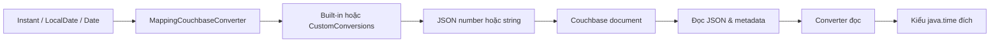

# Ngày giờ, múi giờ và lựa chọn định dạng lưu trữ

## 1. Bài toán ngày giờ trong Spring Data Couchbase

Trong **SPRING_DATA_COUCHBASE**, ứng dụng dùng Java entity, repository và `CouchbaseTemplate` để làm việc với JSON document. Khi cần lưu thời điểm tạo đơn hàng, ngày giao hàng, lịch hẹn hoặc khoảng thời gian hiệu lực, câu hỏi không chỉ là "dùng kiểu Java nào?". Ta còn phải xác định **ý nghĩa của thời gian**, **múi giờ**, **độ chính xác**, **định dạng trong JSON** và **cách truy vấn SQL++**.

JSON không có kiểu ngày giờ riêng. Một thời điểm có thể được biểu diễn thành:

```json
{
  "createdAtIso": "2025-01-01T00:00:00.000Z",
  "createdAtEpochMs": 1735689600000,
  "deliveryDate": "2025-01-03",
  "deliveryTime": "09:30:00",
  "deliveryZone": "Asia/Ho_Chi_Minh"
}
```

Hai field đầu có thể mô tả **cùng một thời điểm tuyệt đối**, nhưng field ngày giao hàng và giờ giao hàng biểu diễn **lịch địa phương**; muốn đổi chúng thành một thời điểm tuyệt đối phải biết múi giờ và cách giải quyết các trường hợp thay đổi giờ mùa hè (DST).

Mục tiêu của bài là:

1. Phân biệt các kiểu `java.time` theo ý nghĩa nghiệp vụ.
2. Hiểu sự khác biệt giữa **instant**, **offset**, **time zone**, **local date/time** và **duration**.
3. Chọn một hợp đồng lưu trữ ổn định: ISO-8601 string, epoch milliseconds hoặc dữ liệu lịch kèm `ZoneId`.
4. Biết tầng mapping Spring Data Couchbase tham gia chuyển đổi ra sao và khi nào cần custom converter.
5. Viết truy vấn SQL++ đúng đơn vị thời gian, phù hợp index và kiểm thử qua DST, timezone, dữ liệu cũ.

Các ví dụ tập trung vào document mapping và chuyển đổi kiểu; TTL/CAS, giao dịch và reactive API chỉ được liên hệ để tránh nhầm các khái niệm.

## 2. Phân biệt thời điểm tuyệt đối và lịch địa phương

Một hệ thống bán hàng ở Việt Nam có thể ghi nhận:

- Khách đã thanh toán vào **09:30 ngày 15/05/2026 tại Thành phố Hồ Chí Minh**.
- Chi nhánh phải giao hàng vào **ngày 16/05/2026**, bất kể thời điểm đồng hồ nào trong ngày.
- Buổi hẹn diễn ra **09:30 mỗi sáng thứ Hai** theo múi giờ của chi nhánh.
- Đơn phải được xử lý trong vòng **30 phút sau khi nhận**.

Bốn yêu cầu này mang bốn ngữ nghĩa khác nhau:

| Ngữ nghĩa | Kiểu Java thường chọn | Điều cần lưu |
| --- | --- | --- |
| Sự kiện tại một thời điểm trên dòng thời gian | `Instant` | Epoch milliseconds hoặc ISO-8601 UTC, theo hợp đồng đã chọn. |
| Một thời điểm có kèm offset cụ thể | `OffsetDateTime` | ISO-8601 có offset, hoặc chuẩn hóa về `Instant` và lưu offset riêng nếu cần. |
| Thời điểm gắn với quy tắc múi giờ địa lý | `ZonedDateTime` | Instant và `ZoneId` nếu cần giữ cả thời điểm lẫn danh tính múi giờ. |
| Một ngày theo lịch, không kèm giờ | `LocalDate` | Chuỗi `YYYY-MM-DD`. |
| Một giờ trong ngày, chưa có ngày | `LocalTime` | Chuỗi `HH:mm:ss` theo độ chính xác đã thống nhất. |
| Ngày và giờ trên đồng hồ địa phương, không có múi giờ | `LocalDateTime` | Chuỗi local datetime **kèm quy ước zone ở nơi khác** nếu sau này cần suy ra instant. |
| Khoảng thời gian có độ dài đo bằng thời gian thực | `Duration` | Đơn vị thống nhất, ví dụ số giây hoặc ISO-8601 duration `PT30M`. |
| Khoảng thời gian theo lịch như một tháng | `Period` | ISO-8601 period `P1M` và quy tắc lịch đi kèm. |

**Nguyên tắc:** Không dùng `LocalDateTime` một mình để biểu diễn thời điểm thanh toán có tính toàn cầu. Nó không chứa offset hoặc vùng múi giờ, nên `2026-05-15T09:30:00` có thể trỏ đến nhiều instant khác nhau.

### 2.1. `Instant`, `ZoneOffset` và `ZoneId` không đồng nghĩa

- `Instant`: một điểm trên trục UTC; không có múi giờ trình bày.
- `ZoneOffset`: độ lệch cụ thể so với UTC, chẳng hạn `+07:00` hoặc `-04:00`.
- `ZoneId`: tên vùng như `Asia/Ho_Chi_Minh` hoặc `America/New_York`; có tập quy tắc lịch sử và chuyển đổi offset theo ngày.
- `OffsetDateTime`: local datetime cùng một offset; đủ xác định instant, nhưng riêng offset không nói được toàn bộ quy tắc của vùng.
- `ZonedDateTime`: local datetime, zone ID và offset áp dụng ở thời điểm đó.

Ví dụ Java:

```java
import java.time.*;

OffsetDateTime local =
    OffsetDateTime.parse("2026-05-15T09:30:00+07:00");

Instant instant = local.toInstant();
// instant = 2026-05-15T02:30:00Z

ZoneId hcm = ZoneId.of("Asia/Ho_Chi_Minh");
ZonedDateTime shownInHcm = instant.atZone(hcm);
// 2026-05-15T09:30+07:00[Asia/Ho_Chi_Minh]
```

Gọi `instant.atZone(hcm)` chỉ thay **cách biểu diễn địa phương**, không làm dịch chuyển instant. Ngược lại, tự gán zone vào một `LocalDateTime` chưa có zone là thao tác **diễn giải một giờ địa phương**, có thể sinh ra instant khác.

### 2.2. UTC là quy ước ghi nhận, không phải múi giờ nghiệp vụ của mọi lịch

Ghi timestamp sự kiện bằng UTC giúp hệ thống ở nhiều vùng trao đổi dữ liệu nhất quán. Tuy nhiên, "giao hàng trước 17:00 ngày 16/05 theo giờ chi nhánh" vẫn phải được đánh giá bằng lịch và `ZoneId` của chi nhánh. Chỉ lưu UTC mà bỏ mất thông tin zone có thể khiến việc sửa lịch hay tính ngày kinh doanh gặp khó khăn.

## 3. JSON không có `Date`: ba lựa chọn lưu trữ chính

Couchbase lưu JSON và không tự biến mọi chuỗi giống ngày giờ thành một kiểu timestamp đặc biệt. Spring Data sử dụng converter để ánh xạ kiểu Java sang các giá trị JSON được hỗ trợ.

### 3.1. Unix epoch milliseconds: số nguyên có đơn vị rõ ràng

Epoch milliseconds là số mili giây tính từ `1970-01-01T00:00:00Z`. Ví dụ:

```json
{ "occurredAtEpochMs": 1735689600000 }
```

Java:

```java
Instant event = Instant.parse("2025-01-01T00:00:00Z");
long epochMs = event.toEpochMilli();   // 1735689600000
Instant roundTrip = Instant.ofEpochMilli(epochMs);
```

Ưu điểm:

- Có thứ tự số học theo thời gian và dễ so sánh khoảng bằng `>=`, `<`.
- Dễ dùng index trên field số khi truy vấn theo khoảng.
- Không mang định dạng trình bày hay phụ thuộc múi giờ khi lưu.
- Có thể trao đổi thuận tiện giữa Java, SQL++ và các dịch vụ hiểu cùng đơn vị.

Nhược điểm:

- Con số không thể tự nói nó là **seconds**, **milliseconds** hay **microseconds**.
- Dùng milliseconds làm mất phần thời gian nhỏ hơn một mili giây.
- Client JavaScript dùng `Number` có giới hạn độ chính xác số nguyên, cần chú ý với timestamp cực xa hoặc đơn vị nano/micro.
- Không lưu được trực tiếp `ZoneId` hay ý nghĩa lịch địa phương.

Một lỗi phổ biến là truyền epoch seconds (10 chữ số ở giai đoạn hiện nay) vào API kỳ vọng epoch milliseconds (thường 13 chữ số). **Không dùng số chữ số làm validation chính thức**: hãy đặt tên field và đơn vị rõ ràng, kiểm tra miền giá trị nghiệp vụ.

### 3.2. ISO-8601 string: dễ đọc và dễ tích hợp

Ví dụ:

```json
{ "occurredAtUtc": "2026-05-15T02:30:00.000Z" }
```

Trong Java:

```java
Instant event = Instant.parse("2026-05-15T02:30:00Z");
String text = event.toString();
Instant restored = Instant.parse(text);
```

Ưu điểm:

- Con người và API bên ngoài dễ đọc; có thể thấy offset/UTC ngay.
- Dễ giữ hợp đồng trao đổi theo ISO-8601/RFC 3339.
- Ít nhầm đơn vị seconds/milliseconds nếu quy định định dạng đủ chặt.

Nhược điểm:

- Truy vấn theo thời gian có thể cần chuyển chuỗi thành epoch milliseconds.
- **Sắp xếp string không tự bảo đảm sắp xếp thời gian** khi trộn offset, độ dài phân số giây hoặc các cách viết khác nhau.
- Format parser, precision và quy ước UTC phải được thống nhất giữa các hệ thống.

Ví dụ hai chuỗi:

```text
2026-05-15T09:30:00+07:00
2026-05-15T02:30:00Z
```

Chúng chỉ cùng **một instant**, nhưng không bằng nhau về giá trị string. Tương tự, khi trộn `...00Z` với `...00.100Z`, so sánh từ điển có thể cho thứ tự không đúng theo thời gian vì độ dài chuỗi khác nhau.

Nếu định sử dụng **range query trực tiếp trên string**, hãy chuẩn hóa tất cả timestamp về cùng UTC, cùng độ rộng thành phần và cùng precision, ví dụ luôn `yyyy-MM-dd'T'HH:mm:ss.SSS'Z'`. Nếu không bảo đảm được, hãy chuyển sang range query trên giá trị epoch milliseconds hoặc dùng hàm parse có chiến lược index thích hợp.

### 3.3. Lịch địa phương + zone ID: cho lịch hẹn, cửa sổ kinh doanh

Ví dụ khi cửa hàng mở lịch hẹn "09:30 ngày 10/12 tại Hồ Chí Minh":

```json
{
  "appointmentLocal": "2026-12-10T09:30:00",
  "appointmentZone": "Asia/Ho_Chi_Minh"
}
```

Khi cần instant:

```java
LocalDateTime local = LocalDateTime.parse("2026-12-10T09:30:00");
ZoneId zone = ZoneId.of("Asia/Ho_Chi_Minh");
ZonedDateTime zoned = local.atZone(zone);
Instant exactTime = zoned.toInstant();
```

Với lịch tái diễn, lưu `LocalTime`, quy tắc ngày trong tuần và `ZoneId` thường đúng ngữ nghĩa hơn so với cố định một epoch timestamp. Lưu thêm instant đã tính cho **mỗi lần diễn ra cụ thể** nếu cần đối chiếu và sắp lịch hiệu quả.

## 4. Chọn kiểu Java phù hợp

Các lớp `java.time` có ranh giới ngữ nghĩa quan trọng:

| Loại dữ liệu trong nghiệp vụ | Kiểu ưu tiên | Vì sao |
| --- | --- | --- |
| `createdAt`, `paidAt`, `processedAt` | `Instant` | Là một thời điểm tuyệt đối; dễ chuẩn hóa UTC. |
| Ngày sinh, ngày giao dự kiến | `LocalDate` | Không tự gắn giờ 00:00 UTC, tránh lệch ngày. |
| Giờ mở cửa trong ngày | `LocalTime` và `ZoneId` | Là giờ đồng hồ tại địa điểm cụ thể. |
| Cuộc họp do người dùng chọn theo vùng | `LocalDateTime` + `ZoneId`; hoặc `ZonedDateTime` | Cần quy tắc vùng và xử lý DST. |
| Chuỗi thời gian có offset từ API ngoài | `OffsetDateTime` | Giữ được thông tin offset đã nhận. |
| Thời gian timeout hoặc độ trễ | `Duration` | Đo thời lượng thực tế, không phụ thuộc lịch. |
| Gia hạn một tháng theo lịch | `Period` | Không tương đương với 30 ngày hay 30 × 24 giờ. |
| Hệ thống Java đời cũ | `Date`, `Calendar` khi buộc tương thích | Nên đổi sang `java.time` ở ranh giới ứng dụng khi có thể. |

**Không đồng nhất ngày lịch với thời điểm midnight UTC.** Ví dụ, giá trị `2026-05-15` cho ngày giao hàng không có thông tin giờ/múi giờ. Nếu biến thành `2026-05-15T00:00:00Z`, khi hiển thị ở một số múi giờ phía Tây, người dùng có thể thấy ngày 14/05.

**Không đồng nhất một ngày với 24 giờ.** Khi có thay đổi DST, khoảng từ 00:00 hôm nay đến 00:00 ngày hôm sau theo múi giờ địa phương có thể dài 23 hoặc 25 giờ.

## 5. Spring Data Couchbase chuyển đổi ngày giờ ra sao?

Khi entity chứa thuộc tính ngày giờ, `MappingCouchbaseConverter` và tập converters của Spring Data chịu trách nhiệm đưa các giá trị Java thành cấu trúc tương thích với JSON. Khi đọc, converter dùng kiểu Java đích và metadata mapping để chuyển trở lại.



Những điểm cần nắm:

1. `Instant`, `LocalDate` hay `Date` **không thể được lưu nguyên vẹn như kiểu Java trong JSON**; phải có biểu diễn số/chuỗi và quy tắc chuyển đổi.
2. Spring Data Couchbase có các bộ converter sẵn có, trong đó có các converter cho `java.time`. **Biểu diễn chính xác của từng kiểu và từng phiên bản cần được đo bằng round-trip**; không nên khẳng định mọi loại temporal đều mặc định thành ISO string hoặc đều mặc định là epoch milliseconds.
3. Tài liệu Spring Data Couchbase có ví dụ `Date` và `Calendar` được lưu thành các timestamp số với cách biểu diễn có thể **khác đơn vị**. Điều này là lý do phải tránh suy luận đơn vị chỉ từ việc JSON chứa số.
4. Các converter thông dụng cho temporal type **không chứa múi giờ** có thể phụ thuộc system-default timezone ở một số đường chuyển đổi. Hai ứng dụng dùng timezone mặc định khác nhau có thể đọc/ghi khác nhau nếu không quy định hợp đồng rõ ràng.
5. `@Field` xác định tên field lưu trữ; nó **không tự chọn timezone, precision hoặc định dạng ISO-8601**.
6. `@Id`, CAS và TTL là metadata của document; chúng không phải định dạng lưu trữ của một field nghiệp vụ như `createdAt`.

### 5.1. Kiểm tra thay vì đoán default converter

Ví dụ một entity đơn giản:

```java
import java.time.Instant;
import java.time.LocalDate;
import org.springframework.data.annotation.Id;
import org.springframework.data.couchbase.core.mapping.Document;
import org.springframework.data.couchbase.core.mapping.Field;

@Document
public record AuditEvent(
    @Id String id,
    @Field Instant occurredAt,
    @Field LocalDate businessDate
) {}
```

Một bước tự kiểm tra trong ứng dụng đang chạy:

```java
AuditEvent input = new AuditEvent(
    "event::42",
    Instant.parse("2026-05-15T02:30:00Z"),
    LocalDate.of(2026, 5, 15)
);

CouchbaseDocument doc = new CouchbaseDocument();
converter.write(input, doc);

System.out.println(doc.export()); // Xem kiểu Number/String và giá trị thật.

AuditEvent output = converter.read(AuditEvent.class, doc);
// So sánh input.occurredAt(), input.businessDate() với output.
```

Đoạn trên là **kiểm tra mapping trong bộ nhớ**, không ghi dữ liệu vào server. Kết quả phụ thuộc bộ converter đang cấu hình. Nếu `businessDate` không round-trip đúng giữa những môi trường có timezone khác nhau, hãy xây hợp đồng lưu trữ tường minh và kiểm tra quy tắc timezone.

### 5.2. Vì sao không dùng Jackson annotation để thay thế mapping converter?

`@JsonFormat` hoặc cấu hình `ObjectMapper` có thể tác động tới API JSON qua Jackson, nhưng không nên mặc định rằng cùng quy tắc sẽ tự động điều khiển việc ghi entity bằng Spring Data Couchbase. Tầng Spring Data có cơ chế mapping và custom conversions riêng. Để tránh hai định dạng mâu thuẫn, hãy test cả JSON API và document thật trong Couchbase.

## 6. Một thiết kế lưu trữ tường minh cho hệ thống đơn hàng

Giả sử dịch vụ muốn:

- Truy vấn thời gian tạo đơn theo khoảng với index.
- Hiển thị thời gian tại múi giờ của cửa hàng.
- Lưu một ngày giao hàng theo lịch cửa hàng, không gắn giờ.

Có thể lưu một document với các field tường minh:

```java
import org.springframework.data.annotation.Id;
import org.springframework.data.couchbase.core.mapping.Document;
import org.springframework.data.couchbase.core.mapping.Field;

@Document
public record OrderTimingDocument(
    @Id String id,
    @Field("created_at_epoch_ms") long createdAtEpochMs,
    @Field("store_zone") String storeZone,
    @Field("delivery_date") String deliveryDate
) {}
```

Dữ liệu Java trước khi tạo entity lưu trữ:

```java
import java.time.*;

Instant createdAt = Instant.parse("2026-05-15T02:30:00Z");
ZoneId storeZone = ZoneId.of("Asia/Ho_Chi_Minh");
LocalDate deliveryDate = LocalDate.of(2026, 5, 16);

OrderTimingDocument doc = new OrderTimingDocument(
    "order::42",
    createdAt.toEpochMilli(),
    storeZone.getId(),
    deliveryDate.toString()
);
```

Mô hình JSON là:

```json
{
  "_class": "com.example.orders.OrderTimingDocument",
  "created_at_epoch_ms": 1778812200000,
  "store_zone": "Asia/Ho_Chi_Minh",
  "delivery_date": "2026-05-16"
}
```

Tên class trong `_class` giả định entity thuộc package `com.example.orders` và type mapper dùng cấu hình thông dụng; giá trị này không phải bắt buộc nếu ứng dụng thay đổi alias. ID `order::42` là document key, không cần được lặp lại trong body JSON.

Đây là một **hợp đồng lưu trữ do ứng dụng chủ động định nghĩa**: trường epoch là số `long`, zone và ngày lịch là chuỗi. Cơ chế mapping mặc định không cần phải chọn định dạng temporal phức tạp vì ứng dụng đã chuyển đổi ở ranh giới domain/persistence. Đổi lại, ứng dụng phải giữ quy tắc parse/format khi chuyển giữa entity lưu trữ và model nghiệp vụ.

Một hướng khác là giữ `Instant`, `LocalDate` trong entity và đăng ký custom converters. Khi chọn hướng đó, phải bảo đảm JSON thực tế vẫn đúng hợp đồng đã thống nhất.

## 7. Tùy biến converter để lưu `Instant` bằng ISO-8601 string

Nếu hợp đồng cần field `occurredAt` là string UTC, có thể đăng ký bộ converter theo cả hai chiều:

```java
import java.time.Instant;
import org.springframework.core.convert.converter.Converter;
import org.springframework.data.convert.ReadingConverter;
import org.springframework.data.convert.WritingConverter;

@WritingConverter
public class InstantToString implements Converter<Instant, String> {
    @Override
    public String convert(Instant source) {
        return source.toString();
    }
}

@ReadingConverter
public class StringToInstant implements Converter<String, Instant> {
    @Override
    public Instant convert(String source) {
        return Instant.parse(source);
    }
}
```

Với một cấu hình kế thừa `AbstractCouchbaseConfiguration`, có thể đưa converter vào danh sách bổ sung của ứng dụng (ví dụ API trong các phiên bản hiện đại):

```java
@Override
protected void additionalConverters(List<Object> converters) {
    converters.add(new InstantToString());
    converters.add(new StringToInstant());
}
```

Cần import `java.util.List` trong lớp cấu hình. Các converter phải **được đăng ký thực sự** trong `CouchbaseCustomConversions`/cấu hình của phiên bản đang sử dụng; chỉ đặt class vào source code không đủ. Cần kiểm thử xem bộ converter người dùng có được ưu tiên so với default converter trong phiên bản Spring Data Couchbase được triển khai.

Có một hạn chế quan trọng: `Instant.toString()` cho ISO-8601 UTC **nhưng độ dài phần thập phân giây có thể thay đổi** theo precision dữ liệu. Hợp đồng này tốt cho parse/round-trip; nếu muốn range query bằng so sánh string trực tiếp, hãy chọn chuẩn định dạng có **precision cố định** hoặc dùng epoch number.

### 7.1. Nếu cần precision cố định ở mức mili giây

```java
import java.time.Instant;
import java.time.ZoneOffset;
import java.time.format.DateTimeFormatter;
import java.time.temporal.ChronoUnit;

private static final DateTimeFormatter UTC_MILLIS =
    DateTimeFormatter.ofPattern("uuuu-MM-dd'T'HH:mm:ss.SSS'Z'")
        .withZone(ZoneOffset.UTC);

Instant source = Instant.parse("2026-05-15T02:30:00.123456Z");
String stored = UTC_MILLIS.format(source.truncatedTo(ChronoUnit.MILLIS));
// "2026-05-15T02:30:00.123Z"
```

Quy ước này **mất phần micro/nano giây** và phải được ghi vào hợp đồng dữ liệu. Không âm thầm đổi sang định dạng mili giây nếu ứng dụng đang cần độ chính xác nano giây. Khi đọc, `Instant.parse(stored)` có thể phục hồi instant ở độ chính xác mili giây đã lưu.

Nếu dùng `ZonedDateTime` hoặc `OffsetDateTime`, hãy xác định rõ liệu có cần lưu lại offset/zone ban đầu. Việc chỉ lưu `Instant` sẽ giữ **thời điểm**, nhưng không giữ chính xác chuỗi local time và zone name nguồn nếu đây là dữ liệu cần kiểm toán.

## 8. DST và những trường hợp không thể giải bằng cộng/trừ 7 giờ

Việt Nam hiện sử dụng `Asia/Ho_Chi_Minh` với offset `+07:00`, nhưng nhiều vùng khác có DST. Ví dụ `America/New_York`:

- **01:30 ngày 01/11/2026** xuất hiện **hai lần** khi đồng hồ lùi từ DST sang giờ chuẩn. Local datetime này có thể tương ứng hai instant khác nhau.
- **02:30 ngày 08/03/2026** không tồn tại ở vùng đó khi đồng hồ nhảy tiến.

Kiểm tra bằng Java:

```java
import java.time.*;
import java.util.List;

ZoneId newYork = ZoneId.of("America/New_York");

LocalDateTime overlap = LocalDateTime.of(2026, 11, 1, 1, 30);
List<ZoneOffset> offsetsInOverlap =
    newYork.getRules().getValidOffsets(overlap);
// Có thể có 2 offset hợp lệ.

LocalDateTime gap = LocalDateTime.of(2026, 3, 8, 2, 30);
List<ZoneOffset> offsetsInGap =
    newYork.getRules().getValidOffsets(gap);
// Danh sách rỗng: local time không tồn tại.
```

Không nên để hành vi giải quyết overlap/gap ngầm định quyết định số tiền, lịch đặt chỗ hoặc SLA. Ứng dụng có thể:

1. Bắt người dùng chọn offset cụ thể khi local time bị trùng.
2. Từ chối khung giờ không tồn tại, hoặc chuyển theo một quy tắc công khai.
3. Lưu `ZoneId` và, với sự kiện đã chốt lịch, lưu cả instant chính xác.
4. Kiểm thử quy tắc DST với dữ liệu lịch của vùng sử dụng.

Đối với lịch lặp, giữ `ZoneId` còn quan trọng vì quy tắc múi giờ và DST có thể được các chính phủ thay đổi trong tương lai. Chỉ lưu `+07:00` hoặc `-05:00` không đủ mô tả chính sách thời gian ở mọi ngày.

## 9. Truy vấn SQL++ khi lưu epoch milliseconds

Giả sử các document đặt trong bucket `shop`, scope `ops`, collection `events`, và field `created_at_epoch_ms` là JSON number theo **mili giây**:

```sql
SELECT META(e).id AS eventId,
       e.created_at_epoch_ms AS createdAtEpochMs,
       MILLIS_TO_UTC(e.created_at_epoch_ms) AS createdAtUtc
FROM `shop`.`ops`.`events` AS e
WHERE e.created_at_epoch_ms >= $fromMs
  AND e.created_at_epoch_ms < $toMs
ORDER BY e.created_at_epoch_ms;
```

Ở đây `$fromMs` và `$toMs` là **tham số truy vấn**; ứng dụng truyền long milliseconds tương ứng. Khoảng `[from, to)` (gồm đầu, không gồm cuối) tránh đếm trùng sự kiện ở ranh giới hai khoảng liên tiếp.

Một index phù hợp với truy vấn thời gian có thể là:

```sql
CREATE INDEX ix_events_created_at
ON `shop`.`ops`.`events`(created_at_epoch_ms);
```

Index thực tế phải được thiết kế theo predicate, filter bổ sung, sort và workload. Converter Java không tự tạo index; nhiệm vụ của nó là thống nhất đơn vị và kiểu dữ liệu ở tầng lưu/đọc.

Các hàm SQL++ thường gặp:

| Hàm | Đầu vào | Mục đích |
| --- | --- | --- |
| `STR_TO_MILLIS(s)` | Chuỗi ngày giờ hợp lệ | Parse thành epoch milliseconds. |
| `MILLIS_TO_UTC(ms)` | Epoch **milliseconds** | Biểu diễn thời điểm ở UTC dạng chuỗi. |
| `MILLIS_TO_TZ(ms, zone)` | Epoch milliseconds, tên zone | Hiển thị thời gian ở múi giờ chỉ định. |
| `DATE_PART_STR(s, part)` | Chuỗi ngày giờ | Lấy một thành phần ngày giờ theo cú pháp được hỗ trợ. |
| `NOW_MILLIS()` | Không tham số | Thời điểm hiện tại của truy vấn dưới dạng epoch milliseconds. |

Lưu ý: SQL++ date functions của Couchbase xử lý số epoch theo **milliseconds**; không truyền số epoch seconds rồi chờ hàm tự nhận biết.

Ví dụ kiểm tra nhanh một instant và thời gian ở chi nhánh:

```sql
SELECT STR_TO_MILLIS("2025-01-01T00:00:00Z") AS epochMs,
       MILLIS_TO_UTC(1735689600000) AS utcText,
       MILLIS_TO_TZ(
           1735689600000,
           "Asia/Ho_Chi_Minh"
       ) AS hcmText;
```

Khi query một field kiểu ISO string không được chuẩn hóa:

```sql
SELECT META(e).id AS eventId
FROM `shop`.`ops`.`events` AS e
WHERE STR_TO_MILLIS(e.created_at_iso) >= $fromMs
  AND STR_TO_MILLIS(e.created_at_iso) < $toMs;
```

Truy vấn này rõ ràng về ngữ nghĩa, nhưng **gọi hàm trên field trong WHERE có thể làm giảm khả năng dùng index thường** trên chuỗi gốc. Cần dùng index biểu thức hoặc field số đã chuẩn hóa nếu truy vấn range thường xuyên; kiểm tra `EXPLAIN` và thống kê thực tế trước khi kết luận.

## 10. Lưu ngày theo lịch và truy vấn theo ngày kinh doanh

Với trường `delivery_date` lưu cố định theo `YYYY-MM-DD`:

```json
{ "delivery_date": "2026-05-16" }
```

Nếu mọi ngày đều được chuẩn hóa thành `YYYY-MM-DD` (zero-padded, cùng lịch), so sánh chuỗi có thể dùng cho sắp xếp và lọc theo thứ tự ngày:

```sql
SELECT META(o).id AS orderId, o.delivery_date
FROM `shop`.`sales`.`orders` AS o
WHERE o.delivery_date >= "2026-05-01"
  AND o.delivery_date <  "2026-06-01";
```

Điều này áp dụng cho **ngày lịch thuần**, không có offset và giờ. Với timestamp chứa nhiều offset hoặc precision khác nhau, không được áp dụng máy móc quy tắc sắp xếp chuỗi.

Khi tạo báo cáo "doanh thu theo ngày tại Hà Nội", phải đổi instant sang vùng nghiệp vụ trước khi lấy `LocalDate`:

```java
Instant paidAt = Instant.parse("2026-05-15T23:30:00Z");
ZoneId storeZone = ZoneId.of("Asia/Ho_Chi_Minh");

LocalDate businessDate = paidAt.atZone(storeZone).toLocalDate();
// 2026-05-16, khác ngày UTC là 2026-05-15.
```

Nếu lấy ngày theo UTC rồi nhóm, báo cáo có thể chuyển một giao dịch sang sai ngày của chi nhánh. Với dữ liệu tổng hợp lớn, có thể lưu `business_date` được tính theo zone tại thời điểm ghi, kèm ID vùng, và có chiến lược cập nhật khi quy tắc nghiệp vụ thay đổi.

## 11. Khác biệt giữa ngày giờ nghiệp vụ với TTL của Couchbase

Timestamp `createdAt` là thuộc tính nghiệp vụ trong JSON. **Document expiry/TTL** là metadata do Couchbase quản lý, ảnh hưởng đến thời điểm document hết hiệu lực trên server.

Ví dụ:

```java
@Document(expiry = 3600)
public class TemporaryEvent {
    @Id String id;

    @Field Instant occurredAt;
}
```

Trong ví dụ này, `expiry = 3600` mô tả thiết lập thời hạn trên document theo đơn vị được annotation quy định (giây), còn `occurredAt` mô tả thời điểm sự kiện. Không coi chúng là cùng một thông tin:

- Đổi `occurredAt` không tự động làm đổi expiry của document.
- Truy vấn `occurredAt` không cho biết chính xác còn bao lâu document bị xóa.
- CAS là metadata kiểm soát ghi đồng thời, không phải timestamp `updatedAt`.
- Giữ nguyên/đặt lại TTL trên thao tác update còn phụ thuộc API, cấu hình và phiên bản Couchbase.

Giao dịch, reactive API và consistency của SQL++ cũng không làm thay đổi ngữ nghĩa seconds/milliseconds của JSON date fields. Cần duy trì hợp đồng kiểu dữ liệu nhất quán xuyên các đường truy cập.

## 12. Mất precision, dữ liệu rỗng và phiên bản hóa schema

### 12.1. Micro/nanosecond không tự sống sót qua epoch milliseconds

`Instant` hỗ trợ precision đến nanosecond, nhưng `toEpochMilli()` chỉ giữ milliseconds. Ví dụ:

```java
Instant precise = Instant.parse("2026-05-15T02:30:00.123456789Z");
long millis = precise.toEpochMilli();

Instant decoded = Instant.ofEpochMilli(millis);
// decoded = 2026-05-15T02:30:00.123Z
```

Nếu phải phân biệt nhiều sự kiện trong cùng một mili giây, xem xét một định dạng có fractional precision đủ lớn hoặc sử dụng timestamp kết hợp sequence/document key. Không nên tự lưu "nano timestamp" kiểu `long` nếu chưa kiểm tra miền giá trị và khả năng tương thích với SQL++/JavaScript.

### 12.2. Missing, null và dữ liệu cũ sai định dạng

Một document có `{"created_at": null}` khác với document thiếu field `created_at`. Spring Data Couchbase thường bỏ qua property Java có giá trị `null` khi ghi entity mặc định, nhưng document do SDK/import khác có thể có JSON `null`. Khi đọc sang kiểu tham chiếu `Instant`, cả hai trường hợp có thể dẫn tới `null` tùy constructor và converter.

Nếu thêm trường bắt buộc mới vào một entity bất biến, document cũ thiếu field có thể làm quá trình dựng entity thất bại. Hãy xác định chính sách migrate/backfill hoặc default; tránh coi `1970-01-01T00:00:00Z` là "không có thời gian" nếu hệ thống có thể có sự kiện thật vào epoch.

### 12.3. Thay đổi định dạng cần migration có kiểm soát

Giả sử hệ thống cũ lưu:

```json
{ "createdAt": 1735689600 }
```

đây là epoch **seconds**; hệ thống mới dùng:

```json
{ "created_at_epoch_ms": 1735689600000 }
```

Đây là thay đổi cả **tên field** lẫn **đơn vị**. Đổi kiểu Java từ `long` sang `Instant` không làm dữ liệu cũ tự chuyển đúng; cần migration hoặc trình đọc tương thích.

Quy trình an toàn:

1. Kiểm kê field thật trong JSON: kiểu number/string, đơn vị, timezone, precision, giá trị thiếu.
2. Chọn một hợp đồng đích có tên rõ ràng, ví dụ `created_at_epoch_ms`.
3. Xây đường đọc tương thích có validation, quan sát lỗi trên dữ liệu hiện có.
4. Backfill theo lô có thể chạy lại, đo sai lệch và phạm vi thời gian bất thường.
5. Khi mọi client đã chuyển, loại bỏ đường cũ và cập nhật index/truy vấn.

Tránh suy đơn vị chỉ bằng độ lớn con số mà không xác nhận nguồn dữ liệu; timestamp âm hoặc thời điểm xa có thể làm heuristic sai.

## 13. Kiểm thử round-trip và lỗi múi giờ

Tối thiểu nên kiểm thử các tình huống:

| Trường hợp | Điều cần xác minh |
| --- | --- |
| `Instant` chuẩn UTC | `write → read` giữ đúng instant và precision cam kết. |
| Cùng instant với offset khác | Parse `2026-05-15T09:30+07:00` và `2026-05-15T02:30Z` cho cùng một thời điểm. |
| Chạy ở timezone JVM khác nhau | Kết quả mapping cho `LocalDate`/`LocalDateTime` có thay đổi không. |
| DST overlap/gap | Chính sách khi local time có hai hoặc không có offset hợp lệ. |
| Giờ sát nửa đêm UTC | Ngày nghiệp vụ tại `Asia/Ho_Chi_Minh` được tính đúng. |
| Fractional seconds | Mili giây có mất micro/nano như hợp đồng nêu rõ không. |
| Null/missing | Entity cũ đọc được hay báo lỗi có thể xử lý. |
| Seconds ↔ milliseconds | Không xuất hiện sai lệch gấp 1000 lần. |
| Query range | Dữ liệu tại đúng `from` và `to` có thuộc khoảng theo quy ước `[from,to)` không. |
| Đường SDK và repository | Hai đường ghi có cùng kiểu JSON và cùng đơn vị không. |

### 13.1. Kiểm thử deterministic bằng `Clock`

`Clock.fixed` giúp test không phụ thuộc thời gian thực khi chạy:

```java
import java.time.*;

Clock clock = Clock.fixed(
    Instant.parse("2026-05-15T23:30:00Z"),
    ZoneOffset.UTC
);

Instant now = clock.instant();
LocalDate hcmDate =
    now.atZone(ZoneId.of("Asia/Ho_Chi_Minh")).toLocalDate();

assert hcmDate.equals(LocalDate.of(2026, 5, 16));
```

Trong ứng dụng Spring, có thể inject bean `Clock` để code nghiệp vụ không gọi `Instant.now()` rải rác. Test timezone/DST nên chỉ rõ vùng và ngày, không phụ thuộc timezone của máy CI.

### 13.2. Dấu hiệu lỗi và cách tìm nguyên nhân

| Hiện tượng | Nghi vấn | Cách xử lý |
| --- | --- | --- |
| Ngày/giờ lệch 7 tiếng | Dùng local datetime như UTC hoặc gán zone nhầm | Ghi rõ nguồn timezone, so sánh `Instant` trước/sau mapping. |
| Thời gian thành năm 1970 hoặc rất xa | Nhầm seconds/milliseconds | In số epoch và đơn vị, đối chiếu bằng `Instant.ofEpochSecond` / `ofEpochMilli`. |
| Query trả thiếu sự kiện | Trộn offset/precision ISO hoặc ranh giới range sai | Chuẩn hóa UTC/format, dùng khoảng `[from,to)`. |
| `LocalDateTime` đọc lệch trên CI | Converter phụ thuộc default JVM zone | Dùng converter tường minh hoặc đổi dữ liệu sang kiểu mang timezone phù hợp. |
| Một lịch hẹn rơi vào giờ sai sau DST | Chỉ lưu offset hoặc resolve giờ local mơ hồ | Lưu `ZoneId`; kiểm tra gap/overlap. |
| Trường thời gian không parse được | Chuỗi cũ dùng format lạ hoặc number không đúng kiểu | Xác minh JSON thực, phiên bản converter, migration. |
| Mất micro/nano | Dùng milliseconds hoặc formatter precision cố định | Xác nhận nhu cầu độ chính xác, đổi hợp đồng lưu nếu cần. |
| Lọc theo index kém hiệu quả | Dùng `STR_TO_MILLIS(field)` trên field string có index thường | Dùng field epoch được index hoặc index biểu thức phù hợp. |

Khi debug, kiểm tra theo thứ tự **Java source → giá trị trong `CouchbaseDocument` → JSON trên server → SQL++ query → Java sau đọc**. Đây là cách khoanh vùng sai lệch giữa mapping, serialization, truy vấn và logic timezone.

## 14. Bài thực hành tổng hợp

**Bài 1 — Định dạng và cùng thời điểm.** Với giá trị `2026-05-15T09:30:00+07:00`, chuyển sang `Instant`, ISO UTC và epoch milliseconds. Chứng minh giờ địa phương và giờ UTC đại diện cùng instant. So sánh kết quả parse hai chuỗi khác offset.

**Bài 2 — So sánh hai hợp đồng lưu trữ.** Tạo một entity dùng `long createdAtEpochMs` và một entity dùng `Instant createdAt` với custom converter ISO. Ghi/đọc bằng repository hoặc `CouchbaseTemplate` trong collection thử nghiệm, kiểm tra JSON thực tế và precision còn giữ.

**Bài 3 — Ngày kinh doanh.** Với timestamp `2026-05-15T23:30:00Z`, tính `LocalDate` ở UTC và `Asia/Ho_Chi_Minh`. Thiết kế một field `business_date` để báo cáo đúng theo vùng của cửa hàng.

**Bài 4 — SQL++ và index.** Tạo bộ dữ liệu có `created_at_epoch_ms` và một index trên field đó. So sánh khoảng truy vấn bằng number với phép lọc dùng `STR_TO_MILLIS(created_at_iso)`, xem `EXPLAIN` và rút ra lựa chọn cho workload nhiều truy vấn range.

**Bài 5 — DST.** Dùng `ZoneRules.getValidOffsets` kiểm tra `2026-11-01T01:30` và `2026-03-08T02:30` ở `America/New_York`. Viết quy tắc ứng dụng cho từng trường hợp và lưu dữ liệu cần thiết để khôi phục một lịch hẹn chính xác.

### Câu hỏi tự kiểm tra

1. Vì sao `Instant` thích hợp cho `createdAt` nhưng `LocalDate` thích hợp cho ngày sinh?
2. `LocalDateTime` thiếu thông tin nào để xác định một instant duy nhất?
3. Khác biệt giữa `ZoneOffset` và `ZoneId` là gì?
4. Tại sao epoch milliseconds cần ghi rõ đơn vị trong tên field/hợp đồng?
5. Hai timestamp ISO có offset khác nhau có thể đại diện cùng một instant không?
6. Khi nào so sánh ISO string theo thứ tự từ điển có thể sai?
7. `Instant.toEpochMilli()` có thể làm mất dữ liệu nào?
8. Tại sao custom converter cho ngày giờ cần được thử cả chiều ghi và đọc?
9. Vì sao lưu trữ TTL của document không thay thế được field `createdAt`?
10. Vì sao báo cáo doanh thu theo ngày cần biết múi giờ của địa điểm kinh doanh?
11. Vì sao một local time ở vùng có DST có thể không tồn tại hoặc xuất hiện hai lần?
12. Điều gì khác nhau khi truy vấn SQL++ trên field timestamp number và field timestamp string phải parse?

## Tài liệu tham khảo

- [Spring Data Couchbase — Modeling Entities](https://docs.spring.io/spring-data/couchbase/reference/couchbase/entity.html): ánh xạ entity, ví dụ kiểu `Date`/`Calendar`, dữ liệu JSON và custom converters.
- [Spring Data Couchbase — Custom Conversions](https://docs.spring.io/spring-data/couchbase/reference/data-commons/custom-conversions.html): đăng ký converter, phân biệt chiều `@ReadingConverter`/`@WritingConverter` và lưu ý system-default timezone cho temporal type không mang timezone.
- [Spring Data Couchbase — CouchbaseJsr310Converters API](https://docs.spring.io/spring-data/couchbase/docs/current/api/org/springframework/data/couchbase/core/convert/CouchbaseJsr310Converters.html): danh sách converter hỗ trợ kiểu `java.time`.
- [Couchbase Java SDK — JSON Modelling / Dates](https://docs.couchbase.com/java-sdk/current/howtos/json.html): lựa chọn ISO-8601 string hoặc Unix epoch số cho ngày giờ.
- [Couchbase Server — SQL++ Date Functions](https://docs.couchbase.com/server/current/n1ql/n1ql-language-reference/datefun.html): `STR_TO_MILLIS`, `MILLIS_TO_UTC`, `MILLIS_TO_TZ`, quy ước timestamps trong hàm SQL++.
- [Java SE — `java.time`](https://docs.oracle.com/en/java/javase/21/docs/api/java.base/java/time/package-summary.html): `Instant`, `LocalDate`, `LocalDateTime`, `ZonedDateTime`, `Duration` và `Period`.

> Lựa chọn kiểu thời gian phải xuất phát từ **ngữ nghĩa nghiệp vụ** trước, sau đó mới quyết định định dạng JSON và chiến lược mapping. Với hệ thống Couchbase nhiều service/client, hãy coi timezone, precision và đơn vị timestamp là một phần của hợp đồng dữ liệu phải kiểm thử và giám sát.

