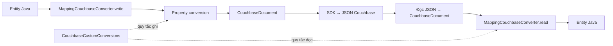

# Đăng ký bộ chuyển đổi đọc và ghi bằng `CouchbaseCustomConversions`

## 1. Vì sao cần converter tùy biến?

Trong **SPRING_DATA_COUCHBASE**, Spring Data ánh xạ entity Java sang document JSON của Couchbase. Các kiểu số, boolean và chuỗi có biểu diễn JSON trực tiếp; còn kiểu giá trị nghiệp vụ như `SkuCode`, `Money`, `EmailAddress` hoặc một định dạng thời gian riêng có thể cần quy tắc chuyển đổi tường minh.

Ví dụ, domain muốn sử dụng `SkuCode` để kiểm tra mã sản phẩm, nhưng hệ thống lưu và truy vấn SKU bằng **string**:

```json
{
  "sku": "BOOK-2026-01",
  "quantity": 2
}
```

Nếu framework xem `SkuCode` như một object lồng nhau, JSON lại có thể là `{"sku":{"value":"BOOK-2026-01"}}`. Hai cách biểu diễn dẫn tới tên field SQL++, index và hợp đồng dữ liệu khác nhau. `CouchbaseCustomConversions` cho phép đăng ký những quy tắc chuyển **giá trị Java → JSON-compatible value** và **JSON-compatible value → Java**.

Sau bài học, bạn có thể:

1. Viết `@WritingConverter` và `@ReadingConverter` đúng chiều.
2. Đăng ký chúng qua `AbstractCouchbaseConfiguration.additionalConverters` để Spring Data sử dụng.
3. Hiểu vai trò của `CouchbaseCustomConversions`, `MappingCouchbaseConverter` và `CouchbaseDocument`.
4. Kiểm chứng bằng round-trip trong Spring context và qua repository/template.
5. Xử lý các trường hợp ambiguous native types, schema cũ, `null`, query SQL++ và vận hành nhiều service.

## 2. Vị trí của `CouchbaseCustomConversions` trong pipeline

Spring Data Couchbase dùng metadata từ `CouchbaseMappingContext` để biết property, `@Field`, constructor và type hint. `MappingCouchbaseConverter` thực hiện đọc/ghi entity; `CouchbaseCustomConversions` lưu các conversion đã được đăng ký để converter chính có thể dùng khi cần.



| Thành phần | Trách nhiệm |
| --- | --- |
| `CouchbaseMappingContext` | Metadata entity và property, tên field, cách khởi tạo, type information. |
| `CouchbaseCustomConversions` | Tập converter được đăng ký và thông tin hướng chuyển đổi. |
| `MappingCouchbaseConverter` | Ánh xạ qua lại entity và `CouchbaseDocument` theo metadata/conversion. |
| `Converter<S,T>` | Chuyển một giá trị kiểu `S` thành kiểu `T`. |
| `@ReadingConverter` | Đánh dấu chuyển đổi từ kiểu lưu trữ sang kiểu Java. |
| `@WritingConverter` | Đánh dấu chuyển đổi từ kiểu Java sang kiểu lưu trữ. |
| `CouchbaseDocument` | Biểu diễn trung gian; bản thân nó không thực hiện I/O mạng. |

**Ranh giới quan trọng:** `MappingCouchbaseConverter.write` là chuyển đổi dữ liệu, không phải `repository.save`. Việc chọn bucket/scope/collection, thực hiện KV/SQL++, lập index, CAS, TTL, giao dịch và durability là công việc ở tầng khác. Reactive API thay đổi cách điều phối I/O, nhưng không tự thay đổi JSON contract của entity.

## 3. Hai hướng chuyển đổi và tính nhập nhằng

Quy tắc xác định hướng:

| Hướng | Kiểu của `Converter<S,T>` | Ý nghĩa |
| --- | --- | --- |
| Writing | `Converter<SkuCode, String>` | Java value object → JSON string. |
| Reading | `Converter<String, SkuCode>` | JSON string → Java value object. |

Trong trường hợp một phía là kiểu miền tùy biến và một phía là kiểu lưu trữ đơn giản, Spring Data có thể suy đoán hướng. Nhưng nếu **cả hai phía là kiểu được data store hỗ trợ trực tiếp**, như `Converter<String, Long>`, hướng có thể nhập nhằng. `@WritingConverter` và `@ReadingConverter` giúp hạn chế việc converter bị đăng ký sai chiều.

Một converter quá rộng giữa `String` và `Long` có thể tác động tới nhiều entity: mã khách hàng `"00042"` vô tình bị hiểu thành số `42`, hoặc một trường string không phải số làm hỏng quá trình đọc. Ưu tiên kiểu domain chuyên biệt để làm nguồn/đích thay vì sửa quy tắc conversion cho toàn bộ kiểu lõi của Java.

**Converter phải được đăng ký tường minh.** Tài liệu Spring Data Commons nhấn mạnh converter không được nhặt tự động từ classpath/container scan, vì có nguy cơ tác động ngoài ý muốn tới conversion service. Chỉ tạo class, gắn annotation hoặc `@Component` chưa chứng minh nó đã được `CouchbaseCustomConversions` thực sự sử dụng.

## 4. Ví dụ xuyên suốt: lưu `SkuCode` thành chuỗi

### 4.1. Định nghĩa value object

Tệp `SkuCode.java`:

```java
package com.example.catalog;

public record SkuCode(String value) {
    public SkuCode {
        if (value == null || !value.matches("[A-Z0-9-]{3,32}")) {
            throw new IllegalArgumentException("SKU không hợp lệ");
        }
    }
}
```

Việc tạo `new SkuCode("BOOK-2026-01")` bảo đảm mã có định dạng hợp lệ. Value object giúp API miền tránh nhầm SKU với các string khác.

### 4.2. Khai báo entity Spring Data Couchbase

Tệp `ProductDocument.java`:

```java
package com.example.catalog;

import org.springframework.data.annotation.Id;
import org.springframework.data.couchbase.core.mapping.Document;
import org.springframework.data.couchbase.core.mapping.Field;

@Document
public record ProductDocument(
    @Id String id,
    @Field("sku") SkuCode sku,
    @Field("quantity") int quantity
) {}
```

Trong ứng dụng:

```java
ProductDocument product = new ProductDocument(
    "product::42",
    new SkuCode("BOOK-2026-01"),
    2
);
```

JSON body mong đợi sau khi đăng ký converter:

```json
{
  "_class": "com.example.catalog.ProductDocument",
  "sku": "BOOK-2026-01",
  "quantity": 2
}
```

Key `product::42` là document ID nằm ngoài body JSON. `_class` minh họa type information mặc định của Spring Data; nó có thể thay đổi theo cấu hình type mapper hoặc alias. `@Field("sku")` quyết định **tên field** và converter quyết định **biểu diễn giá trị** của field đó.

### 4.3. Writing converter: `SkuCode → String`

Tệp `SkuCodeWritingConverter.java`:

```java
package com.example.catalog;

import org.springframework.core.convert.converter.Converter;
import org.springframework.data.convert.WritingConverter;

@WritingConverter
public final class SkuCodeWritingConverter
        implements Converter<SkuCode, String> {

    @Override
    public String convert(SkuCode source) {
        return source.value();
    }
}
```

Converter này trả một string đơn giản. Nó không tự tạo JSON, không quyết định document ID, không có kết nối server và không can thiệp vào CAS/TTL. Các concern đó nằm ở metadata mapping và tầng truy cập.

### 4.4. Reading converter: `String → SkuCode`

Tệp `SkuCodeReadingConverter.java`:

```java
package com.example.catalog;

import org.springframework.core.convert.converter.Converter;
import org.springframework.data.convert.ReadingConverter;

@ReadingConverter
public final class SkuCodeReadingConverter
        implements Converter<String, SkuCode> {

    @Override
    public SkuCode convert(String source) {
        return new SkuCode(source);
    }
}
```

Reading converter đi qua constructor và tận dụng validation của value object. Nếu document có `"sku": "bad sku!"`, việc đọc sẽ thất bại với lỗi chuyển đổi/khởi tạo phù hợp, thay vì âm thầm tạo một SKU không hợp lệ.

**Nguyên tắc hai chiều:** nếu yêu cầu entity có thể ghi rồi đọc lại, hai converter phải mô tả cùng hợp đồng. Chỉ có `SkuCode → String` sẽ không bảo đảm khôi phục được `SkuCode` khi query hoặc repository đọc document.

## 5. Đăng ký qua `AbstractCouchbaseConfiguration`

Đối với ứng dụng cấu hình Spring Data Couchbase qua lớp kế thừa `org.springframework.data.couchbase.config.AbstractCouchbaseConfiguration`, điểm mở rộng được hỗ trợ là:

```java
import java.util.List;

// Đặt trong lớp cấu hình kế thừa AbstractCouchbaseConfiguration.
@Override
protected void additionalConverters(List<Object> converters) {
    converters.add(new SkuCodeWritingConverter());
    converters.add(new SkuCodeReadingConverter());
}
```

Đây là đoạn override **trong lớp cấu hình đang hoạt động**, không phải tệp Java có thể chạy độc lập. Lớp đó còn phải cung cấp các phương thức cấu hình như `getConnectionString()`, `getUserName()`, `getPassword()`, `getBucketName()` theo phiên bản đang dùng.

Spring Data sẽ sử dụng danh sách bổ sung khi tạo custom conversions và kết nối chúng với mapping context/converter do cấu hình quản lý. Lợi ích của cách này:

- Dùng đúng điểm mở rộng đã được framework cung cấp.
- Giữ lại converter mặc định và các thiết lập mapping khác.
- Tập trung khai báo các cặp chuyển đổi trong cùng cấu hình.
- Tránh tự dựng lại `MappingCouchbaseConverter` chỉ để thêm hai conversion.

**Đừng chỉ thêm `@Component` lên các converter rồi kỳ vọng chúng được tự đăng ký.** Kiểm tra `additionalConverters` có chạy trong cấu hình Spring đang sử dụng hay không và bean converter của repository/template có nhận danh sách này hay không.

### 5.1. `CouchbaseCustomConversions` được tạo thế nào?

`CouchbaseCustomConversions` là một specialization của Spring Data `CustomConversions` với các kiểu có thể lưu trực tiếp vào JSON và các converter liên quan đến Couchbase. API cho phép tạo từ danh sách converter:

```java
import java.util.List;
import org.springframework.data.couchbase.core.convert.CouchbaseCustomConversions;

CouchbaseCustomConversions conversions =
    new CouchbaseCustomConversions(List.of(
        new SkuCodeWritingConverter(),
        new SkuCodeReadingConverter()
    ));
```

Với API hiện đại còn có cách khai báo kiểu functional:

```java
CouchbaseCustomConversions conversions =
    CouchbaseCustomConversions.create(adapter -> {
        adapter.registerConverter(new SkuCodeWritingConverter());
        adapter.registerConverter(new SkuCodeReadingConverter());
    });
```

Hai đoạn này **chỉ tạo đối tượng conversions**. Nếu ứng dụng tự wiring bean, phải nối đối tượng đó vào chính mapping converter được repository/template sử dụng. Tạo một instance rời hoặc bean không được mapping pipeline tham chiếu sẽ không có tác dụng đối với document.

Khi dùng `AbstractCouchbaseConfiguration`, nên bắt đầu từ `additionalConverters`. Chỉ thay thế hoàn toàn `customConversions` khi thực sự kiểm soát toàn bộ vòng đời các bean và biết cách bảo toàn converter mặc định.

### 5.2. Lưu ý về cấu hình trong Spring Boot

Không có một công thức override duy nhất cho mọi cách bootstrap Spring Boot. Ứng dụng có thể dựa vào auto-configuration hoặc tự cung cấp `AbstractCouchbaseConfiguration`. Hãy xác định **cấu hình Couchbase thực sự có hiệu lực** trước khi thêm phương thức. Nếu có nhiều bean conversion/mapping từ các nguồn khác nhau, kết quả có thể khác dự kiến.

Dấu hiệu xác minh tốt nhất là giá trị **trong `CouchbaseDocument.export()` và JSON được lưu** sau khi ứng dụng khởi động. Việc source code có method `additionalConverters` không đủ chứng minh converter đã được chọn.

## 6. Kiểm thử round-trip trong Spring context

Ví dụ dưới đây giả định `converter` là bean `CouchbaseConverter` hoặc `MappingCouchbaseConverter` đã được inject vào một phương thức kiểm thử.

```java
import org.springframework.data.couchbase.core.mapping.CouchbaseDocument;

ProductDocument original = new ProductDocument(
    "product::42",
    new SkuCode("BOOK-2026-01"),
    2
);

CouchbaseDocument stored = new CouchbaseDocument();
converter.write(original, stored);

System.out.println(stored.export());
// Kỳ vọng sku là một String, không phải object có field value.

ProductDocument restored =
    converter.read(ProductDocument.class, stored);

assert original.id().equals(restored.id());
assert original.sku().equals(restored.sku());
assert original.quantity() == restored.quantity();
```

Đoạn này kiểm tra **mapping trong bộ nhớ** và không tự thực hiện thao tác `save` trên cluster. Đối với dữ liệu chạy thật, thử thêm một chu kỳ:

```java
ProductDocument saved = repository.save(original);
ProductDocument loaded = repository.findById(saved.id())
    .orElseThrow();

assert loaded.sku().equals(original.sku());
```

Trường hợp repository trên giả định định nghĩa repository cho `ProductDocument` và có kết nối Couchbase phục vụ test. Kiểm tra thêm body JSON raw, vì hai Java object có thể bằng nhau dù một đường serialize đã sử dụng schema khác.

### 6.1. Ba lớp cần đối chiếu

| Lớp | Giá trị SKU cần thấy |
| --- | --- |
| Java trước ghi | `new SkuCode("BOOK-2026-01")` |
| `CouchbaseDocument.export()` và Couchbase JSON | `"sku": "BOOK-2026-01"` |
| Java sau đọc | `new SkuCode("BOOK-2026-01")` |

Unit test chỉ gọi `SkuCodeWritingConverter.convert()` và `SkuCodeReadingConverter.convert()` có thể pass dù chưa đăng ký. Test dùng converter từ Spring context cho biết cả **cấu hình và logic** hoạt động. Test repository/template kiểm chứng thêm lớp tương tác với server.

## 7. Những lỗi phổ biến khi đăng ký

### 7.1. Converter bị chọn sai hướng

`Converter<String, Long>` có hai đầu đều là kiểu native, nên dễ nhập nhằng. Dùng `@ReadingConverter` / `@WritingConverter` để khẳng định chiều. Tốt hơn, nếu đang làm việc với số điện thoại hay mã khách hàng, hãy sử dụng value object riêng thay vì viết converter toàn cục giữa kiểu lõi.

### 7.2. Converter đăng ký toàn cục, tác động ngoài dự kiến

Một `Converter<SkuCode, String>` có thể được dùng cho mọi property kiểu `SkuCode`, kể cả object lồng nhau hoặc list, tùy đường mapping. Nếu chỉ một property cần cách biểu diễn đặc biệt, nên xem xét **property-level conversion** trong phiên bản hỗ trợ hoặc một persistence DTO chuyên biệt.

Không sử dụng converter quá rộng chỉ để giải một trường hợp riêng. Mọi field của các entity khác cũng có thể thay đổi schema khi triển khai.

### 7.3. Converter khác thay thế behavior mặc định

Một số kiểu `java.time` đã có converter của Spring Data Couchbase. Nếu đăng ký thêm `Instant ↔ String`, cần kiểm tra cách ưu tiên converter và representation JSON theo **phiên bản framework đang triển khai**. Việc tự viết converter có thể thay đổi kiểu lưu trữ từ number sang string, kéo theo cập nhật SQL++ và index.

### 7.4. Code dùng SDK trực tiếp

Couchbase Java SDK dùng `JsonObject` hoặc serializer riêng sẽ không tự biết các annotation/converter Spring Data đã cấu hình. Nếu repository lưu `"sku": "BOOK-2026-01"` còn SDK trực tiếp lưu `{"sku":{"value":"BOOK-2026-01"}}`, cùng collection sẽ chứa hai schema. Cần thống nhất hợp đồng JSON giữa mọi producer.

### 7.5. Projection hoặc query trả thiếu dữ liệu

Nếu SQL++ trả một scalar, DTO hoặc một phần field, đường tạo entity có thể không có đủ dữ liệu để dựng object. Type hint như `_class` và metadata ID cũng có thể không được mang theo trong kết quả tùy cách query. Converter không thể tự khôi phục những field đã bị loại bỏ.

## 8. Null, missing và lỗi validation

Có ba tình huống cần phân biệt khi document được đọc:

```json
{"sku": "BOOK-2026-01"}
```

```json
{"sku": null}
```

```json
{}
```

Trường hợp đầu là JSON string hợp lệ. Trường hợp hai có field `sku` nhưng giá trị `null`; trường hợp ba thiếu hoàn toàn field đó. Trong SQL++, trường hợp cuối là `MISSING`, khác với `NULL`.

Spring Data Couchbase thường bỏ qua property Java có giá trị null khi **ghi entity** theo mapping mặc định. Tuy nhiên, dữ liệu do SDK/import tạo ra có thể chứa JSON null tường minh. Converter đọc không nhất thiết được gọi với source null; hành vi còn tùy quá trình dựng entity, constructor và metadata.

Nếu `SkuCode` là bắt buộc, hãy định nghĩa chính sách rõ:

1. Entity cũ thiếu `sku` được migrate hay bị từ chối?
2. Constructor/record có kiểm tra `sku != null` không?
3. String không hợp lệ có làm lỗi đọc không, và log có đủ document ID để tìm nguyên nhân không?
4. Có trường hợp cần trả lỗi nghiệp vụ thay vì ném lỗi parsing không?

Không lặng lẽ thay mọi SKU lỗi bằng `"UNKNOWN"` nếu điều đó có thể khiến sản phẩm bị liên kết nhầm trong tồn kho.

## 9. Schema evolution: từ object thành string

Giả sử trước đây lưu `SkuCode` như nested object:

```json
{ "sku": { "value": "BOOK-2026-01" } }
```

Sau khi đăng ký custom conversions, dữ liệu mới là:

```json
{ "sku": "BOOK-2026-01" }
```

Đây là thay đổi **schema lưu trữ**. Hai JSON này đều hợp lệ nhưng không thể được đọc như nhau nếu reading converter chỉ nhận `String`. Chỉ deploy converter mới không tự chuyển các document trong Couchbase.

Quy trình chuyển đổi:

1. Khảo sát dữ liệu đang tồn tại: bao nhiêu document lưu SKU theo object, bao nhiêu theo string, bao nhiêu thiếu field.
2. Định nghĩa schema đích và quy tắc validate.
3. Triển khai đường đọc tương thích trong giai đoạn chuyển tiếp hoặc backfill dữ liệu cũ trước khi writer mới được bật.
4. Chạy migration có thể lặp lại, quan sát lỗi và dùng CAS/transaction phù hợp để tránh ghi đè cập nhật đồng thời.
5. Đồng bộ các writer khác (SDK trực tiếp, service khác, job import).
6. Cập nhật truy vấn SQL++, index, ETL và báo cáo theo đường dẫn mới.
7. Sau khi kiểm chứng tất cả reader, loại bỏ đường tương thích cũ theo kế hoạch.

Khi có nhiều service cùng dùng collection, thứ tự triển khai rất quan trọng. Một writer mới có thể ghi schema khiến reader cũ lỗi ngay cả khi API của writer hoạt động bình thường.

## 10. Truy vấn SQL++ và index theo biểu diễn thực

Nếu `sku` được lưu dưới dạng string, SQL++ lọc theo field string:

```sql
SELECT META(p).id AS productId, p.sku, p.quantity
FROM `shop`.`catalog`.`products` AS p
WHERE p.sku = "BOOK-2026-01";
```

Index ví dụ:

```sql
CREATE INDEX ix_products_sku
ON `shop`.`catalog`.`products`(sku);
```

Nếu schema cũ lưu object, predicate là `p.sku.value = "BOOK-2026-01"` và index có thể phải đặt trên `sku.value`. Converter Java không tự sửa chỉ mục; cần đo query plan, filter và workload thực tế trước khi triển khai index.

Phát hiện schema trộn:

```sql
SELECT META(p).id AS productId,
       TYPE(p.sku) AS skuType
FROM `shop`.`catalog`.`products` AS p
WHERE TYPE(p.sku) != "string"
   OR p.sku IS MISSING;
```

Bucket `shop`, scope `catalog`, collection `products` chỉ là ví dụ; truy vấn cần collection và các index/permissions phù hợp. `TYPE()` kiểm tra kiểu JSON thực, không thể xác định class Java từng được dùng để tạo giá trị đó.

## 11. Nên dùng converter hay object lồng nhau?

Không phải mọi kiểu miền đều nên được ép thành scalar.

| Trường hợp | Cách lưu hợp lý | Lý do |
| --- | --- | --- |
| `SkuCode`, mã bưu chính, mã khách hàng | JSON string | Bảo toàn format, số 0 đầu; dễ lọc bằng equality. |
| `Money(amountMinor, currency)` | JSON object | Giữ đơn vị cùng amount, dễ truy vấn từng phần. |
| `DateRange(start, end)` | JSON object | Cần rõ timezone, inclusive/exclusive boundaries. |
| `Instant` theo hợp đồng ISO-8601 | String sau custom conversion hoặc persistence DTO | Cần thống nhất UTC và precision; kiểm tra range query. |
| `Instant` theo epoch milliseconds | JSON number với đơn vị tường minh | Phù hợp filter range số, chú ý mất micro/nano. |
| Chỉ một field cần format riêng | Property-level conversion hoặc DTO | Tránh thay đổi toàn bộ giá trị của một kiểu trong nhiều entity. |

Nếu dùng custom converter để lưu `Money` thành `"155000 VND"`, các phép so sánh số hay tổng hợp SQL++ sẽ phức tạp. Hãy chọn representation dựa trên yêu cầu query/index và khả năng vận hành, thay vì chỉ vì code converter viết ngắn.

## 12. Lưu ý với collection, map và reactive API

Một entity có property lồng nhau:

```java
@Document
public record CartDocument(
    @Id String id,
    @Field List<SkuCode> skuList,
    @Field Map<String, SkuCode> relatedSkus
) {}
```

JSON mong muốn có thể là:

```json
{
  "skuList": ["BOOK-2026-01", "PEN-2026-02"],
  "relatedSkus": {
    "bonus": "NOTE-2026-03"
  }
}
```

Tuy nhiên, không nên mặc định mọi collection, generic hay map key được convert theo cách giống nhau ở mọi phiên bản. Kiểm thử cấu trúc thực tế bằng `CouchbaseDocument.export()` và đọc ngược.

Repository và `CouchbaseTemplate` dùng pipeline mapping Spring Data khi thao tác với entity. Reactive repository/template thay đổi cách gửi và nhận kết quả bất đồng bộ; conversion vẫn cần được cấu hình và kiểm thử đầy đủ. Việc một thao tác chạy trên `Mono` hay `Flux` không tự giải quyết xung đột schema hoặc lỗi đọc dữ liệu cũ.

## 13. Bảng xử lý sự cố thường gặp

| Triệu chứng | Nguồn gốc cần kiểm tra | Cách xử lý |
| --- | --- | --- |
| Viết class converter nhưng JSON không đổi | Chưa đăng ký vào `CouchbaseCustomConversions` hoặc cấu hình không được dùng | Kiểm tra `additionalConverters` và bean mapping thực tế. |
| Unit test pass, repository đọc lỗi | Chỉ test `convert()` thủ công, thiếu wiring/chiều đọc | Test `MappingCouchbaseConverter` từ Spring context và `save/findById`. |
| SKU lưu thành object `{"value":...}` | Writing converter không được chọn | Xem danh sách conversion và cấu hình mapping đang hoạt động. |
| SKU đọc thành null | JSON thiếu field, có null, hoặc constructor xử lý thiếu dữ liệu | So sánh raw JSON và quy tắc bắt buộc. |
| Dữ liệu cũ đọc lỗi sau deploy | Đổi schema từ object sang string | Migrate/backfill hoặc reader tương thích. |
| Các property khác bị convert nhầm | Converter quá rộng giữa native types | Dùng value object và annotation hướng. |
| SDK trực tiếp lưu khác repository | SDK không qua Spring mapping pipeline | Thống nhất JSON contract và serializer. |
| SQL++ không lọc đúng SKU | Query dùng `sku.value` nhưng JSON mới là `sku` | Cập nhật predicate, index và projection. |
| Converter ngày giờ gây lệch timestamp | Sai timezone, định dạng hoặc converter ưu tiên | Xác minh JSON, epoch units, UTC và round-trip. |
| Reactive và blocking đọc khác nhau | Có thể cấu hình/đường query khác nhau | Kiểm tra bean, projection và JSON nguồn, đừng quy lỗi cho reactive trước. |

Cách debug đáng tin cậy: **entity đầu vào → `write` → `CouchbaseDocument.export()` → body JSON trên server → `read` → entity đầu ra**. Lỗi xuất hiện ở bước nào thường cho biết cần sửa converter, wiring, serializer, migration hay truy vấn.

## 14. Bài thực hành

### Bài 1 — Đăng ký hai chiều

1. Tạo `SkuCode`, `ProductDocument` và hai converter như mục 4.
2. Đăng ký bằng `additionalConverters` trong cấu hình Couchbase thực tế.
3. Ghi một `ProductDocument` vào `CouchbaseDocument` qua bean converter từ Spring.
4. Xác nhận `sku` là JSON string và không có nested `value`.
5. Đọc ngược và so sánh value object với bản gốc.

### Bài 2 — Đăng ký thiếu một chiều

1. Chỉ dùng writing converter trong cấu hình test tách biệt.
2. Ghi entity rồi thử đọc lại.
3. Ghi nhận hành vi thực tế của phiên bản Spring Data đang dùng.
4. Bổ sung reading converter và kiểm tra round-trip.

### Bài 3 — Dữ liệu cũ và dữ liệu sai

1. Chuẩn bị JSON object `{"sku":{"value":"BOOK-2026-01"}}` theo schema cũ.
2. Chuẩn bị JSON string không hợp lệ `{"sku":"bad sku!"}`.
3. Xác minh cách đọc, ghi lại lỗi, đề xuất migration và quy tắc default.
4. Thử SQL++ `TYPE(sku)` để phân loại dữ liệu trước khi backfill.

### Bài 4 — So sánh đường Spring Data và SDK

1. Lưu bằng repository hoặc `CouchbaseTemplate`.
2. Đọc raw JSON bằng Couchbase SDK, so sánh cấu trúc.
3. Ghi một document raw bằng SDK, đọc qua repository.
4. Nếu dùng reactive repository, kiểm chứng rằng conversion hoạt động tương tự.
5. Kiểm tra câu SQL++ và index đã dựa trên field JSON mới.

### Câu hỏi tự kiểm tra

1. `CouchbaseCustomConversions` khác `MappingCouchbaseConverter` về trách nhiệm nào?
2. Converter `SkuCode → String` thuộc chiều đọc hay ghi?
3. `@ReadingConverter` / `@WritingConverter` giải quyết nhập nhằng nào?
4. Vì sao chỉ có `@Component` hoặc annotation hướng chưa đủ bảo đảm converter được sử dụng?
5. `additionalConverters(List<Object>)` nằm trong class cấu hình nào?
6. Khi nào mới cần tự tạo `CouchbaseCustomConversions` bằng constructor hoặc `create`?
7. Vì sao test `convert()` không chứng minh việc cấu hình đã hoạt động?
8. `@Field("sku")` và writing converter quyết định những phần khác nhau nào của JSON?
9. Hậu quả của đổi SKU từ nested object sang string với SQL++/index là gì?
10. Converter có tự xử lý CAS, TTL, transaction hay consistency của SQL++ không?
11. Vì sao dữ liệu có null, missing hoặc format cũ cần được kiểm thử riêng?
12. Khi nào nên giữ value object nhiều thành phần dưới dạng JSON object?

## Tài liệu tham khảo

- [Spring Data Couchbase — Custom Conversions](https://docs.spring.io/spring-data/couchbase/reference/data-commons/custom-conversions.html): đăng ký conversion tường minh, annotation hướng và converter của hệ thống.
- [`AbstractCouchbaseConfiguration` API](https://docs.spring.io/spring-data/couchbase/reference/api/java/org/springframework/data/couchbase/config/AbstractCouchbaseConfiguration.html): `additionalConverters(List<Object>)`.
- [`CouchbaseCustomConversions` API](https://docs.spring.io/spring-data/couchbase/reference/api/java/org/springframework/data/couchbase/core/convert/CouchbaseCustomConversions.html): constructor danh sách và `create(adapter -> ...)`.
- [Spring Data Couchbase — Modeling Entities](https://docs.spring.io/spring-data/couchbase/reference/couchbase/entity.html): `@Document`, `@Id`, `@Field`, mapping JSON.
- [Spring Data Commons — Object Mapping](https://docs.spring.io/spring-data/commons/reference/object-mapping.html): constructor và metadata của persistent entity.
- [Couchbase Server — SQL++ Type Functions](https://docs.couchbase.com/server/current/n1ql/n1ql-language-reference/typefun.html): kiểm tra kiểu JSON thực tế.

> **Ghi nhớ:** Converter cần **hướng chuyển đổi rõ, được đăng ký với mapping pipeline thật và được xác minh ở cả hai chiều**. Thay đổi cách converter lưu một value object có thể thay đổi schema của mọi document liên quan, đồng thời tác động tới repository, SQL++, index và các service truy cập cùng collection.

