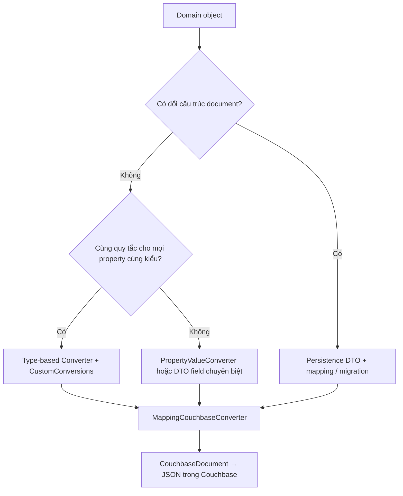

# Phân biệt chuyển đổi một trường và thay đổi biểu diễn toàn tài liệu

## 1. Đặt vấn đề

Trong module **SPRING_DATA_COUCHBASE**, tầng truy cập lưu các entity Java vào document JSON, có thể thao tác qua repository, `CouchbaseTemplate` hoặc API reactive và tìm kiếm bằng SQL++. Khi nhu cầu mới xuất hiện, một nhóm phát triển thường hỏi: "Có thể viết custom converter để thay đổi dữ liệu được lưu hay không?". Trước khi viết code, phải xác định **phạm vi thay đổi**.

Có hai bài toán khác nhau về bản chất:

- **Chuyển đổi giá trị một trường**: giữ nguyên cấu trúc document và tên các field, chỉ thay cách biểu diễn giá trị của một property. Chẳng hạn `SkuCode` của Java được lưu dưới dạng JSON string.
- **Thay đổi biểu diễn toàn tài liệu**: đổi cách phân bố dữ liệu giữa nhiều field, đổi cấu trúc lồng nhau/thành phẳng, thêm discriminator/schema version, đổi document key hoặc thậm chí tách một document thành nhiều document. Các việc này phải xem như thay đổi schema và đường truy cập dữ liệu.

Một converter chuyên xử lý `Money → String` có thể làm field `total` đổi từ object sang chuỗi, nhưng **không mặc nhiên tự tách `total` thành hai field cùng cấp `total_minor` và `currency`**. Đó là lý do cần phân biệt value conversion với document transformation.

Sau bài, bạn sẽ có khả năng:

1. Phân biệt **type-based conversion**, **property-based conversion** và **document-level mapping**.
2. Chọn `Converter<S,T>` / `CouchbaseCustomConversions` khi muốn đổi biểu diễn một kiểu giá trị.
3. Chọn `PropertyValueConverter` khi chỉ một property cụ thể có quy tắc lưu/đọc riêng, trong phiên bản Spring Data Couchbase hỗ trợ.
4. Chọn persistence DTO + mapper hoặc quy trình tái cấu trúc có kiểm soát khi cần đổi schema toàn document.
5. Đánh giá hậu quả của thay đổi đối với `@Id`, `@Version`/CAS, TTL, `_class`, SQL++, index, transaction và client reactive/SDK.
6. Thiết kế migration và kiểm chứng round-trip mà không làm thay đổi dữ liệu cũ ngoài ý muốn.

## 2. Hiểu ba cấp chuyển đổi

| Cấp thay đổi | Đơn vị bị tác động | Cơ chế thường dùng | Ví dụ |
| --- | --- | --- | --- |
| **Theo kiểu (type-based)** | Mọi property phù hợp với một cặp kiểu nguồn/đích trong pipeline mapping | `@WritingConverter`, `@ReadingConverter`, `CouchbaseCustomConversions` | Mọi `SkuCode` được ghi thành JSON string |
| **Theo property (property-based)** | Một property được khai báo/đăng ký cụ thể | `PropertyValueConverter`, `@ValueConverter` hoặc đăng ký property conversions tùy phiên bản | Chỉ `Customer.secretCode` mã hóa/biến đổi theo quy tắc riêng |
| **Toàn document (document-level)** | Cấu trúc nhiều field, metadata và hợp đồng document | Persistence DTO + mapper, lifecycle có kiểm soát hoặc cơ chế ánh xạ root tùy hỗ trợ; khi dùng SDK raw phải tự xử lý phần liên quan | `total.amountMinor` + `total.currency` đổi thành `total_minor` + `currency` |

**Cảnh báo về tên gọi:** "Chuyển đổi một trường" không có nghĩa là cứ dùng một `Converter<A,B>` thì chỉ ảnh hưởng **một property duy nhất**. Converter được đăng ký theo **kiểu** có thể ảnh hưởng mọi field, phần tử collection hoặc nested object tương thích. Nếu chỉ muốn tác động tới một property, cần cơ chế property-based hoặc persistence model/mapper chuyên biệt.

### 2.1. Luồng tổng quát



`MappingCouchbaseConverter` đảm nhiệm ánh xạ entity với `CouchbaseDocument`. `CouchbaseCustomConversions` cung cấp conversion theo kiểu và có cơ chế đăng ký converter theo property ở những phiên bản hỗ trợ. `CouchbaseDocument` là biểu diễn trung gian; nó không phải SDK operation và `write` của converter không phải `repository.save`.

## 3. Ví dụ ban đầu: một đơn hàng được lưu như thế nào?

Giả sử model nghiệp vụ:

```java
public record Money(long amountMinor, String currency) {
    public Money {
        if (currency == null || !currency.matches("[A-Z]{3}")) {
            throw new IllegalArgumentException("Invalid currency");
        }
    }
}

public record SkuCode(String value) {
    public SkuCode {
        if (value == null || value.isBlank()) {
            throw new IllegalArgumentException("SKU is required");
        }
    }
}

public record Order(
    String id,
    SkuCode sku,
    Money total,
    String note
) {}
```

Lưu ý `amountMinor` nghĩa là số **đơn vị tiền tệ nhỏ nhất** theo quy tắc của từng loại tiền. Không mặc định mọi currency đều có 100 đơn vị nhỏ trên một đơn vị lớn; quy tắc scale và rounding phải có hợp đồng riêng.

Tầng persistence có thể bắt đầu bằng entity được mapping:

```java
import org.springframework.data.annotation.Id;
import org.springframework.data.couchbase.core.mapping.Document;
import org.springframework.data.couchbase.core.mapping.Field;

@Document
public record OrderDocument(
    @Id String id,
    @Field SkuCode sku,
    @Field Money total,
    @Field String note
) {}
```

Nếu mapping mặc định xử lý `SkuCode` và `Money` như object lồng nhau, một body JSON minh họa là:

```json
{
  "_class": "com.example.orders.OrderDocument",
  "sku": { "value": "BOOK-01" },
  "total": {
    "amountMinor": 155000,
    "currency": "VND"
  },
  "note": "Giao giờ hành chính"
}
```

`_class` ở ví dụ là type hint trong cấu hình thông dụng, còn document key là `order::42` nằm ngoài body. JSON thực tế có thể có type hint lồng nhau hoặc alias tùy mapping context/cấu hình, vì thế hãy kiểm tra `CouchbaseDocument.export()` trong ứng dụng.

Bây giờ xét ba yêu cầu khác nhau:

1. "Mọi `SkuCode` đều phải lưu như string" → **type-based**.
2. "Chỉ property `legacySku` phải có định dạng riêng; `sku` còn lại giữ nguyên" → **property-based**.
3. "Tách `total` thành `total_minor` và `currency` ở cùng cấp với `sku`, thêm `schema_version`" → **document-level**.

Mỗi yêu cầu cần điểm mở rộng khác nhau.

## 4. Cấp 1 — Type-based conversion của một giá trị

Một value object `SkuCode` có thể được ánh xạ thành string bằng hai converter:

```java
import org.springframework.core.convert.converter.Converter;
import org.springframework.data.convert.ReadingConverter;
import org.springframework.data.convert.WritingConverter;

@WritingConverter
public final class SkuWriteConverter
        implements Converter<SkuCode, String> {

    @Override
    public String convert(SkuCode source) {
        return source.value();
    }
}

@ReadingConverter
public final class SkuReadConverter
        implements Converter<String, SkuCode> {

    @Override
    public SkuCode convert(String source) {
        return new SkuCode(source);
    }
}
```

Đăng ký tường minh trong một cấu hình kế thừa `AbstractCouchbaseConfiguration`:

```java
@Override
protected void additionalConverters(List<Object> converters) {
    converters.add(new SkuWriteConverter());
    converters.add(new SkuReadConverter());
}
```

Đoạn override trên nằm **bên trong lớp cấu hình**; cần import `java.util.List` và đảm bảo cấu hình đó đang được Spring context sử dụng. Chỉ khai báo hai class không đủ để mapping converter tự tìm thấy chúng.

Sau khi đăng ký và xác minh, JSON mong muốn là:

```json
{
  "sku": "BOOK-01",
  "total": {
    "amountMinor": 155000,
    "currency": "VND"
  },
  "note": "Giao giờ hành chính"
}
```

### 4.1. Những gì thay đổi và không đổi

**Thay đổi:** kiểu JSON của **giá trị** `sku` từ object sang string.

**Không đổi bởi converter `SkuCode → String`:** tên field `sku`, field `total`, field `note`, ID, TTL, CAS hoặc cấu trúc tổng thể của document. Những thành phần đó tiếp tục do mapping, entity và API truy cập điều khiển.

**Phạm vi ảnh hưởng:** converter áp dụng dựa trên cặp kiểu, nên các property `SkuCode` khác, kể cả ở entity khác, có thể cùng đổi biểu diễn. Đây vẫn là "conversion một giá trị", nhưng **không nhất thiết chỉ một field**.

### 4.2. Vì sao không dùng converter quá rộng?

Một `Converter<String, String>` viết để chuẩn hóa riêng `note` có thể ảnh hưởng hàng loạt string khác, chẳng hạn mã khách hàng, địa chỉ, URL hoặc secret. Một `Converter<String, Long>` có nguy cơ làm mất số 0 đầu của mã định danh. Trường hợp cả hai đầu là kiểu lưu trữ đơn giản cũng gây nhập nhằng hướng; luôn cân nhắc `@ReadingConverter`/`@WritingConverter` và giới hạn kiểu nguồn/đích.

**Quy tắc lựa chọn:** nếu quy tắc đúng cho **mọi giá trị của một domain type**, type-based converter phù hợp. Nếu chỉ đúng cho **một property**, chuyển sang cơ chế property-based.

## 5. Cấp 2 — Property-based conversion cho một trường cụ thể

Spring Data có giao diện `PropertyValueConverter<DV,SV,C>` để chuyển giá trị của một property được chọn theo **cả hai chiều**. Khác với converter theo kiểu, nó nhận thêm conversion context gắn với property; ngoài `read` và `write` còn có các hook `readNull`/`writeNull`.

Các phiên bản Spring Data Couchbase hiện đại cung cấp `CouchbaseConversionContext` và `CouchbasePropertyValueConverterFactory`; `CouchbaseCustomConversions.CouchbaseConverterConfigurationAdapter` có điểm mở rộng `configurePropertyConversions(...)` và `setPropertyValueConversions(...)`.

Đây là cơ chế dành cho **field có quy tắc riêng**, không nên dùng nó như một cách vô hình để tái cấu trúc nhiều property không liên quan.

### 5.1. Ví dụ: chỉ một property cần mã lưu trữ có tiền tố

Giả sử Java dùng `ReferenceCode` ở hai property:

- `normalCode` phải lưu nguyên văn.
- `externalCode` phải lưu với tiền tố `EXT:` để tương thích với hệ thống ngoài.

Nếu dùng type-based `ReferenceCode → String` có thêm tiền tố, cả hai property đều bị thay đổi. Thay vào đó, định nghĩa một property converter:

```java
public record ReferenceCode(String value) {
    public ReferenceCode {
        if (value == null || value.isBlank()) {
            throw new IllegalArgumentException("Invalid reference code");
        }
    }
}
```

```java
import org.springframework.data.convert.PropertyValueConverter;
import org.springframework.data.couchbase.core.convert.CouchbaseConversionContext;

public final class ExternalReferenceConverter
        implements PropertyValueConverter<
            ReferenceCode, String, CouchbaseConversionContext> {

    @Override
    public ReferenceCode read(
            String stored, CouchbaseConversionContext context) {
        if (!stored.startsWith("EXT:")) {
            throw new IllegalArgumentException("Missing EXT prefix");
        }
        return new ReferenceCode(stored.substring(4));
    }

    @Override
    public String write(
            ReferenceCode value, CouchbaseConversionContext context) {
        return "EXT:" + value.value();
    }
}
```

Một ví dụ dùng annotation `@ValueConverter` trên field cần quy tắc riêng:

```java
import org.springframework.data.annotation.Id;
import org.springframework.data.convert.ValueConverter;
import org.springframework.data.couchbase.core.mapping.Document;
import org.springframework.data.couchbase.core.mapping.Field;

@Document
public class ReferenceDocument {
    @Id
    private String id;

    @Field
    private ReferenceCode normalCode;

    @Field("external_code")
    @ValueConverter(ExternalReferenceConverter.class)
    private ReferenceCode externalCode;

    // Constructor và getter/setter phục vụ entity mapping.
}
```

Ở đây, đoạn class minh họa cấu hình field; cần bổ sung constructor/accessor theo mô hình entity thực tế. Khi version mapping đã bật support property converters và converter factory nhận `@ValueConverter`, property `externalCode` dùng phép đổi có tiền tố, trong khi `normalCode` tiếp tục theo quy tắc mặc định hoặc type converter khác đã đăng ký.

Vì `normalCode` là một value object, nếu muốn nó lưu scalar `"ABC-42"`, bạn vẫn cần quy tắc dành cho nó (ví dụ type-based converter không thêm tiền tố hoặc một property converter khác). Không nên suy từ `@ValueConverter` trên `externalCode` rằng framework tự biết xử lý mọi property `ReferenceCode` còn lại.

### 5.2. Kết quả mô phỏng

Với hai mã Java đều có giá trị `"ABC-42"`, tài liệu mong muốn khi **cả hai property được cấu hình đầy đủ** có thể là:

```json
{
  "normalCode": "ABC-42",
  "external_code": "EXT:ABC-42"
}
```

Kết quả chỉ đáng tin sau khi kiểm tra đúng phiên bản Spring Data Couchbase và conversion configuration. `@ValueConverter` là annotation thuộc Spring Data Commons, còn việc nhận annotation và tạo instance converter phụ thuộc factory/cấu hình của store.

### 5.3. Conversion context và cách xử lý null

`PropertyValueConverter` có thể đọc metadata property thông qua `CouchbaseConversionContext`. Tuy nhiên, dùng context để thay đổi field anh em hoặc metadata cấp document là một dạng coupling khó kiểm soát; các thao tác nhiều field nên đặt ở document mapper.

Khác với `Converter<S,T>` thông thường, property converter có hook `readNull`/`writeNull`. Điều đó **không có nghĩa mọi field MISSING sẽ được tự động gửi vào converter với null**: việc property có tồn tại trong JSON và cách materialize entity còn phụ thuộc pipeline mapping. Hãy kiểm tra riêng ba trường hợp `MISSING`, JSON `null` và giá trị có thật.

### 5.4. Khi nào cần đăng ký programmatically?

Ngoài annotation, có thể cấu hình property conversions thông qua `CouchbaseCustomConversions.create(adapter -> adapter.configurePropertyConversions(...))`. API này cho phép đăng ký theo property path và converter tương ứng nhưng chi tiết signature có thể khác theo nhánh Spring Data. Chỉ sử dụng sau khi kiểm tra tài liệu API của phiên bản dự án và tích hợp bean custom conversions vào mapping converter mà repository/template thực sự dùng.

Lợi thế của đăng ký programmatically là quản lý conversion tại một nơi mà không buộc domain class phụ thuộc annotation store, nhưng đánh đổi bằng cấu hình phức tạp hơn. Đối với quy tắc đơn giản, một persistence DTO có property dạng string cũng là lựa chọn rõ ràng.

## 6. Cấp 3 — Thay đổi biểu diễn **toàn tài liệu**

Giả sử doanh nghiệp muốn chuyển từ schema V1:

```json
{
  "sku": "BOOK-01",
  "total": {
    "amountMinor": 155000,
    "currency": "VND"
  },
  "note": "Giao giờ hành chính"
}
```

sang schema V2:

```json
{
  "schema_version": 2,
  "sku": "BOOK-01",
  "total_minor": 155000,
  "currency": "VND",
  "note": "Giao giờ hành chính"
}
```

Thay đổi này không chỉ là "kiểu của `total`". Hai field `total_minor` và `currency` được tạo ở cấp gốc; field `total` bị loại bỏ; thêm `schema_version`. Một `Converter<Money,String>` hoặc `Converter<Money,Long>` không giải quyết được việc di chuyển giá trị sang **hai field có quan hệ**.

Đây là **document-level transformation** cần được mô hình hóa như một thay đổi schema, có versioning, migration và cập nhật đường query/index.

### 6.1. Hướng an toàn: persistence DTO + mapper tường minh

Tạo một persistence entity đúng cấu trúc lưu trữ mới:

```java
package com.example.orders;

import org.springframework.data.annotation.Id;
import org.springframework.data.couchbase.core.mapping.Document;
import org.springframework.data.couchbase.core.mapping.Field;

@Document
public record OrderRecordV2(
    @Id String id,
    @Field("schema_version") int schemaVersion,
    @Field("sku") String sku,
    @Field("total_minor") long totalMinor,
    @Field("currency") String currency,
    @Field("note") String note
) {}
```

Định nghĩa mapper từ model nghiệp vụ `Order` sang persistence DTO:

```java
public final class OrderRecordMapper {
    private OrderRecordMapper() {}

    public static OrderRecordV2 toRecord(Order source) {
        return new OrderRecordV2(
            source.id(),
            2,
            source.sku().value(),
            source.total().amountMinor(),
            source.total().currency(),
            source.note()
        );
    }

    public static Order toDomain(OrderRecordV2 source) {
        if (source.schemaVersion() != 2) {
            throw new IllegalArgumentException(
                "Unsupported schema version: " + source.schemaVersion());
        }
        return new Order(
            source.id(),
            new SkuCode(source.sku()),
            new Money(source.totalMinor(), source.currency()),
            source.note()
        );
    }
}
```

Tầng service/repository adapter dùng `OrderRecordMapper.toRecord(order)` trước khi gọi repository của `OrderRecordV2`, rồi dùng `toDomain(record)` sau khi đọc. Khác với global converter, mapper này thể hiện rõ **thứ tự và quan hệ của nhiều field**.

**Lưu ý:** `schemaVersion` là version dữ liệu do ứng dụng quản lý, **khác với** `@Version`/CAS của Couchbase dùng optimistic locking. Không dùng CAS làm version schema.

### 6.2. Lợi ích và chi phí của persistence DTO

Ưu điểm:

- Cấu trúc document, tên field, đơn vị tiền và schema version đều được nhìn thấy trong code.
- Giữ domain model độc lập với định dạng lưu trữ và annotation persistence.
- Dễ viết mapper V1/V2 độc lập, kiểm tra migration và rollback.
- Repository/template vẫn tiếp tục quản lý các metadata thông thường của entity persistence.

Chi phí:

- Phải duy trì mapper hai chiều và kiểm tra mọi trường.
- Nếu domain model thay đổi, mapper cần cập nhật tương ứng.
- Cần test cả mapping domain ↔ DTO và DTO ↔ Couchbase JSON.

Với thay đổi phức tạp hoặc schema cần nhiều client ngoài Java, chi phí này thường đáng để đổi lấy hợp đồng rõ ràng.

## 7. Có thể dùng custom converter cho nguyên entity không?

Tài liệu Spring Data Couchbase cho phép converter viết ra **kiểu đơn giản, map/list hoặc `CouchbaseDocument`/`CouchbaseList`** phù hợp với cơ chế translation. Điều đó mở đường cho những chuyển đổi có cấu trúc khi thực sự cần thiết. Tuy nhiên, **không được suy rằng chỉ cần đăng ký `Converter<Order, JsonObject>` là repository sẽ tự áp dụng như một serializer root và tự bảo toàn mọi metadata của Spring Data**.

Khi thay đổi toàn entity, phải kiểm chứng những vấn đề sau:

1. Converter có được gọi ở root entity hay chỉ được dùng khi mapping một nested value?
2. Quy tắc `@Id`, key generation, `@Version`/CAS và expiry/TTL còn được áp dụng đúng không?
3. Type hint `_class` hoặc `@TypeAlias` có được ghi/đọc đủ để dựng subtype không?
4. Lifecycle callbacks/events, auditing, dirty checks và optimistic locking còn hoạt động theo mong đợi không?
5. Các field mới và cũ có được mapping hai chiều và query/index đúng không?
6. Có đường đọc tương thích khi document chưa được migrate không?

Với thay đổi cấu trúc nhiều field, **persistence DTO + mapper** thường là lựa chọn minh bạch hơn. Custom root converter chỉ nên dùng khi hiểu và đã kiểm chứng đầy đủ hợp đồng của framework/phiên bản hiện hành.

### 7.1. Tại sao không trực tiếp can thiệp vào `CouchbaseDocument` trong mọi trường hợp?

`CouchbaseDocument` là cấu trúc trung gian có field body và metadata, không đơn thuần là một `Map<String,Object>`. Việc chỉnh một field bằng converter không đồng nghĩa có thể tự ý thay ID/CAS/expiry hoặc serialize tùy ý. Với `CouchbaseTemplate` và repository, tầng metadata còn tham gia khi lưu document trên server.

Việc dùng SDK `JsonObject` trực tiếp trao cho bạn toàn quyền xây JSON, nhưng đổi lại **bạn chịu trách nhiệm** tạo khóa document, chọn collection, quy tắc TTL/CAS, validation, schema version, xử lý dữ liệu trùng lặp và read/write compatibility. Annotation Spring Data trên entity sẽ không tự được áp dụng khi bạn tự gọi SDK raw.

## 8. Ranh giới giữa document body và metadata Couchbase

| Thông tin | Vị trí thông thường | Ai quản lý |
| --- | --- | --- |
| `sku`, `total_minor`, `currency` | Body JSON | Entity mapping, converter và schema nghiệp vụ. |
| `schema_version` | Body JSON | Phiên bản schema do ứng dụng quy định. |
| `_class` | Body JSON khi type mapper sử dụng | Spring Data type mapping / alias. |
| Document key | Metadata/định danh trong collection | `@Id` và thao tác KV/template/repository. |
| CAS | Metadata server | Couchbase và `@Version` khi dùng optimistic locking. |
| Expiry/TTL | Metadata server | Couchbase, `@Document`/tùy chọn thao tác. |
| Bucket, scope, collection | Vị trí lưu dữ liệu | Cấu hình và API truy cập. |
| Index SQL++ | Cấu trúc index của cluster | Thiết kế truy vấn và vận hành, không do converter tạo. |

Nếu chỉ thay kiểu một property, thông thường không có lý do thay document key, collection, TTL hoặc CAS. Nếu tái cấu trúc toàn document, phải quyết định rõ điều gì giữ nguyên và điều gì cần thay, nhưng **đừng trộn chuyển đổi body với metadata mà không hiểu tác động**.

Ví dụ, ghi một document V2 bằng SDK `upsert` không tự có cùng chính sách CAS/TTL như `repository.save`. Trong khi đó, mapper V2 rồi lưu bằng repository vẫn cho phép tầng Spring Data quản lý metadata theo cấu hình tương ứng.

## 9. Tác động tới truy vấn SQL++ và chỉ mục

Giả sử bucket `shop`, scope `sales` và collection `orders` đang chứa dữ liệu cũ.

### 9.1. Trước khi đổi schema

```sql
SELECT META(o).id AS orderId,
       o.total.amountMinor AS amountMinor,
       o.total.currency AS currency
FROM `shop`.`sales`.`orders` AS o
WHERE o.total.currency = "VND"
  AND o.total.amountMinor >= 100000;
```

Index minh họa cho schema V1:

```sql
CREATE INDEX ix_orders_total_v1
ON `shop`.`sales`.`orders`(
    total.currency,
    total.amountMinor
);
```

### 9.2. Sau khi đổi schema

```sql
SELECT META(o).id AS orderId,
       o.total_minor AS amountMinor,
       o.currency AS currency
FROM `shop`.`sales`.`orders` AS o
WHERE o.currency = "VND"
  AND o.total_minor >= 100000;
```

Index minh họa cho schema V2:

```sql
CREATE INDEX ix_orders_total_v2
ON `shop`.`sales`.`orders`(
    currency,
    total_minor
);
```

Truy vấn SQL++ nhìn **field và giá trị JSON thực tế**. Nó không biết rằng Java `Money` có field `amountMinor`. Khi đổi từ object lồng nhau sang field phẳng, mọi query, index, projection, job ETL và dashboard có thể phải cập nhật.

### 9.3. Phát hiện document đang lẫn schema

```sql
SELECT META(o).id AS orderId,
       TYPE(o.total) AS oldTotalType,
       TYPE(o.total_minor) AS newAmountType,
       o.schema_version AS schemaVersion
FROM `shop`.`sales`.`orders` AS o
WHERE o.schema_version IS MISSING
   OR o.schema_version != 2;
```

Điều kiện trên là một gợi ý kiểm tra **dữ liệu cần rà soát**. Phải điều chỉnh nếu có tài liệu hợp lệ không dùng `schema_version` hoặc kiểu dữ liệu khác. `MISSING` khác JSON `null`; metadata `META(o).id` được truy vấn từ Couchbase, không phải property body tên `id`.

Nếu collection có cả V1 và V2, query V2 thuần sẽ bỏ qua hoặc trả thiếu dữ liệu V1. Có thể dùng đường đọc tương thích theo schemaVersion hoặc migration trước khi bỏ query cũ; tránh viết predicate phức tạp vô hạn chỉ để che giấu thay đổi schema chưa hoàn tất.

## 10. Chuyển đổi theo property có thể gây thay đổi schema không?

Có. "Chuyển đổi một field" không đồng nghĩa thay đổi luôn an toàn. Ví dụ `sku` trước đây là object:

```json
{ "sku": { "value": "BOOK-01" } }
```

Sau khi converter ghi thành string:

```json
{ "sku": "BOOK-01" }
```

Tên field không đổi, nhưng **kiểu JSON và đường dẫn truy vấn** đã đổi. Truy vấn cũ `WHERE sku.value = "BOOK-01"` và index trên `sku.value` không còn phù hợp. Các client SDK khác cũng có thể kỳ vọng object cũ.

So sánh mức độ tác động:

| Thay đổi | Mức ảnh hưởng điển hình | Ví dụ |
| --- | --- | --- |
| Chuẩn hóa giá trị nhưng vẫn giữ kiểu JSON | Hợp đồng giá trị đổi, query equality có thể thay đổi | `"abc"` → `"ABC"` |
| Đổi kiểu JSON của một field | Converter, SQL++, index, client cần cập nhật | Object `sku` → string `sku` |
| Đổi tên một field | Query, index, DTO/projection cần cập nhật | `customerName` → `customer_name` |
| Đổi nesting/flatten nhiều field | Mapper/schema version và migration rộng hơn | `total.amountMinor` → `total_minor` |
| Đổi document key hoặc collection | Ảnh hưởng đường truy cập, uniqueness, quan hệ và vận hành | `order::42` → `tenant::7::order::42` |
| Đổi TTL/CAS policy | Ảnh hưởng thời hạn dữ liệu và concurrency | Ghi mới không giữ expiry cũ |

Cần đánh giá **tác động dữ liệu**, không chỉ kích thước class converter.

## 11. Null, missing và giá trị default

Một field có ba trạng thái JSON đáng phân biệt:

```json
{"note": "Giao giờ hành chính"}
```

```json
{"note": null}
```

```json
{}
```

Trong SQL++, các trạng thái tương ứng là string, `NULL` và `MISSING`. Spring Data Couchbase thường bỏ qua property Java null khi ghi entity theo cách mapping mặc định; document do SDK/import có thể có null tường minh.

Với `PropertyValueConverter`, interface cho phép `readNull`/`writeNull`, nhưng **không tự bảo đảm field MISSING sẽ được chuyển qua các hook như trường hợp JSON null**. Với DTO mapper, người viết phải quyết định default và migration cho cả null lẫn missing.

**Ví dụ cần xử lý cẩn trọng:** khi đổi `Money total` thành `total_minor` và `currency`, một document cũ thiếu `total.currency` không nên bị gán mặc định `"VND"` nếu nguồn dữ liệu có thể dùng nhiều currency. Những giá trị thiếu có ý nghĩa nghiệp vụ phải được kiểm tra hoặc migrate có kiểm soát.

## 12. Migration khi thay cấu trúc toàn document

Một thay đổi schema lớn cần lộ trình rõ ràng. Đề xuất:

1. **Khảo sát dữ liệu thật.** Đếm document V1/V2, kiểu của `total`, các field thiếu, giá trị currency sai và các reader đang dùng collection.
2. **Chốt hợp đồng V2.** Định nghĩa `schema_version`, tên field, đơn vị tiền, required/nullable fields, type hint, document key và TTL policy.
3. **Triển khai reader tương thích.** Có thể đọc V1 và V2 bằng mapper khác nhau. Reader cần fail rõ khi gặp version lạ, không tự phỏng đoán số tiền.
4. **Triển khai writer V2.** Ghi dữ liệu mới bằng DTO V2; bảo đảm các producer khác (SDK/raw import/service ngoại ngữ) hiểu cùng schema.
5. **Backfill idempotent.** Migrate các document V1 theo lô, có ghi nhận lỗi, retry và bảo vệ cập nhật đồng thời bằng CAS hoặc transaction phù hợp.
6. **Cập nhật query và index.** Tạo index V2 trước khi cắt đường đọc cũ nếu khối lượng dữ liệu yêu cầu; đo `EXPLAIN` và latency.
7. **Theo dõi thực tế.** Thống kê tỷ lệ document V1 còn lại, lỗi đọc và timeout, đối chiếu giá trị tiền trước/sau.
8. **Gỡ đường cũ có kế hoạch.** Chỉ bỏ V1 reader/index sau khi mọi client và rollback strategy đã sẵn sàng.

**Đặc biệt quan trọng:** `@Version` dùng CAS để bảo vệ optimistic locking, còn `schema_version` dùng để phân biệt hình dạng JSON. Hai loại version độc lập nhau.

### 12.1. Chuyển đổi và tính nguyên tử

Nếu vẫn lưu **một document** trong cùng collection và dùng một thao tác KV update phù hợp, quá trình ghi body V2 có thể mang tính nguyên tử ở cấp document. Nếu chuyển dữ liệu qua **nhiều document hoặc collection**, yêu cầu nhất quán nghiệp vụ sẽ phức tạp hơn và có thể cần transaction, idempotency hoặc chiến lược đồng bộ khác. Không mặc định một custom converter tự tạo transaction.

Đối với update cạnh tranh, việc đọc V1, chuyển sang V2 rồi ghi lại mà không kiểm tra CAS có thể ghi đè thay đổi vừa xảy ra. Hãy dùng API hỗ trợ optimistic locking/versioning, hoặc các cơ chế concurrency của SDK tùy đường truy cập.

## 13. Kiểm thử đúng phạm vi chuyển đổi

### 13.1. Kiểm thử property/value conversion

Khi đổi `SkuCode` thành string:

- Kiểm tra converter `SkuCode → String` và `String → SkuCode`.
- Dùng bean `MappingCouchbaseConverter` thực sự được cấu hình để `write/read`.
- Kiểm tra `CouchbaseDocument.export()`: field `sku` là string.
- Thử các document cũ có `sku` dạng object, `null` hoặc `MISSING`.
- Xác minh các property khác **không đổi cấu trúc**, nếu đây là một property converter.
- Kiểm tra một entity khác cũng có `SkuCode` để phát hiện converter type-wide bị áp dụng ngoài mong đợi.

### 13.2. Kiểm thử document-level transformation

Với DTO V2:

- Domain `Order` → `OrderRecordV2`: đối chiếu ID, amount, currency, sku, note và schemaVersion.
- DTO V2 → JSON: kiểm tra **sự hiện diện đúng field phẳng** và vắng mặt field `total` cũ.
- JSON → DTO V2 → domain: khôi phục giá trị chính xác, validation chạy lại.
- V1 document → migration → V2: so sánh tổng tiền và tiền tệ trước/sau.
- Kiểm tra `_class`, ID, CAS, TTL và trạng thái update khi dùng repository/template.
- Kiểm tra SQL++ trên V1, V2 và mixed dataset; đo index thực tế.
- Thử rollback: reader cũ sẽ xử lý V2 thế nào?

### 13.3. Ví dụ kiểm tra mapping in-memory

```java
// converter là bean MappingCouchbaseConverter được Spring cấu hình.
OrderRecordV2 persisted = OrderRecordMapper.toRecord(order);

CouchbaseDocument target = new CouchbaseDocument();
converter.write(persisted, target);

System.out.println(target.export());
// Kiểm tra "total_minor", "currency", "schema_version".
// Không còn nested property "total".

OrderRecordV2 restored =
    converter.read(OrderRecordV2.class, target);

Order domainAgain = OrderRecordMapper.toDomain(restored);
```

Phép thử này minh họa conversion **trong bộ nhớ**; cần thêm integration test qua repository/template và Couchbase thật nếu muốn xác minh CAS, TTL, query/index và dữ liệu trên server.

## 14. Nhận diện lỗi thường gặp

| Hiện tượng | Nguyên nhân khả dĩ | Hướng chẩn đoán |
| --- | --- | --- |
| Cứ thêm converter là tất cả field `SkuCode` cùng đổi | `Converter<SkuCode,String>` là type-based | Dùng `PropertyValueConverter` hoặc DTO field riêng nếu cần chỉ một property. |
| `@ValueConverter` không có hiệu lực | Store/version/converter factory chưa nhận annotation hoặc cấu hình khác đang được dùng | Xác minh API phiên bản, wiring và `CouchbaseDocument.export()`. |
| Property khác bị đổi bất ngờ | Global converter quá rộng như `String → Long` | Thu hẹp thành domain type hoặc property-specific conversion. |
| Muốn tách một object thành hai field nhưng converter chỉ ra một string | Value converter chỉ trả về một biểu diễn giá trị | Dùng persistence DTO + mapper hoặc custom root mapping đã được kiểm chứng. |
| Entity mới đọc được nhưng query cũ không thấy dữ liệu | JSON field/path đổi, index chưa cập nhật | Kiểm tra JSON raw, predicate SQL++ và `EXPLAIN`. |
| Writer V2 đọc lỗi trên reader V1 | Mất tương thích schema | Triển khai reader tương thích theo schemaVersion trước khi bật writer V2. |
| Đổi document key khiến mất liên kết | Key nằm ngoài body và thuộc API lưu trữ | Xây migration key/collection riêng, không giao việc này cho converter field. |
| CAS conflict hoặc ghi đè khi backfill | Không dùng optimistic locking/conditional write | Dùng CAS/retry/idempotency và quan sát xung đột. |
| `schema_version` bị hiểu như CAS | Nhầm version hợp đồng dữ liệu với metadata server | Phân biệt `schema_version` và `@Version`. |
| SDK raw ghi khác repository | SDK không qua Spring Data mapping | Thống nhất JSON contract giữa tất cả producer. |
| Reactive repository trả dữ liệu khác | Query/projection/schema hoặc cấu hình khác nhau | So sánh dữ liệu JSON và converter thực sự ở từng đường. |
| Test chỉ gọi converter pass nhưng runtime sai | Converter chưa đăng ký hoặc repository sử dụng mapping khác | Test bean converter từ Spring context và round-trip qua repository. |

Một quy trình debug hữu ích là quan sát **domain → persistence DTO (nếu có) → `CouchbaseDocument.export()` → JSON server → SQL++ projection → DTO/domain sau đọc**. Ghi rõ lớp đầu tiên xuất hiện sai lệch để không sửa nhầm SQL++ khi lỗi ở mapper, hoặc sửa mapper khi lỗi do dữ liệu đã cũ.

## 15. Quy tắc lựa chọn trong dự án

Có thể áp dụng các câu hỏi quyết định:

1. **Chỉ muốn đổi biểu diễn của một kiểu Java, và quy tắc hợp lệ ở mọi nơi?** Dùng type-based `@ReadingConverter`/`@WritingConverter`, đăng ký qua `CouchbaseCustomConversions`.
2. **Chỉ một field cần quy tắc riêng?** Dùng property converter với `@ValueConverter`/đăng ký property-level nếu phiên bản hỗ trợ, hoặc một persistence DTO phù hợp.
3. **Cần đổi tên, tách/gộp nhiều field, đổi nesting hoặc discriminator?** Dùng persistence DTO + mapper và migration.
4. **Cần đổi ID, collection hoặc TTL policy?** Thiết kế ở tầng repository/template/SDK và vận hành migration, không coi là trách nhiệm của conversion một giá trị.
5. **Cần tương thích nhiều ngôn ngữ/client?** Công bố JSON schema tường minh và test từ ít nhất hai đường ghi/đọc.
6. **Dữ liệu cũ đã tồn tại?** Thiết kế đường đọc tương thích/backfill trước khi bật writer mới.

### Ma trận lựa chọn tóm tắt

| Nhu cầu | Gợi ý |
| --- | --- |
| `SkuCode` luôn lưu string | Type converter hai chiều. |
| Chỉ `externalCode` có tiền tố `EXT:` | Property converter / persistence field riêng. |
| `Money` vẫn lưu object `{amountMinor,currency}` | Mapping nested object mặc định. |
| `Money` bị tách thành hai field cấp gốc | Persistence DTO + mapper. |
| Từ đơn hàng V1 sang V2 có schemaVersion | DTO V1/V2, migration, query/index tương ứng. |
| Dịch ID/collection của document | Chiến lược lưu trữ và migration ở tầng truy cập. |
| Ghi raw JSON bằng SDK | Tự đảm bảo schema và metadata; test tương thích Spring Data. |

## 16. Bài thực hành

### Bài 1 — Type converter hay property converter?

Tạo `ReferenceCode` và entity có hai field `normalCode`, `externalCode`. Yêu cầu `normalCode` lưu `"ABC-42"` và `externalCode` lưu `"EXT:ABC-42"`. Thử đăng ký type converter chung, quan sát tại sao không đủ. Sau đó sử dụng property conversion cho `externalCode`; kiểm tra hai chiều và behavior với dữ liệu thiếu.

### Bài 2 — Từ nested object sang scalar

Tạo `SkuCode` với JSON V1 `{"sku":{"value":"BOOK-01"}}`. Đăng ký converter `SkuCode ↔ String` rồi ghi V2 `{"sku":"BOOK-01"}`. Viết hai câu SQL++ tương ứng, kiểm tra những document cũ vẫn tồn tại và đề xuất migration không làm mất dữ liệu.

### Bài 3 — Tái cấu trúc toàn document

Tạo `Order`, `OrderRecordV2` và `OrderRecordMapper` theo mục 6. Ghi qua repository vào collection thử nghiệm, kiểm tra JSON phẳng, schema version và ID. Đọc lại, so sánh amount và currency. Kiểm thử một document V1 chưa chuyển đổi và xử lý lỗi version rõ ràng.

### Bài 4 — Tác động tới index và concurrency

Với dữ liệu V1 và V2 trong một collection, tạo truy vấn lọc đơn hàng VND có tổng tiền từ 100000 đơn vị nhỏ nhất. So sánh index cũ/mới bằng `EXPLAIN`. Mô phỏng hai luồng cùng cập nhật một document, thiết kế CAS/retry phù hợp cho backfill và giải thích vì sao converter không giải quyết tự động xung đột này.

### Câu hỏi tự kiểm tra

1. Type-based converter có chỉ ảnh hưởng một field duy nhất không?
2. `PropertyValueConverter` khác `Converter<S,T>` ở phạm vi và context thế nào?
3. Tại sao `@ValueConverter` cần sự hỗ trợ của store converter factory/cấu hình?
4. Converter `Money → String` có tự tách thành hai field `total_minor` và `currency` không?
5. Những metadata nào ngoài body JSON không nên được xử lý như field nghiệp vụ?
6. `schema_version` và `@Version` dùng CAS khác nhau thế nào?
7. Thay đổi kiểu JSON của `sku` dù giữ nguyên tên field vẫn ảnh hưởng gì tới SQL++?
8. Vì sao dùng persistence DTO giúp rõ ràng khi schema có nhiều field tương quan?
9. Khi nào cần migration V1/V2 và reader tương thích?
10. Vì sao một converter chạy trong unit test chưa bảo đảm repository dùng nó?
11. Vì sao SDK raw JSON và `CouchbaseRepository` có thể sinh ra body khác nhau?
12. Nếu dùng reactive repository, JSON contract có tự đổi theo reactive stream không?

## Tài liệu tham khảo

- [Spring Data Couchbase — Modeling Entities](https://docs.spring.io/spring-data/couchbase/reference/couchbase/entity.html): mapping entity, đọc/ghi property và các giới hạn custom conversions.
- [Spring Data Couchbase — Custom Conversions](https://docs.spring.io/spring-data/couchbase/reference/data-commons/custom-conversions.html): type-based converters, đăng ký tường minh và định hướng đọc/ghi.
- [`CouchbaseCustomConversions` API](https://docs.spring.io/spring-data/couchbase/reference/api/java/org/springframework/data/couchbase/core/convert/CouchbaseCustomConversions.html): cấu hình converter cho Couchbase.
- [`CouchbaseConverterConfigurationAdapter` API](https://docs.spring.io/spring-data/couchbase/reference/api/java/org/springframework/data/couchbase/core/convert/CouchbaseCustomConversions.CouchbaseConverterConfigurationAdapter.html): `configurePropertyConversions` và `setPropertyValueConversions`.
- [`PropertyValueConverter` API](https://docs.spring.io/spring-data/commons/reference/api/java/org/springframework/data/convert/PropertyValueConverter.html): chuyển đổi theo property, context, hook `readNull`/`writeNull`.
- [`CouchbaseConversionContext` API](https://docs.spring.io/spring-data/couchbase/reference/api/java/org/springframework/data/couchbase/core/convert/CouchbaseConversionContext.html): context conversion của Couchbase.
- [`CouchbasePropertyValueConverterFactory` API](https://docs.spring.io/spring-data/couchbase/reference/api/java/org/springframework/data/couchbase/core/convert/CouchbasePropertyValueConverterFactory.html): hỗ trợ converter theo property.
- [Couchbase Server — SQL++ Data Types](https://docs.couchbase.com/server/current/n1ql/n1ql-language-reference/datatypes.html) và [CREATE INDEX](https://docs.couchbase.com/server/current/n1ql/n1ql-language-reference/createindex.html): biểu diễn JSON, truy vấn và index.

> **Ghi nhớ:** Chọn điểm mở rộng theo **phạm vi thay đổi của hợp đồng dữ liệu**: một giá trị, một property hay cả cấu trúc document. Khi động đến nhiều field, metadata hoặc query/index, hãy thiết kế migration và test round-trip như một thay đổi schema thực sự, thay vì kỳ vọng một converter đơn giản tự xử lý toàn bộ.

