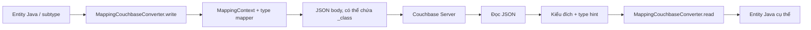

# Thông tin kiểu, @TypeAlias và tương thích khi đổi package hoặc tên lớp

## 1. Vấn đề: tên class Java có thể trở thành dữ liệu lưu trữ

Trong module **SPRING_DATA_COUCHBASE**, ứng dụng dùng Spring Data để ánh xạ entity Java vào Couchbase JSON document, lưu/đọc bằng repository hoặc `CouchbaseTemplate`, đồng thời truy vấn bằng SQL++. JSON hiểu các loại string, number, boolean, object, array và null nhưng không có khái niệm interface, subclass, record hay tên package của Java. Vì thế, Spring Data Couchbase đôi khi cần **thông tin kiểu (type information)** để dựng lại đúng Java object lúc đọc.

Hãy xét body JSON minh họa:

```json
{
  "_class": "com.acme.orders.OrderDocument",
  "status": "PAID",
  "totalMinor": 155000
}
```

Field `_class` là **type hint** do cơ chế mapping Spring Data sử dụng. Nếu class `com.acme.orders.OrderDocument` sau này chuyển sang package `com.acme.sales.persistence`, body cũ vẫn giữ chuỗi tên lớp cũ. Đây là nguy cơ khi dữ liệu trong Couchbase sống lâu hơn một lần triển khai ứng dụng.

`@TypeAlias` cho phép dùng tên kiểu ổn định, chẳng hạn `"order-document"`, thay cho tên class đầy đủ. Nhưng annotation mới **không tự viết lại** document cũ. Người phát triển cần hiểu cách Spring Data ghi/giải mã type hint, điều kiện mapping context nhận alias và lộ trình migration.

Sau bài học, bạn có thể:

1. Phân biệt field `_class`, Java class, discriminator nghiệp vụ và metadata Couchbase.
2. Dùng `@TypeAlias` để định nghĩa mã kiểu ổn định, giảm phụ thuộc vào package.
3. Biết khi nào root entity hoặc nested subtype cần type hint.
4. Giải thích vì sao mapping context phải biết class có alias.
5. Thiết kế đổi package/tên class, giữ tương thích dữ liệu cũ và reader mới.
6. Kiểm tra SQL++, index, projection, các đường repository/template/reactive và SDK trực tiếp.
7. Xây dựng kế hoạch migration với CAS, TTL, schema version, rollback và round-trip test.

## 2. Type hint trong Spring Data Couchbase là gì?

Một JSON object:

```json
{
  "provider": "PAY_WALLET",
  "transactionRef": "TX-42"
}
```

không có đủ thông tin tự thân để kết luận nó là `WalletPayment`, `PaymentResult` hay `Map<String,Object>`. Nếu property Java được khai báo là interface `PaymentDetails`, converter cần quy tắc xác định subtype cụ thể.

Khi type mapper được cấu hình để ghi thông tin kiểu, một hình dạng minh họa là:

```json
{
  "_class": "com.acme.payments.WalletPayment",
  "provider": "PAY_WALLET",
  "transactionRef": "TX-42"
}
```

Trong chiều **ghi**, `MappingCouchbaseConverter` và type mapper có thể ghi type hint dựa trên runtime type. Trong chiều **đọc**, converter dùng kiểu đích, metadata của `CouchbaseMappingContext` và type hint khả dụng để chọn class dựng lại.



**Không phải mọi JSON object đều có `_class`.** Type hint có thể xuất hiện ở root, ở nested object mang runtime subtype, hoặc được lược bỏ nếu cấu hình/type đích đủ rõ. Hình dạng cụ thể phụ thuộc type mapper, metadata entity, property type và phiên bản framework. Luôn kiểm tra biểu diễn thực tế thay vì coi các JSON minh họa là cam kết byte-for-byte.

### 2.1. Các thành phần đảm nhiệm việc mapping

| Thành phần | Trách nhiệm |
| --- | --- |
| `CouchbaseMappingContext` | Metadata về entity, property, mapping annotation, class đã biết. |
| `MappingCouchbaseConverter` | Chuyển entity Java sang `CouchbaseDocument` và đọc ngược. |
| Type mapper | Xác định cách ghi/giải mã thông tin kiểu như `_class`. |
| `@TypeAlias` | Khai báo alias ánh xạ với một Java type đã được mapping context biết. |
| `CouchbaseCustomConversions` | Chuyển giá trị theo cặp kiểu; không tự thay thế toàn bộ type mapping. |
| `CouchbaseDocument` | Biểu diễn trung gian của entity và dữ liệu document; không tự thực hiện mạng. |

`@Field("name")` điều khiển tên field nghiệp vụ trong JSON; nó không phải annotation dùng để ánh xạ alias cho class. `@Id` điều khiển document key; không phải tên type hint.

## 3. Phân biệt type hint, discriminator và metadata của server

Một document Couchbase gồm document key, body JSON và metadata server. Ba loại thông tin rất dễ nhầm:

| Dữ liệu | Ví dụ | Nằm ở đâu, dùng để làm gì |
| --- | --- | --- |
| Type hint Spring Data | `"_class":"order-document"` | Body JSON; phục vụ nhận dạng class. |
| Discriminator nghiệp vụ | `"payment_kind":"WALLET"` | Body JSON; mã loại mà các client cùng hiểu. |
| Schema version | `"schema_version":2` | Body JSON; phiên bản cấu trúc do ứng dụng kiểm soát. |
| Document key | `order::1001` | ID document trong collection; có thể đến từ `@Id`. |
| CAS | Số CAS do server cấp | Metadata; dùng optimistic locking/`@Version`. |
| TTL/expiry | Thời điểm hết hạn document | Metadata server; không phải một field `_class`. |
| Bucket/scope/collection | `shop/sales/orders` | Vị trí lưu/đọc và phạm vi truy vấn. |

Không dùng CAS làm schema version. Không coi `_class` như JSON type chuẩn do Couchbase Server định nghĩa: đây là **quy ước của Spring Data**. Nếu document được tạo qua Couchbase SDK trực tiếp, nó có thể không có `_class` mà vẫn là JSON hoàn toàn hợp lệ.

## 4. FQCN mặc định và hậu quả khi đổi package

Entity ban đầu:

```java
package com.acme.orders;

import org.springframework.data.annotation.Id;
import org.springframework.data.couchbase.core.mapping.Document;
import org.springframework.data.couchbase.core.mapping.Field;

@Document
public record OrderDocument(
    @Id String id,
    @Field String status,
    @Field long totalMinor
) {}
```

Khi cấu hình lưu tên lớp đầy đủ làm type hint, body có thể là:

```json
{
  "_class": "com.acme.orders.OrderDocument",
  "status": "PAID",
  "totalMinor": 155000
}
```

Đổi class sang:

```java
package com.acme.sales.persistence;

// Các property business vẫn giữ như class cũ.
```

Document cũ **không tự đổi** `_class` khi source code thay đổi. Collection có thể chứa cùng lúc nhiều biểu diễn:

```json
{
  "_class": "com.acme.orders.OrderDocument",
  "status": "PAID"
}
```

```json
{
  "_class": "com.acme.sales.persistence.OrderDocument",
  "status": "PAID"
}
```

Reader mới có thể phải giải cả hai tên hoặc dữ liệu phải được chuyển đổi trước. Nếu old FQCN không còn được mapping context/classpath nhận biết, đọc có nguy cơ thất bại hoặc materialize sai khi cần type resolution.

**Không phải mọi lần đổi package đều chắc chắn làm mọi đường đọc lỗi.** Một số operation đã cung cấp class đích cụ thể, và type mapper có thể hoạt động khác với đường dựng subtype qua interface. Nhưng không được giả định mọi document an toàn chỉ vì business fields không thay đổi: phải thử bằng JSON cũ và reader mới.

### 4.1. Các refactor có thể trở thành thay đổi storage contract

- Đổi package hoặc tên concrete entity class.
- Di chuyển subtype của một sealed hierarchy.
- Đổi tên type alias đã phát hành.
- Đổi field từ concrete class sang interface hoặc abstract base class.
- Bỏ class/constructor mà JSON lịch sử vẫn phụ thuộc.
- Đổi cấu hình type key/type mapper.
- Đổi projection làm mất type hint vốn được dùng trong quá trình dựng entity.

Đây là thay đổi cần xem xét ở **dữ liệu lâu dài**, không chỉ tại compiler.

## 5. `@TypeAlias`: tạo danh tính kiểu ổn định

Spring Data Commons cung cấp `org.springframework.data.annotation.TypeAlias`.

Ví dụ đặt alias cho root entity:

```java
package com.acme.orders;

import org.springframework.data.annotation.Id;
import org.springframework.data.annotation.TypeAlias;
import org.springframework.data.couchbase.core.mapping.Document;
import org.springframework.data.couchbase.core.mapping.Field;

@Document
@TypeAlias("order-document")
public record OrderDocument(
    @Id String id,
    @Field String status,
    @Field long totalMinor
) {}
```

Khi type mapper đang dùng alias và mapping context biết class này, JSON minh họa:

```json
{
  "_class": "order-document",
  "status": "PAID",
  "totalMinor": 155000
}
```

Giả sử sau này class được chuyển sang `com.acme.sales.persistence.OrderDocument` nhưng vẫn giữ `@TypeAlias("order-document")`, document **đã lưu alias** có thể được đọc bởi reader mới khi metadata đã đăng ký và các property/constructor tương thích.

### 5.1. Chọn alias như một mã bền vững

| Nguyên tắc | Ví dụ nên dùng | Cần tránh |
| --- | --- | --- |
| Không phụ thuộc package Java | `order-document` | `com.acme.orders.OrderDocument` nếu mục tiêu là tránh refactor package. |
| Có ý nghĩa nghiệp vụ hoặc persistence rõ | `wallet-payment` | `wp2x` không có tài liệu. |
| Ổn định qua deploy | Giữ `order-document` sau rename class | Đổi alias cùng mọi lần đổi tên code. |
| Duy nhất trong mapping context | Mỗi persistent subtype có mã riêng | Hai subtype khác nhau cùng `payment`. |
| Có chính sách migration | Ghi rõ alias V1 và đường nâng cấp | Xóa alias cũ mà không kiểm kê document. |

**Đặt `@TypeAlias` không có nghĩa tất cả document đã lưu FQCN cũ được sửa tự động.** Annotation chủ yếu ảnh hưởng mapping mới theo cấu hình hiện tại; dữ liệu lịch sử giữ nguyên cho tới khi được backfill hoặc đọc qua đường tương thích.

### 5.2. Giới hạn của annotation

`@TypeAlias` không tự:

1. Quét collection để thay `_class` cũ.
2. Đăng ký tất cả subtype chưa được mapping context biết tới.
3. Ánh xạ mọi FQCN lịch sử sang class mới.
4. Tạo field nghiệp vụ `kind` cho client ngoài Java.
5. Sửa constructor hoặc property name không còn phù hợp với JSON cũ.
6. Cập nhật SQL++/index đang hard-code tên class cũ.
7. Đổi CAS, TTL, document key hoặc bật transaction cho migration.

Vì vậy, alias là một phần của giải pháp tương thích **được thiết kế từ đầu**, không phải phép sửa dữ liệu đã tồn tại.

## 6. Mapping context phải biết alias của subtype

Spring Data không thể tự suy ra từ chuỗi `"wallet-payment"` class nào cần tạo nếu metadata chưa được nạp.

Giả sử:

```java
import org.springframework.data.annotation.TypeAlias;

@TypeAlias("wallet-payment")
public record WalletPayment(
    String provider,
    String transactionRef
) implements PaymentDetails {}
```

Một service có thể biết `WalletPayment` qua các mapped entities; service khác chỉ khai báo field interface `PaymentDetails` có thể chưa nạp subtype. Khi đó giải alias có thể không thành công.

Những cách bảo đảm context biết type:

1. Đưa subtype vào tập entity mà mapping context quét/nhận diện qua domain/repository.
2. Khai báo tập **initial entities** ở cấu hình hỗ trợ để metadata có sẵn lúc khởi động.
3. Dùng điểm mở rộng mapping metadata của phiên bản Spring Data Couchbase đang triển khai và kiểm chứng trong Spring context.
4. Khi không muốn phụ thuộc type discovery của framework, dùng persistence DTO với discriminator tường minh và mapper đọc theo whitelist.

Không nên coi việc có file `WalletPayment.java` trên classpath là bằng chứng alias đã được đăng ký. Không nhất thiết cần tạo repository riêng cho mọi subtype; điều quan trọng là metadata được mapping context biết đến.

### 6.1. Checklist khi alias không đọc được

- Class cụ thể có `@TypeAlias` không?
- Chuỗi `_class` trong JSON có trùng chính xác alias không?
- Reader đang chạy có class tương ứng và đã đăng ký metadata không?
- Property đích là interface hay concrete class?
- Type hint có xuất hiện tại **cấp object đúng** không?
- Custom mapper/converter có bỏ hoặc đổi type hint không?
- Query projection có đánh rơi `_class` hoặc các field bắt buộc không?

Hãy kiểm tra trong Spring context **thật của reader**, không chỉ trong một unit test gọi constructor trực tiếp.

## 7. Root type và nested subtype: hai cấp metadata

Một mô hình thanh toán có nhiều biến thể:

```java
public sealed interface PaymentDetails
        permits CardPayment, WalletPayment {}

@TypeAlias("card-payment")
public record CardPayment(
    String last4, String network
) implements PaymentDetails {}

@TypeAlias("wallet-payment")
public record WalletPayment(
    String provider, String transactionRef
) implements PaymentDetails {}
```

Các public top-level type ở ví dụ nên đặt trong tệp Java riêng. Entity gốc:

```java
@Document
@TypeAlias("order-document")
public record OrderDocument(
    @Id String id,
    @Field String status,
    @Field PaymentDetails payment
) {}
```

Khi mapping context đã nhận biết subtype và type mapper ghi hint tại field đa hình, JSON minh họa:

```json
{
  "_class": "order-document",
  "status": "PAID",
  "payment": {
    "_class": "wallet-payment",
    "provider": "PAY_WALLET",
    "transactionRef": "TX-42"
  }
}
```

Type hint gốc `"order-document"` chỉ định entity `OrderDocument`. Type hint trong `payment` giúp chọn subtype `WalletPayment`. **Không mặc định mọi nested object cần hoặc có `_class`.** Nếu property khai báo concrete class đã đủ thông tin, hình dạng có thể khác; thay concrete property thành interface cần kiểm tra lại dữ liệu lịch sử.

### 7.1. Khi nested object thiếu type hint

JSON:

```json
{
  "_class": "order-document",
  "payment": {
    "provider": "PAY_WALLET",
    "transactionRef": "TX-42"
  }
}
```

Với `PaymentDetails payment`, framework có thể thiếu cơ sở dựng subtype. Không suy đoán an toàn rằng hai field `provider` và `transactionRef` chắc chắn là `WalletPayment`: subtype mới có thể dùng các field tương tự.

Giải pháp tùy kiến trúc:

- Ghi đủ type hint cho property đa hình và bảo đảm alias được mapping context biết.
- Dùng persistence DTO mang `payment.kind`/`schema_version` rồi chuyển sang domain subtype bằng logic đã kiểm thử.
- Di chuyển dữ liệu cũ sang schema chứa discriminator rõ ràng.
- Nếu chỉ có một concrete subtype và không muốn đa hình, khai báo đúng concrete property.

### 7.2. Không lẫn với Jackson

Các annotation như `@JsonTypeInfo` hoặc `@JsonSubTypes` có thể điều khiển JSON API khi dùng Jackson. Chúng không mặc nhiên thay thế Spring Data Couchbase type mapper, cũng như `@TypeAlias` không tự làm JSON REST API biết các subtype.

Nếu hệ thống vừa trả entity qua REST, vừa lưu qua repository, hãy kiểm tra **cả hai pipeline** thay vì giả định chúng sinh cùng JSON.

## 8. `_class` so với discriminator nghiệp vụ `kind`

Nếu có nhiều client dùng cùng collection, một schema ít lệ thuộc Java có thể định nghĩa:

```json
{
  "payment": {
    "kind": "WALLET",
    "provider": "PAY_WALLET",
    "transactionRef": "TX-42"
  }
}
```

`kind` là field nghiệp vụ được thống nhất giữa các hệ thống. Nó không tự khiến `MappingCouchbaseConverter` tạo đúng subtype nếu converter chỉ hiểu `_class`; cần mapper hoặc custom conversion tương ứng.

| Tiêu chí | `_class` FQCN | `_class` alias | `payment.kind` |
| --- | --- | --- | --- |
| Phụ thuộc tên Java | Cao | Thấp nếu alias ổn định | Không nếu code nghiệp vụ ổn định |
| Ai định nghĩa? | Class/type mapper | `@TypeAlias` và mapping metadata | JSON schema của ứng dụng |
| Dùng để khôi phục subtype | Spring Data có thể tự dùng | Spring Data có thể tự dùng nếu alias biết trước | Cần quy tắc/mapper riêng nếu type mapper không sử dụng |
| Mức dễ hiểu ngoài Java | Thấp | Trung bình | Cao |
| Đổi package | Có thể phải migrate | Giữ alias sẽ hạn chế rủi ro | Không ảnh hưởng nếu `kind` không đổi |
| Query SQL++ | Gắn với FQCN | Giá trị ổn định hơn | Theo khái niệm nghiệp vụ |

Có thể dùng **cả `_class` và `kind`**, nhưng phải kiểm chứng hai field không mâu thuẫn. Nếu `payment._class="card-payment"` mà `payment.kind="WALLET"`, ứng dụng nên phát hiện lỗi contract, không tùy tiện chọn một diễn giải.

## 9. Đổi package/tên class: ba tình huống khác nhau

### 9.1. Tình huống A — Document đã lưu alias ngay từ đầu

Bản cũ:

```java
package com.acme.orders;

@Document
@TypeAlias("order-document")
public record OrderDocument(/* các property */) {}
```

Bản mới:

```java
package com.acme.sales.persistence;

@Document
@TypeAlias("order-document")
public record OrderDocument(/* các property tương thích */) {}
```

Document cũ lưu `"_class":"order-document"` có cơ sở được đọc ở code mới khi mapping context nhận biết class mới và schema fields vẫn tương thích. Thử với document **đã tồn tại** thay vì chỉ với object mới vừa tạo trong test.

### 9.2. Tình huống B — Document lịch sử dùng FQCN cũ

Body cũ:

```json
{
  "_class": "com.acme.orders.OrderDocument",
  "status": "PAID"
}
```

Class mới dùng `@TypeAlias("order-document")`. Chỉ thêm annotation không bảo đảm `"com.acme.orders.OrderDocument"` tự được nhận thành class mới. Có thể chọn:

1. **Reader tương thích tạm thời** với FQCN cũ và alias mới, thông qua chiến lược mapping/adapter có kiểm thử.
2. **Giữ compatibility type** nếu cấu trúc và framework cho phép, nhưng phải đánh giá tác dụng phụ trên repository/type mapper.
3. **Backfill JSON** chuyển đúng các giá trị `_class` cũ thành alias mà reader mới đã biết.
4. **Migration trước refactor**, khi class cũ còn khả dụng, rồi mới cắt sang code mới.

Không đổi bừa chuỗi FQCN bằng phép replace toàn bộ JSON vì document có thể chứa nested type hints, dữ liệu khác có tên giống nhau hoặc class cũ mang ý nghĩa khác.

### 9.3. Tình huống C — Refactor đồng thời đổi cấu trúc entity

Nếu thêm `payment.kind`, đổi tên `payment`, chuyển từ nested object sang scalar, hoặc thay interface hierarchy, vấn đề lớn hơn type alias. Cần persistence DTO, schema version và migration business fields.

`@TypeAlias` giải bài toán **định danh kiểu**, không giải bài toán **biến đổi cấu trúc document**.

## 10. Kiểm kê type hints bằng SQL++

Giả sử bucket `shop`, scope `sales`, collection `orders`.

### 10.1. Thống kê các kiểu đang được lưu

```sql
SELECT o._class AS storedType,
       COUNT(1) AS documentCount
FROM `shop`.`sales`.`orders` AS o
GROUP BY o._class
ORDER BY documentCount DESC;
```

Kết quả có thể có:

- `com.acme.orders.OrderDocument` — FQCN cũ.
- `com.acme.sales.persistence.OrderDocument` — FQCN mới.
- `order-document` — alias ổn định.
- `MISSING`/`NULL` — document không có type hint hoặc có null, thường do producer/cấu hình khác.

Không tự coi document thiếu `_class` là JSON lỗi: Couchbase SDK trực tiếp không bắt buộc ghi Spring Data type hint.

### 10.2. Tìm document dùng FQCN cũ

```sql
SELECT META(o).id AS docId,
       o._class AS storedType,
       o.status
FROM `shop`.`sales`.`orders` AS o
WHERE o._class = "com.acme.orders.OrderDocument";
```

Với nested payment:

```sql
SELECT META(o).id AS docId,
       o.payment._class AS paymentType
FROM `shop`.`sales`.`orders` AS o
WHERE o.payment._class = "com.acme.payments.WalletPayment";
```

Các tên field trong SQL++ phải theo **JSON thực**, không theo tên property Java sau khi `@Field` đổi tên.

### 10.3. Ví dụ migration một root type hint

Khi đã kiểm chứng reader mới giải `"order-document"`, có thể dùng một lệnh minh họa:

```sql
UPDATE `shop`.`sales`.`orders` AS o
SET o._class = "order-document"
WHERE o._class = "com.acme.orders.OrderDocument"
RETURNING META(o).id AS docId, o._class AS newType;
```

**Không chạy nguyên lệnh hàng loạt trên production khi chưa có kế hoạch vận hành.** Cần chia lô, theo dõi tài liệu bị lỗi, retry/idempotency, kiểm soát cập nhật cạnh tranh và xác nhận hành vi TTL theo API/version đang dùng. Lệnh này chỉ đổi **root** `_class`; nested `payment._class` cần kiểm kê và migration riêng.

Nếu lọc type hints thường xuyên và workload phù hợp, một index có thể cân nhắc:

```sql
CREATE INDEX ix_orders_type_hint
ON `shop`.`sales`.`orders`(_class);
```

Thiết kế index dựa vào selectivity, predicate và `EXPLAIN`, không phải converter tự tạo index. Với báo cáo lâu dài, nên cân nhắc field nghiệp vụ `kind`/`status` hơn là gắn tất cả dashboard với chi tiết `_class` của framework.

## 11. Query projection và thiếu metadata

Query tùy biến có thể chỉ trả một phần body:

```sql
SELECT o.status, o.payment.provider
FROM `shop`.`sales`.`orders` AS o
WHERE o.status = "PAID";
```

Projection trên không nhất thiết chứa `_class` ở root hoặc nested `payment`, cũng có thể bỏ ID hay các property bắt buộc. Nếu cố dựng nguyên entity `OrderDocument` hoặc interface subtype từ kết quả đó, converter có thể không đủ dữ liệu.

Một DTO dành riêng cho báo cáo thường là lựa chọn phù hợp hơn. Khi cần khôi phục full entity đa hình, query/mapper phải mang đủ field và metadata cần thiết. Đừng đồng nhất `SELECT o.status` với việc đọc một document đầy đủ qua repository.

## 12. Multiple readers và SDK ngoài Spring Data

Trong hệ thống có nhiều service, mỗi producer có thể dùng serialization khác nhau:

| Đường ghi | Có tự dùng `@TypeAlias` của Java Spring Data? | Điều phải kiểm tra |
| --- | --- | --- |
| `CouchbaseRepository` | Có thể sử dụng Spring Data type mapper đang cấu hình | Alias, type metadata, entity round-trip. |
| `CouchbaseTemplate` với entity | Tương tự pipeline Spring Data | Kiểu JSON sau ghi và tùy chọn thao tác. |
| Reactive repository/template | Nguyên tắc mapping của Spring Data tương ứng | Cấu hình mapping, query, JSON thực tế. |
| Java SDK `JsonObject` | Không tự biết annotation Spring Data | JSON contract, discriminator và metadata cần bổ sung. |
| SDK Node.js/Go hoặc import | Không hiểu class/alias Java mặc định | Hợp đồng field `kind`, versioning và validation. |
| SQL++ UPDATE | Thao tác trực tiếp JSON body | Ảnh hưởng type hint, CAS/TTL và reader sau update. |

Nếu service không phải Java cần đọc subtype, đừng bắt nó suy tên package từ `_class`. Một JSON schema với `kind` và `schema_version` thường rõ hơn. Nếu dùng cả type hint và discriminator, cần chính sách nhất quán giữa các producer.

## 13. Schema version khác type alias và CAS

Ví dụ:

```json
{
  "_class": "wallet-payment",
  "kind": "WALLET",
  "schema_version": 2,
  "provider": "PAY_WALLET",
  "transactionRef": "TX-42"
}
```

- `_class` là type hint phục vụ ánh xạ class.
- `kind` là nhãn nghiệp vụ do hệ thống định nghĩa.
- `schema_version` là phiên bản cấu trúc payload.
- CAS là metadata server để phát hiện ghi cạnh tranh; nó không phải một trong các field trên.

Đổi alias từ `wallet-payment` sang `wallet` cũng là thay đổi storage contract. Nếu chỉ đổi cấu trúc field mà vẫn cùng ý nghĩa subtype, có thể **giữ alias** và tăng schema version thay vì thay alias mỗi khi release code.

Khi reader gặp schema version chưa biết, cần chính sách rõ ràng: fail fast, đọc compatible, hoặc migrate theo version. Không tự phán đoán payload dựa trên vài field trùng nhau nếu có nguy cơ hiểu sai nghiệp vụ.

## 14. Cẩn trọng với type hint từ dữ liệu không tin cậy

Dữ liệu trong collection có thể đến từ SDK, batch import, dịch vụ khác hoặc nguồn không được kiểm soát tuyệt đối. Không nên dùng chuỗi `_class` từ JSON rồi tự làm `Class.forName()` và khởi tạo class tùy ý.

Thực hành an toàn:

1. Chỉ cho phép các subtype đã được ứng dụng hỗ trợ/mapping rõ ràng.
2. Quản lý alias như danh sách các giá trị hợp lệ, không cho client tự chọn class nội bộ.
3. Validate các field nghiệp vụ sau khi materialize.
4. Ghi log lỗi mapping cùng document ID và alias, tránh để lộ dữ liệu nhạy cảm.
5. Tránh phản hồi FQCN Java nội bộ ra API công cộng khi không cần.
6. Có kế hoạch xử lý unknown type thay vì ép sang một subtype hợp lệ tùy tiện.

`@TypeAlias` giúp tách tên hiển thị khỏi package nhưng **không thay thế quy tắc validation và trust boundary**.

## 15. Lộ trình đổi package an toàn

### Bước 1 — Khảo sát

Đếm các root/nested type hints đang tồn tại, xác định reader/writer (repository, template, reactive, SDK, import/ETL), query/index và khả năng rollback.

### Bước 2 — Chốt hợp đồng alias

Chọn alias ổn định, duy nhất và có tài liệu sở hữu. Phân biệt alias với `kind` nghiệp vụ và `schema_version`.

### Bước 3 — Chuẩn bị reader tương thích

Đảm bảo reader mới đọc được cả FQCN cũ và alias mục tiêu **theo một cơ chế đã kiểm thử**. Không chỉ thêm annotation rồi suy rằng dữ liệu lịch sử tự hợp lệ.

### Bước 4 — Bật writer mới

Sau khi reader tương thích được triển khai, writer mới có thể bắt đầu ghi alias. Xác nhận JSON thật và type hints nested qua SDK raw hoặc SQL++.

### Bước 5 — Backfill có kiểm soát

Chuyển đổi đúng FQCN cũ bằng batch và conditional update thích hợp, quan sát CAS conflict, retry/idempotency, TTL/expiry và lỗi do schema không tương thích.

### Bước 6 — Kiểm tra mọi đường đọc và query

Đọc lại document V1/V2, chạy integration tests, SQL++ query, projections, dashboard, client ngoài Java và đường reactive. Theo dõi số FQCN còn lại.

### Bước 7 — Gỡ hỗ trợ cũ có kế hoạch

Chỉ loại bỏ đường đọc FQCN sau khi dữ liệu lịch sử đã được xử lý hoặc có chính sách lưu trữ riêng, và rollback không làm mất khả năng đọc.

| Tiêu chí sẵn sàng | Cần xác minh |
| --- | --- |
| Mapping context | Root và subtype alias đều được đăng ký. |
| Dữ liệu lịch sử | Không còn FQCN cũ không có đường đọc. |
| Nested polymorphism | Không bỏ sót type hints ở field lồng nhau. |
| JSON ngoài Spring | Producer khác hiểu contract. |
| SQL++/index | Query lọc đúng trong giai đoạn V1/V2. |
| CAS/TTL | Migration không ghi đè cập nhật hoặc phá expiry. |
| Rollback | Reader cũ có chiến lược xử lý alias mới. |
| Monitoring | Có metric và log cho unknown alias/mapping error. |

## 16. Kiểm thử theo hướng dữ liệu thật

### 16.1. Ví dụ round-trip trong bộ nhớ

Giả sử `OrderDocument` có `@TypeAlias("order-document")` và `converter` là bean đã được cấu hình trong Spring context:

```java
OrderDocument original = new OrderDocument(
    "order::1001",
    "PAID",
    155000L
);

CouchbaseDocument intermediate = new CouchbaseDocument();
converter.write(original, intermediate);

System.out.println(intermediate.export());
// Xem _class thực tế nếu type mapper có ghi type hint.

OrderDocument restored =
    converter.read(OrderDocument.class, intermediate);

assert original.status().equals(restored.status());
assert original.totalMinor() == restored.totalMinor();
```

Đây là đoạn minh họa trong một test, **không phải class Java standalone** và không thực hiện I/O mạng. Cần tiếp tục integration test qua repository hoặc template và kiểm tra raw JSON trong collection thử nghiệm.

### 16.2. Ma trận kiểm thử cần thiết

| Tình huống | Kết quả cần kiểm tra |
| --- | --- |
| JSON lưu FQCN cũ | Reader tương thích đọc được hoặc báo lỗi có chủ đích trước migration. |
| JSON lưu alias mới | Reader mới giải alias đúng class. |
| Đổi package, giữ alias | Document đã dùng alias vẫn đọc được. |
| Root vs nested `_class` | Type hint đủ để materialize interface subtype. |
| Mapping context chưa đăng ký subtype | Lỗi được phát hiện trong test startup/round-trip. |
| Alias trùng nhau | Tránh mapping sai subtype. |
| Projection thiếu type hint | Không cố dựng full polymorphic entity khi thiếu dữ liệu. |
| Document không có `_class` | Chính sách cho SDK client khác được kiểm thử. |
| Unknown alias | Fail fast hoặc fallback được thiết kế rõ. |
| CAS/TTL sau migration | Không mất tính nhất quán và vòng đời dữ liệu. |
| Mixed FQCN/alias | SQL++ query/index và reader hoạt động trong rollout. |
| Rollback | Có đường xử lý dữ liệu mới bằng phiên bản cũ hoặc rollback plan. |

### 16.3. Bài thực hành A — Từ FQCN đến alias

Tạo một entity `OrderDocument`, lưu một document khi chưa đặt alias. Kiểm tra `_class` thực tế. Sau đó thêm `@TypeAlias("order-document")` và lưu một document mới. So sánh JSON cũ/mới và giải thích vì sao document cũ không tự thay đổi.

### 16.4. Bài thực hành B — Đổi package

Di chuyển class sang package mới trong một nhánh test. Đọc lại document cũ và mới. Ghi nhận những đường đọc nào thành công hoặc lỗi. Đề xuất reader tương thích hoặc migration cho FQCN lịch sử; xác nhận mapping context của class mới nhận biết alias.

### 16.5. Bài thực hành C — Subtype và discriminator

Tạo `PaymentDetails` với `CardPayment` và `WalletPayment`, đặt alias riêng. Lưu qua repository, đọc raw JSON và xem nested type hint. Bỏ hint khỏi bản JSON thử nghiệm để quan sát kết quả. Thêm `payment.kind` như schema nghiệp vụ dùng cho client khác ngôn ngữ.

### 16.6. Bài thực hành D — SQL++ và backfill

Thống kê FQCN/alias bằng SQL++, viết câu UPDATE minh họa đổi một type hint và thiết kế batch strategy. Kiểm tra lại query, index và metadata sau migration. Giải thích trường hợp cần CAS/retry để tránh writer khác ghi đồng thời.

### Câu hỏi tự kiểm tra

1. JSON có trực tiếp lưu Java class hay interface không?
2. Vì sao `_class` khác document key và CAS?
3. Khi nào Spring Data có thể cần type hint ở nested object?
4. Vì sao đổi package có thể làm document cũ khó đọc?
5. `@TypeAlias` giải quyết phần nào của bài toán refactor?
6. Vì sao thêm annotation mới không tự đổi `_class` lịch sử?
7. Vì sao mapping context phải nhận biết alias?
8. Property interface và property concrete khác nhau ra sao về yêu cầu type hint?
9. `@TypeAlias` có thay thế `@JsonTypeInfo` của Jackson không?
10. Vì sao dùng `payment.kind` khi có nhiều client không dùng Spring Data?
11. Một SQL++ projection thiếu `_class` có thể gây vấn đề gì?
12. Thay alias có cần migration và test rollback không?
13. `schema_version` khác `@Version`/CAS như thế nào?
14. SQL++ UPDATE `_class` có tự cập nhật document key, metadata và index schema không?
15. Vì sao không dùng một giá trị `_class` bất kỳ từ input để tự động nạp Java class?

## Tài liệu tham khảo

- [Spring Data Couchbase — Modeling Entities](https://docs.spring.io/spring-data/couchbase/reference/couchbase/entity.html): entity mapping, `_class`, `@TypeAlias` và các loại metadata.
- [Spring Data Commons — Object Mapping](https://docs.spring.io/spring-data/commons/reference/object-mapping.html): metadata persistent entities và cách khôi phục object.
- [Spring Data Commons — TypeAlias API](https://docs.spring.io/spring-data/commons/docs/current/api/org/springframework/data/annotation/TypeAlias.html): annotation khai báo alias.
- [Spring Data Couchbase — MappingCouchbaseConverter API](https://docs.spring.io/spring-data/couchbase/docs/current/api/org/springframework/data/couchbase/core/convert/MappingCouchbaseConverter.html): conversion và type metadata.
- [Couchbase Server — SQL++ Language Reference](https://docs.couchbase.com/server/current/n1ql/n1ql-language-reference/index.html): `META()`, `SELECT`, `UPDATE`, `CREATE INDEX`.
- [Couchbase Java SDK — JSON Modelling](https://docs.couchbase.com/java-sdk/current/howtos/json.html): body JSON khi thao tác ngoài Spring Data.

> **Kết luận:** Tên Java class có thể trở thành một phần của dữ liệu bền vững qua `_class`. `@TypeAlias` giúp giữ **danh tính lưu trữ** ổn định khi refactor, nhưng chỉ khi alias được quản lý nhất quán và mapping context biết class cần đọc. Dữ liệu FQCN cũ, nested subtype và service ngoài Java vẫn cần chiến lược tương thích, migration và kiểm thử trên JSON thực.

