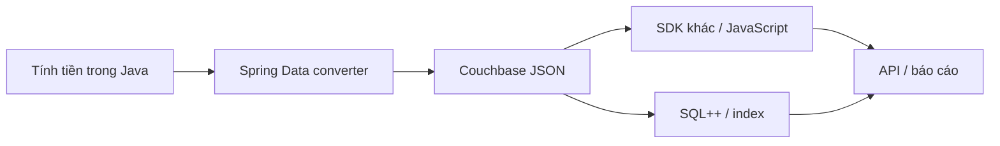

# Giá trị tiền tệ, độ chính xác và tránh mất thông tin

## 1. Vì sao tiền tệ là bài toán chuyển đổi kiểu đặc biệt?

Trong **SPRING_DATA_COUCHBASE**, tầng truy cập dữ liệu ánh xạ entity Java sang document JSON, lưu bằng repository hoặc `CouchbaseTemplate`, truy vấn bằng SQL++ và có thể dùng API reactive. Với số lượng sản phẩm, sai số số thực đôi khi chấp nhận được. Với tiền tệ, sai lệch vài đơn vị nhỏ nhất có thể gây mất cân đối thanh toán, đối soát hoặc hoàn tiền.

Một giá trị tiền **không chỉ là một con số**. Nó cần ít nhất:

- **Giá trị** (amount).
- **Đơn vị tiền tệ** (currency), chẳng hạn `VND`, `USD`, `JPY` hoặc `KWD`.
- **Quy ước đơn vị/scale**, ví dụ phần nhỏ nhất được sử dụng và số chữ số thập phân.
- **Quy tắc làm tròn** khi phép tính không chia hết.
- **Ngữ nghĩa nghiệp vụ**: tiền phải thu, tiền đã thanh toán, hoàn tiền, thuế, phí, số dư hay hạn mức.

Ví dụ `1000` VND và `1000` USD không được cộng trực tiếp như cùng một đại lượng. Tương tự, `10.50` USD không thể được hiểu chính xác nếu một hệ thống khác nhầm `10.50` là đơn vị cent.

Các mục tiêu của bài:

1. Hiểu nguyên nhân `float`/`double` không phù hợp cho tính toán tiền chính xác.
2. Sử dụng `BigDecimal`, đơn vị tiền nhỏ nhất và value object `Money` đúng ngữ nghĩa.
3. Chọn hợp đồng JSON có thể duy trì qua Java, Couchbase SDK, SQL++ và client ngoài Java.
4. Biết cách mapping bằng Spring Data Couchbase, khi nào cần custom converter/DTO.
5. Tránh lỗi mất precision khi đọc/ghi, đổi scale, chuyển số lớn qua JavaScript hoặc tính toán đa tiền tệ.
6. Thiết kế index, migration, kiểm thử round-trip và kiểm soát cập nhật đồng thời bằng CAS/transaction khi cần.

## 2. JSON number không đồng nghĩa với một kiểu số thập phân chính xác

JSON có kiểu `number`, nhưng không định nghĩa rằng số đó được lưu trong bộ nhớ client bằng `int`, `long`, `double` hay `BigDecimal`. Các biểu diễn sau đều là JSON number:

```json
{
  "count": 3,
  "price": 0.1,
  "total": 123456789012345,
  "taxRate": 0.075
}
```

Mỗi bộ giải mã JSON có thể chọn kiểu nội bộ khác nhau. Java `double` là dấu phẩy động nhị phân IEEE 754, `long` là số nguyên 64 bit, còn `BigDecimal` biểu diễn số thập phân với một `unscaledValue` và `scale`. Dữ liệu có thể mất thông tin ở **bất cứ ranh giới nào**:



Một số lỗi điển hình:

- Dùng `double` tính `0.1 + 0.2` rồi mong chính xác bằng `0.3`.
- Biến `BigDecimal` thành `double` trước khi serialize.
- Ghi amount theo cent nhưng reader hiểu thành dollar.
- Lưu amount như string nhưng truy vấn SQL++ lại so sánh theo thứ tự từ điển.
- Truyền số nguyên 64-bit rất lớn qua JavaScript `Number` rồi làm tròn.
- Đọc số theo tỷ giá mới trong khi giao dịch lịch sử phải giữ tỷ giá đã chốt.

**Nguyên tắc:** kiểu Java, biểu diễn JSON, đơn vị, scale, cách tính toán và cách query phải là **một hợp đồng dữ liệu duy nhất**. Chỉ thay annotation trên entity không đủ.

## 3. Vì sao `float` và `double` không phù hợp cho tiền?

`float`/`double` biểu diễn số dưới dạng nhị phân. Nhiều phân số thập phân hữu hạn như `0.1` không có biểu diễn nhị phân hữu hạn.

```java
double subtotal = 0.1;
double fee = 0.2;

System.out.println(subtotal + fee);
// Thường in 0.30000000000000004

System.out.println(subtotal + fee == 0.3);
// false
```

Vấn đề không nằm ở Couchbase. Nó đã xuất hiện trước khi dữ liệu được gửi đến server. Việc JSON hiển thị `0.3` ở một thời điểm nào đó không chứng minh tất cả phép tính sau đó đều chính xác.

Ví dụ sai dễ gặp trong mã nghiệp vụ:

```java
double amount = 19.99;
double total = amount * 3;
// Không nên dùng total như nguồn số tiền cần đối soát chính xác.
```

Với tiền, tránh dùng `float`/`double` làm định dạng chuẩn của value object, tính thuế/phí hoặc dữ liệu đối soát. Chỉ chuyển sang số dấu phẩy động ở **ranh giới thực sự chấp nhận sai số**, chẳng hạn một đồ thị minh họa, và không dùng kết quả đó để ghi ngược thành khoản tiền chính thức.

### 3.1. `BigDecimal` giúp gì?

`BigDecimal` cho phép làm việc với giá trị thập phân và quy tắc làm tròn được chỉ định. Khởi tạo từ **string** hoặc một số nguyên với scale xác định:

```java
import java.math.BigDecimal;

BigDecimal a = new BigDecimal("0.10");
BigDecimal b = new BigDecimal("0.20");

BigDecimal total = a.add(b);
System.out.println(total.toPlainString()); // 0.30
```

Tránh:

```java
BigDecimal unsafe = new BigDecimal(0.1);
// Chứa giá trị thập phân chính xác của double đã xấp xỉ 0.1.
```

`BigDecimal.valueOf(0.1)` thường cho biểu diễn ngắn gọn như `0.1` dựa trên `Double.toString`, nhưng giá trị `double` đầu vào vẫn có thể đã mất precision ở một bước trước đó. Với amount từ API, database, file kế toán hay phép nhập liệu, hãy ưu tiên **decimal string gốc** thay vì đi qua `double`.

### 3.2. `BigDecimal` không tự quyết định chính sách làm tròn

`BigDecimal` làm phép toán chính xác trong phạm vi các toán tử áp dụng, nhưng các phép chia không kết thúc hữu hạn thường cần `scale`/`MathContext` và `RoundingMode`:

```java
import java.math.BigDecimal;
import java.math.RoundingMode;

BigDecimal share = new BigDecimal("10.00")
    .divide(new BigDecimal("3"), 2, RoundingMode.HALF_EVEN);
// 3.33
```

Quy tắc chia tiền `10.00` thành ba phần **không chỉ** là tạo ba lần `3.33`; tổng đó bằng `9.99`, còn `0.01` cần được phân bổ theo chính sách xác định. Khi thanh toán/hoàn tiền theo nhiều phần, việc phân bổ phần dư phải có quy tắc và audit.

## 4. Tiền là một value object, không chỉ một `BigDecimal`

Tạo `Money` mang amount và currency:

```java
import java.math.BigDecimal;
import java.util.Currency;
import java.util.Objects;

public record Money(BigDecimal amount, Currency currency) {

    public Money {
        Objects.requireNonNull(amount, "amount");
        Objects.requireNonNull(currency, "currency");
    }

    public Money add(Money other) {
        if (!currency.equals(other.currency())) {
            throw new IllegalArgumentException(
                "Không được cộng khác currency");
        }
        return new Money(amount.add(other.amount()), currency);
    }
}
```

Một hệ thống nghiêm ngặt có thể kiểm tra thêm dấu âm được phép hay không, scale tối đa, giới hạn số tiền, danh sách currency hợp lệ và quy tắc xử lý tỷ giá. Cần cân nhắc `Currency.getDefaultFractionDigits()`: một số mã không có fraction digits tiêu chuẩn hoặc chính sách lịch sử thay đổi; không nên dùng một default không được kiểm tra cho toàn bộ giao dịch.

### 4.1. Vì sao cần so sánh cả currency?

`Money(10.00, USD)` và `Money(10.00, EUR)` **không bằng nhau về ý nghĩa tài chính**, dù amount giống nhau. Khi tính tổng đơn hàng đa tiền tệ, phải quy đổi theo tỷ giá được lựa chọn và lưu dấu vết tỷ giá, thời điểm chốt và chính sách làm tròn.

```java
Money usd = new Money(
    new BigDecimal("10.00"),
    Currency.getInstance("USD")
);

Money eur = new Money(
    new BigDecimal("10.00"),
    Currency.getInstance("EUR")
);

// usd.add(eur) ném IllegalArgumentException.
```

Bất biến của value object phải được bảo vệ **trước khi ghi** và kiểm tra lại **khi đọc** document do SDK, import hoặc hệ thống khác tạo.

### 4.2. `equals` và `compareTo` của `BigDecimal`

Hai `BigDecimal` có thể cùng giá trị số nhưng khác scale:

```java
BigDecimal x = new BigDecimal("10.0");
BigDecimal y = new BigDecimal("10.00");

System.out.println(x.equals(y));      // false
System.out.println(x.compareTo(y));   // 0
```

- `equals` kiểm tra cả giá trị và scale.
- `compareTo` so sánh theo giá trị số.

Nếu hệ thống cần lưu chính xác cách hiển thị ban đầu `10.0` khác `10.00`, phải quy định scale như dữ liệu có ý nghĩa. Nếu chỉ cần so sánh số tiền trong một currency, cân nhắc chuẩn hóa scale hoặc dùng phép so sánh số theo hợp đồng. Không tùy tiện dùng `stripTrailingZeros()` nếu ứng dụng cần giữ định dạng nhập liệu/audit.

## 5. Ba chiến lược lưu tiền vào Couchbase JSON

Tùy yêu cầu tích hợp và truy vấn, có ba chiến lược phổ biến.

### 5.1. Chiến lược A — Số nguyên đơn vị nhỏ nhất

Ví dụ `19.99` USD được lưu thành `1999` cent:

```json
{
  "amount_minor": 1999,
  "currency": "USD",
  "minor_unit_scale": 2
}
```

Với JPY theo quy tắc thường dùng không có phần thập phân:

```json
{
  "amount_minor": 1999,
  "currency": "JPY",
  "minor_unit_scale": 0
}
```

Hai document có cùng số `1999` nhưng amount theo đơn vị chính lần lượt là `19.99` USD và `1999` JPY. Trường `minor_unit_scale` biến **quy ước đơn vị** thành một phần kiểm chứng được của contract.

Ưu điểm:

- Phép cộng/trừ số nguyên chính xác nếu không tràn phạm vi.
- Thuận tiện cho SQL++ range query và index trên JSON number.
- Không có sai số dấu phẩy động do biểu diễn phần thập phân.

Giới hạn:

- Phải thống nhất `minor_unit_scale` và currency ở mọi client.
- `long` có giới hạn `-9_223_372_036_854_775_808` đến `9_223_372_036_854_775_807`.
- Một client JavaScript dùng `Number` không biểu diễn chính xác tất cả số nguyên `long`.
- Nếu scale thay đổi theo sản phẩm, quy định tiền tệ hoặc phiên bản, phải version hóa dữ liệu và migration có kiểm soát.
- Số nguyên không tự biểu diễn các phép chia hay tỷ lệ chưa được làm tròn.

Đây thường là lựa chọn tốt khi hệ thống xử lý **tiền đã chốt** với độ chia nhỏ nhất rõ và amount nằm trong phạm vi số nguyên đã chọn.

### 5.2. Chiến lược B — Số thập phân dưới dạng JSON string

Ví dụ:

```json
{
  "amount_decimal": "19.99",
  "currency": "USD"
}
```

Ưu điểm:

- Có thể bảo toàn **chuỗi thập phân và scale** theo hợp đồng; không buộc client giải thành `double`.
- Phù hợp giá trị có nhiều chữ số, tỷ giá cần giữ precision hoặc audit phần thập phân gốc.
- Java có thể dùng `new BigDecimal(amountString)` để dựng lại giá trị.

Giới hạn:

- SQL++ nhìn `amount_decimal` là **string**, không phải number.
- So sánh string theo thứ tự từ điển **khác** so sánh số: `"100"` có thể đứng trước `"20"`.
- Range query/sum muốn xử lý số cần biểu diễn/cột phụ hoặc phép chuyển có kiểm chứng và index phù hợp.
- String không hợp lệ như `"1,000.00"`, `"19.99 USD"` hoặc `"NaN"` cần bị từ chối theo định dạng đã thống nhất.

Nếu cần filter liên tục theo amount, có thể lưu cả **dữ liệu nguồn chính xác** và field số phục vụ truy vấn, nhưng phải quy định rõ field nào là nguồn sự thật, ai cập nhật cả hai và kiểm tra nhất quán.

### 5.3. Chiến lược C — JSON number thập phân

Ví dụ:

```json
{
  "amount": 19.99,
  "currency": "USD"
}
```

Đây là cú pháp JSON hợp lệ, nhưng **không bảo đảm round-trip decimal chính xác qua mọi serializer, SDK và ngôn ngữ**. Nếu một client chuyển number sang `double` rồi chuyển về `BigDecimal`, giá trị/scale có thể thay đổi. JSON number không mang metadata `scale` riêng.

JSON number có thể phù hợp cho số lượng hoặc chỉ số chấp nhận sai số; nếu muốn dùng nó cho tiền trong một hệ được kiểm soát, phải **đo và kiểm thử chính xác đường serialize/deserialize, SQL++ và client khác** theo giới hạn nghiệp vụ, không giả định giống nhau giữa các phiên bản.

### 5.4. Ma trận quyết định

| Tiêu chí | Integer minor units | Decimal string | JSON decimal number |
| --- | --- | --- | --- |
| Tính chính xác số tiền khi giữ trong phạm vi hợp đồng | Rất tốt khi integer/scale đúng | Rất tốt khi parse decimal từ string | Phụ thuộc codec và đường đọc/ghi |
| Query range theo số | Thuận tiện | Không trực tiếp theo kiểu string | Thuận tiện về cú pháp, cần kiểm tra precision |
| Giữ nguyên cách viết `19.990` | Không; trừ khi lưu metadata riêng | Có thể giữ nếu không chuẩn hóa string | Không được bảo đảm |
| Tương thích JavaScript `Number` | Cần chú ý số nguyên lớn | Có thể giữ string không mất chữ số | Cần chú ý sai số số thực |
| Dễ kiểm soát đa currency | Tốt khi lưu currency + scale | Tốt khi lưu currency + định dạng | Cần metadata currency/scale riêng |
| Cần migration khi đổi representation | Có | Có | Có |

**Gợi ý mặc định:** với các khoản tiền cần đối soát theo đơn vị nhỏ nhất, dùng **integer minor units + currency + scale chính thức** hoặc một contract decimal string được kiểm chứng. Đừng đưa ra một lựa chọn chỉ vì cú pháp entity Java ngắn hơn.

## 6. Chuyển đổi `BigDecimal` ↔ minor units mà không làm tròn ngầm

Hãy đặt quy tắc: dữ liệu input có thể chỉ được chấp nhận nếu biểu diễn **chính xác** theo scale của currency. Trong Java:

```java
import java.math.BigDecimal;

public final class MinorUnits {
    private MinorUnits() {}

    public static long toMinorUnitsExact(
            BigDecimal amount, int scale) {
        if (scale < 0 || scale > 18) {
            throw new IllegalArgumentException("Invalid scale");
        }
        return amount.movePointRight(scale).longValueExact();
    }

    public static BigDecimal fromMinorUnits(
            long minorUnits, int scale) {
        if (scale < 0 || scale > 18) {
            throw new IllegalArgumentException("Invalid scale");
        }
        return BigDecimal.valueOf(minorUnits, scale);
    }
}
```

Ví dụ:

```java
long usdMinor = MinorUnits.toMinorUnitsExact(
    new BigDecimal("19.99"), 2
); // 1999

BigDecimal usd = MinorUnits.fromMinorUnits(usdMinor, 2);
// 19.99

long jpyMinor = MinorUnits.toMinorUnitsExact(
    new BigDecimal("1999"), 0
); // 1999
```

Nếu amount có thêm số thập phân không thể biểu diễn bằng scale đã chọn:

```java
MinorUnits.toMinorUnitsExact(
    new BigDecimal("19.999"), 2
);
// ArithmeticException: có phần nhỏ hơn đơn vị được chấp nhận.
```

Cách này **không làm tròn âm thầm**. Nếu nghiệp vụ cần làm tròn, hãy tách thành bước được đặt tên và audit rõ:

```java
import java.math.RoundingMode;

BigDecimal input = new BigDecimal("19.995");
BigDecimal rounded = input.setScale(2, RoundingMode.HALF_EVEN);
// 20.00 theo HALF_EVEN.

long minor = MinorUnits.toMinorUnitsExact(rounded, 2);
// 2000
```

`RoundingMode.HALF_EVEN` chỉ là ví dụ, **không phải** quy tắc bắt buộc cho mọi quốc gia, ngân hàng hay loại giao dịch. Thuế, phí, chiết khấu và hoàn tiền cần chính sách riêng và thường có yêu cầu pháp lý/vận hành.

### 6.1. Nguồn scale là một quyết định nghiệp vụ

Java `Currency.getDefaultFractionDigits()` cung cấp số chữ số thập phân thường dùng của mã tiền tệ, nhưng không phải lúc nào cũng đủ cho mọi nghiệp vụ:

- VND/JPY thường xử lý theo đơn vị chính không có phần thập phân; USD thường có 2; KWD thường có 3.
- Có loại mã đặc biệt trả về scale không xác định.
- Một hệ thống có thể dùng precision cao hơn cho **giá nội bộ** hoặc **tỷ giá** so với đơn vị thực thanh toán.
- Lịch sử có thể dùng quy tắc khác khi currency thay đổi chính sách.

Bởi vậy hãy quy định **scale policy theo currency, sản phẩm và thời điểm hiệu lực**, không để mỗi service tùy gọi `Currency.getDefaultFractionDigits()` rồi ghi format khác nhau.

## 7. Thiết kế persistence entity tường minh cho Spring Data Couchbase

Để tránh phụ thuộc việc mặc định mapping `BigDecimal` thành number/string ở từng phiên bản, có thể lưu trực tiếp **integer minor units** vào entity:

```java
package com.example.payments;

import org.springframework.data.annotation.Id;
import org.springframework.data.annotation.Version;
import org.springframework.data.couchbase.core.mapping.Document;
import org.springframework.data.couchbase.core.mapping.Field;

@Document
public record PaymentDocument(
    @Id String id,
    @Field("amount_minor") long amountMinor,
    @Field("currency") String currency,
    @Field("minor_unit_scale") int minorUnitScale,
    @Field("payment_status") String paymentStatus,
    @Version Long version
) {}
```

Giả sử payment của đơn hàng:

```java
PaymentDocument payment = new PaymentDocument(
    "payment::1001",
    MinorUnits.toMinorUnitsExact(
        new java.math.BigDecimal("19.99"), 2),
    "USD",
    2,
    "CAPTURED",
    null
);
```

Body JSON minh họa:

```json
{
  "_class": "com.example.payments.PaymentDocument",
  "amount_minor": 1999,
  "currency": "USD",
  "minor_unit_scale": 2,
  "payment_status": "CAPTURED"
}
```

Giải thích:

- `@Id` quản lý document key `payment::1001`, không bắt buộc thành field `id` trong body.
- `@Field` giữ tên lưu trữ ổn định để SQL++/index có thể tham chiếu.
- `@Version` dùng cơ chế optimistic locking dựa trên CAS; không phải field tiền hay schema version.
- `_class` minh họa type hint trong cấu hình thông thường, có thể khác khi dùng `@TypeAlias`/type mapper.
- Expiry/TTL là metadata của Couchbase; không tự trở thành property tiền chỉ vì nó cũng là một giá trị số.

Entity persistence có thể được chuyển đổi ở ranh giới sang domain `Money`. Việc tách domain model và persistence record giúp đảm bảo tên/kiểu JSON được **quy định tường minh**.

### 7.1. Mapper giữa domain `Money` và record

```java
import java.math.BigDecimal;
import java.util.Currency;

Money fromRecord(PaymentDocument p) {
    Currency c = Currency.getInstance(p.currency());
    int expectedScale = configuredScaleFor(c, p.id());
    if (p.minorUnitScale() != expectedScale) {
        throw new IllegalStateException("Scale không khớp hợp đồng");
    }
    BigDecimal amount = BigDecimal.valueOf(
        p.amountMinor(), p.minorUnitScale());
    return new Money(amount, c);
}
```

`configuredScaleFor` là **hàm nghiệp vụ ứng dụng phải tự cài đặt** để tra cứu quy tắc scale đã chọn (có thể theo loại payment hoặc version), không phải API có sẵn của Java/Spring Data. Nếu hệ thống cần hỗ trợ quy tắc lịch sử, không nên tự dùng **scale hiện tại** để áp lên mọi giao dịch quá khứ; hãy so với policy/version hợp lệ tại thời điểm ghi.

## 8. Khi nào cần `CouchbaseCustomConversions` cho một giá trị tiền?

Nếu hệ thống chọn JSON string và vẫn muốn property entity là kiểu domain chuyên biệt, có thể khai báo value object:

```java
import java.math.BigDecimal;
import java.util.Objects;

public record ExactDecimal(BigDecimal value) {
    public ExactDecimal {
        Objects.requireNonNull(value, "value");
    }
}
```

Và converter hai chiều giữa `ExactDecimal` với string:

```java
import org.springframework.core.convert.converter.Converter;
import org.springframework.data.convert.ReadingConverter;
import org.springframework.data.convert.WritingConverter;

@WritingConverter
public final class DecimalWritingConverter
        implements Converter<ExactDecimal, String> {

    @Override
    public String convert(ExactDecimal source) {
        return source.value().toPlainString();
    }
}

@ReadingConverter
public final class DecimalReadingConverter
        implements Converter<String, ExactDecimal> {

    @Override
    public ExactDecimal convert(String source) {
        return new ExactDecimal(new BigDecimal(source));
    }
}
```

Khi dùng `AbstractCouchbaseConfiguration`, có thể đăng ký:

```java
@Override
protected void additionalConverters(List<Object> converters) {
    converters.add(new DecimalWritingConverter());
    converters.add(new DecimalReadingConverter());
}
```

Đoạn override nằm trong lớp cấu hình Couchbase đang hoạt động; cần import `java.util.List` và đảm bảo repository/template sử dụng đúng bean conversion đó.

**Phân biệt quan trọng:** converter `ExactDecimal ↔ String` chỉ chuyển **giá trị một property**. Nếu JSON cần cả `currency` và `amount_decimal` thành hai field ngang cấp, phải dùng persistence DTO/mapper phù hợp hoặc một mapping root được kiểm chứng; không kỳ vọng converter một giá trị tự tách thành hai field.

Một converter toàn kiểu `Converter<BigDecimal, Double>` là lựa chọn nguy hiểm cho tiền: nó có thể làm mất precision, tác động tới nhiều entity và tạo xung đột với converter mặc định. Nếu có thể, hãy dùng kiểu miền chuyên biệt và biểu diễn đã thống nhất.

### 8.1. Không giả định mọi `BigDecimal` mặc định có cùng JSON representation

Các phiên bản Spring Data Couchbase, SDK và codec có thể xử lý `BigDecimal` qua các đường chuyển đổi khác nhau. Không nên khẳng định rằng mọi property `BigDecimal` mặc định luôn thành JSON number, hoặc luôn thành string. Với dữ liệu tiền cần chính xác:

1. Chốt contract (minor-unit integer/decimal string hoặc định dạng đã được xác minh).
2. Đọc danh sách converter thực sự được đăng ký trong ứng dụng.
3. Viết thử vào `CouchbaseDocument` và kiểm tra dạng giá trị thực tế.
4. Ghi thử qua repository/template, đọc raw JSON bằng SDK và round-trip.
5. Kiểm tra thêm một client ở ngôn ngữ khác nếu hệ thống nhiều service.

## 9. Độ chính xác xuyên JavaScript và các client khác

Java `long` có miền giá trị lớn hơn số nguyên mà JavaScript `Number` có thể biểu diễn chính xác. Trong JavaScript, mọi số nguyên trong đoạn từ `-(2^53 - 1)` đến `2^53 - 1` được biểu diễn chính xác bằng `Number`. Một ví dụ rủi ro:

```json
{
  "amount_minor": 9007199254740993,
  "currency": "USD",
  "minor_unit_scale": 2
}
```

Một client đọc số này vào JavaScript `Number` có thể làm tròn thành số khác; nếu nó ghi JSON lại, dữ liệu đã bị thay đổi dù nghiệp vụ không hề thực hiện phép cộng/trừ.

Các lựa chọn:

- Đặt giới hạn amount để số nguyên luôn nằm trong phạm vi an toàn của **mọi** client.
- Nếu cần số nguyên rất lớn, lưu phần số dưới dạng **decimal string** theo contract và parse bằng kiểu số nguyên lớn thích hợp ở client.
- Dùng một encoding chuyên biệt hoặc object gồm các thành phần được quy định rõ, với serializer chung giữa các service.
- Kiểm tra SDK khác xử lý JSON number lớn ra sao trước khi trao đổi dữ liệu tài chính.

**Không đánh đồng** rủi ro từ JavaScript `Number` với kết luận mọi xử lý JSON của Couchbase Server đều làm tròn theo cùng cách. Lỗi có thể xảy ra ở một client trung gian, query pipeline, serializer hoặc quá trình xuất báo cáo; cần xác định ranh giới gây mất thông tin.

### 9.1. Scale và dữ liệu hiển thị cũng là thông tin

`"19.990"` và `"19.99"` có cùng giá trị số thập phân nhưng khác số chữ số sau dấu phẩy. Nếu mục tiêu là chứng minh **chính xác input ban đầu** hoặc đối chiếu bản ghi người dùng đã nhập, lưu thêm input gốc/metadata cần thiết.

Không coi việc format UI là nguồn sự thật của amount. UI có thể hiển thị dấu phân tách hàng nghìn và dấu thập phân tùy locale, nhưng JSON contract nên dùng định dạng trung lập như decimal string với dấu chấm và không chèn dấu phẩy nhóm hàng nghìn.

## 10. Tính toán thuế, phí, chiết khấu và phân bổ phần dư

Độ chính xác khi **lưu** không cứu được một phép tính sai khi **tạo amount**. Tình huống phổ biến:

- Đơn hàng có nhiều line item.
- Thuế tính trên từng item hay trên toàn invoice có thể cho kết quả làm tròn khác.
- Giảm giá theo tỷ lệ cần phân bổ giữa các line item.
- Hoàn tiền một phần phải giữ tổng các khoản hoàn đúng bằng khoản được phép hoàn.

Cần xác định thứ tự phép toán và thời điểm rounding.

### 10.1. Quy tắc tính và làm tròn minh họa

```java
import java.math.BigDecimal;
import java.math.RoundingMode;

BigDecimal subtotal = new BigDecimal("99.99");
BigDecimal rate = new BigDecimal("0.075");

BigDecimal rawTax = subtotal.multiply(rate);
// 7.49925

BigDecimal chargedTax =
    rawTax.setScale(2, RoundingMode.HALF_UP);
// 7.50
```

Lưu ý `HALF_UP` chỉ là lựa chọn minh họa. Hệ thống cần quy tắc theo thị trường, hợp đồng, luật thuế và đối tác thanh toán.

Nếu tính mỗi item rồi làm tròn trước khi cộng, kết quả có thể khác với cộng tất cả các item rồi làm tròn một lần. Hãy quyết định rõ **rounding ở cấp nào** và lưu bằng chứng đủ cho việc đối soát (tax basis, rate, rounding rule, các amount đã chốt).

### 10.2. Phân bổ tiền thành nhiều phần

Chia `10.00` USD thành ba phần bằng nhau không thể có ba khoản bằng nhau đến cent. Một phương án chia integer minor units:

```java
long totalCents = 1000L;
long portions = 3L;
long base = totalCents / portions;     // 333
long remainder = totalCents % portions; // 1

long first = base + 1; // 334
long second = base;    // 333
long third = base;     // 333

assert first + second + third == totalCents;
```

Chính sách "phần dư được cộng vào khoản đầu" là một quyết định nghiệp vụ. Có thể cần phân bổ theo tỷ lệ item hoặc quy tắc công bằng, nhưng tổng các khoản con phải bằng tổng gốc và phải ghi nhận rõ kết quả.

## 11. Truy vấn SQL++ với amount theo minor units

Giả sử document trong bucket `shop`, scope `billing`, collection `payments` có body:

```json
{
  "amount_minor": 1999,
  "currency": "USD",
  "minor_unit_scale": 2,
  "payment_status": "CAPTURED"
}
```

Truy vấn các payment USD có amount từ `10.00` USD, tức `1000` minor units:

```sql
SELECT META(p).id AS paymentId,
       p.currency,
       p.amount_minor,
       p.minor_unit_scale
FROM `shop`.`billing`.`payments` AS p
WHERE p.currency = "USD"
  AND p.amount_minor >= 1000
  AND p.payment_status = "CAPTURED"
ORDER BY p.amount_minor;
```

Một index minh họa theo workload lọc currency, trạng thái và khoảng amount:

```sql
CREATE INDEX ix_payments_currency_status_amount
ON `shop`.`billing`.`payments`(
    currency,
    payment_status,
    amount_minor
);
```

Index thực tế cần được đánh giá qua `EXPLAIN`, selectivity, order-by và tần suất query. Converter Java không tự tạo index. Câu SQL++ thao tác trên **kiểu JSON đã lưu**, không tự hiểu `Money` của Java.

### 11.1. Không so sánh chuỗi decimal như số

Với JSON:

```json
{"amount_decimal": "100"}
```

và:

```json
{"amount_decimal": "20"}
```

So sánh lexicographic có thể xếp `"100"` trước `"20"`. Khi cần range/sum, hãy có field số đã được chuẩn hóa hoặc cơ chế chuyển/kiểm chứng thích hợp. Việc gọi hàm chuyển string thành số trong `WHERE` có thể ảnh hưởng khả năng sử dụng index thường trên field string. Tùy workload, cân nhắc **index biểu thức** hoặc một field minor-unit integer riêng.

### 11.2. Tổng hợp phải nhóm theo currency và scale

Không cộng USD với JPY rồi trả một tổng không có đơn vị:

```sql
SELECT p.currency,
       p.minor_unit_scale,
       SUM(p.amount_minor) AS totalMinor
FROM `shop`.`billing`.`payments` AS p
WHERE p.payment_status = "CAPTURED"
GROUP BY p.currency, p.minor_unit_scale;
```

Kết quả cần được đọc như một tập tổng theo **currency và scale**. Nếu dữ liệu đang trộn nhiều scale của cùng currency, phải quy đổi hợp lệ trước khi kết luận tổng. Với tổng rất lớn, cần đánh giá precision/overflow ở server, codec và client nhận kết quả; không nên coi `SUM` tự động bảo đảm tài chính chính xác trên mọi tập dữ liệu.

Nếu cần tổng liên currency, phải dùng chính sách FX rate rõ ràng và ghi cả amount gốc, currency gốc, rate áp dụng, thời điểm chốt, currency đích và quy tắc rounding.

### 11.3. Kiểm kê dữ liệu sai kiểu

```sql
SELECT META(p).id AS paymentId,
       TYPE(p.amount_minor) AS amountType,
       TYPE(p.currency) AS currencyType,
       p.minor_unit_scale
FROM `shop`.`billing`.`payments` AS p
WHERE p.amount_minor IS MISSING
   OR p.currency IS MISSING
   OR TYPE(p.amount_minor) != "number"
   OR TYPE(p.currency) != "string";
```

`MISSING` là field không tồn tại, khác JSON `null`. Khi đọc thành entity, cần thiết kế validation cho cả field thiếu, null và sai kiểu; không giả định mọi document do repository tạo.

## 12. Không đánh đồng giá tiền, số dư và phép cập nhật số nguyên

Có thể lưu price hay payment amount bằng một field số nguyên, nhưng **cách cập nhật** phụ thuộc ngữ nghĩa:

- **Giá niêm yết**: thường được thay bằng một version mới và cần audit thay đổi.
- **Khoản thanh toán**: nên được ghi nhận như một sự kiện/record có trạng thái rõ, hạn chế sửa ngầm amount sau khi đã chốt.
- **Số dư tài khoản**: phải xét đồng thời các chuyển khoản, hoàn tiền, phí và bất biến tổng số dư.
- **Counter**: phù hợp đếm sự kiện; không tự trở thành sổ cái tài chính chỉ vì cũng là số nguyên.

Nếu hai request cùng đọc số dư rồi tính `balance - amount`, ghi đè lẫn nhau có thể gây sai lệch. `@Version`/CAS giúp phát hiện concurrent modification trên document, nhưng nó không tự quyết định chuyển tiền giữa nhiều tài khoản đúng hay chưa.

Với thay đổi liên quan **nhiều document**, có thể cần transaction Couchbase ở tầng ứng dụng, hoặc thiết kế ledger/idempotency có kiểm soát. Một `@WritingConverter` không tự tạo transaction hay đảm bảo invariant tài chính.

### 12.1. TTL không phải chính sách lưu chứng từ

TTL/expiry có thể phù hợp cho session hoặc dữ liệu tạm. Với payment, refund hoặc chứng từ phải đối soát, không nên áp dụng expiry ngẫu nhiên chỉ vì annotation `@Document(expiry=...)` thuận tiện. Thời hạn lưu giữ phụ thuộc nghiệp vụ và nghĩa vụ quản trị, độc lập với biểu diễn tiền tệ.

## 13. Quản lý cập nhật đồng thời với CAS và idempotency

Trong Couchbase, mỗi document có CAS do server quản lý. Khi ứng dụng dùng `@Version` của Spring Data, cơ chế optimistic locking có thể dựa vào CAS để phát hiện khi một entity đã bị thay đổi kể từ lần đọc.

Một quy trình khái quát:

```text
1. Đọc payment document và CAS/version hiện tại.
2. Kiểm tra trạng thái và phép chuyển nghiệp vụ hợp lệ.
3. Tạo trạng thái mới, giữ nguyên amount/currency đã chốt.
4. Ghi có điều kiện theo CAS/version.
5. Nếu xung đột, đọc lại rồi đánh giá nghiệp vụ trước khi retry.
```

Không tự động retry một thao tác thanh toán thực thi bên ngoài (charge/refund) chỉ vì CAS conflict: có nguy cơ gửi lệnh đến cổng thanh toán hai lần. Cần idempotency key và logic đối soát kết quả của external side effect.

Nhiều API Couchbase hỗ trợ mutation trên một document ở cấp KV, nhưng điều đó không bảo vệ đầy đủ một nghiệp vụ có nhiều bước và nhiều document. Hãy dùng transaction hoặc chiến lược nhất quán tương ứng với yêu cầu hệ thống, và đo behavior trong failure scenarios.

## 14. Migration: từ `double price` sang hợp đồng tiền chính xác

Giả sử hệ thống cũ lưu:

```json
{
  "price": 19.99,
  "currency": "USD"
}
```

Schema mới muốn:

```json
{
  "schema_version": 2,
  "amount_minor": 1999,
  "currency": "USD",
  "minor_unit_scale": 2
}
```

Đây là thay đổi **kiểu JSON, tên field và quy tắc đơn vị**. Chỉ đổi field Java từ `double` thành `long` không làm document cũ tự được chuyển đúng.

### 14.1. Các bước migration có kiểm soát

1. **Kiểm kê**: tìm JSON `number`, `string`, field thiếu, currency không hợp lệ, giá âm, dữ liệu bị làm tròn và các code path ghi.
2. **Chốt hợp đồng đích**: tên field, scale theo currency, rounding policy, allowed range, cách biểu diễn giá trị lớn.
3. **Xác định mức phục hồi**: nếu dữ liệu đã từng bị làm tròn bởi `double`, không thể luôn khôi phục chính xác amount ban đầu. Cần đối chiếu nguồn gốc đáng tin cậy như hóa đơn hoặc payment provider.
4. **Chuẩn bị reader tương thích**: nhận diện schema V1/V2 và không suy đơn vị từ độ dài số.
5. **Chuyển writer**: các service mới ghi V2; đồng bộ SDK client, ETL và báo cáo.
6. **Backfill**: chuyển dữ liệu theo lô, validation chặt, retry có điều kiện/CAS, log document lỗi và kiểm tra aggregate theo currency.
7. **Cập nhật SQL++/index**: không để query V2 âm thầm bỏ hết document V1.
8. **Thu hồi đường đọc V1** khi đã kiểm chứng các số liệu và có kế hoạch rollback.

**Rất quan trọng:** kết quả migration cần được đối soát bằng nguồn authoritative, không phải chỉ kiểm tra rằng phép đọc lại từ `BigDecimal` cho cùng một chuỗi.

### 14.2. Không "sửa" dữ liệu cũ bằng cách làm tròn tất cả về hai chữ số

Giả sử V1 có `price=19.999`. Đây có thể là một giá trị sai cần xử lý, cũng có thể là **đơn giá nội bộ chính xác hơn cent** trước khi nhân số lượng và làm tròn ở cấp invoice. Tự `setScale(2)` rồi ghi sẽ xóa thông tin. Trước migration, phải hiểu giá trị thể hiện điều gì: đơn giá, amount thanh toán đã chốt hay tỷ giá.

Tương tự, VND không mặc định luôn có cùng scale trong mọi hệ thống; chính sách nội bộ có thể dùng đơn vị tính khác với tiền thanh toán. Vì vậy, schema đích phải gắn với định nghĩa nghiệp vụ và lịch sử.

## 15. Kiểm thử round-trip và đối soát

### 15.1. Test chuyển đổi số nguyên đơn vị nhỏ nhất

```java
BigDecimal original = new BigDecimal("123456.78");
long minor = MinorUnits.toMinorUnitsExact(original, 2);
BigDecimal restored = MinorUnits.fromMinorUnits(minor, 2);

assert minor == 12345678L;
assert original.compareTo(restored) == 0;
```

Thử thêm:

- `0`, `-0.01`, refund âm và các amount có dấu đúng chính sách.
- `1.00`, `1.0` và `1` với scale kỳ vọng.
- Giá trị nhỏ hơn đơn vị tối thiểu, ví dụ `0.001` USD với scale 2.
- Amount rất lớn khiến `longValueExact()` overflow.
- Currency có scale 0, 2, 3 và currency không được hỗ trợ.
- Dữ liệu đọc từ JSON number/string không đúng hợp đồng.

### 15.2. Test mapping trong Spring Data Couchbase

Với bean `converter` được Spring cấu hình:

```java
PaymentDocument payment = new PaymentDocument(
    "payment::1001", 1999L, "USD", 2, "CAPTURED", null
);

CouchbaseDocument target = new CouchbaseDocument();
converter.write(payment, target);

System.out.println(target.export());
// Kiểm tra amount_minor là number, currency là string.

PaymentDocument restored =
    converter.read(PaymentDocument.class, target);
```

Đây là ví dụ trong một phương thức test, chưa ghi server. Khi dùng `@Version`, phải kiểm tra thêm vòng lưu/đọc thực qua repository/template để xác nhận CAS đúng; đừng kỳ vọng chỉ round-trip `CouchbaseDocument` mô phỏng được toàn bộ metadata server.

### 15.3. Test tích hợp nhiều client

| Kịch bản | Điều cần xác minh |
| --- | --- |
| Repository ghi, SDK đọc | JSON body đúng type, đơn vị và currency. |
| SDK ghi, repository đọc | Entity/validation giải đúng amount và scale. |
| JavaScript đọc số lớn | Không mất precision, hoặc dữ liệu được giữ string. |
| SQL++ lọc amount | Query dùng đúng numeric field và index. |
| SQL++ tổng hợp | Không trộn currency/scale và không vượt giới hạn precision. |
| Mixed V1/V2 | Reader có xử lý/đánh dấu dữ liệu cần migrate. |
| Hai ghi đồng thời | CAS/idempotency ngăn ghi đè sai trạng thái. |
| Refund/charge retry | External side effect không bị lặp ngoài ý muốn. |
| Locale khác nhau | Input/serialization không phụ thuộc dấu phẩy, dấu chấm UI. |
| Rollback ứng dụng | Client cũ có chính sách xử lý schema mới rõ ràng. |

## 16. Bảng chẩn đoán sai lệch tiền tệ

| Triệu chứng | Nguyên nhân khả dĩ | Cách xử lý |
| --- | --- | --- |
| `0.1 + 0.2` không bằng `0.3` | Dùng `double` | Chuyển phép tính chính thức sang `BigDecimal` hoặc integer minor units. |
| `new BigDecimal(0.1)` chứa nhiều chữ số | Tạo từ binary double | Parse chuỗi decimal gốc; không dùng double làm trung gian. |
| Amount đọc từ JSON sai scale | Không lưu hoặc không thống nhất `minor_unit_scale` | Cố định scale theo currency/phiên bản, validate lúc đọc. |
| 19.99 USD thành 1999 USD | Nhầm major/minor units | Đổi tên field rõ và kiểm tra conversion exact. |
| Số nguyên lớn thay đổi sau SDK khác | Đi qua JavaScript `Number` hoặc codec thiếu precision | Giới hạn phạm vi hoặc dùng decimal string/encoding an toàn. |
| SQL++ so sánh `"100"` nhỏ hơn `"20"` | String được so lexicographic | Query trên numeric field hoặc dùng cơ chế conversion/index phù hợp. |
| Tổng doanh thu vô nghĩa | Cộng lẫn currency/scale | Nhóm theo currency/scale và quy đổi với tỷ giá có kiểm chứng. |
| Lệch cent giữa các line item | Rounding ở các bước khác nhau | Chốt rounding policy và quy tắc phân bổ phần dư. |
| Mất `.000` sau đọc/ghi | Normalize scale hoặc chuyển sang number | Lưu input/scale nếu format gốc có ý nghĩa. |
| Đọc document V1 lỗi | JSON V1 là number, V2 là minor-unit integer | Dùng read compatibility, migration và đối soát. |
| Hai request cập nhật balance ghi đè nhau | Thiếu CAS/transaction/idempotency | Thiết kế atomicity theo phạm vi nghiệp vụ. |
| Converter custom không được gọi | Chưa đăng ký vào `CouchbaseCustomConversions` | Kiểm tra `additionalConverters` và bean thật của repository. |

Đường debug hiệu quả: **giá trị input gốc → phép tính và rounding → value object → converter → `CouchbaseDocument` → JSON lưu trên server → SQL++/SDK khác → domain object sau đọc**. Xác định ranh giới đầu tiên xảy ra sai lệch trước khi thay đổi schema.

## 17. Bài thực hành tổng hợp

### Bài 1 — So sánh `double`, `BigDecimal` và minor units

Dùng `0.10` và `0.20` để so sánh phép cộng. Thử `new BigDecimal(0.1)` và `new BigDecimal("0.1")`. Viết hàm `toMinorUnitsExact` cho USD và JPY, chứng minh giá trị `19.999` USD bị từ chối nếu không có rounding policy.

### Bài 2 — Lưu payment theo đơn vị nhỏ nhất

Tạo `PaymentDocument` với `amount_minor`, `currency` và `minor_unit_scale`. Lưu bằng repository, đọc raw JSON qua SDK, đọc ngược vào Java và xác nhận amount/currency theo quy tắc của domain. Thử dữ liệu thiếu currency và JSON có `amount_minor` dưới dạng string.

### Bài 3 — Tính thuế và phân bổ

Với ba khoản phải trả, xác định lúc nào rounding và phân bổ cent dư. Chứng minh tổng các khoản con bằng tổng invoice theo minor units; lưu quy tắc rounding để có thể tái hiện kết quả đối soát.

### Bài 4 — Query và index

Trong collection thử nghiệm, tạo các payment ở USD, VND và KWD với scale khác nhau. Query range amount và nhóm theo currency, scale. Thử đối chiếu query trên decimal string với numeric field. Xem `EXPLAIN` để đánh giá index.

### Bài 5 — Migration và concurrency

Chuẩn bị dữ liệu V1 lưu amount dưới dạng JSON number thập phân, dữ liệu V2 lưu minor units. Phác thảo migration theo lô có audit và CAS; ghi nhận những giá trị V1 không thể khôi phục chính xác. Thử mô phỏng hai writer cập nhật cùng payment và giải thích cách idempotency ngăn charge/refund bị thực hiện hai lần.

### Câu hỏi tự kiểm tra

1. Vì sao `BigDecimal` được ưu tiên hơn `double` cho tính toán tiền?
2. Tại sao `new BigDecimal(0.1)` khác `new BigDecimal("0.1")`?
3. `BigDecimal.equals` và `compareTo` khác nhau như thế nào với `10.0` và `10.00`?
4. Lưu `1999` minor units của USD và JPY có cùng amount theo đơn vị chính không?
5. Khi nào `longValueExact()` báo lỗi và tại sao điều đó hữu ích?
6. Vì sao decimal string có thể giữ precision nhưng làm khó range query SQL++?
7. Vì sao không được giả định mọi SDK JSON xử lý `BigDecimal` giống nhau?
8. Số nguyên nào có thể mất precision nếu đi qua JavaScript `Number`?
9. Cần lưu thông tin gì khi quy đổi từ currency này sang currency khác?
10. `minor_unit_scale` và `schema_version` mang ý nghĩa khác nhau thế nào?
11. Tại sao phải nhóm dữ liệu theo currency và scale khi tính tổng?
12. Vì sao chuyển đổi JSON field price không tự đảm bảo không ghi đè khi có concurrency?
13. `@Version`/CAS và transaction giúp gì cho một quy trình thanh toán?
14. Vì sao migration từ `double` không luôn khôi phục được số tiền gốc?
15. Vì sao không dùng TTL tự động cho dữ liệu đối soát dài hạn?
16. Khi nào cần test cả repository, SDK trực tiếp và SQL++ cho cùng payment record?

## Tài liệu tham khảo

- [Spring Data Couchbase — Modeling Entities](https://docs.spring.io/spring-data/couchbase/reference/couchbase/entity.html): mapping entity, field, type information và dữ liệu JSON.
- [Spring Data Couchbase — Custom Conversions](https://docs.spring.io/spring-data/couchbase/reference/data-commons/custom-conversions.html): conversion tường minh, hướng đọc/ghi và đăng ký converter.
- [Couchbase Server — SQL++ Data Types](https://docs.couchbase.com/server/current/n1ql/n1ql-language-reference/datatypes.html): biểu diễn `number`, `string`, `NULL` và `MISSING`.
- [Couchbase Server — SQL++ Aggregate Functions](https://docs.couchbase.com/server/current/n1ql/n1ql-language-reference/aggregatefun.html): tổng hợp theo dữ liệu được lưu.
- [Couchbase Server — CREATE INDEX](https://docs.couchbase.com/server/current/n1ql/n1ql-language-reference/createindex.html): index theo field currency, trạng thái và amount.
- [Couchbase Java SDK — JSON Modelling](https://docs.couchbase.com/java-sdk/current/howtos/json.html): serializer, JSON data model và các đường đọc/ghi.
- [Java SE — BigDecimal API](https://docs.oracle.com/en/java/javase/21/docs/api/java.base/java/math/BigDecimal.html): precision, scale, `longValueExact`, rounding và các phép toán.
- [Java SE — Currency API](https://docs.oracle.com/en/java/javase/21/docs/api/java.base/java/util/Currency.html): currency codes và default fraction digits.

> **Ghi nhớ:** Đối với tiền tệ, hãy chốt **amount + currency + scale + quy tắc làm tròn** trước khi chọn kiểu lưu. Sử dụng decimal arithmetic hoặc integer minor units để tránh sai số không kiểm soát, xác minh JSON round-trip qua mọi client và quản lý migration/concurrency như một phần của hợp đồng dữ liệu, không phải chi tiết phụ của converter.

