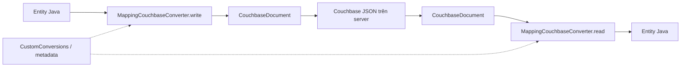

# Kiểm tra ánh xạ hai chiều và phát hiện dữ liệu không chuyển đổi được

## 1. Bài toán: ghi thành công chưa có nghĩa đọc được

Trong module **SPRING_DATA_COUCHBASE**, ứng dụng sử dụng Spring Data Couchbase để ánh xạ entity Java sang JSON document, truy cập bằng repository hoặc `CouchbaseTemplate` và truy vấn SQL++. Một thao tác `save` hoàn thành mới chỉ nói rằng đường **ghi** đã thực hiện được theo cấu hình hiện tại. Nó **không chứng minh** dữ liệu sẽ đọc lại được bằng mọi phiên bản ứng dụng, từ mọi truy vấn, hay sau khi đổi schema.

Ví dụ, một kiểu miền `SkuCode` được ghi dưới dạng string:

```json
{
  "sku": "BOOK-2026-01",
  "status": "PAID",
  "amount_minor": 1999
}
```

Ứng dụng khác hoặc document lịch sử có thể chứa:

```json
{
  "sku": { "value": "BOOK-2026-01" },
  "status": "REFUNDED",
  "amount_minor": "1999"
}
```

Cả hai đều là JSON hợp lệ. Nhưng Java class hiện tại có thể chỉ chấp nhận `sku` là string, `status` là một enum chưa có `REFUNDED` và `amount_minor` là `long`. Khi đó, đọc document thứ hai có nguy cơ lỗi, bất kể việc ghi document đầu tiên thành công.

**Kiểm tra ánh xạ hai chiều (round-trip)** cần trả lời ít nhất ba câu hỏi:

1. **Ghi có đúng hợp đồng JSON không?** Đúng tên field, kiểu JSON, precision, discriminator và đơn vị hay chưa?
2. **Đọc có khôi phục đúng ngữ nghĩa Java không?** Có mất giá trị, scale, kiểu con, timezone, tính bất biến hoặc metadata thiết yếu không?
3. **Dữ liệu ngoài đường ghi mới có được xử lý có chủ đích không?** Document cũ, JSON thiếu/sai kiểu, SDK khác ghi, projection thiếu field và phiên bản enum/type alias chưa biết.

Mục tiêu của bài là thiết kế lớp kiểm thử từ converter đơn lẻ đến integration test, phát hiện dữ liệu không chuyển đổi được, khoanh vùng lỗi và xây chiến lược tương thích schema.

## 2. Hiểu đúng luồng ánh xạ của Spring Data Couchbase

`MappingCouchbaseConverter` và các thành phần liên quan ánh xạ giữa Java entity và `CouchbaseDocument`; Spring Data sử dụng metadata từ mapping context và các quy tắc `CouchbaseCustomConversions`.



`CouchbaseDocument` là biểu diễn trung gian; gọi `write/read` riêng không phải một thao tác KV, không tạo index và không kiểm chứng CAS, TTL hoặc consistency của câu truy vấn SQL++. Tương tự, API reactive thay đổi mô hình I/O, không tự đảm bảo converter đọc được một kiểu dữ liệu mà đường blocking không đọc được.

### 2.1. Có những ranh giới lỗi nào?

| Ranh giới | Lỗi điển hình | Cách phát hiện |
| --- | --- | --- |
| Domain → converter ghi | Sai scale, code enum, null hoặc exception | Unit test converter và value object |
| Converter ghi → `CouchbaseDocument` | Sai kiểu field, thiếu `@Field`, converter chưa đăng ký | Kiểm tra `write` và `export()` |
| `CouchbaseDocument` → JSON server | Khác serializer hoặc metadata ID/TTL/CAS | Đọc raw JSON bằng SDK sau `save` |
| JSON → converter đọc | Sai type, enum chưa biết, type hint không giải được | Test đọc từ fixture JSON cũ/sai |
| Converter đọc → domain | Constructor invariant, primitive default, validation | So sánh domain sau round-trip và thử case lỗi |
| SQL++ → projection | Thiếu `_class`, `@Id`, field bắt buộc | Test query/projection thực tế |
| Giữa nhiều service | Khác phiên bản schema, SDK, locale/timezone | Contract test đa reader/writer |

**Nguyên tắc:** Chẩn đoán lỗi theo từng ranh giới. Đừng vội sửa converter khi nguyên nhân là SQL++ projection làm rơi một field, hoặc sửa query khi raw JSON đã bị ghi sai đơn vị từ ban đầu.

## 3. Round-trip có hai chiều và nhiều mức độ tương đương

Viết `E(x)` là ánh xạ giá trị Java thành biểu diễn lưu trữ và `D(j)` là ánh xạ JSON trở lại Java.

### 3.1. Java → JSON → Java

Mong muốn thông thường:

\[
D(E(x)) \equiv x
\]

Dấu `≡` thể hiện **tương đương theo hợp đồng nghiệp vụ**, không nhất thiết hai object phải cùng reference trong bộ nhớ. Ví dụ:

- Với `SkuCode`, hai value object cần có cùng mã.
- Với `Money`, amount, currency và scale cần thỏa bất biến.
- Với `Instant` lưu theo milliseconds, nếu hệ thống chủ động bỏ microseconds, việc round-trip chỉ bảo toàn theo **precision đã cam kết**.
- Với `@Version` và CAS, giá trị sau `save` có thể chứa metadata mới; không được đồng nhất equality domain với equality của toàn bộ persistence object trong mọi tình huống.

### 3.2. JSON → Java → JSON

Cần kiểm tra cả:

\[
E(D(j)) \approx j
\]

Dấu `≈` cho phép chuẩn hóa **đã công bố**, ví dụ đổi một mã enum cũ thành mã ổn định mới hoặc thêm `schema_version`. Nếu không có chính sách chuẩn hóa, việc một document JSON được đọc rồi ghi lại có thể làm mất field không được entity khai báo, làm đổi format thời gian hoặc bỏ metadata type; đây có thể là mất dữ liệu.

Không bắt buộc so sánh hai chuỗi JSON byte-for-byte. Thứ tự field không quyết định ý nghĩa JSON object; `_class` hoặc metadata do framework thêm có thể khác khi cấu hình thay đổi. Tuy nhiên, **giá trị và kiểu JSON được hợp đồng quy định phải được bảo toàn**.

### 3.3. "Đọc được" khác "đọc đúng"

Nếu Java entity khai báo `int quantity`, dữ liệu thiếu `quantity` có thể bị thay bằng default hoặc gây lỗi tùy cơ chế dựng entity. Một lần đọc không ném exception **chưa đủ**: đọc sai `quantity = 0` có thể nguy hiểm hơn fail fast nếu dữ liệu thực ra chưa được cung cấp.

Đối với số tiền, timestamp, trạng thái thanh toán hoặc subtype của giao dịch, kết quả phải được xác minh về **ngữ nghĩa** và không được âm thầm làm tròn hoặc chọn trạng thái thay thế thiếu cơ sở.

## 4. Xây dựng ví dụ nhất quán để kiểm thử

Giả sử hệ thống dùng value object `SkuCode`, enum `OrderStatus` và số tiền đã chốt theo đơn vị nhỏ nhất.

### 4.1. Value object có invariant

```java
package com.example.orders;

public record SkuCode(String value) {
    public SkuCode {
        if (value == null ||
                !value.matches("[A-Z0-9-]{3,32}")) {
            throw new IllegalArgumentException("Invalid SKU");
        }
    }
}
```

Validation có ích ở cả lúc nhập dữ liệu lẫn đọc document lịch sử hoặc từ SDK khác. Không nên bỏ qua lỗi validation chỉ để repository trả về object.

### 4.2. Enum nghiệp vụ

```java
package com.example.orders;

public enum OrderStatus {
    CREATED,
    PAID,
    CANCELLED
}
```

Trong ví dụ này, hợp đồng lưu trữ cho `status` dùng các chuỗi `"CREATED"`, `"PAID"` hoặc `"CANCELLED"`. Nếu một phiên bản writer mới ghi `"REFUNDED"` mà reader cũ chưa biết, reader cần có chiến lược tương thích hoặc fail rõ, không tự đổi thành `PAID`.

### 4.3. Persistence entity

```java
package com.example.orders;

import org.springframework.data.annotation.Id;
import org.springframework.data.couchbase.core.mapping.Document;
import org.springframework.data.couchbase.core.mapping.Field;

@Document
public record OrderDocument(
    @Id String id,
    @Field("sku") SkuCode sku,
    @Field("status") OrderStatus status,
    @Field("amount_minor") long amountMinor,
    @Field("currency") String currency
) {}
```

Dữ liệu dùng cho test:

```java
OrderDocument sample = new OrderDocument(
    "order::1001",
    new SkuCode("BOOK-2026-01"),
    OrderStatus.PAID,
    1999L,
    "USD"
);
```

Đối với ví dụ, `1999` là **minor units** đã được nghiệp vụ xác minh; trong hệ thống thật phải quy định scale theo currency và loại giao dịch.

## 5. Viết và đăng ký converter hai chiều

Mục tiêu là lưu `SkuCode` thành JSON string thay vì nested object `{"value":...}`.

### 5.1. Writing converter

```java
package com.example.orders;

import org.springframework.core.convert.converter.Converter;
import org.springframework.data.convert.WritingConverter;

@WritingConverter
public final class SkuCodeWritingConverter
        implements Converter<SkuCode, String> {

    @Override
    public String convert(SkuCode source) {
        return source.value();
    }
}
```

### 5.2. Reading converter

```java
package com.example.orders;

import org.springframework.core.convert.converter.Converter;
import org.springframework.data.convert.ReadingConverter;

@ReadingConverter
public final class SkuCodeReadingConverter
        implements Converter<String, SkuCode> {

    @Override
    public SkuCode convert(String source) {
        return new SkuCode(source);
    }
}
```

### 5.3. Đăng ký vào cấu hình thực tế

Với ứng dụng kế thừa `AbstractCouchbaseConfiguration`, thêm vào lớp cấu hình đang hoạt động:

```java
import java.util.List;

@Override
protected void additionalConverters(List<Object> converters) {
    converters.add(new SkuCodeWritingConverter());
    converters.add(new SkuCodeReadingConverter());
}
```

Đây là đoạn override trong **class cấu hình**, không phải file Java độc lập. Nếu ứng dụng dùng một cách bootstrap khác, cần đăng ký converter qua `CouchbaseCustomConversions` tương ứng và bảo đảm bean `MappingCouchbaseConverter` mà repository/template sử dụng nhận đúng cấu hình.

Gắn `@ReadingConverter` / `@WritingConverter` giúp chỉ định chiều; **chúng không có nghĩa converter sẽ tự động được đăng ký** chỉ vì class tồn tại trong source code. Test converter đơn lẻ có thể pass trong khi Spring context hoàn toàn chưa sử dụng nó.

### 5.4. JSON kỳ vọng

```json
{
  "_class": "com.example.orders.OrderDocument",
  "sku": "BOOK-2026-01",
  "status": "PAID",
  "amount_minor": 1999,
  "currency": "USD"
}
```

`_class` là type hint trong cấu hình thông dụng; có thể khác khi dùng `@TypeAlias` hoặc custom type mapper. Document ID `order::1001` nằm trong key, không bắt buộc là field `id` trong body. Đừng so sánh cứng `_class` nếu bài test chỉ muốn xác nhận converter SKU; với contract riêng về type alias, phải có test độc lập cho alias.

## 6. Tầng test 1 — Unit test logic converter

Một unit test được chạy mà không cần Couchbase server:

```java
import static org.junit.jupiter.api.Assertions.*;
import org.junit.jupiter.api.Test;

class SkuCodeConverterTest {

    private final SkuCodeWritingConverter writer =
        new SkuCodeWritingConverter();

    private final SkuCodeReadingConverter reader =
        new SkuCodeReadingConverter();

    @Test
    void roundTripValidSku() {
        SkuCode original = new SkuCode("BOOK-2026-01");

        String stored = writer.convert(original);
        SkuCode restored = reader.convert(stored);

        assertEquals("BOOK-2026-01", stored);
        assertEquals(original, restored);
    }

    @Test
    void rejectInvalidSku() {
        assertThrows(
            IllegalArgumentException.class,
            () -> reader.convert("book with spaces")
        );
    }
}
```

Unit test này chứng minh **hàm conversion** và invariant của value object, không chứng minh Spring Data dùng converter ở field `sku`.

### 6.1. Test bất biến, không chỉ trường hợp đẹp

Đối với `SkuCode`:

| Trường hợp | Kết quả mong muốn |
| --- | --- |
| `BOOK-2026-01` | Ghi string và đọc lại value object tương đương. |
| `book-2026-01` | Bị từ chối nếu contract chỉ chấp nhận chữ hoa. |
| String rỗng | Bị từ chối. |
| Ký tự khoảng trắng hoặc ký tự cấm | Bị từ chối. |
| String dài trên 32 ký tự | Bị từ chối. |
| `null` | Xử lý theo contract null/required field; không giả định reader converter luôn được gọi. |
| JSON object thay vì string | Đường đọc mới phải có chính sách tương thích hoặc báo lỗi. |

Một tập test tốt gồm **giá trị biên và giá trị không hợp lệ**, không chỉ gọi conversion với một mã SKU hoàn toàn bình thường.

## 7. Tầng test 2 — `MappingCouchbaseConverter.write/read` trong bộ nhớ

Khi converter đã được cấu hình, sử dụng **bean thực sự từ Spring context** thay vì tự tạo một converter rời thiếu mapping metadata.

Ví dụ mã nằm trong một method test đã inject `CouchbaseConverter` hoặc `MappingCouchbaseConverter`:

```java
import org.springframework.data.couchbase.core.mapping.CouchbaseDocument;

// converter: bean cấu hình thực tế của Spring Data Couchbase.
OrderDocument original = new OrderDocument(
    "order::1001",
    new SkuCode("BOOK-2026-01"),
    OrderStatus.PAID,
    1999L,
    "USD"
);

CouchbaseDocument document = new CouchbaseDocument();
converter.write(original, document);

System.out.println(document.export());
// Quan sát "sku" là String, "amount_minor" là number,
// "status" là String và field name đúng theo @Field.

OrderDocument restored =
    converter.read(OrderDocument.class, document);

assert restored.sku().equals(original.sku());
assert restored.status() == original.status();
assert restored.amountMinor() == original.amountMinor();
assert restored.currency().equals(original.currency());
```

Đoạn code là **minh họa** trong method test; chưa có bean injection và imports đầy đủ nên không phải một file có thể chạy độc lập. Đây là phép test mapping **không ghi vào server**. Tùy config, metadata `@Id` có thể được xử lý qua document key/metadata riêng; vì vậy không nên dựa vào equality ID trong test conversion in-memory như chứng cứ thay cho integration test KV.

### 7.1. Điều gì phải kiểm tra ở `CouchbaseDocument.export()`?

- `sku`: JSON string `"BOOK-2026-01"`, không phải `{"value":"BOOK-2026-01"}`.
- `status`: string `"PAID"`, đúng contract enum.
- `amount_minor`: JSON number `1999`, không phải string `"1999"`.
- `currency`: string `"USD"`.
- `@Field`: dùng `amount_minor` thay vì tên Java `amountMinor`.
- `_class`: nếu được ghi, alias/FQCN theo cấu hình type mapper.

Tránh assert bằng một chuỗi JSON dài dựa vào thứ tự các field. Tốt hơn hãy kiểm tra **kiểu và giá trị theo từng key** với API phù hợp phiên bản, hoặc parse kết quả `export()` thành cấu trúc JSON để so sánh ngữ nghĩa.

### 7.2. Vì sao nên có cả phép đọc từ fixture độc lập?

Nếu `write` và `read` cùng có một lỗi tương hỗ, phép round-trip `read(write(x))` đôi khi vẫn pass. Ví dụ:

- Writer nhân tiền lên 100 hai lần, reader lại chia 100 hai lần: object khôi phục như cũ, nhưng JSON sai contract.
- Writer dùng `"paid"` và reader cũng hiểu `"paid"`, dù contract liên service yêu cầu `"PAID"`.
- Writer thêm type hint riêng, reader giải được, nhưng SDK khác không hiểu discriminator.

Bởi vậy, test phải so sánh JSON đầu ra với **expected fixture độc lập**, đồng thời đọc một JSON fixture **được viết độc lập** theo hợp đồng đã thống nhất.

## 8. Tầng test 3 — Integration test qua Couchbase thật

Tầng mapping trong bộ nhớ không kiểm chứng các hành vi của server/SDK:

- Document key được gán và truy xuất bằng `@Id` hay không.
- Dữ liệu ghi vào đúng bucket, scope và collection.
- `save/findById` có sử dụng đúng converter và serializer hay không.
- CAS/`@Version` có hoạt động khi ghi cạnh tranh hay không.
- TTL/expiry theo chính sách vận hành có được giữ hay không.
- Query SQL++ có nhìn thấy dữ liệu mới với consistency được yêu cầu hay không.

Ví dụ trong một integration test đã inject repository:

```java
OrderDocument input = new OrderDocument(
    "order::test::1001",
    new SkuCode("BOOK-2026-01"),
    OrderStatus.PAID,
    1999L,
    "USD"
);

repository.save(input);

OrderDocument loaded = repository
    .findById("order::test::1001")
    .orElseThrow();

assert loaded.sku().equals(input.sku());
assert loaded.status() == input.status();
assert loaded.amountMinor() == input.amountMinor();
assert loaded.currency().equals(input.currency());
```

Repository cần được khai báo cho `OrderDocument`, môi trường test có kết nối Couchbase và nên sử dụng một collection/key namespace cô lập, tránh ghi đè document thật. Sau khi `save`, **đọc raw JSON bằng SDK** hoặc SQL++ để kiểm chứng body, thay vì chỉ tin vào kết quả entity đã được Spring Data convert ngược.

Nếu kiểm chứng bằng SQL++ ngay sau KV write, cần xem xét **query consistency/index visibility**. KV `get` và một query qua secondary index có thể nhìn thấy dữ liệu ở những thời điểm khác nhau tùy cấu hình consistency. Không nên kết luận mapping sai chỉ vì query index chưa thấy một document vừa ghi. Với bài test read-after-write bằng query, chọn mức consistency/tùy chọn truy vấn thích hợp và kiểm tra `EXPLAIN` khi cần.

### 8.1. Reactive cũng phải kiểm chứng kết quả cuối

Với repository reactive, pipeline I/O có thể dùng `Mono`/`Flux`. Hành vi conversion về bản chất phải tuân theo cùng JSON contract. Tuy nhiên, test chỉ tạo `Mono` mà không subscribe/verify thì thao tác có thể chưa thực thi.

Trong test reactive, cần verify kết quả và completion/error signal (chẳng hạn dùng `StepVerifier` khi dự án có `reactor-test`). Không coi một publisher được xây dựng thành công là bằng chứng tài liệu đã được ghi.

## 9. Phát hiện dữ liệu không thể chuyển đổi: phân loại theo nguyên nhân

Một document có thể lỗi ở nhiều lớp. Phân loại rõ trước khi chọn cách xử lý:

| Loại lỗi | JSON ví dụ | Tác động |
| --- | --- | --- |
| **Sai kiểu JSON** | `"amount_minor":"1999"` thay vì number | Converter `long` không có đường tương thích hoặc dữ liệu bị hiểu sai. |
| **Sai giá trị** | `"sku":"bad sku!"` | Constructor/value object từ chối. |
| **Enum chưa biết** | `"status":"REFUNDED"` với code cũ | Không thể ánh xạ enum nếu chưa có policy. |
| **Thiếu field** | Không có `currency` | Entity có thể nhận null/default hoặc lỗi khởi tạo. |
| **JSON null** | `"currency":null` | Khác với MISSING; validation nghiệp vụ phải quyết định. |
| **Overflow** | Number quá lớn cho `long` | Mất precision hoặc lỗi chuyển đổi. |
| **Mất số thập phân** | Giá trị tiền đi qua `double` | Có thể đọc được nhưng amount đã sai. |
| **Timestamp sai đơn vị** | Epoch seconds được đọc như milliseconds | Không exception nhưng thời điểm sai. |
| **Type hint không giải được** | `"_class":"old.pkg.Order"` | Không khôi phục được class/subtype mong đợi. |
| **Nested subtype thiếu discriminator** | `payment` interface nhưng không có hint/`kind` | Không biết tạo subtype nào. |
| **Schema phiên bản cũ** | `sku` object, code mới kỳ vọng string | Cần migration hoặc compatible reader. |
| **Projection thiếu field** | Chỉ SELECT `status` nhưng dựng full entity | Thiếu thông tin bắt buộc. |

**Lưu ý:** không phải mọi lỗi đều phát sinh exception; một số biểu hiện là giá trị sai mà code vẫn chạy. Kiểm thử đặc biệt phải chú ý silent corruption: đơn vị tiền, timezone, scale, default primitive hoặc kiểu dữ liệu bị làm tròn.

## 10. MISSING, NULL và các field bắt buộc

Trong JSON, một field có thể tồn tại với giá trị `null` hoặc không tồn tại:

```json
{
  "status": "PAID",
  "currency": null
}
```

```json
{
  "status": "PAID"
}
```

Trường hợp đầu có `currency = NULL`, trường hợp sau `currency IS MISSING` theo SQL++. Chúng khác nhau ở tầng dữ liệu, nhưng có thể cùng dẫn tới Java `null` nếu không có policy đặc biệt.

Với primitive `long amountMinor`, không nên mặc định thiếu field sẽ luôn gây lỗi. Tùy cách dựng entity, dữ liệu có thể bị gán default hoặc quá trình materialization có thể thất bại. Hãy thiết kế test khẳng định **hành vi đúng theo nghiệp vụ**.

### 10.1. Phân biệt required, optional và legacy field

| Field | Hợp đồng gợi ý | Khi thiếu/sai |
| --- | --- | --- |
| `sku` | Bắt buộc, đúng pattern | Reject hoặc đánh dấu document cần sửa. |
| `status` | Bắt buộc, thuộc tập enum/version hỗ trợ | Không tự chọn một trạng thái hợp lệ tùy tiện. |
| `amount_minor` | Bắt buộc, số nguyên theo scale | Reject khi thiếu/overflow/sai đơn vị. |
| `currency` | Bắt buộc, mã hỗ trợ | Không gán default `USD` nếu chưa có bằng chứng. |
| `note` | Có thể optional | Có thể cho phép null/missing theo contract. |
| `schema_version` | Bắt buộc từ phiên bản mới | Có đường đọc V1 được xác định hoặc báo unsupported. |

Spring Data Couchbase thường bỏ qua property Java null khi ghi theo cơ chế mặc định; SDK ngoài hoặc import có thể ghi JSON null tường minh. Converter đọc chưa chắc được gọi với `null`, vì null/missing còn phụ thuộc mapping và constructor. Test cả hai trường hợp.

## 11. Kiểm tra enum và dữ liệu nhiều biến thể

Với `OrderStatus` có `CREATED`, `PAID`, `CANCELLED`, document chứa:

```json
{ "status": "REFUNDED" }
```

có thể không đọc được vào enum của phiên bản cũ. Có ba cách xử lý:

1. **Fail fast:** phù hợp trạng thái nhạy cảm như thanh toán, giao hàng.
2. **Unknown state:** dùng enum `UNKNOWN` hoặc model giữ mã gốc nếu business chấp nhận việc chưa hiểu, nhưng không tự chuyển nó thành `PAID`.
3. **Reader tương thích:** trước khi writer ghi mã mới, triển khai code đọc hiểu cả enum code cũ/mới hoặc lưu mã dưới dạng `String` trong persistence DTO và diễn giải ở domain.

Đối với value object đa biến thể:

```json
{
  "payment": {
    "_class": "wallet-payment",
    "provider": "PAY_WALLET",
    "transactionRef": "TX-42"
  }
}
```

Nếu entity khai báo property kiểu interface, `@TypeAlias("wallet-payment")` chỉ giúp đọc khi mapping context **biết subtype** và type mapper đang dùng alias. Đổi package hoặc tên lớp khi document cũ lưu FQCN có thể khiến type hint không được giải. Cần kiểm tra fixture chứa **alias, FQCN cũ và type không xác định**.

Không coi `@TypeAlias` mới là một phép migration tự động. Nếu có client không dùng Java, một discriminator nghiệp vụ `payment.kind` có thể giúp interoperable schema, nhưng Spring Data không tự dùng `kind` để chọn Java subtype nếu không có logic mapping rõ ràng.

## 12. Độ chính xác số, thời gian và giá trị nghiệp vụ

### 12.1. Số tiền

JSON:

```json
{
  "amount_minor": 1999,
  "currency": "USD",
  "minor_unit_scale": 2
}
```

Nếu Java dùng `long`, cần kiểm tra phạm vi/overflow; nếu dùng `BigDecimal`, cần tránh đi qua `double`. Nếu client JavaScript đọc số nguyên quá `2^53 - 1` bằng `Number` rồi ghi lại, dữ liệu có thể bị làm tròn.

Một test round-trip `BigDecimal` không nên chỉ dùng `10.00`. Hãy thử `0.01`, giá trị âm theo quy tắc nghiệp vụ, số rất lớn, nhiều chữ số thập phân, scale khác nhau, và so sánh cả **giá trị số** lẫn **scale** nếu scale thuộc hợp đồng.

### 12.2. Ngày giờ

JSON có thể lưu timestamp dưới dạng ISO-8601 string hoặc epoch milliseconds; phải thống nhất **đơn vị, timezone và precision**:

```json
{
  "created_at_epoch_ms": 1735689600000,
  "delivery_date": "2025-01-03"
}
```

Một reader kỳ vọng epoch milliseconds nhưng nhận epoch seconds có thể dựng ra một `Instant` hợp lệ nhưng **sai hàng chục năm**. `LocalDate` cũng không nên bị coi là instant ở 00:00 UTC nếu yêu cầu chỉ là ngày lịch.

Đặt test tại ranh giới ngày UTC, zone khác nhau, DST overlap/gap nếu có lịch địa phương, fractional seconds và thời gian gần epoch. Không chỉ assert rằng parse không ném exception.

### 12.3. Các mã có số 0 đầu

`"000123"` là mã sản phẩm hoặc mã khách hàng, không phải số 123. Nếu JSON lưu thành number, không có cách tự khôi phục số 0 đầu khi thông tin định dạng đã mất, trừ khi có contract độ rộng riêng. Test cần so sánh **string y nguyên** ở cả hai chiều.

## 13. Quét dữ liệu sai schema bằng SQL++

Trước migration, SQL++ có thể xác định các document không tuân theo contract. Ví dụ collection `shop`.`sales`.`orders` chứa order.

### 13.1. Phân loại kiểu field đang lưu

```sql
SELECT META(o).id AS orderId,
       TYPE(o.sku) AS skuType,
       TYPE(o.status) AS statusType,
       TYPE(o.amount_minor) AS amountType,
       TYPE(o.currency) AS currencyType
FROM `shop`.`sales`.`orders` AS o
WHERE o.sku IS MISSING
   OR o.sku IS NULL
   OR TYPE(o.sku) != "string"
   OR o.status IS MISSING
   OR TYPE(o.status) != "string"
   OR o.amount_minor IS MISSING
   OR TYPE(o.amount_minor) != "number"
   OR o.currency IS MISSING
   OR TYPE(o.currency) != "string";
```

Đây là **truy vấn audit ví dụ**, chưa phải kiểm tra đầy đủ enum, range, currency validity hay integer scale. Cần thêm quy tắc tương ứng với contract. SQL++ phân biệt `NULL` và `MISSING`; việc so sánh với NULL có logic riêng nên nên dùng `IS NULL`/`IS MISSING` tường minh.

### 13.2. Tìm enum chưa biết

```sql
SELECT META(o).id AS orderId,
       o.status
FROM `shop`.`sales`.`orders` AS o
WHERE o.status NOT IN [
  "CREATED", "PAID", "CANCELLED"
];
```

Truy vấn này tìm các giá trị ngoài danh sách trong các trường hợp có thể so sánh được; để audit toàn diện, kết hợp kiểm tra `IS MISSING`, `IS NULL` và `TYPE(...)`. Không mặc định biểu thức `NOT IN` tự xử lý mọi kiểu và trạng thái thiếu/null đúng với mục tiêu báo cáo.

### 13.3. Thống kê type hints để chuẩn bị migration

```sql
SELECT o._class AS storedType,
       COUNT(1) AS countDocuments
FROM `shop`.`sales`.`orders` AS o
GROUP BY o._class
ORDER BY countDocuments DESC;
```

Nếu collection dùng nhiều type hints do refactor class/package, phải kiểm kê cả root và nested field cần thiết. Document từ SDK có thể không có `_class`; đó không tự động là document sai nếu schema của đường SDK không yêu cầu Spring Data type hints.

### 13.4. Truy vấn không thay thế kiểm thử Java

SQL++ nhìn thấy JSON types/values thật nhưng không biết toàn bộ constructor validation, Java enum mapping, custom converters hay ý nghĩa nghiệp vụ của một field. Ngược lại, test Java không tự bảo đảm một query dùng đúng JSON field name hoặc index. Cần **cả SQL++ audit lẫn mapping test**.

Với dữ liệu lớn, cân nhắc tạo index phục vụ audit/production query nếu workload phù hợp và xem `EXPLAIN`; không tạo index chỉ vì converter đã đổi field.

## 14. Tách lỗi dữ liệu, lỗi cấu hình và lỗi query

Khi `read` thất bại, nguyên nhân có thể thuộc ba nhóm chính:

### 14.1. Lỗi dữ liệu nguồn

- Property missing hoặc JSON null ngoài hợp đồng.
- Enum string không được công nhận.
- Numeric string thay vì number; giá trị vượt miền `long`.
- Object lồng nhau theo schema cũ nhưng converter mới chỉ hiểu scalar.
- Timestamp sai đơn vị hoặc format không parse được.
- Type hint cũ, alias không được công nhận.

Cách xử lý: xác minh raw JSON và nguồn producer, quyết định migration, quarantine hoặc reader tương thích.

### 14.2. Lỗi đăng ký mapping

- Có `@ReadingConverter` nhưng chưa thêm vào `CouchbaseCustomConversions`.
- Chỉ viết converter ghi, chưa có converter đọc.
- Bean repository/template dùng mapping converter khác với bean test.
- `@Field` đổi tên nhưng code test/query vẫn đọc field cũ.
- Mapping context chưa biết subtype `@TypeAlias`.
- Custom converter quá rộng gây chuyển đổi ngoài ý muốn.

Cách xử lý: test `MappingCouchbaseConverter` từ **Spring context thực tế**, kiểm tra cấu hình `additionalConverters`, type aliases và JSON đầu ra.

### 14.3. Lỗi truy vấn hoặc đường truy cập

- SQL++ projection bỏ field bắt buộc hoặc type hint.
- Query filter theo tên Java thay vì tên field Couchbase JSON.
- SDK raw ghi bỏ qua Spring Data conversion.
- Query qua index chưa thấy KV write do query consistency.
- Reactive publisher chưa được subscribe/verify.
- Repository trỏ sai collection hoặc ID key.

Cách xử lý: so sánh direct KV get với SQL++ query, kiểm tra raw result shape, collection, consistency và converter trong từng đường.

## 15. Ngoại lệ và thông điệp lỗi hữu ích

Tầng converter tùy biến có thể ném `IllegalArgumentException` cho dữ liệu không hợp lệ; tầng mapping có thể bọc nó trong exception chuyển đổi, dựng entity hoặc persistence khác. **Không nên hard-code một exception class duy nhất** cho mọi phiên bản và mọi đường truy cập nếu không có hợp đồng cụ thể.

Trong unit test của một converter tự viết, có thể assert exception chính xác:

```java
assertThrows(
    IllegalArgumentException.class,
    () -> new SkuCodeReadingConverter()
        .convert("invalid sku!")
);
```

Trong integration test, ưu tiên xác minh:

1. Thao tác đọc thất bại có thể quan sát được.
2. Cause hoặc error category chỉ ra field, giá trị không hợp lệ và loại lỗi.
3. Application không tiếp tục xử lý như một đơn hàng hợp lệ.
4. Logging/metrics có document ID, field name, schema version và correlation ID khi cần.
5. Không ghi dữ liệu cá nhân, mã bí mật, số thẻ hoặc toàn bộ payload nhạy cảm vào log.

Cần phân biệt lỗi **hợp đồng dữ liệu không đáp ứng** với lỗi hạ tầng như timeout, service unavailable, permission hoặc query consistency. Không đưa tất cả exception vào cùng một nhánh "dữ liệu hỏng" khiến cơ chế retry/quarantine hoạt động sai.

## 16. Chiến lược xử lý dữ liệu không chuyển đổi được

Khi gặp một document sai contract, có các lựa chọn:

| Chính sách | Khi phù hợp | Điều cần tránh |
| --- | --- | --- |
| **Fail fast** | Dữ liệu tài chính, trạng thái giao hàng, các invariant quan trọng | Bỏ qua rồi xử lý tiếp bằng default nguy hiểm. |
| **Quarantine/đánh dấu lỗi** | Batch import, ETL, quy trình data quality | Lưu dữ liệu lỗi không có lý do/sổ theo dõi. |
| **Compatible reader** | Migration V1/V2 có hình dạng cũ được biết | Parse bằng heuristic mơ hồ có thể làm sai tiền/thời gian. |
| **Backfill/migration** | Có số lượng lớn document đã biết schema cũ | UPDATE toàn bộ production mà không có CAS, batch, monitor. |
| **Fallback giữ raw value** | Mã mới do service khác tạo, vẫn cần bảo toàn thông tin | Chuyển mã chưa biết sang enum hợp lệ bất kỳ. |
| **Reject tại ingest** | Có thể kiểm soát mọi producer | Tin rằng dữ liệu lịch sử không cần kiểm tra. |

Đừng "cứu" một record thanh toán không đọc được bằng cách đặt `amount = 0`, `currency = USD` hay `status = PAID`. Đó là hành vi tạo dữ liệu giả có khả năng làm sai đối soát.

## 17. Thiết kế migration tương thích hai chiều

Ví dụ schema V1 lưu SKU như object:

```json
{
  "sku": { "value": "BOOK-2026-01" },
  "status": "PAID",
  "amount": 19.99
}
```

Schema V2 lưu SKU string và amount minor units:

```json
{
  "schema_version": 2,
  "sku": "BOOK-2026-01",
  "status": "PAID",
  "amount_minor": 1999,
  "currency": "USD",
  "minor_unit_scale": 2
}
```

Bước cần làm:

1. **Inventory dữ liệu thực:** số lượng V1/V2, tên field, loại JSON, type hints và dữ liệu thiếu.
2. **Định nghĩa hợp đồng V2:** type, unit, scale, allowed values, nullability, type alias và chiến lược giữ unknown.
3. **Đường đọc V1 và V2:** đọc theo version hoặc shape đã được xác định, không suy đơn vị tiền chỉ theo độ lớn của số.
4. **Đường ghi thống nhất V2:** service mới ghi đúng JSON, các SDK/ETL khác phải được cập nhật.
5. **Backfill có kiểm soát:** batch, idempotency, đo lỗi, lưu audit và bảo vệ cập nhật cạnh tranh bằng CAS khi cần.
6. **Cập nhật SQL++/index:** tránh query V2 âm thầm bỏ qua record V1.
7. **Kiểm chứng reader cũ, reader mới và rollback:** kế hoạch triển khai trước/sau writer.
8. **Gỡ tương thích V1:** chỉ khi tỷ lệ dữ liệu còn lại và client đã được xác minh.

Trong ví dụ trên, V1 `amount = 19.99` có thể đã đi qua `double`. Nếu precision mất ở quá khứ, migration **không thể luôn phục hồi số tiền nguồn**; cần đối chiếu chứng từ hoặc hệ thống authoritative. Không áp dụng `Math.round(amount * 100)` cho mọi dữ liệu cũ rồi tuyên bố đã chính xác.

### 17.1. Version schema không phải version CAS

Field `schema_version` do ứng dụng định nghĩa để chọn parser/mapper. `@Version` khi dùng Spring Data Couchbase thường phục vụ optimistic locking qua CAS server. Hai loại version có trách nhiệm khác nhau.

Một migration đọc V1 rồi ghi V2 mà bỏ qua CAS có thể ghi đè thao tác cập nhật mới. Cần conditional write, retry có tái đánh giá dữ liệu hoặc transaction phù hợp. Không coi custom converter là công cụ điều phối cập nhật nhiều document.

### 17.2. TTL và document key phải được bảo toàn có chủ đích

Nếu record V1 có expiry/TTL, việc thay đổi body hoặc sử dụng một API ghi khác có thể tác động expiry tùy tùy chọn/phiên bản. Document key nằm ngoài JSON body và không tự đổi theo `@Field`. Khi backfill, phải kiểm tra key, TTL, CAS, type hints, metadata và định tuyến collection đúng.

## 18. Ma trận kiểm thử round-trip tối thiểu

| Nhóm | Input/điều kiện | Kỳ vọng |
| --- | --- | --- |
| Happy path | SKU hợp lệ, enum hợp lệ, minor units hợp lệ | Java → JSON → Java giữ nguyên giá trị. |
| JSON contract | `sku` string, `amount_minor` number | JSON có đúng type/name theo hợp đồng. |
| Invalid SKU | Chuỗi sai pattern | Lỗi có chủ đích, không tạo object hợp lệ giả. |
| Unknown enum | `"status":"REFUNDED"` ở reader cũ | Có chính sách tương thích hoặc reject rõ. |
| Missing field | Thiếu `currency` | Không tự cấp default không có cơ sở. |
| JSON null | `currency: null` | Xử lý theo nullability contract. |
| Wrong type | `amount_minor` là string | Phát hiện sai type hoặc compatible reader có kiểm soát. |
| Overflow | Amount vượt `long` | Không âm thầm làm tròn/tràn số. |
| Money precision | Giá trị có fractional digits, số lớn | Round-trip theo unit/scale được quy định. |
| Epoch mismatch | Seconds vs milliseconds | Test phát hiện sai thời điểm dù parse thành công. |
| Root type hint | FQCN/alias được nhận dạng | Khôi phục class đúng. |
| Nested subtype | Object đa hình thiếu hint | Fail rõ hoặc mapper explicit xử lý. |
| Historical document | V1 object, V2 string | Reader/migration theo version hoạt động. |
| Collection/map | `List<SkuCode>`, map chứa nested object | Không mất phần tử, null và type. |
| Raw SDK document | SDK khác ghi body | Spring Data đọc theo contract đã tài liệu hóa. |
| SQL++ projection | Query chỉ trả một số field | DTO thích hợp, không dựng full entity khi thiếu dữ liệu. |
| Concurrent update | Hai writer với CAS | Xung đột được phát hiện, không ghi đè mù. |
| Reactive write/read | Publisher được subscribe/verify | JSON và giá trị khớp đường blocking. |
| Rollback | Reader cũ đọc dữ liệu writer mới | Có kế hoạch tương thích hoặc không bật writer mới. |

Đối với property-level converter có `readNull`/`writeNull`, bổ sung test phân biệt **field có null** với **field MISSING**: hook null không có nghĩa framework luôn gọi converter cho field không tồn tại.

## 19. Kiểm thử tự động và kiểm tra hợp đồng qua nhiều phiên bản

### 19.1. Golden JSON fixtures

Lưu các fixture mẫu trong **bộ test của ứng dụng** (không phải tệp riêng trong bài học này):

- Một document V1 hợp lệ.
- Một document V2 hợp lệ.
- Một document có type alias cũ.
- Một document có missing và null field.
- Một document có sai type hoặc enum chưa biết.
- Một document chứa amount/instant tại giá trị biên.

Fixtures phải được tạo/duyệt từ **contract độc lập**, không chỉ được copy từ cùng writer đang được kiểm thử. Nếu chỉ lấy JSON do writer hiện tại sinh ra, một lỗi tương tự ở reader có thể khiến test pass mà dữ liệu vẫn sai.

### 19.2. Property-based testing

Khi converter có nhiều giá trị đầu vào, có thể dùng property-based testing:

- Sinh SKU hợp lệ để kiểm tra `decode(encode(x)) == x`.
- Sinh chuỗi không hợp lệ để xác minh fail.
- Sinh amount trong phạm vi `long` và policy scale.
- Sinh timestamp quanh vùng DST, thời điểm sát nửa đêm UTC.
- Sinh nested collection nhiều phần tử và các phần tử null theo contract.

Với các giá trị có thể chuẩn hóa (mã uppercase, tiền chuyển scale), phải viết **equivalence relation** rõ ràng, tránh assert không đúng khi Java `BigDecimal.equals` nhạy với scale.

### 19.3. Contract test giữa writer và reader

Nếu service A ghi và service B đọc cùng collection, nên kiểm tra cả ma trận:

| Writer | Reader | Mục tiêu |
| --- | --- | --- |
| V1 | V1 | Không phá hành vi đang chạy. |
| V1 | V2 | Reader mới đọc được dữ liệu cũ. |
| V2 | V2 | Luồng dữ liệu mới đúng contract. |
| V2 | V1 | Kiểm tra khả năng rollback hoặc chính sách chặn rollout. |
| SDK ngoài Spring | V2 | JSON raw tuân contract và ánh xạ thành entity/domain đúng. |

Khi writer V2 đưa ra enum/type alias mới mà reader V1 chưa biết, có thể cần **deploy reader tương thích trước**. Các test đa phiên bản giúp phát hiện lỗi mà unit test từng service riêng lẻ không thấy.

## 20. Tác động tới SQL++, index và consistency

`MappingCouchbaseConverter` không tạo index và không sửa predicate SQL++ khi một field đổi type/name. Nếu `sku` từ object `sku.value` chuyển sang scalar `sku`, query cũ phải được thay:

```sql
-- V1:
SELECT META(o).id AS orderId
FROM `shop`.`sales`.`orders` AS o
WHERE o.sku.value = "BOOK-2026-01";

-- V2:
SELECT META(o).id AS orderId
FROM `shop`.`sales`.`orders` AS o
WHERE o.sku = "BOOK-2026-01";
```

Với dữ liệu mixed V1/V2, một truy vấn chỉ theo path V2 có thể bỏ qua document cũ. Phải xác định thời gian chuyển đổi và chiến lược query/backfill.

Một index minh họa theo contract V2:

```sql
CREATE INDEX ix_orders_sku_status
ON `shop`.`sales`.`orders`(sku, status);
```

Index cần đánh giá theo workload thật, cardinality và `EXPLAIN`; không tự thêm index chỉ vì có custom converter.

Đối với query ngay sau `save`, xác nhận query consistency trước khi coi việc thiếu kết quả là lỗi mapping. Đọc KV theo document ID và query qua GSI có những đảm bảo quan sát khác nhau; kiểm thử chức năng phải lựa chọn mức nhất quán phù hợp yêu cầu.

## 21. Quy trình debug thực tế

Khi phát hiện một document không đọc được, hãy làm theo trình tự:

1. **Định vị document chính xác:** collection và document ID; phân biệt KV not found với conversion failure.
2. **Đọc body raw:** dùng SDK hoặc SQL++; xem kiểu thật của `sku`, `status`, `amount_minor`, `currency`, `_class`.
3. **Xác định schema/version và producer:** document do phiên bản nào, SDK hay import nào ghi?
4. **Kiểm tra mapping metadata:** `@Field`, `@Id`, `@TypeAlias`, constructor của record, property type.
5. **Kiểm tra converter registration:** có đủ hai chiều trong `CouchbaseCustomConversions`? Bean nào đang được template/repository dùng?
6. **Thử `write/read` trong bộ nhớ:** tạo fixture giống raw JSON và cô lập exception.
7. **Đối chiếu contract JSON:** xác định sai lệch là field/type/value/precision/type hint hay projection.
8. **Quyết định xử lý:** reject, quarantine, compatible reader hoặc migration có kiểm soát.
9. **Kiểm tra đường production:** query/index/consistency, reactive subscription, CAS/TTL và monitoring.
10. **Thêm regression test:** golden fixture + ca lỗi biên để không tái diễn.

### 21.1. Bảng dấu hiệu và nguyên nhân

| Triệu chứng | Nghi vấn | Kiểm tra đầu tiên |
| --- | --- | --- |
| Writer test pass, reader test fail | Thiếu reading converter hoặc output không đúng expected type | Raw JSON và custom conversions |
| Mapping test pass, repository không đọc được | Bean config khác, metadata ID, server data cũ | Context wiring và raw JSON |
| SDK đọc JSON được nhưng Spring Data lỗi | Contract kiểu/constructor không hợp lệ | Property types và exception cause |
| Enum lỗi khi đọc | Mã chưa biết hoặc khác case | Giá trị raw `status` |
| Đọc thành công nhưng amount sai | Sai scale, double rounding, overflow | Source calculation và JSON number |
| Một số document lỗi sau refactor | `_class` FQCN cũ, alias context chưa biết | Thống kê type hints |
| Null biến thành default | Constructor/primitive mapping | Fixture null/MISSING |
| SQL++ không tìm thấy document vừa ghi | Query consistency/index hoặc predicate sai | KV get, JSON raw, `EXPLAIN` |
| Query projection lỗi dựng subtype | Thiếu discriminator/field | Shape kết quả SELECT |
| SDK khác ghi sai format | Không dùng converter của Spring Data | Contract test đa client |
| Nhiều lỗi sau migration | Mixed V1/V2, race concurrent updates | schemaVersion, CAS, audit logs |
| Reactive test tưởng pass mà không có dữ liệu | Publisher chưa được verify/subscribe | Completion signal và KV read |

## 22. Bài thực hành

### Bài 1 — Hai chiều converter

Xây `SkuCode`, hai converter và `OrderDocument` theo ví dụ. Viết unit test xác nhận `SkuCode("BOOK-2026-01")` chuyển thành string. Thử SKU rỗng hoặc sai pattern và xác nhận lỗi. Không khởi động Couchbase ở bài này.

### Bài 2 — Test mapping trong Spring context

Đăng ký converter bằng `additionalConverters`. Lấy bean `MappingCouchbaseConverter` từ Spring context, gọi `write/read` trên entity. Kiểm tra JSON do `CouchbaseDocument.export()` trả về và xác minh đúng kiểu/tên field; đối chiếu `OrderStatus` và `amountMinor` sau đọc.

### Bài 3 — Cố tình tạo dữ liệu không chuyển đổi được

Chuẩn bị các body JSON: `sku` object cũ, enum `REFUNDED` chưa biết, `amount_minor` string, thiếu `currency` và `currency:null`. Đọc từng fixture, ghi nhận kết quả/exception, phân loại do data, converter hay constructor. Thiết kế policy cho từng lỗi.

### Bài 4 — Integration test repository và SDK

Trong collection thử nghiệm, ghi bằng repository rồi đọc raw JSON bằng SDK. Sau đó tạo một document bằng SDK raw theo schema V2, đọc lại qua repository. Kiểm tra document ID và xử lý query consistency nếu dùng SQL++ để xác minh ngay sau ghi.

### Bài 5 — Migration V1/V2

Tạo dataset gồm V1 và V2, viết query phân loại theo kiểu `sku`, `amount_minor` và `schema_version`. Thiết kế compatible reader, backfill dùng CAS, log dữ liệu không phục hồi được chính xác. Chạy contract matrix V1/V2 và xác minh rollback.

### Câu hỏi tự kiểm tra

1. Vì sao `save` thành công chưa chứng minh dữ liệu đọc được?
2. Vì sao cần so sánh JSON với fixture độc lập ngoài test `read(write(x))`?
3. `write/read` của `MappingCouchbaseConverter` khác `repository.save/findById` ở đâu?
4. Vì sao test converter riêng chưa kiểm chứng converter đã được Spring đăng ký?
5. Field JSON MISSING khác NULL như thế nào?
6. Tại sao primitive `long` có thể che giấu một field bị thiếu?
7. Vì sao enum chưa biết không nên tự chuyển về trạng thái `PAID`?
8. Khi nào `@TypeAlias` không đủ giúp đọc document đã lưu FQCN cũ?
9. Một projection thiếu `_class` có thể khiến điều gì xảy ra với subtype?
10. Khi nào `BigDecimal` đọc lại bằng giá trị số giống nhau nhưng `equals` lại false?
11. Vì sao epoch seconds có thể bị parse thành `Instant` sai mà không báo lỗi?
12. Nếu SDK ngoài Java ghi sai `sku`, phải sửa converter hay sửa contract producer?
13. Vì sao query GSI chưa thấy dữ liệu KV vừa ghi không nhất thiết là lỗi conversion?
14. `schema_version` và CAS giải quyết hai vấn đề khác nhau nào?
15. Khi nào cần quarantine dữ liệu không hợp lệ thay vì cố tạo Java object?
16. Một vòng migration có thể phá TTL/metadata như thế nào nếu chọn API ghi không phù hợp?
17. Khi dùng reactive repository, test cần xác nhận những signal nào?
18. Tại sao trường hợp negative test quan trọng ngang với round-trip của dữ liệu hợp lệ?

## 23. Tài liệu tham khảo

- [Spring Data Couchbase — Modeling Entities](https://docs.spring.io/spring-data/couchbase/reference/couchbase/entity.html): ánh xạ Java entity, metadata, type hint, các giá trị JSON.
- [Spring Data Couchbase — Custom Conversions](https://docs.spring.io/spring-data/couchbase/reference/data-commons/custom-conversions.html): đăng ký converter và phân biệt hướng đọc/ghi.
- [Spring Data Couchbase — MappingCouchbaseConverter API](https://docs.spring.io/spring-data/couchbase/docs/current/api/org/springframework/data/couchbase/core/convert/MappingCouchbaseConverter.html): `read/write` và các API ánh xạ.
- [Spring Data Couchbase — CouchbaseDocument API](https://docs.spring.io/spring-data/couchbase/docs/current/api/org/springframework/data/couchbase/core/mapping/CouchbaseDocument.html): biểu diễn trung gian và `export()`.
- [Spring Data Commons — Object Mapping](https://docs.spring.io/spring-data/commons/reference/object-mapping.html): tạo entity, metadata và constructor.
- [Couchbase Server — SQL++ Data Types](https://docs.couchbase.com/server/current/n1ql/n1ql-language-reference/datatypes.html): số, string, `NULL` và `MISSING`.
- [Couchbase Server — SQL++ Type Functions](https://docs.couchbase.com/server/current/n1ql/n1ql-language-reference/typefun.html): `TYPE()`.
- [Couchbase Java SDK — JSON Modelling](https://docs.couchbase.com/java-sdk/current/howtos/json.html): serialization JSON và tương tác SDK.
- [Project Reactor — Testing](https://projectreactor.io/docs/core/release/reference/testing.html): xác minh publisher với `StepVerifier` khi kiểm thử reactive.

> **Kết luận:** Kiểm tra chuyển đổi kiểu không dừng ở việc `read(write(x))` trả về một Java object. Cần xác minh **kiểu JSON, ngữ nghĩa nghiệp vụ, các dữ liệu lịch sử/không hợp lệ, đường truy cập thật và các reader khác phiên bản**. Những lỗi mất precision hoặc ngầm gán default thường nguy hiểm hơn một exception rõ ràng; hãy phát hiện chúng bằng fixture độc lập, negative tests và quan sát dữ liệu trên server.

