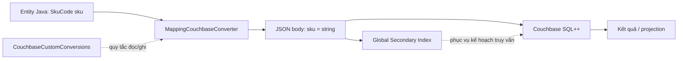

# Ảnh hưởng của bộ chuyển đổi tùy chỉnh đến truy vấn và chỉ mục

## 1. Vấn đề cốt lõi: converter đổi dữ liệu, SQL++ đọc dữ liệu đã lưu

Trong module **SPRING_DATA_COUCHBASE**, ứng dụng xây dựng tầng truy cập Couchbase bằng Spring Data với document mapping, repository, `CouchbaseTemplate` và các truy vấn SQL++. Khi đăng ký một bộ chuyển đổi tùy chỉnh (`custom converter`), lập trình viên thường tập trung vào việc ghi và đọc entity Java. Nhưng thay đổi ở tầng mapping có thể tác động trực tiếp đến **cách dữ liệu được lưu, cách câu truy vấn so sánh giá trị và index nào có thể phục vụ câu truy vấn đó**.

Ví dụ một property Java `SkuCode sku` ban đầu được lưu như JSON object:

```json
{
  "sku": {
    "value": "BOOK-2026-01"
  }
}
```

Sau khi thêm converter `SkuCode → String`, document mới được lưu như sau:

```json
{
  "sku": "BOOK-2026-01"
}
```

Hai document đều là JSON hợp lệ. Tuy nhiên:

- Câu `WHERE p.sku.value = "BOOK-2026-01"` phù hợp với biểu diễn **object**.
- Câu `WHERE p.sku = "BOOK-2026-01"` phù hợp với biểu diễn **string**.
- Index cũ trên `sku.value` không còn tương đương với index mới trên `sku`.
- Nếu một collection chứa đồng thời hai dạng, cùng một truy vấn có thể bỏ sót một phần dữ liệu mà không phát sinh ngoại lệ.
- Các client dùng SDK trực tiếp hoặc SQL++ không tự áp dụng converter Java của Spring Data.

Vì vậy, câu hỏi không chỉ là "Converter có hoạt động không?", mà là **"Hợp đồng JSON thực tế đã đổi ra sao, và toàn bộ đường query/index nào phải thay theo?"**

### Mục tiêu của bài học

Sau bài này, bạn có thể:

1. Giải thích ranh giới giữa `MappingCouchbaseConverter` và engine SQL++/Global Secondary Index (GSI).
2. Phân tích tác động của custom conversion theo **kiểu giá trị**, **đường dẫn field**, **tham số truy vấn** và **khả năng dùng index**.
3. Thiết kế lại truy vấn và chỉ mục khi chuyển object thành scalar, number thành string, enum sang mã ổn định, hoặc timestamp sang format khác.
4. Hiểu sự khác biệt giữa query qua repository/template và query raw bằng SDK.
5. Sử dụng `EXPLAIN`, kiểm tra JSON thực tế và test read/write để tránh query trả thiếu dữ liệu sau migration.
6. Lập lộ trình triển khai tương thích với bucket/scope/collection, TTL, CAS, transaction và API reactive.

## 2. Ba lớp phải tách biệt khi thiết kế

Một ứng dụng Spring Data Couchbase có thể chia thành ba lớp nhìn dữ liệu khác nhau:



| Lớp | Biết gì? | Không tự làm gì? |
| --- | --- | --- |
| **Java/Spring Data mapping** | Java types, `@Field`, `@TypeAlias`, custom conversions, cách tạo entity | Không tự viết lại những SQL++ query cũ hay rebuild mọi index. |
| **JSON document trong Couchbase** | Field, JSON type, giá trị và cấu trúc đã được ghi | Không biết class `SkuCode` hay method `convert()` trong JVM. |
| **SQL++ và GSI** | Biểu thức trên JSON, predicate, đường dẫn field, kiểu giá trị và index definitions | Không tự gọi `@WritingConverter`/`@ReadingConverter` để hiểu một câu SQL++ bất kỳ. |

**Điểm then chốt:** engine SQL++ nhìn **JSON lưu trữ**, không nhìn class Java nguyên gốc. Một index trên `sku.value` là index của biểu thức đường dẫn JSON, không phải index của Java record component `value()`. Đổi converter có thể làm thay đổi **đối tượng mà biểu thức index đó đang đọc**.

### 2.1. Converter theo kiểu ảnh hưởng phạm vi rộng

Nếu đăng ký `Converter<SkuCode, String>` trong `CouchbaseCustomConversions`, conversion có thể được áp dụng cho các property kiểu `SkuCode` phù hợp ở nhiều entity, nested object hoặc collection. Đó là **chuyển đổi giá trị theo kiểu**, không chỉ thay một field duy nhất.

Nếu chỉ một property cần cách lưu khác, hãy cân nhắc property converter ở phiên bản hỗ trợ hoặc persistence DTO/mapper tường minh. Dù chọn cách nào, khi kiểu JSON thực sự đổi, query/index cần kiểm tra lại.

## 3. Ví dụ xuyên suốt: chuyển `SkuCode` từ object sang string

### 3.1. Domain type

```java
package com.example.catalog;

public record SkuCode(String value) {
    public SkuCode {
        if (value == null || !value.matches("[A-Z0-9-]{3,32}")) {
            throw new IllegalArgumentException("Invalid SKU");
        }
    }
}
```

Entity:

```java
package com.example.catalog;

import org.springframework.data.annotation.Id;
import org.springframework.data.couchbase.core.mapping.Document;
import org.springframework.data.couchbase.core.mapping.Field;

@Document
public record ProductDocument(
    @Id String id,
    @Field("sku") SkuCode sku,
    @Field("status") String status,
    @Field("stock") int stock
) {}
```

### 3.2. Converter hai chiều

```java
package com.example.catalog;

import org.springframework.core.convert.converter.Converter;
import org.springframework.data.convert.ReadingConverter;
import org.springframework.data.convert.WritingConverter;

@WritingConverter
public final class SkuWritingConverter
        implements Converter<SkuCode, String> {

    @Override
    public String convert(SkuCode source) {
        return source.value();
    }
}

@ReadingConverter
public final class SkuReadingConverter
        implements Converter<String, SkuCode> {

    @Override
    public SkuCode convert(String source) {
        return new SkuCode(source);
    }
}
```

Hai lớp có thể được đặt trong các tệp Java riêng. Với cấu hình kế thừa `AbstractCouchbaseConfiguration`, đăng ký trong class cấu hình đang chạy:

```java
import java.util.List;

@Override
protected void additionalConverters(List<Object> converters) {
    converters.add(new SkuWritingConverter());
    converters.add(new SkuReadingConverter());
}
```

`@WritingConverter` xác định hướng Java → lưu trữ; `@ReadingConverter` xác định hướng lưu trữ → Java. **Annotation không tự đăng ký converter.** Phải xác nhận `CouchbaseCustomConversions` mà `MappingCouchbaseConverter` sử dụng đã nhận hai converter này.

### 3.3. JSON V1 và V2

V1 lưu nested object:

```json
{
  "_class": "com.example.catalog.ProductDocument",
  "sku": { "value": "BOOK-2026-01" },
  "status": "ACTIVE",
  "stock": 12
}
```

V2 lưu scalar string:

```json
{
  "_class": "com.example.catalog.ProductDocument",
  "sku": "BOOK-2026-01",
  "status": "ACTIVE",
  "stock": 12
}
```

`_class` là type hint minh họa; giá trị có thể là alias hoặc được cấu hình khác. Document ID `product::42` là key, không nhất thiết nằm trong body JSON.

Trong **cùng collection**, một writer mới không tự sửa các V1 document. Thậm chí khi chỉ ghi một số document, collection có thể trở thành tập dữ liệu **trộn schema**.

## 4. Thay đổi đường dẫn truy vấn SQL++

Giả sử bucket `shop`, scope `catalog`, collection `products`.

### 4.1. Query đúng với V1

```sql
SELECT META(p).id AS productId,
       p.sku.value AS sku
FROM `shop`.`catalog`.`products` AS p
WHERE p.sku.value = "BOOK-2026-01";
```

### 4.2. Query đúng với V2

```sql
SELECT META(p).id AS productId,
       p.sku
FROM `shop`.`catalog`.`products` AS p
WHERE p.sku = "BOOK-2026-01";
```

**Không có cơ chế tự động** biến `p.sku.value` thành `p.sku` chỉ vì ứng dụng đã đăng ký converter. Cả `SELECT` và `WHERE` đều phải được kiểm tra theo schema mới.

### 4.3. Index V1 khác index V2

Index phù hợp với đường dẫn V1:

```sql
CREATE INDEX ix_products_sku_v1
ON `shop`.`catalog`.`products`(sku.value);
```

Index phù hợp với V2:

```sql
CREATE INDEX ix_products_sku_v2
ON `shop`.`catalog`.`products`(sku);
```

Một document V2 có `sku` là string thì biểu thức `sku.value` không trỏ đến value object cũ nữa. Index V1 có thể không cung cấp entry hữu ích cho các document V2 theo predicate V2; kế hoạch truy vấn và phạm vi dữ liệu được lập index phải được kiểm tra bằng `EXPLAIN` và dữ liệu thực.

Đối với dữ liệu V1, một index mới trên `sku` đang đánh index **object**, trong khi predicate `sku = "BOOK-2026-01"` so sánh với string. Có index mới không đồng nghĩa query đó đã xử lý được document V1.

### 4.4. Query tạm trong giai đoạn mixed schema

Nếu cả V1 và V2 đang tồn tại, có thể cân nhắc một truy vấn chuyển tiếp:

```sql
SELECT META(p).id AS productId,
       p.sku
FROM `shop`.`catalog`.`products` AS p
WHERE p.sku = "BOOK-2026-01"
   OR p.sku.value = "BOOK-2026-01";
```

Truy vấn `OR` trên hai biểu thức **không được bảo đảm** có cùng hiệu năng với predicate đơn. Query optimizer có thể chọn kế hoạch khác, index coverage khác hoặc cần index riêng phù hợp từng nhánh. Nên dùng `EXPLAIN` và thử trên dữ liệu có cả hai schema.

Đừng giữ logic `OR` vô hạn như một cách che giấu migration chưa hoàn tất. Đường đọc/ghi và index về lâu dài nên thống nhất một contract.

## 5. Tác động tới truy vấn repository và parameter binding

Một repository có thể khai báo:

```java
import java.util.Optional;
import org.springframework.data.couchbase.repository.CouchbaseRepository;

public interface ProductRepository
        extends CouchbaseRepository<ProductDocument, String> {

    Optional<ProductDocument> findBySku(SkuCode sku);
}
```

Đây là ví dụ về **derived query** từ tên method. Nhưng không nên suy rằng giá trị `SkuCode` trong tham số luôn được chuyển thành JSON string ở mọi loại query và mọi phiên bản Spring Data Couchbase:

- Đường mapping của **entity khi save** và đường binding **tham số khi query** là những bước khác nhau.
- Derived query, `@Query` tùy chỉnh, template query và SDK raw SQL++ có thể đi qua cơ chế serialization/binding khác nhau.
- Một custom conversion được dùng để ghi property không tự chứng minh rằng tất cả câu SQL++ tự viết cũng áp dụng đúng conversion cho parameter.
- Nếu query hiện sử dụng nested path `sku.value`, converter không tự thay path thành `sku`.

**Phương pháp chắc chắn:** tạo integration test cho query thực tế, xác minh parameter type/shape bằng kết quả và log query đã được chuẩn hóa an toàn, rồi kiểm tra `EXPLAIN` trên predicate thật.

### 5.1. Raw SQL++ phải truyền đúng biểu diễn lưu trữ

Ví dụ câu query dùng named parameter:

```sql
SELECT META(p).id AS productId, p.sku
FROM `shop`.`catalog`.`products` AS p
WHERE p.sku = $sku;
```

Parameter cần có giá trị JSON tương ứng với field đã lưu:

```json
{
  "sku": "BOOK-2026-01"
}
```

Nếu dùng Couchbase Java SDK trực tiếp, có thể chuẩn bị tham số từ `SkuCode.value()` một cách tường minh:

```java
import com.couchbase.client.java.json.JsonObject;
import com.couchbase.client.java.query.QueryOptions;

// sku là SkuCode hợp lệ.
JsonObject parameters = JsonObject.create()
    .put("sku", sku.value());

QueryOptions options = QueryOptions.queryOptions()
    .parameters(parameters);

// Ví dụ: cluster.query(sql, options)
// sql là chuỗi SQL++ với điều kiện p.sku = $sku.
```

Đoạn code minh họa cách chuẩn bị parameter, không phụ thuộc Spring Data conversion và không hard-code nối giá trị người dùng vào câu SQL++. Khi SQL++ được chạy qua template/repository, hãy kiểm tra chính API của phiên bản đó xem tham số được map như thế nào.

### 5.2. Lưu ý injection và kiểu tham số

Luôn bind query parameters thay vì ghép trực tiếp giá trị chuỗi vào SQL++. Nhưng việc bind đúng vẫn cần **kiểu JSON tương thích**:

- JSON string `"1999"` không đồng nghĩa JSON number `1999`.
- String `"PAID"` khác `"paid"` trong hợp đồng enum phân biệt chữ hoa/thường.
- Object `{"value":"BOOK-2026-01"}` không đồng nghĩa scalar `"BOOK-2026-01"`.
- Timestamp lưu ISO string không đồng nghĩa Unix milliseconds.

Binding giải quyết cách truyền giá trị an toàn; nó **không tự giải quyết sai schema**.

## 6. Thay đổi kiểu JSON tác động đến so sánh và sắp xếp

Custom converter có thể giữ nguyên tên field nhưng đổi **kiểu dữ liệu**. Từ góc nhìn SQL++, đó là một thay đổi lớn.

| Trước conversion | Sau conversion | Thay đổi truy vấn cần xem xét |
| --- | --- | --- |
| `{"sku":{"value":"A-1"}}` | `{"sku":"A-1"}` | `sku.value` → `sku`; index theo path mới. |
| `{"amount_minor":1999}` | `{"amount_minor":"1999"}` | Number comparison → string comparison; SUM/range không còn như cũ. |
| `{"status":"PAID"}` | `{"status":"paid"}` | Cập nhật literal/parameter, query filter và báo cáo. |
| `{"created_at_epoch_ms":1735689600000}` | `{"created_at":"2025-01-01T00:00:00Z"}` | Đổi tên field, kiểu, cách so sánh và index. |
| `{"address":{"city":"Hanoi"}}` | `{"city":"Hanoi"}` | Đổi nesting, SQL++ path và index expressions. |
| `{"payment":{"_class":"com.example.WalletPayment"}}` | `{"payment":{"_class":"wallet-payment"}}` | Query lọc type hint phải hiểu alias/FQCN trong giai đoạn chuyển tiếp. |

### 6.1. JSON string không phải JSON number

Ví dụ lưu amount thành decimal string để bảo toàn chữ số:

```json
{
  "amount_decimal": "100",
  "currency": "USD"
}
```

Nếu query:

```sql
SELECT p.amount_decimal
FROM `shop`.`billing`.`payments` AS p
WHERE p.amount_decimal > "20";
```

thì đang so sánh **chuỗi**, không phải giá trị số theo ý nghĩa tài chính. `"100"` và `"20"` không có thứ tự lexicographic giống `100` và `20`. Do vậy, converter `BigDecimal → String` có thể giữ precision nhưng khiến range query và index tính tiền yêu cầu chiến lược mới.

Giải pháp thường được cân nhắc:

1. Dùng **integer minor units** làm numeric field khi có hợp đồng scale cố định và phạm vi số an toàn.
2. Giữ decimal string chính xác làm nguồn sự thật, thêm numeric/search field có ràng buộc rõ nếu cần query hiệu năng cao.
3. Dùng biểu thức chuyển đổi trong SQL++ và index biểu thức nếu engine/version hỗ trợ, nhưng phải chứng minh precision và hiệu năng trước khi dùng cho nghiệp vụ tài chính.
4. Lọc/tính toán ở tầng dịch vụ sau khi đã giảm tập dữ liệu bằng predicate có index, nếu workload cho phép.

Không dùng `double` chỉ để "query cho tiện" khi nó làm sai amount; cần thiết kế contract dữ liệu và cách tính nhất quán.

## 7. Tiền tệ: chuyển `Money` thành scalar có thể làm mất khả năng query thành phần

Một value object:

```java
public record Money(long amountMinor, String currency) {}
```

Khi được map thành object:

```json
{
  "total": {
    "amountMinor": 155000,
    "currency": "VND"
  }
}
```

SQL++ có thể lọc theo currency và amount:

```sql
SELECT META(o).id AS orderId
FROM `shop`.`sales`.`orders` AS o
WHERE o.total.currency = "VND"
  AND o.total.amountMinor >= 100000;
```

Index phù hợp theo biểu thức:

```sql
CREATE INDEX ix_orders_total
ON `shop`.`sales`.`orders`(
    total.currency,
    total.amountMinor
);
```

Nếu tạo converter `Money → String` để lưu:

```json
{
  "total": "155000 VND"
}
```

thì hai biểu thức `total.currency` và `total.amountMinor` không còn đọc được field con như cũ. Muốn lọc và tổng hợp, ứng dụng phải tách/parse string theo một quy tắc khác, thường làm query phức tạp hơn và giảm khả năng dùng index thông thường.

**Lựa chọn tốt hơn khi cần query thành phần:** giữ `Money` thành object `{amountMinor,currency}` hoặc dùng persistence DTO có các field phẳng `total_minor` và `currency` cùng cấp. Nếu thay đổi từ nested sang flat, cần cập nhật SQL++ và index tương ứng; một converter một giá trị không tự tách field gốc thành hai field ngang cấp.

### 7.1. Partial index theo currency có hữu ích?

Nếu workload chủ yếu tìm đơn hàng VND có amount lớn, một index có điều kiện có thể được đánh giá:

```sql
CREATE INDEX ix_orders_vnd_total
ON `shop`.`sales`.`orders`(total.amountMinor)
WHERE total.currency = "VND";
```

Để optimizer sử dụng hiệu quả, query phải có predicate phù hợp với điều kiện index, ví dụ `total.currency = "VND"`. Sau khi đổi currency field hoặc format, cần xem lại cả **điều kiện partial index** lẫn **key expression**. Không tự cho rằng index vẫn đúng chỉ vì tên `ix_orders_vnd_total` giữ nguyên.

## 8. Timestamp: đổi epoch number sang ISO string

Một lựa chọn common là ghi `Instant` thành epoch milliseconds (JSON number) hoặc ISO-8601 UTC (JSON string).

V1:

```json
{
  "created_at_epoch_ms": 1735689600000
}
```

V2:

```json
{
  "created_at": "2025-01-01T00:00:00Z"
}
```

### 8.1. Query epoch milliseconds

```sql
SELECT META(e).id AS eventId
FROM `shop`.`audit`.`events` AS e
WHERE e.created_at_epoch_ms >= 1735689600000
  AND e.created_at_epoch_ms < 1735776000000;
```

Một index đơn giản:

```sql
CREATE INDEX ix_events_created_epoch
ON `shop`.`audit`.`events`(created_at_epoch_ms);
```

### 8.2. Query ISO string có điều kiện

Nếu **mọi** giá trị đều được chuẩn hóa cùng UTC, cùng format và precision phù hợp, so sánh lexicographic của ISO timestamp có thể tương ứng với thứ tự thời gian:

```sql
SELECT META(e).id AS eventId
FROM `shop`.`audit`.`events` AS e
WHERE e.created_at >= "2025-01-01T00:00:00.000Z"
  AND e.created_at < "2025-01-02T00:00:00.000Z";
```

Nhưng `Instant.toString()` có thể sinh chuỗi khác độ dài phần fractional seconds (`...00Z`, `...00.123Z`). Nếu các timestamp không dùng định dạng thống nhất, so sánh string **có thể không còn tương ứng tuyệt đối với thứ tự thời gian**. Các giá trị dùng offset khác nhau như `+07:00` và `Z` cũng không thể so sánh lexicographic trực tiếp để suy thứ tự theo instant.

Một chiến lược an toàn hơn cho range query là:

- Lưu epoch milliseconds **number** làm field phục vụ lọc, với precision contract rõ.
- Hoặc dùng **chuỗi UTC chuẩn hóa fixed-width** và test boundary/ordering.
- Hoặc chuyển đổi bằng SQL++ date/time functions (chẳng hạn `STR_TO_MILLIS`) và đánh giá index biểu thức/precision theo phiên bản.

### 8.3. Index biểu thức và mất tính sargable

Nếu query phải gọi một hàm trên field:

```sql
SELECT META(e).id AS eventId
FROM `shop`.`audit`.`events` AS e
WHERE STR_TO_MILLIS(e.created_at) >= 1735689600000;
```

thì index đơn giản trên `created_at` có thể không tối ưu cho predicate đã biến đổi. Có thể xem xét index expression:

```sql
CREATE INDEX ix_events_created_parsed
ON `shop`.`audit`.`events`(
    STR_TO_MILLIS(created_at)
);
```

Index expression phải khớp ý nghĩa và biểu thức của query; cần xác minh hàm, timezone, độ chính xác và kế hoạch `EXPLAIN` trên phiên bản Couchbase đang chạy. Không biến đổi một trường text sai định dạng thành timestamp "hợp lệ" bằng phép đoán khi dữ liệu có ý nghĩa nghiệp vụ.

**Lưu ý:** field timestamp của body JSON không phải TTL server. Custom converter ngày giờ không tự gia hạn hoặc hủy expiry; TTL là metadata của document.

## 9. Enum, mã nghiệp vụ và case sensitivity

Một enum Java có thể được lưu theo tên constant:

```java
public enum OrderStatus {
    CREATED, PAID, CANCELLED
}
```

JSON mặc định kiểu phổ biến:

```json
{
  "status": "PAID"
}
```

Nếu custom conversion viết mã ổn định chữ thường `"paid"`, SQL++ phải tìm đúng giá trị thực:

```sql
SELECT META(o).id AS orderId
FROM `shop`.`sales`.`orders` AS o
WHERE o.status = "paid";
```

Một index trên field `status` vẫn có thể là lựa chọn phù hợp về **đường dẫn**, nhưng:

- Query literal hoặc bound parameter phải dùng mã mới.
- Predicate partial index có điều kiện `status = "PAID"` sẽ không còn khớp với `"paid"`.
- `GROUP BY status` có thể tách hai nhóm `"PAID"` và `"paid"` trong giai đoạn chuyển tiếp.
- Báo cáo kiểm tra số đơn hàng theo status có thể sai nếu chỉ lọc một dạng.
- Reader cũ không biết mã mới có thể thất bại khi materialize enum.

Ví dụ partial index:

```sql
CREATE INDEX ix_paid_orders_by_created
ON `shop`.`sales`.`orders`(created_at_epoch_ms)
WHERE status = "paid";
```

Nếu index được định nghĩa lúc JSON chứa `"PAID"`, chỉ sửa converter không tự điều chỉnh `WHERE` trong định nghĩa index. Cần kiểm tra DDL, query và dữ liệu V1/V2 đồng thời.

### 9.1. Không sửa bằng cách gọi `LOWER` ở mọi query mà không tính chi phí

Một phương án chuyển tiếp như `LOWER(o.status) = "paid"` có thể giúp đọc cả hai mã khi dữ liệu hợp lệ. Nhưng việc bọc field trong hàm ảnh hưởng khả năng dùng index thông thường; nếu workload thật cần predicate này lâu dài, phải đánh giá index biểu thức hoặc — tốt hơn — migrate về một mã chuẩn thống nhất.

Đối với trạng thái quan trọng như `PAID`, `CANCELLED`, không chỉ chuẩn hóa chữ thường mà còn cần xác định unknown enum/value và phép chuyển trạng thái hợp lệ.

## 10. `@TypeAlias` và `_class` có thể ảnh hưởng query/index

Spring Data có thể lưu type hint ở field `_class` để hỗ trợ dựng class. Ví dụ trước refactor:

```json
{
  "_class": "com.example.orders.OrderDocument",
  "status": "PAID"
}
```

Sau khi dùng `@TypeAlias("order-document")`:

```json
{
  "_class": "order-document",
  "status": "PAID"
}
```

Nếu SQL++ đang lọc:

```sql
WHERE o._class = "com.example.orders.OrderDocument"
```

thì document mới mang alias có thể bị bỏ sót. Ngược lại, một index có điều kiện chỉ bao gồm FQCN cũ không nhất thiết hỗ trợ đầy đủ query theo alias.

**Khuyến nghị:**

- Ưu tiên discriminator nghiệp vụ như `document_kind` hoặc `payment.kind` khi query/report cần hiểu loại document độc lập tên class Java.
- Quản lý `_class` và `@TypeAlias` như storage metadata của Spring Data; đừng đổi alias tùy tiện.
- Kiểm kê FQCN/alias cũ trước khi refactor package; thêm alias không tự đổi document lịch sử.
- Nếu index/query buộc lọc `_class`, phải theo dõi các alias/FQCN được chấp nhận và kế hoạch migration.

Không nên tự bật cấu hình type mapper khác chỉ để query nhanh hơn mà chưa kiểm chứng việc đọc root/nested subtype, metadata và constructor của entity.

## 11. Array và collection: chuyển đổi cấu trúc có thể đổi cả array index

Giả sử V1 lưu danh sách item:

```json
{
  "items": [
    { "sku": "BOOK-2026-01", "qty": 2 },
    { "sku": "PEN-2026-02", "qty": 3 }
  ]
}
```

Truy vấn SQL++:

```sql
SELECT META(o).id AS orderId
FROM `shop`.`sales`.`orders` AS o
WHERE ANY item IN o.items
      SATISFIES item.sku = "BOOK-2026-01"
      END;
```

Array index ví dụ:

```sql
CREATE INDEX ix_orders_item_sku
ON `shop`.`sales`.`orders`(
    DISTINCT ARRAY item.sku FOR item IN items END
);
```

Nếu custom mapping hoặc DTO mới chuyển các SKU thành string array ở property `skus`:

```json
{
  "skus": [
    "BOOK-2026-01",
    "PEN-2026-02"
  ]
}
```

Query/index cần đổi:

```sql
SELECT META(o).id AS orderId
FROM `shop`.`sales`.`orders` AS o
WHERE ANY sku IN o.skus
      SATISFIES sku = "BOOK-2026-01"
      END;
```

```sql
CREATE INDEX ix_orders_skus
ON `shop`.`sales`.`orders`(
    DISTINCT ARRAY sku FOR sku IN skus END
);
```

Hai schema này không tương đương: V1 giữ `qty` cho từng item, còn V2 chỉ có SKU. Nếu bỏ `qty` mà nghiệp vụ cần số lượng, đó không chỉ là converter thay representation, mà là **mất dữ liệu**. Cần persistence DTO/mapper và migration được thiết kế đầy đủ.

Không mặc định rằng converter của một phần tử collection sẽ tự đổi field `items` sang `skus`: đổi tên và cấu trúc của whole array là thay đổi schema cần xử lý tường minh.

## 12. `NULL`, `MISSING` và tác động lên index

Các JSON sau khác nhau:

```json
{ "sku": "BOOK-2026-01" }
```

```json
{ "sku": null }
```

```json
{}
```

Trong SQL++, trường hợp cuối là `MISSING`, khác `NULL`. Với Spring Data Couchbase, property Java null thường bị bỏ qua trong luồng ghi theo mapping mặc định; nguồn SDK/import có thể ghi JSON null tường minh. Custom converter không bảo đảm mọi value null đều được gọi qua method `convert(null)`.

Ảnh hưởng tới query và index:

- `WHERE p.sku IS MISSING` chỉ tìm document không có field `sku`.
- `WHERE p.sku IS NULL` chỉ tìm document có `sku` bằng JSON null.
- `WHERE p.sku = "BOOK-2026-01"` không tìm được cả hai trường hợp.
- Một số index/biểu thức index có quy tắc riêng về entry đối với leading key `MISSING`; không giả định index sẽ lưu mọi document thiếu field.
- Nếu đổi converter làm field bị bỏ thay vì ghi null, số lượng document tham gia predicate có thể thay đổi.

Ví dụ truy vấn kiểm toán:

```sql
SELECT META(p).id AS productId,
       TYPE(p.sku) AS skuType
FROM `shop`.`catalog`.`products` AS p
WHERE p.sku IS MISSING
   OR p.sku IS NULL
   OR TYPE(p.sku) != "string";
```

Không suy rằng số lượng record không có `sku` là bằng số document có `sku = null`. Nếu cần audit đầy đủ, phải tính từng nhóm và xác minh query/index thực sự bao phủ tập dữ liệu mong muốn.

## 13. Phân biệt "index tồn tại" và "query sử dụng đúng index"

Việc tạo được một index chỉ chứng minh DDL được chấp nhận. Nó **chưa chứng minh** optimizer sử dụng index đó cho query mong muốn, càng chưa chứng minh query trả đủ document lịch sử.

Cần kiểm tra ít nhất:

1. **Key expressions** của index có khớp đường dẫn JSON sau conversion không?
2. **Kiểu dữ liệu** của field đã thay đổi chưa?
3. **WHERE của partial index** có khớp predicate và mã enum/alias mới không?
4. Query có bọc field trong hàm khiến index thông thường không sargable không?
5. Predicate có thêm `OR` cho V1/V2 khiến optimizer chọn kế hoạch kém hiệu quả không?
6. Query có `ORDER BY`, `GROUP BY`, projection nào khiến cần index key bổ sung hay fetch document không?
7. Dữ liệu có nhiều phiên bản schema; index nào thực sự có entry cho các document đó?
8. Các câu query trong repository, `CouchbaseTemplate` và SDK raw có tạo cùng predicate/parameter type không?

### 13.1. Dùng `EXPLAIN` để kiểm tra

```sql
EXPLAIN
SELECT META(p).id AS productId, p.sku
FROM `shop`.`catalog`.`products` AS p
WHERE p.sku = "BOOK-2026-01";
```

Kiểm tra kết quả `EXPLAIN` để tìm:

- Index nào được chọn, ví dụ `ix_products_sku_v2`.
- Có operation quét index, fetch document, filter hay sort nào đáng kể không?
- Các span/range scan có tương ứng predicate không?
- Có chuyển sang index khác hoặc scan rộng vì biểu thức không match không?

Tên operator và output chi tiết tùy phiên bản Couchbase; cần kết hợp `EXPLAIN` với **thời gian thực thi và số lượng dữ liệu trả về** trên môi trường phù hợp. Không tối ưu chỉ dựa vào một dòng text kế hoạch.

### 13.2. Có nhất thiết phải tạo index mới ngay?

Nếu converter chỉ **chuẩn hóa giá trị** mà không đổi tên/kiểu/path (ví dụ cùng JSON string), index đơn giản trên field có thể vẫn phù hợp. Tuy nhiên, phải xét query literal và partial index.

Nếu converter làm đổi path hoặc type, rất có thể cần index mới/định nghĩa lại. Trong giai đoạn migration, có thể duy trì **hai index song song** để phục vụ hai dạng schema, rồi gỡ index cũ sau khi dữ liệu và truy vấn đã được chuyển hết. Việc tạo/hủy index cần tính đến thời gian build, tài nguyên cluster và quy trình vận hành.

Không tự tạo GSI bằng custom converter và không coi annotation entity nào cũng đủ để hệ thống tự làm DDL index.

## 14. Đọc sau ghi: lỗi mapping hay độ trễ chỉ mục?

Một test phổ biến:

1. `repository.save(product)` ghi document bằng KV.
2. Ngay sau đó chạy SQL++ `WHERE sku = "BOOK-2026-01"`.
3. Query trả 0 document.
4. Kết luận converter sai.

Kết luận này **chưa đủ căn cứ**. Query qua Global Secondary Index có thể không nhìn thấy mutation mới ngay nếu lựa chọn consistency của query không yêu cầu nó. Cần phân biệt:

- **KV get theo document key**: kiểm tra document đã ghi và body thực.
- **SQL++ query qua GSI**: kiểm tra visibility/index state và consistency option.
- **Query predicate sai**: field string khác object hoặc literal khác giá trị đã lưu.

Trong một integration test read-after-write, có thể dùng mức scan consistency thích hợp (ví dụ `REQUEST_PLUS` trong SDK/SQL++ API hỗ trợ) hoặc ràng buộc mutation state tùy đường truy cập, rồi xác minh hiệu năng. Tăng query consistency có thể làm tăng độ trễ; hãy lựa chọn theo yêu cầu ứng dụng, không bật tràn lan như cách chữa mọi lỗi mapping.

Tương tự, với reactive repository/template, kết quả I/O phải được subscribe/verify (ví dụ `StepVerifier`); chỉ tạo `Mono` hoặc `Flux` không có nghĩa thao tác đã được thực hiện.

## 15. Truy vấn qua `CouchbaseTemplate` và raw SDK không giống nhau

Các API có thể dùng các đường khác nhau:

| Đường truy cập | Liên hệ với mapping converter | Cần kiểm chứng |
| --- | --- | --- |
| `CouchbaseRepository.save/findById` | Thường đi qua Spring Data entity mapping | JSON lưu, field names, type metadata, ID, round-trip. |
| Derived repository query | Dùng cơ chế xây query của Spring Data | Parameter representation, path, projection, hiệu năng. |
| Repository `@Query` tùy chỉnh | SQL++ do người viết kiểm soát, có thể dùng placeholder/SpEL của Spring Data | Query text, bind values, type hints và field JSON thực. |
| `CouchbaseTemplate` với entity | Sử dụng mapping configuration của Spring Data | Converter áp dụng ở đường đọc/ghi nào, collection nào. |
| `ReactiveCouchbaseRepository` / template reactive | Nguyên tắc mapping tương ứng, I/O reactive | Publisher được thực thi, JSON contract, consistency. |
| Couchbase SDK raw `JsonObject` | Không tự dùng annotation/converter Spring Data | Serializer, values, parameter type, JSON contract. |
| SQL++ DML / ETL | Làm việc trực tiếp với JSON | Không tự gọi converter Java; phải validate format. |

Đường truy cập dùng SDK trực tiếp đặc biệt quan trọng khi có batch import, service Node.js/Go hoặc admin script. Một writer ngoài Spring Data có thể tiếp tục ghi schema V1 sau khi converter của Java đã được nâng cấp lên V2.

**Hợp đồng lưu trữ phải được chia sẻ giữa tất cả producer và consumer**, không chỉ giữa hai phương thức `convert()` trong một service.

## 16. Kiểm thử tác động conversion tới truy vấn và chỉ mục

### 16.1. Kiểm tra biểu diễn JSON bằng `MappingCouchbaseConverter`

Giả sử `converter` là bean `CouchbaseConverter`/`MappingCouchbaseConverter` lấy từ Spring context đã đăng ký hai converter `SkuCode`.

```java
import org.springframework.data.couchbase.core.mapping.CouchbaseDocument;

ProductDocument original = new ProductDocument(
    "product::42",
    new SkuCode("BOOK-2026-01"),
    "ACTIVE",
    12
);

CouchbaseDocument doc = new CouchbaseDocument();
converter.write(original, doc);

System.out.println(doc.export());
// Kỳ vọng field sku là String "BOOK-2026-01".

ProductDocument restored =
    converter.read(ProductDocument.class, doc);

assert restored.sku().equals(original.sku());
assert restored.status().equals(original.status());
```

Đây là một đoạn mã trong phương thức test, không phải một file Java độc lập và **chưa gọi Couchbase server**. Nó kiểm tra conversion trong bộ nhớ, không kiểm tra query/index/TTL/CAS.

Một test tốt phải xác nhận **kiểu giá trị JSON** chứ không chỉ `read(write(entity))`. Hai converter cùng có một lỗi đảo nhau có thể vẫn cho round-trip Java thành công trong khi JSON sai hợp đồng với các client khác.

### 16.2. Kiểm tra integration test

Trong một collection test riêng:

1. Lưu `ProductDocument` mới bằng repository/template.
2. Đọc raw body bằng SDK theo document key, xác nhận `sku` là string và `status` đúng.
3. Chạy SQL++ với bound parameter string đúng schema V2.
4. Đối chiếu kết quả với KV get theo ID; nếu query chưa thấy dữ liệu, kiểm tra consistency.
5. Chạy `EXPLAIN` để xác định index được chọn.
6. Lặp lại với một document V1 `sku.value` còn tồn tại.
7. Kiểm tra query tạm `OR` và số document trả về trên mixed schema.
8. Nếu dùng reactive API, verify toàn bộ publisher và error/completion signal.

Cần test độc lập cả trường hợp **JSON → Java** với fixture V1 và V2. Việc writer mới chỉ ghi V2 không chứng minh reader mới xử lý được V1 đang có trong bucket.

### 16.3. Ma trận kiểm thử quan trọng

| Trường hợp | JSON đầu vào | Query/index cần xác minh |
| --- | --- | --- |
| V1 nested object | `"sku":{"value":"BOOK-2026-01"}` | `sku.value`, index V1. |
| V2 scalar string | `"sku":"BOOK-2026-01"` | `sku`, index V2. |
| V1 và V2 trộn | Hai hình dạng cùng collection | Query chuyển tiếp không bỏ sót document. |
| Sai kiểu | `"sku":1999` | Không khớp string predicate, được audit đúng. |
| Null | `"sku":null` | `IS NULL`; không suy thành MISSING. |
| Missing | Không có `sku` | `IS MISSING`; kiểm tra index coverage. |
| Enum viết chữ thường | `"status":"paid"` | Predicate/partial index mới. |
| Enum cũ chữ hoa | `"status":"PAID"` | Báo cáo V1/V2 và migration. |
| Amount number | `"amount_minor":1999` | Numeric range/index. |
| Amount string | `"amount_minor":"1999"` | Không hiểu nhầm string là number. |
| ISO UTC cố định | `"created_at":"2025-01-01T00:00:00.000Z"` | Range string theo contract. |
| ISO không nhất quán | Mixed offsets/precision | Không dùng lexicographic range thiếu kiểm chứng. |
| Type alias | `"_class":"order-document"` | Type filter/index và reader resolve alias. |
| JSON do SDK khác ghi | Không có Spring Data metadata | Query vẫn theo schema; entity reader xử lý theo thiết kế. |
| Read-after-write | KV vừa ghi | Tách index visibility khỏi lỗi mapper. |

## 17. Phát hiện mixed schema bằng SQL++ trước migration

Trước khi thay query production, hãy thống kê dữ liệu đang thực sự có.

### 17.1. Đếm các kiểu JSON của field

```sql
SELECT TYPE(p.sku) AS skuType,
       COUNT(1) AS documentCount
FROM `shop`.`catalog`.`products` AS p
GROUP BY TYPE(p.sku)
ORDER BY documentCount DESC;
```

Kết quả có thể có `"string"`, `"object"`, `"null"` hoặc `"missing"` tùy data. Khi có field MISSING hoặc NULL, cần đối chiếu ngữ nghĩa các giá trị được trả bởi `TYPE()` trong phiên bản server và dùng `IS MISSING`/`IS NULL` khi audit chi tiết.

### 17.2. Lấy mẫu document sai chuẩn V2

```sql
SELECT META(p).id AS productId,
       TYPE(p.sku) AS skuType,
       p.sku
FROM `shop`.`catalog`.`products` AS p
WHERE p.sku IS MISSING
   OR p.sku IS NULL
   OR TYPE(p.sku) != "string";
```

Một document `sku` kiểu object có thể là V1 hợp lệ, không nhất thiết là dữ liệu hỏng. Hãy phân biệt **schema cũ hợp lệ** với **giá trị thực sự sai contract**.

### 17.3. Kiểm tra các enum code cũ

```sql
SELECT p.status AS statusCode,
       COUNT(1) AS documentCount
FROM `shop`.`catalog`.`products` AS p
GROUP BY p.status
ORDER BY documentCount DESC;
```

Nếu thấy `"ACTIVE"`, `"active"` và `"Active"`, writer/reader có thể chưa thống nhất mã lưu trữ. Cần chuẩn hóa theo hợp đồng được công bố chứ không chỉ sửa filter một phía.

### 17.4. Kiểm kê field date/amount khác loại

```sql
SELECT META(p).id AS productId,
       TYPE(p.amount_minor) AS amountType,
       TYPE(p.created_at) AS timestampType
FROM `shop`.`catalog`.`products` AS p
WHERE p.amount_minor IS NOT MISSING
   OR p.created_at IS NOT MISSING;
```

Đây là truy vấn minh họa cho collection có hai field đó; thêm các ràng buộc thực tế theo schema của dự án. Với dữ liệu tiền, `TYPE="number"` mới chỉ là bước đầu, chưa chứng minh số nguyên/scale/precision đúng.

## 18. Migration đúng cách khi converter đổi schema

Đối với V1 `sku.value` → V2 `sku`, một lộ trình triển khai an toàn thường là:

1. **Kiểm kê dữ liệu và query hiện hành.** Liệt kê raw JSON, số lượng V1/V2, các phương thức repository, `@Query`, template, SDK, ETL, index definitions và báo cáo.
2. **Định nghĩa JSON contract đích.** `sku` phải là string hợp lệ; tên field không thay đổi tùy client; policy null/unknown rõ ràng.
3. **Chuẩn bị reader tương thích.** Reader trong giai đoạn chuyển tiếp phải xử lý dữ liệu V1/V2 có chủ đích hoặc có một migration bảo đảm dữ liệu V1 được chuyển hết trước khi dùng reader mới.
4. **Tạo index V2 trước khi chuyển workload** nếu cần, giữ index V1 cho query cũ trong giai đoạn chuyển đổi.
5. **Cập nhật writer.** Đăng ký custom conversions và xác nhận raw JSON do repository/template mới ghi.
6. **Cập nhật câu query và parameter binding.** Derived query, `@Query` tùy chỉnh, template và SDK phải dùng đúng field/path/JSON type.
7. **Backfill dữ liệu V1 theo lô.** Có validation, idempotency, retry, xử lý CAS conflict và quan sát lỗi; không ghi đè update song song.
8. **Đối chiếu số lượng và tính đúng.** So sánh KV get, SQL++, số kết quả, `EXPLAIN` và latency của các query quan trọng.
9. **Gỡ query/index V1 khi an toàn.** Xác nhận mọi reader/writer đã chuyển và có phương án rollback.

### 18.1. Không biến migration thành "đọc rồi save tất cả"

Nếu đọc entity V1 qua reader mới mà không có converter tương thích, quá trình đọc đã có thể lỗi trước khi `save`. Nếu object cũ chứa field không còn trong entity mới, đọc/ghi lại có thể làm mất field. Ngoài ra, `save` có thể làm thay đổi CAS, expiry behavior, auditing metadata hoặc quy tắc mutation theo API/version.

Cần xác định rõ migration V1 → V2, bảo toàn những field chưa đổi và bảo vệ document khỏi concurrent updates. Với các document quan trọng, dùng CAS/optimistic locking hoặc transaction phù hợp, không nghĩ rằng converter một giá trị tự giải quyết đồng bộ đa document.

### 18.2. Rollback phải được xem từ góc nhìn JSON

Khi writer mới đã ghi V2, nếu rollback code về bản V1 chỉ đọc `sku.value` thì có thể không đọc được document V2. Vì vậy, **triển khai reader tương thích trước writer** là chiến lược quan trọng. Nếu không thể giữ read compatibility, cần một phương án rollback dữ liệu riêng, không chỉ rollback binary.

### 18.3. Trường hợp đổi tên/path nhiều field

Nếu converter hay mapper chuyển một nested `Money total` thành `total_minor` và `currency` ngang cấp, phải coi đây là **document-level transformation**. Thay query/index từ `total.amountMinor` thành `total_minor` và từ `total.currency` thành `currency`; ngoài ra phải kiểm chứng unit/scale và không mất thông tin currency.

Không tự tạo `Converter<Money, String>` rồi kỳ vọng nó tái cấu trúc root document đúng nhiều field.

## 19. CAS, transaction, TTL và lựa chọn reactive có vai trò gì?

Những tính năng này liên quan vận hành data access nhưng **không thay thế cơ chế conversion hoặc thiết kế index**.

### 19.1. CAS/`@Version`

Khi backfill một document, writer khác có thể sửa nó sau thời điểm job đọc. CAS giúp phát hiện xung đột và yêu cầu đọc lại/đánh giá trước khi retry. `@Version` của Spring Data Couchbase hỗ trợ optimistic locking theo cấu hình. Không nên retry mù một side effect tài chính hoặc ghi đè field thay đổi mới chỉ vì dữ liệu V1 cần chuyển sang V2.

### 19.2. Transaction

Một mutation đúng một document có mô hình atomicity khác với việc di chuyển dữ liệu qua nhiều document/collection. Nếu migration ảnh hưởng nhiều record có invariant chung, transaction hoặc cơ chế idempotent/reconciliation có thể cần thiết. Converter không tự mở transaction.

### 19.3. TTL và expiry

Đổi `createdAt` từ epoch sang ISO không đổi metadata TTL của server. Một job `upsert`/`replace` nếu không đặt lựa chọn expiry phù hợp có thể ảnh hưởng vòng đời document tùy API/version. Cần test TTL trước/sau migration, đặc biệt với session, cache, audit hay document thanh toán.

### 19.4. Reactive access

Reactive repository/template sử dụng nguyên tắc mapping của stack Spring Data tương ứng. Nó không tự viết lại query predicate hoặc index theo converter. Khi benchmark/troubleshoot, cần verify subscription/completion và phân biệt lỗi mapping với lỗi async propagation, retry hoặc query consistency.

## 20. Quan sát vận hành và KPI sau khi đổi converter

Trong rollout, ngoài việc kiểm thử code, hãy theo dõi:

- Tỷ lệ document V1/V2 theo `TYPE(field)` hoặc `schema_version`.
- Số lỗi reading converter, unknown enum, type alias không giải được.
- Số document được backfill, skip, retry, CAS conflict.
- Tỷ lệ query trả 0 kết quả bất thường so với baseline nghiệp vụ.
- Query latency p50/p95/p99 và biến động plan/index scan sau chuyển đổi.
- Số lượng truy vấn đi qua index V1 và V2 trong giai đoạn song song.
- Độ trễ query consistency nếu yêu cầu read-after-write.
- Lỗi từ producer không dùng Spring Data và sự khác nhau giữa raw JSON với entity read.

Các metric không nhất thiết phải được thu bằng cùng một API. Quan trọng là **biết phát hiện silent undercount**: query chạy nhanh, không exception, nhưng bỏ sót phần dữ liệu lưu dạng cũ.

## 21. Bảng chẩn đoán nhanh

| Triệu chứng | Nguyên nhân thường gặp | Cách kiểm tra |
| --- | --- | --- |
| Save và findById thành công nhưng findBySku trả rỗng | Parameter representation hoặc JSON path của query không khớp converter | Raw JSON, query binding, `EXPLAIN`. |
| SQL++ tìm được V2 nhưng không thấy V1 | Path `sku` thay thế `sku.value` | Audit `TYPE(sku)`, query chuyển tiếp và index V1/V2. |
| Index cũ ít hiệu quả sau deploy | Biểu thức index không còn trỏ vào dữ liệu mới | Đối chiếu DDL, `EXPLAIN`, selectivity. |
| Enum query mất một phần dữ liệu | `"PAID"` vs `"paid"` | Thống kê `GROUP BY status`. |
| Range query tiền trả sai | Amount string bị so sánh lexicographic | Kiểm tra JSON types, scale, field numeric. |
| Query date sai thứ tự | ISO string không đồng nhất timezone/precision | Audit format và cân nhắc epoch milliseconds. |
| Query lọc alias không thấy record cũ | `_class` trước đây là FQCN | Thống kê type hints và migration. |
| SQL++ vừa ghi không thấy record | GSI visibility/scan consistency | KV get theo ID, query consistency, index state. |
| Derived query đúng nhưng raw SDK sai | Raw query không dùng Spring converter | Bind giá trị JSON tường minh. |
| Một số property cùng kiểu bị thay ngoài dự kiến | Global converter áp dụng theo type | Test nhiều entity, cân nhắc property converter/DTO. |
| Index filter xử lý thiếu MISSING | Behavior của index với absent leading key/NULL | Audit bằng query phù hợp, so với full dataset. |
| Migration gây xung đột ghi | Backfill không dùng CAS/conditional update | Đo conflict, retry có điều kiện và đối chiếu. |
| Reactive test không có document | Publisher chưa thực thi hoặc error bị bỏ qua | Verify subscription/completion/error. |
| Query nhanh nhưng báo cáo thiếu số | Silent undercount do mixed schema | So sánh counts V1/V2, raw JSON và golden fixtures. |

## 22. Thực hành có hướng dẫn

### Bài 1 — Quan sát custom conversion ở tầng lưu trữ

Tạo `SkuCode` và `ProductDocument`, đăng ký writing/reading converters. Ghi một entity bằng bean `MappingCouchbaseConverter` trong bộ nhớ và kiểm tra `CouchbaseDocument.export()`. Xác nhận `sku` là JSON string, không phải object. Đọc lại và kiểm tra `SkuCode`.

### Bài 2 — So sánh hai câu SQL++/index

Chuẩn bị hai document V1/V2 cùng giá trị SKU nhưng ID khác nhau trong collection thử nghiệm. Chạy query trên `sku.value` và `sku`, ghi nhận tập kết quả. Tạo hoặc dùng index tương ứng, chạy `EXPLAIN`, giải thích index nào phù hợp với dữ liệu nào.

### Bài 3 — Kiểm thử parameter binding

Định nghĩa repository method tìm theo `SkuCode` và một truy vấn raw SQL++ với named parameter. So sánh kiểu tham số, JSON body được ghi và kết quả. Tránh nối chuỗi query bằng dữ liệu người dùng. Nếu hai đường trả khác nhau, xác định chỗ tham số không được convert như dự kiến.

### Bài 4 — Từ number sang decimal string

Chuẩn bị document có `amount_minor = 1999`, sau đó giả lập một schema dùng `amount_decimal = "19.99"`. Viết range query cho mỗi schema, giải thích vì sao không dùng string order thay numeric order. Thiết kế field/index phục vụ lọc amount nhưng vẫn bảo toàn precision.

### Bài 5 — Timestamp và index biểu thức

Tạo timestamp ISO UTC đồng nhất rồi thêm dữ liệu có các offset và precision khác nhau. So sánh query lexicographic với query parse thành epoch. Kiểm tra `EXPLAIN` khi dùng `STR_TO_MILLIS` và index biểu thức, ghi chú sai lệch khi dữ liệu không chuẩn.

### Bài 6 — Migration không bỏ sót dữ liệu

Tạo bộ dữ liệu lẫn V1/V2; viết SQL++ thống kê `TYPE(sku)`, cập nhật query tạm, xây backfill có CAS/retry. Sau migration, đối chiếu số document từng schema, query results, plan và latency; kiểm tra rollback code V1 có đọc được dữ liệu V2 không.

### Câu hỏi tự kiểm tra

1. Vì sao custom converter của Spring Data không tự viết lại SQL++ đang lưu trong code?
2. Khác biệt giữa index trên `sku.value` và `sku` là gì?
3. Vì sao tạo index V2 không tự giúp query V2 tìm được document V1?
4. Tại sao test `read(write(entity))` chưa đủ để chứng minh query/index đúng?
5. Derived query và raw SDK query khác nhau ra sao về parameter conversion?
6. Vì sao binding đúng cú pháp chưa có nghĩa binding đúng JSON type?
7. So sánh string `"100"` với `"20"` có giống so sánh số không?
8. Khi nào converter `Money → String` làm mất khả năng query amount/currency?
9. Vì sao timestamp ISO string cần timezone/format/precision thống nhất để query theo thứ tự?
10. Chức năng `STR_TO_MILLIS` trong predicate ảnh hưởng index thông thường như thế nào?
11. Index expression được chọn theo tiêu chí gì?
12. Một partial index theo `status = "PAID"` còn phù hợp sau khi đổi mã thành `"paid"` không?
13. Vì sao document có `sku = NULL` khác document `sku IS MISSING`?
14. Tại sao array index phải đổi khi từ object array sang string array?
15. GSI consistency khác với tính đúng của conversion ở điểm nào?
16. Vì sao rollback ứng dụng có thể lỗi nếu writer mới đã ghi schema mới?
17. CAS và transaction có giải quyết sai JSON representation hay không?
18. Nên theo dõi metric gì để phát hiện query trả thiếu dữ liệu âm thầm?
19. Vì sao converter toàn kiểu có thể thay đổi nhiều entity cùng lúc?
20. Khi nào một migration phải giữ đồng thời query/index V1 và V2?

## 23. Tài liệu tham khảo

- [Spring Data Couchbase — Modeling Entities](https://docs.spring.io/spring-data/couchbase/reference/couchbase/entity.html): ánh xạ entity, field JSON, type metadata và conversion.
- [Spring Data Couchbase — Custom Conversions](https://docs.spring.io/spring-data/couchbase/reference/data-commons/custom-conversions.html): đăng ký converter và đọc/ghi theo kiểu.
- [Spring Data Couchbase — Repositories](https://docs.spring.io/spring-data/couchbase/reference/couchbase/repositories.html): phương thức repository và truy vấn.
- [Couchbase Server — SQL++ CREATE INDEX](https://docs.couchbase.com/server/current/n1ql/n1ql-language-reference/createindex.html): định nghĩa index và biểu thức index.
- [Couchbase Server — SQL++ EXPLAIN](https://docs.couchbase.com/server/current/n1ql/n1ql-language-reference/explain.html): xem kế hoạch truy vấn.
- [Couchbase Server — SQL++ Array Indexing](https://docs.couchbase.com/server/current/n1ql/n1ql-language-reference/indexing-arrays.html): tạo và dùng array index.
- [Couchbase Server — SQL++ Date Functions](https://docs.couchbase.com/server/current/n1ql/n1ql-language-reference/datefun.html): xử lý timestamp string/epoch.
- [Couchbase Server — SQL++ Data Types](https://docs.couchbase.com/server/current/n1ql/n1ql-language-reference/datatypes.html): number/string/object, `NULL` và `MISSING`.
- [Couchbase Java SDK — Query](https://docs.couchbase.com/java-sdk/current/howtos/n1ql-queries-with-sdk.html): parameter binding, scan consistency và SQL++.
- [Spring Data Commons — Object Mapping](https://docs.spring.io/spring-data/commons/reference/object-mapping.html): metadata và cách dựng persistent entity.

> **Kết luận:** Custom converter thay đổi **giá trị JSON được lưu**; SQL++ và GSI hoạt động trên giá trị, kiểu và đường dẫn của JSON đó. Mỗi lần thay conversion, hãy kiểm tra theo thứ tự: **entity Java → converter → JSON body → query predicate/parameter → index expression/EXPLAIN → dữ liệu lịch sử và các client khác**. Một lần `save` thành công không đủ để chứng minh truy vấn đúng hoặc báo cáo không bỏ sót dữ liệu.

