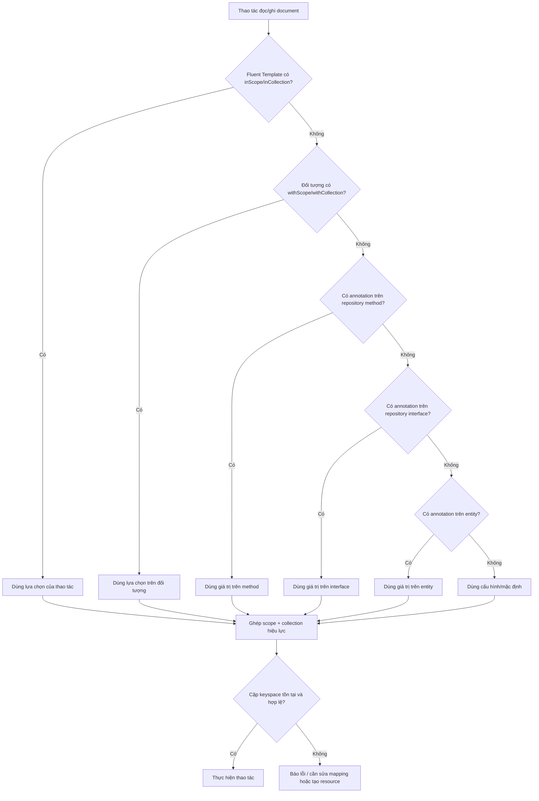

# Thứ tự ưu tiên giữa cấu hình, annotation và lựa chọn khi gọi trong Spring Data Couchbase

Khi ứng dụng sử dụng nhiều **scope** và **collection**, cùng một document Java có thể được truy cập qua repository, `CouchbaseTemplate` hoặc phiên bản reactive. Spring Data Couchbase cho phép chỉ định scope/collection ở nhiều cấp: cấu hình chung, entity, repository, phương thức repository và ngay tại lệnh gọi. Những cấp này có thể xung đột. Nếu không biết **thứ tự ưu tiên**, ứng dụng rất dễ đọc nhầm dữ liệu, ghi vào collection khác dự kiến hoặc phát sinh lỗi khi triển khai.

Bài này thuộc chương **Scope và Collection** của module `SPRING_DATA_COUCHBASE`. Trọng tâm là quy tắc xác định **keyspace cuối cùng** cho một thao tác, cách suy luận khi nhiều cấu hình cùng xuất hiện và cách kiểm chứng bằng repository, Template, SQL++ và các luồng reactive.

Sau bài học, bạn có thể:

- Nêu đúng **sáu mức ưu tiên** mà Spring Data Couchbase công bố.
- Xác định scope/collection thực tế từ một đoạn mã có cả cấu hình, annotation và lựa chọn ở runtime.
- Phân biệt kết quả khi ghi đè **chỉ scope**, **chỉ collection** hoặc cả hai.
- Biết khi nào annotation không quyết định keyspace của câu SQL++ tự viết.
- Chẩn đoán vấn đề dữ liệu, chỉ mục, quyền, TTL, CAS và độ nhất quán liên quan tới việc chọn sai collection.

## 1. Bối cảnh: cùng một ID chưa chắc là cùng document

Giả sử bucket `shop` có cấu trúc:

```text
bucket: shop
├── scope: _default
│   ├── collection: _default
│   └── collection: orders
├── scope: commerce
│   └── collection: orders
├── scope: commerce_dev
│   └── collection: orders
├── scope: archive
│   └── collection: orders_history
└── scope: reporting
    └── collection: orders_snapshot
```

Document có ID `order::1001` trong `shop.commerce.orders` hoàn toàn độc lập với document cùng ID ở `shop.archive.orders_history`. Khóa KV được xác định trong phạm vi collection; vì vậy, câu hỏi “repository này tìm document ở đâu?” cần biết đủ **bucket, scope và collection**.

| Thành phần | Ví dụ | Từ đâu tới? |
| --- | --- | --- |
| Bucket | `shop` | Cấu hình kết nối/Spring Data hoặc Template được chọn. |
| Scope | `commerce` | Cấu hình mặc định, annotation hoặc API chọn tại runtime. |
| Collection | `orders` | Mapping/annotation hoặc API chọn tại runtime. |
| Document ID | `order::1001` | Thuộc tính `@Id` hoặc tham số phương thức. |

Hai annotation `@Scope` và `@Collection` chọn scope/collection; chúng **không tự đổi bucket**. Tương tự, chọn collection khác không tự tạo resource, không sao chép document và không chuyển các chỉ mục.

### Một điều kiện bắt buộc: cặp scope–collection phải hợp lệ

Couchbase có scope `_default` và collection `_default` tương ứng. Một scope do người quản trị tạo **không chứa collection đặc biệt `_default`**.

| Scope | Collection | Có thể dùng? |
| --- | --- | --- |
| `_default` | `_default` | Có. |
| `_default` | `orders` | Có nếu collection `orders` đã được tạo. |
| `commerce` | `orders` | Có nếu scope và collection đã được tạo. |
| `commerce` | `_default` | **Không**. |

Đây là lý do không nên chỉ đổi scope sang một scope nghiệp vụ rồi mặc định rằng mọi thao tác sẽ tìm được collection `_default`.

## 2. Bảng thứ tự ưu tiên chính thức

Spring Data Couchbase công bố thứ tự **từ cao xuống thấp** như sau:

| Mức | Nơi chỉ định | API hoặc cú pháp | Khi nào có hiệu lực? |
| --- | --- | --- | --- |
| **1 – cao nhất** | Fluent API trên **một thao tác Template** | `inScope(...)`, `inCollection(...)` | Khi lệnh `findById`, `findByQuery`, `upsertById`… chọn keyspace trực tiếp. |
| **2** | Đối tượng Template/repository được đổi phạm vi | `withScope(...)`, `withCollection(...)` | Khi thao tác chạy thông qua đối tượng đã chọn scope/collection. |
| **3** | Annotation trên **phương thức repository** | `@Scope`, `@Collection` tại một finder | Cho phương thức có annotation đó. |
| **4** | Annotation trên **repository interface** | `@Scope`, `@Collection` tại interface | Cho các thao tác repository khi không bị mức cao hơn ghi đè. |
| **5** | Annotation trên **entity** | `@Scope`, `@Collection` tại lớp `@Document` | Giá trị nền của kiểu document. |
| **6 – thấp nhất** | Cấu hình scope ứng dụng | `getScopeName()` hoặc thuộc tính tương ứng của Spring Boot | Khi không có lựa chọn scope cao hơn. |

Thứ tự này là quy tắc của **các thao tác được quản lý bởi Spring Data Couchbase**. Nó không có nghĩa mọi đoạn SQL++ hay mọi lời gọi Couchbase Java SDK ngoài Spring Data sẽ tự áp dụng các annotation Java.

Có thể hình dung quá trình chọn đích:



Sơ đồ thể hiện **đường ưu tiên để suy luận**. Trên thực tế, scope và collection có thể được khai báo tại các cấp khác nhau; cần xét từng thành phần trước khi ghép thành keyspace.

## 3. Mức 6: cấu hình ứng dụng là giá trị nền

Ví dụ Spring Boot:

```yaml
spring:
  couchbase:
    connection-string: couchbase://localhost
  data:
    couchbase:
      bucket-name: shop
      scope-name: commerce_dev
```

Ở đây, `spring.data.couchbase.scope-name` đặt **scope nền** là `commerce_dev`. Phần kết nối, xác thực và quyền truy cập cluster được cấu hình riêng theo ứng dụng.

Trong dự án tự quản lý `AbstractCouchbaseConfiguration`, có thể cung cấp scope nền bằng `getScopeName()`:

```java
import org.springframework.data.couchbase.config.AbstractCouchbaseConfiguration;

public class CouchbaseDataConfig extends AbstractCouchbaseConfiguration {

    // Các phương thức cấu hình cluster, credentials, bucket được lược bỏ.

    @Override
    protected String getScopeName() {
        return "commerce_dev";
    }
}
```

Đây là **hai cách cấu hình tương ứng với các kiểu ứng dụng khác nhau**; không nên giả định YAML sẽ luôn ghi đè mọi bean cấu hình Couchbase do dự án tự tạo.

Khi một entity chỉ gắn `@Collection("orders")` mà không đặt `@Scope`, thông thường scope được chọn theo cấu hình nền. Chẳng hạn:

```java
import org.springframework.data.annotation.Id;
import org.springframework.data.couchbase.core.mapping.Document;
import org.springframework.data.couchbase.repository.Collection;

@Document
@Collection("orders")
public class OrderDocument {

    @Id
    private String id;

    private String customerId;
    private String status;

    public OrderDocument() {
    }

    public OrderDocument(String id, String customerId, String status) {
        this.id = id;
        this.customerId = customerId;
        this.status = status;
    }

    public String getId() { return id; }
    public String getCustomerId() { return customerId; }
    public String getStatus() { return status; }

    public void setId(String id) { this.id = id; }
    public void setCustomerId(String customerId) { this.customerId = customerId; }
    public void setStatus(String status) { this.status = status; }
}
```

Với cấu hình phía trên và không có override, entity này có thể được đọc/ghi tại **`shop.commerce_dev.orders`**. Nếu không chọn scope, Spring Data sử dụng scope mặc định của Couchbase theo cấu hình mặc định.

**Ghi nhớ:** cấu hình chung là điểm xuất phát, không phải quy tắc áp đặt bắt buộc cho mọi entity và mọi phương thức.

## 4. Mức 5: annotation trên entity thắng cấu hình chung

Nếu `OrderDocument` có thêm annotation `@Scope`:

```java
import org.springframework.data.couchbase.repository.Scope;
import org.springframework.data.couchbase.repository.Collection;

@Document
@Scope("commerce")
@Collection("orders")
public class OrderDocument {

    @Id
    private String id;

    // Các trường, constructor và getter/setter như ví dụ trước.
}
```

thì lựa chọn của entity là **`commerce.orders`**, có ưu tiên hơn `scope-name: commerce_dev` từ YAML.

Điều này hữu ích khi một kiểu document luôn thuộc một phạm vi cố định, nhưng có thể gây bất ngờ nếu ứng dụng dùng cùng bản build cho nhiều môi trường. Ví dụ, production có scope `commerce`, dev có scope `commerce_dev`: nếu viết `@Scope("commerce")` trên entity, riêng property profile của dev sẽ không tự chuyển entity sang `commerce_dev`.

**Quy tắc thiết kế:** nếu muốn scope thay đổi theo profile, cân nhắc chỉ khai báo `@Collection` trên entity và để scope đến từ cấu hình. Nếu entity thật sự phải luôn nằm trong một scope cố định, khai báo tường minh `@Scope` là hợp lý.

> Về import: hai annotation `@Scope` và `@Collection` của Couchbase thuộc package `org.springframework.data.couchbase.repository`. Đừng nhầm `@Scope` này với `org.springframework.context.annotation.Scope` dùng để cấu hình vòng đời Spring bean.

## 5. Mức 4: annotation trên repository interface thắng entity

Một repository có thể quy định phạm vi riêng:

```java
import java.util.List;
import org.springframework.data.couchbase.repository.CouchbaseRepository;
import org.springframework.data.couchbase.repository.Scope;
import org.springframework.data.couchbase.repository.Collection;

@Scope("reporting")
@Collection("orders_snapshot")
public interface OrderReportRepository
        extends CouchbaseRepository<OrderDocument, String> {

    List<OrderDocument> findByStatus(String status);
}
```

Giả sử `OrderDocument` khai báo `@Scope("commerce")` và `@Collection("orders")`, khi gọi:

```java
OrderDocument snapshot = orderReportRepository
    .findById("order::1001")
    .orElseThrow();
```

repository sẽ chọn **`shop.reporting.orders_snapshot`**, vì annotation ở repository interface có ưu tiên cao hơn entity.

Lợi ích của cấp này là **cùng một entity** có thể được dùng qua hai repository vào hai keyspace có schema tương thích. Nhược điểm là người đọc service cần biết đang inject repository nào; cùng ID và cùng kiểu Java không có nghĩa dữ liệu nằm cùng collection.

Một điều kiện không thể bỏ qua: metadata document, chỉ mục, quyền và cấu trúc dữ liệu của collection đích phải phù hợp với thao tác. Annotation không sao chép document từ `commerce.orders` sang `reporting.orders_snapshot`.

## 6. Mức 3: annotation trên phương thức thắng repository interface

Phương thức riêng có thể chỉ định scope và collection khác với phần còn lại của repository:

```java
import java.util.List;
import org.springframework.data.couchbase.repository.CouchbaseRepository;
import org.springframework.data.couchbase.repository.Scope;
import org.springframework.data.couchbase.repository.Collection;

@Scope("commerce")
@Collection("orders")
public interface OrderRepository
        extends CouchbaseRepository<OrderDocument, String> {

    // Không có annotation riêng: dùng commerce.orders.
    List<OrderDocument> findByCustomerId(String customerId);

    // Truy vấn riêng này dùng archive.orders_history.
    @Scope("archive")
    @Collection("orders_history")
    List<OrderDocument> findByStatus(String status);
}
```

Bảng dự đoán khi bucket là `shop`:

| Lệnh gọi | Đích được chọn | Vì sao? |
| --- | --- | --- |
| `orderRepository.findById("order::1001")` | `shop.commerce.orders` | Không có override trên method `findById`. |
| `orderRepository.findByCustomerId("customer::42")` | `shop.commerce.orders` | Interface chọn commerce/orders. |
| `orderRepository.findByStatus("ARCHIVED")` | `shop.archive.orders_history` | Method có annotation cao hơn interface. |

Chỉ phương thức `findByStatus` được chọn archive. `save`, `findById` và các phương thức khác không tự chuyển sang archive.

**Điểm dễ bỏ sót trong review:** tên phương thức `findByStatus` không cho biết nó đọc archive. Trong dự án thực, có thể đặt tên mang ý nghĩa rõ ràng như `findArchivedByStatus` nếu cơ chế query derivation phù hợp, hoặc tách repository chuyên dụng để tránh truy cập nhầm.

## 7. Mức 2: withScope()/withCollection() thắng annotation phương thức

Repository có thể mở rộng `DynamicProxyable<RepositoryType>` để tạo một đối tượng repository với scope/collection được chọn khi gọi:

```java
import java.util.List;
import org.springframework.data.couchbase.repository.CouchbaseRepository;
import org.springframework.data.couchbase.repository.DynamicProxyable;
import org.springframework.data.couchbase.repository.Scope;
import org.springframework.data.couchbase.repository.Collection;

@Scope("commerce")
@Collection("orders")
public interface OrderRepository
        extends CouchbaseRepository<OrderDocument, String>,
                DynamicProxyable<OrderRepository> {

    @Scope("archive")
    @Collection("orders_history")
    List<OrderDocument> findByStatus(String status);
}
```

Thông thường:

```java
List<OrderDocument> archived =
    orderRepository.findByStatus("ARCHIVED");
```

kết quả đến từ `shop.archive.orders_history` do annotation trên phương thức.

Nếu cần gọi cùng finder trên collection hiện hành:

```java
List<OrderDocument> confirmed = orderRepository
    .withScope("commerce")
    .withCollection("orders")
    .findByStatus("CONFIRMED");
```

thì kết quả đến từ **`shop.commerce.orders`**, vì lựa chọn `withScope/withCollection` có ưu tiên **cao hơn method annotation**.

Có thể lưu proxy đã được lựa chọn để dùng trong phạm vi xử lý:

```java
OrderRepository historyRepository = orderRepository
    .withScope("archive")
    .withCollection("orders_history");

List<OrderDocument> history =
    historyRepository.findByStatus("ARCHIVED");
```

Generic `DynamicProxyable<OrderRepository>` cần là **kiểu repository interface hiện tại**; nhờ đó các lệnh trả về vẫn có kiểu `OrderRepository` và dùng được các finder của nó.

**Không nên hiểu nhầm:** gọi `withScope()` không phải cập nhật biến cấu hình global; nó trả về đối tượng dùng để thực hiện các thao tác với lựa chọn tương ứng. Đối tượng gốc tiếp tục có cách định tuyến được quy định bởi mapping/config của nó.

### withScope()/withCollection() có áp dụng cho Template không?

Spring Data Couchbase cũng có thể hỗ trợ các phương thức `withScope()/withCollection()` trên đối tượng Template/operations phù hợp. Khác với fluent operation ở mức cao nhất, cách này chọn phạm vi cho **đối tượng thao tác**; một lời gọi `inScope()/inCollection()` cụ thể vẫn có mức ưu tiên cao hơn.

Chỉ dùng API hiện diện trong kiểu Template và phiên bản Spring Data đang triển khai; kiểm tra Javadoc nếu refactor từ repository sang Template hoặc ngược lại.

## 8. Mức 1: inScope()/inCollection() của Template thắng mọi mức thấp hơn

`CouchbaseTemplate` cung cấp fluent operations. Khi chọn phạm vi trực tiếp trên một thao tác, lựa chọn đó có mức ưu tiên cao nhất trong bảng.

Giả sử entity `OrderDocument` được khai báo ở `commerce.orders`, một lần truy cập lịch sử có thể viết:

```java
import org.springframework.data.couchbase.core.CouchbaseTemplate;

OrderDocument archived = couchbaseTemplate
    .findById(OrderDocument.class)
    .inScope("archive")
    .inCollection("orders_history")
    .one("order::1001");
```

Đích là **`shop.archive.orders_history`**, dù entity có `@Scope("commerce")` và `@Collection("orders")`.

Tương tự, một truy vấn theo thuộc tính:

```java
import java.util.List;
import org.springframework.data.couchbase.core.query.Query;
import org.springframework.data.couchbase.core.query.QueryCriteria;

Query filter = Query.query(
    QueryCriteria.where("status").is("ARCHIVED")
);

List<OrderDocument> archived = couchbaseTemplate
    .findByQuery(OrderDocument.class)
    .inScope("archive")
    .inCollection("orders_history")
    .matching(filter)
    .all();
```

Thứ tự các phương thức trong fluent chain cũng cần phù hợp với interface trả về trong phiên bản Spring Data cụ thể; không mặc định mọi tùy chọn fluent có thể gọi theo mọi thứ tự.

### Cách chọn ở Template có phạm vi bao lâu?

```java
OrderDocument archived = couchbaseTemplate
    .findById(OrderDocument.class)
    .inScope("archive")
    .inCollection("orders_history")
    .one("order::1001");

OrderDocument current = couchbaseTemplate
    .findById(OrderDocument.class)
    .inScope("commerce")
    .inCollection("orders")
    .one("order::1001");
```

Hai thao tác liên tiếp chọn **hai collection khác nhau**. Lời gọi đầu không tự sửa annotation entity hay “khóa” Template vĩnh viễn vào archive.

## 9. Lập bảng kết quả: khi tất cả các cấp cùng xuất hiện

Để nắm chắc thứ tự ưu tiên, xét một ví dụ có mọi cấp.

**Cấu hình nền:**

```yaml
spring:
  data:
    couchbase:
      bucket-name: shop
      scope-name: commerce_dev
```

**Entity:**

```java
@Document
@Scope("commerce")
@Collection("orders")
public class OrderDocument {
    @Id
    private String id;
    // Các trường khác được lược bỏ.
}
```

**Repository:**

```java
@Scope("reporting")
@Collection("orders_snapshot")
public interface OrderReportRepository
        extends CouchbaseRepository<OrderDocument, String>,
                DynamicProxyable<OrderReportRepository> {

    @Scope("archive")
    @Collection("orders_history")
    List<OrderDocument> findByStatus(String status);
}
```

**Các thao tác để so sánh:**

| Trường hợp | Lời gọi hoặc cấp lựa chọn | Scope hiệu lực | Collection hiệu lực |
| --- | --- | --- | --- |
| A | Entity được truy cập qua Template không có override | `commerce` | `orders` |
| B | `orderReportRepository.findById(id)` | `reporting` | `orders_snapshot` |
| C | `orderReportRepository.findByStatus("ARCHIVED")` | `archive` | `orders_history` |
| D | `orderReportRepository.withScope("commerce").withCollection("orders").findByStatus("CONFIRMED")` | `commerce` | `orders` |
| E | Template `findById(OrderDocument.class).inScope("archive").inCollection("orders_history").one(id)` | `archive` | `orders_history` |

Giải thích:

- A: cấu hình `commerce_dev` bị `@Scope("commerce")` trên entity ghi đè.
- B: repository interface ghi đè entity.
- C: method ghi đè interface.
- D: đối tượng repository tạo qua `withScope/withCollection` ghi đè cả method.
- E: fluent operation trên Template chọn chính xác keyspace cần dùng; đây là mức cao nhất.

**Cẩn thận khi so sánh A và E:** đó là thao tác qua Template, còn B/C/D là thao tác qua repository. Việc cùng tên entity không tạo một “scope duy nhất” cho mọi đường truy cập.

### Một mẹo đọc code thực tế

Khi gặp một lời gọi khó hiểu, đánh dấu lần lượt:

1. **Đối tượng được gọi:** repository gốc, repository đã gọi `withScope`, Template gốc hay Template đã được cấu hình riêng?
2. **Cấp lời gọi:** có `inScope()/inCollection()` ngay trên fluent operation không?
3. **Phương thức repository:** có annotation riêng?
4. **Interface repository:** có annotation?
5. **Entity:** có annotation?
6. **Config:** scope nền hiện được nạp từ profile nào?

Sau đó xác định **scope hiệu lực và collection hiệu lực**, ghép với bucket của đối tượng đang dùng và kiểm tra tài nguyên trên server.

## 10. Ghi đè từng phần: scope và collection phải được xét riêng

Đây là phần dễ mắc lỗi nhất. Spring Data cho phép một số cơ chế chỉ định **scope** hoặc **collection** mà không bắt buộc cả hai. Vì vậy không nên coi mọi lựa chọn là một chuỗi `bucket.scope.collection` bất biến được thay thế nguyên khối.

Ví dụ repository:

```java
@Scope("commerce")
@Collection("orders")
public interface OrderRepository
        extends CouchbaseRepository<OrderDocument, String>,
                DynamicProxyable<OrderRepository> {
}
```

Nếu chỉ gọi:

```java
OrderRepository selected =
    orderRepository.withScope("archive");
```

thì bạn đã yêu cầu scope `archive`, trong khi collection có thể vẫn được lấy từ annotation hoặc mặc định có hiệu lực của repository (chẳng hạn `orders`). Cấu trúc ví dụ ở trên không có `archive.orders`, chỉ có `archive.orders_history`. Vì vậy, thao tác có thể thất bại hoặc đọc sai nơi nếu không kiểm tra collection cuối cùng.

Cách rõ ràng hơn:

```java
OrderRepository selected = orderRepository
    .withScope("archive")
    .withCollection("orders_history");
```

Ngược lại, chỉ ghi đè collection:

```java
OrderRepository selected =
    orderRepository.withCollection("orders_snapshot");
```

chỉ hợp lý nếu collection `orders_snapshot` thực sự có trong **scope hiệu lực** của đối tượng đó. Không nên suy luận rằng tên collection tự khiến hệ thống chọn scope `reporting`.

### Quy tắc để tránh xung đột

- Xem scope và collection là **hai giá trị cần xác định** khi phân tích một thao tác.
- Nếu chuyển từ một miền nghiệp vụ sang miền khác, nên đặt **cả `withScope` và `withCollection`**, hoặc cả `inScope` và `inCollection`.
- Khi chỉ override một thành phần, kiểm tra thành phần còn lại trong metadata/config đang áp dụng và xác minh cặp kết quả có tồn tại.
- Đừng dùng collection `_default` trong scope tùy chỉnh; Couchbase không hỗ trợ cặp đó.

## 11. SQL++ tự viết là trường hợp cần phân biệt

Thứ tự ưu tiên nói trên áp dụng cho cơ chế chọn keyspace của **Spring Data**. Nhưng câu SQL++ tự viết với đường dẫn cứng trong `FROM` được gửi tới Query Service theo chính nội dung SQL++ đó.

Ví dụ Query Workbench:

```sql
SELECT META(o).id AS documentId, o.status
FROM `shop`.`commerce`.`orders` AS o
WHERE o.status = "CONFIRMED";
```

và:

```sql
SELECT META(h).id AS documentId, h.status
FROM `shop`.`archive`.`orders_history` AS h
WHERE h.status = "ARCHIVED";
```

Khi một phương thức repository dùng `@Query` nhưng cố định `FROM` theo keyspace, bạn không thể mặc định rằng annotation `@Scope` hoặc `withCollection` sẽ tự sửa lại chuỗi SQL++. Hãy kiểm tra **câu query cuối cùng** do framework sinh hoặc câu query do bạn viết.

Với truy vấn cần Spring Data tạo phần `SELECT/FROM` tương ứng entity, có thể dùng các biểu thức SpEL được tài liệu hỗ trợ, chẳng hạn `#{#n1ql.selectEntity}` và `#{#n1ql.filter}`, thay vì ghép thủ công đường dẫn. Ví dụ minh họa:

```java
import org.springframework.data.couchbase.repository.Query;

@Query("#{#n1ql.selectEntity} WHERE #{#n1ql.filter} " +
       "AND status = $1")
List<OrderDocument> findWithStatus(String status);
```

Tùy phiên bản và mapping entity, Spring Data có thể thêm các trường phân biệt kiểu như `_class`. Khi di chuyển dữ liệu bằng SDK thô, hãy bảo đảm metadata để repository query tiếp tục ánh xạ đúng document.

### Chỉ mục đi theo collection, không đi theo annotation

```sql
CREATE INDEX ix_current_status
ON `shop`.`commerce`.`orders`(status);

CREATE INDEX ix_history_status
ON `shop`.`archive`.`orders_history`(status);
```

Nếu method được định tuyến tới `archive.orders_history`, chỉ mục trên `commerce.orders` không giúp Query Service truy vấn collection lịch sử. Query finder theo trường cần index thích hợp trên đúng keyspace; trong khi `findById` là thao tác KV đã biết key và thường không cần secondary index SQL++.

## 12. Cơ chế này có giữ nguyên khi dùng reactive không?

Có. Spring Data Couchbase hỗ trợ `ReactiveCouchbaseRepository` và `ReactiveCouchbaseTemplate` cho mô hình xử lý không blocking. Các nguyên tắc chọn scope/collection vẫn cần áp dụng.

Ví dụ repository reactive:

```java
import org.springframework.data.couchbase.repository.ReactiveCouchbaseRepository;
import org.springframework.data.couchbase.repository.DynamicProxyable;
import org.springframework.data.couchbase.repository.Scope;
import org.springframework.data.couchbase.repository.Collection;
import reactor.core.publisher.Flux;

@Scope("commerce")
@Collection("orders")
public interface ReactiveOrderRepository
        extends ReactiveCouchbaseRepository<OrderDocument, String>,
                DynamicProxyable<ReactiveOrderRepository> {

    @Scope("archive")
    @Collection("orders_history")
    Flux<OrderDocument> findByStatus(String status);
}
```

Hai lời gọi:

```java
Flux<OrderDocument> history = reactiveOrderRepository
    .findByStatus("ARCHIVED");

Flux<OrderDocument> current = reactiveOrderRepository
    .withScope("commerce")
    .withCollection("orders")
    .findByStatus("CONFIRMED");
```

- `history` sẽ sử dụng lựa chọn cấp method.
- `current` sử dụng proxy runtime có ưu tiên cao hơn method.
- Kết quả là `Flux`, được tiêu thụ theo ngữ nghĩa Reactor; chỉ tạo publisher chưa xác nhận đã chạy và hoàn tất truy vấn.

Cách chọn keyspace **không thay đổi** chỉ vì chuyển từ synchronous sang reactive. Tuy nhiên, truy vấn SQL++ vẫn cần index, quyền và consistency phù hợp, và ứng dụng cần xử lý luồng reactive đúng cách.

## 13. Hệ quả vận hành của việc chọn sai cấp ưu tiên

### Sai vị trí dữ liệu

Nếu một luồng mong chờ `shop.commerce.orders` nhưng bị annotation repository ghi đè thành `shop.reporting.orders_snapshot`, `findById` có thể trả về rỗng dù key tồn tại ở nơi khác. Kiểm tra đủ bộ `bucket.scope.collection` sẽ nhanh hơn chỉ tìm theo ID.

### Chỉ mục không phù hợp

Finder theo thuộc tính có thể hoạt động ở collection mặc định nhưng lỗi ở collection do `withCollection` chọn, vì index chỉ có trên collection cũ. Cần chuẩn bị index độc lập cho keyspace mới.

### Quyền truy cập

RBAC của Couchbase có thể giới hạn theo bucket/scope/collection. Service account có quyền tại `commerce.orders` chưa chắc có quyền tại `archive.orders_history`. Lựa chọn runtime **không tự tăng quyền**.

### TTL, CAS và giao dịch

- **TTL/expiry:** hết hạn gắn với document và chính sách đang có hiệu lực; đổi collection không tự giữ lại expiry của một document cũ.
- **CAS:** document trong từng collection có giá trị CAS riêng. Hai document trùng key ở hai nơi không có cùng phiên bản.
- **Giao dịch:** cần API transaction phù hợp nếu nhiều thao tác phải thành công hoặc thất bại cùng nhau; lựa chọn scope/collection không tự tạo giao dịch.
- **Consistency:** sau ghi KV, truy vấn SQL++ có thể cần thời gian để chỉ mục cập nhật. Đừng vội kết luận “sai collection” nếu đã xác minh keyspace mà query chưa thấy dữ liệu mới.

### Không truyền keyspace tùy ý từ request

Nếu ứng dụng cho người dùng HTTP tùy ý truyền `scopeName` và `collectionName` rồi gọi `withScope()/withCollection()`, hệ thống có thể cho truy cập ngoài phạm vi nghiệp vụ dự kiến khi quyền tài khoản dịch vụ quá rộng. Nên ánh xạ các lựa chọn được phép từ business context, kiểm tra authorization và phân quyền tối thiểu trên Couchbase.

## 14. Phương pháp kiểm chứng và xử lý lỗi

Bảng triệu chứng nhanh:

| Hiện tượng | Khả năng liên quan tới độ ưu tiên | Cách xác minh |
| --- | --- | --- |
| Profile dev đặt `commerce_dev` nhưng thao tác vẫn đọc `commerce`. | Entity/repository/method có `@Scope("commerce")` ghi đè config. | Kiểm tra annotation và profile đã kích hoạt. |
| Repository `findById` và một finder trả dữ liệu từ hai collection khác nhau. | Finder có annotation cấp method. | Kiểm tra method annotation và so với interface. |
| Một lời gọi finder không tuân theo method annotation. | Repository được gọi qua `withScope()/withCollection()`. | Xem đối tượng proxy đang được dùng. |
| Template truy vấn collection khác entity. | Fluent `inScope()/inCollection()` thắng annotation entity. | Xem chính chuỗi thao tác Template. |
| Đổi scope runtime rồi báo lỗi collection không tồn tại. | Chỉ override scope, collection còn lại không hợp lệ. | Xác minh cặp scope/collection hiệu lực. |
| KV `findById` thành công nhưng query `findByStatus` lỗi. | Thiếu index/permission của collection đích. | Kiểm tra câu SQL++, index và RBAC. |
| `@Query` vẫn đọc keyspace cũ dù đổi annotation. | Mệnh đề `FROM` được hardcode. | Đọc SQL++ cuối cùng, xem xét SpEL. |
| `save` tại archive không ảnh hưởng dữ liệu current. | Hai collection độc lập; annotation không phải migration. | Xây quy trình sao chép/move riêng. |

Một quy trình kiểm tra theo thứ tự:

1. **Xác định đối tượng thực tế được gọi:** repository nào, proxy nào, Template nào; đọc nhánh code dẫn tới lời gọi đó.
2. **Xác định lựa chọn trực tiếp:** có `inScope/inCollection` hay `withScope/withCollection` không?
3. **Đọc annotation đúng chỗ:** method → repository interface → entity.
4. **Kiểm tra cấu hình nền:** profile, property và cấu hình Java đang có hiệu lực.
5. **Ghép keyspace:** xác định bucket từ Template/config, scope và collection hiệu lực; kiểm tra chúng tồn tại trên server.
6. **Thử KV theo ID** với key đã biết; nếu query theo thuộc tính gặp lỗi, xem SQL++ cuối cùng, index, RBAC và consistency.
7. **Xem luồng ghi cũ/mới:** nếu thay đổi đích qua một bản triển khai, dữ liệu cũ có được di chuyển hoặc đồng bộ chưa?

Trong log nội bộ, có thể ghi metadata được phép như bucket, scope, collection, tên repository, loại thao tác và mã lỗi. Tránh ghi credential hoặc dữ liệu cá nhân nhạy cảm.

## 15. Bài tập suy luận thứ tự ưu tiên

### Tình huống 1: cấu hình và entity xung đột

Cấu hình `scope-name: commerce_dev`; entity có `@Scope("commerce")` và `@Collection("orders")`. Không có override khác.

**Hỏi:** repository dựa trên entity đọc đâu?

**Đáp án:** `shop.commerce.orders` (giả sử bucket là `shop`). Annotation trên entity ưu tiên hơn config.

### Tình huống 2: interface và method xung đột

Interface có `@Scope("commerce")`, `@Collection("orders")`; method `findByStatus` có `@Scope("archive")`, `@Collection("orders_history")`.

**Hỏi:** `findById` và `findByStatus` có cùng keyspace không?

**Đáp án:** Không. `findById` dùng `commerce.orders`, còn `findByStatus` dùng `archive.orders_history`.

### Tình huống 3: DynamicProxyable ghi đè method

Cũng repository trên, nhưng gọi:

```java
orderRepository.withScope("commerce")
    .withCollection("orders")
    .findByStatus("CONFIRMED");
```

**Đáp án:** `shop.commerce.orders`. Lựa chọn qua proxy thắng annotation method.

### Tình huống 4: Template ghi đè entity

Entity định vị ở `commerce.orders`, nhưng gọi:

```java
couchbaseTemplate.findById(OrderDocument.class)
    .inScope("archive")
    .inCollection("orders_history")
    .one("order::1001");
```

**Đáp án:** `shop.archive.orders_history`. Fluent Template có ưu tiên cao nhất.

### Tình huống 5: chỉ thay scope

Repository mặc định `commerce.orders`. Runtime gọi `withScope("archive")`, nhưng `archive` chỉ có collection `orders_history`.

**Đáp án:** Không thể mặc định rằng lời gọi hợp lệ. Cần xác định collection hiệu lực; cách rõ ràng là kết hợp `withCollection("orders_history")`.

### Tình huống 6: truy vấn hardcode keyspace

Method có annotation `@Scope("archive")` nhưng `@Query` tự viết dùng `FROM` với đường dẫn `shop.commerce.orders`.

**Đáp án:** Phải kiểm tra SQL++ cuối cùng. Không được giả định annotation tự thay thế phần `FROM` viết cứng; nên dùng query được Spring Data hỗ trợ ánh xạ keyspace hoặc sửa SQL++.

## Ghi nhớ

**Thứ tự ưu tiên trong Spring Data Couchbase:** `inScope()/inCollection()` của fluent Template → `withScope()/withCollection()` của đối tượng Template/repository → annotation trên repository method → annotation trên repository interface → annotation trên entity → cấu hình scope nền.

Khi thực hành, hãy suy luận **scope và collection của từng thao tác**, kiểm tra cặp được tạo sẵn, sau đó đối chiếu quyền, SQL++, chỉ mục và dữ liệu ở collection đó. Annotation hay API chọn đích không tự tạo collection, không di chuyển document và không bảo đảm nhất quán cho nhiều thao tác.

## Tài liệu tham khảo

- [Spring Data Couchbase — Collection Support](https://docs.spring.io/spring-data/couchbase/reference/couchbase/collections.html): thứ tự ưu tiên được công bố và các cách chọn scope/collection.
- [Spring Data Couchbase — @Scope Javadoc](https://docs.spring.io/spring-data/couchbase/docs/current/api/org/springframework/data/couchbase/repository/Scope.html): package, target và thuộc tính của annotation.
- [Spring Data Couchbase — @Collection Javadoc](https://docs.spring.io/spring-data/couchbase/docs/current/api/org/springframework/data/couchbase/repository/Collection.html): package, target và thuộc tính của annotation.
- [Spring Boot — Common Application Properties](https://docs.spring.io/spring-boot/appendix/application-properties/index.html): `spring.data.couchbase.scope-name`, `spring.data.couchbase.bucket-name`.
- [Spring Data Couchbase — Couchbase Repositories](https://docs.spring.io/spring-data/couchbase/reference/couchbase/repository.html): KV theo ID, SQL++ cho các finder và yêu cầu chỉ mục.

