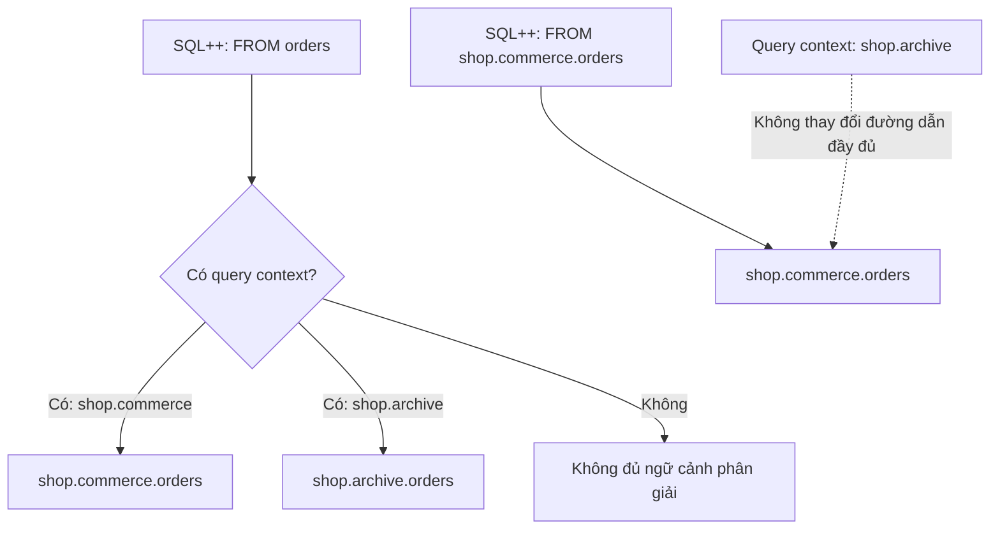

# Ngữ cảnh truy vấn SQL++ và tên keyspace đầy đủ trong Couchbase

Trong **Spring Data Couchbase**, repository và `CouchbaseTemplate` có thể chọn bucket, scope và collection dựa trên mapping hoặc API của ứng dụng. Nhưng khi viết SQL++ (trước đây gọi là N1QL), cơ chế chọn nguồn dữ liệu có thêm một khái niệm quan trọng: **query context** (*ngữ cảnh truy vấn*). Query context cho phép viết tên collection ngắn gọn trong câu lệnh; tên **keyspace đầy đủ** cho phép xác định nguồn dữ liệu rõ ràng mà không phụ thuộc vào ngữ cảnh đang đặt.

Bài học thuộc chương **Scope và Collection** của module `SPRING_DATA_COUCHBASE`. Mục tiêu là giúp bạn đọc đúng câu SQL++, chọn đường dẫn truy vấn trong Query Workbench, Java SDK và Spring Data; đồng thời tránh các lỗi liên quan đến chỉ mục, quyền truy cập, nhất quán sau ghi và chuyển dữ liệu giữa các collection.

Sau bài này, bạn có thể:

- Phân biệt keyspace đầy đủ với tên collection rút gọn.
- Giải thích chính xác query context chứa **bucket và scope**, cách nó phân giải tên collection.
- Viết truy vấn độc lập với context và truy vấn dựa vào context.
- Cấu hình context khi dùng Query Workbench, `cbq` và Couchbase Java SDK.
- Kiểm soát keyspace của repository/`@Query` và `CouchbaseTemplate` trong Spring Data.
- Chẩn đoán truy vấn nhầm collection hoặc thiếu index, thiếu quyền, sai consistency.

## 1. Keyspace trong SQL++ là gì?

Trong Couchbase Server 7.0 trở lên, document được tổ chức theo hệ thống phân cấp:

```text
bucket: shop
├── scope: _default
│   └── collection: _default
├── scope: commerce
│   ├── collection: orders
│   └── collection: customers
└── scope: archive
    └── collection: orders_history
```

**Keyspace** là nguồn dữ liệu mà câu SQL++ tham chiếu đến, thường là một collection. Đường dẫn đầy đủ gồm ba phần:

```text
<bucket>.<scope>.<collection>
```

Ví dụ:

- `shop.commerce.orders`: đơn hàng hiện hành.
- `shop.commerce.customers`: khách hàng.
- `shop.archive.orders_history`: đơn hàng lưu trữ.
- `shop._default._default`: collection mặc định trong scope mặc định của bucket.

Khi đưa đường dẫn vào SQL++, có thể dùng dấu backtick để bao từng tên định danh. Việc này đặc biệt cần thiết nếu tên chứa dấu gạch nối, khoảng trắng hoặc ký tự đặc biệt.

```sql
SELECT META(o).id AS documentId,
       o.customerId,
       o.status
FROM `shop`.`commerce`.`orders` AS o
WHERE o.status = "CONFIRMED";
```

Câu trên chọn **chính xác** collection `orders` trong scope `commerce` của bucket `shop`.

**Không nhầm với document key:** ID như `order::1001` chỉ xác định duy nhất document trong *một collection*. Cùng ID ở `commerce.orders` và `archive.orders_history` là hai document khác nhau.

## 2. Tên keyspace đầy đủ và tên rút gọn

Couchbase SQL++ hỗ trợ hai cách tham chiếu collection phổ biến.

### 2.1. Dùng keyspace đầy đủ

```sql
SELECT o.status
FROM `shop`.`commerce`.`orders` AS o
WHERE META(o).id = "order::1001";
```

Đây là cách dễ kiểm chứng khi câu SQL++ được chạy ở nhiều nơi. Các thành phần bucket, scope và collection xuất hiện ngay trong câu lệnh, nên **query context không cần phân giải nguồn dữ liệu này**.

Theo cú pháp đầy đủ của Couchbase, trước bucket còn có namespace, hiện thường là `default:`. Namespace này có thể bỏ qua:

```sql
-- Có namespace
SELECT o.status
FROM default:`shop`.`commerce`.`orders` AS o;

-- Bỏ namespace, vẫn chỉ rõ đủ bucket.scope.collection
SELECT o.status
FROM `shop`.`commerce`.`orders` AS o;
```

Trong đa số ứng dụng, cú pháp ba thành phần với dấu backtick là đủ rõ ràng.

### 2.2. Dùng tên collection rút gọn

Nếu **query context** đã được đặt là `shop.commerce`, câu sau có thể truy vấn chính collection `shop.commerce.orders`:

```sql
SELECT o.status
FROM `orders` AS o
WHERE META(o).id = "order::1001";
```

Ở đây `orders` là **partial keyspace reference**: tên collection được hiểu theo bucket và scope trong query context.

Ngược lại, nếu context là `shop.archive`, `FROM `orders`` sẽ cố tìm collection tên `orders` trong scope `archive`. Với cấu trúc ví dụ, scope này chỉ có `orders_history`, nên truy vấn có thể thất bại vì không tìm được keyspace. Hệ thống **không tự suy ra** `orders_history` từ tên `orders`.

### Bảng so sánh

| Câu lệnh `FROM` | Query context | Nguồn dữ liệu hiệu lực |
| --- | --- | --- |
| `FROM `shop`.`commerce`.`orders`` | Không đặt | `shop.commerce.orders` |
| `FROM `shop`.`commerce`.`orders`` | `shop.archive` | **Vẫn là** `shop.commerce.orders` |
| `FROM `orders`` | `shop.commerce` | `shop.commerce.orders` |
| `FROM `orders_history`` | `shop.archive` | `shop.archive.orders_history` |
| `FROM `orders`` | Không đặt | Không có bucket/scope để phân giải collection rút gọn; thường lỗi keyspace |
| `FROM `orders`` | `shop.archive` | Tìm `shop.archive.orders`; lỗi nếu collection này không tồn tại |

Điểm then chốt là **query context chỉ giải quyết tham chiếu keyspace không đầy đủ**. Khi câu SQL++ đã cung cấp tên đầy đủ, query context không thay đổi đường dẫn đó.

## 3. Query context gồm những thành phần nào?

Query context là thông tin kèm theo **một yêu cầu truy vấn**, dùng để phân giải tên collection. Dạng thường gặp:

```text
bucket.scope

Ví dụ:
shop.commerce
shop.archive
```

Ở dạng có namespace, query context có thể viết:

```text
default:shop.commerce
```

Trong Couchbase, namespace mặc định thường được sử dụng khi không nêu rõ `default:`. **Query context chọn bucket và scope, không chọn một collection cụ thể.** Câu SQL++ vẫn phải nêu tên collection (hoặc tham chiếu đầy đủ).

Có thể hình dung:



Phân biệt thêm với các khái niệm khác:

| Khái niệm | Có ảnh hưởng gì? |
| --- | --- |
| **Query context** | Chỉ hỗ trợ phân giải tên collection rút gọn trong SQL++. |
| **Scope mặc định của Spring Data** | Định tuyến các thao tác Spring Data khi không có override ưu tiên cao hơn. |
| **Scope object trong Java SDK** | Khi gọi `scope.query(...)`, SDK biết bucket/scope làm query context. |
| **Collection object trong Java SDK** | Dùng cho KV trực tiếp như `collection.get(id)` và `collection.upsert(id, doc)`. |
| **Role/permission** | Quy định tài khoản được phép truy cập dữ liệu nào; context không cấp thêm quyền. |

Query context không tạo resource Couchbase, không di chuyển document và không tự thay đổi TTL hay CAS.

## 4. Thiết lập query context trong Query Workbench

Trong Couchbase Query Workbench, bạn có thể chọn **Bucket** và **Scope** ở phần *Query Context* của trình soạn thảo SQL++.

Ví dụ:

1. Chọn bucket `shop`.
2. Chọn scope `commerce`.
3. Chạy câu truy vấn:

```sql
SELECT META(o).id AS documentId, o.status
FROM `orders` AS o
WHERE o.status = "NEW";
```

Lúc này `orders` tương ứng với `shop.commerce.orders`.

Nếu bạn đổi dropdown sang `shop.archive`, hãy dùng:

```sql
SELECT META(h).id AS documentId, h.status
FROM `orders_history` AS h
WHERE h.status = "ARCHIVED";
```

**Mẹo kiểm tra:** khi nghi ngờ Workbench đang ở context không đúng, thử viết đường dẫn đầy đủ. Ví dụ:

```sql
SELECT META(o).id AS documentId, o.status
FROM `shop`.`commerce`.`orders` AS o
WHERE o.status = "NEW";
```

Câu này có cùng keyspace bất kể dropdown Query Context đang chọn `shop.commerce` hay `shop.archive`.

### Khi cần chạy truy vấn trên scope khác

Với query context `shop.commerce`, bạn vẫn có thể viết:

```sql
SELECT META(h).id AS documentId, h.status
FROM `shop`.`archive`.`orders_history` AS h
WHERE h.status = "ARCHIVED";
```

Đường dẫn đầy đủ thắng việc phân giải tên rút gọn. Câu lệnh chỉ chạy khi collection đó tồn tại và tài khoản có quyền cần thiết.

## 5. Thiết lập query context trong cbq shell và REST Query Service

### 5.1. cbq shell

Trong `cbq`, có thể thiết lập tham số query context tại shell:

```text
\SET -query_context shop.commerce;
```

Sau đó truy vấn bằng tên collection:

```sql
SELECT META(o).id AS documentId, o.status
FROM `orders` AS o
WHERE o.status = "CONFIRMED";
```

Khi muốn bỏ context để kiểm tra đường dẫn đầy đủ hoặc sử dụng cú pháp bucket-only tương thích legacy, có thể dùng lệnh shell:

```text
\UNSET -query_context;
```

**Lưu ý:** `\SET` và `\UNSET` ở đây là **lệnh điều khiển cbq shell**, không phải statement SQL++ có thể chép nguyên vào mọi driver hoặc repository `@Query`.

### 5.2. REST Query Service

Query Service có tham số request `query_context`. Ví dụ nội dung request JSON minh họa:

```json
{
  "statement": "SELECT META(o).id AS id, o.status FROM orders AS o WHERE o.status = $status",
  "query_context": "shop.commerce",
  "$status": "CONFIRMED"
}
```

Trong trường hợp này `orders` được phân giải thành `shop.commerce.orders`.

Khi xây dựng request thực tế, cần sử dụng endpoint Query Service, xác thực, quyền truy cập và cơ chế truyền tham số tương ứng với API đang dùng. Query context là **tham số của yêu cầu**, không phải thuộc tính toàn cục tự đổi mọi session ở các công cụ khác.

## 6. Sử dụng Java SDK: Scope.query và Cluster.query

Couchbase Java SDK cho phép chạy SQL++ ở mức **Scope** hoặc **Cluster**. Đây là hai API dễ tạo ra khác biệt về query context.

### 6.1. Scope.query() tự mang ngữ cảnh bucket/scope

Giả sử ứng dụng đã kết nối thành công và có đối tượng `Cluster cluster`:

```java
import com.couchbase.client.java.Bucket;
import com.couchbase.client.java.Scope;
import com.couchbase.client.java.json.JsonObject;
import com.couchbase.client.java.query.QueryResult;

import static com.couchbase.client.java.query.QueryOptions.queryOptions;

// cluster là Cluster đã được khởi tạo và xác thực.
Bucket bucket = cluster.bucket("shop");
Scope commerce = bucket.scope("commerce");

QueryResult result = commerce.query(
    "SELECT META(o).id AS id, o.customerId, o.status " +
    "FROM `orders` AS o WHERE o.status = $status",
    queryOptions().parameters(
        JsonObject.create().put("status", "CONFIRMED")
    )
);

for (JsonObject row : result.rowsAsObject()) {
    System.out.println(row);
}
```

Vì gọi `commerce.query(...)`, context của truy vấn là scope `commerce` trong bucket `shop`. Câu SQL++ dùng tên `orders` là hợp lệ khi collection tồn tại.

Tương tự, để truy vấn lịch sử:

```java
Scope archive = bucket.scope("archive");

QueryResult history = archive.query(
    "SELECT META(h).id AS id, h.status " +
    "FROM `orders_history` AS h WHERE h.status = $status",
    queryOptions().parameters(
        JsonObject.create().put("status", "ARCHIVED")
    )
);
```

**Quan trọng:** gọi `bucket.scope("commerce")` lấy đối tượng truy cập của SDK, không tự tạo scope trên Couchbase Server.

### 6.2. Cluster.query() với keyspace đầy đủ

Khi gọi ở mức cluster, cách rõ ràng nhất là ghi đủ đường dẫn:

```java
QueryResult result = cluster.query(
    "SELECT META(o).id AS id, o.status " +
    "FROM `shop`.`commerce`.`orders` AS o " +
    "WHERE o.status = $status",
    queryOptions().parameters(
        JsonObject.create().put("status", "CONFIRMED")
    )
);
```

Không cần query context để phân giải `FROM` trong câu này.

Với truy vấn nhiều collection hoặc qua nhiều scope, cách viết đường dẫn đầy đủ tại cluster thường dễ hiểu hơn.

### 6.3. Cluster.query() với query_context

Nếu cần viết câu SQL++ theo tên collection rút gọn khi gọi `cluster.query(...)`, Java SDK có thể truyền query context qua tùy chọn request ở những phiên bản hỗ trợ. Một cách được tài liệu Couchbase minh họa là sử dụng `raw("query_context", ...)`:

```java
QueryResult result = cluster.query(
    "SELECT META(o).id AS id, o.status " +
    "FROM `orders` AS o WHERE o.status = $status",
    queryOptions()
        .raw("query_context", "shop.commerce")
        .parameters(JsonObject.create().put("status", "CONFIRMED"))
);
```

Đây là tùy chọn ở **lệnh truy vấn hiện tại**. Nó không tự sửa scope đang được Spring Data Couchbase dùng cho các repository khác.

Trong ứng dụng mới, nếu đã có đối tượng `Scope` và chỉ truy vấn trong scope đó, `scope.query(...)` thường trực quan hơn việc truyền `raw("query_context", ...)`.

### 6.4. Đặt tham số đúng loại

`$status` là **giá trị dữ liệu**, có thể truyền an toàn bằng query parameter. Ngược lại, tên bucket, scope và collection là **identifier/keyspace**, không nên giả định có thể đặt tên collection bằng tham số giá trị `$collection` trong mệnh đề `FROM`.

Cần chọn keyspace từ tập định danh tin cậy, chẳng hạn enum hoặc cấu hình được phép, rồi dùng query parameter cho điều kiện lọc. Tránh nối chuỗi tên collection lấy trực tiếp từ request chưa được kiểm tra.

## 7. Truy vấn nhiều collection và nhiều scope

Query context đặc biệt tiện khi một nghiệp vụ truy vấn **nhiều collection trong cùng một scope**.

Ví dụ với context `shop.commerce`:

```sql
SELECT META(o).id AS orderId,
       o.status,
       c.name AS customerName
FROM `orders` AS o
JOIN `customers` AS c
  ON o.customerId = META(c).id
WHERE o.status = "CONFIRMED";
```

Cả `orders` và `customers` đều được phân giải theo cùng `shop.commerce`.

Nếu cần kết hợp current và archive, nên dùng keyspace đầy đủ để thấy ranh giới:

```sql
SELECT META(o).id AS orderId, o.status, h.status AS archiveStatus
FROM `shop`.`commerce`.`orders` AS o
LEFT JOIN `shop`.`archive`.`orders_history` AS h
  ON META(o).id = META(h).id
WHERE o.customerId = "customer::42";
```

Truy vấn liên collection có thể yêu cầu các chỉ mục phù hợp và quyền đọc/truy vấn trên cả hai keyspace. Đừng dùng query context như cơ chế cấp quyền hoặc cơ chế bảo đảm rằng câu query không thể truy cập scope khác.

### Khi nào chọn cách nào?

| Nhu cầu | Cách nên cân nhắc |
| --- | --- |
| Một câu query dùng một collection trong scope đã xác định | Context + tên collection ngắn. |
| Nhiều collection trong cùng scope | Context + tên collection riêng ở từng phần `FROM/JOIN`. |
| Truy vấn qua nhiều scope/bucket | Đường dẫn keyspace đầy đủ cho từng nguồn. |
| SQL++ dùng chung giữa các môi trường có cùng tên collection | Query context do cấu hình môi trường chọn. |
| Script vận hành cần xem rõ đích và dễ audit | Keyspace đầy đủ trong câu SQL++. |

Dù dùng kiểu nào, hãy bảo đảm tên resource và chỉ mục đúng với nơi dữ liệu tồn tại.

## 8. Spring Data Couchbase chọn keyspace như thế nào?

**Điểm rất quan trọng:** `spring.data.couchbase.scope-name` là **scope mặc định của Spring Data**, không phải một công tắc tự áp dụng query context lên mọi `cluster.query(...)` mà bạn tự viết.

Spring Data có thể chọn scope/collection bằng cấu hình, annotation hoặc API:

- Cấu hình nền như `spring.data.couchbase.scope-name`.
- `@Scope` và `@Collection` trên entity, repository hoặc phương thức.
- `withScope()/withCollection()` của đối tượng hỗ trợ lựa chọn động.
- `inScope()/inCollection()` trên fluent operation của `CouchbaseTemplate`.

Việc chọn đích của Spring Data cần được phân biệt với **SQL++ đã có keyspace ghi cứng**, vì một câu query tự viết luôn phải được kiểm tra theo chính phần `FROM` của nó.

### 8.1. Mapping entity và repository

Ví dụ entity đơn hàng:

```java
import org.springframework.data.annotation.Id;
import org.springframework.data.couchbase.core.mapping.Document;
import org.springframework.data.couchbase.repository.Scope;
import org.springframework.data.couchbase.repository.Collection;

@Document
@Scope("commerce")
@Collection("orders")
public class OrderDocument {
    @Id
    private String id;

    private String customerId;
    private String status;

    // Constructor và getter/setter được lược bỏ.
}
```

Repository:

```java
import java.util.List;
import org.springframework.data.couchbase.repository.CouchbaseRepository;

public interface OrderRepository
        extends CouchbaseRepository<OrderDocument, String> {

    List<OrderDocument> findByStatus(String status);
}
```

Khi bucket là `shop` và không có override, finder `findByStatus` được Spring Data định tuyến tới collection **`shop.commerce.orders`**. Một câu truy vấn SQL++ được sinh ra có thể dùng metadata và điều kiện kiểu entity bên cạnh điều kiện `status`. Không nên suy diễn SQL++ cuối cùng chỉ từ tên phương thức.

### 8.2. @Query và SpEL thay cho FROM cố định

Đối với câu SQL++ tùy chỉnh trên repository, có thể dùng SpEL của Spring Data:

```java
import java.util.List;
import org.springframework.data.couchbase.repository.Query;

@Query("#{#n1ql.selectEntity} WHERE #{#n1ql.filter} " +
       "AND status = $1")
List<OrderDocument> findByStatusCustom(String status);
```

Trong Spring Data Couchbase:

- `#{#n1ql.selectEntity}` tạo phần SELECT/FROM phù hợp với mapping entity và keyspace hiệu lực.
- `#{#n1ql.filter}` tạo điều kiện phân biệt kiểu document theo metadata Spring Data.
- `$1` nhận tham số vị trí thứ nhất của phương thức.
- Các biến `#{#n1ql.bucket}`, `#{#n1ql.scope}` và `#{#n1ql.collection}` có thể được dùng trong tình huống cần dựng tên keyspace theo metadata.

Ví dụ cấu trúc câu query dùng các biến thành phần:

```java
@Query("SELECT META(o).id AS id, o.status " +
       "FROM #{#n1ql.bucket}.#{#n1ql.scope}.#{#n1ql.collection} AS o " +
       "WHERE o.status = $1")
List<OrderStatusView> findStatuses(String status);
```

`OrderStatusView` trong ví dụ trên là DTO/projection giả định cần được khai báo và ánh xạ phù hợp nếu đưa vào mã thật. Với truy vấn cần tái dựng toàn bộ entity, **nên ưu tiên** `selectEntity` và `filter` để Spring Data lựa chọn đủ các trường metadata cần thiết.

**Tránh lỗi này:**

```java
@Query("SELECT o.* FROM `shop`.`commerce`.`orders` AS o " +
       "WHERE o.status = $1")
List<OrderDocument> findHardcoded(String status);
```

Câu trên gắn cứng `shop.commerce.orders`. Nếu sau đó đổi `@Scope` hoặc `@Collection` trên repository, đừng kỳ vọng framework tự sửa chuỗi `FROM` viết cứng. Hơn nữa, chỉ `SELECT o.*` có thể thiếu metadata cần thiết để khôi phục entity đầy đủ. Kiểm tra SQL++ cuối cùng, projection và yêu cầu mapping.

### 8.3. CouchbaseTemplate

Với `CouchbaseTemplate`, việc chọn scope/collection có thể khai báo trực tiếp ở fluent operation:

```java
import java.util.List;
import org.springframework.data.couchbase.core.CouchbaseTemplate;
import org.springframework.data.couchbase.core.query.Query;
import org.springframework.data.couchbase.core.query.QueryCriteria;

// couchbaseTemplate đã được inject, bucket đã cấu hình.
Query filter = Query.query(
    QueryCriteria.where("status").is("CONFIRMED")
);

List<OrderDocument> confirmed = couchbaseTemplate
    .findByQuery(OrderDocument.class)
    .inScope("commerce")
    .inCollection("orders")
    .matching(filter)
    .all();
```

Spring Data chọn keyspace theo API của thao tác. Khi debug, không nên giả định `Query Workbench` có cùng query context với `CouchbaseTemplate`: chúng là hai đường thực thi và hai lớp cấu hình khác nhau.

### 8.4. Repository reactive và ReactiveCouchbaseTemplate

Cùng nguyên tắc áp dụng với API reactive:

```java
import org.springframework.data.couchbase.core.ReactiveCouchbaseTemplate;
import org.springframework.data.couchbase.core.query.Query;
import org.springframework.data.couchbase.core.query.QueryCriteria;
import reactor.core.publisher.Flux;

Query filter = Query.query(
    QueryCriteria.where("status").is("CONFIRMED")
);

Flux<OrderDocument> confirmed = reactiveCouchbaseTemplate
    .findByQuery(OrderDocument.class)
    .inScope("commerce")
    .inCollection("orders")
    .matching(filter)
    .all();
```

Reactive thay đổi cách trả và xử lý kết quả (`Flux`/`Mono`), **không thay đổi quy tắc phân giải keyspace của SQL++**. Câu query vẫn cần chỉ mục và quyền thích hợp; việc tạo publisher chưa đồng nghĩa thao tác đã hoàn tất.

## 9. Trường hợp đặc biệt: collection mặc định và truy vấn legacy

Trong Couchbase, collection mặc định thuộc scope mặc định:

```text
shop._default._default
```

Để tránh phụ thuộc vào ngữ cảnh, có thể viết rõ:

```sql
SELECT META(d).id AS documentId, d.status
FROM `shop`.`_default`.`_default` AS d;
```

Vì lý do tương thích với các phiên bản cũ, một số truy vấn còn dùng **chỉ tên bucket** để tham chiếu collection mặc định:

```sql
-- Cú pháp legacy khi query context KHÔNG được đặt
SELECT META(d).id AS documentId, d.status
FROM `shop` AS d;
```

Theo tài liệu Couchbase, cú pháp bucket-only tương thích legacy này yêu cầu **không đặt query context**. Khi Workbench hoặc `cbq` đang có query context, nên dùng đường dẫn đầy đủ thay vì cố dự đoán cách engine phân giải tên bucket.

**Không suy ra:** `shop.commerce._default` là collection mặc định của scope `commerce`. Scope do ứng dụng tạo không có collection `_default` hệ thống.

## 10. Chỉ mục, quyền và tính nhất quán theo keyspace

### 10.1. Chỉ mục phải nằm trên collection được truy vấn

Giả sử câu SQL++ lọc theo `customerId` trong hai collection:

```sql
CREATE INDEX ix_orders_customer
ON `shop`.`commerce`.`orders`(customerId);

CREATE INDEX ix_history_customer
ON `shop`.`archive`.`orders_history`(customerId);
```

Dù hai truy vấn có cùng điều kiện `WHERE customerId = ...`, chúng **không chia sẻ chỉ mục** giữa collection. Nếu đổi query context từ `shop.commerce` sang `shop.archive` nhưng vẫn dùng tên collection cũ, query còn có thể không phân giải được keyspace.

Sử dụng `EXPLAIN` để xem kế hoạch trên đúng collection:

```sql
EXPLAIN
SELECT META(o).id AS documentId, o.status
FROM `shop`.`commerce`.`orders` AS o
WHERE o.customerId = "customer::42";
```

Cần lưu ý các truy vấn Spring Data có thể phát sinh thêm điều kiện lọc kiểu document; thiết kế index dựa trên câu SQL++ cuối cùng chứ không chỉ một mẫu truy vấn minh họa.

### 10.2. Query context không cấp quyền

Tài khoản chạy truy vấn phải được cấp các quyền cần thiết cho Query Service và collection thực tế. Một câu query dùng keyspace đầy đủ có thể đọc scope khác với context nếu tài khoản có quyền, còn nếu không có quyền thì truy vấn thất bại.

Do đó, query context **không phải ranh giới bảo mật**. Trong hệ thống nhiều tenant, cần kiểm soát tenant được phép truy cập tại service và cấp RBAC tối thiểu, không chỉ dựa vào lựa chọn dropdown hoặc chuỗi context.

### 10.3. Scan consistency và truy vấn ngay sau ghi

Ghi document bằng KV, ví dụ `collection.upsert(...)` hoặc `repository.save(...)`, có thể thành công trước khi secondary index phản ánh mutation. Nếu sau đó truy vấn bằng SQL++, kết quả có thể tạm thời chưa chứa document mới.

Với Java SDK, có thể yêu cầu index bắt kịp trước khi chạy truy vấn:

```java
import com.couchbase.client.java.query.QueryScanConsistency;

QueryResult result = commerce.query(
    "SELECT META(o).id AS id, o.status FROM `orders` AS o " +
    "WHERE o.status = $status",
    queryOptions()
        .scanConsistency(QueryScanConsistency.REQUEST_PLUS)
        .parameters(JsonObject.create().put("status", "CONFIRMED"))
);
```

`REQUEST_PLUS` có thể tăng độ trễ; chỉ chọn khi yêu cầu nghiệp vụ cần mức nhất quán đó. Nếu `findById` theo KV nhìn thấy document nhưng SQL++ chưa thấy, kiểm tra cả **query context**, **keyspace**, **index** và **scan consistency** trước khi kết luận dữ liệu bị mất.

### 10.4. Liên hệ TTL, CAS và giao dịch

- **TTL/expiry:** là thuộc tính vòng đời document hoặc chính sách liên quan; thay query context không gia hạn hay chuyển expiry.
- **CAS:** gắn với phiên bản document cụ thể tại collection cụ thể; hai document trùng ID ở hai nơi không có CAS chung.
- **Giao dịch:** truy vấn trong transaction phải sử dụng API transaction tương ứng của Couchbase/Spring Data; không được thay bằng những lệnh `scope.query` độc lập nếu cần ngữ nghĩa nguyên tử của transaction.
- **Migration:** đổi context hoặc sửa `FROM` không tự chuyển document cũ sang collection mới. Phải thực hiện quy trình sao chép/move và xác minh riêng.

## 11. Chẩn đoán lỗi thực tế

| Hiện tượng | Nguyên nhân thường gặp | Hướng kiểm tra |
| --- | --- | --- |
| `FROM orders` chạy trong Workbench nhưng lỗi trong Java SDK. | Workbench có query context, `cluster.query` không được truyền context. | Dùng đường dẫn đầy đủ, `scope.query` hoặc truyền context đúng cho lệnh Java. |
| Truy vấn trả dữ liệu archive thay vì current. | Query context chọn `shop.archive` và tên collection rút gọn phù hợp archive. | In/log context của yêu cầu và keyspace trong `FROM`. |
| Đổi query context nhưng câu SQL++ vẫn đọc collection cũ. | `FROM` đã chứa đường dẫn đầy đủ. | Kiểm tra SQL++; context chỉ tác động lên tham chiếu rút gọn. |
| `FROM shop` không hoạt động khi Workbench có context. | Dùng bucket-only legacy khi query context đã đặt. | Bỏ context hoặc dùng `shop._default._default` đầy đủ. |
| `scope.query("FROM orders ...")` báo keyspace không tồn tại. | Collection `orders` không có trong scope được chọn. | Kiểm tra `Bucket.scope` và collection trong scope đó. |
| Truy vấn SQL++ thất bại nhưng `collection.get(id)` hoạt động. | Thiếu index hoặc quyền Query, dù KV theo key thành công. | Xem lỗi Query Service và index/RBAC của collection đích. |
| Repository có `@Scope` mới nhưng `@Query` vẫn đọc nơi cũ. | `@Query` hardcode `FROM` hoặc template/fluent có override. | Kiểm tra chuỗi SQL++ cuối cùng và thứ tự ưu tiên của Spring Data. |
| Sau `save`, SQL++ chưa nhìn thấy document mới. | Secondary index chưa cập nhật tới mutation. | Kiểm tra bằng KV, sau đó xét scan consistency. |
| Dùng `$collection` trong `FROM` không hoạt động. | Query parameter thường dùng cho **giá trị**, không dùng tùy ý làm tên keyspace. | Chọn keyspace từ allowlist và parameter hóa điều kiện `WHERE`. |
| Truy vấn cross-scope bị từ chối. | Quyền tài khoản không bao phủ collection được tham chiếu. | Rà soát quyền Query/Read theo collection thực tế. |

### Quy trình kiểm tra có thứ tự

1. **Ghi lại câu SQL++ thực tế**, không chỉ tên phương thức repository.
2. **Kiểm tra `FROM`/`JOIN`:** tên collection rút gọn hay đường dẫn đầy đủ?
3. **Kiểm tra query context của đúng nơi chạy:** Workbench, `cbq`, `scope.query`, `cluster.query`, Spring Data hay một API riêng.
4. **Xác định keyspace cuối cùng:** ghép đúng bucket, scope và collection.
5. **Xác nhận tài nguyên tồn tại:** tên chính xác và phân biệt scope/collection `_default`.
6. **Xác minh chỉ mục và quyền** trên keyspace đã xác định.
7. **Kiểm tra tính nhất quán** nếu vừa ghi xong mà SQL++ chưa thấy kết quả.
8. **Đối chiếu KV theo ID** để xác minh document thực sự nằm ở collection nào.

## 12. Tình huống thiết kế: ứng dụng có current và archive

Dịch vụ bán hàng lưu đơn hàng hiện hành ở `shop.commerce.orders` và dữ liệu lịch sử ở `shop.archive.orders_history`. Cần một cách truy vấn dễ theo dõi và giảm nguy cơ đọc nhầm nơi.

**Phương án A – đường dẫn đầy đủ trong SQL++ điều tra/vận hành:**

```sql
SELECT META(o).id AS documentId, o.status
FROM `shop`.`commerce`.`orders` AS o
WHERE o.customerId = "customer::42";

SELECT META(h).id AS documentId, h.status
FROM `shop`.`archive`.`orders_history` AS h
WHERE h.customerId = "customer::42";
```

Câu lệnh tự mô tả nguồn dữ liệu, phù hợp khi chạy trực tiếp trên nhiều môi trường hoặc audit.

**Phương án B – đặt context trong Java SDK theo mục đích nghiệp vụ:**

```java
Scope currentScope = cluster.bucket("shop").scope("commerce");
Scope historyScope = cluster.bucket("shop").scope("archive");

QueryResult current = currentScope.query(
    "SELECT META(o).id AS id, o.status FROM `orders` AS o " +
    "WHERE o.customerId = $customerId",
    queryOptions().parameters(
        JsonObject.create().put("customerId", "customer::42")
    )
);

QueryResult archived = historyScope.query(
    "SELECT META(h).id AS id, h.status FROM `orders_history` AS h " +
    "WHERE h.customerId = $customerId",
    queryOptions().parameters(
        JsonObject.create().put("customerId", "customer::42")
    )
);
```

Mỗi lời gọi dùng context của scope object; tên collection ngắn và tường minh theo nghiệp vụ. Lựa chọn context trong SDK không tự ảnh hưởng repository Spring Data đang có cấu hình riêng.

**Phương án C – Spring Data mapping:** repository/Template chọn scope và collection qua annotation hoặc fluent API; câu `@Query` tùy chỉnh dùng SpEL khi cần bám theo mapping. Phương án này hữu ích khi muốn sử dụng Spring Data converter, entity mapping, repository query và reactive API thống nhất.

Trong mọi phương án, cần tạo index cho từng collection, kiểm tra quyền theo phạm vi và xử lý riêng quy trình di chuyển dữ liệu giữa current/archive.

## 13. Câu hỏi tự kiểm tra

**Câu 1.** Query context là `shop.commerce`. Câu `SELECT ... FROM `orders`` đọc ở đâu?

**Đáp án:** `shop.commerce.orders`, nếu collection đó tồn tại và tài khoản có quyền.

**Câu 2.** Query context là `shop.archive`. Câu `SELECT ... FROM `shop`.`commerce`.`orders`` đọc ở đâu?

**Đáp án:** Vẫn là `shop.commerce.orders`. Keyspace đầy đủ không bị context đổi sang archive.

**Câu 3.** Query context là `shop.archive` và scope đó chỉ có `orders_history`. Câu `FROM `orders`` có tự tìm `orders_history` không?

**Đáp án:** Không. Nó thử phân giải `shop.archive.orders`; cần sửa tên collection hoặc đổi context.

**Câu 4.** Câu `FROM `shop`` để đọc collection mặc định có nên dùng khi Workbench đang đặt query context không?

**Đáp án:** Không. Với cú pháp legacy bucket-only, nên bỏ context hoặc viết đầy đủ `shop._default._default`.

**Câu 5.** Java SDK gọi `scope.query("SELECT ... FROM orders")` và `cluster.query("SELECT ... FROM orders")` có luôn tương đương không?

**Đáp án:** Không. `scope.query` mang query context của scope, còn `cluster.query` cần keyspace đầy đủ hoặc query context được truyền phù hợp.

**Câu 6.** Chỉ mục `customerId` trên `shop.commerce.orders` có tự dùng được cho `shop.archive.orders_history` không?

**Đáp án:** Không. Index là theo collection, cần index thích hợp trên collection lịch sử.

**Câu 7.** Đổi context từ `shop.commerce` sang `shop.archive` có tự chuyển đơn hàng hoặc thay CAS/TTL không?

**Đáp án:** Không. Context chỉ ảnh hưởng cách phân giải keyspace của câu SQL++; thao tác dữ liệu, expiry và CAS là những vấn đề riêng.

## Ghi nhớ

- **Keyspace đầy đủ:** `bucket.scope.collection` (namespace `default:` có thể được viết tường minh). Nó xác định collection trực tiếp.
- **Query context:** chỉ rõ bucket và scope dùng để phân giải tên collection rút gọn trong SQL++.
- **Đường dẫn đầy đủ thắng context:** đổi context không đổi `FROM` đã viết đầy đủ.
- **Ở SDK:** `scope.query` có context của scope; `cluster.query` thường dùng keyspace đầy đủ hoặc query_context được truyền rõ.
- **Ở Spring Data:** annotation, repository, Template và SpEL chọn keyspace theo cơ chế framework; kiểm tra riêng các câu SQL++ tự viết có `FROM` cứng.
- **Về vận hành:** query context không tạo tài nguyên, không cấp quyền, không chuyển dữ liệu và không thay thế chỉ mục/scan consistency.

## Tài liệu tham khảo

- [Couchbase SQL++ — Queries and Results](https://docs.couchbase.com/server/current/n1ql/n1ql-intro/queriesandresults.html): keyspace reference, query context và cú pháp legacy.
- [Couchbase — Read Data and Return Results](https://docs.couchbase.com/server/current/guides/select.html): query context chỉ phân giải partial keyspace, không thay đổi keyspace đầy đủ.
- [Couchbase — Run Your First SQL++ Query](https://docs.couchbase.com/server/current/getting-started/try-a-query.html): cấu hình context trong cbq và Query Workbench.
- [Couchbase Java SDK — SQL++ Queries](https://docs.couchbase.com/java-sdk/current/howtos/sqlpp-queries-with-sdk.html): `scope.query`, `cluster.query`, tham số và scan consistency.
- [Spring Data Couchbase — Couchbase Repositories](https://docs.spring.io/spring-data/couchbase/reference/couchbase/repository.html): `@Query`, SpEL và query derivation.
- [Spring Data Couchbase — Collection Support](https://docs.spring.io/spring-data/couchbase/reference/couchbase/collections.html): mapping scope/collection và thứ tự ưu tiên các API.

