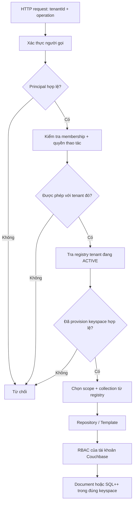

# Định tuyến theo tenant và kiểm soát tenant được phép truy cập

Trong một nền tảng **SaaS đa khách hàng (multi-tenant)**, nhiều công ty cùng sử dụng một ứng dụng nhưng mỗi công ty chỉ được xem và thay đổi dữ liệu thuộc phạm vi của mình. Couchbase cung cấp bucket, scope và collection để tổ chức dữ liệu; **Spring Data Couchbase** cung cấp `@Scope`, `@Collection`, `CouchbaseRepository`, `CouchbaseTemplate` và `DynamicProxyable` để chọn nơi lưu dữ liệu ở runtime.

Tuy nhiên, **định tuyến dữ liệu không đồng nghĩa với phân quyền**. Một người dùng có thể sửa `tenantId` trong URL, gửi document ID của tổ chức khác hoặc gọi một endpoint báo cáo thiếu điều kiện lọc. Nếu hệ thống dùng tài khoản Couchbase có quyền trên nhiều tenant, chỉ việc đặt tên scope riêng sẽ không ngăn được lỗi truy cập chéo.

Bài thuộc chương **Scope và Collection** của module `SPRING_DATA_COUCHBASE`. Chúng ta sẽ thiết kế đường đi an toàn từ **người dùng đã xác thực → tenant được phép → keyspace đã provision → repository/query**, đồng thời phân tích lựa chọn scope-per-tenant, collection-per-tenant và shared collection, các biện pháp ngăn IDOR, RBAC, chỉ mục, TTL, CAS, transaction và luồng reactive.

## 1. Phân biệt tenant, user và keyspace

Một **tenant** là đơn vị sở hữu hoặc quản lý dữ liệu độc lập về mặt nghiệp vụ, chẳng hạn công ty `acme` và `globex` dùng chung hệ thống đặt hàng. Mỗi tenant có thể có nhiều user; một user cũng có thể thuộc nhiều tenant với những quyền khác nhau.

| Khái niệm | Ví dụ | Vai trò |
| --- | --- | --- |
| Tenant ID nội bộ | `t_01J8ACME` | Định danh tenant ổn định, do hệ thống quản lý. |
| User / principal | `user-123` | Danh tính đã được xác thực. |
| Membership | `user-123` có quyền đọc đơn hàng tenant `t_01J8ACME` | Quyết định người dùng có được thao tác hay không. |
| Keyspace | `shop.tenant_acme.orders` | Nơi document được lưu trong Couchbase. |
| Document ID | `order::1001` | Khóa duy nhất **bên trong một collection**. |

Không suy ra tenant chỉ từ tên user, tên domain, chuỗi query hoặc document ID. `requestedTenantId` từ URL là **yêu cầu của client**, không phải bằng chứng người gọi được phép truy cập.

Ví dụ:

```text
GET /api/tenants/t_01J8ACME/orders/order-1001
Authorization: Bearer <access-token>
```

Hệ thống phải kiểm tra:

1. Token có hợp lệ và có thể xác định principal đáng tin cậy không?
2. Principal có membership **đang còn hiệu lực** tại `t_01J8ACME` không?
3. Principal có quyền **READ_ORDER** trong tenant này không?
4. Tenant này đang được ánh xạ tới keyspace nào?
5. Chỉ sau các bước trên mới được đọc document từ keyspace đó.

**Mấu chốt:** một claim `tenantId` trong token, một tham số đường dẫn hoặc một header do client gửi không tự thay cho authorization. Hệ thống phải dùng chính sách và membership tin cậy để quyết định.

## 2. Các mô hình tổ chức dữ liệu multi-tenant

Không có một mô hình đúng cho mọi quy mô. Couchbase cho phép lựa chọn mức cô lập phù hợp với số tenant, quy định bảo mật, nhu cầu chỉ mục và khả năng vận hành.

### 2.1. Mỗi tenant một scope

```text
bucket: shop
├── scope: tenant_acme
│   ├── collection: orders
│   ├── collection: customers
│   └── collection: invoices
└── scope: tenant_globex
    ├── collection: orders
    ├── collection: customers
    └── collection: invoices
```

**Cách truy cập:** tenant `acme` dùng `shop.tenant_acme.orders`, còn tenant `globex` dùng `shop.tenant_globex.orders`.

**Ưu điểm:** tên collection giống nhau giữa các tenant, dễ dùng chung entity/repository; có thể phân quyền theo scope; chỉ mục theo collection và một số chính sách vận hành có thể được quản lý riêng.

**Đổi lại:** mỗi tenant tạo thêm scope và các collection tương ứng. Số lượng scope/collection, index, thao tác provision, backup/restore và vòng đời tenant có thể trở thành gánh nặng; giới hạn tài nguyên phụ thuộc phiên bản Couchbase Server/Capella và cấu hình cluster.

**Phù hợp:** số tenant có thể quản lý được và cần ranh giới logic rõ ràng hoặc RBAC theo scope.

### 2.2. Mỗi tenant một collection trong scope chung

```text
bucket: shop
└── scope: commerce
    ├── collection: orders_acme
    ├── collection: orders_globex
    ├── collection: customers_acme
    └── collection: customers_globex
```

Mô hình này giúp tách dữ liệu ở cấp collection nhưng tên collection tăng theo số tenant và loại document. Khi số tenant hoặc domain tăng, số collection có thể phát triển nhanh.

**Phù hợp:** số tenant nhỏ, ít loại dữ liệu và cần khác biệt về quyền hoặc TTL theo collection. Nếu mỗi tenant có nhiều collection, **scope riêng cho tenant** thường dễ nhìn và quản lý hơn.

### 2.3. Tất cả tenant dùng chung collection

```text
bucket: shop
└── scope: commerce
    ├── collection: orders
    └── collection: customers
```

Document đơn hàng chứa tenant ID:

```json
{
  "tenantId": "t_01J8ACME",
  "customerId": "customer::42",
  "status": "CONFIRMED",
  "total": 1250000
}
```

**Ưu điểm:** số collection tăng theo domain, không tăng theo số tenant; vận hành index và provisioning dễ mở rộng cho nhiều tenant nhỏ.

**Rủi ro:** quyền RBAC ở cấp collection **không tách được từng document theo tenant**. Mỗi đường đọc, tìm kiếm, ghi, cập nhật, xóa, export và báo cáo phải có kiểm soát tenant ở tầng ứng dụng. Một truy vấn thiếu `tenantId` có thể gây rò rỉ dữ liệu liên tenant.

**Phù hợp:** rất nhiều tenant nhỏ, yêu cầu isolation được giải quyết ở ứng dụng, có quy trình review/test nghiêm ngặt.

### 2.4. Mỗi tenant một bucket

Có thể dùng bucket riêng khi tenant yêu cầu cấu hình tài nguyên, chính sách quản trị hoặc cô lập vận hành cấp bucket. Đổi lại, số bucket và độ phức tạp hạ tầng tăng; không nên tạo bucket chỉ vì thêm một user hoặc một entity.

| Tiêu chí | Scope / tenant | Collection / tenant | Shared collection | Bucket / tenant |
| --- | --- | --- | --- | --- |
| Ranh giới dữ liệu | Scope | Collection | Field `tenantId` | Bucket |
| RBAC riêng theo tenant | Có thể theo scope | Có thể theo collection | Không ở mức tenant document | Có thể theo bucket |
| Chỉ mục | Theo collection trong scope | Theo từng collection | Chung, cần khóa lọc tenant | Theo collection/bucket |
| Số tài nguyên theo tenant | Tăng | Tăng nhanh theo loại dữ liệu | Gần như không tăng | Tăng mạnh |
| Chi phí provision/offboard | Trung bình | Trung bình đến cao | Thường thấp hơn | Cao |
| Cách ly tài nguyên vật lý | Không hoàn toàn | Không hoàn toàn | Không | Có thêm ranh giới cấu hình, nhưng còn tùy cluster |
| Nguy cơ lỗi query thiếu tenant filter | Thấp hơn với keyspace đúng | Thấp hơn với keyspace đúng | **Cao**, phải kiểm soát chặt | Thấp hơn với kết nối đúng |

**Nguyên tắc chọn:** bắt đầu từ mức bảo mật và vận hành thực tế cần có; không tuyên bố rằng scope riêng là cách ly tài nguyên tuyệt đối hoặc query context là cơ chế authorization.

## 3. Kiến trúc an toàn: authorize trước, định tuyến sau

Một API phục vụ nhiều tenant nên đi qua các tầng sau:



Có ba lớp cần tách bạch:

1. **Authentication:** ai là người gọi? Kết quả đến từ token/session được hệ thống xác minh, không từ chuỗi client tự khai.
2. **Application authorization:** người đó có quyền làm thao tác cụ thể trên tenant đã yêu cầu không?
3. **Storage authorization:** tài khoản ứng dụng được Couchbase cấp quyền đọc/ghi/truy vấn ở scope/collection nào?

Chỉ sau bước 2 mới nên lựa chọn keyspace. Nếu bước kiểm tra trả về không xác định, lỗi kết nối hệ thống membership hoặc tenant đã bị vô hiệu hóa, chính sách nên **fail closed**: không truy cập dữ liệu bằng một scope mặc định bất kỳ.

### Đừng dùng tên tenant tự do làm tên scope

Đoạn mã sau **không an toàn**:

```java
// Không kiểm tra membership, không tra registry.
OrderRepository selected = orderRepository
    .withScope(request.getTenantId())
    .withCollection("orders");

return selected.findById(orderId);
```

Vấn đề không chỉ ở định dạng chuỗi: một caller có thể biết hoặc đoán tên scope của tenant khác, rồi khiến ứng dụng dùng tài khoản Couchbase có quyền rộng để đọc sai dữ liệu.

Quy trình đúng cần biến **requested tenant ID** thành **trusted route** thông qua chính sách và registry, thay vì coi tên tenant do client gửi là tên scope.

## 4. Thiết kế Tenant Registry và quyền theo thao tác

Registry là nơi quản lý ánh xạ tenant → vị trí dữ liệu đã được provision và trạng thái tenant. Ví dụ về bản ghi cấu hình nội bộ:

| Tenant ID | Trạng thái | Scope | Collection đơn hàng |
| --- | --- | --- | --- |
| `t_01J8ACME` | `ACTIVE` | `tenant_acme` | `orders` |
| `t_01J8GLOBEX` | `ACTIVE` | `tenant_globex` | `orders` |
| `t_01J8LEGACY` | `SUSPENDED` | `tenant_legacy` | `orders` |

Mapping này phải lấy từ nguồn do hệ thống kiểm soát. Nếu một tenant được đổi scope, đó là thay đổi quản trị có kiểm tra dữ liệu và đồng bộ cấu hình, không phải tác dụng phụ của việc client truyền ID khác.

Có thể mô hình hóa hợp đồng bằng Java 17:

```java
public record TenantOrderRoute(String scope, String collection) {
    public TenantOrderRoute {
        if (scope == null || scope.isBlank()
                || collection == null || collection.isBlank()) {
            throw new IllegalArgumentException("Invalid tenant route");
        }
    }
}

public interface TenantRegistry {
    // Chỉ trả về route của tenant đang ACTIVE và đã provision.
    java.util.Optional<TenantOrderRoute> findActiveOrdersRoute(
        String tenantId
    );
}

public interface TenantAccessPolicy {
    // Tham số principalId phải đến từ danh tính đã xác thực.
    void requireReadOrders(String principalId, String tenantId);
    void requireWriteOrders(String principalId, String tenantId);
}
```

Đây là **hợp đồng ứng dụng minh họa**, không phải interface có sẵn trong Spring Data. Một implementation production cần kiểm tra membership, roles, trạng thái tenant, chính sách tài nguyên, quyết định từ chối và vòng đời cache.

Tránh cách triển khai ngây thơ như `"tenant_" + tenantId` làm tên scope mà không kiểm tra tính hợp lệ và sự ánh xạ đã đăng ký. Dù có quy tắc tên có thể dự đoán được, **tenant authorization vẫn phải chạy trước**.

## 5. Định tuyến repository với DynamicProxyable

Đây là lựa chọn phù hợp khi **cùng một loại document và bộ finder** được sử dụng trên các scope khác nhau.

### 5.1. Entity đơn hàng dùng chung

```java
import org.springframework.data.annotation.Id;
import org.springframework.data.annotation.Version;
import org.springframework.data.couchbase.core.mapping.Document;

@Document
public class OrderDocument {

    @Id
    private String id;

    // Có thể giữ để kiểm tra và audit ngay cả khi tenant đã tách scope.
    private String tenantId;

    private String status;

    @Version
    private Long version;

    public OrderDocument() {
    }

    // Constructor, getter và setter được lược bỏ.
}
```

`@Version` hỗ trợ optimistic locking trên document tương ứng. Nó **không** thay thế authorization và không nối các document ở hai tenant thành một phiên bản chung.

### 5.2. Repository hỗ trợ đổi scope và collection

```java
import java.util.List;

import org.springframework.data.couchbase.repository.Collection;
import org.springframework.data.couchbase.repository.CouchbaseRepository;
import org.springframework.data.couchbase.repository.DynamicProxyable;

@Collection("orders")
public interface OrderRepository
        extends CouchbaseRepository<OrderDocument, String>,
                DynamicProxyable<OrderRepository> {

    List<OrderDocument> findByStatus(String status);
}
```

- `CouchbaseRepository` hỗ trợ CRUD và query finder.
- `DynamicProxyable<OrderRepository>` cho phép `withScope()` và `withCollection()` trả về đúng kiểu repository.
- `@Collection("orders")` là giá trị nền; lời gọi runtime vẫn chỉ rõ collection để tránh phụ thuộc vào mapping kế thừa.
- Trong thiết kế này, repository gốc **không được expose trực tiếp** tới controller hay các service có thể bỏ qua authorization.

Để tránh sai package, annotation `@Scope` và `@Collection` của Couchbase nằm trong `org.springframework.data.couchbase.repository`. Không nhầm `@Scope` này với annotation quản lý vòng đời bean của Spring Framework.

### 5.3. Service kiểm tra quyền trước khi chọn repository

```java
import java.util.Optional;

import org.springframework.security.access.AccessDeniedException;
import org.springframework.stereotype.Service;

@Service
public class TenantOrderService {

    private final OrderRepository baseRepository;
    private final TenantRegistry registry;
    private final TenantAccessPolicy accessPolicy;

    public TenantOrderService(
            OrderRepository baseRepository,
            TenantRegistry registry,
            TenantAccessPolicy accessPolicy) {
        this.baseRepository = baseRepository;
        this.registry = registry;
        this.accessPolicy = accessPolicy;
    }

    public Optional<OrderDocument> findOrder(
            String principalId,
            String requestedTenantId,
            String documentId) {

        // 1. Authorization trước khi lookup keyspace.
        accessPolicy.requireReadOrders(
            principalId, requestedTenantId
        );

        // 2. Chỉ chấp nhận route ACTIVE từ registry tin cậy.
        TenantOrderRoute route = registry
            .findActiveOrdersRoute(requestedTenantId)
            .orElseThrow(() ->
                new AccessDeniedException("Tenant unavailable")
            );

        // 3. Đổi cả scope và collection cho đúng lời gọi.
        OrderRepository scoped = baseRepository
            .withScope(route.scope())
            .withCollection(route.collection());

        // 4. Chỉ sau các bước trên mới truy cập Couchbase.
        return scoped.findById(documentId)
            .filter(doc ->
                requestedTenantId.equals(doc.getTenantId())
            );
    }
}
```

Trong ví dụ trên, `getTenantId()` là getter của entity `OrderDocument` (được lược bỏ ở phần khai báo cho gọn). Ví dụ dùng Spring Security để minh họa cách từ chối truy cập; ứng dụng có thể sử dụng lớp exception/domain policy khác.

**Điều quan trọng khi chuyển sang production:**

- `principalId` phải lấy từ security context đã xác thực (không nhận nguyên xi từ request body).
- Chính sách `requireReadOrders` cần kiểm tra membership hiện hành và quyền cụ thể. Quyền đọc không ngầm bao gồm quyền sửa/xóa.
- `registry.findActiveOrdersRoute` chỉ trả về mapping đã được provision. Nếu thiếu mapping hoặc tenant bị khóa, không fallback sang `_default`.
- Phần `filter` tenant ID là **kiểm tra phòng vệ bổ sung**, không thay thế authorization hoặc việc định tuyến đúng scope.
- Giá trị `documentId` vẫn cần quy tắc xác thực/kiểm tra theo nghiệp vụ; đừng suy rằng biết ID đồng nghĩa có quyền sở hữu.
- Với write, phải kiểm tra quyền ghi và bảo đảm document được ghi thuộc tenant đã chọn, không cho client tự thay `tenantId` trong payload.

Ví dụ một đường gọi được phép:

```text
Principal: user-123
Requested tenant: t_01J8ACME
Policy: user-123 được READ_ORDER tại t_01J8ACME
Registry: t_01J8ACME -> tenant_acme / orders
Đích cuối: shop.tenant_acme.orders
```

Nếu user-123 cố chọn `t_01J8GLOBEX` nhưng không thuộc tenant đó, lời gọi phải dừng ở `requireReadOrders`, **không thực hiện truy vấn**.

## 6. Ghi dữ liệu: chống giả mạo tenant và cập nhật chéo

Với multi-tenant, rủi ro không chỉ là đọc lén mà còn là sửa hoặc xóa document thuộc tenant khác. Khi thiết kế command ghi, cần xác định tenant từ ngữ cảnh tin cậy.

### 6.1. Tạo mới

Không lấy `tenantId` từ entity do client gửi rồi lưu nguyên:

```java
// Không an toàn: client có thể đặt tenantId của tổ chức khác.
OrderDocument input = request.toDocument();
baseRepository.save(input);
```

Luồng đúng:

1. Xác định `principalId` từ authentication.
2. Kiểm tra quyền tạo đơn hàng trong `requestedTenantId`.
3. Resolve route của tenant đang ACTIVE.
4. Ứng dụng tạo ID và gán tenant ID từ ngữ cảnh đã được kiểm tra.
5. Lưu bằng repository proxy của tenant tương ứng.

Ví dụ đoạn xử lý sau khi đã có route được authorize:

```java
OrderDocument order = new OrderDocument();
order.setId("order::" + java.util.UUID.randomUUID());
order.setTenantId(authorizedTenantId);
order.setStatus("NEW");

OrderRepository scoped = baseRepository
    .withScope(route.scope())
    .withCollection(route.collection());

scoped.save(order);
```

Có thể dùng `insert` riêng thay vì semantics upsert nếu yêu cầu nghiêm ngặt rằng document mới **không được phép ghi đè** khóa đã tồn tại. Với repository `save`, cần hiểu cách mapping phiên bản/ID quyết định insert/replace.

### 6.2. Cập nhật và xóa

- Authorization cần phân biệt `READ_ORDER`, `WRITE_ORDER`, `DELETE_ORDER` theo chính sách.
- Trước khi cập nhật, xác minh document hiện có thực sự thuộc tenant đúng; không để payload thay `tenantId` hoặc keyspace.
- Dùng `@Version`/CAS hoặc điều kiện cập nhật phù hợp để tránh ghi đè cạnh tranh khi cần.
- Đối với delete, không chỉ tin vào ID; với shared collection cần thêm tenant scoping hoặc cơ chế key composite và kiểm tra owner.
- Thao tác nhiều document không tự trở thành giao dịch chỉ vì cùng tenant; hãy dùng transaction API khi nghiệp vụ cần tính nguyên tử.

**Không lưu một repository proxy có scope thay đổi được trong trường mutable của singleton service và sửa theo request.** Dùng biến cục bộ/đối tượng proxy trả về cho chính lời gọi để tránh luồng request của tenant A vô tình dùng route của tenant B.

## 7. Shared collection: mọi truy vấn phải có tenant predicate

Nếu nhiều tenant dùng chung `shop.shared.orders`, dữ liệu phải mang định danh tenant trong document và quy tắc truy cập ứng dụng.

### 7.1. Entity và finder

```java
import org.springframework.data.annotation.Id;
import org.springframework.data.couchbase.core.mapping.Document;
import org.springframework.data.couchbase.repository.Scope;
import org.springframework.data.couchbase.repository.Collection;

@Document
@Scope("shared")
@Collection("orders")
public class SharedOrderDocument {

    @Id
    private String id;

    private String tenantId;
    private String status;

    public SharedOrderDocument() {}

    // Getters, setters và constructor được lược bỏ.
}
```

Repository được thiết kế có finder bắt buộc tenant:

```java
import java.util.List;
import org.springframework.data.couchbase.repository.CouchbaseRepository;

public interface SharedOrderRepository
        extends CouchbaseRepository<SharedOrderDocument, String> {

    List<SharedOrderDocument> findByTenantIdAndStatus(
        String tenantId, String status
    );
}
```

**Điều kiện bắt buộc ở service:** truyền `tenantId` đã được authorize, không truyền giá trị lấy trực tiếp từ query parameter. Trong shared collection, một finder như `findByStatus("CONFIRMED")` mà thiếu tenant predicate có thể trả về đơn hàng thuộc mọi tenant.

### 7.2. Câu SQL++ an toàn hơn về phạm vi

```sql
SELECT META(o).id AS documentId,
       o.tenantId,
       o.status
FROM `shop`.`shared`.`orders` AS o
WHERE o.tenantId = $tenantId
  AND o.status = $status;
```

Cần dùng named parameters cho **giá trị** `tenantId` và `status` từ server-side authorization context. Các tham số query không phải cơ chế lựa chọn identifier trong `FROM`.

Index có tenant ID làm khóa dẫn đầu:

```sql
CREATE INDEX ix_orders_tenant_status
ON `shop`.`shared`.`orders`(tenantId, status);
```

Index này là điểm bắt đầu hợp lý nếu truy vấn thường lọc theo tenant và trạng thái. Thiết kế index thực tế phải dựa trên `EXPLAIN`, dữ liệu, điều kiện type discriminator của Spring Data và các query/report đang chạy.

### 7.3. Đọc theo ID cần kiểm soát riêng

Một document key đơn giản như `order::1001` không tự biểu diễn tenant. Với shared collection, có thể tổ chức key theo dạng:

```text
tenant::<internalTenantId>::order::<uuid>
```

Ví dụ:

```text
tenant::t_01J8ACME::order::4c6f3d2a
tenant::t_01J8GLOBEX::order::4c6f3d2a
```

Từ tenant đã được authorize và business ID đã được xác thực, ứng dụng tự tạo composite key; không nhận một key tuyệt đối rồi tin rằng nó thuộc tenant hiện tại.

Kể cả khi key có tiền tố tenant, cần:

- Kiểm tra tenant ID trong document lúc đọc và cập nhật khi phù hợp.
- Không expose `findAll()` hoặc `findById()` trực tiếp cho controller thiếu tenant guard.
- Kiểm soát các đường export, background job, event consumer và admin API tương tự HTTP endpoint.
- Đảm bảo việc tạo ID, lưu document và cập nhật không thể bị thao tác chéo bằng payload hoặc path khác.
- Không dựa vào việc ID khó đoán như một biện pháp bảo mật duy nhất.

### 7.4. Báo cáo tổng hợp và quyền cross-tenant

Đôi khi nhân viên vận hành được phép làm báo cáo trên nhiều tenant. Hãy định nghĩa **quyền riêng**, ví dụ `REPORT_CROSS_TENANT`, thay vì bỏ predicate khi nhận giá trị `tenantId = "*"` từ client. Nên có API/bộ quyền riêng và ghi audit những thao tác mở rộng phạm vi dữ liệu.

## 8. RBAC của Couchbase và quyền của ứng dụng

Couchbase bảo vệ dữ liệu bằng **Role-Based Access Control (RBAC)**. Các role cấp quyền theo phạm vi bucket, scope hoặc collection, tùy loại quyền.

| Loại quyền (ví dụ) | Tác dụng thường gặp |
| --- | --- |
| `data_reader` | Đọc dữ liệu bằng KV trong phạm vi được cấp. |
| `data_writer` | Ghi dữ liệu bằng KV trong phạm vi được cấp. |
| `query_select` | Thực thi SQL++ `SELECT` trên collection được cấp. |
| Quyền quản lý scope/index | Dành cho quy trình provisioning hoặc quản trị, không tự cấp rộng cho service thường. |

Ví dụ cách biểu diễn role theo tài liệu RBAC:

```text
data_reader[shop:tenant_acme:orders]
data_writer[shop:tenant_acme:orders]
query_select[shop:tenant_acme:orders]
```

Đây là **cú pháp mô tả phạm vi role**, không phải cấu hình tạo user hoàn chỉnh. Tài khoản chạy hệ thống có thể được cấp quyền khác nhau theo quy định của tổ chức.

### Một service account hay mỗi tenant một credential?

**Một service account dùng nhiều tenant:** dễ triển khai và pool kết nối, nhưng tài khoản Couchbase có thể đọc nhiều scope. Lúc này kiểm tra membership/authorization trong ứng dụng là lớp bắt buộc; nếu nó bị bỏ qua, DB RBAC không ngăn được việc truy cập chéo giữa các scope mà service account được phép đọc.

**Credential tách theo tenant hoặc nhóm tenant:** có thể áp RBAC chặt hơn ở tầng DB, nhưng phải quản lý nhiều tài khoản, secrets, rotation, connection/client và provisioning. Đây là lựa chọn khi yêu cầu cô lập cao và quy mô vận hành cho phép.

**Không hiểu sai query context:** SQL++ `query_context` giúp phân giải tên collection rút gọn, **không cấp hoặc giới hạn quyền**. Một câu query có đường dẫn keyspace đầy đủ vẫn có thể truy cập collection khác nếu credential có quyền. Bởi vậy, không được dùng “đã đặt context tenant A” như chứng minh không thể đọc tenant B.

## 9. Spring Data @Query, Template và truy vấn tự viết

Với tenant-per-scope, annotation trên entity hoặc repository có thể đặt scope nền. Nhưng khi định tuyến theo tenant động, lựa chọn `withScope()/withCollection()` của `DynamicProxyable` có ưu tiên cao hơn annotation.

Thứ tự ưu tiên Spring Data Couchbase từ cao xuống thấp:

1. `inScope()/inCollection()` của một fluent operation trên Template.
2. `withScope()/withCollection()` của Template hoặc repository đã được cấu hình.
3. `@Scope/@Collection` trên method repository.
4. `@Scope/@Collection` trên repository interface.
5. `@Scope/@Collection` trên entity.
6. Scope nền của cấu hình ứng dụng.

### 9.1. Dùng Template sau khi đã authorize

```java
// route đã được tra registry sau bước authorization.
OrderDocument order = couchbaseTemplate
    .findById(OrderDocument.class)
    .inScope(route.scope())
    .inCollection(route.collection())
    .one(documentId);
```

Lựa chọn trực tiếp trên fluent operation có ưu tiên cao nhất. Nó là **khả năng định tuyến**, không phải policy engine; caller phải kiểm tra quyền trước khi tới đây.

### 9.2. @Query nên tôn trọng mapping keyspace

Với repository có scope được chọn runtime, query tùy chỉnh có thể dùng SpEL do Spring Data hỗ trợ:

```java
import java.util.List;
import org.springframework.data.couchbase.repository.Query;

@Query("#{#n1ql.selectEntity} WHERE #{#n1ql.filter} " +
       "AND status = $1")
List<OrderDocument> findByStatusCustom(String status);
```

`#{#n1ql.selectEntity}` giúp tạo phần SELECT/FROM theo entity và keyspace hiệu lực; `#{#n1ql.filter}` bổ sung điều kiện mapping kiểu document. Trong shared collection, **phải thêm điều kiện tenant** hoặc dùng finder `findByTenantIdAndStatus`. Không giả định `#n1ql.filter` tự bổ sung tenant ID nghiệp vụ.

Tránh hardcode một collection khác trong `FROM` rồi kỳ vọng `withScope()` sẽ sửa câu SQL++:

```java
// Dễ đọc sai tenant khi đích lưu được chọn động:
@Query("SELECT o.* FROM `shop`.`tenant_acme`.`orders` AS o " +
       "WHERE o.status = $1")
List<OrderDocument> unsafeHardcodedQuery(String status);
```

Câu query có keyspace viết cứng cần được rà soát riêng. Trong thực tế, hãy dùng query derivation, SpEL phù hợp hoặc template với keyspace được chọn từ registry tin cậy.

### 9.3. Không đưa tên collection từ user vào SQL++ bằng nối chuỗi

```java
// Không nên:
String sql = "SELECT o.* FROM " + requestedScope
           + "." + requestedCollection
           + " AS o";
```

Ngoài nguy cơ định tuyến trái phép, đây còn là cách dựng SQL++ identifier từ dữ liệu chưa tin cậy. Query parameters phù hợp cho **giá trị**, không phải thay thế tùy ý tên keyspace trong `FROM`. Chọn route từ mapping do hệ thống quản lý và sử dụng API Spring Data/SDK thích hợp.

## 10. API reactive: không dựa vào ThreadLocal tenant thiếu kiểm soát

Trong `ReactiveCouchbaseRepository` hoặc `ReactiveCouchbaseTemplate`, luồng xử lý có thể chuyển thread. Vì thế, cách gắn tenant vào một `ThreadLocal` mutable rồi đọc lại ở tầng repository là dễ lỗi nếu không có chiến lược context propagation đã được kiểm chứng.

Một cách rõ ràng hơn là **truyền tenant đã được authorize qua pipeline**:

```java
import reactor.core.publisher.Mono;

public interface ReactiveTenantAccessPolicy {
    // Mono hoàn tất nếu được phép; phát lỗi nếu bị từ chối.
    Mono<Void> requireReadOrders(String principalId, String tenantId);
}

public interface ReactiveTenantRegistry {
    // Chỉ emit route của tenant đang ACTIVE.
    Mono<TenantOrderRoute> activeOrdersRoute(String tenantId);
}
```

Repository reactive:

```java
import org.springframework.data.couchbase.repository.Collection;
import org.springframework.data.couchbase.repository.DynamicProxyable;
import org.springframework.data.couchbase.repository.ReactiveCouchbaseRepository;

@Collection("orders")
public interface ReactiveOrderRepository
        extends ReactiveCouchbaseRepository<OrderDocument, String>,
                DynamicProxyable<ReactiveOrderRepository> {
}
```

Service reactive:

```java
import org.springframework.security.access.AccessDeniedException;
import reactor.core.publisher.Mono;

public Mono<OrderDocument> findOrderReactive(
        String principalId,
        String requestedTenantId,
        String documentId) {

    return reactiveAccessPolicy
        .requireReadOrders(principalId, requestedTenantId)
        .then(reactiveRegistry.activeOrdersRoute(requestedTenantId))
        .switchIfEmpty(Mono.error(
            new AccessDeniedException("Tenant unavailable")
        ))
        .flatMap(route ->
            reactiveOrderRepository
                .withScope(route.scope())
                .withCollection(route.collection())
                .findById(documentId)
        )
        .filter(order ->
            requestedTenantId.equals(order.getTenantId())
        );
}
```

Các biến `reactiveAccessPolicy`, `reactiveRegistry` và `reactiveOrderRepository` là dependency của service (inject qua constructor trong mã production). Phương thức chỉ là minh họa cách *compose* pipeline.

**Lưu ý:** nếu implementation kiểm tra membership hoặc registry phải thực hiện truy vấn blocking, không gọi trực tiếp nó trên event loop; cần thiết kế truy cập reactive hoặc chuyển luồng một cách có chủ đích. Không dùng `block()` trong request pipeline reactive để “chờ” quyết định quyền.

Khi hệ thống dùng Spring Security reactive, principal phải được lấy từ security context hợp lệ. Không lấy `principalId` từ field body rồi cho phép caller tự giả danh.

## 11. Chỉ mục và tính nhất quán theo từng mô hình tenant

### Tenant-per-scope

Với scope riêng:

```sql
CREATE INDEX ix_orders_status_acme
ON `shop`.`tenant_acme`.`orders`(status);

CREATE INDEX ix_orders_status_globex
ON `shop`.`tenant_globex`.`orders`(status);
```

Hai collection có index riêng. Khi provision tenant mới, phải provision cả scope/collection **và chỉ mục** trước khi mở lưu lượng.

Câu SQL++ đầy đủ:

```sql
SELECT META(o).id AS documentId, o.status
FROM `shop`.`tenant_acme`.`orders` AS o
WHERE o.status = "CONFIRMED";
```

Ngay cả khi Query Service đang có `query_context` cho tenant khác, đường dẫn keyspace đầy đủ vẫn trỏ vào `tenant_acme.orders`. **Query context không bảo đảm cô lập tenant.**

### Shared collection

Với nhiều tenant trong `shop.shared.orders`, mọi truy vấn nghiệp vụ cần predicate `tenantId` tương ứng và index bắt đầu bằng `tenantId` khi phù hợp:

```sql
CREATE INDEX ix_orders_tenant_status
ON `shop`.`shared`.`orders`(tenantId, status);
```

Dùng `EXPLAIN` để kiểm tra kế hoạch truy vấn và bảo đảm các truy vấn theo tenant không bị mở rộng thành quét ngoài phạm vi cần thiết.

### KV và SQL++ có đặc tính khác nhau

- `findById` thường là KV theo key, không cần secondary index SQL++.
- Finder theo thuộc tính chạy qua SQL++, cần index phù hợp với đúng collection.
- Sau một lệnh ghi KV, index có thể chưa cập nhật ngay; query SQL++ có thể chưa nhìn thấy document với scan consistency mặc định.
- Mức nhất quán mạnh hơn cho truy vấn (ví dụ `REQUEST_PLUS` khi phù hợp) có thể tăng độ trễ. Phải cân bằng theo nghiệp vụ và đo lường.

Nếu không tìm thấy document, xác minh **tenant authorization → route → keyspace → KV → query/index** theo thứ tự thay vì vội cho rằng document đã bị mất.

## 12. TTL, CAS và transaction trong hệ thống nhiều tenant

### 12.1. TTL và vòng đời dữ liệu

Collection có thể có chính sách hết hạn tài liệu khác nhau tùy phiên bản/cấu hình Couchbase. Một số tenant có yêu cầu retention khác nhau: ví dụ tenant doanh nghiệp lưu đơn hàng lâu hơn tenant thử nghiệm.

- Với tenant-per-scope, TTL có thể đặt theo **collection** hoặc trên từng document; scope không có `maxTTL` riêng.
- Với shared collection, chính sách collection áp dụng chung; thời hạn riêng từng tenant cần được ứng dụng kiểm soát khi ghi và phải tôn trọng giới hạn ở bucket/collection.
- Không áp expiry ngắn cho dữ liệu phải lưu lâu vì hợp đồng hoặc quy định.

### 12.2. CAS và optimistic locking

Couchbase CAS giúp kiểm soát xung đột trên **document cụ thể trong một collection**. `@Version` của Spring Data có thể hỗ trợ optimistic locking khi update.

CAS không xác thực người dùng, không chứng minh tenant ownership. Nếu hai tenant có key `order::1001` trong hai collection riêng, đó vẫn là hai document độc lập với phiên bản riêng.

### 12.3. Giao dịch nhiều document

Tạo đơn hàng, trừ tồn kho và ghi sự kiện nghiệp vụ bằng các lệnh `save` độc lập không tự thành giao dịch. Khi nghiệp vụ yêu cầu nguyên tử, cần transaction API phù hợp của Couchbase/Spring Data, xử lý retry và điều kiện hỗ trợ theo phiên bản.

**Đừng dùng transaction như biện pháp kiểm tra tenant.** Authorization phải diễn ra trước khi tổ chức chuỗi thao tác; mọi document/keyspace trong transaction cần thuộc tập tài nguyên đã được policy cho phép.

## 13. Tenant lifecycle: onboarding, đình chỉ, chuyển vùng và offboarding

Định tuyến tenant là một phần của vận hành hệ thống, không chỉ của code repository.

### 13.1. Onboarding tenant mới

1. Tạo tenant ID **ổn định** ở registry với trạng thái `PROVISIONING`.
2. Chọn mô hình lưu trữ và keyspace từ chính sách do hệ thống quản lý.
3. Provision scope/collection và index nếu mô hình tenant-per-scope.
4. Cấp quyền DB hoặc thiết lập quyền dịch vụ theo phạm vi cần thiết.
5. Kiểm thử quyền và read/write trên keyspace vừa tạo.
6. Chuyển trạng thái registry sang `ACTIVE` khi mọi tài nguyên đã sẵn sàng.
7. Tạo membership ban đầu cho người quản trị tenant bằng quy trình xác thực và phê duyệt.

Không để tenant `ACTIVE` trước khi tạo đủ tài nguyên và quyền, tránh route tới collection chưa tồn tại hoặc fallback sang `_default`.

### 13.2. Khóa tenant hoặc thu hồi membership

Khi tenant bị `SUSPENDED` hoặc membership của user bị thu hồi:

- Policy phải chặn thao tác ngay theo yêu cầu nhất quán của sản phẩm.
- Registry không trả route active cho tenant bị khóa.
- Cache membership và route phải có cơ chế invalidation/TTL phù hợp với yêu cầu thu hồi quyền.
- Các background job hoặc tác vụ đã xếp hàng phải kiểm tra quyền/trạng thái tenant ở thời điểm thực thi khi cần.

**Không cố dùng status rỗng hoặc unknown để “chọn tenant mặc định”.** Unknown/inactive tenant phải thất bại an toàn.

### 13.3. Di chuyển tenant sang scope/bucket khác

Nếu tenant cần chuyển sang keyspace khác:

1. Provision đích, index và quyền.
2. Sao chép document, kiểm tra schema, key, expiry, metadata mapping và dữ liệu liên quan.
3. Lập chiến lược ghi trong giai đoạn chuyển: dừng ghi có kiểm soát hoặc cơ chế đồng bộ phù hợp.
4. Xác minh dữ liệu ở đích, thực hiện chuyển route có kiểm soát.
5. Cập nhật cache và quan sát lỗi/độ trễ.
6. Chỉ dọn keyspace cũ sau khi xác nhận rollback/retention.

Đổi mapping trong registry hoặc gọi `withScope` **không tự migrate dữ liệu**.

### 13.4. Offboarding

Cần định nghĩa chính sách lưu giữ, backup, xóa dữ liệu và quyền truy cập theo quy định áp dụng. Không đơn giản xóa scope ngay khi nhận request: có thể còn transaction, dữ liệu cần retention hoặc job đang chạy.

## 14. Kiểm thử chống truy cập chéo tenant

Multi-tenancy cần các test âm tính (*negative tests*), không chỉ thử đường đi thành công của user hợp lệ.

| Kịch bản | Dữ liệu | Kết quả mong muốn |
| --- | --- | --- |
| User A đọc đơn hàng tenant A | Membership và quyền đọc hợp lệ | Được phép; đúng collection tenant A. |
| User A yêu cầu tenant B | Không có membership tenant B | Bị từ chối trước khi gọi repository. |
| User A có quyền đọc nhưng thử xóa | Không có `DELETE_ORDER` | Bị từ chối. |
| User A dùng ID đơn hàng tenant B trong route tenant A | ID từ tenant khác | Không trả/không sửa dữ liệu tenant B. |
| User đổi `tenantId` trong JSON khi tạo mới | Payload giả mạo | Server bỏ qua hoặc từ chối giá trị; gán tenant đã authorize. |
| Tenant `SUSPENDED` | Registry không active | Bị từ chối; không fallback. |
| Shared collection: query thiếu tenant predicate | `findByStatus` hoặc export sai phạm vi | Test phải phát hiện; endpoint không được trả dữ liệu cross-tenant. |
| User A gọi câu SQL++ khác scope | Credential dịch vụ có quyền rộng | App policy phải chặn việc chọn keyspace trái phép. |
| Thử cập nhật document cùng key tại tenant B | Key trùng, scope khác | Không đổi document tenant B. |
| Thu hồi membership trong khi có cache | User A mất quyền | Đường gọi mới bị chặn theo yêu cầu thu hồi. |
| Luồng reactive xử lý request A và B đồng thời | Hai tenant khác nhau | Không rò context/proxy giữa hai luồng. |
| Provision tenant thiếu collection/index | Registry chưa ACTIVE | Không mở API đọc/ghi đến đích chưa sẵn sàng. |

**Cách viết test hiệu quả:** tạo hai tenant có document trùng ID nhưng nội dung khác nhau. Bằng cách đó, nếu route bị dùng sai, test sẽ nhìn thấy lỗi rõ ràng thay vì chỉ gặp kết quả rỗng.

Ngoài HTTP API, cần kiểm thử cả scheduled job, message consumer, batch export, endpoint admin và công cụ ETL vì đây cũng là các đường truy cập dữ liệu có thể bỏ qua controller authorization.

## 15. Các lỗi thiết kế thường gặp

| Lỗi | Hậu quả | Sửa thế nào |
| --- | --- | --- |
| Dùng `tenantId` trong URL làm tên scope trực tiếp. | Có thể truy cập tenant khác khi service account có quyền rộng. | Tra authorization và registry tin cậy trước khi chọn route. |
| Dựa vào `query_context` để giới hạn tenant. | SQL++ keyspace đầy đủ có thể vượt context nếu credential cho phép. | Dùng app authorization + RBAC và không expose truy vấn tùy ý. |
| Không kiểm tra quyền theo **thao tác**. | User có READ vẫn có thể WRITE/DELETE. | Quy định permission riêng cho read/write/delete/export. |
| Dùng shared collection nhưng finder không có `tenantId`. | Rò dữ liệu cross-tenant. | Bắt buộc tenant predicate từ context tin cậy, index phù hợp. |
| Dùng `findById(id)` trực tiếp trong shared collection. | Có thể đọc document tenant khác nếu biết ID. | Dùng ID có namespace tenant + kiểm tra ownership trước khi trả/cập nhật. |
| Ghi nguyên `tenantId` từ request body. | Giả mạo sở hữu dữ liệu. | Server gán tenant ID từ route đã authorize. |
| Registry không có trạng thái tenant. | Tenant chưa provision hoặc đã khóa vẫn được truy cập. | Trạng thái `PROVISIONING/ACTIVE/SUSPENDED` và fail closed. |
| Đổi scope nhưng quên collection. | Truy cập sai collection hoặc “not found”. | Chọn cả `withScope` và `withCollection`. |
| Tạo scope/collection cho mọi tenant không kiểm soát quy mô. | Hết giới hạn tài nguyên, tăng chi phí index/provision. | So sánh mô hình shared collection, kiểm tra giới hạn phiên bản. |
| Dùng mutable global tenant context ở service singleton. | Request tenant này nhiễm route tenant khác. | Route tường minh, proxy cục bộ, context propagation có kiểm thử. |
| Dùng tài khoản Couchbase có quyền toàn bucket và bỏ app policy. | DB RBAC không bảo vệ được giữa các scope mà account được cấp quyền. | Least privilege và authorization ở service. |
| Đổi route tenant mà không migrate dữ liệu. | Đọc/ghi sai nơi, kết quả không nhất quán. | Quy trình chuyển dữ liệu và cutover có đối soát. |

## 16. Bài tập tình huống

### Câu 1. Hai tenant có collection riêng nhưng cùng ID

Tenant `acme` và `globex` đều có document key `order::1001`. Một API nhận:

```text
GET /tenants/globex/orders/order::1001
```

Người gọi chỉ có membership tenant `acme`.

**Đáp án:** phải từ chối trước khi query. ID trùng nhau không phải vấn đề; **request tenant B không được phép** mới là vấn đề.

### Câu 2. Tài khoản service có quyền mọi scope

Ứng dụng sử dụng `shop.tenant_acme.orders` và `shop.tenant_globex.orders`. Tài khoản Couchbase được cấp quyền đọc cả hai. Một developer cho phép frontend truyền scope vào `withScope()`.

**Đáp án:** không an toàn. RBAC của cùng tài khoản không ngăn được việc dùng route khác trong tập phạm vi đã được cấp. Phải kiểm tra membership và permission, rồi lấy route từ registry đã kiểm soát.

### Câu 3. Có hàng chục nghìn tenant nhỏ

Mỗi tenant chỉ có vài trăm đơn hàng, nhưng ứng dụng dự kiến tạo ba collection cho mỗi tenant.

**Đáp án:** cần kiểm tra giới hạn và chi phí quản trị theo phiên bản. Shared collection với `tenantId`, index có khóa dẫn đầu tenant và các lớp authorization chặt chẽ có thể phù hợp hơn; không tự mặc định tenant-per-scope sẽ mở rộng vô hạn.

### Câu 4. Shared collection và truy vấn thiếu tenantId

Repository:

```java
List<SharedOrderDocument> findByStatus(String status);
```

Service gọi phương thức này cho user tenant A.

**Đáp án:** query có thể trả đơn hàng của nhiều tenant. Phải chọn finder có điều kiện `tenantId` từ authorization context hoặc thiết kế tầng truy cập bắt buộc tenant predicate; chặn trực tiếp phương thức thiếu scoping ở endpoint tenant.

### Câu 5. Request B dùng lại proxy của request A

Một singleton service giữ trường `currentRepository` và ghi đè theo tenant mỗi khi có request.

**Đáp án:** dễ tạo lỗi cạnh tranh. Không lưu lựa chọn tenant trong mutable singleton; dùng proxy được trả về như biến cục bộ của request hoặc thiết kế truyền route tường minh.

### Câu 6. Đổi query context có tự ngăn SQL++ đọc tenant khác?

**Đáp án:** không. Query context chỉ hỗ trợ phân giải tên collection rút gọn. Đường dẫn đầy đủ vẫn chỉ đến collection khác nếu tài khoản có quyền. Authorization phải được thực hiện ở ứng dụng và/hoặc bằng credential RBAC bị giới hạn.

## 17. Checklist thiết kế và code review

1. **Mô hình dữ liệu:** chọn scope-per-tenant, collection-per-tenant, shared collection hay bucket-per-tenant dựa trên quy mô và yêu cầu cô lập.
2. **Định danh tenant:** dùng tenant ID nội bộ ổn định; không lấy tên scope từ request một cách tự do.
3. **Authentication:** principal đến từ nguồn xác thực đã được kiểm tra.
4. **Authorization:** kiểm tra membership còn hiệu lực và permission cho từng thao tác trước khi truy cập DB.
5. **Tenant Registry:** route chỉ dành cho tenant ACTIVE, đã provision và ánh xạ bởi hệ thống.
6. **Repository/Template:** chọn cả scope/collection; không expose truy cập raw thiếu guard.
7. **Shared collection:** mọi đường read/query/export phải mang tenant predicate, KV theo ID có kiểm tra ownership và quy ước key.
8. **RBAC:** quyền tối thiểu theo scope/collection; hiểu rủi ro service account có quyền rộng.
9. **SQL++ và index:** chỉ mục đúng collection; query context không được xem là ranh giới bảo mật.
10. **Ghi và concurrency:** server gán tenant ID, kiểm soát payload, dùng CAS/optimistic lock khi cần.
11. **Reactive:** không dựa vào mutable `ThreadLocal`; truyền context rõ ràng và kiểm thử concurrent requests.
12. **Vòng đời tenant:** onboarding, suspend, revocation, migration, offboarding có trạng thái và quy trình.
13. **Kiểm thử:** có negative tests cross-tenant cho CRUD, finder, admin/export, background jobs và reactive.
14. **Audit:** ghi tenant ID nội bộ, actor và kết quả policy ở mức phù hợp, không ghi token hoặc dữ liệu nhạy cảm không cần thiết.

## Ghi nhớ

**Định tuyến theo tenant chỉ trả lời “truy cập ở đâu”; authorization trả lời “ai được phép làm gì”.** Với Spring Data Couchbase, `DynamicProxyable` và `CouchbaseTemplate` giúp lựa chọn scope/collection theo request, nhưng lựa chọn đó phải xuất phát từ registry **đã được kiểm tra quyền**. Nếu dùng shared collection, `tenantId` cần được áp dụng vào cả truy vấn và quy tắc quản lý document ID. RBAC, chỉ mục, TTL, CAS, giao dịch và các luồng reactive phải được thiết kế theo mô hình tenant đã chọn, không được kỳ vọng annotation hay query context tự tạo hàng rào bảo mật.

## Tài liệu tham khảo

- [Couchbase Server — Scopes and Collections](https://docs.couchbase.com/server/current/learn/data/scopes-and-collections.html): tổ chức dữ liệu, tenant separation, quyền và giới hạn scope/collection.
- [Couchbase Server — Roles](https://docs.couchbase.com/server/current/learn/security/roles.html): `data_reader`, `data_writer`, `query_select` và quyền trên tài nguyên.
- [Couchbase Server — RBAC REST API](https://docs.couchbase.com/server/current/rest-api/rbac.html): cách biểu diễn quyền trên bucket, scope và collection.
- [Spring Data Couchbase — Collection Support](https://docs.spring.io/spring-data/couchbase/reference/couchbase/collections.html): `DynamicProxyable`, `inScope`/`inCollection`, `withScope`/`withCollection` và thứ tự ưu tiên.
- [Spring Data Couchbase — DynamicProxyable Javadoc](https://docs.spring.io/spring-data/couchbase/reference/api/java/org/springframework/data/couchbase/repository/DynamicProxyable.html): kiểu generic và chữ ký API định tuyến động.
- [Spring Data Couchbase — Repository Queries](https://docs.spring.io/spring-data/couchbase/reference/couchbase/repository.html): query derivation, SpEL và yêu cầu chỉ mục.

