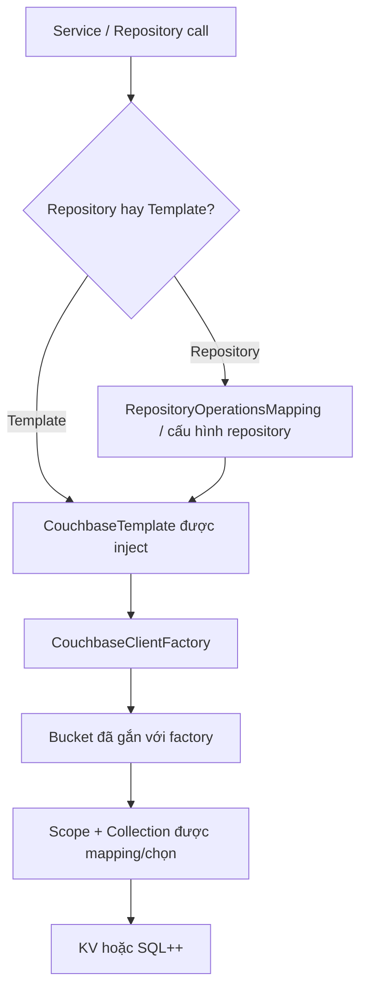

# Tách repository hoặc Template cho nhiều bucket trong Spring Data Couchbase

Khi phát triển một hệ thống với **Spring Data Couchbase**, việc tổ chức dữ liệu không dừng ở scope và collection. Có những trường hợp **đơn hàng đang hoạt động**, **sự kiện kiểm toán** và **dữ liệu lưu trữ** cần dùng những **bucket khác nhau** để áp dụng chính sách tài nguyên, quyền truy cập hoặc vòng đời vận hành khác nhau. Khi đó, chỉ đổi `@Scope`, `@Collection` hay gọi `inScope()` là **chưa đủ**: ứng dụng phải chọn đúng **CouchbaseClientFactory**, **CouchbaseTemplate** hoặc **repository được ánh xạ tới bucket tương ứng**.

Bài thuộc chương **Scope và Collection** của module `SPRING_DATA_COUCHBASE`. Chúng ta sẽ xây dựng một kiến trúc truy cập nhiều bucket, giải thích các API Spring Data để ánh xạ repository, tách Template ở tầng service và mở rộng sang reactive. Phần cuối phân tích SQL++, chỉ mục, TTL, CAS, giao dịch, phân quyền và các tình huống kiểm thử để không đọc/ghi nhầm bucket.

Sau bài học, bạn có thể:

- Phân biệt **chọn bucket** với **chọn scope/collection**.
- Hiểu vì sao một `CouchbaseClientFactory` gắn với một bucket.
- Tạo Template riêng cho từng bucket và inject bằng `@Qualifier`.
- Sử dụng `RepositoryOperationsMapping` với `map`, `mapEntity` và `setDefault`.
- Biết vai trò của `@EnableCouchbaseRepositories(couchbaseTemplateRef = ...)` trong một chiến lược thay thế.
- Thiết kế routing an toàn, kể cả khi một entity có nhiều repository hoặc khi dùng API reactive.
- Đánh giá hệ quả của nhiều bucket đối với index, quyền, consistency, expiry, CAS, transaction và quá trình migration.

## 1. Khi nào cần tách bucket?

Giả sử một nền tảng bán hàng có ba nhóm dữ liệu:

```text
Couchbase cluster
├── bucket: shop-live
│   ├── scope: commerce
│   │   ├── collection: orders
│   │   └── collection: customers
│   └── scope: catalog
│       └── collection: products
├── bucket: shop-audit
│   └── scope: operations
│       └── collection: audit_events
└── bucket: shop-archive
    └── scope: archive
        └── collection: orders_history
```

Ví dụ yêu cầu nghiệp vụ:

| Dữ liệu | Keyspace | Đặc tính nổi bật |
| --- | --- | --- |
| Đơn hàng hiện hành | `shop-live.commerce.orders` | Đọc/ghi thường xuyên, có yêu cầu phản hồi nhanh. |
| Khách hàng | `shop-live.commerce.customers` | Dữ liệu nghiệp vụ cần kiểm soát quyền. |
| Audit event | `shop-audit.operations.audit_events` | Ghi bổ sung, truy vấn kiểm toán, chính sách giữ dữ liệu riêng. |
| Đơn hàng lịch sử | `shop-archive.archive.orders_history` | Ít ghi, truy vấn theo giai đoạn, vòng đời lưu trữ khác. |

Tách bucket có thể hữu ích khi cần các cấu hình **cấp bucket** khác nhau như tài nguyên lưu trữ, replica, expiry mặc định, cơ chế backup, mức quota hoặc quyền. Nhưng **không nên tách bucket chỉ vì xuất hiện thêm một Java entity**. Nếu hai nhóm dữ liệu dùng chung chính sách tài nguyên và vận hành, các scope/collection riêng trong một bucket có thể đơn giản hơn.

### Sự khác nhau giữa nhiều collection và nhiều bucket

| Việc muốn làm | Cách triển khai |
| --- | --- |
| Cùng bucket, chuyển từ `commerce.orders` sang `archive.orders_history` | `@Scope/@Collection`, `inScope/inCollection` hoặc `withScope/withCollection`. |
| Chuyển từ `shop-live` sang `shop-audit` | Chọn **client factory/Template/repository ánh xạ bucket khác**. |
| Truy vấn SQL++ từ nhiều collection | Có thể dùng keyspace đầy đủ trong query và quyền phù hợp. |
| Di chuyển dữ liệu sang bucket khác | Cần **quy trình copy/migrate**; đổi mapping không tự di chuyển. |

**Giới hạn cốt lõi:** `inScope("operations")` và `inCollection("audit_events")` chỉ chọn scope/collection **bên trong bucket đang gắn với Template**. Chúng không thay đổi `shop-live` thành `shop-audit`.

## 2. Các thành phần Spring Data tham gia chọn bucket

Một thao tác repository/Template thường đi qua các thành phần:



### 2.1. CouchbaseClientFactory

`CouchbaseClientFactory` là abstraction Spring Data sử dụng để truy cập các đối tượng Couchbase SDK đã được quản lý. Theo Javadoc của Spring Data Couchbase, **một client factory được gắn với một bucket**.

Có thể hình dung:

```text
CouchbaseClientFactory(shop-live)  -> bucket shop-live
CouchbaseClientFactory(shop-audit) -> bucket shop-audit
CouchbaseClientFactory(shop-archive) -> bucket shop-archive
```

Một factory có thể cung cấp scope mặc định hoặc tạo biến thể theo scope, nhưng **`withScope()` trên factory không phải `withBucket()`**.

### 2.2. CouchbaseTemplate và ReactiveCouchbaseTemplate

`CouchbaseTemplate` sử dụng factory và converter để thực hiện mapping entity. Nếu Template được tạo bằng factory của `shop-audit`, thao tác của nó nhắm tới bucket `shop-audit`.

`ReactiveCouchbaseTemplate` giữ vai trò tương tự trong mô hình reactive, với kết quả như `Mono` và `Flux`.

### 2.3. RepositoryOperationsMapping

Repository Spring Data không nhất thiết dùng cùng Template. `RepositoryOperationsMapping` quyết định **repository interface hoặc domain entity nào được hỗ trợ bởi CouchbaseOperations nào**.

Có ba cách chọn:

- `map(RepositoryInterface.class, operations)`: ánh xạ cho **một repository interface cụ thể**.
- `mapEntity(Entity.class, operations)`: ánh xạ cho **những repository chưa được map trực tiếp** nhưng dùng entity đó.
- `setDefault(operations)`: thay Template mặc định cho những repository chưa có mapping riêng.

Đây là **thứ tự chọn Template/bucket cho repository**. Nó khác với thứ tự chọn **scope/collection bên trong bucket** thông qua annotation hoặc fluent API.

## 3. Định nghĩa entity và repository cho từng bucket

Đầu tiên tạo các entity đơn giản. Ví dụ Java dùng cấu trúc package minh họa `example.shop`; trong dự án thật nên đặt trong package phù hợp với quy tắc kiến trúc.

### 3.1. Đơn hàng hiện hành ở bucket shop-live

```java
import org.springframework.data.annotation.Id;
import org.springframework.data.couchbase.core.mapping.Document;
import org.springframework.data.couchbase.repository.Scope;
import org.springframework.data.couchbase.repository.Collection;

@Document
@Scope("commerce")
@Collection("orders")
public class OrderDocument {

    @Id
    private String id;

    private String customerId;
    private String status;

    public OrderDocument() {}

    // Constructor, getters và setters được lược bỏ.
}
```

Repository:

```java
import java.util.List;
import org.springframework.data.couchbase.repository.CouchbaseRepository;

public interface OrderRepository
        extends CouchbaseRepository<OrderDocument, String> {

    List<OrderDocument> findByCustomerId(String customerId);
}
```

### 3.2. Sự kiện kiểm toán ở bucket shop-audit

```java
import java.time.Instant;
import org.springframework.data.annotation.Id;
import org.springframework.data.couchbase.core.mapping.Document;
import org.springframework.data.couchbase.repository.Scope;
import org.springframework.data.couchbase.repository.Collection;

@Document
@Scope("operations")
@Collection("audit_events")
public class AuditEventDocument {

    @Id
    private String id;

    private String actorId;
    private String action;
    private Instant occurredAt;

    public AuditEventDocument() {}

    // Constructor, getters và setters được lược bỏ.
}
```

Repository:

```java
import java.time.Instant;
import java.util.List;
import org.springframework.data.couchbase.repository.CouchbaseRepository;

public interface AuditEventRepository
        extends CouchbaseRepository<AuditEventDocument, String> {

    List<AuditEventDocument> findByActorId(String actorId);

    List<AuditEventDocument> findByOccurredAtAfter(
        Instant from
    );
}
```

**Lưu ý:** hai annotation `@Scope` và `@Collection` của Spring Data Couchbase thuộc package `org.springframework.data.couchbase.repository`, **không phải** `org.springframework.data.couchbase.core.mapping`.

Với cấu hình các repository dùng đúng bucket:

| Repository | Entity | Bucket | Scope | Collection |
| --- | --- | --- | --- | --- |
| `OrderRepository` | `OrderDocument` | `shop-live` | `commerce` | `orders` |
| `AuditEventRepository` | `AuditEventDocument` | `shop-audit` | `operations` | `audit_events` |

Điểm quyết định tên **bucket** nằm ở Template được ánh xạ cho repository; annotation entity chỉ chọn scope/collection.

## 4. Cấu hình mặc định trong Spring Boot: một bucket trước

Một ứng dụng Spring Boot thông thường có thể cấu hình bucket chính:

```yaml
spring:
  couchbase:
    connection-string: couchbase://localhost
    username: ${COUCHBASE_USERNAME}
    password: ${COUCHBASE_PASSWORD}
  data:
    couchbase:
      bucket-name: shop-live
```

Cấu hình này chọn bucket chính `shop-live`. Nó **không** có nghĩa Spring Boot sẽ tự nhận nhiều bucket khác chỉ bằng cách viết thêm một danh sách tên bucket mà không định nghĩa factory/Template tương ứng.

Trong thiết kế nhiều bucket:

1. Chọn một bucket mặc định cho những repository chưa định tuyến riêng.
2. Tạo ClientFactory và Template riêng cho các bucket bổ sung.
3. Ánh xạ các repository cần thiết tới Template đúng bucket.
4. Nếu service gọi Template trực tiếp, inject rõ theo tên bean.

Với ứng dụng đã extends `AbstractCouchbaseConfiguration`, nó có phương thức `getBucketName()` cho bucket mặc định; việc tạo thêm Template/factory nằm trong cấu hình Java. Hãy chọn **một chiến lược cấu hình nhất quán** với cách Spring Boot của dự án đang quản lý các bean để tránh tạo bean trùng hoặc autoconfiguration bị ghi đè ngoài ý muốn.

## 5. Cách 1: RepositoryOperationsMapping cho các bucket khác nhau

Đây là cơ chế được Spring Data Couchbase tài liệu hóa trực tiếp cho trường hợp repository đa bucket.

### 5.1. Hook chính thức

Khi dùng `AbstractCouchbaseConfiguration`, override hook:

```java
@Override
protected void configureRepositoryOperationsMapping(
        RepositoryOperationsMapping mapping) {

    // Ánh xạ repository/entity sang CouchbaseOperations ở bucket khác.
}
```

Gói import:

```java
import org.springframework.data.couchbase.repository.config.RepositoryOperationsMapping;
```

Hook nhận mapping có **Template mặc định** cho các repository. Bạn bổ sung các mapping cần thiết; không phải tự tạo lại toàn bộ hạ tầng repository.

### 5.2. Ví dụ cấu hình minh họa hoàn chỉnh

Ví dụ sau cố ý dùng `shop-live` làm bucket mặc định và tạo Template thứ hai cho `shop-audit`. Nó đi theo cấu trúc API mà tài liệu Spring Data Couchbase mô tả; khi đưa vào dự án cần đối chiếu cấu hình bảo mật, bean lifecycle và phiên bản Spring Data đang sử dụng.

```java
import org.springframework.context.annotation.Configuration;
import org.springframework.data.couchbase.CouchbaseClientFactory;
import org.springframework.data.couchbase.SimpleCouchbaseClientFactory;
import org.springframework.data.couchbase.config.AbstractCouchbaseConfiguration;
import org.springframework.data.couchbase.core.CouchbaseTemplate;
import org.springframework.data.couchbase.core.convert.MappingCouchbaseConverter;
import org.springframework.data.couchbase.repository.config.EnableCouchbaseRepositories;
import org.springframework.data.couchbase.repository.config.RepositoryOperationsMapping;

@Configuration
@EnableCouchbaseRepositories(basePackages = "example.shop")
public class MultiBucketCouchbaseConfig
        extends AbstractCouchbaseConfiguration {

    @Override
    public String getConnectionString() {
        return "couchbase://localhost";
    }

    @Override
    public String getUserName() {
        return System.getenv("COUCHBASE_USERNAME");
    }

    @Override
    public String getPassword() {
        return System.getenv("COUCHBASE_PASSWORD");
    }

    @Override
    public String getBucketName() {
        return "shop-live";
    }

    @Override
    protected void configureRepositoryOperationsMapping(
            RepositoryOperationsMapping mapping) {

        // Factory này được gắn với bucket shop-audit.
        CouchbaseClientFactory auditFactory =
            new SimpleCouchbaseClientFactory(
                getConnectionString(),
                authenticator(),
                "shop-audit"
            );

        CouchbaseTemplate auditOperations =
            new CouchbaseTemplate(
                auditFactory,
                new MappingCouchbaseConverter()
            );

        // Ưu tiên ánh xạ riêng cho AuditEventRepository.
        mapping.map(AuditEventRepository.class, auditOperations);

        // OrderRepository và các repository chưa map:
        // tiếp tục dùng template mặc định của shop-live.
    }
}
```

**Quan trọng khi đưa code vào production:**

- Ví dụ tạo factory/template trực tiếp trong hook để thể hiện đúng cơ chế ánh xạ; dự án thực nên quản lý **lifecycle** của factory/connection, dùng chung converter được cấu hình với custom conversions/callbacks/encryption nếu cần, và kiểm tra ngữ nghĩa của Spring Boot autoconfiguration.
- Không hardcode username/password thực tế. Có thể dùng secret manager hoặc cấu hình Spring theo môi trường.
- Đừng đặt tên helper tùy ý trùng `couchbaseTemplate` hoặc `couchbaseClientFactory` nếu nó có thể đụng cơ chế tạo bean mặc định.
- Nếu bạn đã định nghĩa thêm Template khác bằng `@Bean`, cần tránh vô tình tạo **hai** Template không đồng bộ cho cùng bucket mà không có chủ đích.
- Chuẩn bị các bucket, scope, collection và quyền trước; hook này không tự provision chúng.

### 5.3. map, mapEntity và setDefault: khác nhau thế nào?

Giả sử hệ thống có cả `OrderRepository`, `AuditEventRepository` và `AuditSearchRepository`.

```java
// auditOps và liveOps là các CouchbaseOperations đã cấu hình.
// Các dòng minh họa được đặt trong configureRepositoryOperationsMapping.

mapping.map(
    AuditEventRepository.class, auditOps
);

mapping.mapEntity(
    AuditEventDocument.class, auditOps
);

// Chỉ cần gọi khi muốn đổi default cho phần còn lại:
mapping.setDefault(liveOps);
```

Thứ tự giải quyết mapping cho repository:

| Ưu tiên | Cơ chế | Ví dụ |
| --- | --- | --- |
| **1** | `map(Repository.class, operations)` | `AuditEventRepository` dùng `auditOps`. |
| **2** | `mapEntity(Entity.class, operations)` | Các repository chưa map, dùng `AuditEventDocument`, sẽ dùng `auditOps`. |
| **3** | `setDefault(operations)` | Những repository chưa có mapping riêng dùng `liveOps`. |

Chúng ta có thể diễn giải nguyên tắc bằng hàm quyết định:

```text
Khi tạo một repository:
  Nếu repository interface có mapping cụ thể -> chọn operations đó.
  Ngược lại nếu entity type có mapping           -> chọn operations của entity.
  Cuối cùng                                     -> operations mặc định.
```

Đây là thứ tự **chọn Template và bucket**, không phải thứ tự ưu tiên của `@Scope`/`@Collection`. Sau khi bucket đã được chọn, Spring Data mới tiếp tục sử dụng mapping scope/collection của thao tác tương ứng.

### 5.4. Cùng một entity ở nhiều repository

Nếu một kiểu entity được dùng cho repository dữ liệu hiện hành và repository dữ liệu lịch sử, `mapEntity` không đủ để phân biệt hai repository vì cả hai chia sẻ entity class. Hãy dùng `map` theo **interface**:

```java
mapping.map(
    CurrentOrderRepository.class, liveOps
);

mapping.map(
    ArchivedOrderRepository.class, archiveOps
);
```

Điều này cho phép cùng `OrderDocument` ánh xạ đến bucket khác nhau **qua hai repository khác nhau**, với điều kiện document ở hai nơi có schema và metadata mapping phù hợp.

Cần kiểm tra thêm `@Scope`/`@Collection` của entity và repository: cùng entity có thể được dùng lại, nhưng tên scope/collection ở các bucket có thể khác nhau.

## 6. Cách 2: Bean CouchbaseTemplate riêng cho từng bucket

Trong các service không muốn dựa vào repository mapping, có thể tạo Template theo tên rõ ràng, rồi dùng `@Qualifier`.

### 6.1. Tạo factory và Template bổ sung

Ví dụ dưới đây dùng một `Cluster` SDK đã được Spring quản lý, tạo hai factory gắn với hai bucket. Các converter và translation service được lấy từ cấu hình Spring Data hiện có.

```java
import com.couchbase.client.java.Cluster;
import org.springframework.beans.factory.annotation.Qualifier;
import org.springframework.context.annotation.Bean;
import org.springframework.context.annotation.Configuration;
import org.springframework.data.couchbase.CouchbaseClientFactory;
import org.springframework.data.couchbase.SimpleCouchbaseClientFactory;
import org.springframework.data.couchbase.core.CouchbaseTemplate;
import org.springframework.data.couchbase.core.convert.MappingCouchbaseConverter;
import org.springframework.data.couchbase.core.convert.translation.TranslationService;

@Configuration
public class ExtraBucketTemplatesConfig {

    @Bean("liveClientFactory")
    public CouchbaseClientFactory liveClientFactory(Cluster cluster) {
        return new SimpleCouchbaseClientFactory(
            cluster, "shop-live", "_default"
        );
    }

    @Bean("auditClientFactory")
    public CouchbaseClientFactory auditClientFactory(Cluster cluster) {
        return new SimpleCouchbaseClientFactory(
            cluster, "shop-audit", "_default"
        );
    }

    @Bean("liveCouchbaseTemplate")
    public CouchbaseTemplate liveCouchbaseTemplate(
            @Qualifier("liveClientFactory") CouchbaseClientFactory factory,
            MappingCouchbaseConverter converter,
            TranslationService translationService) {

        return new CouchbaseTemplate(
            factory, converter, translationService
        );
    }

    @Bean("auditCouchbaseTemplate")
    public CouchbaseTemplate auditCouchbaseTemplate(
            @Qualifier("auditClientFactory") CouchbaseClientFactory factory,
            MappingCouchbaseConverter converter,
            TranslationService translationService) {

        return new CouchbaseTemplate(
            factory, converter, translationService
        );
    }
}
```

**Đọc kỹ giới hạn của ví dụ:** cần có bean `Cluster`, `MappingCouchbaseConverter` và `TranslationService` từ hạ tầng Spring Data, cũng như chính sách quản lý lifecycle cho các factory. Nếu dự án dựa hoàn toàn vào autoconfiguration, việc tự thêm `CouchbaseClientFactory` có thể thay đổi điều kiện tạo bean mặc định. Hãy cấu hình đầy đủ, kiểm tra context và tránh tình trạng có nhiều bean cùng kiểu nhưng không có qualifier; đoạn code minh họa cách **ràng buộc một factory với một bucket**, không phải cấu hình Boot độc lập cho mọi dự án.

Với các dự án dùng `AbstractCouchbaseConfiguration`, nhiều bean mặc định đã được tạo từ lớp này. Không nên thêm một cấu hình thứ hai để tạo lại `Cluster` hoặc một `couchbaseTemplate` mới cùng tên mà không xác định rõ trách nhiệm.

### 6.2. Inject Template đúng bucket bằng @Qualifier

```java
import org.springframework.beans.factory.annotation.Qualifier;
import org.springframework.data.couchbase.core.CouchbaseTemplate;
import org.springframework.stereotype.Service;

@Service
public class TwoBucketStore {

    private final CouchbaseTemplate liveTemplate;
    private final CouchbaseTemplate auditTemplate;

    public TwoBucketStore(
            @Qualifier("liveCouchbaseTemplate")
            CouchbaseTemplate liveTemplate,
            @Qualifier("auditCouchbaseTemplate")
            CouchbaseTemplate auditTemplate) {

        this.liveTemplate = liveTemplate;
        this.auditTemplate = auditTemplate;
    }

    public OrderDocument findOrder(String id) {
        return liveTemplate
            .findById(OrderDocument.class)
            .inScope("commerce")
            .inCollection("orders")
            .one(id);
    }

    public AuditEventDocument findAuditEvent(String id) {
        return auditTemplate
            .findById(AuditEventDocument.class)
            .inScope("operations")
            .inCollection("audit_events")
            .one(id);
    }
}
```

Khi service gọi `liveTemplate` thì bucket là `shop-live`. Khi gọi `auditTemplate` thì bucket là `shop-audit`. Hai lời gọi tự chọn scope/collection **bên trong bucket của Template tương ứng**.

### 6.3. Vì sao không chỉ @Primary?

Với hai Template cùng kiểu, chỉ dựa vào `@Primary` có thể khiến một service vô tình inject Template của bucket mặc định khi quên qualifier. Với các đường ghi nhạy cảm (audit, archive), tốt hơn nên inject **tường minh theo tên hoặc wrapper chuyên trách**.

Ví dụ có thể định nghĩa interface cấp nghiệp vụ `AuditStore` và chỉ expose phương thức ghi audit, thay vì đưa raw `CouchbaseTemplate` ra khắp hệ thống.

## 7. Một lựa chọn khác: @EnableCouchbaseRepositories theo từng package

Spring Data Couchbase hỗ trợ thuộc tính `couchbaseTemplateRef` trên `@EnableCouchbaseRepositories`. Nó chỉ tên bean `CouchbaseTemplate` mà nhóm repository được quét sẽ dùng.

Ví dụ cấu trúc package:

```text
example.shop
├── repository
│   ├── live
│   │   └── OrderRepository.java
│   └── audit
│       └── AuditEventRepository.java
└── config
    ├── LiveRepositoriesConfiguration.java
    └── AuditRepositoriesConfiguration.java
```

Cấu hình nhóm live:

```java
import org.springframework.context.annotation.Configuration;
import org.springframework.data.couchbase.repository.config.EnableCouchbaseRepositories;

@Configuration
@EnableCouchbaseRepositories(
    basePackages = "example.shop.repository.live",
    couchbaseTemplateRef = "liveCouchbaseTemplate"
)
public class LiveRepositoriesConfiguration {
}
```

Cấu hình nhóm audit:

```java
import org.springframework.context.annotation.Configuration;
import org.springframework.data.couchbase.repository.config.EnableCouchbaseRepositories;

@Configuration
@EnableCouchbaseRepositories(
    basePackages = "example.shop.repository.audit",
    couchbaseTemplateRef = "auditCouchbaseTemplate"
)
public class AuditRepositoriesConfiguration {
}
```

Với cách này, các repository phải được đặt trong **package không chồng lấn**. Nếu cùng một interface bị quét từ nhiều cấu hình, có thể xảy ra bean trùng hoặc wiring không như dự kiến.

**Hai chiến lược cần phân biệt:**

- `RepositoryOperationsMapping` phù hợp khi muốn điều khiển mapping theo **interface/entity** trong cấu hình Spring Data.
- `couchbaseTemplateRef` phù hợp khi muốn điều khiển theo **nhóm package repository**.

Không nên tự động kết hợp cả hai chỉ để “chắc chắn hơn” khi chưa hiểu cách mỗi cơ chế đăng ký repository. Hãy chọn một chiến lược nhất quán, xác định repo nào thuộc bucket nào và có integration test kiểm chứng. Khi dùng `@EnableCouchbaseRepositories` thủ công trong Spring Boot, cần kiểm tra autoconfiguration mặc định đã back off hoặc được thu hẹp phù hợp để tránh quét trùng.

## 8. Reactive: tách ReactiveCouchbaseTemplate và repository mapping

Với luồng xử lý Reactive, `ReactiveCouchbaseTemplate` cũng cần factory gắn với bucket tương ứng. Việc chỉ đổi kiểu trả về thành `Mono`/`Flux` không làm bucket tự đổi.

Ví dụ tạo Reactive Template:

```java
import org.springframework.data.couchbase.core.ReactiveCouchbaseTemplate;

// auditFactory, converter và translationService đã cấu hình.
ReactiveCouchbaseTemplate reactiveAuditTemplate =
    new ReactiveCouchbaseTemplate(
        auditFactory, converter, translationService
    );
```

Khi dùng `AbstractCouchbaseConfiguration`, hook dành cho repository reactive là:

```java
@Override
protected void configureReactiveRepositoryOperationsMapping(
        ReactiveRepositoryOperationsMapping mapping) {

    mapping.map(
        ReactiveAuditEventRepository.class,
        reactiveAuditTemplate
    );
}
```

Trong ví dụ trên, `reactiveAuditTemplate` là biến tham chiếu đến `ReactiveCouchbaseTemplate` đã được khởi tạo/quản lý, và cần import:

```java
import org.springframework.data.couchbase.repository.config.ReactiveRepositoryOperationsMapping;
```

Tương tự imperative mapping, API reactive cũng có `map`, `mapEntity` và `setDefault` theo phiên bản được hỗ trợ. Khi thiết kế application context, cần quản lý bean reactive riêng và xác minh hook nhận đúng Template.

Repository reactive:

```java
import org.springframework.data.couchbase.repository.ReactiveCouchbaseRepository;
import reactor.core.publisher.Flux;

public interface ReactiveAuditEventRepository
        extends ReactiveCouchbaseRepository<AuditEventDocument, String> {

    Flux<AuditEventDocument> findByActorId(String actorId);
}
```

Service dùng Template reactive đã được inject:

```java
import reactor.core.publisher.Mono;

public Mono<AuditEventDocument> loadAudit(String id) {
    return reactiveAuditTemplate
        .findById(AuditEventDocument.class)
        .inScope("operations")
        .inCollection("audit_events")
        .one(id);
}
```

Để tránh rò ngữ cảnh, không lưu Template mutable theo “bucket hiện tại” cho các request đồng thời. Tốt hơn nên tạo và inject những Template bucket-specific bất biến theo cấu hình, hoặc định tuyến request qua một registry tập bucket được phép và các bean tương ứng.

**Lưu ý về thực thi reactive:** `Mono` và `Flux` cần được tiêu thụ trong pipeline Reactor; việc chỉ tạo publisher không xác nhận thao tác đã ghi/đọc xong. Không lạm dụng `block()` trong event loop.

## 9. Một entity dùng nhiều bucket: cần quyết định theo nơi truy cập

Một vấn đề phổ biến là document đơn hàng hiện hành và lịch sử có schema gần giống nhau, nhưng ở hai bucket:

```text
shop-live.commerce.orders
shop-archive.archive.orders_history
```

Có thể sử dụng cùng `OrderDocument` cho cả hai repo:

```java
public interface CurrentOrderRepository
        extends CouchbaseRepository<OrderDocument, String> {
}

public interface ArchivedOrderRepository
        extends CouchbaseRepository<OrderDocument, String> {
}
```

Sau đó dùng mapping repository-interface:

```java
mapping.map(CurrentOrderRepository.class, liveOperations);
mapping.map(ArchivedOrderRepository.class, archiveOperations);
```

**Vấn đề phải xem xét:** nếu entity có annotation `@Scope("commerce")`, `@Collection("orders")`, các giá trị này có thể vẫn được dùng trên repo archive dù Template đã chuyển bucket. Kết quả có thể là repo archive thử truy cập `shop-archive.commerce.orders`, trong khi resource thật sự là `shop-archive.archive.orders_history`.

Giải pháp là chọn một trong các cách:

- Đặt scope/collection ở từng repository interface để ghi đè entity khi cần.
- Dùng các entity chuyên biệt (`CurrentOrderDocument`, `ArchivedOrderDocument`) khi schema hoặc vòng đời đã tách đáng kể.
- Với thao tác Template cụ thể, đặt `inScope()/inCollection()`.
- Đảm bảo tất cả các tổ hợp bucket/scope/collection được kiểm thử.

Ví dụ trên repo archive:

```java
import org.springframework.data.couchbase.repository.Scope;
import org.springframework.data.couchbase.repository.Collection;

@Scope("archive")
@Collection("orders_history")
public interface ArchivedOrderRepository
        extends CouchbaseRepository<OrderDocument, String> {
}
```

Điều này minh họa sự độc lập giữa hai việc: mapping **repository → bucket** và mapping **repository/entity → scope + collection**.

## 10. Tại sao DynamicProxyable không giải quyết việc đổi bucket?

`DynamicProxyable<RepositoryType>` bổ sung các phương thức như `withScope()` và `withCollection()`. Chúng phục vụ việc chọn scope/collection khi đã có repository được gắn với một Template/bucket.

Ví dụ:

```java
OrderRepository selected = orderRepository
    .withScope("commerce")
    .withCollection("orders");
```

Giả sử `OrderRepository` đã được map tới `shop-live`. Chuỗi trên vẫn ở bucket `shop-live`; nó **không** có khả năng tự chuyển sang `shop-audit` chỉ vì scope hoặc collection có cùng tên.

Nếu cần định tuyến theo bucket một cách có chủ đích, service nên chọn **repository/Template được cấu hình cho bucket tương ứng**, sau đó chọn scope/collection nếu cần.

### Không nhận bucket name tùy ý từ request

Ví dụ sai:

```java
// Không an toàn và cũng không phải cách đổi bucket của repository:
String requestedBucket = request.getBucketName();
// Sau đó cố ghép requestedBucket vào scope/collection.
```

Cần ánh xạ nghiệp vụ từ giá trị được phép (ví dụ `LIVE`, `AUDIT`, `ARCHIVE`) sang đúng bean/repository đã được quản lý và kiểm tra quyền truy cập trước khi thực thi.

## 11. SQL++ và chỉ mục trong kiến trúc nhiều bucket

SQL++ có thể tham chiếu collection bằng đường dẫn đầy đủ:

```sql
SELECT META(o).id AS documentId, o.status
FROM `shop-live`.`commerce`.`orders` AS o
WHERE o.status = "CONFIRMED";
```

```sql
SELECT META(a).id AS documentId, a.actorId, a.action
FROM `shop-audit`.`operations`.`audit_events` AS a
WHERE a.actorId = "user::42";
```

Dùng dấu backtick cho tên `shop-live` vì chứa dấu gạch nối. Câu query có tên keyspace đầy đủ **không phụ thuộc vào query context để chọn collection đó**.

### Query context không phải lựa chọn bucket của Template

Trên Java SDK, bạn có thể chạy `scope.query(...)` trong context của bucket/scope được chọn, hoặc `cluster.query(...)` với keyspace đầy đủ. Điều này không thay đổi factory gắn với `CouchbaseTemplate` của Spring Data.

Đặc biệt với `@Query` tự viết:

```java
@Query("SELECT META(a).id AS id, a.actorId " +
       "FROM `shop-audit`.`operations`.`audit_events` AS a " +
       "WHERE a.actorId = $1")
List<AuditEventDocument> findAuditByActorId(String actorId);
```

Nếu người viết hardcode `FROM` theo bucket cụ thể, việc thay Template/repository mapping không tự thay đường dẫn SQL++ này. Với query ánh xạ entity, nên ưu tiên query derivation hoặc các SpEL hỗ trợ như `#{#n1ql.selectEntity}` và `#{#n1ql.filter}` để Spring Data xây dựng phần SELECT/FROM và điều kiện mapping phù hợp.

### Chỉ mục theo đúng keyspace

```sql
CREATE INDEX ix_live_orders_status
ON `shop-live`.`commerce`.`orders`(status);

CREATE INDEX ix_audit_actor
ON `shop-audit`.`operations`.`audit_events`(actorId);
```

Index ở `shop-live.commerce.orders` không tự được dùng cho `shop-audit.operations.audit_events`. Cần kiểm tra các query do repository sinh ra bằng `EXPLAIN` và tạo index phù hợp ở bucket/collection thực tế.

**KV và SQL++ khác nhau:** `findById` thường dựa trên key/value và không cần secondary index; finder theo thuộc tính thường dùng SQL++ và cần chỉ mục. Đừng đánh đồng lỗi index với lỗi định tuyến bucket.

## 12. Vận hành: RBAC, expiry, CAS, transaction và backup

### 12.1. RBAC: phân quyền theo bucket và phạm vi con

Tài khoản chạy Order Service có thể được cấp quyền đọc/ghi trong `shop-live`; Audit Service có thể được cấp quyền ghi hạn chế trong `shop-audit`. Nếu một ứng dụng dùng chung credential có quyền trên cả hai bucket, DB RBAC không tự ngăn developer gọi sai Template ở code.

Nên kết hợp:

1. Tài khoản Couchbase có quyền tối thiểu theo bucket/scope/collection.
2. Service sử dụng bean/repository đã được kiểm tra và đóng gói sau một interface nghiệp vụ.
3. Khi có route động, xác thực và kiểm tra authorization trước khi chọn bucket.
4. Audit thông tin bucket/scope/collection thực tế được truy cập, không đưa token/secrets vào log.

### 12.2. TTL/expiry theo chính sách bucket

Tách bucket có thể phù hợp khi dữ liệu audit, cache hoặc session cần những chính sách lưu giữ khác nhau. Tuy nhiên:

- Expiry có thể được đặt ở cấp document, collection hoặc theo chính sách bucket, tùy phiên bản/cấu hình.
- Thay bucket hoặc Template **không tự chuyển expiry** của document từ nơi cũ.
- Nếu collection đích có chính sách `maxTTL` khác, hành vi expiry khi ghi lại có thể khác.
- Dữ liệu audit quan trọng cần chính sách retention phù hợp; không áp TTL ngắn chỉ vì nằm trong bucket riêng.

### 12.3. CAS và optimistic locking

CAS gắn với **phiên bản của document tại keyspace cụ thể**. Hai document cùng ID ở `shop-live.commerce.orders` và `shop-archive.archive.orders_history` không có cùng CAS.

Spring Data hỗ trợ `@Version` để thực hiện optimistic locking theo trường hợp sử dụng. Nhưng không thể dùng CAS của bản live như bằng chứng update bản archive đang giữ cùng phiên bản.

### 12.4. Giao dịch giữa nhiều bucket

Đừng mặc định rằng gọi `save()` trên hai repository ở hai bucket tạo thành một transaction nguyên tử. Cần dùng API transaction đúng phiên bản, kiểm tra điều kiện hỗ trợ khi thao tác trên nhiều collection/bucket và xử lý retry, idempotency.

Nếu hai bucket ở **hai Couchbase cluster khác nhau**, không giả định có một transaction Couchbase nguyên tử bao phủ cả hai cluster. Đối với quy trình phân tán, có thể cần pattern **outbox, saga hoặc eventual consistency** theo yêu cầu nghiệp vụ.

### 12.5. Backup và phục hồi

Tách bucket có thể hỗ trợ chính sách quản trị phù hợp, nhưng cách backup/restore thực tế phụ thuộc Couchbase Server/Capella và công cụ được vận hành. Cần kiểm tra phạm vi backup, index definitions, cluster credentials và thời điểm phục hồi trước khi tuyên bố một bucket có thể khôi phục hoàn toàn độc lập.

## 13. Cùng cluster và khác cluster: hai bài toán khác nhau

### 13.1. Nhiều bucket trong cùng Couchbase cluster

Một `Cluster` SDK có thể được chia sẻ cho nhiều `SimpleCouchbaseClientFactory`, mỗi factory gắn với bucket riêng:

```java
CouchbaseClientFactory liveFactory =
    new SimpleCouchbaseClientFactory(
        cluster, "shop-live", "_default"
    );

CouchbaseClientFactory auditFactory =
    new SimpleCouchbaseClientFactory(
        cluster, "shop-audit", "_default"
    );
```

Khi sử dụng cùng cluster, kết nối cơ sở và environment có thể được quản lý tập trung. Nhưng tài khoản dùng cho cluster cần đủ quyền với từng bucket mà ứng dụng truy cập.

### 13.2. Bucket thuộc hai Couchbase cluster khác nhau

Nếu audit nằm trên cluster khác, cần **hai đối tượng Cluster hoặc hai cấu hình client độc lập**, có connection string, xác thực, lifecycle và policy riêng.

```text
Cluster A                 Cluster B
  shop-live                shop-audit
    liveFactory              auditFactory
      liveTemplate             auditTemplate
```

Không nên đưa tên bucket của cluster B vào factory gắn với Cluster A rồi kỳ vọng nó kết nối sang cluster khác. Đây là việc lựa chọn **cluster trước, bucket sau**, rồi scope/collection.

Về độ tin cậy, các thao tác ở hai cluster có thể có độ trễ, timeout và trạng thái mạng độc lập. Cần giải pháp retry có kiểm soát, idempotency và quan sát lỗi riêng cho từng luồng.

## 14. Bài toán thực tế: ghi đơn hàng và phát sinh audit event

Một service nhận yêu cầu cập nhật trạng thái đơn hàng và cần ghi audit event. Một cách tổ chức code:

```java
@Service
public class OrderCommandService {

    private final OrderRepository orderRepository;
    private final AuditEventRepository auditEventRepository;

    public OrderCommandService(
            OrderRepository orderRepository,
            AuditEventRepository auditEventRepository) {
        this.orderRepository = orderRepository;
        this.auditEventRepository = auditEventRepository;
    }

    public void confirmOrder(String orderId) {
        OrderDocument order = orderRepository
            .findById(orderId)
            .orElseThrow();

        order.setStatus("CONFIRMED");
        orderRepository.save(order);

        AuditEventDocument audit = new AuditEventDocument();
        audit.setId("audit::" + java.util.UUID.randomUUID());
        audit.setActorId("order-service");
        audit.setAction("ORDER_CONFIRMED");
        auditEventRepository.save(audit);
    }
}
```

Đoạn mã chỉ minh họa hai repository được cấu hình tới hai bucket. Các getter/setter của entity được lược bỏ ở phần model trước đó. **Không coi ví dụ này là workflow production có transaction hoàn chỉnh**: nếu lưu order thành công nhưng ghi audit thất bại, hệ thống có trạng thái một phần.

Nếu audit là yêu cầu bắt buộc, phải thiết kế cơ chế đảm bảo phát sự kiện đáng tin cậy: ví dụ transactional outbox hoặc cơ chế xử lý bất đồng bộ với retry/idempotency. Mức độ nhất quán và tính nguyên tử phải được xác định theo giới hạn của hạ tầng được chọn.

### Checklist kiểm soát ngay ở tầng service

- Repository order map tới `shop-live`.
- Repository audit map tới `shop-audit`.
- `@Scope/@Collection` của từng entity trỏ tới scope/collection tồn tại ở bucket tương ứng.
- Index/permission được chuẩn bị cho các query finder.
- Lệnh ghi có timeout/retry và cơ chế xử lý partial failure phù hợp.
- Log không chứa credential, thông tin thanh toán hay dữ liệu người dùng không cần thiết.

## 15. Kiểm thử để phát hiện mapping sai bucket

Integration test nên chạy với hai bucket thực sự tồn tại trong môi trường test, không chỉ mock repository. Một chiến lược đơn giản là lưu cùng document ID vào hai keyspace khác nhau với giá trị phân biệt.

Ví dụ:

```text
shop-live.commerce.orders
  key: order::1001
  status: CONFIRMED

shop-archive.archive.orders_history
  key: order::1001
  status: ARCHIVED
```

Sau đó kiểm tra:

1. `CurrentOrderRepository.findById("order::1001")` trả `CONFIRMED`.
2. `ArchivedOrderRepository.findById("order::1001")` trả `ARCHIVED`.
3. Ghi trên repository archive không đổi nội dung ở live.
4. Template được inject với `@Qualifier("auditCouchbaseTemplate")` không thể vô tình đọc `shop-live` chỉ vì entity có cùng tên collection.
5. Query finder theo thuộc tính dùng index đúng bucket/collection, không trả lỗi Query Service.
6. Thiếu role trên bucket audit dẫn tới lỗi quyền phù hợp, không fallback sang bucket live.
7. Khi cấu hình sai tên bucket hoặc thiếu bean Template, application context phải thất bại rõ ràng hoặc test phải phát hiện trước khi nhận lưu lượng.
8. Đường reactive cũng phải định tuyến vào bucket mong muốn và được kiểm tra bằng subscriber thích hợp.

**Đặc biệt quan trọng:** nếu có `RepositoryOperationsMapping` với nhiều mức, hãy tạo test có repository-specific mapping, entity mapping và default; kiểm tra đúng thứ tự lựa chọn:

```text
repo-specific map -> entity map -> default operations
```

Không đánh đồng thứ tự này với thứ tự `inScope()/withScope()/@Scope`. Một thứ tự chọn **Template/bucket**, thứ tự còn lại chọn **scope/collection**.

## 16. Các lỗi phổ biến và cách khắc phục

| Triệu chứng | Nguyên nhân có thể | Hướng xử lý |
| --- | --- | --- |
| Đã gắn `@Scope("operations")` nhưng audit vẫn ghi vào bucket live. | Annotation chỉ đổi scope, không đổi bucket. | Tạo Template/factory audit và ánh xạ repository hoặc inject Template đúng bucket. |
| Dùng `withCollection("audit_events")` nhưng không thấy audit. | Repository vẫn ở bucket mặc định. | Kiểm tra `RepositoryOperationsMapping` và bucket của factory. |
| Một repository ở bucket sai dù `mapEntity` được cấu hình. | Có `map(Repository.class, ...)` ưu tiên cao hơn. | Kiểm tra thứ tự resolve mapping. |
| `@EnableCouchbaseRepositories` có hai cấu hình nhưng tạo repository trùng. | `basePackages` chồng lấn hoặc autoconfiguration quét lại. | Thu hẹp package quét và kiểm tra tên bean/ref. |
| Có nhiều `CouchbaseTemplate`, startup báo ambiguous injection. | Không có qualifier hoặc primary rõ ràng. | Inject theo `@Qualifier`, thiết kế default nhất quán. |
| Cấu hình thêm factory làm default Template biến mất. | Điều kiện của Spring Boot autoconfiguration thay đổi khi có bean tùy chỉnh. | Kiểm tra bean graph; khi cần khai báo đầy đủ hạ tầng Couchbase. |
| `findById` hoạt động nhưng finder SQL++ lỗi. | Thiếu index ở bucket mới hoặc thiếu quyền Query. | Xem query/EXPLAIN, tạo index ở keyspace hiệu lực. |
| `@Query` vẫn đọc bucket cũ. | SQL++ tự viết hardcode `FROM`. | Dùng SpEL hoặc sửa đường dẫn, kiểm tra câu query cuối cùng. |
| Ghi vào bucket archive không xóa bản live. | Đổi Template không phải migration. | Thực hiện copy/move có đối soát và kế hoạch rollback. |
| Đọc cùng ID ở hai bucket cho kết quả khác. | Mỗi bucket/collection có không gian key riêng. | Xác minh keyspace và yêu cầu nghiệp vụ. |
| Dữ liệu một bucket có expiry khác dự kiến. | Bucket/collection đích có chính sách TTL khác. | Kiểm tra `maxTTL` và expiry lúc ghi. |
| Audit ghi thất bại sau khi order thành công. | Hai lệnh độc lập không tự nguyên tử. | Thiết kế transaction hỗ trợ hoặc outbox/saga. |
| Reactive repo trả `Mono` nhưng không thấy thao tác. | Publisher chưa được tiêu thụ; hoặc mapping reactive riêng chưa được cấu hình. | Kiểm tra subscription và `configureReactiveRepositoryOperationsMapping`. |
| Một bucket nằm trên cluster khác nhưng vẫn dùng chung Cluster. | Factory gắn nhầm cluster. | Dùng cấu hình client riêng và quản lý lifecycle tương ứng. |

## 17. Bài tập đọc code

Giả sử bucket mặc định `shop-live` có `commerce.orders` và bucket thứ hai `shop-audit` có `operations.audit_events`. Một cấu hình có:

```java
@Override
protected void configureRepositoryOperationsMapping(
        RepositoryOperationsMapping mapping) {

    mapping.map(
        AuditEventRepository.class, auditOperations
    );
}
```

Trong đó `auditOperations` là `CouchbaseTemplate` gắn với `shop-audit`.

**Câu 1:** `OrderRepository.findById(id)` dùng bucket nào nếu không có mapping bổ sung?

**Đáp án:** bucket mặc định `shop-live`, với scope/collection còn lại được chọn từ entity/repository/config.

**Câu 2:** `AuditEventRepository.findById(id)` dùng bucket nào?

**Đáp án:** `shop-audit`, vì repo-specific mapping chọn `auditOperations`.

**Câu 3:** Gắn `@Scope("operations")` cho `AuditEventDocument` nhưng bỏ mapping audit đi thì có chắc đọc được `shop-audit` không?

**Đáp án:** Không. Annotation scope không đổi bucket; repository có thể tiếp tục dùng `shop-live.operations.audit_events` nếu Template mặc định là live.

**Câu 4:** Hai repository dùng cùng `OrderDocument` nhưng cần hai bucket khác nhau. Dùng `mapEntity(OrderDocument.class, ops)` có đủ phân biệt chúng không?

**Đáp án:** Không nếu cả hai chia sẻ domain entity. Hãy dùng `map(CurrentOrderRepository.class, liveOps)` và `map(ArchivedOrderRepository.class, archiveOps)`.

**Câu 5:** Một lệnh Template:

```java
auditTemplate.findById(AuditEventDocument.class)
    .inScope("operations")
    .inCollection("audit_events")
    .one("audit::1");
```

**Hỏi:** Bucket nào được sử dụng?

**Đáp án:** bucket đã gắn với `auditTemplate`, tức `shop-audit`. `inScope/inCollection` không chọn bucket.

**Câu 6:** Một finder SQL++ trên `shop-audit.operations.audit_events` bị lỗi index, nhưng KV `findById` hoạt động. Cần kiểm tra gì?

**Đáp án:** tạo secondary index phù hợp **trên collection trong bucket audit**, kiểm tra Query Service/RBAC và câu SQL++ thực tế.

**Câu 7:** Ghi thành công vào live rồi ghi audit thất bại. Việc dùng hai Template có tự rollback lệnh live không?

**Đáp án:** Không. Hai lệnh không tự tạo transaction; cần thiết kế cơ chế bảo đảm nhất quán dựa trên khả năng của hạ tầng và yêu cầu nghiệp vụ.

**Câu 8:** Dùng `scope.query()` của Couchbase Java SDK trên bucket audit có tự đổi ánh xạ `OrderRepository` của Spring Data không?

**Đáp án:** Không. Đó là hai đường truy cập độc lập; repository được chọn bucket từ hạ tầng Spring Data.

## 18. Checklist trước khi triển khai đa bucket

1. **Mục tiêu tách bucket:** xác định nhu cầu tài nguyên, backup, retention, quyền hoặc tách cluster; không tách chỉ vì khác Java class.
2. **Mô hình dữ liệu:** ghi rõ bucket.scope.collection cho từng entity, repository và nghiệp vụ.
3. **Client factory:** mỗi factory gắn đúng bucket; nếu khác cluster thì có cấu hình client phù hợp.
4. **Template:** tạo và quản lý Template theo bucket, converter, translation service, lifecycle.
5. **Repository routing:** chọn `RepositoryOperationsMapping` hoặc `couchbaseTemplateRef` theo cấu trúc code, tránh trùng quét.
6. **Mức ưu tiên:** test `map` trước `mapEntity`, rồi fallback/default.
7. **Scope/collection:** xác minh annotation/fluent API vẫn trỏ tới collection có thật trong bucket đã chọn.
8. **Dependency injection:** dùng qualifier; kiểm tra application context và tránh bean ambiguous.
9. **SQL++ và index:** kiểm tra câu query thực tế và index/RBAC trên từng keyspace.
10. **Security:** account chỉ được cấp quyền cần thiết; không nhận bucket name tự do từ request.
11. **Vòng đời dữ liệu:** kiểm tra expiry, CAS và các chính sách bucket khác nhau.
12. **Transaction/workflow:** xử lý partial failure, retries và idempotency khi dùng nhiều bucket/cluster.
13. **Testing:** test cùng ID ở hai bucket, thao tác KV/query/reactive và quyền thiếu.
14. **Migration:** chuẩn bị quy trình copy, xác minh dữ liệu, cutover và rollback nếu thay đổi cấu trúc cũ.

## Ghi nhớ

**Bucket được quyết định bởi ClientFactory/Template hoặc ánh xạ repository; scope và collection được chọn bên trong bucket đó.** Vì thế, `@Scope`, `@Collection`, `inScope` và `withScope` không thay thế cấu hình đa bucket. Khi nhiều repository cần những bucket khác nhau, dùng `RepositoryOperationsMapping.map/mapEntity/setDefault` hoặc tách package quét repository với `couchbaseTemplateRef`; khi service dùng Template trực tiếp, inject rõ bean bằng `@Qualifier`. Luôn kiểm tra quyền, index, TTL, CAS, transaction và quy trình migrate trên đúng bucket.

## Tài liệu tham khảo

- [Spring Data Couchbase — Installation & Configuration: Configuring Multiple Buckets](https://docs.spring.io/spring-data/couchbase/reference/couchbase/configuration.html): hook `configureRepositoryOperationsMapping` và `configureReactiveRepositoryOperationsMapping` cùng ví dụ đa bucket.
- [Spring Data Couchbase — RepositoryOperationsMapping Javadoc](https://docs.spring.io/spring-data/couchbase/docs/current/api/org/springframework/data/couchbase/repository/config/RepositoryOperationsMapping.html): quy tắc `map`, `mapEntity`, `setDefault` và `resolve`.
- [Spring Data Couchbase — CouchbaseClientFactory Javadoc](https://docs.spring.io/spring-data/couchbase/docs/current/api/org/springframework/data/couchbase/CouchbaseClientFactory.html): một factory gắn với một bucket.
- [Spring Data Couchbase — SimpleCouchbaseClientFactory Javadoc](https://docs.spring.io/spring-data/couchbase/docs/current/api/org/springframework/data/couchbase/SimpleCouchbaseClientFactory.html): constructor cho cluster, bucket và scope.
- [Spring Data Couchbase — EnableCouchbaseRepositories Javadoc](https://docs.spring.io/spring-data/couchbase/docs/current/api/org/springframework/data/couchbase/repository/config/EnableCouchbaseRepositories.html): thuộc tính `couchbaseTemplateRef` và `basePackages`.
- [Spring Data Couchbase — CouchbaseTemplate Javadoc](https://docs.spring.io/spring-data/couchbase/docs/current/api/org/springframework/data/couchbase/core/CouchbaseTemplate.html): constructor và fluent operations.
- [Spring Data Couchbase — ReactiveCouchbaseTemplate Javadoc](https://docs.spring.io/spring-data/couchbase/docs/current/api/org/springframework/data/couchbase/core/ReactiveCouchbaseTemplate.html): cấu hình Template reactive.
- [Spring Data Couchbase — Collection Support](https://docs.spring.io/spring-data/couchbase/reference/couchbase/collections.html): các cách chọn scope/collection và thứ tự ưu tiên.

