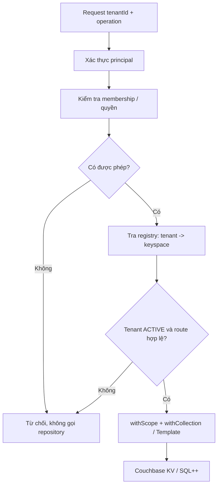

# Kiểm thử truy cập đúng collection và phát hiện nhầm namespace trong Spring Data Couchbase

Trong ứng dụng **Spring Data Couchbase**, một lời gọi `findById("order::1001")` thành công **không đủ chứng minh** ứng dụng đã đọc đúng dữ liệu. Cùng một ID có thể tồn tại ở nhiều collection; một repository có thể bị ghi đè `@Scope` hoặc `@Collection`; một câu SQL++ có thể chứa `FROM` cố định; hoặc Template đã được inject từ bucket khác. Khi triển khai đa tenant, lỗi này còn có thể gây truy cập chéo dữ liệu.

Bài học thuộc chương **Scope và Collection** của module `SPRING_DATA_COUCHBASE`. Mục tiêu là xây dựng **bộ kiểm thử có khả năng phát hiện sai bucket, scope hoặc collection** ở cả thao tác KV, repository, `CouchbaseTemplate`, SQL++ và API reactive. Chúng ta cũng sẽ tránh những kết luận sai do chỉ mục SQL++ cập nhật chậm, dữ liệu test còn sót, quyền truy cập quá rộng hoặc cấu hình môi trường khác nhau.

## 1. Xác định chính xác điều cần kiểm chứng

Couchbase tổ chức dữ liệu theo đường dẫn:

```text
bucket.scope.collection
```

Ví dụ bucket `shop` chứa:

```text
shop
├── commerce
│   ├── orders
│   └── customers
├── archive
│   └── orders_history
└── tenant_b
    └── orders
```

Cùng ID `order::1001` có thể có giá trị khác nhau:

| Keyspace | ID | Trạng thái được cố ý gieo vào fixture |
| --- | --- | --- |
| `shop.commerce.orders` | `order::1001` | `CURRENT` |
| `shop.archive.orders_history` | `order::1001` | `ARCHIVED` |
| `shop.tenant_b.orders` | `order::1001` | `TENANT_B` |

Ba document là **ba bản ghi độc lập**. Nếu assertion chỉ viết “kết quả khác `null`”, truy cập nhầm collection vẫn có thể khiến test pass.

Cần kiểm chứng năm nhóm bất biến (*invariants*):

1. **Đúng địa chỉ:** bucket, scope, collection thực tế phải trùng với đích nghiệp vụ.
2. **Đúng nội dung:** cùng một ID nhưng dữ liệu ở hai collection phải được phân biệt.
3. **Không truy cập chéo:** document chỉ tồn tại ở collection B không được xuất hiện qua API mặc định nhắm A.
4. **Đúng đường truy vấn:** KV và SQL++ phải nhắm cùng keyspace dự kiến khi kiểm thử cùng nghiệp vụ.
5. **Đúng quyền và ngữ cảnh:** caller không được truy cập collection/tenant ngoài phạm vi được phép, kể cả khi biết ID hoặc tên keyspace.

**Chiến lược mạnh nhất:** dùng fixture có **cùng ID tại ít nhất hai collection nhưng payload đối lập**, cộng thêm một document **chỉ tồn tại ở collection sai**. Bộ dữ liệu này giúp phân biệt lỗi routing với lỗi không có dữ liệu.

## 2. “Nhầm namespace” có thể xảy ra ở những tầng nào?

Trong Couchbase SQL++, tên namespace đôi khi còn nhắc tới tiền tố `default:`. Tuy nhiên, khi kiểm thử Spring Data, lỗi “nhầm namespace” thường là **nhầm keyspace**: bucket, scope, collection hoặc ngữ cảnh truy vấn.

| Tầng | Cơ chế chọn đích | Kiểu lỗi thường gặp |
| --- | --- | --- |
| Cấu hình ứng dụng | Bucket của `CouchbaseClientFactory`; scope mặc định | Test kết nối đúng cluster nhưng sai bucket hoặc scope nền. |
| Entity | `@Scope`, `@Collection` | Annotation entity ghi đè scope cấu hình. |
| Repository | Annotation trên interface hoặc method | Một finder truy vấn archive trong khi `findById` đọc current. |
| Repository động | `DynamicProxyable.withScope/withCollection` | Dùng proxy sai tenant hoặc chỉ đổi scope mà quên collection. |
| Template | `inScope/inCollection` trên fluent operation | Thao tác ghi trực tiếp vào collection khác với thao tác đọc. |
| SQL++ | `FROM` và `query_context` | Context chọn scope A nhưng query ghi cứng keyspace B. |
| Multi-bucket | Template/client factory | Đổi scope nhưng vẫn ở bucket cũ. |
| Reactive | Pipeline và context | Truyền sai route hoặc rò trạng thái mutable giữa hai request đồng thời. |

Từ góc độ kiểm thử, cần xác nhận **đích cuối cùng**, không chỉ đọc code hoặc so sánh giá trị cấu hình trước khi thao tác chạy.

## 3. Thiết kế fixture có “mồi nhử” để bắt lỗi routing

Một bộ dữ liệu kiểm thử nhỏ nhưng có tính phân biệt cao:

```text
Test ID A: it::run42::same
  shop.commerce.orders       -> status=CURRENT
  shop.archive.orders_history -> status=ARCHIVED

Test ID B: it::run42::archive-only
  shop.commerce.orders        -> không tồn tại
  shop.archive.orders_history -> status=ARCHIVE_ONLY

Test ID C: it::run42::current-only
  shop.commerce.orders       -> status=CURRENT_ONLY
  shop.archive.orders_history -> không tồn tại
```

Các assertion cần viết rõ:

| Trường hợp | Kỳ vọng |
| --- | --- |
| Repository current đọc Test ID A | Trả `CURRENT`. |
| Repository archive đọc Test ID A | Trả `ARCHIVED`. |
| Repository current đọc Test ID B | Không có kết quả. |
| Repository archive đọc Test ID C | Không có kết quả. |
| Xóa Test ID A ở archive | Document current cùng ID vẫn tồn tại. |
| SQL++ lọc tại current | Không lẫn dữ liệu archive. |

Bởi vì một lỗi mapping có thể khiến **cả ghi lẫn đọc cùng đi sai nơi**, không nên tạo tất cả fixture **chỉ bằng chính API đang được kiểm thử**. Ví dụ nếu `OrderRepository.save` sai scope và `OrderRepository.findById` cũng sai scope, test “save rồi find” vẫn có thể pass. Nên **gieo dữ liệu bằng Couchbase Java SDK ở keyspace tường minh**, sau đó đọc bằng repository; đồng thời dùng SDK để kiểm tra nơi dữ liệu Spring Data vừa ghi.

### Quy tắc cô lập dữ liệu test

- Dùng ID có tiền tố `it::` và UUID cho từng test hoặc từng lần chạy.
- Không dùng chung một document key giữa các test đang chạy song song, trừ khi chủ ý kiểm tra cùng ID ở nhiều collection **trong một test**.
- Không sử dụng bucket/collection production để thử ghi hoặc xóa.
- Dùng Testcontainers hoặc cluster test được provision có chủ đích; dọn dữ liệu sau test nếu cluster được chia sẻ.
- Ghi rõ bucket/scope/collection của fixture trong code và thông báo lỗi để chẩn đoán dễ hơn.

## 4. Chuẩn bị môi trường integration test bằng Testcontainers

**Unit test** thích hợp cho logic chọn route, enum, tenant policy và việc tạo đối tượng service. Nhưng một mock repository không chứng minh Couchbase nhận truy vấn tại đúng collection. Muốn kiểm tra mapping thực, cần **integration test** với Couchbase Server.

Một cấu hình thường dùng:

- JUnit 5 và Spring Boot Test.
- Testcontainers Couchbase module.
- Couchbase Server hỗ trợ scope/collection (7.0+).
- Các service **KV**, **QUERY** và **INDEX** nếu test cả SQL++.
- Spring Data Couchbase tương thích với phiên bản Spring Boot của dự án.

Ví dụ phụ thuộc Gradle, với phiên bản do BOM dự án quản lý:

```groovy
dependencies {
    testImplementation("org.springframework.boot:spring-boot-starter-test")
    testImplementation("org.testcontainers:testcontainers-couchbase")
    testImplementation("org.testcontainers:testcontainers-junit-jupiter")
    testImplementation("io.projectreactor:reactor-test")
}
```

Tên artifact Testcontainers ở ví dụ phù hợp **Testcontainers 2.x**. Với 1.x, các module Couchbase/JUnit Jupiter có tọa độ artifact khác; hãy dùng bộ dependency **cùng phiên bản** do BOM quản lý. Không trộn 1.x và 2.x chỉ để sao chép code.

### 4.1. Chạy container riêng cho lớp test

```java
import org.junit.jupiter.api.Test;
import org.springframework.boot.test.context.SpringBootTest;
import org.springframework.test.context.DynamicPropertyRegistry;
import org.springframework.test.context.DynamicPropertySource;
import org.testcontainers.couchbase.BucketDefinition;
import org.testcontainers.couchbase.CouchbaseContainer;
import org.testcontainers.couchbase.CouchbaseService;
import org.testcontainers.junit.jupiter.Container;
import org.testcontainers.junit.jupiter.Testcontainers;

@SpringBootTest
@Testcontainers
class CollectionRoutingIT {

    @Container
    static final CouchbaseContainer CB =
        new CouchbaseContainer("couchbase/server:7.6.2")
            .withEnabledServices(
                CouchbaseService.KV,
                CouchbaseService.QUERY,
                CouchbaseService.INDEX
            )
            .withBucket(new BucketDefinition("shop"));

    @DynamicPropertySource
    static void couchbaseProperties(DynamicPropertyRegistry registry) {
        registry.add(
            "spring.couchbase.connection-string",
            CB::getConnectionString
        );
        registry.add("spring.couchbase.username", CB::getUsername);
        registry.add("spring.couchbase.password", CB::getPassword);
        registry.add("spring.data.couchbase.bucket-name", () -> "shop");
    }

    // Các test được triển khai ở phần sau.
}
```

Container được khai báo static nên được chia sẻ giữa những test method trong cùng lớp; các test phải **tự cô lập dữ liệu**, không giả định container khởi động lại trước mỗi method. Docker phải khả dụng ở môi trường chạy CI. Docker image và quota cần được chọn theo tài nguyên/phiên bản thực tế; `7.6.2` là một phiên bản minh họa, không phải yêu cầu cứng.

**Lưu ý:** ví dụ trên giả định dự án Spring Boot đã có cấu hình scan repository và có `OrderRepository` tương ứng. Đối với ứng dụng dùng `AbstractCouchbaseConfiguration` tùy chỉnh, `@DynamicPropertySource` chỉ có hiệu lực nếu cấu hình thực sự đọc các property tương ứng.

### 4.2. Tạo scope và collection test một cách tường minh

Testcontainers tạo bucket theo `BucketDefinition`. Nó **không tự tạo các scope/collection nghiệp vụ** của ví dụ. Hãy provision trong fixture test hoặc theo migration trước khi dùng repository.

Ví dụ Java SDK cho một container mới:

```java
import java.time.Duration;

import com.couchbase.client.java.Bucket;
import com.couchbase.client.java.Cluster;
import com.couchbase.client.java.manager.collection.CollectionManager;

import org.junit.jupiter.api.AfterAll;
import org.junit.jupiter.api.BeforeAll;

private static Cluster sdk;

@BeforeAll
static void createCollections() {
    sdk = Cluster.connect(
        CB.getConnectionString(),
        CB.getUsername(),
        CB.getPassword()
    );

    Bucket bucket = sdk.bucket("shop");
    bucket.waitUntilReady(Duration.ofSeconds(60));

    CollectionManager manager = bucket.collections();
    manager.createScope("commerce");
    manager.createScope("archive");

    manager.createCollection("commerce", "orders");
    manager.createCollection("archive", "orders_history");
}

@AfterAll
static void closeSdk() {
    if (sdk != null) {
        sdk.disconnect();
    }
}
```

Đoạn trên là **phần bổ sung trong lớp** `CollectionRoutingIT`, không phải một Java file độc lập; các `import` cần nằm ở đầu file thực. Trong SDK 3.12+, có overload `createCollection(scopeName, collectionName)`; ở những phiên bản SDK cũ hơn, có thể dùng `CollectionSpec.create(collectionName, scopeName)` rồi gọi `createCollection(spec)`.

Các thao tác quản trị có thể mất thời gian lan truyền trạng thái. Khi sử dụng môi trường dùng chung hoặc retry test, cần xử lý riêng `ScopeExistsException` / `CollectionExistsException` và chờ tài nguyên thực sự sẵn sàng, thay vì coi mọi lỗi “not found” sau khi tạo là lỗi ứng dụng. Không nuốt tất cả exception và tiếp tục chạy.

### 4.3. Đừng quên trạng thái index

Các test KV theo ID **không cần secondary index SQL++**. Nhưng test finder theo thuộc tính cần có Query Service và index phù hợp; chuẩn bị riêng:

```sql
CREATE INDEX ix_it_current_status
ON `shop`.`commerce`.`orders`(status);

CREATE INDEX ix_it_history_status
ON `shop`.`archive`.`orders_history`(status);
```

Đợi index **ONLINE** trước khi assert kết quả SQL++. Ở các phiên bản Couchbase Server hiện đại, một số truy vấn có thể chạy bằng **sequential scan** ngay cả khi chưa có secondary index; do đó không viết test với giả định “thiếu index thì nhất định phải báo lỗi”. Thay vào đó, kiểm tra **kế hoạch `EXPLAIN`** khi mục tiêu là xác nhận index đúng và hiệu năng.

## 5. Entity và repository để kiểm thử thực tế

Sử dụng kiểu entity nhỏ, mapping rõ ràng. Các đoạn mã dưới đây có thể đặt ở những file ứng dụng/test tương ứng; bỏ khai báo package cho gọn.

### 5.1. Entity

```java
import org.springframework.data.annotation.Id;
import org.springframework.data.couchbase.core.mapping.Document;

@Document
public class OrderDocument {

    @Id
    private String id;

    private String status;

    public OrderDocument() {
    }

    public OrderDocument(String id, String status) {
        this.id = id;
        this.status = status;
    }

    public String getId() {
        return id;
    }

    public void setId(String id) {
        this.id = id;
    }

    public String getStatus() {
        return status;
    }

    public void setStatus(String status) {
        this.status = status;
    }
}
```

### 5.2. Repository current và lựa chọn động

```java
import org.springframework.data.couchbase.repository.Collection;
import org.springframework.data.couchbase.repository.CouchbaseRepository;
import org.springframework.data.couchbase.repository.DynamicProxyable;
import org.springframework.data.couchbase.repository.Scope;

@Scope("commerce")
@Collection("orders")
public interface OrderRepository
        extends CouchbaseRepository<OrderDocument, String>,
                DynamicProxyable<OrderRepository> {
}
```

Hai annotation `@Scope` / `@Collection` thuộc package **`org.springframework.data.couchbase.repository`**, không phải `core.mapping`. `DynamicProxyable<OrderRepository>` trả về proxy cùng kiểu interface khi gọi `withScope()` và `withCollection()`.

Với repo trên:

- `orderRepository.findById(id)` phải nhắm `shop.commerce.orders`.
- `orderRepository.withScope("archive").withCollection("orders_history").findById(id)` phải nhắm `shop.archive.orders_history`.

Nếu entity cũng có annotation scope/collection, annotation repository có ưu tiên cao hơn. Nếu dùng Template với fluent `inScope/inCollection`, lựa chọn trực tiếp của Template có mức ưu tiên cao hơn annotation entity.

## 6. Integration test quan trọng nhất: cùng ID, khác trạng thái

Một test hữu ích nên **gieo dữ liệu bằng SDK** tại hai collection, rồi **đọc bằng Spring Data repository**.

Đoạn mã sau được đặt trong `CollectionRoutingIT` ở phần 4, có các field `CB` và `sdk` như đã khai báo:

```java
import java.util.UUID;

import com.couchbase.client.java.Collection;
import com.couchbase.client.java.json.JsonObject;

import org.junit.jupiter.api.Test;
import org.springframework.beans.factory.annotation.Autowired;

import static org.junit.jupiter.api.Assertions.assertEquals;
import static org.junit.jupiter.api.Assertions.assertTrue;

@Autowired
private OrderRepository orderRepository;

@Test
void sameId_mustReadFromTheSelectedCollection() {
    String id = "it::" + UUID.randomUUID();

    Collection current = sdk.bucket("shop")
        .scope("commerce")
        .collection("orders");

    Collection history = sdk.bucket("shop")
        .scope("archive")
        .collection("orders_history");

    // Dùng SDK làm oracle độc lập với Spring Data repository.
    current.upsert(id, JsonObject.create()
        .put("status", "CURRENT")
        .put("_class", OrderDocument.class.getName()));

    history.upsert(id, JsonObject.create()
        .put("status", "ARCHIVED")
        .put("_class", OrderDocument.class.getName()));

    OrderDocument fromCurrent = orderRepository
        .findById(id)
        .orElseThrow();

    OrderDocument fromHistory = orderRepository
        .withScope("archive")
        .withCollection("orders_history")
        .findById(id)
        .orElseThrow();

    assertEquals("CURRENT", fromCurrent.getStatus());
    assertEquals("ARCHIVED", fromHistory.getStatus());

    // Đối chiếu vị trí vật lý qua Java SDK.
    assertEquals("CURRENT",
        current.get(id).contentAsObject().getString("status"));
    assertEquals("ARCHIVED",
        history.get(id).contentAsObject().getString("status"));
}
```

Ý nghĩa của từng kiểm tra:

- Test giữ nguyên **ID**, chỉ thay đổi **keyspace**.
- Giá trị `status` khác nhau giúp test fail nếu routing sai.
- Document được SDK tạo có field `_class` tương ứng để các query phụ thuộc metadata của Spring Data có thể lọc đúng kiểu entity.
- SDK đọc trực tiếp từng collection giúp xác thực dữ liệu thực sự nằm ở đâu, tránh test “Spring Data tự ghi, tự đọc” cùng sai.
- Việc dùng UUID riêng tránh xung đột với lần chạy trước.

Nếu cả hai assertion cùng trả `CURRENT`, đó là dấu hiệu cần kiểm tra việc `withScope/withCollection` có được áp dụng, hay một lớp wrapper/service đã dùng lại repository gốc thay vì proxy được trả về.

## 7. Negative test: một document chỉ ở collection sai

Một phép thử còn mạnh hơn là tạo document **chỉ tồn tại ở archive** và xác nhận repository mặc định **không** trả về nó.

```java
@Test
void currentRepository_mustNotSeeArchiveOnlyDocument() {
    String id = "it::archive-only::" + UUID.randomUUID();

    sdk.bucket("shop")
        .scope("archive")
        .collection("orders_history")
        .insert(id, JsonObject.create()
            .put("status", "ARCHIVE_ONLY")
            .put("_class", OrderDocument.class.getName()));

    assertTrue(orderRepository.findById(id).isEmpty());

    assertEquals("ARCHIVE_ONLY",
        orderRepository
            .withScope("archive")
            .withCollection("orders_history")
            .findById(id)
            .orElseThrow()
            .getStatus());
}
```

Lỗi định tuyến sang archive sẽ khiến assertion `isEmpty()` thất bại. Nếu không tạo document “mồi nhử” ở archive, test chỉ kiểm tra một ID không tồn tại ở cả hai nơi sẽ **pass dù repository trỏ sai**.

Thực hiện bài test đối xứng: document chỉ ở current phải không được xuất hiện qua repository archive.

### Vì sao phải kiểm tra cả chiều ngược lại?

Giả sử code chọn sai scope nhưng tình cờ scope sai không có document theo ID đó; test “không tìm thấy” vẫn đúng về kết quả, nhưng sai về đích. Muốn chứng minh không truy cập chéo, cần thiết kế dữ liệu để một lần định tuyến nhầm **để lại dấu hiệu rõ ràng**.

## 8. Kiểm tra cả đường ghi: đừng chỉ test findById

Một rủi ro khác là đọc đúng nhưng `save()` hoặc `upsert` lại ghi vào collection khác vì service dùng Template/repository khác nhau.

### 8.1. Ghi bằng Spring Data, kiểm tra bằng SDK

```java
import org.springframework.data.couchbase.core.CouchbaseTemplate;

@Autowired
private CouchbaseTemplate template;

@Test
void templateWrite_mustLandInCommerceOrdersOnly() {
    String id = "it::write::" + UUID.randomUUID();

    OrderDocument order = new OrderDocument(id, "JUST_WRITTEN");

    template.upsertById(OrderDocument.class)
        .inScope("commerce")
        .inCollection("orders")
        .one(order);

    var current = sdk.bucket("shop")
        .scope("commerce")
        .collection("orders");

    var history = sdk.bucket("shop")
        .scope("archive")
        .collection("orders_history");

    assertTrue(current.exists(id).exists());
    assertEquals("JUST_WRITTEN",
        current.get(id).contentAsObject().getString("status"));
    assertTrue(!history.exists(id).exists());
}
```

Ở đây, oracle chính là Java SDK theo **đường dẫn vật lý tường minh**. Test sẽ thất bại nếu Template thật sự ghi vào `archive.orders_history` hoặc một collection khác.

Việc gọi `inScope()` / `inCollection()` chỉ chọn đích trong **bucket của Template đang được inject**. Nếu ứng dụng có nhiều bucket, cần thêm một bài test kiểm tra đúng `CouchbaseClientFactory`/Template tương ứng; cùng scope và collection nhưng khác bucket vẫn là nơi lưu khác.

### 8.2. Xóa phải có tính cục bộ theo collection

Với cùng ID ở current và archive, xóa bằng repository archive:

```java
orderRepository
    .withScope("archive")
    .withCollection("orders_history")
    .deleteById(id);
```

Assertion cần là:

```java
assertTrue(current.exists(id).exists());
assertTrue(!history.exists(id).exists());
```

Trước đoạn này, fixture phải tạo ID ở **cả hai collection**; `current` và `history` là các đối tượng SDK Collection đã lấy đúng scope. Đây là test về **tác dụng phụ**, không chỉ về giá trị trả về.

## 9. Chẩn đoán rõ “không có document” và “sai namespace”

Một lỗi thường gặp là gom mọi trường hợp đọc thất bại vào “not found”. Thực tế cần tách:

| Kết quả | Khả năng liên quan |
| --- | --- |
| `findById(id)` trả `Optional.empty()` | Document không tồn tại ở **keyspace được chọn**; có thể do nhầm mapping. |
| Lỗi scope/collection không tồn tại | Tài nguyên chưa provision, tên sai hoặc thay scope mà quên collection. |
| Lỗi quyền | Tài khoản không có quyền KV/Query cần thiết trên keyspace. |
| SQL++ trả 0 hàng ngay sau ghi | Có thể sai keyspace, filter/mapping sai hoặc secondary index chưa cập nhật. |
| SQL++ thất bại vì index/query plan | Thiếu hoặc chưa sẵn sàng index phù hợp, hoặc vấn đề Query Service. |
| Dữ liệu thuộc tenant khác | Định tuyến hoặc kiểm tra authorization/predicate tenant bị lỗi. |

Trong code production, không nên bắt mọi lỗi SDK rồi chuyển thành `Optional.empty()`. Hành vi đó làm lỗi quyền hoặc cấu hình keyspace trở thành “không có đơn hàng”, che giấu nguyên nhân gốc và khiến test khó phát hiện.

### Test tài nguyên bị cấu hình sai

Có thể tạo một test riêng mà cấu hình cố ý chỉ tới collection không tồn tại (ví dụ `orders_typo`). Assertion không nhất thiết gắn với **một subclass exception cụ thể** cho mọi phiên bản SDK, nhưng phải phân biệt hai tình huống:

- Đường dẫn có collection tồn tại, ID không tồn tại → trường hợp không có document.
- Đường dẫn có collection không tồn tại → **lỗi cấu hình/resource**, không được âm thầm fallback sang `_default`.

Hãy kiểm tra exception/log có đủ thông tin keyspace và loại lỗi, không dựa vào một chuỗi message tiếng Anh có thể thay đổi giữa phiên bản server.

## 10. SQL++: xác nhận query keyspace và scan consistency

### 10.1. Keyspace đầy đủ làm phép thử độc lập

Với SQL++, đường dẫn đầy đủ loại bỏ phụ thuộc vào query context:

```sql
SELECT META(o).id AS documentId, o.status
FROM `shop`.`commerce`.`orders` AS o
WHERE o.status = "CURRENT";

SELECT META(h).id AS documentId, h.status
FROM `shop`.`archive`.`orders_history` AS h
WHERE h.status = "ARCHIVED";
```

Nếu test kiểm tra SQL++ qua hai keyspace, hãy dùng cùng một ID kiểm chứng và điều kiện phân biệt tương tự fixture KV.

### 10.2. Dùng REQUEST_PLUS để tránh test flaky do độ trễ index

SQL++ thường đọc qua chỉ mục. Với consistency mặc định, một document mới upsert bằng KV có thể chưa được Query Service quan sát ngay. Đừng dùng `Thread.sleep(1000)` và hy vọng CI luôn đủ nhanh.

Ví dụ SDK:

```java
import com.couchbase.client.java.json.JsonObject;
import com.couchbase.client.java.query.QueryResult;
import com.couchbase.client.java.query.QueryScanConsistency;

import static com.couchbase.client.java.query.QueryOptions.queryOptions;

QueryResult result = sdk.query(
    "SELECT META(o).id AS documentId, o.status " +
    "FROM `shop`.`commerce`.`orders` AS o " +
    "WHERE o.status = $status",
    queryOptions()
        .parameters(
            JsonObject.create().put("status", "CURRENT")
        )
        .scanConsistency(QueryScanConsistency.REQUEST_PLUS)
);
```

`REQUEST_PLUS` giúp truy vấn đợi chỉ mục bắt kịp đến thời điểm yêu cầu. Nó có thể tăng độ trễ nên chỉ sử dụng ở những test/nghiệp vụ thực sự cần bảo đảm này. Không lấy REQUEST_PLUS làm cách sửa lỗi sai `FROM` hoặc sai bộ lọc `_class`.

### 10.3. So sánh query context và keyspace đầy đủ

Nếu dùng `scope.query(...)`, tên collection rút gọn được phân giải trong scope đó:

```java
var archiveScope = sdk.bucket("shop").scope("archive");

QueryResult archived = archiveScope.query(
    "SELECT META(h).id AS documentId, h.status " +
    "FROM `orders_history` AS h WHERE h.status = $status",
    queryOptions()
        .parameters(
            JsonObject.create().put("status", "ARCHIVED")
        )
        .scanConsistency(QueryScanConsistency.REQUEST_PLUS)
);
```

Nhưng `cluster.query("FROM `shop`.`commerce`.`orders` ...")` có keyspace đầy đủ sẽ trỏ tới current dù query context được đặt là archive. Trong test, ghi rõ **cả query text và query context** để người đọc không suy luận sai.

**Lưu ý:** SQL++ có thể đọc dữ liệu khác phạm vi Spring Data repository nếu bạn viết `FROM` cứng. Do đó, test SQL++ tự viết phải kiểm chứng keyspace từ **chính câu truy vấn cuối cùng**, không chỉ từ annotation.

## 11. Kiểm thử repository finder theo thuộc tính và @Query

Repository có các cơ chế định tuyến scope/collection ưu tiên từ cao xuống thấp:

1. `inScope()/inCollection()` của fluent operation trên Template.
2. `withScope()/withCollection()` của đối tượng Template/repository.
3. `@Scope/@Collection` trên phương thức repository.
4. `@Scope/@Collection` trên interface repository.
5. `@Scope/@Collection` trên entity.
6. Cấu hình scope nền.

Nếu test chỉ `findById`, bạn mới kiểm tra đường KV. Finder như `findByStatus` thường sinh SQL++ và có thể dùng annotation cấp method khác.

Ví dụ:

```java
import java.util.List;

import org.springframework.data.couchbase.repository.Collection;
import org.springframework.data.couchbase.repository.CouchbaseRepository;
import org.springframework.data.couchbase.repository.Scope;

@Scope("commerce")
@Collection("orders")
public interface OrderQueryRepository
        extends CouchbaseRepository<OrderDocument, String> {

    List<OrderDocument> findByStatus(String status);

    @Scope("archive")
    @Collection("orders_history")
    List<OrderDocument> findByStatusAndIdNot(
        String status, String excludedId
    );
}
```

**Tình huống phải kiểm thử:**

- `findByStatus("CURRENT")` nhắm current (annotation interface).
- Finder có annotation method nhắm archive.
- Finder chạy trên đúng collection nhưng thiếu index vẫn có thể kém hiệu năng hoặc thất bại tùy phiên bản/cấu hình.
- SQL++ sinh ra có thể có điều kiện phân biệt kiểu entity (thường liên quan `_class`); fixture tạo bằng SDK cần giữ metadata phù hợp.

Với `@Query` tùy chỉnh:

```java
import org.springframework.data.couchbase.repository.Query;

@Query("#{#n1ql.selectEntity} WHERE #{#n1ql.filter} " +
       "AND status = $1")
List<OrderDocument> findWithStatus(String status);
```

Các biểu thức SpEL được Spring Data cung cấp hỗ trợ tạo phần SELECT/FROM và điều kiện mapping. Khi test thay scope/collection của repository, cần kiểm tra `@Query` có thực sự sử dụng mapping động hay bị ràng buộc bởi một `FROM` viết cứng.

### Cách test finder hiệu quả

1. Chuẩn bị cùng dữ liệu trạng thái ở hai collection với **giá trị nhận diện khác nhau**.
2. Tạo index cần thiết và đợi online.
3. Dùng predicate thật của finder, không chỉ `findAll()` nếu nghiệp vụ không dùng `findAll()`.
4. Kiểm tra **danh sách ID đầy đủ**, không chỉ `size() > 0`.
5. So sánh với truy vấn SDK dùng đường dẫn keyspace đầy đủ và consistency phù hợp.
6. Đặt tên test thể hiện phạm vi: `findArchivedOrders_mustNotReturnCurrentOrders`.

## 12. Test định tuyến tenant: từ authorization tới storage

Nếu mỗi tenant có scope hoặc collection riêng, lỗi sai keyspace có thể trở thành lỗi bảo mật. Một service thường trải qua:



Một bộ test bắt buộc có:

| Kịch bản | Assertion chính |
| --- | --- |
| User A đọc đơn hàng tenant A | Đúng document A, đúng keyspace. |
| User A yêu cầu tenant B | Bị từ chối **trước** truy cập DB. |
| User A biết ID đơn hàng tenant B | Không thể đọc/sửa/xóa tại tenant B. |
| Tenant đang `SUSPENDED` | Registry không trả route active; không fallback sang default. |
| Chỉ gọi `withScope` mà quên collection | Test phát hiện cặp keyspace sai hoặc thiếu. |
| Request A và B chạy đồng thời | Không trộn proxy/context giữa hai tenant. |
| Tài khoản Couchbase có quyền rộng | Application authorization vẫn chặn truy cập trái phép. |

Với **shared collection**, không có namespace riêng cho từng tenant ở tầng Couchbase. Khi đó phải kiểm tra điều kiện `tenantId` trong mọi query và quyền sở hữu của document theo ID:

```sql
SELECT META(o).id AS documentId, o.status
FROM `shop`.`shared`.`orders` AS o
WHERE o.tenantId = $tenantId
  AND o.status = $status;
```

Test cần gieo dữ liệu tenant A và B cùng trạng thái, rồi xác nhận query A chỉ trả ID của A. Không dùng tài khoản admin để suy luận rằng RBAC đã bảo vệ đúng phạm vi người dùng thực.

## 13. Kiểm thử RBAC phải dùng credential hạn chế

Một test chạy bằng user Couchbase có quyền toàn cluster có thể chứng minh **routing đúng**, nhưng **không chứng minh quyền truy cập bị giới hạn**.

Để test RBAC, nên tạo tài khoản thử riêng, ví dụ:

- `reader_current` có quyền đọc/query trên `shop.commerce.orders`.
- Không có quyền trên `shop.archive.orders_history`.
- Có hai fixture với cùng ID ở current và archive.

Kỳ vọng:

1. Truy cập current với user có quyền → thành công.
2. Truy cập archive với cùng user → **bị từ chối**, không trả bản archive.
3. Ứng dụng không fallback sang current hoặc `_default` khi gặp lỗi quyền archive.
4. Lỗi quyền được ghi nhận đúng loại, không bị biến thành “document không tồn tại”.

Role và phạm vi quyền phụ thuộc mô hình truy cập KV hay SQL++ (ví dụ quyền đọc KV và Query SELECT là khác nhau). Tài khoản dùng trong test phải mô phỏng **role thực của service**; không chỉ dùng quyền quản trị Testcontainers.

## 14. Kiểm thử API reactive bằng StepVerifier

`ReactiveCouchbaseTemplate` và `ReactiveCouchbaseRepository` có cùng yêu cầu định tuyến. Điểm khác là thao tác trả `Mono` hoặc `Flux` và được kích hoạt khi có subscriber.

Ví dụ:

```java
import org.junit.jupiter.api.Test;
import org.springframework.beans.factory.annotation.Autowired;
import org.springframework.data.couchbase.core.ReactiveCouchbaseTemplate;

import reactor.test.StepVerifier;

import static org.junit.jupiter.api.Assertions.assertEquals;

@Autowired
private ReactiveCouchbaseTemplate reactiveTemplate;

@Test
void reactiveRead_mustUseArchiveCollection() {
    String id = "it::reactive::" + UUID.randomUUID();

    sdk.bucket("shop")
        .scope("archive")
        .collection("orders_history")
        .insert(id, JsonObject.create()
            .put("status", "REACTIVE_ARCHIVE")
            .put("_class", OrderDocument.class.getName()));

    var publisher = reactiveTemplate
        .findById(OrderDocument.class)
        .inScope("archive")
        .inCollection("orders_history")
        .one(id);

    StepVerifier.create(publisher)
        .assertNext(doc ->
            assertEquals("REACTIVE_ARCHIVE", doc.getStatus())
        )
        .verifyComplete();
}
```

Đây là đoạn code đặt trong một lớp test đã có `sdk` và import `UUID`/`JsonObject` như ví dụ trước. Nếu không có document ở collection đích, pipeline có thể hoàn thành rỗng thay vì phát giá trị; `assertNext` sẽ giúp phát hiện điều đó.

Nên bổ sung negative test reactive: document chỉ ở current không được xuất hiện qua Template/repository chọn archive. Nếu ứng dụng dùng `DynamicProxyable<ReactiveOrderRepository>`, cần test cùng ID ở hai nơi tương tự imperative test.

**Tránh bẫy reactive:**

- Không chỉ tạo publisher rồi assert một biến: chưa chắc DB đã được gọi.
- Dùng `StepVerifier` hoặc một subscriber test phù hợp để thực thi pipeline.
- Không lưu tenant/collection của request vào trường mutable singleton hay `ThreadLocal` không được kiểm soát.
- Nếu có xử lý đồng thời, chạy test với hai tenant, nhiều publisher và kiểm tra mỗi publisher giữ đúng route.

## 15. Kiểm thử cấu hình nhiều bucket

Một ứng dụng có thể dùng hai Template:

```text
liveTemplate    -> bucket shop-live
auditTemplate   -> bucket shop-audit
```

Ngay cả khi cả hai bucket chứa `commerce.orders`, `inScope("commerce").inCollection("orders")` **không thay đổi bucket** của Template.

Một fixture có thể gieo cùng key:

```text
shop-live.commerce.orders  : status=LIVE
shop-audit.commerce.orders : status=AUDIT_COPY
```

Test yêu cầu:

- Repository current hoặc `liveTemplate` đọc `LIVE`.
- Repository audit hoặc `auditTemplate` đọc `AUDIT_COPY`.
- `RepositoryOperationsMapping.map(...)` ánh xạ đúng repository vào đúng bucket.
- `mapEntity(...)` chỉ áp dụng cho repository không có mapping cụ thể.
- `setDefault(...)` xử lý repository chưa được map riêng.
- Nếu có `@EnableCouchbaseRepositories(couchbaseTemplateRef = ...)` theo package, mỗi package được quét đúng một lần.

**Không nên chỉ mock hai bean Template:** như vậy sẽ không bắt được trường hợp cả hai bean vô tình dùng cùng `CouchbaseClientFactory` và cùng bucket.

## 16. Kiểm thử TTL, CAS và giao dịch trong đúng collection

### 16.1. TTL

Nếu một nghiệp vụ ghi document có thời hạn 30 phút, test không nên chỉ assert nó đã được lưu. Cần kiểm tra expiry theo API hoặc test ở một khoảng thời gian thích hợp, đồng thời xác minh **collection được chọn** có chính sách `maxTTL` tương thích.

Không dùng `Thread.sleep(30 phút)` trong CI. Nên dùng cấu hình test với TTL ngắn có kiểm soát, kết hợp API kiểm tra metadata expiry nếu phù hợp, rồi test riêng logic hết hạn. Khi chuyển document giữa collection, expiry không tự được bảo toàn nếu quy trình copy không làm việc đó.

### 16.2. CAS/optimistic locking

Thử cập nhật đồng thời cùng document bằng hai bản đọc cũ để xác minh cơ chế `@Version`/CAS nếu ứng dụng có dùng. Nhưng lưu ý **CAS chỉ ràng buộc một document ở đúng collection**. Test xung đột của `shop.commerce.orders` không chứng minh gì về document cùng ID tại `shop.archive.orders_history`.

### 16.3. Transaction

Nếu một nghiệp vụ ghi nhiều collection, cần có test transaction với API tương ứng và kịch bản failure/retry. Hai lệnh `repository.save()` độc lập không tự nguyên tử. Test “ghi một document, sau đó ghi document khác” không đủ xác minh rollback toàn bộ.

**Thứ tự kiểm thử đề xuất:** trước tiên xác minh keyspace của từng thao tác, sau đó mới kiểm tra expiry, CAS hoặc transaction; nếu keyspace sai, các assertion concurrency/consistency có thể đang kiểm tra nhầm document.

## 17. Ma trận kiểm thử khuyến nghị

Bộ test nên phủ cả **API**, **keyspace** và **hành vi sai**:

| Mã | API/luồng | Fixture | Assertion |
| --- | --- | --- | --- |
| T01 | Repository `findById` | Cùng ID tại current/archive, status khác | Chỉ đọc đúng status current. |
| T02 | Dynamic repository `withScope/withCollection` | Cùng ID | Chỉ đọc đúng status archive. |
| T03 | Negative KV | ID chỉ có ở archive | Repository current không thấy. |
| T04 | Template `upsertById` | ID mới | SDK xác nhận chỉ collection đúng có dữ liệu. |
| T05 | Xóa bằng repo archive | Cùng ID hai nơi | Current vẫn tồn tại, archive đã mất. |
| T06 | Finder SQL++ | Document khác trạng thái trên hai collection | Danh sách kết quả đúng ID, đúng keyspace. |
| T07 | `@Query` custom | `FROM` hardcode khác annotation | Test phát hiện query trỏ sai nơi. |
| T08 | SQL++ query context | Tên collection rút gọn/đầy đủ | Kết quả tương ứng context và keyspace đầy đủ. |
| T09 | Repository method annotation | Method chọn archive, interface chọn current | Mỗi method truy cập đúng đích. |
| T10 | Reactive Template/repository | Cùng ID | `StepVerifier` xác nhận route chính xác. |
| T11 | Tenant A/B | Document cùng ID ở hai scope | Không truy cập chéo dù biết ID. |
| T12 | RBAC | Credential chỉ có quyền current | Đọc archive bị từ chối, không fallback. |
| T13 | Multi-bucket | Cùng keyspace suffix ở hai bucket | Mỗi Template đọc đúng bucket. |
| T14 | Resource sai | Collection chưa tồn tại | Lỗi cấu hình rõ ràng, không coi là empty result. |
| T15 | Ghi rồi query ngay | KV mới ghi, query SQL++ | Consistency được chọn có chủ đích; không test bằng sleep cố định. |
| T16 | CAS/TTL/transaction | Document theo chính sách nghiệp vụ | Tính chất được kiểm chứng trong **keyspace đúng**. |

Không nhất thiết mọi dự án phải có toàn bộ T01–T16 ở cùng một lớp. Tách thành các nhóm test theo tốc độ và độ tin cậy giúp CI dễ bảo trì.

## 18. Mẹo bảo đảm test ổn định và dễ chẩn đoán

### 18.1. Đừng phụ thuộc vào thứ tự test

Nếu test B chỉ chạy được sau khi test A đã tạo document, đó là dấu hiệu fixture không độc lập. Hãy tạo dữ liệu tại chính test cần dùng, hoặc tạo bằng `@BeforeEach` với ID riêng.

### 18.2. Chờ trạng thái resource, không chờ thời gian mù

Sau khi tạo scope/collection/index, cần đợi chúng sẵn sàng. Ưu tiên cơ chế polling có giới hạn, SDK readiness hoặc trạng thái index thay vì chèn một `Thread.sleep(...)` cố định.

### 18.3. Phân biệt số lượng kết quả và tính đúng đắn

Assertion yếu:

```java
assertTrue(results.size() > 0);
```

Assertion tốt hơn:

```java
assertEquals(
    java.util.Set.of(expectedId),
    results.stream()
        .map(OrderDocument::getId)
        .collect(java.util.stream.Collectors.toSet())
);
```

Đồng thời, nên assert kích thước danh sách nếu không muốn dữ liệu trùng hoặc kết quả bổ sung ngoài dự kiến. Với kết quả sắp xếp, kiểm tra đúng thứ tự theo `ORDER BY` được chỉ định.

### 18.4. Ghi đủ thông tin keyspace trong lỗi test

Thông điệp lỗi nên thể hiện:

```text
Expected: shop.commerce.orders / id=it::... / status=CURRENT
Actual:   shop.archive.orders_history / id=it::... / status=ARCHIVED
Operation: OrderRepository.findById
```

Không ghi credential hoặc payload chứa dữ liệu cá nhân thực vào log CI. Dùng fixture giả và mã nhận diện test.

### 18.5. Testcontainers không thay thế kiểm thử môi trường thật

Testcontainers giúp phát hiện routing sai ở tầng Spring Data và SDK, nhưng không tự bảo đảm các đặc tính vận hành như role thực tế, cấu hình chỉ mục production, nhiều node, topology, bucket khác cluster hoặc policy network. Những phần đó cần smoke test/staging riêng.

## 19. Checklist trước khi merge thay đổi scope/collection

Khi một pull request thay `@Scope`, `@Collection`, `getScopeName()`, `withScope` hoặc `inCollection`, kiểm tra:

1. **Có sơ đồ keyspace** ghi rõ bucket.scope.collection trước/sau thay đổi.
2. **Có fixture phân biệt:** cùng ID ở collection cũ/mới với payload khác nhau.
3. **Có positive test** đọc/ghi đúng collection mới.
4. **Có negative test** không thấy document chỉ ở collection khác.
5. **Có oracle độc lập** bằng SDK hoặc query keyspace đầy đủ, không chỉ save rồi find qua cùng API.
6. **Có test finder SQL++** nếu ứng dụng dùng query theo thuộc tính.
7. **Index và Query Service** được provision và đạt trạng thái sẵn sàng trong test.
8. **Có kiểm tra `@Query` custom** với `FROM` viết cứng và query context.
9. **Có test quyền** nếu keyspace tương ứng tenant/role khác nhau.
10. **Có test reactive và concurrent requests** nếu ứng dụng dùng pipeline Reactor.
11. **Có kiểm tra multi-bucket** nếu thay ClientFactory/Template mapping.
12. **Có kế hoạch dữ liệu cũ:** đổi mapping không tự migrate document.
13. **Không biến lỗi quyền/resource thành empty result**.
14. **Test có thể chạy lặp lại** trên CI mà không phụ thuộc dữ liệu sót lại.
15. **Theo dõi hiệu năng:** xem `EXPLAIN` và chỉ mục đúng keyspace, không chỉ xem query trả dữ liệu.

## 20. Bài tập vận dụng

**Bài 1 — Cùng ID khác collection.** Một document `order::700` có status `NEW` trong `commerce.orders` và `ARCHIVED` trong `archive.orders_history`. Repository current trả `ARCHIVED`. Nên kiểm tra gì?

**Đáp án:** kiểm tra bucket của repository, `@Scope/@Collection` ở entity/interface/method, proxy `withScope/withCollection` đã dùng, và đối chiếu trực tiếp từng collection bằng SDK. Đây là dấu hiệu rõ của sai routing hoặc bị ghi đè mapping.

**Bài 2 — Save rồi find đều pass.** Một test dùng `repository.save(order)`, sau đó `repository.findById(id)`, kết quả đúng. Test có chứng minh đã lưu ở `commerce.orders` không?

**Đáp án:** chưa. Nếu cả hai thao tác cùng nhắm sai scope, test vẫn pass. Cần kiểm tra vị trí vật lý bằng SDK/query tường minh.

**Bài 3 — KV có, query SQL++ chưa thấy.** Ngay sau `upsert`, `findById` thấy document nhưng `findByStatus` chưa thấy. Có thể kết luận repository query dùng sai collection không?

**Đáp án:** không. Cần xác minh keyspace, index readiness, metadata mapping và scan consistency. Có thể kiểm tra lại bằng `REQUEST_PLUS` khi phù hợp.

**Bài 4 — Tenant B được đọc bởi user A.** Nếu service account có quyền trên cả hai scope, đổi `withScope("tenant_b")` từ request của user A có tự bị Couchbase ngăn chặn không?

**Đáp án:** không nhất thiết. DB RBAC áp dụng theo credential của service. Ứng dụng cần authorize membership và hành động trước khi chọn keyspace; test phải xác minh user A bị từ chối trước truy cập DB.

**Bài 5 — Reactive trả Mono nhưng không thấy query chạy.** Test tạo `Mono<OrderDocument> result` rồi không subscribe. Có thể kiểm tra routing từ điều đó không?

**Đáp án:** không. Dùng `StepVerifier` hoặc subscriber test để thực thi pipeline và assert nội dung đúng từ collection mong muốn.

**Bài 6 — SQL++ thiếu index.** Query trên Server 7.6+ vẫn chạy dù không có secondary index. Có thể bỏ kiểm thử chỉ mục không?

**Đáp án:** không. Query có thể dùng sequential scan và vẫn trả kết quả; nếu yêu cầu hiệu năng, phải kiểm tra `EXPLAIN`, index readiness và kế hoạch truy vấn thực tế.

## Ghi nhớ

**Kiểm thử đúng collection là kiểm thử *định tuyến và cô lập dữ liệu*, không chỉ kiểm thử CRUD.** Hãy gieo cùng ID với payload khác nhau ở hai collection, tạo thêm document chỉ tồn tại ở collection “sai”, rồi dùng **SDK làm oracle độc lập**. Kiểm tra cả chiều đọc, ghi, xóa, repository finder, SQL++, Template, reactive và quyền tenant. Khi query SQL++ không thấy dữ liệu mới, phân biệt lỗi keyspace với độ trễ index; khi gặp lỗi quyền hoặc resource, không biến chúng thành “not found”. Đây là cách phát hiện sớm những sai lệch rất khó quan sát khi triển khai.

## Tài liệu tham khảo

- [Spring Data Couchbase — Collection Support](https://docs.spring.io/spring-data/couchbase/reference/couchbase/collections.html): annotation, Template, DynamicProxyable và thứ tự ưu tiên chọn scope/collection.
- [Spring Data Couchbase — Repositories](https://docs.spring.io/spring-data/couchbase/reference/couchbase/repository.html): khác biệt KV theo ID và SQL++ query theo thuộc tính.
- [Testcontainers for Java — Couchbase module](https://java.testcontainers.org/modules/databases/couchbase/): khởi động CouchbaseContainer và định nghĩa bucket test.
- [Testcontainers — JUnit 5](https://java.testcontainers.org/test_framework_integration/junit_5/): vòng đời container static/instance và các giới hạn chạy test song song.
- [Couchbase Java SDK — Provisioning Cluster Resources](https://docs.couchbase.com/java-sdk/current/howtos/provisioning-cluster-resources.html): tạo scope/collection bằng SDK.
- [Couchbase Java SDK — SQL++ Queries](https://docs.couchbase.com/java-sdk/current/howtos/sqlpp-queries-with-sdk.html): query, tham số và REQUEST_PLUS.
- [Couchbase Java SDK — Query Context and Indexes](https://docs.couchbase.com/java-sdk/current/concept-docs/n1ql-query.html): keyspace đầy đủ, query context, chỉ mục và sequential scan.

