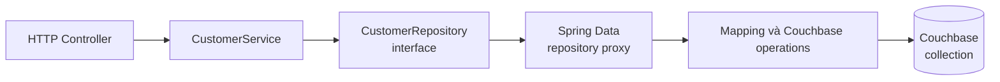

# Repository proxy, dependency injection và phạm vi trách nhiệm

Trong **SPRING_DATA_COUCHBASE**, repository là điểm vào thuận tiện để làm việc với document trên Couchbase. Một interface như `CustomerRepository extends CouchbaseRepository<Customer, String>` không cần implementation viết tay: Spring Data tạo **repository proxy** và Spring quản lý nó như một bean để các service nhận qua **dependency injection (DI)**.

Hiểu vòng đời của proxy, cách inject và ranh giới trách nhiệm sẽ giúp thiết kế tầng truy cập dữ liệu có thể kiểm thử, bảo trì và mở rộng từ CRUD sang SQL++, `CouchbaseTemplate`, giao dịch hoặc API reactive mà không đặt logic nghiệp vụ sai tầng.

## 1. Mục tiêu học tập

Sau bài này, bạn có thể:

- Giải thích **repository interface**, **repository proxy** và **Spring bean** khác nhau ở đâu.
- Mô tả cách Spring Data Couchbase phát hiện repository, tạo proxy và chuyển lời gọi đến thao tác dữ liệu tương ứng.
- Dùng **constructor injection** để đưa repository vào service mà không tự khởi tạo repository.
- Phân định trách nhiệm giữa **controller**, **service**, **repository** và **Couchbase infrastructure**.
- Xác định lúc nào repository phù hợp, lúc nào cần `CouchbaseTemplate`, truy vấn SQL++ hoặc phiên bản reactive.
- Chẩn đoán các lỗi thường gặp khi repository bean không được tạo hoặc truy vấn chạy sai kỳ vọng.

## 2. Các thành phần trong bức tranh tổng thể

| Khái niệm | Định nghĩa ngắn | Vai trò với Couchbase |
| --- | --- | --- |
| **Repository interface** | Hợp đồng Java do lập trình viên khai báo. | Xác định entity, kiểu ID và các phương thức truy cập dữ liệu. |
| **Repository proxy** | Đối tượng được Spring Data tạo trong lúc chạy, triển khai interface repository. | Tiếp nhận lời gọi, chọn cách thực thi CRUD, truy vấn dẫn xuất, truy vấn khai báo hoặc custom implementation. |
| **Spring bean** | Đối tượng do Spring container tạo và quản lý. | Cho phép repository được inject vào service/controller hoặc bean khác. |
| **Dependency injection (DI)** | Container cung cấp đối tượng mà một lớp cần, thường qua constructor. | Service nhận `CustomerRepository` từ Spring, không tự `new` implementation. |
| **Couchbase infrastructure** | Cấu hình kết nối, mapping, converter, template, SDK và các thành phần Spring Data liên quan. | Thực hiện việc ánh xạ entity và giao tiếp với bucket/scope/collection. |

Sơ đồ lời gọi đơn giản:



**Interface** mô tả bạn *muốn truy cập dữ liệu như thế nào*. **Proxy** là đối tượng thực tế nhận lời gọi ở runtime. **Spring container** quản lý proxy và inject nó vào nơi cần dùng.

Sơ đồ là cách nhìn logic; trong runtime, biến có kiểu `CustomerRepository` thường tham chiếu trực tiếp đến **đối tượng proxy triển khai interface đó**, chứ không cần một đối tượng interface riêng đứng giữa.

## 3. Spring Data tạo repository proxy như thế nào?

Xét interface:

```java
import org.springframework.data.couchbase.repository.CouchbaseRepository;

public interface CustomerRepository
        extends CouchbaseRepository<Customer, String> {
}
```

Không có lớp `CustomerRepositoryImpl` do bạn tự viết, nhưng một service vẫn gọi được:

```java
customers.findById("customer::tenant-a::C102");
customers.save(customer);
customers.deleteById("customer::tenant-a::C102");
```

Quá trình khởi tạo ở mức khái niệm:

1. **Quét repository:** Spring Data tìm các interface repository trong những package được cấu hình.
2. **Đọc metadata:** framework xác định loại entity (`Customer`), kiểu ID (`String`), ánh xạ document và các phương thức khai báo.
3. **Dựng repository factory/proxy:** framework tạo bean triển khai interface, gắn các thành phần cần thiết để xử lý phương thức.
4. **Đăng ký bean:** Spring container lưu bean này để DI có thể cung cấp nó cho các lớp phụ thuộc.
5. **Xử lý lời gọi:** khi service gọi phương thức, proxy điều phối việc đọc/ghi theo key hoặc thực thi truy vấn và ánh xạ kết quả thành entity.

Ví dụ `findById(key)` thường đi theo đường truy cập **key-value (KV)** đến đúng document key. Ngược lại, phương thức như `findByTenantId(String tenantId)` là **derived query** dựa trên trường dữ liệu; Spring Data có thể tạo SQL++ và cần chỉ mục phù hợp.

**Proxy không phải bản sao dữ liệu trong bộ nhớ.** Nó là đối tượng trung gian thực thi yêu cầu truy cập Couchbase. Repository bean thông thường có phạm vi singleton, có thể được nhiều request dùng chung. Vì vậy, không cất trạng thái theo từng request (như tenant hiện hành, ID hoặc giỏ hàng đang xử lý) vào field mutable của repository/service singleton.

### Proxy repository khác gì Spring AOP?

Cả hai có thể sử dụng cơ chế proxy, nhưng mục đích khác nhau:

- **Spring Data repository proxy** triển khai hợp đồng truy cập dữ liệu của interface repository.
- **Spring AOP proxy/advice** có thể bổ sung hành vi cắt ngang như transaction, caching hoặc bảo mật khi được cấu hình.

Không nên suy luận rằng chỉ cần repository là mọi lời gọi đã được bọc transaction, có retry hoặc bảo vệ khỏi ghi đồng thời. Những hành vi đó phụ thuộc vào cấu hình và cơ chế của từng thao tác.

## 4. Ví dụ tự chứa: entity và repository

Giả sử ứng dụng lưu khách hàng trong bucket `appdata`, scope `sales`, collection `customers`. Entity:

```java
package com.example.customer;

import org.springframework.data.annotation.Id;
import org.springframework.data.couchbase.core.mapping.Collection;
import org.springframework.data.couchbase.core.mapping.Document;
import org.springframework.data.couchbase.core.mapping.Field;
import org.springframework.data.couchbase.core.mapping.Scope;

@Document
@Scope("sales")
@Collection("customers")
public class Customer {

    @Id
    private String id;

    @Field
    private String tenantId;

    @Field
    private String displayName;

    public Customer() {
    }

    public Customer(String id, String tenantId, String displayName) {
        this.id = id;
        this.tenantId = tenantId;
        this.displayName = displayName;
    }

    public String getId() {
        return id;
    }

    public String getTenantId() {
        return tenantId;
    }

    public String getDisplayName() {
        return displayName;
    }
}
```

Interface repository:

```java
package com.example.customer;

import java.util.List;
import org.springframework.data.couchbase.repository.CouchbaseRepository;

public interface CustomerRepository
        extends CouchbaseRepository<Customer, String> {

    List<Customer> findByTenantId(String tenantId);
}
```

Ba điểm cần nắm:

- `@Id String id` là **document key**. Vì thế kiểu generic thứ hai của `CouchbaseRepository<Customer, String>` cũng là `String`.
- `@Scope("sales")` và `@Collection("customers")` chỉ ra **phạm vi lưu trữ document trong Couchbase**. Chúng khác với khái niệm Spring bean scope (singleton, prototype, request...).
- `findByTenantId` đọc theo **trường JSON**. Nó thường sử dụng SQL++ thay vì thao tác KV và cần thiết kế index cho collection phù hợp. Việc chỉ khai báo interface không tự tạo sẵn chỉ mục tối ưu.

`@Document`, `@Id` và các annotation mapping giúp framework biết cách chuyển giữa `Customer` và document. Để vận hành, bucket/scope/collection phải tồn tại và tài khoản kết nối phải có quyền phù hợp.

## 5. Dependency injection bằng constructor

Một service dùng repository có thể viết như sau:

```java
package com.example.customer;

import java.util.List;
import java.util.Optional;
import org.springframework.stereotype.Service;

@Service
public class CustomerService {

    private final CustomerRepository customers;

    public CustomerService(CustomerRepository customers) {
        this.customers = customers;
    }

    public Optional<Customer> getByDocumentKey(String documentKey) {
        if (documentKey == null || documentKey.isBlank()) {
            throw new IllegalArgumentException(
                    "Document key không được rỗng");
        }

        return customers.findById(documentKey);
    }

    public List<Customer> findInTenant(String tenantId) {
        if (tenantId == null || tenantId.isBlank()) {
            throw new IllegalArgumentException(
                    "Tenant ID không được rỗng");
        }

        return customers.findByTenantId(tenantId);
    }
}
```

Spring nhìn vào constructor `CustomerService(CustomerRepository customers)`, tìm một bean phù hợp kiểu `CustomerRepository` và cấp bean đó cho service. Trường `final` giúp bảo đảm tham chiếu dependency không thay đổi sau khi đối tượng được tạo.

Với chỉ một constructor, Spring không đòi hỏi ghi thêm `@Autowired` trên constructor. Constructor injection làm dependency rõ ràng, hỗ trợ unit test và tránh tình trạng service được tạo nhưng repository chưa được khởi tạo đúng.

**Không tự tạo repository bằng `new CustomerRepository()`:** interface không thể khởi tạo trực tiếp; implementation do Spring Data cung cấp thông qua repository factory. Cũng không cần tự viết một lớp implementation chỉ để bọc lại từng phương thức CRUD.

### Controller chỉ phối hợp lớp giao tiếp

Một controller tối giản:

```java
package com.example.customer;

import java.util.Optional;
import org.springframework.http.ResponseEntity;
import org.springframework.web.bind.annotation.GetMapping;
import org.springframework.web.bind.annotation.PathVariable;
import org.springframework.web.bind.annotation.RequestMapping;
import org.springframework.web.bind.annotation.RestController;

@RestController
@RequestMapping("/customers")
public class CustomerController {

    private final CustomerService service;

    public CustomerController(CustomerService service) {
        this.service = service;
    }

    @GetMapping("/{documentKey}")
    public ResponseEntity<Customer> get(
            @PathVariable String documentKey) {

        Optional<Customer> result =
                service.getByDocumentKey(documentKey);

        return result.map(ResponseEntity::ok)
                .orElseGet(() -> ResponseEntity.notFound().build());
    }
}
```

Đây là ví dụ minh họa luồng DI. Trong ứng dụng thực, controller còn cần xác thực, phân quyền theo tenant, thiết kế URL hợp lệ và trả DTO để tránh lộ các trường nội bộ. Không nên coi document key trong URL là bằng chứng người gọi được phép truy cập document.

## 6. Khi nào Spring tạo được bean repository?

Với ứng dụng Spring Boot đã sử dụng starter Spring Data Couchbase, các điều kiện cơ bản thường gồm:

- Có dependency Spring Data Couchbase tương thích với phiên bản Spring Boot.
- Có thông tin kết nối Couchbase và tên bucket, kèm quyền truy cập thích hợp.
- Interface repository nằm trong vùng package được repository scanning tìm thấy.
- Entity có metadata mapping hợp lệ và kiểu ID phù hợp.

Ví dụ cấu trúc package phổ biến:

```text
com.example
├── Application.java          (@SpringBootApplication)
└── customer
    ├── Customer.java         (@Document)
    ├── CustomerRepository.java
    ├── CustomerService.java  (@Service)
    └── CustomerController.java
```

Khi `Application` nằm trong package gốc `com.example`, cơ chế cấu hình và quét package thông thường của Boot có thể tìm được các thành phần bên dưới. Nếu repository nằm ngoài vùng quét hoặc ứng dụng có nhiều cấu hình dữ liệu, hãy cấu hình repository scanning rõ ràng, ví dụ `@EnableCouchbaseRepositories(basePackages = "com.example.customer")`, và bảo đảm mapping/connection cũng được cấu hình tương ứng.

Không mặc định rằng **component scan** của `@Component` và **repository scan** là một cơ chế duy nhất; Spring Data có cơ chế kích hoạt repository riêng. Việc thêm `@Repository` lên một interface kế thừa `CouchbaseRepository` thông thường không phải điều kiện cần để framework tạo proxy.

Tùy phiên bản Spring Boot, có thể cấu hình kết nối với các property tương tự:

```yaml
spring:
  couchbase:
    connection-string: COUCHBASE_CONNECTION_STRING_FROM_ENV
    username: COUCHBASE_USERNAME_FROM_ENV
    password: COUCHBASE_PASSWORD_FROM_ENV
  data:
    couchbase:
      bucket-name: appdata
```

Đây là cấu hình minh họa với các giá trị giữ chỗ, **không phải chuỗi kết nối sử dụng trực tiếp**. Khi triển khai, truyền giá trị thông qua biến môi trường hoặc secret store theo cơ chế cấu hình của Spring Boot và kiểm tra tên property của phiên bản đang dùng.

## 7. Phạm vi trách nhiệm: repository, service và controller

Thiết kế dễ bảo trì nhất là để từng lớp chịu trách nhiệm đúng phần việc.

| Tầng | Nên làm | Không nên làm |
| --- | --- | --- |
| **Controller/API** | Nhận request, kiểm tra dữ liệu đầu vào ở mức API, chuyển sang service, ánh xạ response và lỗi HTTP. | Ghép toàn bộ quy tắc nghiệp vụ hoặc viết các truy vấn Couchbase rải rác trong controller. |
| **Service/application** | Điều phối use case, kiểm tra quy tắc nghiệp vụ, quyền tenant, xây dựng document key, phối hợp nhiều repository, xác định ranh giới transaction. | Chứa mã HTTP cụ thể hoặc tự xử lý kết nối SDK cho CRUD thông thường. |
| **Repository** | Định nghĩa thao tác lưu/đọc theo entity, ID và truy vấn; cung cấp hợp đồng truy cập dữ liệu tập trung. | Quyết định quyền của người dùng, thực hiện workflow bán hàng hoặc gửi email. |
| **Couchbase infrastructure** | Quản lý kết nối, mapping, bucket/scope/collection, chỉ mục, timeout, retry có chủ đích và quan sát vận hành. | Đưa chính sách nghiệp vụ riêng của từng use case vào cấu hình kỹ thuật chung. |

Ví dụ một yêu cầu **hủy đơn hàng** có thể cần kiểm tra quyền người dùng, trạng thái đơn hiện tại, khả năng hoàn tiền và phát sự kiện. Service nên điều phối các bước đó. Repository chỉ cung cấp thao tác lấy/lưu document cần thiết. Nếu cần bảo đảm nhất quán qua nhiều document, service là nơi xác định nhu cầu giao dịch và phối hợp cơ chế Couchbase phù hợp.

**Repository không đồng nghĩa “mọi logic liên quan dữ liệu đều ở repository”.** Quy tắc đặt tên, phép tính nghiệp vụ, điều phối nhiều bước và chính sách phân quyền thường có chủ sở hữu ở domain/service; các truy vấn tồn tại để phục vụ những quyết định đó.

### Có nên inject repository trực tiếp vào controller?

Về kỹ thuật có thể làm được, nhưng với API có quy tắc nghiệp vụ, dùng controller → service → repository giúp tập trung phân quyền, validation, quy tắc nhất quán và kiểm thử. Ở ứng dụng demo chỉ CRUD rất đơn giản, có thể chọn thiết kế gọn hơn; cần cân nhắc mức độ phức tạp thực tế.

### “Scope” ở đây có mấy nghĩa?

Có ba khái niệm dễ bị lẫn:

1. **Phạm vi trách nhiệm**: lớp repository chịu trách nhiệm truy cập dữ liệu.
2. **Couchbase scope**: không gian chứa collection bên trong bucket, ví dụ `sales`.
3. **Spring bean scope**: chính sách vòng đời bean như singleton, prototype. Repository bean thường là singleton theo cấu hình mặc định.

`@Scope("sales")` trong đoạn entity là **annotation mapping của Spring Data Couchbase** (`org.springframework.data.couchbase.core.mapping.Scope`). Nó không phải `@Scope` của Spring IoC (`org.springframework.context.annotation.Scope`).

## 8. Repository proxy, query, template và reactive API

`CouchbaseRepository` phù hợp cho hầu hết thao tác CRUD và truy vấn theo entity. Tuy nhiên, lựa chọn API cần dựa trên nhu cầu:

| Nhu cầu | Lựa chọn thường phù hợp | Lưu ý |
| --- | --- | --- |
| Lấy một document theo key | `CouchbaseRepository.findById(id)` | Truy cập KV trực tiếp, biết chính xác key. |
| Lưu một entity | `CouchbaseRepository.save(entity)` | Hiểu rõ upsert/phiên bản; dùng cơ chế insert-only khi cần cấm ghi đè. |
| Tìm theo trường JSON | Derived query như `findByTenantId(...)` hoặc `@Query` | SQL++ thường cần index và phải kiểm tra hiệu năng truy vấn. |
| Thao tác document linh hoạt, không tiện diễn đạt qua interface repository | `CouchbaseTemplate` hoặc custom repository fragment | Gom phần truy cập dữ liệu phức tạp vào thành phần persistence có chủ đích. |
| Thao tác mức thấp đặc thù Couchbase SDK | SDK hoặc abstraction thích hợp | Cần cân nhắc CAS, TTL, timeout và tương tác với mapping. |
| Luồng dữ liệu không chặn trong ứng dụng reactive | `ReactiveCouchbaseRepository<T, ID>`, API reactive tương ứng | Dùng `Mono`/`Flux` và thiết kế end-to-end reactive. |

Một repository reactive có thể khai báo:

```java
import org.springframework.data.couchbase.repository.ReactiveCouchbaseRepository;

public interface ReactiveCustomerRepository
        extends ReactiveCouchbaseRepository<Customer, String> {
}
```

Đây là ví dụ về **kiểu API**: khi gọi `reactiveRepository.findById(id)`, kết quả là `Mono<Customer>`.

Repository đồng bộ trả `Optional<Customer>` / `List<Customer>` trong ví dụ trên. Repository reactive trả `Mono<Customer>` / `Flux<Customer>`. Chúng có mô hình thực thi khác nhau; không nên gọi `block()` bừa bãi trong request path reactive vì có thể triệt tiêu lợi ích không chặn.

Lựa chọn API ảnh hưởng kiến trúc service và controller; việc có sẵn proxy repository **không tự biến thao tác đồng bộ thành reactive**.

## 9. Tùy biến hành vi repository đúng cách

Có ba mức thường dùng:

1. **CRUD có sẵn**: dùng thẳng `save`, `findById`, `deleteById` khi khớp nhu cầu.
2. **Truy vấn khai báo**: thêm phương thức derived query hoặc `@Query` để tìm theo điều kiện nghiệp vụ trên trường document.
3. **Custom repository fragment**: khi cần nhiều bước truy cập Couchbase đặc biệt, tạo interface và implementation của fragment theo quy ước Spring Data, rồi ghép vào repository.

Không cần tạo một interface “base repository” phức tạp cho mọi dự án nếu chỉ cần một vài phương thức CRUD. Ngược lại, không nên dồn một truy vấn tùy biến dài, xây index, chạy migration hay cấu hình SDK vào service chỉ vì repository mặc định chưa có phương thức phù hợp.

Với câu SQL++ có điều kiện theo tenant, cần xem **scope/collection đích**, metadata mapping (có thể bao gồm trường phân loại entity), **chỉ mục** và execution plan. Repository proxy chỉ điều phối truy vấn, không bảo đảm SQL++ chạy nhanh khi cấu trúc index chưa phù hợp.

## 10. Khả năng kiểm thử đến từ DI

Do `CustomerService` phụ thuộc vào interface, unit test có thể thay repository proxy bằng mock. Ví dụ dùng JUnit 5 và Mockito:

```java
package com.example.customer;

import static org.junit.jupiter.api.Assertions.assertTrue;
import static org.mockito.Mockito.verify;
import static org.mockito.Mockito.when;

import java.util.Optional;
import org.junit.jupiter.api.Test;
import org.junit.jupiter.api.extension.ExtendWith;
import org.mockito.InjectMocks;
import org.mockito.Mock;
import org.mockito.junit.jupiter.MockitoExtension;

@ExtendWith(MockitoExtension.class)
class CustomerServiceTest {

    @Mock
    private CustomerRepository customers;

    @InjectMocks
    private CustomerService service;

    @Test
    void getByDocumentKeyReturnsCustomerWhenFound() {
        String key = "customer::tenant-a::C102";
        Customer customer =
                new Customer(key, "tenant-a", "Lan Anh");

        when(customers.findById(key))
                .thenReturn(Optional.of(customer));

        Optional<Customer> result = service.getByDocumentKey(key);

        assertTrue(result.isPresent());
        verify(customers).findById(key);
    }
}
```

Trong unit test này, không cần Couchbase thật; mục tiêu là kiểm tra cách service dùng hợp đồng repository.

**Integration test** có mục tiêu khác: kiểm tra repository proxy được khởi tạo, entity mapping đúng, kết nối tới bucket/scope/collection, truy vấn SQL++, chỉ mục, CAS/TTL và lỗi thực tế từ Couchbase. Cần môi trường Couchbase kiểm thử với cấu hình phù hợp. Mock repository không chứng minh rằng derived query sẽ chạy được trên máy chủ.

## 11. Lỗi thường gặp và cách chẩn đoán

| Triệu chứng | Nguyên nhân nên kiểm tra | Hướng xử lý |
| --- | --- | --- |
| `No qualifying bean of type 'CustomerRepository'` | Chưa có dependency/config hỗ trợ repository; interface nằm ngoài vùng quét; cấu hình repository bị tắt. | Kiểm tra dependency, auto-configuration, package scanning và cấu hình Couchbase. |
| Service nhận `null` ở field repository | Đối tượng service được tạo bằng `new` ngoài Spring hoặc dùng field injection sai ngữ cảnh. | Để Spring quản lý service; ưu tiên constructor injection. |
| Có bean nhưng truy vấn thất bại khi chạy | Bucket/scope/collection, quyền truy cập hoặc cấu hình index chưa đúng. | Xác minh kết nối, collection, RBAC, cấu trúc document và kế hoạch truy vấn. |
| `findById("C102")` trả về rỗng | Key thực tế chứa tiền tố/tenant hoặc khác ký tự hoa thường. | Dùng document key đầy đủ; thống nhất quy tắc tạo key. |
| `findByTenantId(...)` chậm hoặc lỗi index | Derived query chạy SQL++ nhưng chưa có index phù hợp. | Thiết kế index theo filter và kiểm tra query plan. |
| Có nhiều bean cùng interface được yêu cầu | Nhiều cấu hình repository/bean hoặc nhiều datasource không được phân định rõ. | Cấu hình repository factory, package và qualifier theo kiến trúc hệ thống. |
| Hai request ghi đè thay đổi của nhau | `save` không tự bảo đảm optimistic locking nếu chưa bật/versioning đúng. | Dùng `@Version`/CAS hoặc transaction khi yêu cầu nhất quán. |
| Controller chứa nhiều lệnh repository | Quy tắc nghiệp vụ và API đang trộn với persistence. | Chuyển điều phối use case vào service; giữ repository tập trung vào data access. |

Các lỗi bean không chỉ xuất phát từ quét package: trong nhiều cấu hình, bean có thể được đăng ký nhưng **khởi tạo thất bại** vì mapping, connection, config hoặc dependency. Cần đọc nguyên nhân gốc (`Caused by`) trong stack trace thay vì chỉ nhìn thông báo bề mặt.

## 12. Bài tập áp dụng

Giả sử ứng dụng quản lý đơn hàng `OrderDocument` và cần API “Lấy đơn hàng đang chờ xử lý của tenant hiện tại”.

Hãy phác thảo thiết kế:

1. `OrderRepository` kế thừa `CouchbaseRepository<OrderDocument, String>` và khai báo truy vấn lấy đơn theo tenant, trạng thái.
2. `OrderService` nhận repository bằng constructor, xác nhận quyền của người gọi đối với tenant, điều phối điều kiện “đang chờ xử lý”.
3. `OrderController` nhận request, gọi service và trả DTO cho client.
4. Tạo index SQL++ phục vụ đúng điều kiện truy vấn và kiểm tra execution plan trên collection đơn hàng.
5. Viết unit test dùng mock repository để kiểm tra việc service truyền đúng điều kiện, sau đó viết integration test để xác nhận truy vấn trên Couchbase thật.

**Tự kiểm tra kiến thức:**

- Vì sao không cần lớp triển khai `CustomerRepository` viết tay cho CRUD mặc định?
- Tại sao constructor injection giúp unit test của `CustomerService` đơn giản hơn?
- Vì sao `findById` và `findByTenantId` không nhất thiết có cùng cơ chế thực thi?
- Nếu một thao tác nghiệp vụ cập nhật nhiều document và phải xử lý xung đột, phần nào quyết định ranh giới transaction?
- `@Scope("sales")` trên entity là Couchbase scope hay Spring bean scope?

## Ghi nhớ

Trong Spring Data Couchbase, **interface repository** là hợp đồng truy cập dữ liệu, **repository proxy** là đối tượng Spring Data tạo để thực hiện hợp đồng và **constructor injection** đưa đối tượng đó vào service. Controller xử lý giao tiếp, service sở hữu luồng nghiệp vụ và các ràng buộc, còn repository tập trung vào persistence. Phân định rõ trách nhiệm này giúp hệ thống mở rộng từ document mapping và CRUD sang SQL++, chỉ mục, `CouchbaseTemplate`, TTL, CAS, giao dịch và reactive API mà vẫn giữ cấu trúc dễ kiểm thử và vận hành.
