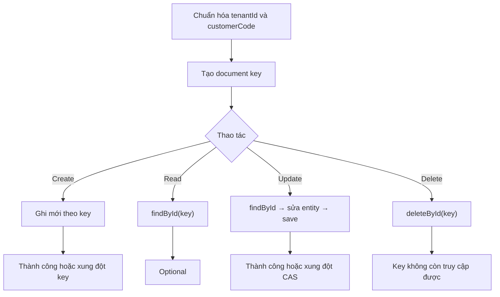

# Tạo, đọc, sửa, xóa tài liệu theo định danh

Trong **SPRING_DATA_COUCHBASE**, ứng dụng thường cần xử lý một document cụ thể dựa trên **document key**: tạo khách hàng, xem chi tiết, cập nhật tên và xóa khách hàng. Spring Data Couchbase cung cấp các thao tác này qua `CouchbaseRepository`; khi cần kiểm soát chặt việc chỉ chèn mới, CAS, TTL hay giao dịch, có thể kết hợp thêm `CouchbaseTemplate` hoặc API SDK phù hợp.

Bài học thuộc chương **Repository**, tập trung vào luồng CRUD (*Create, Read, Update, Delete*) **theo định danh**. Các thao tác này khác với tìm kiếm theo thuộc tính JSON bằng SQL++. Hiểu sự khác nhau giúp thiết kế tầng truy cập dữ liệu có hiệu năng, nhất quán và dễ vận hành trong hệ thống dùng bucket, scope và collection.

## 1. Mục tiêu

Sau bài học, bạn có thể:

- Tạo entity và repository để thực hiện `save`, `findById`, `existsById` và `deleteById` với document key.
- Phân biệt **tạo mới**, **ghi đè/upsert** và **cập nhật**; tránh xem một lần gọi `save` là lời hứa "chỉ tạo nếu chưa có".
- Viết service CRUD kiểm soát định dạng key và xử lý document không tồn tại.
- Nhận diện xung đột cập nhật đồng thời qua `@Version`/CAS, cũng như các giới hạn của chuỗi thao tác đọc–sửa–ghi.
- Giải thích ảnh hưởng của TTL, collection và quyền truy cập tới kết quả CRUD.

## 2. Document key là đầu vào của CRUD theo định danh

Couchbase lưu document trong bucket → scope → collection. Trong **mỗi collection**, một document được xác định bằng một **key duy nhất**, chẳng hạn:

```text
Bucket:      appdata
Scope:       sales
Collection:  customers

Document key: customer::tenant-a::C102
```

Phần nội dung JSON của document có thể là:

```json
{
  "tenantId": "tenant-a",
  "customerCode": "C102",
  "displayName": "Lan Anh"
}
```

Document key được lưu dưới dạng định danh document; nó **không nhất thiết xuất hiện như một trường JSON `id`**. Trong Java, Spring Data ánh xạ thuộc tính đánh dấu `@Id` thành key đó.

Khi gọi:

```java
repository.findById("customer::tenant-a::C102");
```

repository truy cập **document có đúng key này** trong collection được cấu hình cho entity. Nó không tự tìm document có trường JSON `customerCode = "C102"`.

| Ý định | API thường dùng | Cơ chế truy cập |
| --- | --- | --- |
| Đọc document có key xác định | `findById(id)` | Truy cập key-value (KV) theo key |
| Kiểm tra key có tồn tại | `existsById(id)` | Kiểm tra theo key |
| Lưu entity có `@Id` xác định | `save(entity)` | Ghi theo key, phụ thuộc mapping/version |
| Xóa document theo key | `deleteById(id)` | Xóa theo key |
| Tìm theo `tenantId` hoặc `customerCode` | Phương thức truy vấn của repository | Thường là SQL++, cần index phù hợp |

**Lợi ích:** với CRUD bằng key, không cần tạo chỉ mục SQL++ chỉ để định vị document đó. Điều này không đồng nghĩa tất cả phương thức repository đều dùng KV; `findAll` và các truy vấn theo thuộc tính có chi phí và điều kiện chỉ mục riêng.

## 3. Tạo entity và repository

Ví dụ sử dụng Spring Data Couchbase với một collection `sales.customers`. Giả sử kết nối, bucket `appdata`, scope `sales` và collection `customers` đã được tạo và ứng dụng được cấp quyền cần thiết.

### 3.1. Entity `Customer`

```java
package com.example.customer;

import org.springframework.data.annotation.Id;
import org.springframework.data.annotation.Version;
import org.springframework.data.couchbase.core.mapping.Collection;
import org.springframework.data.couchbase.core.mapping.Document;
import org.springframework.data.couchbase.core.mapping.Field;
import org.springframework.data.couchbase.core.mapping.Scope;

@Document
@Scope("sales")
@Collection("customers")
public class Customer {

    @Id
    private String id;

    @Field
    private String tenantId;

    @Field
    private String customerCode;

    @Field
    private String displayName;

    @Version
    private Long version;

    public Customer() {
    }

    public Customer(
            String id,
            String tenantId,
            String customerCode,
            String displayName) {
        this.id = id;
        this.tenantId = tenantId;
        this.customerCode = customerCode;
        this.displayName = displayName;
    }

    public String getId() {
        return id;
    }

    public void setId(String id) {
        this.id = id;
    }

    public String getTenantId() {
        return tenantId;
    }

    public void setTenantId(String tenantId) {
        this.tenantId = tenantId;
    }

    public String getCustomerCode() {
        return customerCode;
    }

    public void setCustomerCode(String customerCode) {
        this.customerCode = customerCode;
    }

    public String getDisplayName() {
        return displayName;
    }

    public void setDisplayName(String displayName) {
        this.displayName = displayName;
    }

    public Long getVersion() {
        return version;
    }

    public void setVersion(Long version) {
        this.version = version;
    }
}
```

Hai thuộc tính cần phân biệt:

- `@Id private String id` chứa **document key**, chẳng hạn `customer::tenant-a::C102`.
- `@Version private Long version` phục vụ optimistic locking dựa trên thông tin phiên bản/CAS; đây **không phải** thành phần của key. Để Spring Data tự quản lý, không tự gán số version tùy ý.

Tùy phiên bản Spring Data Couchbase và cấu hình chuyển đổi, metadata ánh xạ có thể thêm trường nội bộ vào JSON. Điều đó không làm thay đổi vai trò của document key.

### 3.2. Repository

```java
package com.example.customer;

import org.springframework.data.couchbase.repository.CouchbaseRepository;

public interface CustomerRepository
        extends CouchbaseRepository<Customer, String> {
}
```

`Customer` là kiểu entity; `String` là kiểu của `Customer.id` được đánh dấu `@Id`. Không khai báo `Long` cho repository khi entity dùng `String`, ngay cả khi mã khách hàng có dạng số.

Spring Data tạo implementation repository khi ứng dụng được cấu hình Couchbase và component scanning/repository scanning phù hợp.

## 4. Vòng đời CRUD theo key



Sơ đồ thể hiện ý tưởng nghiệp vụ. Tạo mới tuyệt đối và cập nhật có điều kiện cần chọn API và chiến lược đồng thời phù hợp; không phải mọi nhánh đều có cùng hành vi khi xảy ra tranh chấp.

### 4.1. Create: tạo document

Với entity có ID xác định, cách ghi ngắn gọn là:

```java
String id = "customer::tenant-a::C102";

Customer customer = new Customer(
        id, "tenant-a", "C102", "Lan Anh");

Customer saved = repository.save(customer);
```

Nếu document chưa có, dữ liệu được ghi vào collection. Nhưng tên phương thức `save` **không đủ để khẳng định** thao tác sẽ từ chối mọi document đã tồn tại: Spring Data quyết định đường ghi dựa trên trạng thái entity, chiến lược nhận diện entity mới và `@Version`. Nếu mapping không kiểm soát version, đường ghi có thể có hành vi upsert.

Đối với nghiệp vụ **chỉ được tạo mới khi key chưa tồn tại**, nên dùng thao tác *insert-only* có tính nguyên tử của Couchbase, ví dụ API `insertById` do `CouchbaseTemplate` cung cấp ở các phiên bản hỗ trợ fluent operations, hoặc `insert` của SDK Couchbase. Khi key đã tồn tại, thao tác phải trả lỗi thay vì ghi đè.

```java
// Ví dụ minh họa với CouchbaseTemplate:
couchbaseTemplate
        .insertById(Customer.class)
        .one(customer);
```

**Không sử dụng** chuỗi `if (!repository.existsById(id)) repository.save(entity)` như một cơ chế bảo vệ duy nhất. Hai request có thể cùng thấy key chưa tồn tại trước khi cùng ghi; đây là lỗi *time-of-check to time-of-use*.

### 4.2. Read: đọc theo key

```java
Optional<Customer> customer =
        repository.findById("customer::tenant-a::C102");

if (customer.isPresent()) {
    System.out.println(customer.get().getDisplayName());
} else {
    System.out.println("Không tìm thấy khách hàng");
}
```

`findById` trả `Optional<Customer>` để thể hiện trường hợp key không tồn tại, tránh phải dùng `null` làm tín hiệu không tìm thấy.

Nếu chỉ cần kiểm tra có tồn tại:

```java
boolean found =
        repository.existsById("customer::tenant-a::C102");
```

`existsById` chỉ là một ảnh chụp trạng thái tại thời điểm kiểm tra. Một luồng khác có thể tạo hoặc xóa document ngay sau đó, vì vậy kết quả này không bảo đảm cho thao tác ghi tiếp theo.

### 4.3. Update: đọc, sửa và lưu

Khi thay đổi một thuộc tính của document đang có:

```java
String id = "customer::tenant-a::C102";

Customer existing = repository.findById(id)
        .orElseThrow(() ->
                new IllegalArgumentException("Customer không tồn tại"));

existing.setDisplayName("Lan Anh Nguyễn");

Customer updated = repository.save(existing);
```

Đây là mô hình **read–modify–write**: đọc entity, thay đổi trường cần thiết rồi lưu. Nếu entity có `@Version` và được ánh xạ đúng, Spring Data Couchbase có thể dùng CAS để từ chối bản cập nhật dựa trên phiên bản cũ.

Ví dụ xung đột:

1. Request A đọc customer ở phiên bản `v1`.
2. Request B cũng đọc customer ở `v1`.
3. B cập nhật và lưu thành công, document chuyển sang phiên bản `v2`.
4. A cố ghi từ bản `v1`; optimistic locking có thể phát hiện xung đột và báo lỗi.

Nếu bỏ `@Version` và không dùng kiểm soát đồng thời khác, thao tác ghi sau có thể ghi đè thay đổi của thao tác trước. Lưu toàn bộ entity cũng có thể ghi đè những trường mà request không chủ định sửa, vì vậy không nên tùy tiện dựng một entity thiếu dữ liệu rồi gọi `save` để "patch" một trường.

**Không tự đổi ID để cập nhật document:**

```java
existing.setId("customer::tenant-a::C103");
repository.save(existing);
```

Đoạn này trỏ đến **một key khác**; không phải thao tác đổi tên document cũ. Nếu cần chuyển key, phải thiết kế quy trình sao chép/tạo mới, xử lý liên kết và xóa document cũ với kiểm soát xung đột phù hợp.

### 4.4. Delete: xóa theo key

```java
repository.deleteById("customer::tenant-a::C102");
```

Lệnh xóa nhắm tới document có key được truyền vào. Hành vi cụ thể khi key không tồn tại (trả về, bỏ qua hoặc phát sinh ngoại lệ) có thể khác theo phiên bản và triển khai repository; kiểm tra trong môi trường dự án nếu nghiệp vụ cần phân biệt rõ `404` và xóa lặp lại.

Đối với API REST, có thể chọn chính sách xóa **idempotent**: sau khi xử lý, tài nguyên không còn tồn tại, và yêu cầu xóa lặp lại được coi là hợp lệ. Tuy nhiên, phải chủ động quyết định chính sách này tại lớp service/controller; đừng suy diễn nó chỉ từ tên `deleteById`.

Một lời gọi xóa bằng key **không tự động dọn các tham chiếu nghiệp vụ** ở những document khác. Nếu cần cập nhật đồng thời nhiều document, phải cân nhắc transaction hoặc thiết kế xử lý nhất quán tương ứng.

## 5. Viết service CRUD có ranh giới rõ ràng

Service đặt quy tắc tạo key tại một chỗ, tránh mỗi controller tự ghép chuỗi khác nhau. Ví dụ dưới đây dùng `CouchbaseTemplate` để tạo mới có tính insert-only và repository cho đọc, cập nhật, xóa. Giả sử đã khai báo bean `CouchbaseTemplate` từ cấu hình Spring Data Couchbase của ứng dụng.

```java
package com.example.customer;

import java.util.Optional;
import org.springframework.data.couchbase.core.CouchbaseTemplate;
import org.springframework.stereotype.Service;

@Service
public class CustomerService {

    private final CustomerRepository repository;
    private final CouchbaseTemplate template;

    public CustomerService(
            CustomerRepository repository,
            CouchbaseTemplate template) {
        this.repository = repository;
        this.template = template;
    }

    // Create: lỗi nếu key đã tồn tại.
    public Customer create(
            String tenantId,
            String customerCode,
            String displayName) {
        String id = keyOf(tenantId, customerCode);
        Customer customer =
                new Customer(id, tenantId, customerCode, displayName);
        return template.insertById(Customer.class).one(customer);
    }

    // Read: không tìm thấy được biểu diễn bằng Optional.empty().
    public Optional<Customer> read(
            String tenantId, String customerCode) {
        return repository.findById(keyOf(tenantId, customerCode));
    }

    // Update: nạp bản hiện hành và giữ nguyên ID.
    public Customer rename(
            String tenantId,
            String customerCode,
            String newDisplayName) {
        Customer customer = repository
                .findById(keyOf(tenantId, customerCode))
                .orElseThrow(() ->
                        new IllegalArgumentException(
                                "Không tìm thấy customer"));

        customer.setDisplayName(newDisplayName);
        return repository.save(customer);
    }

    // Delete: xóa đúng document key.
    public void delete(
            String tenantId, String customerCode) {
        repository.deleteById(keyOf(tenantId, customerCode));
    }

    private static String keyOf(String tenantId, String customerCode) {
        if (tenantId == null || tenantId.isBlank()
                || customerCode == null || customerCode.isBlank()) {
            throw new IllegalArgumentException(
                    "tenantId và customerCode phải có giá trị");
        }
        if (tenantId.contains("::") || customerCode.contains("::")) {
            throw new IllegalArgumentException(
                    "Thành phần key không được chứa '::'");
        }
        return "customer::" + tenantId + "::" + customerCode;
    }
}
```

**Chính sách lỗi cần có ở tầng ứng dụng:**

| Trường hợp | Hướng xử lý ở service/API |
| --- | --- |
| Create gặp key đã tồn tại | Báo xung đột nghiệp vụ, thường ánh xạ HTTP `409 Conflict`. |
| Read không tìm thấy | Trả `Optional.empty()` hoặc chuyển thành `404 Not Found` ở tầng HTTP. |
| Update không tìm thấy | Báo không tồn tại, không dùng `save` trên entity mới để vô tình tạo document. |
| Update gặp CAS conflict | Báo xung đột; đọc lại và thử lại **chỉ khi** logic nghiệp vụ cho phép, không retry mù quáng. |
| Delete không tìm thấy | Chọn trước ngữ nghĩa API (ví dụ xóa lặp lại hợp lệ hoặc trả `404`) và thực hiện thống nhất. |
| Lỗi kết nối, timeout, thiếu quyền | Phân loại là lỗi hạ tầng; không đánh đồng với "không tìm thấy". |

Với hệ thống nhiều tenant, tiền tố `tenant-a` trong key chỉ là một quy ước định danh. Controller/service vẫn phải xác minh người dùng có quyền truy cập tenant tương ứng trước khi đọc, sửa hoặc xóa dữ liệu.

## 6. Chọn cách cập nhật theo mức độ nhất quán

| Tình huống | Cơ chế phù hợp | Cần chú ý |
| --- | --- | --- |
| Đọc một document đã biết key | `repository.findById(id)` | Nhanh gọn, không cần SQL++ index cho việc định vị key |
| Tạo một document mới, cấm trùng key | `CouchbaseTemplate.insertById(...).one(...)` hoặc SDK insert | Chặn trùng key tại thao tác ghi nguyên tử |
| Ghi nội dung mà việc tạo mới hoặc thay thế đều hợp lệ | `save(...)` theo mapping hiện hành | Hiểu rõ cơ chế nhận diện entity mới và `@Version` |
| Sửa dữ liệu quan trọng, có nhiều người cập nhật | Đọc rồi lưu với `@Version`/CAS | Xử lý optimistic locking conflict |
| Cập nhật nhiều document như một đơn vị | Transaction phù hợp, khi được hỗ trợ/cấu hình | Kiểm tra giới hạn giao dịch và retry |
| Chỉnh một thuộc tính với chi phí truyền nhỏ | API cập nhật có chọn lọc như sub-document, nếu phù hợp | Không mặc định hành vi giống lưu nguyên entity |
| Cần API không chặn luồng | `ReactiveCouchbaseRepository` và service reactive tương ứng | Không gọi `block()` trong luồng reactive |

Không nên nghĩ optimistic locking hay giao dịch là một thuộc tính của **kiểu ID**. ID xác định document; CAS/version xác định điều kiện ghi; transaction hỗ trợ tính nhất quán của một tập thao tác.

## 7. Các tình huống ảnh hưởng kết quả CRUD

### 7.1. TTL: document có thể tự hết hạn

Nếu document được gán **TTL**, sau thời hạn sống, thao tác `findById(id)` có thể không còn tìm thấy nó, dù ứng dụng chưa gọi `deleteById`.

Việc ghi lại document có giữ nguyên, đặt mới hay thay đổi TTL phụ thuộc thao tác và tùy chọn expiration được sử dụng. Không giả định `save` luôn giữ TTL cũ; cần có chính sách TTL rõ ràng và kiểm thử trên đúng Couchbase/Spring Data version.

### 7.2. Scope và collection quyết định không gian key

Hai document cùng key:

```text
sales.customers  → customer::tenant-a::C102
sales.archived   → customer::tenant-a::C102
```

vẫn là **hai document khác nhau** vì nằm ở hai collection khác nhau. Nếu repository trỏ nhầm collection, `findById` có thể trả kết quả không tìm thấy dù key xuất hiện trong công cụ quản trị ở một collection khác.

### 7.3. Thao tác KV và truy vấn SQL++ có đặc tính khác nhau

Đọc theo key thường dùng đường KV; tìm theo trường JSON thường đi qua SQL++ và chỉ mục. Sau một chuỗi ghi–đọc, hành vi nhất quán của truy vấn SQL++ có thể phụ thuộc scan consistency, trong khi đọc KV theo key có cơ chế khác. Vì vậy, khi kiểm tra ngay document vừa tạo, ưu tiên `findById` nếu đã biết key; không dùng kết quả truy vấn theo trường làm bằng chứng duy nhất về việc lưu thành công nếu chưa xét chế độ nhất quán.

### 7.4. Retry có thể làm thay đổi ý nghĩa nghiệp vụ

Sau timeout của thao tác create, không thể chỉ dựa vào timeout để kết luận document chưa được ghi. Trước khi retry, cần xác định thao tác có thể lặp lại an toàn không, hoặc đọc kiểm tra document và dùng khóa/điều kiện ghi phù hợp.

Đặc biệt, nếu một lần ghi đã thành công nhưng phản hồi bị mất, gọi lại insert-only có thể báo trùng key. Đây có thể là kết quả của lần ghi trước, không nhất thiết là lỗi nghiệp vụ do một request khác.

### 7.5. Xóa và cập nhật đồng thời

Nếu một luồng đọc document, luồng khác xóa key, sau đó luồng đầu gọi `save`, kết quả phụ thuộc đường ghi, version và điều kiện tồn tại. Với cập nhật nghiệp vụ cần đảm bảo document vẫn tồn tại, cần dùng optimistic locking hoặc thao tác ghi có điều kiện thay vì dựa vào việc đã đọc thành công trước đó.

## 8. Bài thực hành có thể tự kiểm chứng

Dùng môi trường Couchbase thử nghiệm riêng, tạo sẵn `appdata.sales.customers` và cấu hình kết nối cho Spring Boot.

| Bước | Thao tác | Kết quả cần kiểm tra |
| --- | --- | --- |
| 1 | `create("tenant-a", "C102", "Lan Anh")` | Document có key `customer::tenant-a::C102` được tạo |
| 2 | `read("tenant-a", "C102")` | `Optional` có giá trị, `displayName = "Lan Anh"` |
| 3 | Gọi lại create với cùng tenant/key | Insert-only báo xung đột; document cũ không bị ghi đè |
| 4 | `rename("tenant-a", "C102", "Lan Anh Nguyễn")` | Đọc lại cùng key thấy tên mới |
| 5 | `read("tenant-a", "C999")` | `Optional.empty()` |
| 6 | `delete("tenant-a", "C102")` rồi đọc lại | Không còn tìm thấy key |
| 7 | Tạo cùng `customerCode = "C102"` cho `tenant-a` và `tenant-b` | Tồn tại độc lập vì key khác nhau |

**Bài tập mở rộng về CAS:** tạo hai bản `Customer` bằng hai lần đọc cùng một key, sửa tên ở cả hai, lưu bản thứ nhất rồi thử lưu bản thứ hai. Với `@Version` hoạt động đúng, bản thứ hai phải được phát hiện là cập nhật trên dữ liệu cũ. Kiểm tra ngoại lệ cụ thể và chính sách xử lý tại phiên bản framework đang dùng.

## 9. Lỗi phổ biến và cách nhận biết

| Dấu hiệu | Nguyên nhân thường gặp | Cách xử lý |
| --- | --- | --- |
| `findById("C102")` không thấy dữ liệu | Key thực tế có tiền tố loại entity và tenant | Dùng hàm tạo key thống nhất |
| Create vô tình ghi đè customer có trước | Dùng save/upsert thay vì insert-only | Chọn thao tác chỉ chèn khi chưa có |
| Update tạo thêm document lạ | Entity bị thay `@Id` hoặc cập nhật bằng đối tượng mới thiếu ngữ cảnh | Giữ ID ổn định; đọc và sửa entity hiện có |
| Người thứ hai ghi đè thay đổi của người thứ nhất | Không có CAS/version hoặc không xử lý xung đột | Bật `@Version`, xử lý lỗi optimistic locking |
| Có key trong Couchbase nhưng repository báo không thấy | Trỏ sai bucket/scope/collection hoặc key khác ký tự/chữ hoa | Kiểm tra đích mapping và key chính xác |
| Sau một thời gian document "biến mất" | TTL hết hạn | Kiểm tra cấu hình expiration và nhu cầu giữ dữ liệu |
| Tìm theo trường JSON chậm dù findById nhanh | Truy vấn SQL++ thiếu index phù hợp | Tách lookup theo key khỏi truy vấn tìm kiếm |
| Không xóa được hoặc lỗi truy cập | Quyền tài khoản, kết nối, CAS hoặc môi trường | Phân loại lỗi; không gộp tất cả vào `404` |

## 10. Ghi nhớ

Với Spring Data Couchbase, CRUD **theo định danh** bắt đầu từ document key: khai báo `@Id String id`, định nghĩa `CouchbaseRepository<Customer, String>`, dùng `findById`/`existsById`/`deleteById` và lựa chọn cơ chế ghi đúng với nghiệp vụ.

- **Create** yêu cầu chống trùng key: dùng thao tác *insert-only* nguyên tử khi không được phép ghi đè.
- **Read** theo key trả về `Optional`; không nhầm key với trường dữ liệu JSON.
- **Update** nên giữ nguyên ID, đọc dữ liệu hiện tại và dùng `@Version`/CAS khi cần bảo vệ cập nhật đồng thời.
- **Delete** nhắm vào key cụ thể; cần tự xác định hành vi với key không tồn tại và dữ liệu liên quan.
- **Vận hành** phải xét scope/collection, TTL, quyền truy cập, lỗi timeout và sự khác nhau giữa KV với truy vấn SQL++.

Đây là nền tảng để tiếp tục học repository query, `CouchbaseTemplate`, chỉ mục, giao dịch và API reactive mà vẫn giữ được tính nhất quán của dữ liệu.
