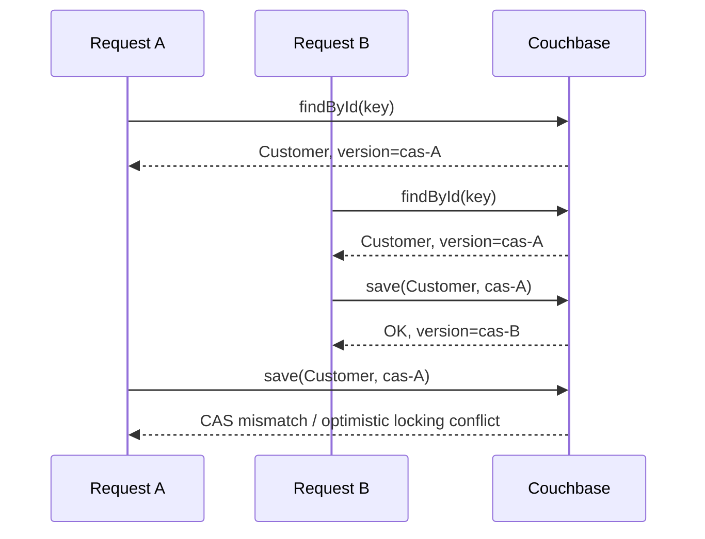

# Ý nghĩa của save và ảnh hưởng của trạng thái mới hoặc trường phiên bản

Trong **SPRING_DATA_COUCHBASE**, phương thức `save(entity)` của `CouchbaseRepository` là một lối vào phổ biến để ghi document. Tuy nhiên, ý nghĩa thực tế của lời gọi này phụ thuộc vào **trạng thái entity** mà Spring Data nhận diện, **document key** và việc entity có được quản lý **phiên bản bằng `@Version`** hay không. Nhầm lẫn những yếu tố này có thể khiến thao tác "tạo mới" vô tình ghi lên dữ liệu cũ, hoặc thao tác "cập nhật" bị từ chối vì xung đột CAS.

Bài thuộc chương **Repository**, giải thích cơ chế này từ góc nhìn tầng truy cập dữ liệu Spring Data Couchbase; đồng thời liên hệ với document mapping, `CouchbaseTemplate`, bucket/scope/collection, TTL, chỉ mục SQL++, giao dịch và lựa chọn API reactive khi cần.

## 1. Mục tiêu học tập

Sau bài học, bạn có thể:

- Giải thích vì sao `save` không phải là một cam kết nghiệp vụ "luôn chèn mới" hoặc "luôn sửa document đã có".
- Phân biệt trạng thái **new/existing trong Spring Data** với **sự tồn tại thực tế của key trong Couchbase**.
- Nhận biết vai trò của `@Id`, `@Version`, kiểu `Long` và chiến lược `isNew` đối với thao tác ghi.
- Dùng optimistic locking dựa trên CAS để phát hiện cập nhật đồng thời.
- Chọn thao tác insert-only, replace có điều kiện, upsert hoặc read–modify–save cho từng yêu cầu nghiệp vụ.
- Xử lý lỗi duplicate key, optimistic locking conflict và các tình huống timeout hoặc document hết hạn TTL.

## 2. Phân biệt ID, trạng thái mới và phiên bản

Couchbase định danh một document bằng **document key duy nhất trong collection**. Spring Data ánh xạ thuộc tính `@Id` của entity tới key đó.

Ví dụ:

```text
Bucket:       appdata
Scope:        sales
Collection:   customers
Document key: customer::tenant-a::C102
```

Nội dung JSON minh họa:

```json
{
  "tenantId": "tenant-a",
  "customerCode": "C102",
  "displayName": "Lan Anh"
}
```

Trong Java, có ba khái niệm riêng:

| Khái niệm | Câu hỏi nó trả lời | Ví dụ |
| --- | --- | --- |
| `@Id` | Ghi/đọc **document nào**? | `customer::tenant-a::C102` |
| Trạng thái entity mới (`isNew`) | Spring Data nên **xử lý entity như lần đầu được lưu** hay như entity đã được lưu? | `version == null` có thể báo entity mới |
| `@Version`/CAS | Bản dữ liệu đang ghi có còn là **phiên bản hợp lệ** không? | CAS của lần đọc gần nhất |

**Trạng thái "new" là thông tin phía ứng dụng.** Nó không tương đương với một truy vấn lên Couchbase để chắc chắn key chưa tồn tại. Ví dụ entity có ID được cấp sẵn và `version == null` có thể được xem là mới, dù một document mang key đó đã tồn tại từ trước; thao tác insert-only khi ấy phải báo xung đột.

Ngược lại, entity bị coi là đã tồn tại không bảo đảm document tương ứng vẫn còn trên máy chủ: một request khác có thể đã xóa nó, hoặc TTL có thể đã làm document hết hạn.

## 3. Entity minh họa với `@Id` và `@Version`

Ví dụ sau dùng một khách hàng có ID ổn định, được lưu trong collection `sales.customers`. Giả sử ứng dụng đã cấu hình Couchbase và bucket `appdata`, scope và collection đã được tạo sẵn.

```java
package com.example.customer;

import org.springframework.data.annotation.Id;
import org.springframework.data.annotation.Version;
import org.springframework.data.couchbase.core.mapping.Collection;
import org.springframework.data.couchbase.core.mapping.Document;
import org.springframework.data.couchbase.core.mapping.Field;
import org.springframework.data.couchbase.core.mapping.Scope;

@Document
@Scope("sales")
@Collection("customers")
public class Customer {

    @Id
    private String id;

    @Field
    private String tenantId;

    @Field
    private String customerCode;

    @Field
    private String displayName;

    @Version
    private Long version;

    public Customer() {
    }

    public Customer(String id, String tenantId,
                    String customerCode, String displayName) {
        this.id = id;
        this.tenantId = tenantId;
        this.customerCode = customerCode;
        this.displayName = displayName;
    }

    public String getId() {
        return id;
    }

    public void setId(String id) {
        this.id = id;
    }

    public String getTenantId() {
        return tenantId;
    }

    public void setTenantId(String tenantId) {
        this.tenantId = tenantId;
    }

    public String getCustomerCode() {
        return customerCode;
    }

    public void setCustomerCode(String customerCode) {
        this.customerCode = customerCode;
    }

    public String getDisplayName() {
        return displayName;
    }

    public void setDisplayName(String displayName) {
        this.displayName = displayName;
    }

    public Long getVersion() {
        return version;
    }

    public void setVersion(Long version) {
        this.version = version;
    }
}
```

Định nghĩa repository:

```java
package com.example.customer;

import org.springframework.data.couchbase.repository.CouchbaseRepository;

public interface CustomerRepository
        extends CouchbaseRepository<Customer, String> {
}
```

`Customer.id` là `String` nên tham số kiểu ID của repository cũng là `String`. `@Version Long version` là metadata dùng cho kiểm soát ghi đồng thời; không đưa nó vào document key và không coi nó là số thứ tự nghiệp vụ.

Couchbase cung cấp cơ chế **CAS (Compare-And-Swap)**: mỗi lần document thay đổi, token CAS có thể thay đổi. Trong Spring Data Couchbase, thuộc tính `@Version` được tích hợp với CAS để thực hiện optimistic locking. **Không giả định giá trị `version` sẽ lần lượt là 1, 2, 3** như một bộ đếm độc lập; hãy xem nó như giá trị phiên bản do tầng lưu trữ quản lý.

## 4. `save` thực hiện điều gì?

Lời gọi phổ biến:

```java
Customer saved = repository.save(customer);
```

Gồm hai ý riêng:

1. Spring Data sử dụng metadata ánh xạ và trạng thái entity để xác định cách xử lý việc lưu.
2. Couchbase thực thi thao tác ghi tương ứng với **key** và, khi được áp dụng, điều kiện CAS/phiên bản.

Không thể suy ra từ tên `save` rằng thao tác đó luôn là một SQL++ `INSERT`, hoặc rằng nó sẽ bỏ qua key đã tồn tại. Đây là thao tác persistence tổng quát trên entity.

Ở mức Couchbase, các chiến lược ghi cơ bản có ý nghĩa khác nhau:

| Chiến lược | Document chưa tồn tại | Document đã tồn tại |
| --- | --- | --- |
| **Insert-only** | Tạo document | Báo lỗi trùng key; không ghi đè |
| **Upsert** | Tạo document | Ghi/thay thế theo key, không tự kiểm tra CAS nếu không áp dụng điều kiện riêng |
| **Replace** | Báo không tìm thấy | Thay nội dung document |
| **Replace có CAS** | Báo không tìm thấy | Chỉ thay khi token CAS còn khớp |
| **`repository.save(entity)`** | Hành vi do Spring Data chọn theo mapping/trạng thái | Có thể chịu ảnh hưởng của `@Version` và chiến lược save |

**Hệ quả thiết kế:** nếu yêu cầu nghiệp vụ là "chắc chắn không được ghi đè", hãy chọn thao tác insert-only nguyên tử rõ ràng; nếu yêu cầu là "cập nhật đúng bản đã đọc", hãy dùng điều kiện CAS/optimistic locking. Đừng biến `save` thành một lời hứa mạnh hơn những gì cấu hình hiện tại bảo đảm.

### `save` trả về entity sau khi lưu

Nên dùng giá trị trả về:

```java
Customer stored = repository.save(customer);
Long currentVersion = stored.getVersion();
```

Giá trị trả về có thể chứa thông tin được cập nhật bởi Spring Data, chẳng hạn metadata/version mới. Đối với các thao tác tiếp theo, **giữ entity trả về** thay vì tiếp tục dựa vào bản sao cũ không có version hiện hành. Không nên tự gán `@Version` từ client để mô phỏng một lần cập nhật thành công.

## 5. Spring Data nhận diện entity mới như thế nào?

Spring Data Commons cung cấp cơ chế *entity state detection*. Các quy tắc mặc định cần hiểu theo thứ tự ưu tiên:

1. **Có thuộc tính `@Version` kiểu tham chiếu** như `Long`: giá trị `null` biểu thị entity mới, giá trị khác `null` biểu thị entity đã có trạng thái lưu.
2. **Có `@Version` kiểu nguyên thủy** như `long`: giá trị mặc định `0` được dùng để nhận diện entity mới.
3. **Không có thuộc tính version:** kiểm tra ID; ID `null` thường được xem là mới, ID khác `null` thường được xem là đã có.
4. Một số mô hình sử dụng `Persistable` hoặc cấu hình `EntityInformation` tùy chỉnh để kiểm soát `isNew`; lúc đó cần hiểu rõ quy tắc ghi và ánh xạ của repository đang dùng.

Các quy tắc này mô tả nhận diện trạng thái trong Spring Data. Đường thực thi ghi cụ thể của Spring Data Couchbase còn phụ thuộc phiên bản framework và API sử dụng. Không dùng chúng thay thế cho thao tác kiểm tra tồn tại có tính nguyên tử trên máy chủ.

### So sánh với entity có ID được cấp trước

```java
Customer customer = new Customer(
        "customer::tenant-a::C102",
        "tenant-a",
        "C102",
        "Lan Anh");

// version chưa được gán, tức null:
System.out.println(customer.getVersion()); // null

Customer stored = repository.save(customer);
```

Trong mô hình có `@Version Long`, `version == null` là tín hiệu entity mới, **mặc dù `id` đã khác `null`**. Đây là lý do dùng `String` ID có ý nghĩa nghiệp vụ không ngăn cản Spring Data nhận diện một entity mới.

Nếu bỏ hẳn `@Version` và tiếp tục tạo entity với ID định trước, Spring Data có thể xem entity đó là "không mới" ngay từ trước lần lưu đầu tiên. Với Couchbase, hành vi thực tế khi `save` gặp key có/không có còn do cơ chế ghi tương ứng quyết định. Vì vậy, **không dựa vào `id != null` để kết luận document đã tồn tại**.

### Bảng trạng thái minh họa

| Đặc điểm entity | `id` | `version` | Nhận diện newness mặc định |
| --- | --- | --- | --- |
| Có `@Version Long` | Đã gán | `null` | Mới |
| Có `@Version Long` | Đã gán | CAS khác `null` | Không mới |
| Có `@Version long` | Đã gán | `0` | Mới |
| Có `@Version long` | Đã gán | Khác `0` | Không mới |
| Không có `@Version` | `null` | Không có | Mới |
| Không có `@Version` | Đã gán | Không có | Không mới |

Nên ưu tiên `Long` có thể `null` khi dùng optimistic locking, vì trạng thái **chưa từng được lưu** trở nên rõ ràng. Không gán `version = 0L` cho một `Long` rồi kỳ vọng nó được xử lý y hệt `null`; với kiểu tham chiếu, `0L` vẫn là giá trị **khác null**.

## 6. `@Version`, CAS và cập nhật đồng thời

Optimistic locking hữu ích khi ít xảy ra xung đột nhưng hậu quả của ghi đè dữ liệu là đáng kể. Nó cho phép đọc dữ liệu không giữ khóa dài hạn rồi kiểm tra phiên bản lúc ghi.

Giả sử document `customer::tenant-a::C102` đang có token CAS là `cas-A`.



Cả A và B đọc cùng một bản. B ghi trước nên CAS đổi thành `cas-B`. Nếu A vẫn gửi điều kiện phiên bản cũ `cas-A`, Couchbase từ chối ghi. Spring Data chuyển xung đột thành lỗi ở tầng truy cập dữ liệu (thường thuộc nhóm `OptimisticLockingFailureException`).

Nếu không có `@Version` hoặc cơ chế kiểm soát CAS tương đương, ứng dụng có nguy cơ rơi vào tình huống **last write wins**: cập nhật sau ghi đè cập nhật trước.

### Ví dụ cập nhật đúng cách

```java
public Customer updateDisplayName(
        CustomerRepository repository,
        String id,
        String displayName) {

    Customer current = repository.findById(id)
            .orElseThrow(() ->
                    new IllegalArgumentException(
                            "Không tìm thấy document"));

    current.setDisplayName(displayName);
    return repository.save(current);
}
```

Điều quan trọng là cập nhật **entity đã được đọc cùng version hiện hành**, không dựng một entity mới chỉ chứa `id` và `displayName` rồi gọi `save`.

### Xử lý khi phiên bản cũ

```java
import org.springframework.dao.OptimisticLockingFailureException;

try {
    Customer updated = updateDisplayName(
            repository,
            "customer::tenant-a::C102",
            "Lan Anh Nguyễn");

    System.out.println(updated.getVersion());

} catch (OptimisticLockingFailureException ex) {
    // Ví dụ ở tầng ứng dụng:
    // báo lỗi xung đột để người dùng tải lại dữ liệu,
    // hoặc đọc lại và tính toán thay đổi một lần nữa.
    throw ex;
}
```

Có thể ánh xạ lỗi xung đột sang HTTP `409 Conflict` hoặc một quy tắc xử lý nghiệp vụ phù hợp. Không tự động retry cùng một entity mang version cũ: nếu không đọc lại và tính toán thay đổi theo dữ liệu mới, lần retry vẫn xung đột hoặc có thể vô tình ghi đè.

**Đặc biệt:** với giao diện sửa dữ liệu, cần quyết định có nên dùng version mà người dùng đã đọc trước đó. Nếu service luôn `findById` lại tại thời điểm nhận yêu cầu và ghi ngay, nó bảo vệ được các xung đột **trong khoảng từ lần đọc đến lần lưu đó**, nhưng không tự phát hiện mọi xung đột với một biểu mẫu đã mở rất lâu. Muốn phát hiện thao tác dựa trên phiên bản giao diện cũ, hãy truyền và kiểm tra phiên bản mong đợi theo chính sách nghiệp vụ.

## 7. Cùng một lời gọi `save`, những tình huống khác nhau

### Trường hợp A: Document chưa có, entity có version `null`

```java
Customer first = new Customer(
        "customer::tenant-a::C102",
        "tenant-a", "C102", "Lan Anh");

// first.getVersion() == null
Customer result = repository.save(first);
```

Với `@Version Long`, entity được nhận diện là mới. Sau khi lưu thành công, result mang version/CAS tương ứng. Hãy dùng result làm trạng thái hiện hành.

### Trường hợp B: Dùng lại key nhưng tạo object mới với version `null`

```java
Customer another = new Customer(
        "customer::tenant-a::C102",
        "tenant-a", "C102", "Tên khác");

// another.getVersion() vẫn null.
repository.save(another);
```

Về mặt metadata, `another` vẫn giống một entity **mới**, không phải bản đang được quản lý với version của document đã có. Trong đường ghi insert-only, nó sẽ bị từ chối vì trùng key. Không dùng cách khởi tạo này để "cập nhật nhanh" document hiện tại.

Nếu yêu cầu thực sự là thay dữ liệu, hãy đọc bản đang có, sửa trường cần thay và lưu lại kèm thông tin CAS. Nếu yêu cầu là tạo mới, dùng insert-only để lỗi trùng key được phát hiện rõ ràng.

### Trường hợp C: Cập nhật bằng bản cũ

```java
Customer copyA = repository.findById(id).orElseThrow();
Customer copyB = repository.findById(id).orElseThrow();

copyA.setDisplayName("Tên từ A");
repository.save(copyA);

copyB.setDisplayName("Tên từ B");
repository.save(copyB); // Có thể báo xung đột version/CAS.
```

Khi `@Version` hoạt động, bản copyB mang CAS từ trước khi A cập nhật. Đó chính là tình huống optimistic locking cần bắt được.

### Trường hợp D: Document bị xóa hoặc hết hạn sau khi đọc

Một entity đã đọc có version hợp lệ tại thời điểm đọc. Nếu document bị xóa hoặc hết hạn TTL trước lúc lưu lại, thao tác có điều kiện tồn tại/CAS phải được xem xét như **xung đột trạng thái**, không mặc định tạo lại document.

Tùy API và cách Spring Data thực hiện thao tác ghi, lỗi có thể là không tìm thấy hoặc optimistic locking conflict. Tầng service nên phân loại rõ kết quả phù hợp với nghiệp vụ, thay vì tự chuyển mọi lỗi thành "không tìm thấy".

## 8. Chọn `save` hay thao tác ghi tường minh?

Đối với nghiệp vụ cần ngữ nghĩa tạo/sửa thật chặt, `CouchbaseTemplate` cung cấp các phương thức ghi theo key như `insertById`, `replaceById` hoặc `upsertById` trong các phiên bản hỗ trợ fluent API. SDK Couchbase cũng có các thao tác `insert`, `replace` và `upsert` tương ứng.

### 8.1. Create: chèn mới, không ghi đè

```java
import org.springframework.data.couchbase.core.CouchbaseTemplate;

public Customer createCustomer(
        CouchbaseTemplate template,
        Customer customer) {

    return template
            .insertById(Customer.class)
            .one(customer);
}
```

`insertById` thể hiện ý định **chỉ tạo nếu key chưa tồn tại**. Khi hai request cùng tạo một key, sự kiểm tra trùng key diễn ra tại thao tác ghi; chỉ một request được tạo document. Cách này đáng tin cậy hơn mẫu "`existsById` rồi `save`" vì hai bước riêng không tạo thành một điều kiện nguyên tử.

### 8.2. Update: nạp bản hiện hành và lưu có version

```java
public Customer renameCustomer(
        CustomerRepository repository,
        String id,
        String newName) {

    Customer current = repository.findById(id)
            .orElseThrow(() ->
                    new IllegalArgumentException(
                            "Customer không tồn tại"));

    current.setDisplayName(newName);
    return repository.save(current);
}
```

Kết hợp với `@Version`, cách này phù hợp với cập nhật có phát hiện xung đột. Việc kiểm tra phiên bản diễn ra ở thao tác ghi, khác với gọi `existsById` như một bước tiền kiểm.

### 8.3. Upsert: tạo hoặc ghi đè khi chủ đích cho phép

Upsert phù hợp cho dữ liệu mà nghiệp vụ **cho phép** cả tạo mới lẫn ghi đè, chẳng hạn ghi lại một cấu hình được tính toán hoàn toàn từ nguồn đáng tin cậy. Tuy nhiên, nếu nhiều request cùng sửa từng trường khác nhau, upsert không có điều kiện CAS dễ làm mất dữ liệu.

Không dùng upsert chỉ vì nó "tiện" khi yêu cầu thực tế là:
- Tạo một đơn hàng duy nhất và từ chối key trùng.
- Chỉ sửa khi document vẫn là bản khách hàng đã xem.
- Không phục hồi document đã bị xóa bởi request khác.

### So sánh quyết định

| Yêu cầu nghiệp vụ | Cách tiếp cận | Điều kiện cần giữ |
| --- | --- | --- |
| Chỉ tạo mới | Insert-only nguyên tử (`insertById`/SDK `insert`) | Key chưa tồn tại |
| Cập nhật bản đã đọc | Đọc hiện hành + `save` với `@Version` | CAS còn phù hợp |
| Ghi toàn bộ nội dung, được phép tạo hoặc thay thế | Upsert tường minh | Đã chấp nhận ghi đè theo thiết kế |
| Thay document chỉ khi có sẵn | Replace có điều kiện | Document tồn tại; thêm CAS nếu cần chống mất cập nhật |
| Thay đổi nhiều document như một đơn vị | Transaction hoặc chiến lược nhất quán tương ứng | Phù hợp giới hạn giao dịch Couchbase |
| Cập nhật rất nhỏ, tránh truyền cả document | Sub-document mutation của SDK, khi phù hợp | Xác định rõ quy tắc ghi đồng thời và version |

## 9. `Persistable` và nhận diện entity mới tùy chỉnh

Trong một số mô hình, ID luôn được tạo từ nghiệp vụ và phiên bản chưa thể hiện đầy đủ vòng đời entity. Spring Data Commons cho phép thay đổi cách nhận diện "new" thông qua interface `Persistable<ID>` và `isNew()`.

Ví dụ ý tưởng:

```java
import org.springframework.data.domain.Persistable;

public class ExternalIdEntity implements Persistable<String> {

    private String id;
    private boolean newEntity = true;

    @Override
    public String getId() {
        return id;
    }

    @Override
    public boolean isNew() {
        return newEntity;
    }

    public void markPersisted() {
        newEntity = false;
    }
}
```

Đây là **mã minh họa cơ chế**, chưa phải entity Couchbase hoàn chỉnh. Khi triển khai thực tế, phải quyết định cách gắn `@Document`, `@Id`, trường transient/không ánh xạ và cách đánh dấu sau khi load hoặc lưu. Một cờ `newEntity` được lưu nhầm vào JSON hay không được chuyển trạng thái sau đọc có thể gây nhận diện sai.

Với Spring Data Couchbase, chỉ dùng chiến lược tùy chỉnh khi đã xác minh repository/template của phiên bản đang sử dụng vận dụng `isNew` đúng theo dự kiến. **Không dùng `Persistable.isNew()` như một cách "bỏ qua CAS" hoặc ép ghi đè**; yêu cầu chống trùng key hay chống mất cập nhật vẫn nên được thực thi bởi thao tác ghi phù hợp ở Couchbase.

Trong đa số entity ứng dụng thông thường, sử dụng `@Version Long` có thể `null` và để Spring Data quản lý sẽ đơn giản, dễ kiểm chứng hơn một cơ chế trạng thái tự tạo.

## 10. Những giới hạn dễ bỏ sót

### 10.1. Trạng thái entity không phải bảo đảm về tồn tại

Không có sự tương đương tuyệt đối giữa:

```text
entity được Spring Data xem là NEW
                 và
document key chưa tồn tại trên Couchbase
```

Cũng không có tương đương tuyệt đối giữa:

```text
entity được Spring Data xem là EXISTING
                 và
document key vẫn đang tồn tại trên Couchbase
```

Các tình huống sao chép entity, khởi tạo version bằng tay, TTL, delete đồng thời, retry sau timeout hoặc đổi collection đều có thể khiến hai phía khác nhau.

### 10.2. ID cố định, version thay đổi

Giữ nguyên `@Id` khi cập nhật một document; chỉ có dữ liệu và version/CAS thay đổi. Nếu đổi `@Id` rồi `save`, ứng dụng đang chỉ tới key khác, không tự đổi tên key cũ.

### 10.3. TTL ảnh hưởng vòng đời document

Document có TTL có thể hết hạn giữa lúc đọc và lúc ghi. Ngoài ra, một thao tác ghi có thể ảnh hưởng thời gian hết hạn tùy API và tùy chọn expiration. Vì thế, phải xác định rõ chính sách TTL cho từng loại document thay vì giả định `save` luôn giữ TTL cũ.

### 10.4. Bucket/scope/collection là một phần của đích ghi

Document key chỉ duy nhất **trong collection**. Cùng `customer::tenant-a::C102` ở `sales.customers` và `sales.archived` có thể là hai document khác nhau. Nếu repository hoặc template ghi nhầm collection, `save` vẫn có thể thành công nhưng kết quả không nằm ở vị trí ứng dụng khác đọc.

### 10.5. Không có giao dịch ngầm cho toàn bộ quy trình

`findById` → tính toán nghiệp vụ → `save` là nhiều bước. `@Version` giúp phát hiện xung đột trên document khi ghi, nhưng không tự tạo giao dịch nguyên tử cho nhiều document, không cập nhật các tham chiếu liên quan và không thay thế Couchbase transactions nếu nghiệp vụ yêu cầu điều đó.

### 10.6. Truy vấn SQL++ và chỉ mục không thay thế CAS

`findById` là truy cập theo document key; một phương thức repository như `findByCustomerCode` thường được thực thi qua SQL++ và cần chỉ mục phù hợp. SQL++ query có thể chịu ảnh hưởng scan consistency sau ghi. Tuy nhiên, dù document được đọc qua KV hay SQL++, yêu cầu chống ghi đè vẫn cần kiểm tra CAS/version ở **thời điểm ghi**.

### 10.7. Reactive thay đổi cách thực thi, không thay đổi nguyên tắc

Khi dùng `ReactiveCouchbaseRepository`, lời gọi `save` trả về một publisher như `Mono<Customer>`, và thao tác được thực thi trong luồng reactive khi có subscription phù hợp. Ví dụ:

```java
import reactor.core.publisher.Mono;

Mono<Customer> saved =
        reactiveCustomerRepository.save(customer);
```

Version/CAS và việc phân biệt create-only, update, upsert vẫn cần được bảo đảm. Không gọi `block()` tùy tiện trong request pipeline reactive; xử lý xung đột trong luồng `Mono`/`Flux` và chỉ retry khi đã tính toán lại từ trạng thái đúng.

### 10.8. Timeout không đồng nghĩa ghi thất bại

Sau timeout, có thể máy chủ đã ghi thành công nhưng ứng dụng chưa nhận được phản hồi. Retry một thao tác insert-only với cùng key có thể gặp duplicate key; retry một cập nhật có CAS cũ có thể gặp conflict. Cần có cơ chế truy vết/idempotency theo nghiệp vụ để phân biệt ghi đã thành công với xung đột thực sự.

## 11. Thực hành: kiểm tra hành vi `save` và version

Hãy chạy các kịch bản sau trên môi trường Couchbase thử nghiệm với repository, cấu hình bucket/scope/collection và `@Version Long version` như ví dụ. Không chạy trên dữ liệu khách hàng thật.

| Bước | Thao tác | Kết quả cần quan sát |
| --- | --- | --- |
| 1 | Tạo `Customer` với key mới, `version == null`, gọi `save` | Lưu được document; entity trả về có version/CAS do hệ thống quản lý |
| 2 | `findById(key)` và xem `getVersion()` | Đọc được document và version hiện hành |
| 3 | Đổi `displayName` trên bản vừa đọc, gọi `save` | Cập nhật cùng key, version thay đổi |
| 4 | Đọc hai bản A/B của cùng key, lưu A trước rồi lưu B | Bị từ chối theo optimistic locking khi dùng version đúng cách |
| 5 | Tạo entity mới cùng key nhưng `version == null` | Ghi nhận rõ hành vi đường lưu; với thao tác insert-only phải báo trùng key |
| 6 | Thử `insertById` hai lần trên cùng key | Lần thứ hai báo lỗi key đã tồn tại, không ghi đè lần đầu |
| 7 | Xóa hoặc để TTL làm hết hạn một document đã được đọc, rồi thử lưu bản cũ | Quan sát lỗi tồn tại/phiên bản của API và xử lý thành xung đột nghiệp vụ phù hợp |
| 8 | Thử không dùng `@Version` trong mô hình riêng | So sánh khả năng phát hiện lost update với phiên bản có `@Version` |

Một bài kiểm tra tích hợp có ý nghĩa cần kiểm tra **dữ liệu cuối cùng**, **mã lỗi/loại ngoại lệ**, **key**, và **version** sau từng tình huống; đừng chỉ kiểm tra rằng lời gọi `save` có trả về giá trị khác `null`.

### Câu hỏi tự kiểm tra

1. Vì sao `@Id` đã có giá trị vẫn chưa đủ để kết luận document đã tồn tại?
2. Với `@Version Long`, `null` khác gì `0L` khi nhận diện entity mới?
3. Khi nào nên dùng insert-only thay cho `repository.save`?
4. Vì sao `existsById` trước `save` không bảo đảm "tạo đúng một lần" trong môi trường nhiều request?
5. Một request đọc document khi CAS là A, request khác ghi khiến CAS thành B: request đầu cần làm gì?
6. Nếu người dùng sửa một biểu mẫu cũ, chỉ đọc lại record mới nhất trước `save` có luôn phát hiện xung đột với biểu mẫu đó không?

## 12. Ghi nhớ

`save` là phương thức ghi entity ở tầng repository. Muốn hiểu nó, cần xem đồng thời **`@Id` xác định key**, **newness của entity**, **`@Version`/CAS** và **chính sách ghi mong muốn**. Entity mới trong Spring Data không chứng minh key chưa có trên Couchbase; entity được xem là đã tồn tại cũng không chứng minh document vẫn còn.

Với yêu cầu **không ghi đè document đã có**, dùng insert-only nguyên tử. Với yêu cầu **không làm mất cập nhật đồng thời**, dùng optimistic locking/CAS và xử lý xung đột. Với yêu cầu **được phép tạo hoặc thay thế**, cân nhắc upsert rõ ràng. Các quy tắc đó tiếp tục áp dụng khi triển khai qua `CouchbaseTemplate`, chuyển sang reactive hoặc kết hợp TTL và giao dịch trong Spring Data Couchbase.
