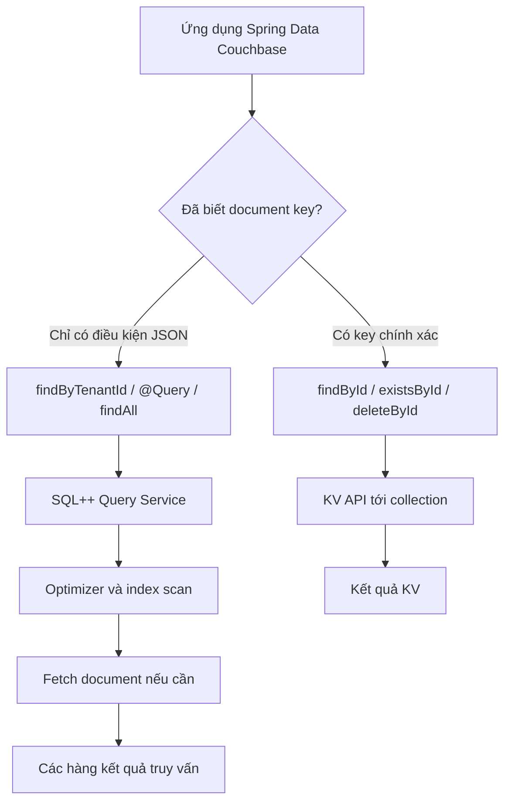

# Phân biệt thao tác theo khóa với thao tác được thực hiện bằng SQL++

Trong chương **Repository** của **SPRING_DATA_COUCHBASE**, cùng một interface `CouchbaseRepository` có thể cung cấp hai nhóm thao tác với **đường thực thi khác nhau**: truy cập document qua **key-value (KV)** khi đã biết document key, và truy vấn **SQL++** khi cần lọc, sắp xếp, phân trang hoặc tổng hợp theo các trường dữ liệu.

Phân biệt hai nhóm này giúp chọn API đúng, thiết kế document key hợp lý, tạo chỉ mục phù hợp cho bucket/scope/collection, hiểu độ trễ và tính nhất quán sau ghi, đồng thời biết khi nào nên chuyển sang `CouchbaseTemplate`, truy vấn tùy chỉnh hoặc API reactive.

## 1. Mục tiêu bài học

Sau bài học, bạn có thể:

- Xác định phương thức repository nào dùng **KV lookup theo document key** và phương thức nào thường thực hiện **SQL++ query**.
- Phân biệt `@Id`/document key với trường JSON như `customerCode`, kể cả khi chúng chứa giá trị gần giống nhau.
- Viết ví dụ Spring Data Couchbase truy cập bằng `findById` và truy vấn bằng phương thức suy diễn tên (`derived query`) hoặc `@Query`.
- Giải thích vì sao truy vấn SQL++ cần chỉ mục và vì sao một truy vấn có thể chưa thấy thay đổi mới ghi khi dùng mức scan consistency thấp.
- Đọc dấu hiệu từ `EXPLAIN`, chọn chỉ mục thứ cấp và tránh lỗi hiệu năng thường gặp.
- Chọn phương pháp phù hợp với TTL, CAS, phân quyền tenant và API đồng bộ/reactive.

## 2. Document key và trường JSON khác nhau

Giả sử ứng dụng lưu khách hàng trong:

```text
Bucket:       appdata
Scope:        sales
Collection:   customers

Document key: customer::tenant-a::C102
```

Giá trị JSON minh họa:

```json
{
  "tenantId": "tenant-a",
  "customerCode": "C102",
  "displayName": "Lan Anh",
  "status": "ACTIVE"
}
```

Document key thuộc **metadata định danh của Couchbase**, có tính duy nhất trong **collection**. Các trường `tenantId`, `customerCode`, `displayName` và `status` là nội dung JSON. Hai hình thức truy cập trả lời hai câu hỏi khác nhau:

- **KV theo key:** “Document có key chính xác `customer::tenant-a::C102` là gì?”
- **SQL++ theo dữ liệu:** “Có những customer nào thuộc tenant A, đang ACTIVE và tên bắt đầu bằng ‘Lan’?”

Couchbase không tự biến `customerCode = "C102"` thành key `customer::tenant-a::C102`. Quy tắc ghép key do ứng dụng định nghĩa và phải được thực hiện nhất quán.

Một truy vấn SQL++ có thể sử dụng `META(c).id` để làm việc với key trong câu truy vấn; điều đó **không biến** lệnh `SELECT` thành lời gọi KV của repository. Trình tối ưu SQL++ có thể chọn kế hoạch phù hợp với điều kiện và chỉ mục, nhưng ứng dụng vẫn đi qua đường truy vấn SQL++.

## 3. Hai đường truy cập nhìn từ repository



| Tiêu chí | Thao tác KV theo key | Truy vấn SQL++ |
| --- | --- | --- |
| Đầu vào chính | **Document key chính xác** | Điều kiện trên JSON, metadata, biểu thức hoặc các khóa liên quan |
| Ví dụ repository | `findById(id)`, `existsById(id)`, `deleteById(id)` | `findByTenantId(...)`, `findByStatus(...)`, `findAll()`, `@Query` |
| Cần index SQL++ để tìm theo key? | **Không** | Thường **cần index phù hợp** cho truy vấn |
| Loại kết quả | Một document, trạng thái tồn tại hoặc kết quả ghi/xóa | Một hoặc nhiều hàng; có thể lọc, phân trang, sắp xếp, tổng hợp |
| Bộ phận thực thi | Đường KV của Couchbase | Query Service và optimizer |
| Nhất quán sau ghi | Đọc theo key qua KV có cơ chế truy cập trực tiếp | Kết quả có thể phụ thuộc **scan consistency** của index |
| Khi phù hợp | CRUD đối tượng đã biết key | Tìm theo thuộc tính, tra cứu danh sách, báo cáo |
| Điểm cần tối ưu | Key, payload, CAS, timeout, kết nối | Index, predicate, ORDER BY, LIMIT, projection, execution plan |

**Lưu ý:** `save(entity)` là thao tác ghi theo key, nhưng việc chọn insert/upsert/replace và kiểm tra CAS có thể phụ thuộc trạng thái entity, `@Version` và phiên bản Spring Data. Không suy luận từ tên `save` rằng nó luôn bảo đảm chỉ chèn mới.

## 4. Khai báo entity và repository cho cả hai kiểu truy cập

### 4.1. Entity `Customer`

```java
package com.example.customer;

import org.springframework.data.annotation.Id;
import org.springframework.data.annotation.Version;
import org.springframework.data.couchbase.core.mapping.Collection;
import org.springframework.data.couchbase.core.mapping.Document;
import org.springframework.data.couchbase.core.mapping.Field;
import org.springframework.data.couchbase.core.mapping.Scope;

@Document
@Scope("sales")
@Collection("customers")
public class Customer {

    @Id
    private String id;

    @Field
    private String tenantId;

    @Field
    private String customerCode;

    @Field
    private String displayName;

    @Field
    private String status;

    @Version
    private Long version;

    public Customer() {
    }

    public Customer(String id, String tenantId, String customerCode,
                    String displayName, String status) {
        this.id = id;
        this.tenantId = tenantId;
        this.customerCode = customerCode;
        this.displayName = displayName;
        this.status = status;
    }

    public String getId() { return id; }
    public void setId(String id) { this.id = id; }

    public String getTenantId() { return tenantId; }
    public void setTenantId(String tenantId) { this.tenantId = tenantId; }

    public String getCustomerCode() { return customerCode; }
    public void setCustomerCode(String customerCode) {
        this.customerCode = customerCode;
    }

    public String getDisplayName() { return displayName; }
    public void setDisplayName(String displayName) {
        this.displayName = displayName;
    }

    public String getStatus() { return status; }
    public void setStatus(String status) { this.status = status; }

    public Long getVersion() { return version; }
    public void setVersion(Long version) { this.version = version; }
}
```

`@Id String id` ánh xạ sang **document key**. `@Version Long version` tham gia optimistic locking dựa trên CAS khi ghi; version không phải thuộc tính nghiệp vụ để tìm kiếm customer.

`@Scope` và `@Collection` chỉ định đích ánh xạ. Chúng không tự tạo scope/collection trên Couchbase. Ứng dụng cần cấu hình kết nối, bucket mặc định, scope/collection đã tồn tại và quyền truy cập tương ứng.

### 4.2. Repository chứa cả hai kiểu phương thức

```java
package com.example.customer;

import java.util.List;
import java.util.Optional;
import org.springframework.data.couchbase.repository.CouchbaseRepository;

public interface CustomerRepository
        extends CouchbaseRepository<Customer, String> {

    // Truy vấn SQL++ theo trường JSON:
    List<Customer> findByTenantId(String tenantId);

    Optional<Customer> findByTenantIdAndCustomerCode(
            String tenantId, String customerCode);

    List<Customer> findByTenantIdAndStatus(
            String tenantId, String status);
}
```

Các phương thức kế thừa như `findById` nhận kiểu `String`, đúng với `@Id String id`. Các phương thức tự khai báo `findByTenantId`, `findByTenantIdAndCustomerCode` và `findByTenantIdAndStatus` là **derived queries**: Spring Data phân tích tên để sinh truy vấn trên các trường của entity, thường thực thi bằng SQL++.

**Cùng nằm trong một interface không có nghĩa mọi phương thức dùng cùng đường truy cập.**

## 5. Thao tác theo key: truy cập KV

### 5.1. Đọc, kiểm tra tồn tại và xóa

```java
String key = "customer::tenant-a::C102";

// Đọc đúng document key:
Optional<Customer> customer = repository.findById(key);

// Kiểm tra sự tồn tại của key:
boolean exists = repository.existsById(key);

// Xóa đúng document key (trong môi trường thử nghiệm):
repository.deleteById(key);
```

Đây là nhóm thao tác theo key, vì đã biết **định danh chính xác**. Không cần tạo index SQL++ trên `tenantId` hay `customerCode` để thực hiện các lời gọi này.

Nếu gọi `repository.findById("C102")` trong khi key thật là `customer::tenant-a::C102`, lời gọi sẽ không tìm đúng document. Spring Data không tự ghép prefix hay tra cứu theo `customerCode`.

Hàm tạo key tập trung giúp tránh lỗi:

```java
public final class CustomerKeys {

    private CustomerKeys() {
    }

    public static String of(String tenantId, String customerCode) {
        if (tenantId == null || tenantId.isBlank()
                || customerCode == null || customerCode.isBlank()) {
            throw new IllegalArgumentException(
                    "tenantId/customerCode không được rỗng");
        }
        if (tenantId.contains("::") || customerCode.contains("::")) {
            throw new IllegalArgumentException(
                    "Thành phần key không được chứa '::'");
        }
        return "customer::" + tenantId + "::" + customerCode;
    }
}
```

Với khóa như ví dụ, nếu có đủ `tenantId` và `customerCode` thì ứng dụng **đã biết key** và nên cân nhắc `findById(CustomerKeys.of(...))`. Truy vấn theo hai trường JSON vẫn hợp lệ nhưng có thêm yêu cầu về index và scan consistency.

### 5.2. Ghi theo key

```java
Customer customer = new Customer(
        CustomerKeys.of("tenant-a", "C102"),
        "tenant-a",
        "C102",
        "Lan Anh",
        "ACTIVE");

Customer stored = repository.save(customer);
```

`save` ghi document được xác định bằng `@Id`. Với entity có `@Version`, việc ghi còn chịu ảnh hưởng của trạng thái mới/cũ và CAS. Lựa chọn tạo mới hay cập nhật phải được xác định ở tầng nghiệp vụ:

- **Chỉ chèn mới:** dùng insert-only nguyên tử, chẳng hạn `insertById` trên `CouchbaseTemplate` hoặc KV SDK.
- **Sửa phiên bản đã đọc:** đọc entity hiện hành, đổi trường cần sửa rồi lưu có `@Version`/CAS.
- **Cho phép tạo hoặc ghi đè:** cân nhắc upsert tường minh.

Không dùng `existsById(key)` rồi `save(entity)` làm bảo đảm chống trùng key: hai request có thể cùng thấy key chưa tồn tại trước lúc ghi.

### 5.3. KV theo key không tự tìm kiếm theo prefix

Cho dù key có dạng:

```text
customer::tenant-a::C101
customer::tenant-a::C102
customer::tenant-a::C103
```

`findById("customer::tenant-a::")` **không** có nghĩa “trả về mọi customer của tenant A”. API KV cần một key hoàn chỉnh. Để lấy tập document theo điều kiện, dùng SQL++ hoặc cấu trúc tra cứu khác do ứng dụng quản lý.

## 6. Truy vấn SQL++: tìm theo trường dữ liệu

### 6.1. Derived query trong Spring Data

```java
List<Customer> active =
        repository.findByTenantIdAndStatus("tenant-a", "ACTIVE");

Optional<Customer> byBusinessCode =
        repository.findByTenantIdAndCustomerCode(
                "tenant-a", "C102");
```

Ở đây `tenantId`, `status` và `customerCode` là **thuộc tính JSON**. Spring Data xây dựng điều kiện truy vấn, Couchbase Query Service xử lý SQL++ trên collection tương ứng.

Truy vấn có thể trả về **nhiều document**. Khi khai báo `Optional<Customer>` cho tổ hợp `tenantId` và `customerCode`, nghiệp vụ phải bảo đảm tổ hợp này duy nhất. Chỉ khai báo `Optional` **không tự tạo unique constraint** trên các trường JSON; Couchbase bảo đảm tính duy nhất cho **document key trong collection**.

### 6.2. SQL++ tương đương trong Query Workbench

Ví dụ tìm khách hàng mã `C102` tại tenant A:

```sql
SELECT
    META(c).id AS documentKey,
    c.tenantId,
    c.customerCode,
    c.displayName,
    c.status
FROM `appdata`.`sales`.`customers` AS c
WHERE c.tenantId = $tenantId
  AND c.customerCode = $customerCode;
```

Trong Query Workbench hoặc SDK cần cung cấp tham số `tenantId` và `customerCode`. Câu SQL++ minh họa **logic lọc dữ liệu**, không phải chuỗi mà Spring Data nhất thiết sinh y hệt. Truy vấn do Spring Data Couchbase tạo có thể thêm điều kiện phân biệt kiểu entity, projection và metadata cần thiết cho mapping.

Ví dụ tìm customer ACTIVE có tên phù hợp mẫu:

```sql
SELECT
    META(c).id AS documentKey,
    c.customerCode,
    c.displayName
FROM `appdata`.`sales`.`customers` AS c
WHERE c.tenantId = $tenantId
  AND c.status = "ACTIVE"
  AND c.displayName LIKE $namePattern
ORDER BY c.displayName
LIMIT 20;
```

SQL++ hỗ trợ biểu thức, sắp xếp, phân trang, gom nhóm và join phù hợp. Đây là các nhu cầu mà `findById` đơn lẻ không giải quyết.

### 6.3. `@Query` tùy chỉnh khi tên phương thức không đủ

Spring Data Couchbase hỗ trợ `@Query` với các biểu thức SpEL của framework, ví dụ:

```java
package com.example.customer;

import java.util.List;
import org.springframework.data.couchbase.repository.Query;
import org.springframework.data.couchbase.repository.CouchbaseRepository;

public interface CustomerSearchRepository
        extends CouchbaseRepository<Customer, String> {

    @Query(
        "#{#n1ql.selectEntity} " +
        "WHERE #{#n1ql.filter} " +
        "AND tenantId = $1 " +
        "AND displayName LIKE $2"
    )
    List<Customer> searchByTenantAndName(
            String tenantId, String namePattern);
}
```

Ví dụ:

```java
List<Customer> result =
        searchRepository.searchByTenantAndName(
                "tenant-a", "Lan%");
```

`#{#n1ql.selectEntity}` và `#{#n1ql.filter}` hỗ trợ dựng phần chọn entity và điều kiện ánh xạ phù hợp trong các phiên bản Spring Data Couchbase hỗ trợ cú pháp này. Khả năng sử dụng macro và cách bind tham số cần kiểm tra theo phiên bản. `$1` và `$2` là tham số vị trí, không nên ghép dữ liệu người dùng trực tiếp vào chuỗi SQL++.

Dấu `%` trong `LIKE` là wildcard; nếu nghiệp vụ yêu cầu tìm kiếm chuỗi nguyên văn, cần xử lý escape đúng quy tắc SQL++.

## 7. Chỉ mục: yếu tố quyết định của SQL++

### 7.1. Vì sao `findById` chạy được nhưng `findByTenantId` có thể thất bại?

`findById` dùng key để truy cập KV nên không cần **SQL++ secondary index**. SQL++ phải có con đường truy cập dữ liệu mà optimizer có thể chọn. Nếu không có index phù hợp, truy vấn có thể báo lỗi “no index available” hoặc dùng kế hoạch kém hiệu quả.

Ví dụ tạo index phục vụ lọc theo tenant và mã khách hàng:

```sql
CREATE INDEX ix_customers_tenant_code
ON `appdata`.`sales`.`customers`(
    tenantId,
    customerCode
);
```

Đối với truy vấn danh sách theo tenant, trạng thái và tên:

```sql
CREATE INDEX ix_customers_tenant_status_name
ON `appdata`.`sales`.`customers`(
    tenantId,
    status,
    displayName
);
```

Đây là **hai ví dụ index cho hai mẫu truy vấn**, không phải yêu cầu tạo cả hai trong mọi hệ thống. Index tiêu tốn tài nguyên lưu trữ, bộ nhớ và chi phí duy trì khi ghi; cần quan sát workload thực tế trước khi bổ sung.

### 7.2. Dùng `EXPLAIN` kiểm tra kế hoạch

```sql
EXPLAIN
SELECT
    META(c).id AS documentKey,
    c.customerCode,
    c.displayName
FROM `appdata`.`sales`.`customers` AS c
WHERE c.tenantId = "tenant-a"
  AND c.status = "ACTIVE"
ORDER BY c.displayName
LIMIT 20;
```

Trong plan, kiểm tra:

- **Index được chọn:** optimizer có dùng index dự kiến hay quét phạm vi rộng?
- **Predicate pushdown:** điều kiện `tenantId`/`status` có được áp dụng sớm ở index không?
- **Fetch:** có cần đọc document đầy đủ hay index đủ trường để trả kết quả (*covering index*)?
- **Sort và limit:** có phải sắp xếp nhiều hàng trước khi giới hạn?
- **Chi phí thực tế:** đo thời gian, số document được đọc và tải Query Service trên dữ liệu đại diện.

Không phỏng đoán thời gian chỉ từ tên phương thức repository. Truy vấn SQL++ với index phù hợp có thể nhanh, nhưng truy vấn qua index thiếu phù hợp có thể tốn chi phí lớn dù chỉ trả về một document.

### 7.3. Tránh lạm dụng primary index

Primary index hữu ích cho một số trường hợp thử nghiệm, nhưng không nên mặc định sử dụng cho mọi truy vấn production. Với mẫu WHERE và ORDER BY đã biết, secondary index phù hợp thường giảm khối lượng quét.

### 7.4. Index thuộc đúng collection

`sales.customers` và `sales.archived` là hai collection khác nhau. Index tạo trên collection này không tự phục vụ collection kia. Cùng một document key cũng có thể tồn tại trong cả hai collection. Khi kết quả khác dự kiến, kiểm tra **bucket, scope và collection** trước.

## 8. Tính nhất quán: KV lookup và SQL++ index scan

Giả sử ứng dụng vừa lưu customer bằng `save` rồi đọc ngay:

```java
Customer saved = repository.save(customer);

Optional<Customer> kv =
        repository.findById(saved.getId());

List<Customer> query =
        repository.findByTenantId("tenant-a");
```

Hai cách đọc không nhất thiết nhìn thấy dữ liệu theo cùng một cách tại cùng một thời điểm:

- **KV lookup** theo key truy cập trực tiếp trạng thái document qua đường KV.
- **SQL++** phụ thuộc vào chỉ mục và mức **scan consistency**. Index có thể cập nhật bất đồng bộ với thao tác ghi; với consistency thấp, document vừa ghi có thể chưa xuất hiện ngay trong kết quả.

Các mức nhất quán truy vấn:

| Chế độ | Ý nghĩa | Đánh đổi |
| --- | --- | --- |
| `NOT_BOUNDED` | Không chờ index bắt kịp một mốc mutation cụ thể; thường là mặc định cho query thông thường | Độ trễ thấp hơn nhưng có thể tạm chưa thấy ghi mới |
| `REQUEST_PLUS` | Chờ index xử lý các thay đổi trước thời điểm yêu cầu theo ngữ nghĩa chế độ này | Có thể tăng độ trễ và tài nguyên |
| `AT_PLUS` / theo mutation state | Chờ index theo trạng thái mutation được ghi nhận | Phù hợp khi cần read-your-own-writes và có metadata hỗ trợ |

Cách cấu hình qua SDK hoặc Spring Data phụ thuộc phiên bản đang dùng. Ví dụ với Couchbase Java SDK:

```java
import com.couchbase.client.java.Cluster;
import com.couchbase.client.java.json.JsonObject;
import com.couchbase.client.java.query.QueryResult;
import com.couchbase.client.java.query.QueryScanConsistency;

import static com.couchbase.client.java.query.QueryOptions.queryOptions;

// cluster là đối tượng đã cấu hình và được quản lý vòng đời.
QueryResult rows = cluster.query(
        "SELECT META(c).id AS documentKey, c.displayName " +
        "FROM `appdata`.`sales`.`customers` AS c " +
        "WHERE c.tenantId = $tenantId",
        queryOptions()
                .parameters(
                        JsonObject.create().put("tenantId", "tenant-a"))
                .scanConsistency(QueryScanConsistency.REQUEST_PLUS));
```

Đoạn mã minh họa cách chọn consistency khi **truy vấn trực tiếp bằng SDK**; không có nghĩa derived query repository tự sử dụng `REQUEST_PLUS`. Muốn dùng consistency đó qua Spring Data cần cấu hình đường truy vấn phù hợp và kiểm tra trên phiên bản thực tế.

**Nguyên tắc:** nếu đã biết key của document vừa ghi và chỉ cần đọc document đó, dùng `findById`. Nếu cần lọc theo thuộc tính và phải nhìn thấy ghi mới ngay, xác định yêu cầu scan consistency và đánh đổi hiệu năng.

## 9. Phân trang và số lượng kết quả

Khi tìm nhiều document, tránh gọi `findAll()` rồi lọc trong Java. Tận dụng WHERE, ORDER BY và giới hạn kết quả tại server.

Ví dụ repository hỗ trợ phân trang:

```java
import org.springframework.data.domain.Page;
import org.springframework.data.domain.Pageable;
import org.springframework.data.couchbase.repository.CouchbaseRepository;

public interface CustomerPageRepository
        extends CouchbaseRepository<Customer, String> {

    Page<Customer> findByTenantIdAndStatus(
            String tenantId,
            String status,
            Pageable pageable);
}
```

Sử dụng:

```java
import org.springframework.data.domain.Page;
import org.springframework.data.domain.PageRequest;
import org.springframework.data.domain.Sort;

Page<Customer> page =
        customerPageRepository.findByTenantIdAndStatus(
                "tenant-a",
                "ACTIVE",
                PageRequest.of(
                        0, 20, Sort.by("displayName").ascending()));
```

Với dữ liệu lớn, cần xem xét index phục vụ WHERE/ORDER BY, chi phí truy vấn đếm của `Page` và độ sâu phân trang. Với nhu cầu duyệt sâu, phân trang theo con trỏ/keyset có thể hiệu quả hơn offset lớn, nhưng phải thiết kế thứ tự ổn định và phù hợp API.

Với nhiều tenant, phải đặt bộ lọc tenant phù hợp: `findByCustomerCode("C102")` có nguy cơ trả về dữ liệu của tenant khác nếu thiếu kiểm soát. Tiền tố tenant trong document key **không thay thế phân quyền** của service/controller.

## 10. SQL++ có thể tìm theo key, nhưng không đồng nghĩa KV

Có thể viết:

```sql
SELECT META(c).id AS documentKey, c.*
FROM `appdata`.`sales`.`customers` AS c
WHERE META(c).id = "customer::tenant-a::C102";
```

Đây vẫn là **SQL++**. Optimizer có thể nhận ra điều kiện theo key và chọn kế hoạch thuận lợi, nhưng yêu cầu vẫn đi qua Query Service, cú pháp và quyền truy vấn tương ứng. Nếu ứng dụng chỉ đọc một document đã biết key, `repository.findById(key)` thể hiện ý định trực tiếp và không cần thiết kế index chỉ để định vị key.

Ngược lại, nếu chỉ biết `status`, `tenantId`, một khoảng thời gian hoặc tên gần đúng, không thể "đoán" đầy đủ key. SQL++ hoặc cấu trúc tra cứu nghiệp vụ là phù hợp.

## 11. TTL, CAS, giao dịch và reactive

### 11.1. TTL có thể làm document biến mất

Document có TTL có thể hết hạn giữa hai request. Sau đó `findById(key)` có thể trả `Optional.empty()`. SQL++ cũng không còn trả document đã hết hiệu lực; kết quả tại từng thời điểm có thể chịu thêm ảnh hưởng tiến độ index/consistency. "Query chưa thấy" không tự chứng minh thao tác ghi thất bại.

### 11.2. CAS kiểm soát ghi, không phải điều kiện tìm kiếm

`@Version` ánh xạ với CAS giúp bảo vệ cập nhật đồng thời. Dù entity được đọc qua `findById` hay SQL++, khi ghi lại một bản cũ, vẫn cần cơ chế kiểm tra CAS ở **thời điểm ghi** để tránh lost update. Một `SELECT` theo JSON không tự tạo optimistic locking cho lần `save` tiếp theo.

### 11.3. Nhiều document cần chiến lược nhất quán riêng

Một chuỗi `findById`, `save` và derived queries không mặc nhiên tạo thành giao dịch. Khi nghiệp vụ cần cập nhật nhiều document nguyên tử, xem xét Couchbase transactions, cấu hình và giới hạn phiên bản đang dùng. Đường KV hay SQL++ ở bước đọc không tự giải quyết vấn đề giao dịch.

### 11.4. Reactive đổi mô hình xử lý, không đổi cơ chế truy cập

Với `ReactiveCouchbaseRepository`:

```java
import reactor.core.publisher.Flux;
import reactor.core.publisher.Mono;
import org.springframework.data.couchbase.repository.ReactiveCouchbaseRepository;

public interface ReactiveCustomerRepository
        extends ReactiveCouchbaseRepository<Customer, String> {

    Flux<Customer> findByTenantId(String tenantId);
}

// Giả sử reactiveCustomerRepository đã được inject:
Mono<Customer> one = reactiveCustomerRepository.findById(
        "customer::tenant-a::C102");

Flux<Customer> many =
        reactiveCustomerRepository.findByTenantId("tenant-a");
```

`Mono<Customer>` từ `findById` thể hiện đọc theo key; `Flux<Customer>` từ `findByTenantId` là truy vấn theo điều kiện. Reactive không tự tạo index, không thay đổi consistency và không xóa bỏ yêu cầu CAS/TTL. Tránh gọi `block()` tùy tiện trong pipeline reactive.

## 12. Chẩn đoán lỗi theo đúng đường truy cập

| Dấu hiệu | Kiểm tra đầu tiên | Hướng xử lý |
| --- | --- | --- |
| `findById("C102")` trả trống | Định dạng key thật sự | Truyền key đầy đủ, kiểm tra đúng collection |
| `findById(key)` chạy được nhưng `findByTenantId(...)` báo lỗi | Collection có index SQL++ phù hợp? | Tạo/điều chỉnh secondary index, xem `EXPLAIN` |
| Derived query trả thiếu bản vừa tạo | Scan consistency và tiến độ index | Chọn consistency phù hợp hoặc đọc theo key |
| SQL++ chậm dù chỉ trả ít hàng | Index, số hàng scan/fetch, ORDER BY | Tối ưu predicate/index/projection, đo plan |
| Query Workbench có dữ liệu nhưng repository query không có | Khác keyspace, type discriminator, mapping? | So sánh query Spring Data sinh và cấu hình entity |
| `save` ghi đè cập nhật của request khác | Có `@Version`/CAS chưa? | Dùng optimistic locking, xử lý conflict |
| Hai tenant truy cập nhầm dữ liệu | Điều kiện tenant và quyền service | Ràng buộc tenant cho cả hai đường đọc |
| Document biến mất sau một thời gian | TTL/expiration | Kiểm tra chính sách hết hạn |
| Query timeout | Query Service, index, consistency, tải | Xem plan/metric; không quy timeout thành "không có dữ liệu" |
| `findAll()` dùng nhiều tài nguyên | Tập kết quả không giới hạn | Thêm điều kiện, phân trang hoặc xử lý hàng loạt |

## 13. Bài thực hành

Dùng Couchbase thử nghiệm với bucket `appdata`, scope `sales` và collection `customers`. Tạo ít nhất bốn document:

| Document key | tenantId | customerCode | status | displayName |
| --- | --- | --- | --- | --- |
| `customer::tenant-a::C101` | tenant-a | C101 | ACTIVE | Anh |
| `customer::tenant-a::C102` | tenant-a | C102 | ACTIVE | Lan |
| `customer::tenant-a::C103` | tenant-a | C103 | INACTIVE | Minh |
| `customer::tenant-b::C102` | tenant-b | C102 | ACTIVE | Bình |

Thực hiện:

1. Gọi `findById("customer::tenant-a::C102")`; xác nhận trả đúng khách hàng Lan.
2. Gọi `findById("C102")`; giải thích vì sao không tìm được document ở bước 1.
3. Gọi `findByTenantIdAndStatus("tenant-a", "ACTIVE")`; xác nhận chỉ nhận C101 và C102 của tenant A.
4. Kiểm tra derived query trước/sau khi tạo index phù hợp; dùng `EXPLAIN` quan sát kế hoạch quét.
5. Ghi document mới, đọc ngay bằng `findById`, rồi tìm lại bằng SQL++ với consistency mặc định; quan sát và giải thích nếu kết quả khác nhau. Thử `REQUEST_PLUS` khi cần.
6. Chạy `SELECT META(c).id ... WHERE META(c).id = ...`; so sánh ý định và đường thực thi với `findById`.
7. Dùng truy vấn giới hạn 20 hàng với ORDER BY; so sánh số hàng được scan khi thay đổi index.

Kết quả độ trễ tùy dữ liệu, topology, phiên bản Couchbase, index và tải hệ thống. Chỉ kết luận về hiệu năng sau khi kiểm tra trên môi trường đại diện.

### Câu hỏi tự đánh giá

1. Vì sao `findById("customer::tenant-a::C102")` không cần index SQL++?
2. Vì sao `findByTenantIdAndCustomerCode("tenant-a", "C102")` thường cần index dù chỉ trả một document?
3. Khi nào có thể thay truy vấn SQL++ bằng `findById`?
4. Vì sao gọi `findAll()` rồi lọc trong Java kém hiệu quả khi collection lớn?
5. `REQUEST_PLUS` giải quyết vấn đề gì và có đánh đổi nào?
6. `@Version` có phụ thuộc đường đọc KV hay SQL++ không?
7. `SELECT ... WHERE META(c).id = ...` có trở thành `findById` của repository không?

## 14. Ghi nhớ

Trong Spring Data Couchbase, **truy cập theo document key** và **truy vấn theo nội dung JSON** là hai cơ chế khác nhau dù cùng được cung cấp qua repository. `findById`, `existsById` và `deleteById` làm việc trực tiếp với key; các derived queries, `@Query` và thao tác truy vấn tập document thường đi qua SQL++ và cần index phù hợp.

Thiết kế key ổn định giúp CRUD đơn giản. Thiết kế index theo mẫu truy vấn giúp SQL++ hiệu quả. Khi phối hợp hai đường truy cập, cần chú ý scope/collection, cập nhật bất đồng bộ của index, scan consistency, CAS/optimistic locking, TTL và phân quyền tenant. Các nguyên tắc này tiếp tục áp dụng khi mở rộng sang `CouchbaseTemplate`, giao dịch và `ReactiveCouchbaseRepository`.
