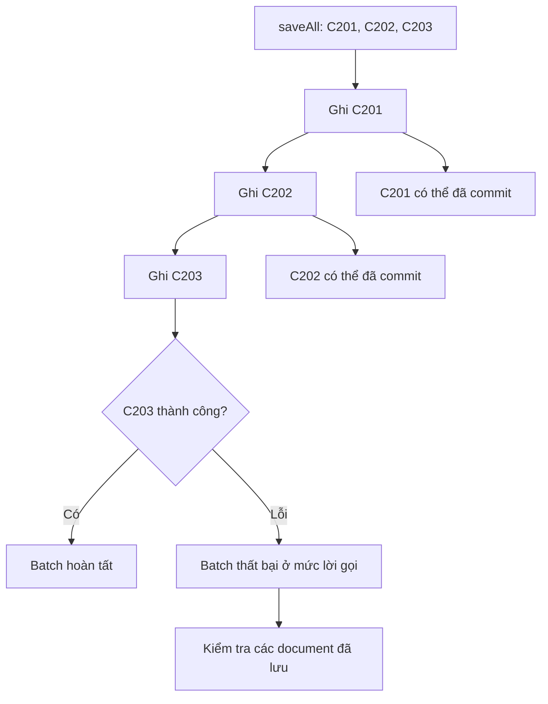
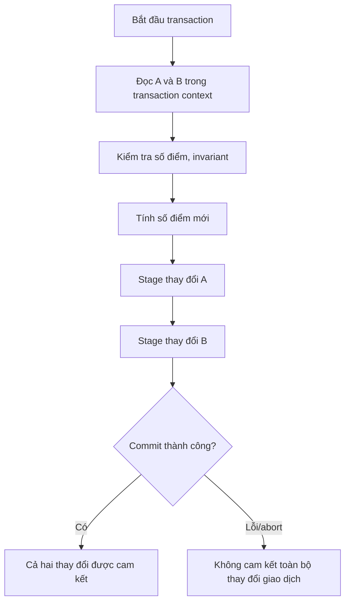

# Đọc hoặc ghi nhiều tài liệu và giới hạn về tính nguyên tử

Trong module **SPRING_DATA_COUCHBASE**, các repository giúp xử lý một document bằng `findById`, `save` hoặc `deleteById`, và cũng cho phép làm việc với **nhiều document** qua `findAllById`, `saveAll`, `deleteAllById` và các phương thức tìm kiếm danh sách. Tuy nhiên, cần hiểu chính xác: **một phương thức nhận danh sách không có nghĩa toàn bộ thao tác là một giao dịch nguyên tử**.

Bài thuộc chương **Repository**, tập trung vào cách đọc, ghi và xóa nhiều document, bảo đảm nào thuộc về **một document**, điều gì có thể xảy ra nếu batch thất bại giữa chừng và khi nào phải dùng **Couchbase transactions** hoặc thiết kế bù trừ. Những kiến thức này gắn với document mapping, bucket/scope/collection, chỉ mục SQL++, CAS/optimistic locking, TTL và cách xử lý reactive của Spring Data Couchbase.

## 1. Mục tiêu bài học

Sau bài này, bạn có thể:

- Dùng các phương thức repository để đọc nhiều ID, lưu nhiều entity và xóa nhiều ID.
- Hiểu rằng `findAllById` có thể trả **ít phần tử hơn số key được yêu cầu**; không giả định kết quả giữ thứ tự đầu vào.
- Phân biệt **một lệnh gọi API**, **một nhóm thao tác** và **một transaction**.
- Giải thích vì sao `saveAll`, `deleteAllById` và chuỗi nhiều `save` thông thường **không mang hợp đồng all-or-nothing**.
- Dùng `@Version`/CAS để bảo vệ **từng document** mà không nhầm thành bảo đảm tính nguyên tử cho cả nhóm.
- Lựa chọn transaction, retry có điều kiện, idempotency hoặc quy trình bù trừ cho nghiệp vụ liên quan nhiều document.
- Đánh giá chi phí đọc theo nhiều key, truy vấn SQL++ theo điều kiện, phân trang và xử lý reactive.

## 2. Một ví dụ xuyên suốt

Giả sử hệ thống quản lý khách hàng theo tenant trong:

```text
Bucket:      appdata
Scope:       sales
Collection:  customers
```

Mỗi document có key ổn định:

```text
customer::tenant-a::C101
customer::tenant-a::C102
customer::tenant-a::C103
customer::tenant-b::C101
```

Nội dung của `customer::tenant-a::C102`:

```json
{
  "tenantId": "tenant-a",
  "customerCode": "C102",
  "displayName": "Lan Anh",
  "status": "ACTIVE",
  "points": 120
}
```

Couchbase lưu **document key** riêng với phần JSON. Key duy nhất **trong một collection**; cùng key có thể xuất hiện ở collection khác. Spring Data ánh xạ key từ thuộc tính `@Id`.

Hai nhu cầu thường gặp:

1. **Đã biết danh sách key:** lấy đúng các customer C101, C102 và C103. Đây là bài toán đọc theo định danh.
2. **Chỉ biết điều kiện:** lấy tất cả customer ACTIVE của tenant A. Đây là bài toán tìm tập document theo thuộc tính, thường được thực hiện bằng SQL++ và cần index thích hợp.

Hai cách đọc nhiều document có thể dẫn tới kết quả tương tự, nhưng đường thực thi, chi phí và tính nhất quán khác nhau.

## 3. Entity và repository nền tảng

### 3.1. Ánh xạ entity

Ví dụ dùng Spring Data Couchbase, với scope `sales` và collection `customers` đã được tạo và cấu hình kết nối bucket `appdata`.

```java
package com.example.customer;

import org.springframework.data.annotation.Id;
import org.springframework.data.annotation.Version;
import org.springframework.data.couchbase.core.mapping.Collection;
import org.springframework.data.couchbase.core.mapping.Document;
import org.springframework.data.couchbase.core.mapping.Field;
import org.springframework.data.couchbase.core.mapping.Scope;

@Document
@Scope("sales")
@Collection("customers")
public class Customer {

    @Id
    private String id;

    @Field
    private String tenantId;

    @Field
    private String customerCode;

    @Field
    private String displayName;

    @Field
    private String status;

    @Field
    private int points;

    @Version
    private Long version;

    public Customer() {
    }

    public Customer(
            String id, String tenantId, String customerCode,
            String displayName, String status, int points) {
        this.id = id;
        this.tenantId = tenantId;
        this.customerCode = customerCode;
        this.displayName = displayName;
        this.status = status;
        this.points = points;
    }

    public String getId() { return id; }
    public void setId(String id) { this.id = id; }

    public String getTenantId() { return tenantId; }
    public void setTenantId(String tenantId) {
        this.tenantId = tenantId;
    }

    public String getCustomerCode() { return customerCode; }
    public void setCustomerCode(String customerCode) {
        this.customerCode = customerCode;
    }

    public String getDisplayName() { return displayName; }
    public void setDisplayName(String displayName) {
        this.displayName = displayName;
    }

    public String getStatus() { return status; }
    public void setStatus(String status) { this.status = status; }

    public int getPoints() { return points; }
    public void setPoints(int points) { this.points = points; }

    public Long getVersion() { return version; }
    public void setVersion(Long version) { this.version = version; }
}
```

Ở đây:

- `@Id String id` chính là **document key**.
- `@Version Long version` tích hợp cơ chế **CAS** cho optimistic locking khi Spring Data thực hiện thao tác ghi được hỗ trợ. Version có chức năng kiểm tra cập nhật đồng thời, không phải key hoặc tổng số lần cập nhật nghiệp vụ.
- `@Scope`/`@Collection` chọn collection đích. Annotation không tự tạo collection và không cấp quyền truy cập.

### 3.2. Repository

```java
package com.example.customer;

import java.util.List;
import org.springframework.data.couchbase.repository.CouchbaseRepository;

public interface CustomerRepository
        extends CouchbaseRepository<Customer, String> {

    List<Customer> findByTenantIdAndStatus(
            String tenantId, String status);
}
```

`CouchbaseRepository<Customer, String>` cung cấp các phương thức CRUD kế thừa từ hệ thống repository Spring Data. Đối với bài này, quan tâm nhất đến:

| Phương thức | Ý nghĩa | Dạng kết quả thông thường |
| --- | --- | --- |
| `findAllById(Iterable<String> ids)` | Đọc những document có key nằm trong danh sách | `Iterable<Customer>` |
| `saveAll(Iterable<Customer> entities)` | Lưu các entity được cung cấp | `Iterable<Customer>` |
| `deleteAllById(Iterable<? extends String> ids)` | Xóa các document theo những key đã cho | `void` |
| `deleteAll(Iterable<? extends Customer> entities)` | Xóa những entity được cung cấp | `void` |
| `findAll()` | Tìm tập document thuộc repository | `Iterable<Customer>` |
| `findByTenantIdAndStatus(...)` | Lọc theo trường JSON | `List<Customer>` |

Chữ **All** thể hiện phạm vi nhiều phần tử, **không phải một cam kết transaction**. Các chi tiết về batch, sự song song, thứ tự thực thi, số lần truy cập mạng và loại lỗi tùy phiên bản/implementation; không suy đoán chúng chỉ từ tên phương thức.

## 4. Đọc nhiều document theo danh sách key

### 4.1. Dùng `findAllById`

```java
List<String> keys = List.of(
        "customer::tenant-a::C101",
        "customer::tenant-a::C102",
        "customer::tenant-a::C999");

Iterable<Customer> found = repository.findAllById(keys);

for (Customer customer : found) {
    System.out.println(customer.getId());
}
```

Giả sử C101 và C102 tồn tại, còn C999 không tồn tại. Theo hợp đồng repository, kết quả có thể chỉ chứa **hai entity được tìm thấy**. Đừng mong đợi một `null` hoặc `Optional.empty()` tại vị trí thứ ba trong `Iterable<Customer>`.

Đặc biệt:

- **Không bảo đảm một kết quả cho mỗi key đầu vào.** Key không tìm thấy sẽ không tạo entity hợp lệ.
- **Không mặc định cùng thứ tự với key đầu vào.** Nếu UI cần hiển thị đúng thứ tự lựa chọn, phải tự sắp xếp/đối chiếu.
- **Không suy ra snapshot nhiều document.** Nếu một document bị thay đổi/xóa trong khi batch đang đọc, các phần tử có thể phản ánh những thời điểm khác nhau.
- **Không suy ra phân trang.** `findAllById` dùng một danh sách key đã biết; nó không thay thế truy vấn danh sách theo điều kiện có `Pageable`.

### 4.2. Giữ thứ tự và báo những key còn thiếu

Nếu API cần phản hồi **đúng một dòng cho mỗi key yêu cầu**, hãy đối chiếu kết quả qua map. Ví dụ Java 17+:

```java
package com.example.customer;

import java.util.HashMap;
import java.util.List;
import java.util.Map;
import java.util.Optional;

public class CustomerLookupService {

    private final CustomerRepository repository;

    public CustomerLookupService(CustomerRepository repository) {
        this.repository = repository;
    }

    public record LookupResult(
            String requestedKey,
            Optional<Customer> customer) {
    }

    public List<LookupResult> lookupInRequestedOrder(
            List<String> keys) {

        Map<String, Customer> byId = new HashMap<>();

        for (Customer customer : repository.findAllById(keys)) {
            byId.put(customer.getId(), customer);
        }

        return keys.stream()
                .map(key -> new LookupResult(
                        key, Optional.ofNullable(byId.get(key))))
                .toList();
    }
}
```

Nếu đầu vào là `[C101, C999, C102]`, kết quả giữ vị trí yêu cầu, và mỗi `LookupResult` cho biết có/không có entity tương ứng. Trường hợp người dùng truyền **key trùng** thì danh sách đầu ra vẫn có dòng cho từng vị trí, nhưng map chỉ giữ một entity cho mỗi key.

Mẫu này giải quyết **cách biểu diễn kết quả**. Nó không làm cho các lần đọc trở thành một snapshot nguyên tử hoặc đảm bảo từng key không đổi giữa lúc đọc và phản hồi.

### 4.3. Khi nào dùng SQL++ thay vì danh sách key?

Nếu chỉ biết `tenantId` và `status`, không thể lấy tất cả document bằng cách gọi `findAllById` với một prefix như `customer::tenant-a::`. API key-value cần **key hoàn chỉnh**.

Với truy vấn:

```java
List<Customer> active =
        repository.findByTenantIdAndStatus("tenant-a", "ACTIVE");
```

Spring Data thường dùng SQL++ theo trường JSON. Cần index tương ứng, ví dụ:

```sql
CREATE INDEX ix_customers_tenant_status
ON `appdata`.`sales`.`customers`(
    tenantId,
    status
);
```

Đây là index minh họa; phải kiểm tra `EXPLAIN`, câu query thực tế được Spring Data sinh và workload trước khi chọn index production. Truy vấn SQL++ cũng chịu ảnh hưởng của **scan consistency** vì index có thể cập nhật bất đồng bộ.

## 5. Lưu nhiều entity với `saveAll`

### 5.1. Lưu một tập entity

```java
List<Customer> customers = List.of(
        new Customer(
                "customer::tenant-a::C201",
                "tenant-a", "C201", "Hà",
                "ACTIVE", 0),
        new Customer(
                "customer::tenant-a::C202",
                "tenant-a", "C202", "An",
                "ACTIVE", 0),
        new Customer(
                "customer::tenant-a::C203",
                "tenant-a", "C203", "Bình",
                "ACTIVE", 0));

Iterable<Customer> saved = repository.saveAll(customers);
```

Một lời gọi `saveAll` ngắn hơn việc tự gọi `save` ở nhiều chỗ và có thể được implementation tối ưu cho thao tác nhiều entity. Tuy nhiên, điều quan trọng về mặt nghiệp vụ là:

**`saveAll(customers)` không tự hứa rằng hoặc cả C201–C203 đều được ghi, hoặc không document nào được ghi.**

Giả sử C201 và C202 đã được lưu, rồi thao tác với C203 gặp lỗi xung đột, timeout hoặc lỗi hạ tầng. Không nên mặc định hai lần ghi trước sẽ tự rollback. Phạm vi commit thực tế cần được xác minh bằng kết quả, lỗi và trạng thái lưu trữ.

### 5.2. Một phương thức, nhiều thay đổi



Sơ đồ **minh họa khả năng hoàn tất một phần**, không mô tả thứ tự hoặc lịch thực thi bắt buộc của implementation. Một số phương thức có thể xử lý tuần tự, song song hoặc theo cơ chế khác. Đừng dùng vị trí phần tử gây lỗi để kết luận chính xác những phần tử nào đã commit.

Phải phân biệt:

- **Atomicity của một mutation trên một document:** thao tác ghi riêng lẻ được Couchbase thực hiện nguyên tử đối với document đó theo API và điều kiện ghi.
- **Atomicity của một batch:** mọi mutation được cam kết như **một đơn vị**. Thao tác repository thông thường không cung cấp bảo đảm này.
- **Durability:** mức độ ghi được xác nhận/tồn tại khi nút gặp sự cố. Durability khác với atomicity và không tự biến batch thành transaction.
- **Isolation:** các thao tác đồng thời nhìn thấy thay đổi của nhau như thế nào. CAS trên từng document không tạo snapshot thống nhất cho toàn batch.

### 5.3. `saveAll` không đồng nghĩa insert-only

Một entity có `@Id` được cấp sẵn không chứng minh key chưa tồn tại. Đường ghi của `save`/`saveAll` phụ thuộc trạng thái mới/cũ, `@Version`, mapping và phiên bản Spring Data Couchbase. Với yêu cầu **chỉ thêm document chưa tồn tại**, không nên dùng `saveAll` và giả định nó sẽ luôn từ chối mọi key trùng.

Thay vào đó:

- Nếu mỗi customer có thể thành công độc lập, dùng **insert-only nguyên tử cho từng key** và báo kết quả riêng từng phần tử.
- Nếu nghiệp vụ yêu cầu **hoặc tạo toàn bộ hoặc không tạo ai**, dùng transaction được Couchbase và phiên bản API hỗ trợ.
- Nếu cho phép ghi đè, xác định rõ ngữ nghĩa upsert và kiểm soát CAS/phiên bản khi cần.

Cũng không nên dùng `existsById(key)` trước `saveAll` như một cơ chế tránh trùng: trạng thái có thể thay đổi giữa bước kiểm tra và bước ghi (*time-of-check to time-of-use*).

## 6. Cập nhật nhiều entity và CAS theo từng document

`@Version` giúp Spring Data Couchbase thực hiện **optimistic locking** bằng cơ chế CAS cho các thao tác ghi phù hợp. Ví dụ khi sửa điểm tích lũy của hai customer:

```java
Customer first = repository.findById(
        "customer::tenant-a::C101").orElseThrow();

Customer second = repository.findById(
        "customer::tenant-a::C102").orElseThrow();

first.setPoints(first.getPoints() + 10);
second.setPoints(second.getPoints() + 20);

repository.saveAll(List.of(first, second));
```

Mỗi entity mang version/CAS từ lần đọc của **chính document đó**. Nếu một luồng khác sửa C102 sau khi ứng dụng đọc, việc ghi C102 có thể bị từ chối vì CAS không còn khớp. Điều này giúp tránh *lost update* **trên C102**, nhưng không tự đảo ngược việc C101 có thể đã được ghi thành công.

| Câu hỏi | `@Version`/CAS trên từng document giải quyết? |
| --- | --- |
| Có ai sửa C102 kể từ lúc mình đọc C102 không? | **Có**, kiểm tra điều kiện phiên bản ở lúc ghi |
| Nếu C102 xung đột, tự rollback C101 đã ghi? | **Không** |
| Hai document phải đổi điểm cùng lúc hoặc không đổi gì? | **Không**, cần cơ chế transaction hoặc thiết kế khác |
| Đọc C101 và C102 có phải cùng snapshot logic? | **Không**, không tự có chỉ nhờ CAS |
| Có thể tự retry toàn bộ batch với version cũ? | **Không nên**; cần đánh giá những gì đã commit và đọc lại trạng thái phù hợp |

Với các nghiệp vụ như chuyển điểm giữa hai tài khoản, ghi nợ và ghi có vào hai document, chỉ CAS từng document **chưa đủ** để bảo vệ bất biến kiểu “tổng điểm trước và sau không đổi”.

## 7. Xóa nhiều document

### 7.1. `deleteAllById`

```java
List<String> keysToDelete = List.of(
        "customer::tenant-a::C201",
        "customer::tenant-a::C202",
        "customer::tenant-a::C203");

repository.deleteAllById(keysToDelete);
```

Lời gọi trên yêu cầu xóa các document theo key. Nó không tự tạo transaction cho cả nhóm. Nếu một lỗi xảy ra, có thể có một số document đã bị xóa, số khác còn tồn tại. Hành vi khi key không tồn tại và loại exception có thể thay đổi theo phiên bản/implementation; nếu API nghiệp vụ cần báo chính xác key nào vắng mặt, phải thiết kế cách đối chiếu riêng.

### 7.2. `deleteAll(entities)` và `deleteAll()`

`deleteAll(entities)` nhận một tập entity được cung cấp. Còn `deleteAll()` không có đối số là yêu cầu rất rộng: nó tác động đến tập document mà repository quản lý theo cách triển khai tương ứng, có thể phát sinh truy vấn để xác định tập cần xóa.

Vì vậy:

- Tránh gọi `deleteAll()` để dọn dữ liệu production nếu chưa xác định chính xác phạm vi tác động.
- Với dữ liệu cần xóa theo bộ lọc, phải xác định keyspace, loại entity, tenant, điều kiện truy vấn, số lượng bản ghi và rủi ro khi dữ liệu thay đổi giữa bước chọn và bước xóa.
- Xóa theo danh sách key không tự dọn **tham chiếu nghiệp vụ** trong các document khác.
- Nếu cần archive trước khi xóa, hai thao tác "ghi archive" và "xóa bản chính" cũng là một nghiệp vụ nhiều document, cần transaction hoặc quy trình phục hồi rõ ràng.

## 8. Bảo đảm nào tồn tại khi thao tác nhiều document?

| Cơ chế | Phạm vi bảo vệ | Điều nó **không** tự bảo đảm |
| --- | --- | --- |
| Một KV insert/replace/remove | Mutation của **một document** theo key | Các document khác cùng thành công |
| `@Version`/CAS | Không ghi đè **bản cũ** của từng document khi áp dụng đúng | Rollback các mutation khác đã commit |
| `saveAll`/`deleteAllById` | API tiện lợi để xử lý nhiều entity/key | All-or-nothing cho cả danh sách |
| Một số lần `findById` hoặc `findAllById` | Trả dữ liệu theo các key yêu cầu | Snapshot nhất quán xuyên nhiều document |
| SQL++ với scan consistency mạnh hơn | Giúp index theo kịp mốc ghi nhất định | Tự tạo transaction cho chuỗi đọc–sửa–ghi |
| Couchbase transactions | Atomic commit cho tập thao tác được hỗ trợ **bên trong giao dịch** | Bao trùm mọi side effect ngoài hệ thống, mọi API tùy ý |

### 8.1. Vì sao gọi nhiều `save` trong một service chưa đủ?

```java
public void movePointsWithoutTransaction(
        Customer a, Customer b, int points) {

    a.setPoints(a.getPoints() - points);
    repository.save(a);  // Có thể đã commit.

    b.setPoints(b.getPoints() + points);
    repository.save(b);  // Có thể thất bại.
}
```

Nếu ghi A thành công, rồi ghi B thất bại, tổng điểm có thể giảm trong dữ liệu đã lưu. Một exception ném ra ở cuối **không đảo ngược** mutation A.

Đây là lý do không thể coi phạm vi một phương thức Java, một request HTTP, một lời gọi `saveAll` hoặc một khối `try/catch` là transaction.

### 8.2. `@Transactional` cũng cần đúng transaction manager

Nếu cần transaction, phải xác nhận phiên bản Spring Data Couchbase, cấu hình transaction manager và các API tham gia giao dịch thực sự được hỗ trợ. Chỉ thêm `@Transactional` vào phương thức mà không có transaction manager phù hợp, hoặc gọi SDK bên ngoài transaction context, không đảm bảo mọi thao tác Couchbase cùng thuộc một giao dịch.

Nếu ứng dụng còn ghi vào hệ thống khác như email, message broker hoặc một cơ sở dữ liệu khác, transaction Couchbase **không mặc nhiên** bao trùm các hệ thống đó.

## 9. Khi nghiệp vụ cần all-or-nothing: Couchbase transactions

### 9.1. Trường hợp nên dùng

Cân nhắc transaction khi có một **bất biến xuyên nhiều document** phải được bảo toàn, ví dụ:

- Chuyển điểm từ customer A sang customer B, tổng điểm phải không đổi.
- Tạo đơn hàng và bản ghi phân bổ tồn kho liên quan như một đơn vị.
- Chuyển một document từ collection hiện hành sang archive, khi nghiệp vụ không cho phép mất hoặc nhân đôi ở trạng thái cam kết.
- Ghi đồng thời document chính và một document chỉ mục tra cứu do ứng dụng tự quản lý.

Couchbase hỗ trợ giao dịch nhiều document qua các API transaction phù hợp. Phạm vi thao tác, isolation, retry, keyspace và cấu hình phụ thuộc phiên bản Couchbase/SDK/Spring Data, vì vậy cần dùng **đúng API trong transaction context** và kiểm tra tài liệu của phiên bản đang triển khai.

### 9.2. Luồng giao dịch ở mức khái niệm



**Mã giả** minh họa cách tổ chức, không phải mã gọi trực tiếp repository:

```text
transaction.run(ctx -> {
    a = ctx.get(collection, keyA)
    b = ctx.get(collection, keyB)

    require(a.points >= amount)

    ctx.replace(a, points = a.points - amount)
    ctx.replace(b, points = b.points + amount)
})
```

Trong Java SDK thật, chữ ký `ctx.get`, `ctx.replace` và đối tượng transaction document tuân theo phiên bản SDK; cần dùng API transaction thực tế thay vì trộn lẫn các lời gọi ngoài giao dịch.

**Giới hạn cần hiểu:**

1. Chỉ những thao tác được thực thi **trong transaction context** và được API hỗ trợ mới thuộc transaction đó.
2. Giao dịch có chi phí phối hợp, thời gian, tài nguyên, conflict và retry. Không dùng transaction để thay thế mọi batch xử lý độc lập.
3. Transaction có thể retry lambda khi gặp xung đột. Không đặt side effect ngoài Couchbase như gửi email, phát sự kiện không idempotent hoặc gọi dịch vụ tính phí trực tiếp trong lambda.
4. Xác minh các yêu cầu về server, SDK, timeout và collection liên quan trước khi dùng trong production.
5. Với yêu cầu cập nhật nhiều hệ thống, cần thiết kế **outbox**, saga hoặc idempotency phù hợp; transaction Couchbase đơn lẻ không biến các hệ thống ngoài Couchbase thành một commit chung.

### 9.3. Khi không cần transaction

Nếu cần cập nhật độc lập trạng thái của 1.000 customer và chấp nhận rằng 990 thành công, 10 cần xử lý lại, một batch có báo kết quả riêng có thể phù hợp hơn transaction toàn bộ. Lúc này, nên chia batch nhỏ, ghi nhận danh sách lỗi, thiết kế retry an toàn và idempotency.

Lựa chọn giữa transaction và xử lý từng phần xuất phát từ **bất biến nghiệp vụ**, không chỉ từ số document.

## 10. Xử lý hoàn tất một phần và retry

### 10.1. Không tin rằng exception nghĩa là chưa ghi gì

Giả sử `saveAll` ném exception do timeout. Không thể chắc rằng không document nào đã được ghi. Một số mutation có thể thành công nhưng phản hồi bị mất hoặc batch bị dừng ở giai đoạn khác. Do đó:

- Không tự rollback bằng cách xóa toàn bộ key đã yêu cầu nếu chưa biết có document tồn tại từ trước hay không.
- Không retry mù quáng một batch có phép cộng điểm, trừ số dư hoặc cộng tồn kho: chạy lại có thể áp dụng tác động **hai lần**.
- Kiểm tra trạng thái theo key, version/CAS và mã nghiệp vụ tương ứng trước khi quyết định ghi lại.
- Ghi nhận **operation ID** ổn định cho thao tác nghiệp vụ nếu cần hỗ trợ retry/idempotency.

### 10.2. Kịch bản xử lý độc lập từng phần tử

Khi nghiệp vụ cho phép thành công một phần, có thể xử lý từng key và thu thập kết quả. Ví dụ **mẫu minh họa**:

```java
package com.example.customer;

import java.util.ArrayList;
import java.util.List;

public class CustomerBatchService {

    private final CustomerRepository repository;

    public CustomerBatchService(CustomerRepository repository) {
        this.repository = repository;
    }

    public record ItemResult(
            String id,
            boolean success,
            String errorCode) {
    }

    public List<ItemResult> saveIndependently(
            List<Customer> customers) {

        List<ItemResult> results = new ArrayList<>();

        for (Customer customer : customers) {
            try {
                repository.save(customer);
                results.add(new ItemResult(
                        customer.getId(), true, null));
            } catch (RuntimeException error) {
                // Ví dụ tối giản: hệ thống thật cần phân loại lỗi.
                results.add(new ItemResult(
                        customer.getId(), false,
                        "WRITE_FAILED"));
            }
        }

        return results;
    }
}
```

Đây là cách **ghi nhận kết quả từng phần tử**, không tạo transaction. Ví dụ cố tình không phân loại exception chi tiết; trong production, cần phân biệt xung đột CAS, duplicate key, timeout, thiếu quyền và lỗi cấu hình, đồng thời giữ thông tin điều tra trong log/trace an toàn.

Với timeout, `success=false` ở tầng ứng dụng chỉ cho biết **chưa xác nhận thành công**, không chứng minh document không được ghi. Vì vậy, không dùng cột `success` duy nhất làm sự thật cuối cùng cho các thao tác không idempotent; bổ sung trạng thái `UNKNOWN`/`RECONCILE_REQUIRED` nếu hệ thống cần phân biệt kết quả chưa xác định.

### 10.3. Ba loại kết quả nên theo dõi

| Trạng thái xử lý | Ý nghĩa | Hành động |
| --- | --- | --- |
| `SUCCESS` | Đã nhận xác nhận ghi thành công | Ghi nhận kết quả |
| `FAILED` | Biết thao tác bị từ chối, ví dụ xung đột rõ ràng | Phân loại lỗi và quyết định sửa dữ liệu đầu vào |
| `UNKNOWN` | Timeout hoặc mất phản hồi, chưa biết ghi đã commit chưa | Đọc đối chiếu, kiểm tra operation ID/trạng thái trước retry |

Nếu cần “exactly once” ở cấp nghiệp vụ, phải xây dựng idempotency và kiểm soát cạnh tranh cụ thể. Một thao tác `saveAll` không tự cung cấp bảo đảm exactly-once cho một tác động nghiệp vụ.

## 11. Đọc và ghi nhiều document không cho snapshot xuyên document

Hãy tưởng tượng hai key:

```text
customer::tenant-a::C101 (points = 100)
customer::tenant-a::C102 (points = 200)
```

Một tiến trình chuyển 20 điểm từ C101 sang C102, dùng hai thao tác ghi riêng:

```text
T0: C101 = 100, C102 = 200
T1: ghi C101 = 80
T2: đọc C101 = 80, C102 = 200  → tổng tạm thời 280
T3: ghi C102 = 220
T4: C101 = 80, C102 = 220       → tổng 300
```

Nếu một độc giả gọi `findAllById(List.of(keyA, keyB))` giữa T1 và T3, họ có thể thấy trạng thái giữa chừng. Nhiều lần đọc KV độc lập không có hợp đồng snapshot chung. Thậm chí nếu cả hai phép ghi cuối cùng thành công, độc giả vẫn có thể thấy dữ liệu chưa đồng bộ trong khoảng thời gian thao tác diễn ra.

CAS bảo vệ **tính hợp lệ của phiên bản ghi** cho từng document, còn transaction và isolation mới giải quyết được yêu cầu nhất quán xuyên document trong phạm vi được hỗ trợ. Không tự coi việc tất cả lời gọi hoàn thành cùng một HTTP request là một thời điểm quan sát nguyên tử.

## 12. SQL++, index và tính nhất quán khi truy vấn tập lớn

`findAll` và derived queries theo thuộc tính thường dựa trên SQL++. Truy vấn SQL++ cần index và có thể chịu ảnh hưởng scan consistency.

Ví dụ:

```sql
SELECT META(c).id AS documentKey, c.customerCode, c.points
FROM `appdata`.`sales`.`customers` AS c
WHERE c.tenantId = "tenant-a"
  AND c.status = "ACTIVE"
ORDER BY c.customerCode;
```

Chỉ mục phục vụ mẫu truy vấn:

```sql
CREATE INDEX ix_customers_tenant_status_code
ON `appdata`.`sales`.`customers`(
    tenantId,
    status,
    customerCode
);
```

Cần xem `EXPLAIN` để biết optimizer có dùng index dự kiến không. Index này không tự phục vụ các collection khác, và việc tạo index không biến truy vấn thành transaction.

### 12.1. SQL++ có thể chậm thấy dữ liệu mới

Các mutation KV thường được đưa vào secondary index bất đồng bộ. Với `NOT_BOUNDED`, SQL++ có thể tạm không thấy document vừa được `save` thành công. `REQUEST_PLUS` hoặc nhất quán theo mutation state giúp query chờ index bắt kịp theo ngữ nghĩa tương ứng, nhưng có chi phí.

Vì vậy, khi xác minh từng key ngay sau batch, ưu tiên đọc trực tiếp bằng key nếu mục đích là đối chiếu document. Một truy vấn theo `status` trả thiếu hàng ngay sau ghi chưa đủ kết luận key chưa tồn tại.

### 12.2. Phân trang thay vì `findAll` không giới hạn

Tải toàn bộ collection vào bộ nhớ để xử lý hàng triệu document có thể tốn bộ nhớ, mạng, Query Service và kéo dài cửa sổ thay đổi dữ liệu. Nên dùng:

- Query có WHERE/ORDER BY phù hợp và index thực tế.
- `Pageable`, `Page<T>` hoặc `Slice<T>` khi repository/phiên bản hỗ trợ.
- Kích thước batch giới hạn theo tài nguyên và mục tiêu độ trễ.
- Thứ tự ổn định, đặc biệt khi dùng phân trang và dữ liệu thường xuyên thay đổi.

**Phân trang không tạo snapshot.** Document thêm/xóa giữa hai trang có thể làm trùng/bỏ sót phần tử với offset pagination. Nếu cần xử lý đúng từng record, cân nhắc keyset/cursor, checkpoint, phiên bản dữ liệu và idempotency theo nghiệp vụ.

## 13. Giới hạn phụ thuộc TTL, collection và cấu hình vận hành

### 13.1. TTL có thể làm batch thiếu key

Nếu C102 hết hạn TTL ngay trước hoặc trong quá trình `findAllById`, kết quả có thể chỉ có các key còn sống. Lỗi timeout hoặc document không tìm thấy cần được hiểu trong bối cảnh expiration của từng document.

Khi ghi batch, mỗi document có thể có chính sách TTL khác nhau. Không giả định `saveAll` tạo cùng thời điểm hết hạn hay tự giữ TTL cũ; hành vi expiration phụ thuộc API và cấu hình mapping/ghi.

### 13.2. Cùng key ở collection khác là document khác

`customer::tenant-a::C102` trong `sales.customers` và `sales.archived` là hai document độc lập. Một repository gắn với collection `customers` không tự tìm hoặc xóa document cùng key ở `archived`.

Các thao tác dữ liệu nhiều collection cần xác định rõ keyspace ở từng bước. Nếu cần chuyển document qua collection như một tác vụ nguyên tử, kiểm tra transaction API hỗ trợ các collection đó và dùng cùng transaction context.

### 13.3. Durability khác transaction

Couchbase cho phép chọn mức durability cho những mutation được hỗ trợ. Durability có liên quan đến mức xác nhận ghi/khả năng sống sót khi sự cố xảy ra; nó **không** đảm bảo tất cả document trong batch thành công cùng lúc. Có thể tăng durability của các mutation riêng lẻ mà batch vẫn hoàn tất một phần.

### 13.4. Giới hạn, timeout và tải hệ thống

Với batch lớn, cần đo:

- Số document, kích thước JSON và tổng byte truyền.
- Số thao tác song song và khả năng chịu tải của Couchbase.
- Độ trễ KV, Query Service và mức độ chờ index.
- Timeout ở từng API và chính sách retry.
- Dung lượng index, phân vùng dữ liệu, độ lệch key, memory và monitoring.
- Nguy cơ giữ quá nhiều entity trong bộ nhớ ứng dụng.

Không có một kích thước batch tối ưu chung cho mọi workload. Hãy đo trên dữ liệu và topology đại diện, theo dõi tỷ lệ lỗi và đặt giới hạn tại tầng ứng dụng.

## 14. Reactive repository: `Flux` không tạo transaction

Với `ReactiveCouchbaseRepository`:

```java
package com.example.customer;

import org.springframework.data.couchbase.repository.ReactiveCouchbaseRepository;
import reactor.core.publisher.Flux;

public interface ReactiveCustomerRepository
        extends ReactiveCouchbaseRepository<Customer, String> {

    Flux<Customer> findByTenantIdAndStatus(
            String tenantId, String status);
}
```

Cách gọi:

```java
Flux<Customer> selected =
        reactiveRepository.findAllById(
                List.of(
                        "customer::tenant-a::C101",
                        "customer::tenant-a::C102"));

Flux<Customer> saved =
        reactiveRepository.saveAll(customers);
```

`Flux<Customer>` cho phép phát nhiều entity và phối hợp pipeline bất đồng bộ. Tuy nhiên:

- Subscription, backpressure và các toán tử điều khiển cách xử lý dữ liệu, **không tự cung cấp all-or-nothing**.
- Nếu publisher phát `onError` sau khi một số mutation đã được thực thi, không được mặc định các mutation trước bị rollback.
- Retry `Flux` có side effect ghi có thể chạy lại một số thao tác. Cần idempotency/điều kiện ghi trước khi retry.
- `collectList()` gom toàn bộ kết quả trong bộ nhớ; với tập dữ liệu lớn, nên xử lý theo lô và kiểm soát concurrency.
- Tránh gọi `block()` trong luồng reactive request; đồng thời xác minh transaction manager/reactive transaction API của phiên bản dự án nếu cần transaction thật.

Một pipeline chạy không chặn luồng giúp sử dụng tài nguyên hợp lý trong nhiều bối cảnh, nhưng không làm mất những rủi ro về CAS, TTL, partial failure hoặc scan consistency.

## 15. Lựa chọn API theo yêu cầu nghiệp vụ

| Yêu cầu | Lựa chọn gợi ý | Điều cần kiểm soát |
| --- | --- | --- |
| Có vài key và muốn đọc các document tương ứng | `findAllById(keys)` | Key thiếu, thứ tự đầu ra, trạng thái thay đổi trong lúc đọc |
| Tìm mọi customer ACTIVE của tenant | Derived query/SQL++ có filter và index | Index, phân trang, scan consistency, phân quyền tenant |
| Lưu nhiều entity độc lập, chấp nhận thành công một phần | `saveAll` hoặc ghi từng document với kết quả riêng | Retry, idempotency, CAS, đối chiếu sau lỗi |
| Tạo nhiều document mới, không được ghi đè key trùng | Insert-only theo từng key | Xử lý duplicate key và báo phần tử lỗi |
| Tạo nhiều document, phải thành công toàn bộ hoặc không tạo gì | Couchbase transaction thích hợp | Scope hỗ trợ, timeout, conflict, retry và phạm vi transaction |
| Cập nhật hai số dư phải bảo toàn tổng | Transaction nhiều document | Bất biến toàn cục, đọc/ghi trong context |
| Xóa nhiều key độc lập | `deleteAllById(keys)` | Lỗi hoàn tất một phần, retry an toàn, dữ liệu liên quan |
| Xóa một tập lớn dựa trên filter | Query lấy ID + batch xử lý hoặc chiến lược vận hành phù hợp | Dữ liệu thay đổi, checkpoint, tốc độ và khả năng phục hồi |
| Xử lý nguồn dữ liệu liên tục | Reactive Flux với giới hạn concurrency | Backpressure, lỗi giữa stream, tránh side effect lặp |

## 16. Bài thực hành

Chuẩn bị môi trường Couchbase thử nghiệm có bucket `appdata`, scope `sales` và collection `customers`. Tạo tối thiểu các document:

| Key | status | points |
| --- | --- | --- |
| `customer::tenant-a::C101` | ACTIVE | 100 |
| `customer::tenant-a::C102` | ACTIVE | 200 |
| `customer::tenant-a::C103` | INACTIVE | 300 |

Thực hiện:

1. **Đọc thiếu key:** gọi `findAllById` với C101, C102, C999. Xác nhận kết quả chỉ có document tìm được và tự đối chiếu key thiếu.
2. **Giữ thứ tự:** truyền danh sách [C102, C999, C101], dùng map để trả kết quả đúng thứ tự yêu cầu.
3. **Lưu nhiều:** tạo C201, C202, C203 bằng `saveAll`; đọc lại từng key để kiểm tra.
4. **Quan sát không nguyên tử:** trong môi trường cô lập, tạo lỗi có kiểm soát ở một thao tác batch; quan sát các document đã hoàn thành thay vì mặc định rollback.
5. **Thử CAS:** đọc C101 và C102, tạo cập nhật cạnh tranh trên một document, sau đó quan sát xung đột. Giải thích vì sao CAS không rollback mutation thành công trên document khác.
6. **Xóa nhiều:** gọi `deleteAllById` trên một nhóm key thử nghiệm và kiểm tra từng key còn hay mất.
7. **SQL++ so với KV:** truy vấn danh sách ACTIVE với index phù hợp; dùng `EXPLAIN` và so sánh yêu cầu index với `findAllById`.
8. **Transaction:** triển khai một ca chuyển điểm A → B bằng transaction API của phiên bản đang sử dụng; thử lỗi trước commit để xác minh bất biến tổng điểm được bảo vệ.
9. **Reactive:** dùng `saveAll` từ reactive repository, quan sát tín hiệu `onNext`/`onError` và đối chiếu trạng thái lưu khi một phần tử lỗi.

Các thao tác có thể thay đổi/xóa dữ liệu, nên chỉ dùng key và collection thử nghiệm. Khi phân tích lỗi, giữ log, version/CAS, key và trạng thái cuối cùng; không kết luận tính nguyên tử chỉ từ giá trị trả về của một phương thức.

### Câu hỏi tự kiểm tra

1. Vì sao `findAllById` có thể trả ít entity hơn số key đầu vào?
2. Có thể dựa vào thứ tự `Iterable<Customer>` để ghép trực tiếp với thứ tự key đầu vào không?
3. Khi `saveAll` ném exception, ta đã biết chắc rằng không document nào được lưu chưa?
4. `@Version` có thể rollback một entity khác đã được lưu thành công trước đó không?
5. Tại sao `existsById` trước `saveAll` không đủ chống key trùng trong môi trường nhiều request?
6. Tình huống chuyển điểm từ A sang B cần bảo đảm gì mà hai thao tác `save` thông thường chưa cung cấp?
7. `REQUEST_PLUS` có biến SQL++ thành một transaction nhiều document không?
8. Tại sao retry toàn bộ batch trừ/cộng điểm sau timeout có thể gây lỗi nghiệp vụ?
9. Reactive `Flux<Customer>` có bảo đảm mọi mutation bên trong cùng commit không?
10. Khi nào nên dùng transaction, khi nào nên chấp nhận xử lý độc lập từng phần tử?

## 17. Ghi nhớ

**Đọc hoặc ghi nhiều tài liệu là thao tác theo tập, không mặc nhiên là transaction.** `findAllById` giúp lấy nhiều key nhưng không bảo đảm kết quả đủ số lượng, đúng thứ tự hoặc cùng một snapshot. `saveAll` và `deleteAllById` giúp xử lý nhiều entity/key nhưng không tự bảo đảm mọi mutation thành công hoặc rollback cùng nhau.

Trong Spring Data Couchbase, **CAS/`@Version` bảo vệ ghi đồng thời cho từng document**; **SQL++ index và scan consistency** ảnh hưởng việc tìm/quan sát tập document; **TTL** có thể làm một số key hết hạn độc lập. Nếu nghiệp vụ có bất biến xuyên nhiều document, cần transaction đúng API và phạm vi hỗ trợ. Nếu nghiệp vụ cho phép thành công một phần, cần trạng thái kết quả rõ ràng, đối chiếu, retry an toàn và idempotency. Những nguyên tắc này tiếp tục áp dụng khi dùng `CouchbaseTemplate` hoặc `ReactiveCouchbaseRepository`.
