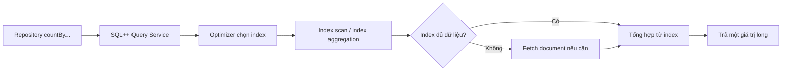

# exists, count và chi phí của các thao tác tổng hợp

Trong chương **Repository** của **SPRING_DATA_COUCHBASE**, ứng dụng không phải lúc nào cũng cần lấy toàn bộ document. Nhiều yêu cầu chỉ hỏi **có tồn tại không** hoặc **có bao nhiêu document thỏa điều kiện**: một khách hàng đã được tạo chưa, tenant có bao nhiêu khách hàng đang hoạt động, hoặc mỗi trạng thái có bao nhiêu đơn hàng.

Spring Data Couchbase hỗ trợ những yêu cầu này thông qua `existsById`, `count` và phương thức truy vấn suy diễn như `countByTenantIdAndStatus`. Tuy nhiên, những tên phương thức trông đơn giản có thể dẫn tới **hai đường thực thi khác nhau**: kiểm tra một document bằng **KV (key-value)** hoặc chạy một **truy vấn SQL++** qua Query Service và chỉ mục. Chọn nhầm cách có thể khiến một phép kiểm tra tồn tại rẻ trở thành phép quét tốn tài nguyên, hoặc khiến số đếm không phản ánh ngay document vừa ghi.

Bài học giải thích ngữ nghĩa, hiệu năng và giới hạn nhất quán của các phép kiểm tra tồn tại, đếm và tổng hợp trong hệ thống Couchbase có bucket/scope/collection, chỉ mục, TTL, CAS, giao dịch và API reactive.

## 1. Mục tiêu học tập

Sau bài này, bạn có thể:

- Dùng `existsById(id)` để kiểm tra một **document key chính xác** và giải thích vì sao nó khác truy vấn theo trường JSON.
- Dùng `count()` và `countBy...` để đếm document, nhưng không giả định mọi phép đếm đều có chi phí hằng số.
- Phân biệt câu hỏi “có ít nhất một?” với “chính xác có bao nhiêu?” và chọn API phù hợp.
- Viết SQL++ sử dụng `COUNT(*)`, `COUNT(field)`, `COUNT(DISTINCT ...)` và `GROUP BY`; hiểu các khác biệt về ngữ nghĩa.
- Chọn chỉ mục phù hợp, đọc `EXPLAIN` và nhận biết chi phí index scan, fetch, group, sort và consistency.
- Xử lý kết quả `0` hoặc `false` đúng cách, không đánh đồng với lỗi hệ thống, index chưa cập nhật hay thiếu quyền.
- Nhận biết race condition khi dùng `exists`/`count` như bước tiền kiểm trước khi ghi, và lựa chọn insert-only, CAS hoặc giao dịch.
- Hiểu trường hợp cần thống kê gần đúng, phân trang hoặc duy trì document tổng hợp riêng thay vì đếm trực tiếp trên tập lớn.

## 2. Bối cảnh: document key và dữ liệu nghiệp vụ

Giả sử ứng dụng đã cấu hình bucket `appdata`, scope `sales`, collection `customers`.

```text
Bucket       appdata
Scope        sales
Collection   customers

Document key: customer::tenant-a::C102
```

Nội dung JSON:

```json
{
  "tenantId": "tenant-a",
  "customerCode": "C102",
  "displayName": "Lan Anh",
  "status": "ACTIVE",
  "points": 120
}
```

Từ cùng document trên, ứng dụng có thể đặt ra ba câu hỏi:

1. **Có document với key `customer::tenant-a::C102` không?** Đây là bài toán KV theo key.
2. **Có customer nào có `tenantId = "tenant-a"` và `customerCode = "C102"` không?** Đây là điều kiện trên nội dung JSON; nếu không tự xác định được key, thường cần SQL++.
3. **Tenant A có bao nhiêu customer có `status = "ACTIVE"`?** Đây là phép đếm trên một tập document và thường cần SQL++ cùng chỉ mục phù hợp.

Couchbase quản lý document key độc lập với các trường JSON. `@Id` trong entity ánh xạ đến key. Giá trị `customerCode` không tự biến thành key hay có ràng buộc duy nhất, trừ khi ứng dụng thiết kế và thực thi quy tắc tương ứng.

Một document key là duy nhất **bên trong collection**, vì vậy cùng chuỗi key có thể tồn tại ở `sales.customers` và `sales.archived` mà không phải cùng một document.

## 3. Phân biệt `exists`, `count` và truy vấn lấy dữ liệu

| Nhu cầu | Ví dụ Spring Data Couchbase | Kết quả | Cơ chế thường gặp |
| --- | --- | --- | --- |
| Kiểm tra **key cụ thể** | `repository.existsById(id)` | `boolean` | KV theo key |
| Đọc document có key cụ thể | `repository.findById(id)` | `Optional<Customer>` | KV theo key |
| Đếm document thuộc repository | `repository.count()` | `long` | Truy vấn/tổng hợp do repository thực hiện, thường qua SQL++ |
| Đếm theo JSON | `repository.countByTenantIdAndStatus(...)` | `long` | Derived query SQL++ |
| Kiểm tra có ít nhất một document theo JSON | `repository.existsByTenantIdAndCustomerCode(...)` nếu phiên bản hỗ trợ | `boolean` | Derived query SQL++, không phải `existsById` |
| Lấy danh sách theo JSON | `repository.findByTenantIdAndStatus(...)` | `List<Customer>` | Truy vấn SQL++ |

Tên `exists` không đồng nghĩa với một thuật toán cụ thể. Đối với **`existsById`**, đã có một key để kiểm tra bằng KV. Đối với **`existsBy...` theo thuộc tính**, Spring Data phải biểu diễn điều kiện tìm kiếm; SQL++ có thể cần quét index để xác định có hàng phù hợp. Tùy phiên bản/implementation, truy vấn tồn tại có thể được tối ưu để dừng sớm, nhưng không được mặc định mọi trường hợp đều làm vậy.

Tương tự, `count()` là phép đếm có vẻ đơn giản ở tầng Java, nhưng chi phí phía Couchbase phụ thuộc phạm vi đếm, điều kiện lọc, chỉ mục và kế hoạch truy vấn.

## 4. Khai báo entity và repository

### 4.1. Entity `Customer`

```java
package com.example.customer;

import org.springframework.data.annotation.Id;
import org.springframework.data.annotation.Version;
import org.springframework.data.couchbase.core.mapping.Collection;
import org.springframework.data.couchbase.core.mapping.Document;
import org.springframework.data.couchbase.core.mapping.Field;
import org.springframework.data.couchbase.core.mapping.Scope;

@Document
@Scope("sales")
@Collection("customers")
public class Customer {

    @Id
    private String id;

    @Field
    private String tenantId;

    @Field
    private String customerCode;

    @Field
    private String displayName;

    @Field
    private String status;

    @Field
    private int points;

    @Version
    private Long version;

    public Customer() {
    }

    public Customer(
            String id,
            String tenantId,
            String customerCode,
            String displayName,
            String status,
            int points) {
        this.id = id;
        this.tenantId = tenantId;
        this.customerCode = customerCode;
        this.displayName = displayName;
        this.status = status;
        this.points = points;
    }

    public String getId() { return id; }
    public void setId(String id) { this.id = id; }

    public String getTenantId() { return tenantId; }
    public void setTenantId(String tenantId) {
        this.tenantId = tenantId;
    }

    public String getCustomerCode() { return customerCode; }
    public void setCustomerCode(String customerCode) {
        this.customerCode = customerCode;
    }

    public String getDisplayName() { return displayName; }
    public void setDisplayName(String displayName) {
        this.displayName = displayName;
    }

    public String getStatus() { return status; }
    public void setStatus(String status) { this.status = status; }

    public int getPoints() { return points; }
    public void setPoints(int points) { this.points = points; }

    public Long getVersion() { return version; }
    public void setVersion(Long version) { this.version = version; }
}
```

`@Id String id` xác định key của document. `@Version Long version` cung cấp cơ chế kiểm tra cập nhật đồng thời dựa trên CAS khi ghi qua API Spring Data phù hợp, **không** phải một trường phục vụ việc đếm. Cấu hình bucket, scope, collection và quyền truy cập là điều kiện của môi trường chạy; annotation không tự tạo chúng.

### 4.2. Repository

```java
package com.example.customer;

import java.util.List;
import org.springframework.data.couchbase.repository.CouchbaseRepository;

public interface CustomerRepository
        extends CouchbaseRepository<Customer, String> {

    long countByTenantIdAndStatus(
            String tenantId, String status);

    long countByTenantId(String tenantId);

    boolean existsByTenantIdAndCustomerCode(
            String tenantId, String customerCode);

    List<Customer> findByTenantIdAndStatus(
            String tenantId, String status);
}
```

Các phương thức `count()` và `existsById(String)` có sẵn từ hợp đồng repository. `countBy...` và `existsBy...` là các phương thức suy diễn tên (*derived query*). Cần đối chiếu và chạy kiểm tra tích hợp khi dùng một phiên bản Spring Data Couchbase cụ thể vì khả năng hỗ trợ từng biến thể query và cách tạo SQL++ có thể khác nhau.

`countByTenantIdAndStatus(...)` trả `long` vì số bản ghi có thể lớn hơn phạm vi `int`. Kết quả `0L` nghĩa là **không có bản ghi khớp điều kiện ở thời điểm/mức nhất quán truy vấn**, không tự chứng minh toàn bộ tenant không tồn tại.

## 5. `existsById`: kiểm tra một document bằng key

### 5.1. Cách dùng

```java
String key = "customer::tenant-a::C102";

boolean exists = repository.existsById(key);

if (exists) {
    System.out.println("Có document với key đã cho");
} else {
    System.out.println("Không tìm thấy document với key đã cho");
}
```

Lời gọi này nhắm đến **đúng key** trong collection của entity; nó không tìm theo `customerCode`. Với ví dụ trên:

```java
repository.existsById("C102"); // Không phải key đầy đủ.
```

không thể được dùng để kết luận khách hàng C102 có tồn tại trong dữ liệu nghiệp vụ hay không, bởi key thực tế có tiền tố `customer::tenant-a::`.

### 5.2. Vì sao kiểm tra theo key thường tiết kiệm hơn?

KV API của Couchbase được thiết kế để định vị một document theo key. Khi đã biết key hoàn chỉnh, hệ thống không cần SQL++ secondary index để xác định document. Thao tác tồn tại cũng không cần truyền toàn bộ JSON về ứng dụng nếu API tương ứng chỉ kiểm tra key.

Tuy vậy, không nên gán cho `existsById` con số độ trễ cố định hoặc bảo đảm toán học rằng luôn nhanh hơn mọi SQL++. Thời gian thực tế còn tùy kết nối, tải, phân phối vBucket, trạng thái cluster và timeout. Ý nghĩa quan trọng là **không phải quét một tập document theo điều kiện JSON**.

### 5.3. Khi nào nên dùng `findById`?

Nếu ứng dụng **sắp cần chính nội dung document**, thường phù hợp hơn khi gọi `findById` một lần:

```java
Customer customer = repository.findById(key)
        .orElseThrow(() ->
                new IllegalArgumentException(
                        "Customer không tồn tại"));
System.out.println(customer.getDisplayName());
```

Đừng gọi `existsById(key)` rồi luôn gọi tiếp `findById(key)` để lấy dữ liệu khi không có lý do riêng: cách đó tạo thêm một lượt truy cập, và document có thể bị thay đổi hoặc xóa **giữa hai lần gọi**.

`existsById` phù hợp khi ứng dụng **chỉ cần câu trả lời có/không**, ví dụ xác minh một bản ghi phụ trợ đã được tạo. Nhưng kết quả true không khóa document; nó vẫn có thể bị xóa ngay sau khi kiểm tra.

## 6. `existsBy...` theo thuộc tính không giống `existsById`

Một yêu cầu khác:

```java
boolean hasCustomer =
        repository.existsByTenantIdAndCustomerCode(
                "tenant-a", "C102");
```

Ở đây điều kiện là **hai trường JSON**, nên thường phải sử dụng SQL++ và chỉ mục. Truy vấn kiểm tra tồn tại kiểu này có thể được tối ưu để chỉ cần tìm **một kết quả phù hợp**, không nhất thiết đếm chính xác mọi kết quả. Tuy nhiên, cần kiểm tra SQL++ được sinh và `EXPLAIN` trước khi kết luận chi phí thực tế.

Một mẫu SQL++ minh họa cho câu hỏi “có ít nhất một hàng khớp không?” là:

```sql
SELECT RAW 1
FROM `appdata`.`sales`.`customers` AS c
WHERE c.tenantId = $tenantId
  AND c.customerCode = $customerCode
LIMIT 1;
```

Nếu query trả về một hàng `1` thì có ít nhất một kết quả; trả về danh sách rỗng thì không có kết quả ở mức consistency của query. Câu trên là **ví dụ truy vấn trực tiếp trong Query Workbench/SDK**, không có nghĩa Spring Data sinh đúng cú pháp này cho mọi phương thức `existsBy...`.

### 6.1. Có thể tính ra key không?

Nếu quy tắc định danh của ứng dụng là:

```text
customer::<tenant-id>::<customer-code>
```

thì từ `tenant-a` và `C102` có thể tính ra `customer::tenant-a::C102`. Khi nghiệp vụ bảo đảm customer luôn được lưu theo quy tắc đó, `existsById(fullKey)` thường là cách trực tiếp hơn để kiểm tra sự tồn tại.

Nếu mã nghiệp vụ không quyết định được document key, hoặc cần tìm theo email, trạng thái, thời gian tạo, các phép tìm theo JSON là chính đáng.

### 6.2. `exists` không phải unique constraint

Hai document có **key khác nhau** vẫn có thể cùng `tenantId = "tenant-a"` và `customerCode = "C102"`. `existsByTenantIdAndCustomerCode` chỉ trả lời “có ít nhất một?”; nó không phát hiện hoặc ngăn trùng giá trị nghiệp vụ.

Ngay cả khi kết quả `existsBy...` là false, một request khác có thể chèn document phù hợp ngay sau đó. Không dùng phép kiểm tra tồn tại để thay thế ràng buộc ghi nguyên tử.

## 7. `count()` và `countBy...`: đếm tập document

### 7.1. Đếm theo điều kiện

```java
long activeCustomers =
        repository.countByTenantIdAndStatus(
                "tenant-a", "ACTIVE");

long allCustomersInTenant =
        repository.countByTenantId("tenant-a");
```

Kết quả là số lượng document thỏa điều kiện của query. Với SQL++ tương ứng ở mức ý tưởng:

```sql
SELECT RAW COUNT(1)
FROM `appdata`.`sales`.`customers` AS c
WHERE c.tenantId = $tenantId
  AND c.status = $status;
```

Với `tenantId = "tenant-a"` và `status = "ACTIVE"`, câu trên trả một giá trị số, kể cả `0` nếu không có hàng phù hợp.

SQL++ do Spring Data sinh có thể khác câu ví dụ trên: framework có thể thêm các điều kiện phân loại entity (discriminator), alias hoặc metadata ánh xạ. Vì vậy, kết quả `repository.count()` của một loại entity không nên được mặc định là **đúng bằng** mọi document trong collection nếu collection chứa nhiều loại entity hoặc có bộ lọc mapping.

### 7.2. `count()` đếm phạm vi nào?

```java
long total = repository.count();
```

`count()` là thao tác tổng hợp trên phạm vi entity mà repository quản lý. Muốn biết thực tế câu SQL++ nào chạy, cần kiểm tra log/query plan ở đúng phiên bản. Không mặc định nó đếm toàn bộ bucket, mọi scope hoặc mọi collection: entity mapping và repository quyết định keyspace và điều kiện có thể được áp dụng.

Nếu cần số lượng **toàn bộ document trong một collection không phân biệt entity**, một truy vấn SQL++ tường minh có thể thích hợp hơn, với điều kiện tài khoản có quyền và index đủ dùng. Nhưng cần phân biệt mục tiêu vận hành của collection với phép đếm một tập entity nghiệp vụ.

### 7.3. Kết quả `0` không phải lỗi

| Tình huống | Dạng kết quả | Ý nghĩa |
| --- | --- | --- |
| Không có customer ACTIVE thuộc tenant A | `countByTenantIdAndStatus(...) == 0L` | Không có hàng khớp theo phạm vi/consistency |
| Document key C999 không tồn tại | `existsById(key) == false` | Key không tìm được trong collection đã chọn |
| Có ít nhất một customer ACTIVE | `countByTenantIdAndStatus(...) > 0L` | Có một hoặc nhiều hàng khớp |
| Query SQL++ thiếu index, timeout, thiếu quyền | Exception | **Không** được chuyển thành `0L` |
| Đọc JSON có lỗi ánh xạ | Exception hoặc lỗi truy cập dữ liệu | Cần xử lý lỗi, không coi là tập rỗng |

Việc trả `0` khi có exception làm báo cáo trở nên sai và có thể khiến hệ thống quyết định tạo dữ liệu trùng hoặc vượt hạn mức.

## 8. `COUNT(*)`, `COUNT(1)`, `COUNT(field)` và `COUNT(DISTINCT ...)`

Trong SQL++, cách dùng biểu thức đếm ảnh hưởng trực tiếp tới **ý nghĩa thống kê**.

### 8.1. Đếm số hàng đầu vào

```sql
SELECT RAW COUNT(*)
FROM `appdata`.`sales`.`customers` AS c
WHERE c.tenantId = "tenant-a";
```

`COUNT(*)` đếm những hàng được tạo ra sau các bước `FROM`/`WHERE` tương ứng. `COUNT(1)` với hằng số khác `NULL`/`MISSING` thường cho cùng số hàng trong ví dụ này. Không nên khẳng định một cách máy móc rằng `COUNT(1)` luôn nhanh hơn `COUNT(*)`; optimizer có thể tối ưu chúng tương đương.

### 8.2. Đếm số giá trị có mặt ở một trường

```sql
SELECT RAW COUNT(c.displayName)
FROM `appdata`.`sales`.`customers` AS c
WHERE c.tenantId = "tenant-a";
```

`COUNT(c.displayName)` không đếm các giá trị `NULL` hoặc `MISSING` của biểu thức. Vì vậy, kết quả có thể **nhỏ hơn** `COUNT(*)` nếu một số document chưa có tên hoặc chứa tên bằng `NULL`. Cần chọn biểu thức đúng mục tiêu: đếm customer hay đếm customer **có tên**.

### 8.3. Đếm giá trị phân biệt

```sql
SELECT RAW COUNT(DISTINCT c.customerCode)
FROM `appdata`.`sales`.`customers` AS c
WHERE c.tenantId = "tenant-a";
```

`COUNT(DISTINCT ...)` đếm các giá trị phân biệt của biểu thức, sau khi loại giá trị không hợp lệ theo quy tắc của aggregate. Nó có thể cần nhiều công việc hơn đếm số hàng thông thường: duy trì tập giá trị khác nhau hoặc xử lý các bước tổng hợp tương ứng. Việc có hai document cùng `customerCode` không làm chúng thành cùng một document; chỉ **document key** có ràng buộc duy nhất trong collection.

### 8.4. Join, `UNNEST` và nguy cơ đếm lặp

Khi SQL++ tạo thêm hàng bằng `JOIN` hoặc `UNNEST`, `COUNT(*)` đếm **hàng của kết quả trung gian**, không nhất thiết đếm số document gốc duy nhất.

Ví dụ mỗi customer có một mảng `tags`; `UNNEST` sẽ biến một customer có ba tag thành ba hàng. Nếu muốn đếm khách hàng duy nhất trong truy vấn như vậy, phải cân nhắc `COUNT(DISTINCT META(c).id)` hoặc thiết kế query khác phù hợp. Không lấy kết quả count sau join và mặc định đó là số document.

## 9. `GROUP BY`: tổng hợp theo nhóm

Yêu cầu: “Trong tenant A, có bao nhiêu customer theo từng trạng thái?”

```sql
SELECT
    c.status AS customerStatus,
    COUNT(*) AS totalCustomers
FROM `appdata`.`sales`.`customers` AS c
WHERE c.tenantId = $tenantId
GROUP BY c.status
ORDER BY totalCustomers DESC;
```

Kết quả minh họa:

| customerStatus | totalCustomers |
| --- | ---: |
| ACTIVE | 1200 |
| INACTIVE | 210 |
| SUSPENDED | 35 |

Đây là dữ liệu **ví dụ để hiểu cấu trúc**, không phải số liệu thực của hệ thống.

Đối với `GROUP BY`:

- Mỗi nhóm cần duy trì thông tin tổng hợp. Chi phí phụ thuộc số hàng đầu vào và **số nhóm phân biệt**.
- `ORDER BY totalCustomers DESC` có thể thêm bước sắp xếp.
- Nếu chọn thêm trường không thuộc nhóm/aggregate, cần tuân thủ ngữ nghĩa SQL++ và xác định rõ cách tổng hợp.
- Cần xử lý document thiếu trường `status` theo quy tắc dữ liệu mong muốn; không tự gán chúng là ACTIVE.
- Một biểu đồ thống kê cập nhật liên tục cần xác định liệu kết quả cho phép chậm so với ghi mới hay phải dùng scan consistency mạnh hơn.

Nếu chỉ cần một số đếm cho `status = "ACTIVE"`, dùng `countByTenantIdAndStatus(...)` đơn giản hơn một query `GROUP BY` toàn bộ trạng thái.

## 10. Chi phí: một giá trị trả về có thể đòi hỏi nhiều công việc

Một `COUNT(*)` trả **một số duy nhất**, nhưng Query Service vẫn phải xác định **bao nhiêu hàng đủ điều kiện**. Số byte gửi về client nhỏ không có nghĩa công việc phía server rẻ.



Sơ đồ mô tả các bước **có thể** xuất hiện trong một kế hoạch query, không cố định mọi truy vấn. Optimizer có thể dùng tối ưu hóa aggregate trên index khi phù hợp, hoặc phải quét nhiều mục index và fetch document.

| Cách làm | Dữ liệu tải về ứng dụng | Chi phí phía Couchbase cần lưu ý |
| --- | --- | --- |
| `existsById(key)` | `boolean` | Truy cập một key, không cần SQL++ index |
| `findById(key)` | Một entity nếu có | Truy cập KV và truyền/ánh xạ JSON |
| Derived `existsBy...` | `boolean` | SQL++ theo predicate; có thể dừng sớm nếu kế hoạch tối ưu |
| `countBy...` | Một `long` | Phải xác định tập hàng khớp; chi phí index scan/aggregate |
| `findBy...` rồi `list.size()` | Toàn bộ entity khớp | Fetch và truyền mọi document; có thể tốn nhiều hơn count |
| `findAll()` rồi `stream().filter(...).count()` | Có thể toàn bộ tập entity | Rất tốn bộ nhớ, mạng và query; không nên dùng khi chỉ cần đếm |
| `GROUP BY` nhiều trường | Nhiều hàng tổng hợp | Chi phí scan, nhóm, có thể sort/hash lớn |
| `COUNT(DISTINCT field)` | Một số | Chi phí loại trùng và tính đa dạng giá trị |

**Quy tắc quan trọng:** khi chỉ cần **có ít nhất một** kết quả, không nên đếm tất cả hàng chỉ để kiểm tra `count > 0` nếu tồn tại đường lookup hoặc query tồn tại tối ưu hơn. Khi cần **đúng số lượng**, không nên tải toàn bộ entity vào ứng dụng chỉ để lấy `size()`.

### 10.1. Không khẳng định `COUNT(*)` luôn quét mọi document

Nếu có index phù hợp, Query Service có thể đếm từ **các mục index**, thậm chí áp dụng tối ưu hóa aggregation, mà không fetch toàn bộ JSON. Vì vậy, cách diễn đạt đúng là: chi phí `count` phụ thuộc **số mục cần xét, index và execution plan**, chứ không mặc định phải đọc toàn bộ document.

Ngược lại, một query count trên collection rất lớn, predicate thiếu tính chọn lọc hoặc index không phù hợp có thể vẫn đắt dù kết quả chỉ là một số.

### 10.2. Cardinality và selectivity

- **Cardinality:** số lượng giá trị phân biệt hoặc số hàng trong tập dữ liệu.
- **Selectivity:** mức độ điều kiện WHERE thu hẹp tập dữ liệu.

Điều kiện `tenantId = "tenant-a"` trong một hệ thống có hàng nghìn tenant có thể chọn lọc tốt. Nhưng nếu tenant A chiếm 90% dữ liệu, việc đếm toàn bộ customer của tenant A vẫn phải xử lý một phạm vi lớn. Dự đoán chi phí cần dựa trên phân bố dữ liệu thực, không chỉ tên trường.

### 10.3. Đếm lặp lại ở tần suất cao

Một dashboard có 100 ô thống kê, mỗi ô gọi `countBy...` riêng mỗi giây, có thể tạo tải lớn lên Query Service dù từng câu query khá nhanh. Cần cân nhắc gộp thống kê bằng một query có nhóm, cache ngắn hạn nếu cho phép, hoặc duy trì read model tổng hợp riêng khi cần tần suất đọc rất cao.

## 11. Chọn index phù hợp cho `countBy...`

Giả sử truy vấn thường xuyên là:

```sql
SELECT RAW COUNT(1)
FROM `appdata`.`sales`.`customers` AS c
WHERE c.tenantId = $tenantId
  AND c.status = $status;
```

Một chỉ mục minh họa:

```sql
CREATE INDEX ix_customers_tenant_status
ON `appdata`.`sales`.`customers`(
    tenantId,
    status
);
```

Với predicate theo `tenantId` và `status`, index có các trường này có thể giúp Query Service thu hẹp phạm vi quét. Nếu workload chủ yếu lọc tenant trước rồi status, thứ tự như trên thường là điểm khởi đầu hợp lý; cần đo và kiểm tra plan trên dữ liệu thực.

Đối với truy vấn kiểm tra theo tenant và mã khách hàng:

```sql
CREATE INDEX ix_customers_tenant_code
ON `appdata`.`sales`.`customers`(
    tenantId,
    customerCode
);
```

Không bắt buộc tạo cả hai index ở mọi ứng dụng. Mỗi index làm tăng chi phí lưu trữ và duy trì khi insert, update, delete. Nếu có nhiều mẫu truy vấn, hãy chọn tập index dựa trên workload, thay vì tạo một index cho mỗi phương thức repository.

### 11.1. Dùng `EXPLAIN` để kiểm tra

```sql
EXPLAIN
SELECT RAW COUNT(1)
FROM `appdata`.`sales`.`customers` AS c
WHERE c.tenantId = "tenant-a"
  AND c.status = "ACTIVE";
```

Những câu hỏi cần trả lời từ execution plan:

1. Query sử dụng index nào? Có phải index phù hợp với predicate?
2. Có đang quét gần như toàn bộ index hoặc dùng primary index không?
3. Có cần bước `Fetch` đọc nội dung document, hay phép đếm có thể được index cover?
4. Có các bước aggregate, group, exchange hoặc sort gây chi phí lớn không?
5. Độ trễ, số mục index xét và tải hệ thống thay đổi thế nào khi tập dữ liệu tăng?

**Không chỉ nhìn thời gian của một lần chạy** trên dữ liệu vài trăm document; thử với số lượng, phân bố tenant/status, tải và topology gần production.

### 11.2. Không lạm dụng primary index

Primary index giúp một số truy vấn được chạy mà không có secondary index theo thuộc tính, nhưng không phải giải pháp hiệu năng mặc định. Với thao tác count có điều kiện ổn định, secondary index phù hợp thường giảm số mục cần kiểm tra.

### 11.3. Đúng keyspace

Index tạo trên `appdata.sales.customers` không dùng trực tiếp cho `appdata.sales.archived`. Nếu `countBy...` trả số bất ngờ hoặc SQL++ báo lỗi index, xác minh bucket/scope/collection đang được Spring Data map, không chỉ nhìn tên repository.

## 12. Tính nhất quán: vừa ghi xong, `count` đã cập nhật chưa?

### 12.1. KV và index có đường cập nhật khác nhau

Ví dụ:

```java
Customer customer = new Customer(
        "customer::tenant-a::C105",
        "tenant-a", "C105",
        "Hạnh", "ACTIVE", 0);

Customer saved = repository.save(customer);

boolean foundByKey = repository.existsById(saved.getId());
long activeCount = repository.countByTenantIdAndStatus(
        "tenant-a", "ACTIVE");
```

`existsById` dùng đường KV theo key. `countByTenantIdAndStatus` thường thực thi SQL++ dựa trên index. Couchbase có thể cập nhật index **bất đồng bộ** so với mutation. Do đó, với scan consistency thấp, query count có thể chưa phản ánh ngay document vừa ghi, dù KV đã thấy key đó.

### 12.2. Những mức scan consistency quan trọng

| Mức | Ý nghĩa khái quát | Chi phí/giới hạn |
| --- | --- | --- |
| `NOT_BOUNDED` | Query không chờ index cập nhật đến một mốc mutation cụ thể; thường là mặc định | Có thể tạm chưa thấy ghi mới |
| `REQUEST_PLUS` | Chờ index bắt kịp những thay đổi trước lúc yêu cầu theo ngữ nghĩa chế độ | Có thể tăng độ trễ, đặc biệt khi index đang chậm |
| Nhất quán theo mutation state, ví dụ `AT_PLUS` | Chờ index đến những mutation đã ghi nhận | Cần có metadata mutation và API hỗ trợ |

Ví dụ yêu cầu mức `REQUEST_PLUS` qua Couchbase Java SDK (minh họa độc lập với repository):

```java
import com.couchbase.client.java.Cluster;
import com.couchbase.client.java.json.JsonObject;
import com.couchbase.client.java.query.QueryResult;
import com.couchbase.client.java.query.QueryScanConsistency;

import static com.couchbase.client.java.query.QueryOptions.queryOptions;

// cluster đã được khởi tạo/cấu hình trước đó:
QueryResult queryResult = cluster.query(
        "SELECT RAW COUNT(1) " +
        "FROM `appdata`.`sales`.`customers` AS c " +
        "WHERE c.tenantId = $tenantId " +
        "AND c.status = $status",
        queryOptions()
                .parameters(
                        JsonObject.create()
                                .put("tenantId", "tenant-a")
                                .put("status", "ACTIVE"))
                .scanConsistency(QueryScanConsistency.REQUEST_PLUS));
```

Đoạn mã cho thấy nguyên tắc cấu hình query ở **SDK**, không có nghĩa mọi derived method `countBy...` tự động kế thừa mức `REQUEST_PLUS`. Cách cấu hình tính nhất quán cho Spring Data cụ thể cần đối chiếu phiên bản đang dùng.

**`REQUEST_PLUS` không biến COUNT thành transaction** và không đảm bảo rằng một tập document sẽ không tiếp tục thay đổi trong lúc ứng dụng xử lý kết quả. Nó giải quyết độ trễ của index theo ngữ nghĩa scan consistency, không phải vấn đề nhiều bước đọc–ghi hay toàn bộ hệ thống đứng yên.

## 13. TTL, soft delete và định nghĩa “đang tồn tại”

Một document Couchbase có thể được gán TTL. Khi hết hạn, `existsById(key)` có thể trả false; SQL++ query cũng không còn tính document đã hết hiệu lực vào tập kết quả theo trạng thái index/consistency. Do đó, một `count` giảm không nhất thiết do ứng dụng gọi `deleteById`.

Ứng dụng cũng có thể dùng **soft delete**, ví dụ có trường:

```json
{
  "tenantId": "tenant-a",
  "customerCode": "C102",
  "status": "DELETED"
}
```

Document vẫn tồn tại theo key, vì vậy `existsById(key)` vẫn có thể là true. Nhưng nếu định nghĩa “customer còn hoạt động” là `status = "ACTIVE"`, phương thức `countByTenantIdAndStatus("tenant-a", "ACTIVE")` sẽ không đếm nó.

| Câu hỏi | Cách định nghĩa |
| --- | --- |
| Document có key trên storage không? | `existsById(fullKey)` |
| Có customer nghiệp vụ đang hoạt động không? | Query lọc `status = "ACTIVE"` và tenant |
| Có bao nhiêu customer không bị soft delete? | Query lọc trạng thái theo quy tắc nghiệp vụ |
| Có bao nhiêu document đã từng tồn tại trong lịch sử? | Không thể suy trực tiếp từ document hiện tại; cần audit/event history hoặc số liệu lịch sử |

Khi thiết kế thống kê, hãy ghi rõ điều kiện tenant, status, thời gian, TTL và collection; tránh đặt tên biến chung chung `total` mà không biết tổng của tập nào.

## 14. Race condition: vì sao `exists`/`count` không đủ để bảo vệ thao tác ghi?

### 14.1. `existsById` rồi `save` có thể bị chen ngang

Mẫu dễ gây lỗi:

```java
String key = "customer::tenant-a::C102";

if (!repository.existsById(key)) {
    repository.save(customer);
}
```

Hai request A và B có thể cùng đọc “chưa tồn tại”, sau đó cùng ghi. Nếu đường `save` cho phép upsert hoặc mapping không thực hiện insert-only, dữ liệu có thể bị ghi đè. Thao tác kiểm tra tồn tại và ghi là **hai bước riêng**.

Với yêu cầu “chỉ tạo nếu key chưa tồn tại”, hãy dùng thao tác insert-only nguyên tử mà Couchbase hỗ trợ, ví dụ:

```java
import org.springframework.data.couchbase.core.CouchbaseTemplate;

public Customer createOnly(
        CouchbaseTemplate template, Customer entity) {
    return template.insertById(Customer.class).one(entity);
}
```

Khả năng và chữ ký của fluent API cần kiểm tra trên phiên bản Spring Data Couchbase sử dụng; ý nghĩa cốt lõi là **điều kiện key chưa tồn tại được kiểm tra tại thao tác ghi**, không phải ở một query tiền kiểm tách rời. Có thể dùng SDK `insert` tương ứng.

### 14.2. `count < limit` rồi tạo document không bảo đảm quota

Giả sử tenant chỉ được phép có tối đa 100 customer ACTIVE:

```java
long count = repository.countByTenantIdAndStatus(
        tenantId, "ACTIVE");

if (count < 100) {
    repository.save(newCustomer);
}
```

Đây **không phải** cơ chế thực thi hạn mức an toàn trong môi trường cạnh tranh:

- Hai request có thể cùng đọc `count = 99` rồi cùng tạo customer mới, dẫn đến 101.
- Nếu query dùng index chưa bắt kịp, giá trị đếm còn có thể cũ ngay trước khi có request đồng thời.
- Một request khác có thể kích hoạt/xóa/đổi trạng thái customer giữa lúc đếm và ghi.

Nếu hạn mức là **bất biến bắt buộc**, cần thiết kế cơ chế đồng bộ ở thời điểm ghi: transaction cho những thao tác liên quan, document quản lý quota với CAS kết hợp cơ chế commit/khôi phục phù hợp, hoặc workflow phân bổ slot/idempotency có bảo đảm rõ ràng. Chỉ CAS trên document quota mà ghi customer ở một mutation độc lập vẫn có thể tạo trạng thái hoàn tất một phần nếu không có transaction hoặc phục hồi tương ứng.

### 14.3. Không dùng `count()+1` làm ID

`count() + 1` không phải bộ tạo ID an toàn. Document có thể bị xóa, TTL hết hạn hoặc nhiều request cùng đọc một count. Kết quả có thể trùng hoặc thấp hơn ID đã cấp trước đây.

Nên chọn document key bất biến dựa trên ID nghiệp vụ thật sự duy nhất, UUID, hoặc cơ chế cấp ID được thiết kế để tránh cạnh tranh. Không dùng thứ tự số lượng document hiện tại làm nguồn định danh.

## 15. Thống kê nhiều nhóm: truy vấn trực tiếp hay read model?

Đối với dashboard dùng nhiều chỉ số theo tenant, cách chạy query mỗi lần truy cập có thể không hiệu quả khi số document rất lớn hoặc lưu lượng đọc cao.

Có ba hướng chính:

| Hướng | Phù hợp khi | Đánh đổi |
| --- | --- | --- |
| `countBy...`/SQL++ trực tiếp | Truy vấn không quá dày, cần số đếm linh hoạt theo điều kiện | Phụ thuộc index, Query Service, consistency |
| SQL++ `GROUP BY` trong một query | Cần nhiều nhóm thống kê cùng lúc | Có thể tốn scan/aggregate nhưng giảm nhiều lời gọi riêng |
| Document thống kê riêng (*materialized counter/read model*) | Chỉ số cố định, được đọc rất thường xuyên | Phải duy trì đồng bộ, xử lý trùng sự kiện, retry và sai lệch |

### 15.1. Ví dụ read model

Có thể lưu một document:

```text
Key: customer-stats::tenant-a
```

```json
{
  "tenantId": "tenant-a",
  "active": 1200,
  "inactive": 210,
  "lastUpdated": "2026-11-25T02:00:00Z"
}
```

Đọc một document thống kê bằng KV có thể tiết kiệm chi phí hơn chạy nhiều câu SQL++ COUNT trên tập dữ liệu lớn. Tuy nhiên, **tính đúng của số đếm phải được thiết kế**: thay đổi status, TTL, xóa, retry và ghi đồng thời đều có thể làm lệch counter.

- **Eventual consistency chấp nhận được:** cập nhật read model bất đồng bộ, ghi rõ thời điểm `lastUpdated` và cơ chế tái đối soát.
- **Cần exact count ở thời điểm commit:** dùng transaction/thiết kế nhất quán hỗ trợ cập nhật document nghiệp vụ và thống kê cùng một đơn vị.
- **Counter tăng/giảm nguyên tử trên một key:** chỉ giải quyết cạnh tranh đối với chính counter; không tự đảm bảo mutation của customer và counter cùng commit.
- **TTL và soft delete:** phải có chính sách giảm/điều chỉnh count khi document rời tập dữ liệu nghiệp vụ; không suy ra số lượng hiện tại chỉ từ tổng số lượt tạo.

Không cache count vô thời hạn nếu dữ liệu được dùng cho quyết định quan trọng. Hãy xác định rõ độ mới chấp nhận được cho từng mục đích: hiển thị dashboard, báo cáo kiểm toán, tính phí hoặc hạn mức.

### 15.2. Chọn độ chính xác theo câu hỏi

- **Giao diện tổng quan:** số đếm chậm vài giây có thể chấp nhận được nếu sản phẩm công bố rõ tính chất.
- **Báo cáo vận hành định kỳ:** có thể chạy query theo đợt, lưu thời điểm snapshot và lưu thông tin bộ lọc.
- **Kiểm toán, thanh toán hoặc quota chặt:** cần bất biến và mô hình giao dịch/đối soát; không dùng một phép COUNT tùy thời điểm như khóa đồng thời.
- **Đếm danh sách dùng cho phân trang:** số total có thể biến động khi dữ liệu thay đổi; lựa chọn `Page` hay `Slice` phụ thuộc việc có thật sự cần tổng số chính xác không.

## 16. `Page` và chi phí count ẩn trong phân trang

Ví dụ:

```java
import org.springframework.data.domain.Page;
import org.springframework.data.domain.Pageable;
import org.springframework.data.couchbase.repository.CouchbaseRepository;

public interface CustomerPageRepository
        extends CouchbaseRepository<Customer, String> {

    Page<Customer> findByTenantIdAndStatus(
            String tenantId, String status, Pageable pageable);
}
```

Khi trả `Page<Customer>`, ứng dụng có thể cần cả **dữ liệu của trang hiện tại** và **tổng số kết quả**. Tùy repository/implementation, total count có thể cần một truy vấn tổng hợp bổ sung. Với bảng lớn, phần lấy tổng có thể đóng góp đáng kể vào độ trễ dù trang chỉ có 20 hàng.

```java
import org.springframework.data.domain.PageRequest;

Page<Customer> page =
        pageRepository.findByTenantIdAndStatus(
                "tenant-a", "ACTIVE",
                PageRequest.of(0, 20));

long total = page.getTotalElements();
```

`PageRequest.of(0, 20)` giới hạn **kích thước trang dữ liệu**, không có nghĩa phép đếm tổng chỉ xét 20 document. Nếu chỉ cần biết còn trang tiếp theo, có thể cân nhắc `Slice<T>` ở những phiên bản repository hỗ trợ, hoặc một thiết kế cursor/keyset phù hợp, để tránh yêu cầu tổng số mọi lần đọc.

Không giả định `Page` là snapshot nhất quán giữa dữ liệu trang và tổng số trong môi trường có ghi/xóa đồng thời. Nếu nghiệp vụ cần snapshot đúng một thời điểm, phải xem xét chiến lược nhất quán khác.

## 17. Reactive: Mono/Flux không làm count miễn phí

Trong ứng dụng reactive, `ReactiveCouchbaseRepository` thường biểu diễn một kết quả đơn bằng `Mono<T>` và tập kết quả bằng `Flux<T>`.

Ví dụ:

```java
package com.example.customer;

import org.springframework.data.couchbase.repository.ReactiveCouchbaseRepository;
import reactor.core.publisher.Flux;
import reactor.core.publisher.Mono;

public interface ReactiveCustomerRepository
        extends ReactiveCouchbaseRepository<Customer, String> {

    Mono<Long> countByTenantIdAndStatus(
            String tenantId, String status);

    Flux<Customer> findByTenantIdAndStatus(
            String tenantId, String status);
}
```

Sử dụng:

```java
Mono<Boolean> existsByKey =
        reactiveRepository.existsById(
                "customer::tenant-a::C102");

Mono<Long> activeCount =
        reactiveRepository.countByTenantIdAndStatus(
                "tenant-a", "ACTIVE");

Flux<Customer> activeCustomers =
        reactiveRepository.findByTenantIdAndStatus(
                "tenant-a", "ACTIVE");
```

`Mono<Boolean>` có thể phát `false`, `Mono<Long>` có thể phát `0L`: đó vẫn là **giá trị hợp lệ**, không phải `Mono.empty()`. Nếu query không thực thi được, publisher phát tín hiệu lỗi `onError`; không nên biến mọi lỗi thành `0L`/`false`.

Reactive giúp điều phối thao tác bất đồng bộ và sử dụng thread hợp lý, nhưng SQL++ count vẫn cần index/aggregation và vẫn chịu ảnh hưởng consistency. Tránh tạo nhiều query tổng hợp song song không giới hạn chỉ vì các API đều trả `Mono`.

Nếu cần thống kê ngay sau mutation trong một luồng reactive, hãy làm rõ điểm phát mutation, consistency của query kế tiếp và điều kiện nghiệp vụ. Không gọi `block()` tùy tiện trong request pipeline reactive.

## 18. Thực hành: đo đúng đường truy cập và độ trễ

Tạo dữ liệu thử nghiệm trong `appdata.sales.customers`:

| Document key | tenantId | customerCode | status |
| --- | --- | --- | --- |
| `customer::tenant-a::C101` | tenant-a | C101 | ACTIVE |
| `customer::tenant-a::C102` | tenant-a | C102 | ACTIVE |
| `customer::tenant-a::C103` | tenant-a | C103 | INACTIVE |
| `customer::tenant-b::C102` | tenant-b | C102 | ACTIVE |

Thực hiện các bước:

1. **Key existence:** gọi `existsById("customer::tenant-a::C102")`, `existsById("customer::tenant-a::C999")` và `existsById("C102")`; giải thích từng kết quả.
2. **Đếm theo JSON:** gọi `countByTenantIdAndStatus("tenant-a", "ACTIVE")`; với dữ liệu mẫu, dự kiến `2L`. Gọi thêm với `"SUSPENDED"` để quan sát `0L`.
3. **Đếm đúng phạm vi:** so sánh `count()`, `countByTenantId("tenant-a")` và `SELECT RAW COUNT(*) FROM ...`. Nếu có thêm loại entity khác trong collection, phân tích ảnh hưởng của mapping/discriminator.
4. **Index:** trước và sau khi tạo `ix_customers_tenant_status`, dùng `EXPLAIN` kiểm tra query count. Ghi lại index được chọn, số mục scan/fetch và độ trễ trên dữ liệu đại diện.
5. **Nhất quán:** ghi thêm C104 ACTIVE rồi gọi `existsById` và `countByTenantIdAndStatus` gần nhau; thử mức `REQUEST_PLUS` khi cần nhìn thấy ghi mới.
6. **`COUNT(field)`:** thêm một document không có `displayName` và so sánh `COUNT(*)` với `COUNT(c.displayName)`.
7. **`GROUP BY`:** tính số customer theo `status` và đối chiếu tổng các nhóm với `COUNT(*)` khi các nhóm bao phủ mọi hàng.
8. **Race condition:** mô phỏng hai request cùng thấy `count = 2` và cùng tạo customer dưới hạn mức 3; giải thích vì sao bộ đếm tiền kiểm không đảm bảo giới hạn.
9. **Pagination:** lấy trang 2–3 phần tử và quan sát chi phí tính `totalElements` nếu `Page` yêu cầu truy vấn đếm.
10. **Reactive:** thử `Mono<Long>` count khi không có kết quả; xác nhận nó phát `0L` chứ không hoàn tất rỗng.

Chỉ dùng dữ liệu và collection thử nghiệm. Độ trễ và plan phụ thuộc phiên bản Couchbase, phân bố dữ liệu, topology, index và tải thực tế; không rút ra kết luận hiệu năng từ bốn document mẫu.

## 19. Lỗi phổ biến và cách xử lý

| Dấu hiệu | Nguyên nhân thường gặp | Hướng kiểm tra/xử lý |
| --- | --- | --- |
| `existsById("C102")` trả false dù thấy khách hàng C102 | Truyền mã nghiệp vụ thay cho document key | Dùng key đầy đủ, kiểm tra collection |
| `existsById(key)` true nhưng `countBy...` chưa tăng | SQL++ index chưa theo kịp mutation hoặc khác bộ lọc | Kiểm tra scan consistency, tenant/status và mapping |
| `count()` khác truy vấn count thủ công | Khác keyspace, type discriminator hoặc điều kiện query | So sánh SQL++ thực tế, không giả định cùng phạm vi |
| `countBy...` chạy chậm | Predicate kém chọn lọc hoặc index chưa phù hợp | Xem `EXPLAIN`, đo index scan, thiết kế index |
| Query count báo “no index available” | Thiếu index SQL++ | Tạo/điều chỉnh index trên đúng collection |
| Truy vấn trả `0` khi lẽ ra có dữ liệu | Keyspace sai, filter sai, index chưa cập nhật | Kiểm tra từng giả thuyết, phân biệt với lỗi |
| `COUNT(field)` nhỏ hơn `COUNT(*)` | Có giá trị NULL/MISSING | Chọn biểu thức đếm theo mục tiêu |
| `GROUP BY` cho tổng lớn hơn số document | Có JOIN/UNNEST nhân hàng | Xét lại tập hàng trung gian và DISTINCT |
| Quota vượt giới hạn dù đã `count < limit` | Request cạnh tranh, query count cũ | Thực thi bất biến ở thao tác ghi/transaction |
| ID trùng khi dùng `count()+1` | Xóa, TTL, race condition | Dùng chiến lược ID ổn định/duy nhất |
| Dashboard làm Query Service quá tải | Quá nhiều truy vấn count liên tục | Gộp query, cache có TTL hoặc read model |
| Reactive count phát lỗi | Lỗi truy vấn/hạ tầng | Xử lý `onError`, không tự trả `0L` |

## 20. Câu hỏi tự kiểm tra

1. `existsById(id)` và `existsByTenantIdAndCustomerCode(...)` khác nhau ở đầu vào và đường thực thi thế nào?
2. Vì sao `COUNT(*)` trả một số nhưng vẫn có thể cần quét một lượng lớn mục index?
3. Khi chỉ cần biết có khách hàng ACTIVE nào không, vì sao không nhất thiết phải đếm toàn bộ khách hàng ACTIVE?
4. `COUNT(c.displayName)` có thể nhỏ hơn `COUNT(*)` trong trường hợp nào?
5. `COUNT(DISTINCT c.customerCode)` trả lời câu hỏi khác `COUNT(*)` ra sao?
6. Vì sao không dùng `existsById` rồi `save` để bảo đảm key mới?
7. Vì sao `countByTenantIdAndStatus(...) < limit` chưa đủ thực thi quota?
8. Tại sao `REQUEST_PLUS` có thể giúp đếm phản ánh ghi mới, nhưng không biến một chuỗi thao tác thành transaction?
9. `Page<Customer>` trả 20 document có đồng nghĩa chỉ phải xét 20 document khi tính `getTotalElements()` không?
10. Một document có `status = "DELETED"` vẫn có thể khiến `existsById(key)` trả true vì sao?
11. Khi nào read model thống kê phù hợp hơn SQL++ COUNT trực tiếp, và cần giải quyết vấn đề nhất quán nào?
12. `Mono<Long>` phát `0L` khác `Mono.empty()` và `onError` như thế nào?

## 21. Ghi nhớ

**`existsById` là phép kiểm tra theo document key; các phép `count` và `existsBy...` trên trường JSON thường sử dụng SQL++ và chỉ mục.** Chi phí của một phép tổng hợp phụ thuộc số mục cần xét, tính chọn lọc của bộ lọc, index, bước fetch/group/sort và mức scan consistency, **không phụ thuộc vào việc kết quả chỉ chứa một số hay một boolean**.

Dùng `exists` khi chỉ cần câu trả lời có/không, dùng `count` khi cần số lượng chính xác theo phạm vi được định nghĩa rõ, và dùng `GROUP BY` khi cần phân tích nhiều nhóm. Đừng biến `exists`/`count` thành khóa đồng thời cho thao tác ghi: hãy dùng insert-only, CAS, transaction hoặc idempotency đúng với bất biến nghiệp vụ. Khi mở rộng sang `CouchbaseTemplate` và `ReactiveCouchbaseRepository`, những khác biệt giữa KV, SQL++, TTL và tính nhất quán vẫn giữ nguyên.
