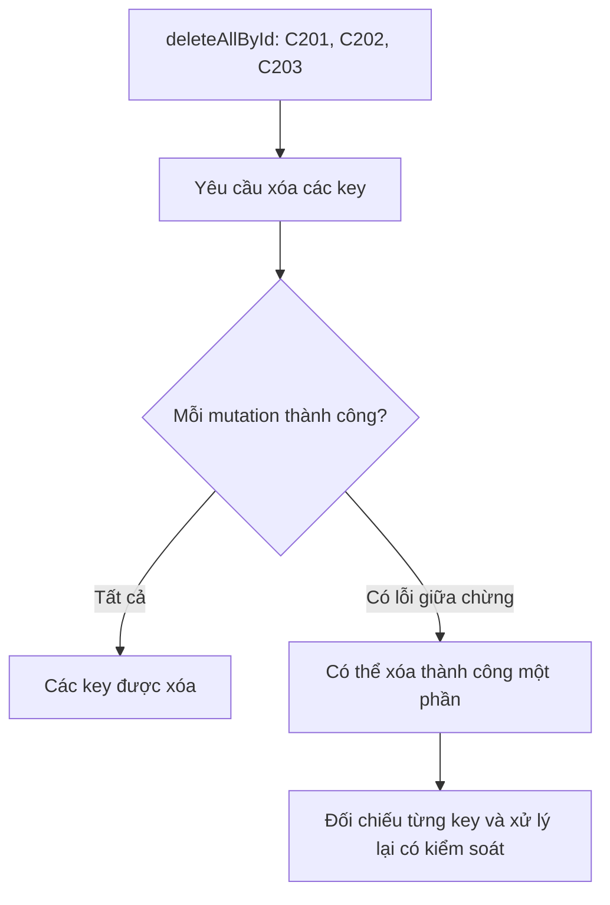

# Xóa theo khóa, xóa theo điều kiện và phạm vi dữ liệu bị ảnh hưởng

Trong chương **Repository** của **SPRING_DATA_COUCHBASE**, thao tác xóa có thể rất đơn giản nếu ứng dụng đã biết chính xác **document key**, chẳng hạn `customer::tenant-a::C102`. Nhưng khi yêu cầu là “xóa mọi khách hàng INACTIVE của tenant A”, ứng dụng cần **lọc theo dữ liệu** và phải xác định rõ những document nào thực sự nằm trong phạm vi xóa.

Spring Data Couchbase cung cấp các thao tác repository như `deleteById`, `delete(entity)`, `deleteAllById` và `deleteAll`. Đối với xóa theo điều kiện trên các trường JSON, ứng dụng có thể chọn truy vấn **SQL++ DELETE**, hoặc truy vấn lấy danh sách key rồi xóa các key đó. Các cách này khác nhau về đường thực thi, yêu cầu chỉ mục, khả năng chạy đồng thời, chi phí và cách xử lý lỗi. **Một lệnh xóa tác động nhiều document không mặc nhiên là một transaction nguyên tử.**

Bài học kết nối document mapping, bucket/scope/collection, repository, `CouchbaseTemplate` và SQL++; đồng thời giải thích tác động của TTL, CAS, giao dịch và API reactive đối với tính nhất quán và vận hành.

## 1. Mục tiêu

Sau bài học, bạn có thể:

- Phân biệt xóa **một document theo key** với xóa **nhiều document được chọn bởi điều kiện SQL++**.
- Biết phạm vi tác động của `deleteById`, `deleteAllById`, `delete(entity)` và `deleteAll()`.
- Thiết kế điều kiện xóa có kiểm soát: đúng bucket/scope/collection, đúng tenant, đúng loại entity và đúng trạng thái.
- Viết SQL++ `DELETE ... WHERE ... RETURNING` có tham số, đồng thời kiểm tra điều kiện bằng `SELECT`/`EXPLAIN` trước khi vận hành.
- Giải thích giới hạn của quy trình “chọn key rồi xóa”, bao gồm **TOCTOU**, index chưa đồng bộ và xóa thành công một phần.
- Phân biệt xóa vật lý, soft delete và hết hạn TTL; hiểu trường hợp cần giữ audit.
- Sử dụng CAS/optimistic locking hoặc transaction thích hợp khi điều kiện nghiệp vụ yêu cầu.
- Thiết kế xử lý lỗi, retry và xác minh kết quả sau khi xóa, kể cả với API reactive.

## 2. Document key quyết định đích xóa KV

Giả sử dữ liệu nằm trong:

```text
Bucket:      appdata
Scope:       sales
Collection:  customers

Document key: customer::tenant-a::C102
```

Nội dung JSON:

```json
{
  "tenantId": "tenant-a",
  "customerCode": "C102",
  "displayName": "Lan Anh",
  "status": "INACTIVE"
}
```

Couchbase quản lý **document key** riêng với giá trị JSON. Trong Spring Data Couchbase, thuộc tính `@Id` ánh xạ đến key; trường `customerCode` chỉ là dữ liệu nghiệp vụ, trừ khi ứng dụng có quy tắc ánh xạ cố định từ mã đó sang key.

Đối với `deleteById("customer::tenant-a::C102")`, đích xóa là **một key xác định** trong collection mà repository ánh xạ. Không có thao tác “xóa tất cả document bắt đầu bằng tiền tố” chỉ vì key có chứa `tenant-a`.

Hai collection có thể có cùng chuỗi key:

```text
appdata.sales.customers:
    customer::tenant-a::C102

appdata.sales.archived:
    customer::tenant-a::C102
```

Đây là **hai document độc lập**. Xóa ở `customers` không tự xóa bản trong `archived`.

## 3. Các cơ chế xóa: so sánh nhanh

| Cách xóa | Đầu vào | Phạm vi dự kiến | Đường thực thi / yêu cầu |
| --- | --- | --- | --- |
| `repository.deleteById(id)` | Một document key | Một document theo key | KV; không cần chỉ mục SQL++ để xác định key |
| `repository.delete(entity)` | Entity, thường có ID | Document do entity định danh | Xóa theo mapping; khả năng kiểm tra version phụ thuộc đường ghi |
| `repository.deleteAllById(ids)` | Nhiều key chính xác | Những document có key trong danh sách | Nhiều thao tác xóa; **không tự all-or-nothing** |
| `repository.deleteAll(entities)` | Nhiều entity | Những document được định danh bởi các entity | Không tự all-or-nothing |
| `repository.deleteAll()` | Không truyền điều kiện | Phạm vi dữ liệu mà repository quản lý theo triển khai | Rất rộng; cần xem implementation và phạm vi thực tế |
| SQL++ `DELETE ... WHERE` | Điều kiện JSON hoặc metadata | Tập document thỏa điều kiện trong keyspace | Query Service, index và tính nhất quán truy vấn |
| `SELECT` key rồi `deleteAllById` | Điều kiện để tìm key, rồi danh sách key | Những key đã chọn, kể cả nếu dữ liệu đổi sau bước SELECT | Hai giai đoạn, có khoảng trống cạnh tranh |
| Soft delete bằng `status = "DELETED"` | Key hoặc điều kiện | Document vẫn tồn tại, thay trạng thái nghiệp vụ | Ghi/cập nhật, không xóa vật lý |

Các phương thức xóa repository được gọi qua API Java, nhưng tên phương thức **không tự bảo đảm** điều kiện “chưa bị thay đổi”, “thuộc tenant đã xác thực” hoặc “cùng rollback nếu có lỗi”. Các điều kiện đó phải được bảo vệ ở tầng ứng dụng và/hoặc thao tác lưu trữ.

## 4. Khai báo entity và repository minh họa

Giả sử ứng dụng đã thiết lập kết nối tới bucket `appdata`, và scope `sales` cùng collection `customers` tồn tại.

### 4.1. Entity

```java
package com.example.customer;

import org.springframework.data.annotation.Id;
import org.springframework.data.annotation.Version;
import org.springframework.data.couchbase.core.mapping.Collection;
import org.springframework.data.couchbase.core.mapping.Document;
import org.springframework.data.couchbase.core.mapping.Field;
import org.springframework.data.couchbase.core.mapping.Scope;

@Document
@Scope("sales")
@Collection("customers")
public class Customer {

    @Id
    private String id;

    @Field
    private String tenantId;

    @Field
    private String customerCode;

    @Field
    private String displayName;

    @Field
    private String status;

    @Version
    private Long version;

    public Customer() {
    }

    public Customer(
            String id, String tenantId, String customerCode,
            String displayName, String status) {
        this.id = id;
        this.tenantId = tenantId;
        this.customerCode = customerCode;
        this.displayName = displayName;
        this.status = status;
    }

    public String getId() { return id; }
    public void setId(String id) { this.id = id; }

    public String getTenantId() { return tenantId; }
    public void setTenantId(String tenantId) {
        this.tenantId = tenantId;
    }

    public String getCustomerCode() { return customerCode; }
    public void setCustomerCode(String customerCode) {
        this.customerCode = customerCode;
    }

    public String getDisplayName() { return displayName; }
    public void setDisplayName(String displayName) {
        this.displayName = displayName;
    }

    public String getStatus() { return status; }
    public void setStatus(String status) { this.status = status; }

    public Long getVersion() { return version; }
    public void setVersion(Long version) { this.version = version; }
}
```

`@Id` đánh dấu document key. `@Version` hỗ trợ optimistic locking dựa trên CAS cho các thao tác ghi phù hợp; nó **không khiến mọi kiểu xóa đều tự kiểm tra CAS**, đặc biệt nếu API chỉ nhận key. Khi cần xóa có điều kiện phiên bản, phải chọn đường ghi có hỗ trợ CAS rõ ràng.

### 4.2. Repository

```java
package com.example.customer;

import java.util.List;
import org.springframework.data.couchbase.repository.CouchbaseRepository;

public interface CustomerRepository
        extends CouchbaseRepository<Customer, String> {

    List<Customer> findByTenantIdAndStatus(
            String tenantId, String status);
}
```

Kiểu `String` của repository phải khớp `@Id String id`. `findByTenantIdAndStatus` là derived query theo JSON, thường thực thi qua SQL++. Phần xóa theo key lấy từ các phương thức CRUD kế thừa.

## 5. Xóa một document theo key

### 5.1. `deleteById`

```java
String id = "customer::tenant-a::C102";
repository.deleteById(id);
```

Đây là lựa chọn tự nhiên khi:

- Ứng dụng đã xác định được key đầy đủ.
- Chỉ muốn xóa **đúng một document** ở collection của entity.
- Không cần lọc thêm theo status hay trường JSON tại thời điểm xóa.
- Đã thực hiện kiểm tra quyền của người gọi tại tầng service.

`deleteById("C102")` không tương đương với `deleteById("customer::tenant-a::C102")`. Nếu quy tắc key bao gồm tenant và loại entity, mọi đường CRUD phải dùng cùng một hàm tạo key.

### 5.2. Service giới hạn key theo tenant đã xác thực

```java
package com.example.customer;

import org.springframework.stereotype.Service;

@Service
public class CustomerDeletionService {

    private final CustomerRepository repository;

    public CustomerDeletionService(CustomerRepository repository) {
        this.repository = repository;
    }

    public void deleteCustomer(
            String authorizedTenantId,
            String customerCode) {

        // authorizedTenantId phải lấy từ ngữ cảnh xác thực/
        // ủy quyền đã kiểm tra, không tin trực tiếp query param.
        String id = keyOf(authorizedTenantId, customerCode);
        repository.deleteById(id);
    }

    private static String keyOf(
            String tenantId, String customerCode) {
        if (tenantId == null || tenantId.isBlank()
                || customerCode == null || customerCode.isBlank()) {
            throw new IllegalArgumentException(
                    "Tenant và mã khách hàng phải có giá trị");
        }
        if (tenantId.contains("::") || customerCode.contains("::")) {
            throw new IllegalArgumentException(
                    "Thành phần key chứa dấu phân cách không hợp lệ");
        }
        return "customer::" + tenantId + "::" + customerCode;
    }
}
```

Dùng tiền tố tenant trong key giúp phân tách định danh, nhưng **không tự tạo phân quyền**. Với API quản trị, vẫn phải kiểm tra người gọi được phép thao tác tenant đó. Nếu customer có thể bị chuyển tenant hoặc key không phản ánh tenant hiện tại, chỉ kiểm tra prefix chưa đủ; cần cơ chế xác minh dữ liệu và chính sách truy cập tương ứng.

### 5.3. Document không tồn tại và xóa lặp lại

Với một thao tác xóa, có thể gặp:

- Key tồn tại và xóa thành công.
- Key đã bị xóa bởi request khác hoặc hết hạn TTL trước khi xóa.
- Timeout hoặc lỗi kết nối khiến ứng dụng **chưa biết chắc** thao tác đã hoàn tất.
- Lỗi quyền, mapping hoặc điều kiện ghi.

Không nên dựa vào một giả định cố định rằng mọi phiên bản Spring Data Couchbase của `deleteById` sẽ ném cùng ngoại lệ hoặc bỏ qua key không tồn tại giống nhau. Hãy kiểm tra hành vi thực tế của version đang dùng, rồi định nghĩa chính sách API: trả `204 No Content` cho yêu cầu xóa lặp lại, hay trả `404 Not Found` nếu nghiệp vụ cần phân biệt.

HTTP DELETE được thiết kế theo ngữ nghĩa idempotent ở mức trạng thái tài nguyên; điều đó không có nghĩa mọi lần gọi nhất thiết trả cùng mã HTTP. Đồng thời, việc gửi sự kiện hoặc tác động phụ bên ngoài phải có cơ chế tránh phát trùng khi retry.

## 6. Xóa bằng entity và trường phiên bản

```java
Customer current = repository.findById(
        "customer::tenant-a::C102").orElseThrow();

repository.delete(current);
```

Đọc rồi xóa bằng entity cho phép service **kiểm tra dữ liệu nghiệp vụ trước khi yêu cầu xóa**, chẳng hạn trạng thái, quyền sở hữu hoặc tham chiếu liên quan. Tuy nhiên, có một khoảng thời gian từ lúc đọc đến lúc ghi xóa:

```text
T1: đọc customer với status = INACTIVE
T2: request khác chuyển status = ACTIVE
T3: service gọi delete(current)
```

Nếu nghiệp vụ yêu cầu “chỉ xóa nếu document vẫn là phiên bản INACTIVE vừa kiểm tra”, thao tác xóa phải **áp dụng điều kiện tại thời điểm mutation**. Đừng mặc định chỉ vì entity có `@Version` nên mọi cách xóa đều kiểm tra version như nhau. Tùy API và phiên bản Spring Data, cần xác minh hỗ trợ CAS hoặc dùng KV remove có điều kiện.

### 6.1. Xóa có điều kiện CAS bằng Couchbase Java SDK

Ví dụ về nguyên tắc “đọc một phiên bản, chỉ xóa nếu phiên bản đó chưa đổi”:

```java
import com.couchbase.client.java.Collection;
import com.couchbase.client.java.kv.GetResult;

import static com.couchbase.client.java.kv.RemoveOptions.removeOptions;

public void deleteIfUnchanged(Collection collection, String key) {
    GetResult current = collection.get(key);

    // Có thể kiểm tra JSON/điều kiện nghiệp vụ từ current.contentAsObject().
    // Phải thực hiện kiểm tra trước khi gọi remove.

    collection.remove(
            key,
            removeOptions().cas(current.cas()));
}
```

Nếu document đã thay đổi sau lần `get`, CAS cũ không còn khớp và lần `remove` sẽ bị từ chối. Nếu document đã bị xóa, thao tác cũng không thể xóa bản mà client đã đọc. Bắt và phân loại ngoại lệ CAS mismatch/không tồn tại theo SDK đang sử dụng.

**CAS bảo vệ một document.** Nó không tự bảo đảm việc xóa document A và sửa document B thành một hành động nguyên tử; yêu cầu đó cần transaction hoặc quy trình nhất quán phù hợp.

## 7. Xóa nhiều key: `deleteAllById` và `deleteAll(entities)`

### 7.1. Xóa một danh sách key đã biết

```java
List<String> ids = List.of(
        "customer::tenant-a::C201",
        "customer::tenant-a::C202",
        "customer::tenant-a::C203");

repository.deleteAllById(ids);
```

Đây là lựa chọn phù hợp khi hệ thống đã có danh sách key đầy đủ và mỗi document có thể được xóa độc lập. Một số lưu ý:

1. **Không mặc định all-or-nothing:** một số document có thể đã bị xóa khi xảy ra lỗi với các document còn lại.
2. **Không giả định thứ tự:** implementation có thể tối ưu, chạy song song hoặc tuần tự tùy phiên bản.
3. **Không suy ra kết quả chi tiết từ `void`:** nếu API chỉ trả `void`, muốn biết key nào còn lại phải đối chiếu theo chính sách phù hợp.
4. **Key không tồn tại:** cần kiểm tra quy tắc lỗi của repository version đang dùng.
5. **Tránh danh sách quá lớn:** giới hạn kích thước batch và số thao tác đồng thời để dễ giám sát và phục hồi.
6. **Không tự xóa liên kết:** tham chiếu đến các key ở document khác vẫn do ứng dụng chịu trách nhiệm.

`deleteAll(entities)` nhận các entity thay cho danh sách key. Với tác vụ bảo vệ version hoặc kiểm tra thông tin entity, phải xác minh đường xóa có thực hiện điều kiện mong muốn; không suy đoán từ tên phương thức.

### 7.2. Xóa hàng loạt không đồng nghĩa transaction



Sơ đồ chỉ mô tả **khả năng thành công một phần**. Nó không khẳng định thứ tự thực thi cố định hay thời điểm nào mỗi mutation hoàn tất.

Nếu xóa một nhóm document là nghiệp vụ “hoặc xóa toàn bộ hoặc giữ nguyên toàn bộ”, một batch repository thông thường **không đủ** để thực thi bất biến đó. Cần transaction đúng ngữ cảnh và API được hỗ trợ.

## 8. `deleteAll()`: phạm vi rộng, cần rất thận trọng

`repository.deleteAll()` không có điều kiện truyền từ caller. Đây là phương thức rất rộng, đặc biệt nếu collection chứa dữ liệu nhiều tenant.

```java
// Không dùng trên môi trường production khi chưa kiểm soát phạm vi:
repository.deleteAll();
```

Đừng tự suy diễn nó chắc chắn tương đương “xóa đúng customer của tenant hiện tại”. Với các repository Spring Data, tập document được thao tác có thể phụ thuộc entity mapping, type discriminator và cách implementation duyệt dữ liệu. Vì vậy, trước khi chọn API này trong tác vụ vận hành, phải hiểu đầy đủ:

- Bucket, scope, collection mà repository trỏ tới.
- Collection chỉ chứa một loại entity hay chứa nhiều loại.
- Có bao nhiêu tenant hoặc nhóm dữ liệu dùng chung collection.
- Tên method có được implementation chuyển thành một lệnh SQL++ rộng hay phải duyệt/xóa từng document.
- Cách đo phạm vi thực tế và kiểm soát rollback/khôi phục nếu lỡ xóa sai.

Đối với thao tác nghiệp vụ thông thường, ưu tiên **key cụ thể** hoặc **điều kiện có tenant xác thực** và sử dụng những API thể hiện rõ phạm vi.

## 9. Xóa theo điều kiện bằng SQL++

Bài toán: “Xóa các customer có `tenantId = "tenant-a"` và `status = "INACTIVE"` trong collection `sales.customers`.”

Không thể thực hiện bằng `deleteById("tenant-a")` hoặc `deleteById("customer::tenant-a::")`, vì `deleteById` cần **một key hoàn chỉnh**, không phải prefix hay biểu thức SQL++.

### 9.1. Trước hết xem tập dữ liệu sẽ bị ảnh hưởng

```sql
SELECT
    META(c).id AS documentKey,
    c.tenantId,
    c.customerCode,
    c.status
FROM `appdata`.`sales`.`customers` AS c
WHERE c.tenantId = $tenantId
  AND c.status = $status
ORDER BY META(c).id
LIMIT 100;
```

`SELECT` với `LIMIT 100` chỉ cho **mẫu 100 bản ghi đầu**, không chứng minh tổng số chỉ có 100. Nếu cần ước lượng phạm vi, dùng thêm `COUNT(*)` với điều kiện tương ứng; cần lưu ý kết quả count có thể chịu ảnh hưởng scan consistency và ghi đồng thời.

### 9.2. SQL++ `DELETE` có điều kiện

```sql
DELETE FROM `appdata`.`sales`.`customers` AS c
WHERE c.tenantId = $tenantId
  AND c.status = $status
RETURNING META(c).id AS documentKey;
```

Câu lệnh tác động lên **các document thỏa WHERE trong collection được chỉ định**. `RETURNING` trả metadata của những document được mutation xử lý, giúp quan sát key bị xóa theo ngữ nghĩa SQL++ của phiên bản đang dùng.

Điều kiện `tenantId` và `status` là **cả hai ràng buộc**. Nếu bỏ WHERE hoặc chỉ giữ `status = "INACTIVE"`, lệnh có thể tác động lên các tenant khác. Vì vậy, phần điều kiện và keyspace quan trọng hơn việc chỉ nhìn thấy từ khóa DELETE.

Một câu SQL++ DELETE có thể tác động **nhiều document**; bản thân việc đó không mặc nhiên cung cấp tính nguyên tử xuyên toàn bộ tập, cũng không tự tạo transaction cho các thao tác khác trong service.

### 9.3. Thực thi bằng Couchbase Java SDK với tham số

```java
import com.couchbase.client.java.Cluster;
import com.couchbase.client.java.json.JsonObject;
import com.couchbase.client.java.query.QueryResult;

import static com.couchbase.client.java.query.QueryOptions.queryOptions;

// cluster được cấu hình và quản lý vòng đời bởi ứng dụng.
QueryResult result = cluster.query(
        "DELETE FROM `appdata`.`sales`.`customers` AS c " +
        "WHERE c.tenantId = $tenantId " +
        "AND c.status = $status " +
        "RETURNING META(c).id AS documentKey",
        queryOptions().parameters(
                JsonObject.create()
                        .put("tenantId", "tenant-a")
                        .put("status", "INACTIVE")));

result.rowsAsObject().forEach(row ->
        System.out.println(row.getString("documentKey")));
```

Đây là ví dụ **SDK truy vấn SQL++** trong một ứng dụng có Spring Data Couchbase. Lệnh DELETE đi qua Query Service, không phải `repository.deleteById`. Nên đóng gói nó trong một service/repository tùy chỉnh, có quyền và tham số được kiểm soát, thay vì ghép SQL++ trực tiếp từ request HTTP.

- **Bind giá trị** như `tenantId` và `status` bằng tham số; không nối chuỗi dữ liệu người dùng vào WHERE.
- **Keyspace cố định hoặc theo allowlist tin cậy**; thông thường không thể bind tên bucket/scope/collection như một giá trị dữ liệu.
- **Không in toàn bộ ID ở log nhạy cảm**; ghi nhận operation ID, tenant đã ủy quyền, số lượng và trạng thái xử lý.
- **Xem xét tải và kích thước kết quả RETURNING**; với tập rất lớn, trả tất cả key về client cũng tốn tài nguyên.

API query của SDK có thể cấu hình độ nhất quán, timeout và các tùy chọn khác. Cần kiểm tra hành vi của phiên bản Couchbase/SDK triển khai, đặc biệt nếu truy vấn xóa phụ thuộc secondary index vừa được cập nhật.

### 9.4. Index cho điều kiện WHERE

Truy vấn xóa theo trường JSON thường cần con đường truy cập được optimizer chấp nhận. Ví dụ:

```sql
CREATE INDEX ix_customers_tenant_status
ON `appdata`.`sales`.`customers` (
    tenantId,
    status
);
```

Trước khi chạy xóa số lượng lớn, kiểm tra kế hoạch:

```sql
EXPLAIN
DELETE FROM `appdata`.`sales`.`customers` AS c
WHERE c.tenantId = "tenant-a"
  AND c.status = "INACTIVE";
```

Chú ý index nào được chọn, số mục phải quét, sự cần thiết của bước fetch và tải Query Service. Không coi `CREATE INDEX` minh họa là thiết kế tối ưu cho mọi workload; cần kiểm tra trên dữ liệu, type discriminator và bộ lọc thực tế.

### 9.5. Xóa theo điều kiện không tự kiểm tra mọi quy tắc nghiệp vụ

SQL++ DELETE WHERE chỉ thể hiện những điều kiện ghi trong câu lệnh. Nếu nghiệp vụ còn yêu cầu “khách hàng không có đơn hàng đang mở”, “không bị khóa bởi giao dịch khác” hoặc “thuộc quyền của người gọi”, phải biểu diễn và bảo vệ những quy tắc đó bằng cách phù hợp.

Nếu tập dữ liệu cùng collection chứa nhiều loại entity, cần giới hạn loại document bằng điều kiện nhận diện đúng của mapping. SQL++ viết trực tiếp có thể **không tự kế thừa** bộ lọc type mà Spring Data thêm khi truy vấn entity; chỉ giới hạn tenant/status có thể chưa đủ.

## 10. Chọn key bằng SQL++ rồi xóa bằng repository

Một lựa chọn khác là dùng SQL++ để tìm **key của các ứng viên**, sau đó xóa bằng KV. Cách này hữu ích khi cần kiểm soát batch hoặc áp dụng kiểm tra riêng cho từng phần tử.

### 10.1. Truy vấn key của ứng viên

```sql
SELECT RAW META(c).id
FROM `appdata`.`sales`.`customers` AS c
WHERE c.tenantId = $tenantId
  AND c.status = $status
ORDER BY META(c).id
LIMIT 100;
```

Kết quả là các chuỗi key. Ứng dụng có thể đưa chúng vào `repository.deleteAllById(ids)`.

Ví dụ ở mức Java, khi đã nhận một danh sách key được xác minh:

```java
List<String> candidateKeys = List.of(
        "customer::tenant-a::C301",
        "customer::tenant-a::C302");

repository.deleteAllById(candidateKeys);
```

### 10.2. Khoảng trống TOCTOU

Quy trình hai bước có thể gặp cạnh tranh:

```text
T1: SELECT thấy C301 có status = INACTIVE
T2: request khác chuyển C301 sang ACTIVE
T3: deleteAllById xóa C301 theo key
```

Ở T3, xóa bằng key **không tự kiểm tra lại** điều kiện status từ T1. Nếu cần chỉ xóa khi vẫn đúng trạng thái đã xem, phải dùng điều kiện ở **thời điểm mutation**: chẳng hạn xóa có CAS sau khi đọc và kiểm tra bản hiện tại, hoặc giao dịch chứa các bước cần thiết.

Ngoài ra, SQL++ index có thể chưa bắt kịp mutation mới; tập ứng viên ban đầu không mặc nhiên là snapshot hoàn chỉnh của mọi document thỏa điều kiện ở thời điểm cuối batch.

### 10.3. Không xóa theo offset khi tập kết quả đang co lại

Giả sử lặp:

```text
Trang 1: OFFSET 0 LIMIT 100  → xóa 100 bản
Trang 2: OFFSET 100 LIMIT 100 → xóa tiếp
```

Sau khi xóa trang đầu, phần còn lại có thể dịch lên đầu tập kết quả. Dùng OFFSET tăng dần trên tập đang bị xóa có nguy cơ **bỏ sót** document. Nếu cần xử lý số lượng lớn:

- Dùng chiến lược keyset/cursor với một thứ tự ổn định và checkpoint hợp lý.
- Hoặc liên tục lấy một lô đầu với điều kiện nhất quán, xóa rồi đối chiếu, kèm giới hạn vòng lặp và xử lý document thay đổi.
- Ghi nhận operation ID và key đã xử lý để retry an toàn.
- Kiểm soát tốc độ và kích thước lô theo tải cluster.

Không có một phương án phân trang duy nhất bảo đảm snapshot xuyên tất cả mutation đang diễn ra. Nếu cần tập ảnh hưởng **cố định tại một mốc**, phải thiết kế ranh giới nghiệp vụ và chiến lược nhất quán rõ ràng.

## 11. Xóa vật lý, soft delete và TTL

Ba tình huống này có thể dẫn đến việc người dùng “không thấy dữ liệu” nhưng khác nhau về lưu trữ:

| Cách xử lý | Document vẫn tồn tại theo key? | Khả năng khôi phục và rủi ro |
| --- | --- | --- |
| **Hard delete** bằng KV/SQL++ DELETE | Sau khi xóa có hiệu lực: không | Cần backup/audit/nguồn phục hồi riêng nếu muốn khôi phục |
| **Soft delete** cập nhật `status = "DELETED"` | Có | Có thể khôi phục trạng thái, nhưng phải lọc ở mọi đường đọc nghiệp vụ |
| **TTL/expiration** | Có thể biến mất khi hết hạn | Thời điểm phụ thuộc expiration; không dùng TTL như bản ghi audit |

### 11.1. Soft delete là một lần ghi

```java
Customer customer = repository.findById(id)
        .orElseThrow();

customer.setStatus("DELETED");
repository.save(customer);
```

Entity vẫn có document key; vì vậy `repository.existsById(id)` có thể trả `true` sau soft delete. Các truy vấn nghiệp vụ phải loại trạng thái `DELETED` nếu không muốn hiển thị document này.

Khi có `@Version`, cập nhật trạng thái soft delete có thể dùng optimistic locking để phát hiện bản cũ, nhưng không tự giải quyết các tham chiếu hoặc số liệu tổng hợp phụ thuộc vào customer.

### 11.2. TTL là hết hạn, không phải chính sách lưu vết

TTL có thể khiến document không còn được truy cập sau khi hết hạn, không cần `deleteById`. Nhưng nếu phải giải thích **ai xóa, vì sao xóa, lúc nào xóa**, chỉ dựa vào việc document biến mất là không đủ. Cần event/audit hoặc quy trình retention theo yêu cầu nghiệp vụ.

Khi cập nhật soft delete hoặc chuyển sang archive, cần kiểm tra chính sách expiration của API ghi. Không mặc định mọi lệnh `save` giữ nguyên TTL cũ.

### 11.3. Archive trước khi xóa

Quy trình:

```text
1. Ghi document archive sang collection khác
2. Xóa document gốc khỏi customers
```

gồm ít nhất **hai mutation** và có thể hoàn tất một phần. Nếu nghiệp vụ yêu cầu không mất và không nhân đôi dữ liệu ở trạng thái commit, cần transaction phù hợp hoặc thiết kế idempotent, reconciliation và bù trừ.

## 12. Tính nguyên tử, CAS và giao dịch khi xóa

### 12.1. Một document khác một tập document

KV `remove(key)` là mutation của một document. CAS có thể bảo vệ điều kiện phiên bản của document đó. Nhưng:

```java
repository.deleteById(keyA);
repository.deleteById(keyB);
```

không tự mang hợp đồng “cả A và B đều bị xóa, hoặc cả hai vẫn tồn tại”. Nếu xóa A thành công và xóa B lỗi, A không tự phục hồi.

SQL++ `DELETE WHERE` cũng không được mặc định là transaction nhiều document chỉ vì được gửi thành **một statement**. Khi tác động lên nhiều document, cần hiểu bảo đảm và giới hạn của SQL++/server version, và xem xét transaction nếu có bất biến all-or-nothing.

### 12.2. Khi nào cần Couchbase transactions?

Ví dụ:

- Xóa đơn hàng và cập nhật số lượng giữ chỗ ở document tồn kho như một đơn vị.
- Xóa customer cùng document chỉ mục tra cứu nghiệp vụ tự quản lý, nếu không được phép tồn tại lệch nhau.
- Di chuyển document giữa `customers` và `archived` khi không được phép mất hoặc nhân đôi ở trạng thái commit.
- Xóa nhiều phần tử mà hợp đồng nghiệp vụ yêu cầu **tất cả cùng thành công hoặc cùng thất bại**.

Couchbase có transaction API cho các thao tác được hỗ trợ trong đúng transaction context. Khi dùng Spring, phải xác minh transaction manager, phạm vi API và phiên bản tương ứng. **Chỉ thêm `@Transactional` trên service chưa đủ** nếu những thao tác Couchbase không được thực thi bằng cơ chế giao dịch đã cấu hình.

Không đặt side effect ngoài Couchbase (gửi email, thu phí, xuất sự kiện không idempotent) trực tiếp trong đoạn callback có thể được transaction retry. Đối với nhiều hệ thống, cân nhắc outbox/saga hoặc quy trình bù trừ.

### 12.3. CAS bảo vệ điều kiện thay đổi, transaction bảo vệ bất biến nhóm

| Nhu cầu | Cơ chế |
| --- | --- |
| Chỉ xóa C102 nếu chưa ai sửa từ lúc đọc | Remove có CAS phù hợp |
| Xóa C101 và C102 như một đơn vị | Transaction nhiều document được hỗ trợ |
| Xóa mọi customer có `status = "INACTIVE"` | SQL++ DELETE có bộ lọc rõ ràng; nếu còn điều kiện nguyên tử khác, thiết kế thêm |
| Archive một customer rồi xóa bản gốc mà không thất lạc | Transaction hoặc quy trình phục hồi/idempotency |
| Xóa hàng triệu document độc lập, chấp nhận thành công một phần | Batch có checkpoint, throttling, đối chiếu, retry phù hợp |

## 13. Kiểm tra tác động trước và sau xóa

Đối với thao tác xóa theo điều kiện, cần có quy trình quan sát rõ ràng.

### 13.1. Trước khi xóa

1. **Khóa phạm vi:** xác định bucket, scope, collection, tenant đã xác thực, loại entity, trạng thái và tiêu chí thời gian.
2. **Chạy SELECT mẫu:** xem các key và thuộc tính của một tập ứng viên với cùng WHERE dự kiến.
3. **Đếm ứng viên:** dùng `COUNT(*)` cùng WHERE để ước tính số document, và ghi thời điểm/mức scan consistency. Đây là **ước tính tại thời điểm truy vấn**, không phải lời hứa số delete thực tế.
4. **Kiểm tra plan:** dùng `EXPLAIN` để bảo đảm câu DELETE không gây quét rộng ngoài dự kiến.
5. **Quyết định phục hồi:** backup/archival/audit, mức rủi ro cho phép, transaction hay lô độc lập.
6. **Giới hạn tác động:** đảm bảo tenant/filter bắt buộc không bị bỏ qua khi dùng automation hoặc job.

### 13.2. Trong khi xóa

- Dùng tham số binding, không nối chuỗi user input vào SQL++.
- Ghi nhận operation ID, phạm vi và số key được xác nhận.
- Hạn chế tải nếu xóa nhiều; tránh làm nghẽn Query Service hoặc KV.
- Phân loại lỗi thiếu quyền, xung đột CAS, timeout, key không tồn tại và lỗi index.
- Không giả định mọi document chưa được xác nhận đều chắc chắn chưa bị xóa.

### 13.3. Sau khi xóa

Có thể đọc từng key đã biết bằng KV để đối chiếu hoặc chạy truy vấn kiểm tra theo điều kiện với mức consistency được chọn. Tuy nhiên:

- `COUNT trước − COUNT sau` không luôn bằng đúng số document bị xóa nếu có **ghi, xóa, cập nhật hoặc TTL đồng thời**.
- SQL++ query kiểm tra có thể chưa nhìn thấy toàn bộ mutation theo tiến độ index/scan consistency.
- `RETURNING` và metadata query giúp quan sát, nhưng nếu phản hồi bị mất do timeout, ứng dụng phải **đối chiếu trạng thái** thay vì tự khẳng định không có thao tác nào đã thành công.
- Nếu dữ liệu có tham chiếu, kiểm tra các bất biến nghiệp vụ liên quan: đơn hàng còn tồn tại, chỉ mục tra cứu đã được cập nhật, báo cáo có được tái tính đúng không.

Đối với tác vụ vận hành quan trọng, lưu báo cáo có operation ID, phạm vi, thời điểm bắt đầu/kết thúc, kết quả xác nhận và danh sách cần reconciliation. Không đưa nội dung JSON nhạy cảm vào log không kiểm soát.

## 14. Xử lý lỗi và retry an toàn

| Trạng thái | Điều biết được | Hướng xử lý |
| --- | --- | --- |
| Xóa KV được xác nhận thành công | Key đã bị remove theo lời gọi đó | Ghi nhận kết quả |
| Key không tồn tại hoặc hết hạn trước khi xóa | Không còn document theo key ở thời điểm kiểm tra/ghi | Chọn chính sách idempotent hoặc báo `404` |
| CAS mismatch | Document đã thay đổi từ phiên bản quan sát | Không xóa bừa; đọc lại và đánh giá điều kiện |
| SQL++ báo thiếu index | Query không thể định vị tập dữ liệu theo plan có thể chạy | Thiết kế index trên đúng collection |
| Thiếu quyền | Identity không được phép truy cập/xóa | Báo lỗi phân quyền, không đổi thành `0 deleted` |
| Timeout/mất phản hồi | Chưa xác định chắc kết quả | Đối chiếu key, ghi trạng thái `UNKNOWN` |
| Batch lỗi giữa chừng | Có thể xóa thành công một phần | Kiểm tra từng key và tiếp tục theo chính sách |

### 14.1. Retry idempotent có giới hạn

Lệnh xóa lại cùng một key thường vẫn hướng đến trạng thái cuối “key không tồn tại”. Tuy vậy, kết quả HTTP, exception và **side effect** có thể khác nhau. Đặc biệt, không retry một lần xóa theo **điều kiện động** mà không kiểm tra lại phạm vi: giữa hai lần chạy, document mới có thể bắt đầu thỏa điều kiện và bị xóa thêm.

Đối với tác vụ có yêu cầu xóa đúng **tập ứng viên tại thời điểm phê duyệt**, nên có snapshot danh sách key/mốc dữ liệu theo chính sách phù hợp và kiểm tra CAS hoặc transaction khi cần. Retry trên một WHERE rộng có thể thay đổi đối tượng bị xóa.

### 14.2. Không bắt mọi lỗi thành “không tìm thấy”

Cách không nên dùng:

```java
try {
    repository.deleteById(key);
} catch (RuntimeException exception) {
    // Sai: timeout/CAS/permission bị che giấu.
    return;
}
```

Một thao tác thất bại do Couchbase chưa sẵn sàng khác với key đã bị xóa. Service phải phân loại lỗi để client biết nên làm gì, và để hệ thống giám sát phát hiện lỗi thực tế.

## 15. Reactive: xóa nhiều không tự có transaction

Khi dùng `ReactiveCouchbaseRepository`, thao tác xóa theo key có thể tham gia pipeline reactive:

```java
package com.example.customer;

import org.springframework.data.couchbase.repository.ReactiveCouchbaseRepository;

public interface ReactiveCustomerRepository
        extends ReactiveCouchbaseRepository<Customer, String> {
}
```

```java
import reactor.core.publisher.Mono;

// reactiveRepository được inject từ cấu hình Spring.
Mono<Void> deletion = reactiveRepository.deleteById(
        "customer::tenant-a::C102");
```

Một `Mono<Void>` hoàn thành không phát entity; lỗi từ thao tác xóa đi qua tín hiệu `onError`. Các API xóa nhiều phần tử và chữ ký của chúng phụ thuộc các interface và phiên bản thư viện được dùng.

Reactive chỉ thay đổi cách phối hợp bất đồng bộ; nó không:

- Tự kiểm tra tenant hoặc status trước khi xóa.
- Tự tạo SQL++ index.
- Biến một chuỗi nhiều mutation thành giao dịch.
- Bảo đảm retry không gây side effect lặp.
- Thay thế CAS khi cần bảo vệ phiên bản.

Không gọi `block()` tùy tiện trong luồng WebFlux; nếu cần transaction, chọn transaction API reactive được hỗ trợ đúng phiên bản và bảo đảm mọi thao tác tham gia context đó.

## 16. Bài thực hành

Trong Couchbase thử nghiệm, chuẩn bị collection `appdata.sales.customers` với dữ liệu:

| Document key | tenantId | customerCode | status |
| --- | --- | --- | --- |
| `customer::tenant-a::C101` | tenant-a | C101 | ACTIVE |
| `customer::tenant-a::C102` | tenant-a | C102 | INACTIVE |
| `customer::tenant-a::C103` | tenant-a | C103 | INACTIVE |
| `customer::tenant-b::C102` | tenant-b | C102 | INACTIVE |
| `customer::tenant-a::C104` | tenant-a | C104 | DELETED |

Thực hiện theo thứ tự:

1. **Xóa theo key:** dùng `deleteById("customer::tenant-a::C101")`, rồi xác minh bằng `findById`. Quan sát hành vi khi gọi lại cùng key ở repository version đang dùng.
2. **Giới hạn tenant:** viết service lấy tenant từ ngữ cảnh đã ủy quyền, xác minh thao tác trên tenant A không xóa được key của tenant B chỉ vì cùng `customerCode`.
3. **Xem trước phạm vi:** `SELECT` các customer `tenant-a` có `status = "INACTIVE"`; ghi lại key dự kiến là C102 và C103.
4. **Kiểm tra index:** tạo index phù hợp trên `tenantId`/`status` trong môi trường thử nghiệm, dùng `EXPLAIN DELETE` kiểm tra kế hoạch.
5. **SQL++ DELETE:** chạy `DELETE ... WHERE tenantId = "tenant-a" AND status = "INACTIVE" RETURNING META(c).id`; xác minh C102/C103 bị xóa, còn `tenant-b::C102` không bị ảnh hưởng.
6. **Thử TOCTOU:** chọn trước key của C102 khi INACTIVE, sau đó đổi status thành ACTIVE trước bước xóa key; giải thích vì sao deleteById có thể xóa sai điều kiện ban đầu.
7. **Thử CAS:** đọc C102 lấy CAS, sửa document qua request khác, rồi thử remove với CAS cũ; quan sát lỗi xung đột.
8. **Thử soft delete:** cập nhật `status = "DELETED"` và xác minh `existsById` vẫn có thể true.
9. **Xóa nhiều key:** gọi `deleteAllById` với nhóm key thử nghiệm, kiểm tra kết quả từng key khi một thao tác bị lỗi có kiểm soát.
10. **Archive/transaction:** thiết kế quy trình chuyển document giữa hai collection có yêu cầu giữ bất biến. Dùng transaction SDK/Spring Data phù hợp nếu môi trường hỗ trợ; thử tình huống lỗi trước commit.
11. **Reactive:** gọi `deleteById` qua reactive repository, quan sát `onComplete` và `onError`; không coi Mono hoàn thành là bằng chứng cho các document liên quan cũng được xóa.

Chỉ thao tác trên dữ liệu thử nghiệm có thể tạo lại. Không chạy các câu DELETE minh họa trên collection vận hành thực tế mà chưa kiểm soát đầy đủ phạm vi và phương án phục hồi.

## 17. Câu hỏi tự kiểm tra

1. Vì sao `deleteById("customer::tenant-a::")` không xóa mọi customer của tenant A?
2. Phạm vi tác động của `deleteAll()` có thể khác `deleteAllById(ids)` ở điểm nào?
3. SQL++ `DELETE WHERE tenantId = ...` cần bảo vệ thêm điều kiện gì nếu collection chứa nhiều loại entity?
4. Vì sao `SELECT` key rồi `deleteAllById` có thể xóa document không còn thỏa điều kiện ban đầu?
5. Vì sao `deleteAllById` hoặc một câu SQL++ DELETE nhiều document không nên được mặc định là all-or-nothing?
6. Khi nào CAS đủ để bảo vệ xóa, và khi nào cần transaction nhiều document?
7. Nếu trước khi xóa đếm được 100 document nhưng sau khi xóa chỉ thấy count giảm 95, có thể kết luận đúng 95 key bị xóa không?
8. Soft delete khác hard delete và TTL ra sao khi gọi `existsById`?
9. Vì sao retry một lệnh xóa theo status sau timeout có thể ảnh hưởng thêm document mới?
10. Khi xóa theo tenant, tại sao prefix trong key không thể thay thế kiểm tra phân quyền?

## 18. Ghi nhớ

**Xóa theo key** là thao tác định vị một document chính xác trong collection; **xóa theo điều kiện** đòi hỏi xác định tập document phù hợp qua SQL++, chỉ mục và bộ lọc nghiệp vụ. `deleteById`, `deleteAllById`, `delete(entity)` và `deleteAll()` có phạm vi khác nhau. Không dùng chúng thay thế lẫn nhau khi chưa rõ những document có thể bị ảnh hưởng.

Khi xóa dữ liệu trong Spring Data Couchbase, luôn xác định đúng **bucket/scope/collection, tenant, loại entity, điều kiện và khả năng phục hồi**. Dùng CAS khi cần xác minh document chưa thay đổi; dùng transaction khi phải bảo toàn bất biến xuyên nhiều document. Kiểm tra lỗi, scan consistency, TTL và kết quả thành công một phần giúp thao tác xóa rõ ràng, nhất quán và có thể vận hành an toàn, dù dùng repository, `CouchbaseTemplate`, SQL++ hay API reactive.
