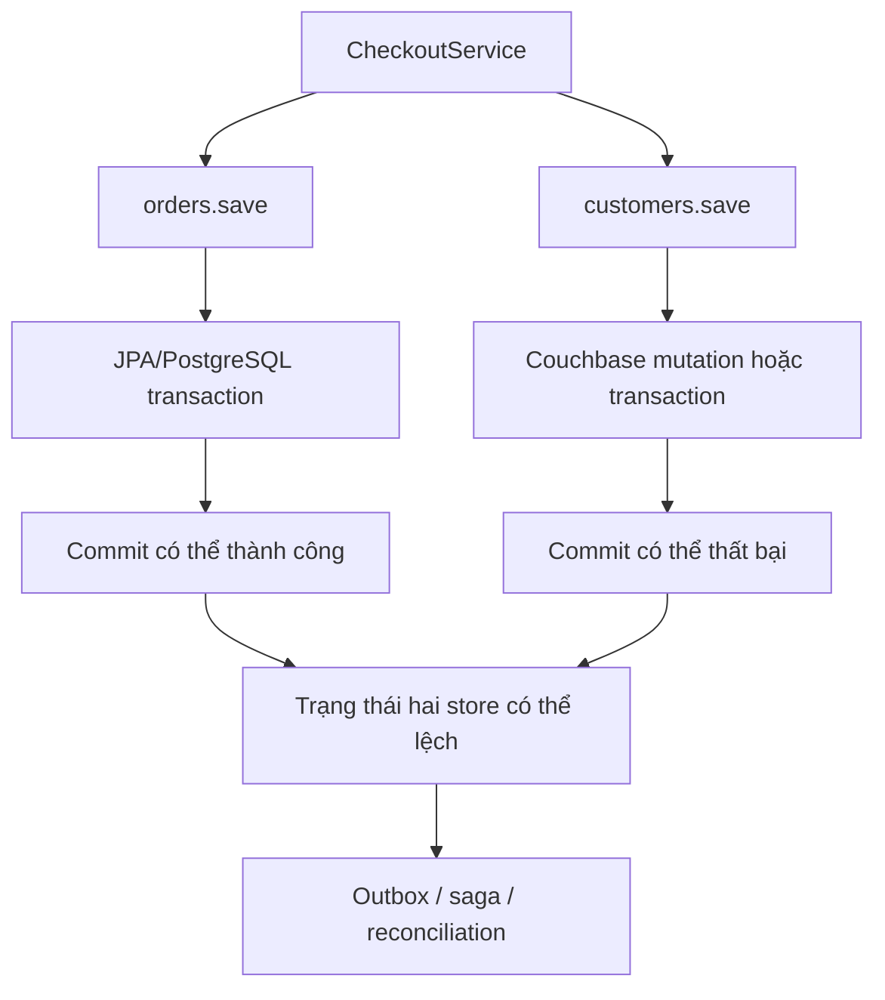

# Quản lý nhiều module Spring Data trong cùng ứng dụng

Trong chương **Repository** của **SPRING_DATA_COUCHBASE**, một ứng dụng không nhất thiết chỉ dùng Couchbase. Nhiều hệ thống lưu hồ sơ khách hàng ở Couchbase để tận dụng document mapping, truy cập KV và SQL++, nhưng lưu đơn hàng trong PostgreSQL bằng Spring Data JPA, hoặc đồng thời sử dụng Spring Data MongoDB, Redis hay Elasticsearch cho những nhu cầu khác.

Việc thêm nhiều module Spring Data đem lại API repository nhất quán, nhưng cũng tạo ra những câu hỏi cấu hình: **repository này thuộc datastore nào, entity được ánh xạ bởi module nào, bộ quét repository có chạy chồng lên nhau không, và transaction bao phủ những thao tác nào?**

Bài học giải thích các nguyên tắc quản lý nhiều module Spring Data trong cùng một ứng dụng Spring Boot, tập trung vào tổ hợp **Spring Data Couchbase + Spring Data JPA**. Những nguyên tắc này cũng giúp quản lý CouchbaseTemplate, bucket/scope/collection, truy vấn SQL++, index, TTL, CAS và lựa chọn API reactive trong kiến trúc nhiều nguồn dữ liệu.

## 1. Mục tiêu học tập

Sau bài học, bạn có thể:

- Giải thích vì sao Spring Data cần **strict repository configuration mode** khi classpath có nhiều Spring Data module.
- Sử dụng repository interface chuyên biệt và annotation domain để xác định repository thuộc Couchbase, JPA hay datastore khác.
- Tổ chức package và dùng `@EnableCouchbaseRepositories`/`@EnableJpaRepositories` khi cần giới hạn phạm vi quét rõ ràng.
- Phân biệt entity Couchbase `@Document` với JPA `@Entity`, kể cả các annotation `@Id` và `@Version` có cùng tên nhưng khác ngữ nghĩa.
- Cấu hình các kết nối độc lập mà không nhầm Couchbase collection với bảng JPA.
- Hiểu vì sao `@Transactional` **không tự tạo giao dịch nguyên tử xuyên Couchbase và PostgreSQL**.
- Lựa chọn outbox, eventual consistency, saga hoặc cơ chế đối soát khi cần đồng bộ hai nguồn dữ liệu.
- Kiểm thử bootstrap, query, index, lỗi transaction và tình huống repository không được nhận diện đúng.

## 2. Một ứng dụng, nhiều Spring Data module

Ví dụ Gradle Groovy DSL:

```groovy
dependencies {
    implementation("org.springframework.boot:spring-boot-starter-data-couchbase")
    implementation("org.springframework.boot:spring-boot-starter-data-jpa")
    runtimeOnly("org.postgresql:postgresql")
}
```

Dự án dùng Spring Boot thường quản lý phiên bản dependency qua BOM. Ví dụ này chỉ minh họa **hai module dữ liệu**, chưa gồm các dependency web, test hoặc observability.

Spring Data Commons cung cấp các khái niệm chung như `Repository`, `CrudRepository`, `Pageable` và quy ước derived query. Tuy nhiên, hai module có cách ánh xạ và truy cập rất khác nhau:

| Tiêu chí | Spring Data Couchbase | Spring Data JPA |
| --- | --- | --- |
| Kiểu dữ liệu | JSON document | Hàng trong bảng quan hệ |
| Repository | `CouchbaseRepository<T, ID>` | `JpaRepository<T, ID>` |
| Entity mapping | `@Document` của Couchbase | `@Entity` của Jakarta Persistence |
| Định danh | Document key qua Spring Data `@Id` | Primary key qua JPA `@Id` |
| Namespace | Bucket / scope / collection | Database / schema / table |
| Đọc theo ID | Thường qua KV | Qua JPA/ORM và SQL |
| Lọc theo trường | SQL++ và Couchbase index | JPQL/SQL và RDBMS index |
| Lạc quan khi ghi | CAS/`@Version` của Spring Data Couchbase | Optimistic version của JPA |
| Expiration | TTL của Couchbase | Không mặc nhiên có cùng TTL |
| Transaction | Couchbase transactions theo API được hỗ trợ | JPA transaction manager của datasource |

Tên `save` hay `findById` giống nhau **không có nghĩa đường thực thi, ngữ nghĩa insert/update, phạm vi transaction hoặc hiệu năng giống nhau**.

## 3. Strict repository configuration mode

Khi nhiều module Spring Data cùng hiện diện, framework phải xác định **repository factory** phù hợp cho mỗi interface. Spring Data có thể chuyển sang chế độ nhận diện chặt hơn, thường gọi là *strict repository configuration mode*.

Log có thể xuất hiện nội dung như sau:

```text
Multiple Spring Data modules found,
entering strict repository configuration mode
```

Đây là **thông báo**, không nhất thiết là lỗi. Lỗi xảy ra khi Spring Data không thể xác định an toàn repository ứng viên thuộc datastore nào, hoặc khi nhiều cấu hình quét cùng một repository dẫn đến bean trùng.

### 3.1. Ba tín hiệu để phân định module

1. **Interface repository chuyên biệt:** `CouchbaseRepository`, `JpaRepository`, `MongoRepository`... thể hiện rõ module mong muốn.
2. **Annotation đặc thù của domain:** Couchbase `@Document`, JPA `@Entity`... giúp nhận diện entity thuộc store nào.
3. **Phạm vi repository scanning:** cấu hình rõ mỗi module chỉ quét package repository của chính mình.

Các tín hiệu này cần được sử dụng nhất quán. Đường dẫn package không phải dữ liệu tự động định danh datastore; nó có ý nghĩa khi được đặt trong cấu hình scan tương ứng.

### 3.2. Ví dụ repository mơ hồ

```java
package com.example.shop.shared;

import org.springframework.data.repository.CrudRepository;

public interface AmbiguousRepository
        extends CrudRepository<UnmarkedRecord, String> {
}
```

Nếu `UnmarkedRecord` không mang annotation đặc thù và classpath có cả Couchbase lẫn JPA, Spring Data có thể không có đủ căn cứ để gán interface vào một module. Một interface quá chung dùng `Repository<...>` cũng có rủi ro tương tự.

Nên viết rõ:

```java
package com.example.shop.customer.couchbase;

import org.springframework.data.couchbase.repository.CouchbaseRepository;

public interface CustomerRepository
        extends CouchbaseRepository<CustomerDocument, String> {
}
```

Và repository thuộc JPA:

```java
package com.example.shop.order.jpa;

import org.springframework.data.jpa.repository.JpaRepository;

public interface OrderRepository
        extends JpaRepository<OrderEntity, Long> {
}
```

## 4. Thiết kế package theo ranh giới datastore

Cấu trúc đề xuất:

```text
com.example.shop
├── ShopApplication.java
├── config
│   └── RepositoryConfiguration.java
├── customer
│   ├── CustomerService.java
│   └── couchbase
│       ├── CustomerDocument.java
│       └── CustomerRepository.java
├── order
│   ├── OrderService.java
│   └── jpa
│       ├── OrderEntity.java
│       └── OrderRepository.java
└── integration
    └── OrderCustomerSyncService.java
```

Cách tổ chức này đảm bảo:

- Repository Couchbase nằm trong `customer.couchbase`, dễ đặt vào phạm vi quét của Couchbase.
- Repository JPA nằm trong `order.jpa`, dễ đặt vào phạm vi quét JPA.
- Mỗi persistence entity có mapping và lifecycle riêng.
- Service có thể phối hợp nhiều repository, nhưng phải chủ động quản lý tính nhất quán.
- Khi mở rộng thêm MongoDB hoặc Elasticsearch, có thể thêm adapter/package riêng thay vì trộn mọi repository vào một package không phân biệt.

Đây là **quy ước kiến trúc**, không phải cấu trúc folder bắt buộc của Spring.

## 5. Entity Couchbase và repository của nó

Giả sử dữ liệu khách hàng đặt tại bucket `appdata`, scope `sales`, collection `customers`.

```java
package com.example.shop.customer.couchbase;

import org.springframework.data.annotation.Id;
import org.springframework.data.annotation.Version;
import org.springframework.data.couchbase.core.mapping.Collection;
import org.springframework.data.couchbase.core.mapping.Document;
import org.springframework.data.couchbase.core.mapping.Field;
import org.springframework.data.couchbase.core.mapping.Scope;

@Document
@Scope("sales")
@Collection("customers")
public class CustomerDocument {

    @Id
    private String id;

    @Field
    private String tenantId;

    @Field
    private String customerCode;

    @Field
    private String displayName;

    @Field
    private String status;

    @Version
    private Long version;

    public CustomerDocument() {
    }

    public CustomerDocument(
            String id, String tenantId,
            String customerCode, String displayName,
            String status) {
        this.id = id;
        this.tenantId = tenantId;
        this.customerCode = customerCode;
        this.displayName = displayName;
        this.status = status;
    }

    public String getId() { return id; }
    public void setId(String id) { this.id = id; }

    public String getTenantId() { return tenantId; }
    public void setTenantId(String tenantId) {
        this.tenantId = tenantId;
    }

    public String getCustomerCode() { return customerCode; }
    public void setCustomerCode(String customerCode) {
        this.customerCode = customerCode;
    }

    public String getDisplayName() { return displayName; }
    public void setDisplayName(String displayName) {
        this.displayName = displayName;
    }

    public String getStatus() { return status; }
    public void setStatus(String status) { this.status = status; }

    public Long getVersion() { return version; }
    public void setVersion(Long version) { this.version = version; }
}
```

Các annotation cần chú ý:

- `org.springframework.data.couchbase.core.mapping.Document`: đây là document Couchbase, **không** phải annotation MongoDB dù cùng tên `Document`.
- `org.springframework.data.annotation.Id`: đánh dấu **document key**, ví dụ `customer::tenant-a::C102`.
- `@Scope` và `@Collection`: xác định đích lưu trữ bên trong bucket; không tự tạo scope/collection.
- `org.springframework.data.annotation.Version`: phục vụ optimistic locking dựa trên CAS; không phải JPA version.

Repository:

```java
package com.example.shop.customer.couchbase;

import java.util.List;
import org.springframework.data.couchbase.repository.CouchbaseRepository;

public interface CustomerRepository
        extends CouchbaseRepository<CustomerDocument, String> {

    List<CustomerDocument> findByTenantId(String tenantId);

    List<CustomerDocument> findByTenantIdAndStatus(
            String tenantId, String status);
}
```

`findById` nhận một **document key hoàn chỉnh** và thường dùng đường KV. Các phương thức `findByTenantId...` lọc theo trường JSON và thường thực thi bằng SQL++; chúng cần index và có thể chịu ảnh hưởng scan consistency.

## 6. Entity JPA cần mapping độc lập

Ví dụ đơn hàng nằm trong bảng PostgreSQL:

```java
package com.example.shop.order.jpa;

import jakarta.persistence.Entity;
import jakarta.persistence.GeneratedValue;
import jakarta.persistence.GenerationType;
import jakarta.persistence.Id;
import jakarta.persistence.Table;
import jakarta.persistence.Version;

@Entity
@Table(name = "orders")
public class OrderEntity {

    @Id
    @GeneratedValue(strategy = GenerationType.IDENTITY)
    private Long id;

    private String customerKey;
    private String status;

    @Version
    private Long version;

    protected OrderEntity() {
    }

    public OrderEntity(String customerKey, String status) {
        this.customerKey = customerKey;
        this.status = status;
    }

    public Long getId() { return id; }
    public String getCustomerKey() { return customerKey; }
    public String getStatus() { return status; }
    public void setStatus(String status) { this.status = status; }
    public Long getVersion() { return version; }
}
```

Repository JPA:

```java
package com.example.shop.order.jpa;

import java.util.List;
import org.springframework.data.jpa.repository.JpaRepository;

public interface OrderRepository
        extends JpaRepository<OrderEntity, Long> {

    List<OrderEntity> findByCustomerKey(String customerKey);
}
```

Ở đây `OrderEntity.customerKey` chỉ lưu một **tham chiếu nghiệp vụ** đến document key của customer. PostgreSQL không tự tạo foreign key đến một document Couchbase; JPA cũng không tự join SQL với SQL++ như join hai bảng trong một RDBMS.

**Không nên gắn đồng thời `@Entity` JPA và `@Document` Couchbase lên cùng class** chỉ để chia sẻ cấu trúc dữ liệu. Cách này làm ranh giới module mơ hồ và có thể tạo vấn đề về mapping, lifecycle, version và repo discovery.

Nếu hai store cùng cần một số thuộc tính, chia sẻ **DTO/domain model không phụ thuộc persistence**, sau đó chuyển đổi sang `CustomerDocument` hoặc `OrderEntity` tại adapter thích hợp.

## 7. Cấu hình quét repository rõ ràng

Ví dụ cấu hình tường minh:

```java
package com.example.shop.config;

import org.springframework.context.annotation.Configuration;
import org.springframework.data.couchbase.repository.config.EnableCouchbaseRepositories;
import org.springframework.data.jpa.repository.config.EnableJpaRepositories;

@Configuration(proxyBeanMethods = false)
@EnableCouchbaseRepositories(
        basePackages = "com.example.shop.customer.couchbase"
)
@EnableJpaRepositories(
        basePackages = "com.example.shop.order.jpa"
)
public class RepositoryConfiguration {
}
```

Ý nghĩa:

1. Couchbase repository scanner quét package `customer.couchbase` và các package con của nó.
2. JPA repository scanner quét package `order.jpa` và các package con tương ứng.
3. Mỗi interface được tạo bởi đúng factory, đúng store.
4. Các bean hạ tầng như Couchbase operations, datasource và JPA entity manager vẫn phải được cấu hình hợp lệ.

Trong Spring Boot, nhiều trường hợp auto-configuration tự quét repository đúng nhờ interface chuyên biệt và các điều kiện phát hiện module. **Không phải ứng dụng đa module nào cũng bắt buộc dùng hai annotation `@Enable...Repositories`.** Cấu hình tường minh hữu ích nhất khi package phức tạp, nhiều module có entity mơ hồ hoặc các lần quét chồng nhau.

Không nên vừa bật nhiều cấu hình quét rộng vừa bật các cấu hình quét hẹp rồi mặc định mọi bean sẽ được tạo đúng một lần. Kiểm tra behavior của Spring Boot và Spring Data đang dùng.

### Sử dụng `basePackageClasses`

Trong các phiên bản hỗ trợ, có thể tham chiếu class làm mốc thay cho chuỗi package:

```java
@Configuration(proxyBeanMethods = false)
@EnableCouchbaseRepositories(
        basePackageClasses = CustomerRepository.class
)
@EnableJpaRepositories(
        basePackageClasses = OrderRepository.class
)
public class RepositoryConfiguration {
}
```

Ví dụ này giả định đã import `CustomerRepository` và `OrderRepository` đúng package. Nếu tên hoặc khả năng của attribute thay đổi theo phiên bản, đối chiếu API tương ứng trước khi áp dụng.

## 8. Cấu hình kết nối là trách nhiệm riêng của mỗi store

Ví dụ `application.yml` cho môi trường phát triển:

```yaml
spring:
  couchbase:
    connection-string: couchbase://localhost
    username: couchbase_app
    password: ${COUCHBASE_PASSWORD}
  data:
    couchbase:
      bucket-name: appdata

  datasource:
    url: jdbc:postgresql://localhost:5432/shop
    username: shop_app
    password: ${POSTGRES_PASSWORD}

  jpa:
    open-in-view: false
    hibernate:
      ddl-auto: validate
```

Đây là ví dụ định hướng, **không phải cấu hình production**. Trong môi trường thực, dùng secret manager, TLS, quyền tối thiểu, timeout, connection pool và các kiểm soát vận hành phù hợp. Tên property chính xác cần được xác minh với phiên bản Spring Boot của dự án.

Phân biệt rõ:

- `spring.couchbase`: thông số cluster/kết nối Couchbase.
- `spring.data.couchbase.bucket-name`: bucket cho Spring Data Couchbase.
- `@Scope`/`@Collection`: scope và collection trong Couchbase; **không phải** JPA schema/table.
- `spring.datasource`/`spring.jpa`: JDBC datasource và cấu hình ORM.
- `@Table(name = "orders")`: bảng PostgreSQL; **không** phải Couchbase collection.

Nếu ứng dụng dùng nhiều Couchbase buckets/clusters, đây còn là bài toán **nhiều Couchbase operations/template**, khác với việc cài thêm một module JPA. Chỉ tách package chưa đủ để ánh xạ hai cluster; cần cấu hình operations và repository đúng đích theo phiên bản Spring Data.

## 9. `@Id`, `@Version`, `save` và transaction không thể suy từ tên chung

Cả Couchbase và JPA đều có `@Id`, `@Version`, `save` và `findById` nhưng ý nghĩa cụ thể khác nhau.

```java
CustomerDocument customer =
        customerRepository.findById(
                "customer::tenant-a::C102")
            .orElseThrow();

OrderEntity order =
        orderRepository.findById(100L)
            .orElseThrow();
```

| Câu hỏi | Couchbase | JPA |
| --- | --- | --- |
| ID định vị ở đâu? | Key của document trong collection | Primary key trong bảng |
| `save` làm gì? | Ghi theo entity/document state, có thể liên quan insert/replace/upsert và CAS | Persist/merge theo JPA entity state |
| `@Version` là gì? | Metadata/CAS được Spring Data sử dụng | Optimistic locking version theo ORM |
| Có TTL tự động? | Có thể cấu hình expiration của document | Không mặc định cùng cơ chế |
| Query theo trường | SQL++ với Couchbase index | JPQL/SQL với RDBMS index |
| Giao dịch là của ai? | Couchbase transaction context được hỗ trợ | JPA transaction manager |

Đừng tạo một generic service giả định rằng tất cả `CrudRepository` có semantics giống nhau. API chung giúp chia sẻ *mẫu tổ chức*, không xóa đi đặc tính riêng của datastore.

## 10. Một service gọi Couchbase và JPA: không có atomic commit chung

Ví dụ nghiệp vụ đặt hàng, lưu đơn hàng ở PostgreSQL và ghi dấu trạng thái trên document khách hàng ở Couchbase:

```java
package com.example.shop.integration;

import com.example.shop.customer.couchbase.CustomerDocument;
import com.example.shop.customer.couchbase.CustomerRepository;
import com.example.shop.order.jpa.OrderEntity;
import com.example.shop.order.jpa.OrderRepository;
import org.springframework.stereotype.Service;

@Service
public class CheckoutService {

    private final OrderRepository orders;
    private final CustomerRepository customers;

    public CheckoutService(
            OrderRepository orders,
            CustomerRepository customers) {
        this.orders = orders;
        this.customers = customers;
    }

    public OrderEntity placeOrder(String customerKey) {
        CustomerDocument customer = customers.findById(customerKey)
                .orElseThrow(() ->
                        new IllegalArgumentException(
                                "Customer không tồn tại"));

        OrderEntity order =
                orders.save(new OrderEntity(customerKey, "NEW"));

        customer.setStatus("HAS_ORDER");
        customers.save(customer);

        return order;
    }
}
```

Đoạn mã minh họa **rủi ro nhất quán**, chưa phải cách triển khai tốt cho nghiệp vụ production. Một lỗi sau `orders.save` có thể khiến đơn hàng đã được commit ở PostgreSQL nhưng thay đổi customer ở Couchbase không thành công. Ngay cả thứ tự commit có thể khác tùy phạm vi transaction thực tế.

### Vì sao không chỉ thêm `@Transactional`?

`@Transactional` sử dụng **transaction manager được chọn** cho thao tác tham gia transaction. Trong ứng dụng nhiều datastore:

- JPA thường dùng một transaction manager gắn với datasource quan hệ.
- Couchbase có cơ chế transaction riêng theo API/manager được hỗ trợ ở phiên bản dùng.
- Nếu tồn tại nhiều transaction manager, thiếu lựa chọn cụ thể có thể dẫn đến nhập nhằng hoặc chọn manager không đúng.
- **Transaction JPA không tự bao bọc Couchbase mutation**, và transaction Couchbase không tự quản lý PostgreSQL.
- Hai transaction managers riêng biệt không tự trở thành một distributed transaction ACID.



Couchbase transaction chỉ bảo vệ những thao tác Couchbase nằm **trong transaction context** và được API hỗ trợ. Nó không mặc nhiên biến một service phối hợp JPA + Couchbase thành transaction xuyên hai hệ thống.

## 11. Chiến lược nhất quán xuyên datastore

| Nhu cầu | Chiến lược thường phù hợp | Rủi ro phải xử lý |
| --- | --- | --- |
| Chỉ tổng hợp dữ liệu để đọc | Service gọi cả hai repository | Timeout, kết quả không cùng snapshot |
| Một store là nguồn dữ liệu chuẩn, store kia là read model | Outbox/event-driven update | Eventual consistency, retry, sự kiện trùng |
| Workflow nhiều bước có trạng thái trung gian | Saga/state machine | Bù trừ, idempotency, lỗi kéo dài |
| Bất biến chỉ nằm trong Couchbase | Couchbase transaction | Mọi mutation cần tham gia context |
| Bất biến chỉ nằm trong RDBMS | JPA transaction | Phạm vi datasource và transaction manager |
| Cần bất biến ngay lập tức trên hai store | Xem lại ranh giới dữ liệu và kiến trúc | Không giả định ACID xuyên store nếu thiếu cơ chế được chứng minh |

### 11.1. Ví dụ outbox khi JPA là nguồn sự thật

Luồng khả thi:

```text
Trong một JPA transaction:
  INSERT orders
  INSERT outbox_events
          |
          v
Dispatcher phát event
          |
          v
Consumer cập nhật Couchbase
          |
          v
Đánh dấu đã xử lý / đối soát
```

- Outbox event được ghi **cùng transaction JPA** với đơn hàng, tránh mất sự kiện khi order đã commit.
- Consumer Couchbase phải dùng `eventId` hoặc version để xử lý **idempotent**.
- Nếu event phát hai lần, mutation không được nhân đôi điểm hoặc trạng thái.
- Nếu Couchbase tạm không hoạt động, hệ thống cần retry theo backoff, dead-letter/escalation và đối soát.
- Sự nhất quán là **eventual**: ứng dụng phải chấp nhận khoảng trễ cập nhật read model.

Outbox không tự tạo exactly-once delivery; nó cung cấp nền tảng để xử lý delivery ít nhất một lần một cách an toàn.

### 11.2. Khi nào nên ưu tiên một nguồn sự thật?

Nếu nghiệp vụ thực sự cần một ràng buộc chặt xuyên nhiều entity tại thời điểm commit, đặt các entity chịu cùng bất biến trong một ranh giới transaction được hỗ trợ thường đơn giản hơn cố ép hai datastore cùng commit. Có thể dùng một store làm nguồn sự thật và dùng store kia cho read model/tìm kiếm/tối ưu truy cập.

## 12. Cấu hình module đúng chưa đủ: Couchbase vẫn có index, TTL và CAS

Sau khi repository bootstrap thành công, từng phương thức Couchbase vẫn có yêu cầu vận hành riêng.

### Đọc theo document key

```java
CustomerDocument customer =
        customerRepository.findById(
                "customer::tenant-a::C102")
            .orElseThrow();
```

`findById` thường truy cập KV theo key. Không cần SQL++ secondary index để định vị key.

### Tìm theo JSON qua SQL++

```java
List<CustomerDocument> result =
        customerRepository.findByTenantIdAndStatus(
                "tenant-a", "ACTIVE");
```

Query này thường dùng SQL++ và cần index phù hợp:

```sql
CREATE INDEX ix_customers_tenant_status
ON `appdata`.`sales`.`customers` (tenantId, status);
```

Index tạo trên collection Couchbase không thay thế index RDBMS của JPA. Cần xem `EXPLAIN` và query thực tế; Spring Data có thể thêm điều kiện loại entity hoặc metadata khi mapping.

### TTL và tính nhất quán

Document Couchbase có TTL có thể hết hạn, khiến KV lookup không còn tìm thấy; bảng JPA không tự hết hạn theo cùng cơ chế. Các query SQL++ có thể dùng index cập nhật bất đồng bộ, nên số liệu theo thuộc tính có thể chậm thấy một mutation mới ở mức scan consistency thấp.

### CAS và `@Version`

Couchbase `@Version` có thể bảo vệ ghi khi CAS còn khớp. JPA `@Version` bảo vệ entity quan hệ theo cơ chế ORM. **Hai phiên bản này độc lập**, không thể dùng CAS Couchbase để rollback JPA hay ngược lại.

## 13. Khi nào dùng CouchbaseTemplate, khi nào dùng repository?

Repository lý tưởng cho CRUD, derived query và phân tách interface. Khi cần thao tác KV tùy chỉnh, điều kiện ghi, TTL cụ thể hoặc truy vấn nâng cao, ứng dụng có thể dùng `CouchbaseTemplate`/operations hoặc SDK phù hợp.

```java
package com.example.shop.customer.couchbase;

import org.springframework.data.couchbase.core.CouchbaseTemplate;
import org.springframework.stereotype.Service;

@Service
public class CustomerWriteService {

    private final CouchbaseTemplate template;

    public CustomerWriteService(CouchbaseTemplate template) {
        this.template = template;
    }

    public CustomerDocument createOnly(CustomerDocument customer) {
        return template.insertById(CustomerDocument.class)
                .one(customer);
    }
}
```

`insertById` thể hiện ý định insert-only trên key. API và chữ ký fluent operations cần xác minh với Spring Data Couchbase version đang dùng.

Ở phía JPA, `EntityManager` là API của ORM, không thể thực hiện SQL++ Couchbase:

```java
import jakarta.persistence.EntityManager;
import org.springframework.data.couchbase.core.CouchbaseTemplate;
```

Nếu nhiều bean `CouchbaseTemplate`/operations cùng kiểu tồn tại do cấu hình nhiều cluster, sử dụng qualifier/mapping phù hợp; `@Primary` không phải cách giải quyết gốc rễ việc repository bị nhận diện sai datastore.

## 14. Lỗi thường gặp khi bật nhiều Spring Data module

| Triệu chứng | Nguyên nhân có thể | Kiểm tra |
| --- | --- | --- |
| Log “Multiple Spring Data modules found” | Framework bật strict mode | Đây có thể chỉ là thông tin |
| “Could not safely identify store assignment” | Repository chung, entity thiếu store annotation | Dùng interface chuyên biệt và annotation đúng |
| Không có bean `CustomerRepository` | Couchbase package không được scan hoặc thiếu hạ tầng | Kiểm tra `@EnableCouchbaseRepositories`, log và kết nối |
| Không có bean `OrderRepository` | JPA package ngoài vùng quét hoặc bootstrap lỗi | Kiểm tra `@EnableJpaRepositories` và entity mapping |
| Bean repository bị trùng | Các cấu hình quét cùng package/interface | Thu hẹp vùng quét, bỏ cấu hình chồng |
| JPA báo “not a managed type” | `@Entity` hoặc entity scan chưa đúng | Kiểm tra import, JPA entity scanning |
| Couchbase `findById` trả trống | Sai key, bucket/scope/collection hoặc TTL | Kiểm tra đích mapping và key đầy đủ |
| Couchbase derived query báo thiếu index | SQL++ chưa có index phù hợp | Tạo index đúng collection, xem `EXPLAIN` |
| Hai transaction managers khiến `@Transactional` nhập nhằng | Không chọn manager rõ | Phân định transaction per store |
| JPA commit rồi Couchbase fail | Không có cross-store atomic commit | Thiết kế outbox/saga/reconciliation |
| Test một module đỗ nhưng cả app khởi động lỗi | Slice test chưa bao quát cấu hình khác | Thêm integration test bootstrap đa module |

Không khắc phục các lỗi trên chỉ bằng cách tắt strict mode hoặc thêm `@Primary` tùy tiện. Cần xác định **repository thuộc store nào** và **đang được tạo bởi factory nào**.

## 15. Kiểm thử nhiều module một cách có hệ thống

### 15.1. Kiểm thử riêng từng adapter

Couchbase:

- `@Document`/`@Id`/`@Scope`/`@Collection` ánh xạ đúng.
- Repository `CouchbaseRepository<CustomerDocument, String>` khởi tạo.
- `findById` sử dụng key đúng; derived query SQL++ có index.
- CAS/`@Version` xử lý cập nhật đồng thời; TTL theo chính sách.

JPA:

- `@Entity`, bảng và ID đúng.
- `JpaRepository<OrderEntity, Long>` được quét và khởi tạo.
- Query, transaction, optimistic locking và schema migration hoạt động.

### 15.2. Kiểm thử bootstrap đồng thời

Ví dụ integration test cho môi trường thử nghiệm có cả Couchbase và PostgreSQL:

```java
package com.example.shop;

import com.example.shop.customer.couchbase.CustomerRepository;
import com.example.shop.order.jpa.OrderRepository;
import org.junit.jupiter.api.Test;
import org.springframework.beans.factory.annotation.Autowired;
import org.springframework.boot.test.context.SpringBootTest;

import static org.junit.jupiter.api.Assertions.assertNotNull;

@SpringBootTest
class MultiModuleBootstrapTest {

    @Autowired
    CustomerRepository customers;

    @Autowired
    OrderRepository orders;

    @Test
    void repositoriesBelongToConfiguredStores() {
        assertNotNull(customers);
        assertNotNull(orders);
    }
}
```

Test này chỉ xác nhận **cả hai repository bean có mặt**, không tự chứng minh transaction, namespace hay query chính xác. Cần thêm integration test thực sự ghi/đọc hai datastore test và so sánh kết quả. Có thể dùng Testcontainers hoặc hạ tầng kiểm thử được cấp trước.

### 15.3. Kiểm thử failure mode xuyên store

Thử các tình huống có kiểm soát:

1. PostgreSQL ghi thành công, Couchbase không truy cập được.
2. Couchbase ghi thành công, JPA transaction rollback.
3. Outbox event được phát hai lần sau timeout.
4. Consumer cập nhật Couchbase xong nhưng mất acknowledgment.
5. Couchbase document hết hạn TTL giữa hai bước.
6. SQL++ chưa thấy mutation mới do scan consistency.
7. CAS Couchbase và optimistic locking JPA đều phát sinh xung đột trong các request riêng.

Xác minh **trạng thái cuối cùng và cơ chế phục hồi**, không chỉ kiểm tra rằng một method ném hay không ném exception.

## 16. Reactive repository khi ứng dụng còn có JPA blocking

Spring Data Couchbase cung cấp `ReactiveCouchbaseRepository` để dùng mô hình publisher:

```java
package com.example.shop.customer.couchbase;

import org.springframework.data.couchbase.repository.ReactiveCouchbaseRepository;
import reactor.core.publisher.Flux;

public interface ReactiveCustomerRepository
        extends ReactiveCouchbaseRepository<CustomerDocument, String> {

    Flux<CustomerDocument> findByTenantId(String tenantId);
}
```

Reactive repository cũng phải được **scan và gán đúng store**, với cấu hình repository/operations tương ứng ở version đang dùng. Việc bật repository imperative không nhất thiết tự cấu hình toàn bộ reactive repositories.

Trong khi đó, JPA truyền thống thường dựa trên JDBC/ORM **blocking**. Nếu dùng Spring WebFlux, không gọi blocking JPA trực tiếp trên event-loop rồi kỳ vọng toàn luồng là non-blocking. Cần một ranh giới scheduler phù hợp hoặc kiến trúc xử lý riêng; đồng thời hiểu rằng reactive Couchbase **không tạo transaction chung** với JPA.

Tránh `block()` tùy tiện trong pipeline reactive. Những yêu cầu về index, TTL, scan consistency, CAS và quyền truy cập vẫn tồn tại dù phương thức trả `Mono` hay `Flux`.

## 17. Bài thực hành

Chuẩn bị ứng dụng Spring Boot thử nghiệm có Couchbase bucket `appdata`, scope `sales`, collection `customers` và PostgreSQL database `shop` với bảng `orders`.

1. Thêm dependencies Couchbase/JPA/PostgreSQL và quản lý phiên bản qua Spring Boot.
2. Tách package `customer.couchbase` và `order.jpa`, không đặt mọi repository vào một package `shared`.
3. Tạo `CustomerDocument` có annotation Couchbase và `OrderEntity` có annotation JPA.
4. Khai báo `CustomerRepository extends CouchbaseRepository`, `OrderRepository extends JpaRepository`.
5. Khởi động và đọc log strict repository mode. Đảm bảo không có cảnh báo store assignment.
6. Nếu cần, thêm `@EnableCouchbaseRepositories` và `@EnableJpaRepositories` với package không chồng nhau.
7. Tạo document key `customer::tenant-a::C102` và một order JPA tham chiếu key đó; đọc lại từ từng repository.
8. Gọi derived query `findByTenantId`, thiết kế index SQL++ tương ứng và quan sát `EXPLAIN`.
9. Mô phỏng sai package scanning trong môi trường thử nghiệm, quan sát lỗi bootstrap rồi khôi phục.
10. Mô phỏng Couchbase failure sau khi JPA save và xác minh **không có bảo đảm rollback cả hai**.
11. Thiết kế outbox event để đồng bộ trạng thái đơn hàng sang Couchbase, có event ID và xử lý trùng.
12. Nếu sử dụng WebFlux, tạo reactive Couchbase repository và xác minh ranh giới với JPA blocking.

Không thử phá cấu hình hoặc xóa dữ liệu trên môi trường production. Mọi thao tác ghi/xóa nên thực hiện trên dữ liệu thử nghiệm có thể tạo lại.

## 18. Câu hỏi tự đánh giá

1. Khi nào Spring Data áp dụng strict repository configuration mode? Thông báo đó có luôn là lỗi không?
2. Vì sao `CrudRepository` chung có thể nhập nhằng khi Couchbase và JPA cùng tồn tại?
3. Interface chuyên biệt và giới hạn package scan giúp xác định store như thế nào?
4. `@Document` Couchbase và `@Document` MongoDB khác nhau ở đâu?
5. Vì sao không nên annotate đồng thời `@Entity` JPA và `@Document` Couchbase trên cùng class nếu không có thiết kế đặc biệt?
6. `@EnableCouchbaseRepositories` có tự tạo bucket/scope/collection hay secondary index không?
7. Vì sao `findById` Couchbase và JPA có cùng tên nhưng khác cơ chế?
8. `@Version` JPA và CAS Couchbase có tạo chung một phiên bản dữ liệu xuyên hai hệ thống không?
9. `@Transactional` trên service có bảo đảm PostgreSQL và Couchbase cùng commit hoặc cùng rollback không?
10. Outbox và idempotency giải quyết vấn đề gì khi đồng bộ hai datastore?
11. Khi nào nên dùng `CouchbaseTemplate` thay vì repository?
12. Có những rủi ro nào khi kết hợp reactive Couchbase với blocking JPA?

## 19. Ghi nhớ

**Quản lý nhiều Spring Data module là quản lý ranh giới datastore.** Dùng repository interface chuyên biệt, annotation entity đúng import, package scanning không chồng chéo và hạ tầng kết nối được cấu hình cho từng store. Couchbase có document key, bucket/scope/collection, truy vấn SQL++, index, TTL và CAS; JPA có entity/table, ORM và transaction manager của nguồn dữ liệu quan hệ.

Không giả định `save`, `findById` và `@Transactional` có cùng semantics ở mọi module. Nếu một nghiệp vụ cần cập nhật cả Couchbase lẫn JPA, phải thiết kế **nguồn sự thật, eventual consistency, outbox/saga, idempotency và cơ chế đối soát** phù hợp thay vì mặc định có distributed transaction. Kiểm thử bootstrap đa module cùng các tình huống lỗi thực tế giúp hệ thống Spring Data Couchbase dễ bảo trì, nhất quán và vận hành an toàn.
