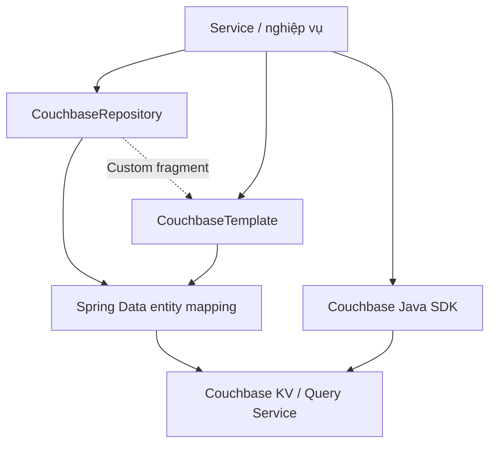

# Giới hạn của Repository và thời điểm chuyển sang Template

Trong chương **Repository** của **SPRING_DATA_COUCHBASE**, `CouchbaseRepository` là lựa chọn thuận tiện để tạo tầng truy cập dữ liệu theo domain: khai báo interface, kế thừa CRUD, thêm phương thức tìm kiếm theo tên và để Spring Data xử lý phần lớn mã lặp. Tuy nhiên, khi nghiệp vụ cần kiểm soát chi tiết **insert-only, CAS, TTL, câu SQL++ động, keyspace hoặc cách thực thi một thao tác**, chỉ khai báo phương thức repository có thể không còn là cách thể hiện rõ nhất.

Spring Data Couchbase còn cung cấp **`CouchbaseTemplate`** và **`ReactiveCouchbaseTemplate`**. Template là một API truy cập dữ liệu ở mức thấp hơn repository, nhưng **vẫn giữ các khả năng mapping entity của Spring Data**. Khi cần các tính năng KV hoặc SQL++ đặc biệt ngoài lớp trừu tượng Template đang dùng, ứng dụng có thể cân nhắc **Couchbase Java SDK**.

Điểm cốt lõi của bài học không phải “Repository yếu, Template mạnh”, mà là **chọn mức trừu tượng vừa đủ cho một yêu cầu cụ thể**, giữ cho nghiệp vụ dễ kiểm tra và tránh hiểu sai về tính nguyên tử, chỉ mục, nhất quán hoặc cách lưu document.

## 1. Mục tiêu học tập

Sau bài này, bạn có thể:

- Xác định **Repository đã giải quyết tốt những loại yêu cầu nào**, kể cả derived query, `@Query`, phân trang và repository fragment.
- Nhận biết những tình huống cần API tường minh hơn như **insert-only, upsert, replace có CAS, TTL, truy vấn SQL++ động, scope/collection linh hoạt**.
- Hiểu `CouchbaseTemplate` nằm giữa **Repository** và **Couchbase Java SDK** về mức độ trừu tượng.
- Dùng Template để thực hiện một thao tác tạo mới không cho ghi đè và tìm document theo entity mapping.
- Tổ chức một **custom repository fragment** để kết hợp tiện lợi của Repository với logic truy cập bằng Template.
- Phân biệt việc chuyển API với những bảo đảm khác như **transaction**, **optimistic locking**, **scan consistency** và **idempotency**.
- Đánh giá chi phí vận hành: truy cập theo key, index SQL++, query plan, batch, timeout và reactive.

## 2. Ba mức trừu tượng thường gặp



| Tiêu chí | Repository | CouchbaseTemplate | Couchbase Java SDK |
| --- | --- | --- | --- |
| Cách lập trình | Interface và phương thức khai báo | Lời gọi operations/fluent API | Lời gọi SDK trực tiếp |
| Entity mapping của Spring | Tích hợp mặc định | Tích hợp | Không tự dùng Spring mapping |
| CRUD theo ID | Rất phù hợp | Có | Có |
| Derived query | Có | Không phải mô hình interface suy diễn | Không |
| `@Query` | Có | Dùng API truy vấn riêng | `cluster.query`/`scope.query` |
| Điều khiển loại ghi | Có thể cần API khác để diễn đạt rõ | Các operations như insert/upsert/replace | `insert`, `upsert`, `replace` và tùy chọn SDK |
| Điều khiển TTL/CAS | Có khả năng thông qua mapping và API phù hợp, nhưng không phải mọi nhu cầu đều tiện | Linh hoạt hơn trong các operation được hỗ trợ | Tùy chọn KV chi tiết |
| Truy vấn điều kiện động | Custom fragment, query tùy chỉnh | Có API truy vấn theo entity | Tự xây dựng SQL++/tham số |
| Sub-document/lookup-in/mutate-in | Không phải mục tiêu chính của repository | Tùy API/phiên bản | SDK thường là lựa chọn trực tiếp |
| Transaction nhiều document | Chỉ khi operations tham gia transaction đúng cách | Chỉ khi operations tham gia transaction đúng cách | Transaction API rõ ngữ cảnh |
| Reactive | Reactive repository | Reactive template | Reactive SDK |

**Không có quy tắc “Template luôn nhanh hơn Repository”.** Hai API có thể dùng cùng hoạt động Couchbase ở bên dưới. Sự khác biệt nằm chủ yếu ở **quyền kiểm soát và cách biểu đạt ý định**; hiệu năng thật còn phụ thuộc KV hay SQL++, chỉ mục, số lượt mạng, payload, consistency và tải hệ thống.

## 3. Một tình huống xuyên suốt

Giả sử ứng dụng có bucket `appdata`, scope `sales` và collection `customers`. Mỗi khách hàng được gán document key:

```text
customer::<tenantId>::<customerCode>

Ví dụ:
customer::tenant-a::C102
```

Document có nội dung:

```json
{
  "tenantId": "tenant-a",
  "customerCode": "C102",
  "displayName": "Lan Anh",
  "status": "ACTIVE",
  "rewardPoints": 120
}
```

Các use case:

1. Lấy customer theo key, đổi tên và lưu.
2. Liệt kê customer ACTIVE theo tenant.
3. Tạo một customer mới nhưng **tuyệt đối không ghi đè** nếu key trùng.
4. Tìm kiếm theo nhiều bộ lọc tùy chọn hoặc sắp xếp do yêu cầu nghiệp vụ quy định.
5. Xóa document chỉ khi phiên bản được người dùng xem vẫn còn hợp lệ.
6. Lưu document với thời hạn TTL cụ thể hoặc tính toán khác nhau theo loại document.
7. Chuyển điểm giữa hai customer theo bất biến all-or-nothing.

Use case 1 và 2 thường đủ rõ bằng Repository. Những trường hợp còn lại có thể cần Template hoặc SDK, nhưng trường hợp 7 còn yêu cầu **transaction**, không thể được giải quyết chỉ bằng đổi tên API.

## 4. Entity và repository cơ bản

### 4.1. Document mapping

```java
package com.example.customer;

import org.springframework.data.annotation.Id;
import org.springframework.data.annotation.Version;
import org.springframework.data.couchbase.core.mapping.Collection;
import org.springframework.data.couchbase.core.mapping.Document;
import org.springframework.data.couchbase.core.mapping.Field;
import org.springframework.data.couchbase.core.mapping.Scope;

@Document
@Scope("sales")
@Collection("customers")
public class Customer {

    @Id
    private String id;

    @Field
    private String tenantId;

    @Field
    private String customerCode;

    @Field
    private String displayName;

    @Field
    private String status;

    @Field
    private long rewardPoints;

    @Version
    private Long version;

    public Customer() {
    }

    public Customer(
            String id,
            String tenantId,
            String customerCode,
            String displayName,
            String status,
            long rewardPoints) {
        this.id = id;
        this.tenantId = tenantId;
        this.customerCode = customerCode;
        this.displayName = displayName;
        this.status = status;
        this.rewardPoints = rewardPoints;
    }

    public String getId() { return id; }
    public void setId(String id) { this.id = id; }

    public String getTenantId() { return tenantId; }
    public void setTenantId(String tenantId) {
        this.tenantId = tenantId;
    }

    public String getCustomerCode() { return customerCode; }
    public void setCustomerCode(String customerCode) {
        this.customerCode = customerCode;
    }

    public String getDisplayName() { return displayName; }
    public void setDisplayName(String displayName) {
        this.displayName = displayName;
    }

    public String getStatus() { return status; }
    public void setStatus(String status) { this.status = status; }

    public long getRewardPoints() { return rewardPoints; }
    public void setRewardPoints(long rewardPoints) {
        this.rewardPoints = rewardPoints;
    }

    public Long getVersion() { return version; }
    public void setVersion(Long version) { this.version = version; }
}
```

- `@Id` là **document key**, không phải trường JSON `customerCode`.
- `@Scope`/`@Collection` chọn keyspace của entity; chúng không tự tạo scope và collection trên server.
- `@Version Long` giúp tích hợp optimistic locking dựa trên CAS khi Spring Data thực hiện thao tác ghi tương ứng. Không xem version là số thứ tự nghiệp vụ tăng 1 mỗi lần.
- Bucket `appdata` được cấu hình ở ứng dụng. Cùng chuỗi key có thể tồn tại độc lập trong hai collection khác nhau.

### 4.2. Repository cho thao tác thường dùng

```java
package com.example.customer;

import java.util.List;
import org.springframework.data.couchbase.repository.CouchbaseRepository;

public interface CustomerRepository
        extends CouchbaseRepository<Customer, String> {

    List<Customer> findByTenantIdAndStatus(
            String tenantId, String status);
}
```

Cách dùng:

```java
Customer customer = repository.findById(
        "customer::tenant-a::C102").orElseThrow();

customer.setDisplayName("Lan Anh Nguyễn");
Customer stored = repository.save(customer);

List<Customer> active =
        repository.findByTenantIdAndStatus(
                "tenant-a", "ACTIVE");
```

- `findById` theo **key hoàn chỉnh** thường đi qua KV.
- `save` dùng entity mapping và các quy tắc lưu, có thể liên quan trạng thái entity/`@Version`.
- `findByTenantIdAndStatus` là derived query theo JSON, thường thực thi bằng **SQL++**, cần index phù hợp.

Với các use case này, Repository mang lại API ngắn gọn và đủ ý nghĩa. **Không cần chuyển sang Template chỉ vì có hơn một điều kiện WHERE.**

## 5. Repository không chỉ có CRUD

Nhiều trường hợp thường bị xem nhầm là “giới hạn của Repository”, nhưng trên thực tế vẫn có lựa chọn ở tầng repository.

| Nhu cầu | Có thể giữ Repository bằng cách nào? |
| --- | --- |
| Tìm theo hai, ba trường JSON cố định | Derived query như `findByTenantIdAndStatus` |
| Tìm theo biểu thức SQL++ ổn định | `@Query` được tham số hóa |
| Kết quả nhiều document | `List<T>`, `Iterable<T>`, hoặc kiểu hỗ trợ phù hợp |
| Phân trang và sắp xếp | `Pageable`, `Sort` và kiểu kết quả được module/phiên bản hỗ trợ |
| Có/không có document theo key | `existsById` |
| Đếm theo điều kiện | `countBy...` nếu được module hỗ trợ |
| Một nhóm use case đặc thù | Custom repository fragment gọi Template bên trong |
| API bất đồng bộ | `ReactiveCouchbaseRepository` |

Chuyển ngay mọi truy vấn sang Template hoặc SDK có thể khiến ứng dụng mất lợi ích interface repository: ít mã lặp, các quy tắc mapping nhất quán, dễ mock interface ở service và dễ đọc ý định của phương thức.

### 5.1. `@Query` cho câu truy vấn SQL++ ổn định

Khi derived method dài hoặc điều kiện không diễn đạt tốt bằng tên phương thức, có thể dùng `@Query`:

```java
import java.util.List;
import org.springframework.data.couchbase.repository.Query;

public interface CustomerRepository
        extends CouchbaseRepository<Customer, String> {

    @Query(
        "#{#n1ql.selectEntity} " +
        "WHERE #{#n1ql.filter} " +
        "AND tenantId = $1 " +
        "AND status = $2"
    )
    List<Customer> findByTenantAndStatusQuery(
            String tenantId, String status);
}
```

Ví dụ dùng các macro Spring Data Couchbase `#{#n1ql.selectEntity}` và `#{#n1ql.filter}` để giữ các phần phục vụ entity mapping/type filter theo cú pháp mà phiên bản hỗ trợ. `$1` và `$2` là tham số được bind theo vị trí, tránh ghép dữ liệu người dùng vào SQL++.

**Không nhất thiết phải dùng Template chỉ để chạy một câu SQL++ cố định.** Nếu truy vấn phức tạp nhưng ổn định, `@Query` thường đủ rõ. Tuy nhiên, cần đối chiếu macro, placeholder và mapping return type với phiên bản Spring Data Couchbase đang dùng.

### 5.2. Khi Repository bắt đầu kém tự nhiên

Các dấu hiệu có thể cân nhắc Template:

- Số tổ hợp bộ lọc tăng nhanh: hàng chục phương thức `findBy...` khác nhau chỉ khác vài điều kiện tùy chọn.
- Một workflow cần lựa chọn **insert-only, replace-only, upsert** một cách tường minh.
- Phải cấu hình tùy chọn theo từng thao tác, ví dụ expiration/TTL hoặc điều kiện CAS.
- Cần thao tác thông qua entity mapping nhưng không muốn viết thêm nhiều repository methods chỉ để bao các biến thể.
- Nhu cầu truy vấn có nhiều nhánh động, projection, giới hạn hoặc sắp xếp do hệ thống kiểm soát.
- Cần một adapter thấp hơn Repository để gom logic đọc–ghi chuyên biệt và phục vụ kiểm thử tích hợp.

**Dấu hiệu chưa đủ để chuyển:** “Repository không hỗ trợ bất cứ query nào ngoài key” — nhận định đó sai. Repository vẫn có derived query và `@Query`.

## 6. Quy tắc quyết định: giữ Repository, dùng Template hay SDK?

| Câu hỏi | Lựa chọn ưu tiên | Lý do |
| --- | --- | --- |
| Đọc một entity theo ID | `repository.findById` | Thể hiện KV lookup rõ, trả `Optional` |
| Tìm danh sách theo bộ lọc cố định | Derived query | Ít mã, dễ hiểu |
| Query SQL++ phức tạp nhưng ổn định | `@Query` | Giữ interface repository, tham số hóa |
| Tìm kiếm với nhiều bộ lọc tùy chọn | Template/query object hoặc custom fragment | Dựng điều kiện linh hoạt hơn |
| Chỉ tạo mới, phải từ chối key trùng | Template insert-only hoặc SDK `insert` | Ngữ nghĩa thao tác rõ ràng ở thời điểm ghi |
| Cập nhật entity đọc trước đó với CAS | Repository `save` + `@Version` nếu phù hợp | Tận dụng optimistic locking và mapping |
| Ghi theo key với CAS/expiration đặc biệt | Template nếu API hỗ trợ; SDK nếu cần tùy chọn sâu hơn | Kiểm soát điều kiện và tùy chọn |
| Sub-document mutation, binary document, đặc tính SDK riêng | Couchbase Java SDK | Không ép abstraction không phù hợp |
| Xử lý nhiều document như một giao dịch | Transaction API hỗ trợ | Template hay Repository tự thân không tạo all-or-nothing |
| Cần cùng contract repository nhưng một phương thức đặc biệt | Repository fragment + Template/SDK bên trong | Giữ ranh giới dịch vụ ổn định |
| Pipeline reactive | Reactive repository hoặc reactive template | Không chặn thread, nhưng vẫn cần index/CAS/transaction |

Đây là hướng lựa chọn kiến trúc, không phải ma trận bảo đảm hiệu năng tuyệt đối. Hãy dựa vào **hành vi cần đạt** trước khi quyết định API.

## 7. Ví dụ chuyển sang Template: tạo mới không ghi đè

### 7.1. Vì sao `save` chưa truyền đạt đủ ý định?

Ví dụ:

```java
Customer newCustomer = new Customer(
        "customer::tenant-a::C205",
        "tenant-a",
        "C205",
        "Hà",
        "ACTIVE",
        0
);

repository.save(newCustomer);
```

`save` là phương thức lưu entity tổng quát. Đường ghi cụ thể có thể phụ thuộc trạng thái mới/cũ, `@Version` và phiên bản Spring Data; không nên coi nó là một API nghiệp vụ “chèn đúng một lần và tuyệt đối không overwrite”.

Nếu nghiệp vụ yêu cầu **không bao giờ ghi lên document mang key đã có**, chọn insert-only.

### 7.2. `CouchbaseTemplate.insertById`

```java
package com.example.customer;

import org.springframework.data.couchbase.core.CouchbaseTemplate;
import org.springframework.stereotype.Service;

@Service
public class CustomerCreationService {

    private final CouchbaseTemplate template;

    public CustomerCreationService(CouchbaseTemplate template) {
        this.template = template;
    }

    public Customer createOnly(Customer customer) {
        return template.insertById(Customer.class)
                .one(customer);
    }
}
```

Đường `insertById(Customer.class).one(customer)` thể hiện ý định **chỉ tạo nếu key chưa tồn tại** trong phạm vi collection ánh xạ của `Customer`. Nếu hai request cùng tạo một key, thao tác insert-only của Couchbase kiểm tra điều kiện tại thời điểm ghi; không chỉ dựa trên một `existsById` tách rời.

Điều này hữu ích cho customer, đơn hàng hoặc document nghiệp vụ có key định danh duy nhất. Khi có lỗi trùng key, tầng service nên ánh xạ sang lỗi nghiệp vụ rõ ràng, ví dụ HTTP `409 Conflict`; không nên âm thầm gọi upsert để “sửa lỗi”.

### 7.3. Vì sao tiền kiểm tồn tại không thay thế insert-only?

```java
// Không đủ để bảo đảm chỉ tạo mới khi có request đồng thời.
if (!repository.existsById(customer.getId())) {
    repository.save(customer);
}
```

Hai request có thể cùng thấy key chưa tồn tại, rồi cùng ghi. Lỗi này là **TOCTOU (time-of-check to time-of-use)**. Sử dụng Template không tự giải quyết mọi race condition, nhưng **chọn đúng operation insert-only** cung cấp điều kiện tồn tại được kiểm tra nguyên tử ở mutation của document.

## 8. Template vẫn sử dụng Spring Data mapping

`CouchbaseTemplate` không phải cách “bỏ qua repository để gửi JSON thô”. Nó làm việc với domain class và Spring Data mapping.

Ví dụ tìm một document theo key:

```java
import org.springframework.data.couchbase.core.CouchbaseTemplate;

public Customer loadCustomer(
        CouchbaseTemplate template,
        String key) {
    return template.findById(Customer.class)
            .one(key);
}
```

API fluent ở các bản Spring Data Couchbase hỗ trợ cú pháp trên sẽ đọc vào `Customer` theo mapping. **Cần kiểm tra hợp đồng trả về khi không tìm thấy**: không nên giả định method của Template trả `Optional<Customer>` giống hệt `repository.findById`; tầng service nên quy định cách chuyển kết quả “không tồn tại” thành `Optional` hoặc exception nghiệp vụ.

Những lợi ích mapping cần giữ:

- `@Id` vẫn định nghĩa document key.
- `@Scope`/`@Collection` vẫn điều khiển keyspace khi truy cập theo entity mapping.
- Converter của Spring Data xử lý ánh xạ các thuộc tính Java/JSON.
- Các annotation liên quan version/type mapping vẫn có ý nghĩa theo operation đang sử dụng.

Đừng trộn entity đã ánh xạ sang collection A với một thao tác SDK trực tiếp ở collection B rồi giả định Spring Data tự sửa namespace cho bạn.

## 9. Truy vấn động bằng Template và Query API

### 9.1. Tình huống tìm kiếm nhiều bộ lọc tùy chọn

Giả sử API cho phép lọc customer theo:

- `tenantId`: **bắt buộc** theo ngữ cảnh đã ủy quyền.
- `status`: tùy chọn.
- `displayName`: tùy chọn, có thể tìm theo tiền tố.
- `limit`: có giới hạn trên để tránh trả quá nhiều dữ liệu.

Nếu viết derived queries riêng cho mọi tổ hợp, interface có thể phình to. Template cho phép dựng điều kiện bằng các query/criteria API được phiên bản Spring Data hỗ trợ.

Ví dụ minh họa truy vấn khi tenant và status được xác định:

```java
import java.util.List;
import org.springframework.data.couchbase.core.CouchbaseTemplate;
import org.springframework.data.couchbase.core.query.Criteria;
import org.springframework.data.couchbase.core.query.Query;

public List<Customer> findActiveCustomers(
        CouchbaseTemplate template,
        String tenantId) {

    Criteria criteria = Criteria.where("tenantId")
            .is(tenantId)
            .and("status")
            .is("ACTIVE");

    Query query = Query.query(criteria);

    return template.findByQuery(Customer.class)
            .matching(query)
            .all();
}
```

Đoạn mã minh họa **fluent query API**, cần đối chiếu chữ ký `Query`/`Criteria` và các overload theo phiên bản Spring Data Couchbase được dùng. Trong dự án thật, thêm bộ lọc, sắp xếp và giới hạn bằng API truy vấn tương ứng. Quan trọng là **bộ lọc tenant luôn hiện diện**, ngay cả khi mọi bộ lọc khác đều tùy chọn.

Khi chỉ cần một query đơn giản và cố định như ví dụ, derived method `findByTenantIdAndStatus` vẫn có thể dễ hiểu hơn. Lý do chuyển sang Template xuất hiện khi **độ động của query** đủ lớn để việc khai báo nhiều method/`@Query` trở nên khó bảo trì.

### 9.2. Không xây SQL++ bằng cách nối input người dùng

Không nên:

```java
// Sai: có nguy cơ làm thay đổi cú pháp/truy vấn.
String sql = "SELECT c.* FROM customers c WHERE c.tenantId = '" +
        tenantFromRequest + "'";
```

Nếu cần SQL++ trực tiếp, bind **giá trị** bằng tham số và cố định **keyspace** theo cấu hình tin cậy. Ví dụ dùng Couchbase Java SDK cho một query không cần entity mapping:

```java
import com.couchbase.client.java.Cluster;
import com.couchbase.client.java.json.JsonObject;
import com.couchbase.client.java.query.QueryResult;

import static com.couchbase.client.java.query.QueryOptions.queryOptions;

// cluster đã được cấu hình và quản lý vòng đời.
QueryResult result = cluster.query(
        "SELECT META(c).id AS documentKey, c.displayName " +
        "FROM `appdata`.`sales`.`customers` AS c " +
        "WHERE c.tenantId = $tenantId AND c.status = $status",
        queryOptions().parameters(
                JsonObject.create()
                        .put("tenantId", "tenant-a")
                        .put("status", "ACTIVE")));
```

Đây là cách dùng SDK khi muốn kiểm soát một câu SQL++ trực tiếp; nó **không tự ánh xạ kết quả về `Customer` theo Spring Data**. Nếu muốn ánh xạ domain ở tầng Spring, ưu tiên các API Template/query tương ứng hoặc custom repository method.

Tên bucket/scope/collection thường không thể bind như một tham số giá trị. Nếu ứng dụng hỗ trợ chọn keyspace động, hãy kiểm soát bằng allowlist/configuration tin cậy, không dùng input thô đưa vào câu SQL++.

## 10. Duy trì interface Repository bằng custom fragment

Khi một vài thao tác cần Template, không nhất thiết chuyển **toàn bộ** customer service từ Repository sang Template. Có thể tạo **repository fragment** để bổ sung hành vi tùy chỉnh.

### 10.1. Interface fragment

```java
package com.example.customer;

import java.util.List;

public interface CustomerSearchFragment {

    List<Customer> searchActive(String tenantId);
}
```

### 10.2. Implementation gọi Template

```java
package com.example.customer;

import java.util.List;
import org.springframework.data.couchbase.core.CouchbaseTemplate;
import org.springframework.data.couchbase.core.query.Criteria;
import org.springframework.data.couchbase.core.query.Query;

public class CustomerSearchFragmentImpl
        implements CustomerSearchFragment {

    private final CouchbaseTemplate template;

    public CustomerSearchFragmentImpl(CouchbaseTemplate template) {
        this.template = template;
    }

    @Override
    public List<Customer> searchActive(String tenantId) {
        Query query = Query.query(
                Criteria.where("tenantId").is(tenantId)
                        .and("status").is("ACTIVE"));

        return template.findByQuery(Customer.class)
                .matching(query)
                .all();
    }
}
```

Spring Data repository fragment convention thường tìm implementation có tên dựa trên fragment interface kèm hậu tố `Impl` (tùy cấu hình): `CustomerSearchFragmentImpl` cho `CustomerSearchFragment`.

### 10.3. Repository kết hợp fragment

```java
package com.example.customer;

import org.springframework.data.couchbase.repository.CouchbaseRepository;

public interface CustomerRepository
        extends CouchbaseRepository<Customer, String>,
                CustomerSearchFragment {
}
```

Tầng service có thể gọi cùng một interface:

```java
Customer stored = repository.findById(key)
        .orElseThrow();

List<Customer> active =
        repository.searchActive("tenant-a");
```

Trong ví dụ này, `searchActive` vẫn khá đơn giản và có thể viết bằng derived query. Mục đích là minh họa **cách cấu trúc**; ứng dụng thật nên dùng fragment cho logic đủ phức tạp để việc tái sử dụng, kiểm thử và bảo trì có lợi.

Với các dự án đã tùy biến postfix hoặc có nhiều fragment implementation, kiểm tra cấu hình scan và bean naming theo Spring Data version để tránh hai implementation cạnh tranh.

## 11. CAS và cập nhật có điều kiện: Template không làm mất race condition

### 11.1. Optimistic locking qua repository

Nếu entity có `@Version Long`:

```java
Customer current = repository.findById(key)
        .orElseThrow();

current.setDisplayName("Tên mới");
Customer updated = repository.save(current);
```

Spring Data Couchbase có thể dùng CAS/version của entity để phát hiện xung đột khi lưu, tùy operation được hỗ trợ. Khi nhiều request cùng sửa một document, cần xử lý lỗi optimistic locking và **không retry mù quáng với version cũ**.

### 11.2. Khi cần điều kiện CAS rất cụ thể

Ví dụ nghiệp vụ “chỉ xóa customer nếu document vẫn là bản đã đọc và không đổi từ lúc duyệt”. SDK Couchbase cho phép truyền CAS:

```java
import com.couchbase.client.java.Collection;
import com.couchbase.client.java.kv.GetResult;

import static com.couchbase.client.java.kv.RemoveOptions.removeOptions;

public void removeIfUnchanged(
        Collection collection, String id) {

    GetResult current = collection.get(id);

    // Kiểm tra trạng thái hoặc điều kiện nghiệp vụ từ current.
    // Nếu không đủ điều kiện, không được gọi remove.

    collection.remove(
            id,
            removeOptions().cas(current.cas()));
}
```

Nếu document đổi sau `get`, thao tác `remove` với CAS cũ sẽ bị từ chối. Đây là điều kiện ghi **trên một document**, không bảo đảm all-or-nothing khi xóa hoặc cập nhật thêm document khác.

Khi Template hỗ trợ operation có điều kiện/CAS cần thiết, có thể dùng Template. Nếu API Template không phơi bày tùy chọn bạn cần, dùng SDK trực tiếp **trong một adapter riêng**, không cố dựng workaround dựa vào kiểm tra `existsById` rồi thao tác không có điều kiện.

### 11.3. Kiểm tra trước rồi ghi không phải giao dịch

```java
if (repository.existsById(id)) {
    // Một request khác vẫn có thể xóa/sửa id ở khoảng này.
    repository.save(changedCustomer);
}
```

Dù bước đọc thực hiện bằng Repository còn bước ghi dùng Template, chúng vẫn là **hai thao tác độc lập** trừ khi được phối hợp bằng transaction/điều kiện ghi thích hợp.

## 12. TTL: chọn đường API khi expiration là quyết định từng request

Có những loại document cần TTL cố định trong mapping, nhưng cũng có những tình huống expiration khác nhau theo request: session ngắn hạn, mã xác minh hoặc dữ liệu tạm.

Ví dụ lưu JSON bằng SDK với TTL 30 phút:

```java
import java.time.Duration;
import com.couchbase.client.java.Collection;
import com.couchbase.client.java.json.JsonObject;

import static com.couchbase.client.java.kv.UpsertOptions.upsertOptions;

public void putTemporaryDocument(
        Collection collection,
        String id,
        JsonObject body) {

    collection.upsert(
            id,
            body,
            upsertOptions().expiry(Duration.ofMinutes(30)));
}
```

SDK trong ví dụ cho phép biểu đạt trực tiếp expiration của mutation. Khi dùng Spring Data Couchbase, có thể có các annotation/tùy chọn expiry ở tầng mapping hoặc Template tùy phiên bản. Cần chọn đường API có khả năng biểu đạt **chính sách TTL thật sự** thay vì dựa vào giả định rằng mọi lời gọi `repository.save` luôn giữ expiration trước đó.

Cần phân biệt:

- **Insert**: key mới, chính sách TTL được áp dụng lúc tạo.
- **Update/replace/upsert**: expiration có thể thay đổi tùy API/tùy chọn và cấu hình; cần kiểm tra hành vi giữ hoặc đặt lại TTL.
- **Delete/hết hạn**: document không còn truy cập được, nhưng cách xóa không thay thế audit log.
- **Mutation SDK trực tiếp**: không tự thực hiện mọi converter hoặc annotation mapping của Spring Data.

Nếu cần vừa giữ Spring Data mapping vừa đặt TTL linh hoạt, hãy kiểm tra fluent operations của Template hiện dùng trước khi quyết định phải xuống SDK.

## 13. Scope và collection động: không chỉ là đổi một chuỗi

Một entity thường được ánh xạ đến keyspace thông qua `@Scope`/`@Collection`, ví dụ `sales.customers` trong bucket `appdata`. Repository chuẩn lý tưởng khi các document của một loại có điểm truy cập được xác định rõ.

Nếu hệ thống có nhiều scope/collection theo tenant hoặc theo loại dữ liệu, cần xác định:

1. **Chính sách chọn keyspace**: ai được phép truy cập scope/collection nào?
2. **Cách đặt document key**: key chỉ duy nhất trong collection, không duy nhất xuyên tất cả collection.
3. **Cấu hình operations/template/repository**: API nào hỗ trợ override hoặc ánh xạ theo ngữ cảnh trong Spring Data version hiện hành?
4. **Query index**: mỗi collection cần index phù hợp với workload của nó.
5. **Giao dịch**: những thao tác qua nhiều collection có thể cần transaction và đúng context.
6. **Quan sát và vận hành**: timeout, error rate, TTL và quyền có thể khác theo namespace.

**Không được ghép tên collection từ query parameter rồi đưa thẳng vào SQL++**. Nếu Template không hỗ trợ đúng cách định tuyến theo ngữ cảnh, có thể dùng các bean operations hoặc SDK collection được chọn qua một registry/allowlist đáng tin cậy.

Thay toàn bộ repository bằng Template chưa chắc giải quyết được mọi bài toán multi-tenant. Đôi khi thiết kế tốt hơn là **giữ một collection và dùng tenantId trong key/predicate**, hoặc chia collection theo yêu cầu vận hành đã được cân nhắc.

## 14. SQL++ và chỉ mục: chuyển API không bỏ được chi phí query

`findById` theo key thường là KV lookup, **không yêu cầu SQL++ secondary index**. Ngược lại:

```java
List<Customer> result =
        repository.findByTenantIdAndStatus(
                "tenant-a", "ACTIVE");
```

và một truy vấn tương ứng qua Template/SDK có thể cùng dùng **SQL++ Query Service** và cùng cần index.

Ví dụ chỉ mục cho truy vấn tenant + status:

```sql
CREATE INDEX ix_customers_tenant_status
ON `appdata`.`sales`.`customers`(
    tenantId,
    status
);
```

Câu SQL++ minh họa:

```sql
SELECT
    META(c).id AS documentKey,
    c.customerCode,
    c.displayName
FROM `appdata`.`sales`.`customers` AS c
WHERE c.tenantId = $tenantId
  AND c.status = $status;
```

Kiểm tra kế hoạch:

```sql
EXPLAIN
SELECT META(c).id, c.displayName
FROM `appdata`.`sales`.`customers` AS c
WHERE c.tenantId = "tenant-a"
  AND c.status = "ACTIVE";
```

Các câu hỏi cần quan sát:

- Query dùng index nào? Có quét quá rộng không?
- Có bước `Fetch` nhiều document khi chỉ muốn vài trường không?
- Có tính năng index covering hoặc index scan được tối ưu phù hợp không?
- ORDER BY/LIMIT có thể tận dụng index hay phải sort lớn?
- Request có yêu cầu scan consistency mạnh hơn mức mặc định không?

**Chuyển từ Repository sang Template không tự tạo index hoặc làm SQL++ thành KV.** Cần đo trên workload thực tế thay vì suy từ hình thức API.

### 14.1. Read-your-own-writes và scan consistency

Secondary index Couchbase có thể cập nhật bất đồng bộ so với KV mutation. Sau khi `save` thành công, `findById` theo key có thể thấy document, trong khi SQL++ query theo `status` ở mức `NOT_BOUNDED` chưa thấy ngay.

Nếu cần query phản ánh mutation mới, chọn cơ chế scan consistency phù hợp như `REQUEST_PLUS` hoặc nhất quán theo mutation state ở API/version hỗ trợ. Đây là **quyết định về query**, không phải lý do mặc định chuyển toàn bộ truy cập sang Template. Nếu Repository hỗ trợ cấu hình consistency cần thiết, vẫn có thể giữ Repository.

## 15. Đọc/ghi nhiều document: Template không tự có atomicity

Giả sử cần cộng điểm cho hai customer:

```java
Customer a = repository.findById(keyA).orElseThrow();
Customer b = repository.findById(keyB).orElseThrow();

a.setRewardPoints(a.getRewardPoints() + 10);
b.setRewardPoints(b.getRewardPoints() + 10);

repository.saveAll(List.of(a, b));
```

Nếu một mutation thành công còn mutation khác thất bại, không nên giả định `saveAll` sẽ tự rollback. Dùng Template để gọi hai operation tương ứng cũng **không tự tạo giao dịch**.

| Yêu cầu | Cách tiếp cận |
| --- | --- |
| Nhiều document độc lập, chấp nhận thành công một phần | Batch/loop có kết quả, retry và idempotency |
| Cập nhật hai document phải cùng commit | Couchbase transaction API được hỗ trợ |
| Xóa nhiều key, có thể bị lỗi giữa chừng | Batch có checkpoint và reconciliation |
| Tìm nhiều document theo điều kiện | SQL++ có index, phân trang, consistency phù hợp |
| Thao tác có side effect ngoài Couchbase | Outbox/saga hoặc quy trình phối hợp, không trông chờ transaction Couchbase bao trùm |

**Giới hạn ở đây là bảo đảm của workflow và datastore, không phải giới hạn riêng của Repository.** Transaction phải có đúng transaction manager/context và mọi operation cần tham gia context đó. Chỉ thêm `@Transactional` hoặc dùng Template không chứng minh tất cả API đã nằm trong cùng một giao dịch.

## 16. Lựa chọn reactive Repository hay Reactive Template

Khi ứng dụng dùng Spring WebFlux hoặc một pipeline bất đồng bộ, có thể chọn `ReactiveCouchbaseRepository` hoặc `ReactiveCouchbaseTemplate`.

Ví dụ repository reactive:

```java
package com.example.customer;

import org.springframework.data.couchbase.repository.ReactiveCouchbaseRepository;
import reactor.core.publisher.Flux;

public interface ReactiveCustomerRepository
        extends ReactiveCouchbaseRepository<Customer, String> {

    Flux<Customer> findByTenantIdAndStatus(
            String tenantId, String status);
}
```

Ví dụ một thao tác tạo mới qua Reactive Template:

```java
import org.springframework.data.couchbase.core.ReactiveCouchbaseTemplate;
import reactor.core.publisher.Mono;

public Mono<Customer> createOnlyReactive(
        ReactiveCouchbaseTemplate template,
        Customer customer) {

    return template.insertById(Customer.class)
            .one(customer);
}
```

Mỗi phương thức trả publisher; thao tác diễn ra theo quy tắc subscription của Reactor. `Mono<Customer>` thành công có thể phát một entity; lỗi trùng key, CAS hoặc lỗi kết nối đi theo tín hiệu lỗi. Không coi `Mono.empty()` và `onError` là một trường hợp.

Reactive Template thuận tiện khi muốn phối hợp query/operation linh hoạt trong pipeline, nhưng:

- Không tự loại bỏ chi phí SQL++ và index.
- Không tạo giao dịch nhiều document nếu không có context hỗ trợ.
- Không làm retry một mutation không idempotent trở nên an toàn.
- Không nên gọi `block()` tùy tiện trong event loop.
- Không nhất thiết nhanh hơn cho một lần đọc KV đơn lẻ; lợi ích thường đến từ mô hình điều phối tài nguyên và throughput phù hợp.

Khi ứng dụng có cả repository imperative/reactive, cần tách rõ các bean, luồng thực thi và transaction API để tránh vô tình chặn thread.

## 17. Kiến trúc kết hợp: Repository làm façade, Template ở adapter

Một kiến trúc hợp lý là giữ API domain rõ ràng, không để mọi service gọi trực tiếp Template hay SDK:

```text
CustomerController
       |
       v
CustomerService (quy tắc nghiệp vụ)
       |
       +------------------+
       |                  |
       v                  v
CustomerRepository   CustomerCustomWriter
(CRUD + query)       (Template / SDK)
       |                  |
       +---------+--------+
                 |
                 v
         Couchbase cluster
```

Ví dụ service phân tách use case:

```java
@Service
public class CustomerApplicationService {

    private final CustomerRepository repository;
    private final CustomerCreationService creation;

    public CustomerApplicationService(
            CustomerRepository repository,
            CustomerCreationService creation) {
        this.repository = repository;
        this.creation = creation;
    }

    public Customer get(String id) {
        return repository.findById(id).orElseThrow();
    }

    public Customer create(Customer customer) {
        return creation.createOnly(customer);
    }

    public List<Customer> findActive(String tenantId) {
        return repository.findByTenantIdAndStatus(
                tenantId, "ACTIVE");
    }
}
```

Để chạy ví dụ đầy đủ, thêm các import `java.util.List` và `org.springframework.stereotype.Service`. Chú ý service không tự đảm bảo người gọi được quyền truy cập tenant; kiểm tra phân quyền là ràng buộc bắt buộc ở tầng ứng dụng.

Lợi ích:

- Mỗi method phản ánh **nghiệp vụ**, không bắt service biết mọi tùy chọn Couchbase.
- Query thông thường vẫn gọn bằng Repository.
- Operation đặc biệt được gom về một adapter có thể kiểm thử tích hợp riêng.
- Khi thay đổi quyết định implementation từ Template sang SDK, contract service ít bị ảnh hưởng.
- Dễ giám sát những thao tác nhạy cảm: insert-only, CAS, TTL, xóa theo điều kiện và query chi phí lớn.

## 18. Những hiểu lầm dễ gặp

| Nhận định sai | Thực tế nên hiểu |
| --- | --- |
| “Repository chỉ làm CRUD; có WHERE phải dùng Template” | Derived query và `@Query` có thể xử lý nhiều điều kiện |
| “Template luôn nhanh hơn Repository” | Phụ thuộc operation, index, consistency, mạng và payload |
| “Template dùng JSON thô nên bỏ mọi mapping” | `CouchbaseTemplate` vẫn tích hợp Spring Data mapping |
| “`save` chắc chắn là insert-only” | Ngữ nghĩa ghi còn tùy entity state/`@Version`/implementation |
| “`existsById` rồi `save` tránh được ghi trùng” | Hai bước có TOCTOU; dùng insert-only nếu yêu cầu không ghi đè |
| “Chuyển sang Template giúp query không cần index” | SQL++ vẫn cần con đường index phù hợp |
| “Template tự xử lý atomic batch” | Không; transaction riêng khi nghiệp vụ yêu cầu all-or-nothing |
| “`@Version` tạo transaction nhiều document” | CAS chỉ bảo vệ điều kiện ghi từng document |
| “SDK tự áp dụng `@Document`/`@Collection`” | SDK không tự dùng Spring Data entity converter/mapping |
| “Reactive Template làm mọi query không còn timeout” | Vẫn có timeout, tải, consistency và retry |
| “Một collection cho mỗi tenant luôn tốt hơn” | Cần đánh giá isolation, quyền, số collection/index và vận hành |
| “Chỉ cần đổi API là sửa được lost update” | Phải chọn CAS/transaction/idempotency đúng yêu cầu |

## 19. Kiểm thử khi chuyển một operation sang Template

### 19.1. Kiểm tra đúng ngữ nghĩa ghi

Với thao tác create-only:

1. Tạo `Customer` với một key chưa tồn tại, gọi `template.insertById(...).one(...)`.
2. Xác minh document tồn tại ở đúng scope/collection và có dữ liệu được ánh xạ.
3. Gọi lại insert-only với cùng key nhưng tên khác.
4. Xác minh request thứ hai **bị từ chối vì key trùng**, và document ban đầu không bị ghi đè.
5. So sánh với hành vi `repository.save` trên entity mới/cũ và với version được quản lý.

Không xem việc “method không ném exception” là bằng chứng duy nhất. Phải đọc lại document và kiểm tra dữ liệu cuối.

### 19.2. Kiểm tra truy vấn động

- Bắt buộc tenant từ ngữ cảnh đã ủy quyền, không dựa hoàn toàn vào query param.
- Thử các tổ hợp filter có/không có status, tên, ngày tạo.
- Đảm bảo query không mở rộng ra ngoài tenant nếu một filter tùy chọn bị bỏ trống.
- Chạy `EXPLAIN` trên câu SQL++ thực tế với dữ liệu đại diện.
- Kiểm tra chỉ mục, pagination, ORDER BY, projection và giới hạn kết quả.
- Quan sát scan consistency sau khi vừa ghi một document qua KV.

### 19.3. Kiểm tra CAS, TTL và lỗi

- Hai request cùng đọc một version, request A ghi trước, request B ghi với CAS cũ phải theo chính sách xung đột.
- Tạo document với TTL ngắn trong môi trường test và quan sát thời điểm không còn truy cập được.
- Thử timeout hoặc mất kết nối sau mutation: không suy rằng ghi chắc chắn thất bại.
- Đảm bảo duplicate key, CAS mismatch, index missing và permission denied được phân loại, không trả `Optional.empty()` hoặc số `0` giả.
- Với reactive, xác minh tín hiệu `onNext`/`onComplete`/`onError` và không vô tình thực thi mutation hai lần khi resubscribe/retry.

### 19.4. Kiểm tra tính nhất quán khi kết hợp nhiều operation

Nếu workflow gồm tạo document A, cập nhật B và gửi event ra hệ thống ngoài, hãy thử lỗi ở từng bước. Việc một thao tác được chuyển sang Template **không** đồng nghĩa toàn workflow có rollback. Cần kiểm tra transaction scope, idempotency key, outbox hoặc cơ chế đối soát phù hợp.

## 20. Bài thực hành

Chuẩn bị một ứng dụng Spring Boot thử nghiệm, bucket `appdata`, scope `sales` và collection `customers`.

| Bài tập | Yêu cầu | Lựa chọn API cần giải thích |
| --- | --- | --- |
| 1 | Đọc `customer::tenant-a::C102` theo key | Repository `findById` |
| 2 | Tìm customer ACTIVE của tenant A | Derived query |
| 3 | Tìm customer ACTIVE có thêm bộ lọc tên tùy chọn | Template query hoặc custom fragment khi đủ phức tạp |
| 4 | Tạo C205 mới, phải từ chối key trùng | Template `insertById` |
| 5 | Cập nhật tên customer có phát hiện mất cập nhật | `@Version` với Repository `save` hoặc CAS operation phù hợp |
| 6 | Tạo document tạm hết hạn sau 30 phút | Template option hoặc SDK expiry theo API hỗ trợ |
| 7 | Xóa chỉ khi CAS còn khớp | Template nếu có option phù hợp, hoặc SDK `remove` có CAS |
| 8 | Tìm theo JSON sau khi vừa ghi KV | Kiểm tra SQL++ index/scan consistency |
| 9 | Chuyển điểm giữa hai customer như một giao dịch | Transaction API được hỗ trợ |
| 10 | Triển khai một phương thức tìm kiếm đặc biệt mà vẫn giữ interface Repository | Custom fragment + Template |

Sau mỗi bài tập, trả lời:

1. Vì sao mức trừu tượng được chọn là phù hợp?
2. Nếu thay API, **bảo đảm nghiệp vụ có thay đổi không**?
3. Phạm vi bucket/scope/collection đã được ràng buộc đúng chưa?
4. Đã có index thích hợp cho SQL++ chưa?
5. Có race condition giữa bước đọc và ghi không?
6. Nếu nhận timeout, có thể xác minh trạng thái cuối bằng cách nào?
7. Điều gì xảy ra khi chạy hai request cùng lúc?
8. Kiểm thử nào chứng minh operation không ghi đè/không xóa nhầm?

Chỉ thực hiện trên dữ liệu thử nghiệm có thể tạo lại. Không dùng lệnh xóa diện rộng hay sửa cấu hình TTL trên dữ liệu vận hành thật chỉ để quan sát hành vi.

## 21. Câu hỏi tự kiểm tra

1. Vì sao `findByTenantIdAndStatus` không nhất thiết phải được viết lại bằng `CouchbaseTemplate`?
2. Khác biệt giữa `@Query` trên Repository và câu SQL++ dựng động trong code là gì?
3. Khi nào `insertById` có ý nghĩa nghiệp vụ khác `save`?
4. Vì sao `existsById` trước `save` không đảm bảo tạo đúng một lần?
5. `CouchbaseTemplate` có còn dùng `@Id`, `@Scope` và `@Collection` không?
6. Nếu query SQL++ thiếu index, chuyển từ Repository sang Template có làm query chạy được không?
7. Khi cần CAS để xóa một document, vì sao đọc trước rồi `deleteById` chưa đủ?
8. Template và SDK khác nhau như thế nào về mapping Spring Data và tùy chọn KV?
9. Custom repository fragment giúp tránh việc gì khi chỉ một vài use case cần Template?
10. TTL có thể bị ảnh hưởng như thế nào khi chọn insert/upsert/replace?
11. Vì sao hai lệnh ghi trong cùng method không trở thành transaction chỉ vì dùng chung Template?
12. Khi nào nên dùng ReactiveCouchbaseTemplate thay vì ReactiveCouchbaseRepository?
13. Nếu hệ thống có nhiều scope/collection, có thể ghép tên collection từ request vào SQL++ trực tiếp không?
14. Một service có nên biết toàn bộ lựa chọn SDK và index của Couchbase hay đặt chúng trong adapter?

## 22. Ghi nhớ

**Repository là lựa chọn mặc định tốt cho CRUD và truy vấn khai báo; Template là lựa chọn khi cần biểu đạt thao tác lưu trữ chi tiết hơn; SDK là lựa chọn khi cần tính năng thấp hơn mà Template chưa phơi bày.** Không cần bỏ Repository chỉ vì một truy vấn phức tạp: hãy cân nhắc `@Query`, derived query hoặc custom fragment trước.

Khi chuyển từ `CouchbaseRepository` sang `CouchbaseTemplate`, hãy xác định rõ **operation thực sự**, document key, bucket/scope/collection, quy tắc CAS, TTL và cách xử lý lỗi. Chuyển API **không tự thay đổi** tính nguyên tử nhiều document, scan consistency, yêu cầu SQL++ index hay khả năng retry an toàn. Một tầng truy cập dữ liệu tốt là tầng chọn đúng công cụ cho từng nghiệp vụ, giữ contract rõ ràng và được kiểm chứng bằng integration test ở môi trường Couchbase đại diện.
