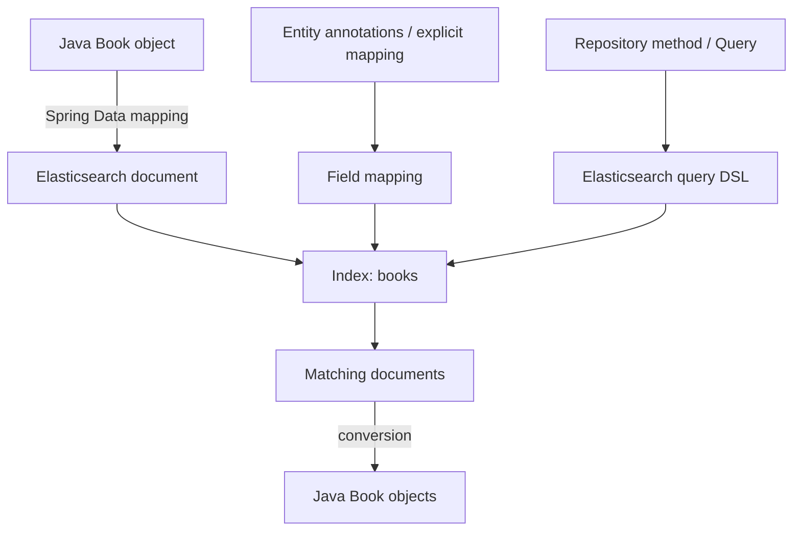

# Document, Index, Mapping, Query, and Repository in One Unified Model

Spring Data Elasticsearch helps Java applications work with Elasticsearch through familiar Spring Data concepts: entities, repositories, queries, and data conversion. However, to use it properly, you first need to understand Elasticsearch's core concepts. A Java object is stored as a document; the document belongs to an index; a mapping describes how each field is indexed and queried; a query defines the set of documents to find; and a repository is the API layer the application uses to perform those operations.

These concepts connect into a unified model. A repository does not replace an index or mapping, and entity annotations do not turn Elasticsearch into a relational database. Spring Data provides the abstraction layer and mapping mechanism; Elasticsearch still determines how data is stored, analyzed, indexed, and searched.

## 1. Looking at the whole model before diving into each component

Suppose an application manages a book catalog. A book has an identifier, title, author, publication date, and price. The application needs to save books, search by title, filter by author, and sort by publication date.

The model can be visualized as follows:



| Component | Meaning | Question it answers |
|---|---|---|
| Document | An independent JSON record | What does a single book's data look like? |
| Index | A collection of documents with a shared search purpose | Where are documents stored and searched? |
| Mapping | Defines the type and handling of each field | Which fields are text, numbers, dates, or identifiers? |
| Query | Conditions and rules for finding documents | Which documents need to be found? |
| Repository | Data access API at the application layer | How does Java code invoke save and search operations? |

For example, `Book` is a Java type, a `Book` instance is an in-memory object, and a document is the JSON representation of that instance inside Elasticsearch. Many book documents are stored in the `books` index. The mapping specifies that `title` is an analyzable text field, `price` is a number, and `publishedAt` is a date. The repository provides the `findByAuthor` method, and Spring Data translates that call into the appropriate Elasticsearch query.

## 2. Document: the searchable unit of data

A document is the basic unit of data that Elasticsearch indexes and returns in search results. In terms of content, a document is a JSON structure consisting of fields and values. It typically corresponds to a business object that the application wants to search independently, such as a product, article, customer profile, or book.

Example of a book document:

```json
{
  "id": "book-1001",
  "title": "Spring Data in Practice",
  "author": "Nguyen An",
  "price": 185000,
  "publishedAt": "2025-04-12",
  "tags": ["java", "spring", "search"]
}
```

A document has a unique identifier within the scope of an index, commonly referred to as `_id`. When writing a document, the application can supply an ID to update or replace the exact document later. If no ID is supplied, Elasticsearch can auto-generate one. In business applications, application-managed IDs generally make data synchronization and cross-referencing clearer.

A document can contain nested objects and arrays. For example, a product can have a `manufacturer` containing `name` and `country`, or a list of `variants`. A flexible JSON structure allows rich data representation, though field types and query behavior remain governed by the mapping.

### 2.1 Mapping a document to a Java entity

Spring Data Elasticsearch lets you describe a document using a Java class. The `@Document` annotation marks a class as mapped to an index. The `@Id` annotation marks the property used as the document identifier.

```java
import java.time.LocalDate;
import java.util.List;

import org.springframework.data.annotation.Id;
import org.springframework.data.elasticsearch.annotations.Document;
import org.springframework.data.elasticsearch.annotations.Field;
import org.springframework.data.elasticsearch.annotations.FieldType;

@Document(indexName = "books")
public class Book {

    @Id
    private String id;

    @Field(type = FieldType.Text)
    private String title;

    @Field(type = FieldType.Keyword)
    private String author;

    @Field(type = FieldType.Double)
    private Double price;

    @Field(type = FieldType.Date, pattern = "uuuu-MM-dd")
    private LocalDate publishedAt;

    @Field(type = FieldType.Keyword)
    private List<String> tags;

    protected Book() {
    }

    public Book(String id, String title, String author,
                Double price, LocalDate publishedAt, List<String> tags) {
        this.id = id;
        this.title = title;
        this.author = author;
        this.price = price;
        this.publishedAt = publishedAt;
        this.tags = tags;
    }

    public String getId() { return id; }
    public String getTitle() { return title; }
    public String getAuthor() { return author; }
    public Double getPrice() { return price; }
    public LocalDate getPublishedAt() { return publishedAt; }
    public List<String> getTags() { return tags; }
}
```

In this example:

- `@Document(indexName = "books")` binds the `Book` class to the `books` index.
- `@Id` binds the `id` property to the `_id` document identifier.
- `@Field` provides Elasticsearch type metadata for each property.
- Spring Data uses mapping metadata and converters to translate between Java objects and document data.

The Java property name is typically used as the document field name unless another field name is configured. You can specify an explicit field name via the `name` attribute of `@Field`, such as `@Field(name = "published_at", type = FieldType.Date)`. When renaming fields, ensure that the mapping, queries, and existing data all follow the same convention.

An entity does not need to include every internal Elasticsearch metadata field. For example, `_index`, `_score`, or pagination details normally belong to search results or dedicated response classes rather than properties of the domain document.

## 3. Index: the container for documents

An index is a collection of documents managed and searched as a single unit. In the example above, `books` is the index holding book documents. An index has a name, settings, and mappings. Settings configure characteristics such as the number of shards, number of replicas, and default analyzers; mappings define the structure and data types of fields.

Do not treat an index as completely identical to an SQL table. An index is a structure designed for distributed search and analytics. An index can be divided into multiple primary shards; each shard is an independent Lucene index. Replica shards can increase fault tolerance and serve read load. Sharding affects operations, data distribution, and performance, though repository users generally do not manipulate shards manually in every query.

### 3.1 Declaring an index in Spring Data

`@Document(indexName = "books")` tells Spring Data which index is associated with the entity. This annotation is application-side metadata. Depending on the version configuration and index initialization approach, Spring Data can help create the index and mapping from entity metadata. In production deployments, you should explicitly decide who is responsible for creating indices, applying settings, and managing mapping changes.

You can configure several options on `@Document`, for example:

```java
@Document(
    indexName = "books",
    createIndex = false
)
public class Book {
    // fields
}
```

Setting `createIndex = false` indicates that the application does not ask Spring Data to auto-create the index from annotations. This is useful when indices are managed by deployment infrastructure or separate migrations. Specific attribute names and capabilities can vary across Spring Data Elasticsearch versions, so verify the exact API for the Spring Boot version in use.

### 3.2 Creating an index and inspecting mappings

When explicit index control is needed, you can create an index via Elasticsearch's administration APIs or Spring Data's `IndexOperations`. Illustrative example with `ElasticsearchOperations`:

```java
import org.springframework.data.elasticsearch.core.ElasticsearchOperations;
import org.springframework.data.elasticsearch.core.IndexOperations;

public class BookIndexInitializer {

    private final ElasticsearchOperations operations;

    public BookIndexInitializer(ElasticsearchOperations operations) {
        this.operations = operations;
    }

    public void createIndexIfMissing() {
        IndexOperations indexOps = operations.indexOps(Book.class);

        if (!indexOps.exists()) {
            indexOps.create();
            indexOps.putMapping(indexOps.createMapping());
        }
    }
}
```

This is an example of an operational flow, not a complete migration mechanism. In a real application, you must handle concurrency when multiple instances start simultaneously, control index creation permissions, apply settings prior to creation, and define behavior when an index already exists with an incompatible mapping. Avoid letting every application startup arbitrarily alter the structure of an index holding critical data.

Useful inspection commands in Elasticsearch:

```http
GET /books
GET /books/_mapping
GET /books/_settings
GET /books/_doc/book-1001
```

`GET /books/_mapping` shows how Elasticsearch currently understands the fields. This is more reliable evidence than reading Java annotations alone, because an index may have been created earlier or its live mapping may be managed independently.

## 4. Mapping: the contract for field types and search behavior

A mapping describes how Elasticsearch stores and indexes document fields. The mapping decides whether a field is `text`, `keyword`, `date`, `integer`, `long`, `double`, `boolean`, `object`, `nested`, or another specialized type. This choice directly affects how data is searched, filtered, sorted, and aggregated.

An illustrative mapping for the `books` index:

```json
{
  "mappings": {
    "properties": {
      "title": {
        "type": "text",
        "fields": {
          "keyword": {
            "type": "keyword"
          }
        }
      },
      "author": {
        "type": "keyword"
      },
      "price": {
        "type": "double"
      },
      "publishedAt": {
        "type": "date",
        "format": "uuuu-MM-dd||strict_date_optional_time"
      },
      "tags": {
        "type": "keyword"
      }
    }
  }
}
```

### 4.1 `text` and `keyword` solve two different needs

This is the most important distinction when designing mappings for string data.

`text` is typically used for content requiring full-text search. When indexing a text value, an analyzer can normalize and split content into tokens. For example, the title `Spring Data Elasticsearch` can be analyzed into tokens for word-level querying. Therefore, `text` is suitable for content search, but usually unsuitable for direct sorting or aggregations.

`keyword` stores a string as an unsplit value for exact matching, filtering, sorting, and aggregations. It fits codes, statuses, identifiers, labels, or categorical values. For instance, `author = "Nguyen An"` can be filtered as an exact value.

When a field needs both full-text search and exact filtering/sorting, you can use a multi-field:

```json
"title": {
  "type": "text",
  "fields": {
    "keyword": { "type": "keyword" }
  }
}
```

You can then search content via `title`, while sorting or aggregating via `title.keyword` (provided mapping and size limits are appropriate). The name `keyword` here is a designer-chosen sub-field name, not a mandatory keyword syntax.

### 4.2 Numeric, date, and boolean types

Numeric fields should use the numeric type suited to the value domain and required operations. `integer` fits 32-bit integers; `long` covers a larger range; `float` and `double` handle floating-point numbers; `scaled_float` can suit decimal values stored with a scaling factor. For monetary values, determine required precision and rounding rules; do not pick a numeric type based solely on the Java type while ignoring business requirements.

Date fields are normalized by Elasticsearch to support range filtering and chronological sorting. Align date formats, time zones, and conversions across `Instant`, `LocalDate`, `LocalDateTime`, or corresponding Java types. A calendar date (`LocalDate`) has no time zone; an instant (`Instant`) represents an absolute point on the timeline.

Boolean represents true/false state. If an attribute may be unset, distinguish between `false` and `null` and define how queries should handle both cases.

### 4.3 `object` and `nested`

An `object` field lets a document contain sub-structures. However, Elasticsearch generally flattens object fields during indexing. This can produce false matches when an object contains an array of sub-objects and a query needs to preserve the relationship between fields within the same element.

Example order document:

```json
{
  "items": [
    { "product": "A", "color": "red" },
    { "product": "B", "color": "blue" }
  ]
}
```

With standard object mapping, simultaneously querying `items.product = A` and `items.color = blue` can match because the values are indexed independently, even though no element is both product A and blue. The `nested` type stores each array element object as a separate internal document, allowing queries to preserve the relationship between fields of the same element. On the other hand, nested queries and nested aggregations are more complex and resource-intensive.

In Spring Data, you can describe a nested field with the corresponding metadata, such as `@Field(type = FieldType.Nested)`. Choose `nested` only when query requirements genuinely need to preserve relationships within individual sub-objects.

### 4.4 Dynamic mapping and data type risks

If a field is not declared in the mapping, Elasticsearch may infer its type upon receiving a new document, depending on dynamic mapping settings. This is convenient during experimentation but carries risk: an initial value may cause Elasticsearch to pick a type unsuitable for later data. For example, a code field first indexed as a number will fail or misbehave if subsequent codes contain leading zeros or letters.

For data with a stable structure, define mappings intentionally and control dynamic fields. You can configure `dynamic` at the mapping or object level to allow, reject, or only store undeclared fields under an appropriate policy. Before applying it, understand the impact on searchability and storage for unknown fields.

### 4.5 Mapping is not a schema whose types can be changed arbitrarily

Mappings can be extended in many cases, such as adding new fields, but you generally cannot directly change the type of a field that has already been indexed under an old type. If `price` is currently `keyword` and needs to become `double`, the standard safe approach is to create a new index with the right mapping, reindex the data, verify results, and then switch the alias or read/write traffic to the new index.

Changing a mapping should be treated like a data migration:

1. Identify the current mapping and actual live data.
2. Design the target mapping, including analyzers, multi-fields, and `nested` if needed.
3. Create a new index with the target settings and mapping.
4. Reindex or transform data from the old index.
5. Verify document counts, field values, and key queries.
6. Switch the application or alias to the new index.
7. Delete the old index only after a rollback plan is in place and safety is confirmed.

## 5. Query: expressing search conditions

Elasticsearch provides a JSON-based Query DSL. A query can search text, filter exact values, filter ranges, combine multiple conditions, sort, and paginate.

Example finding books whose title contains content related to Spring:

```json
GET /books/_search
{
  "query": {
    "match": {
      "title": "spring data"
    }
  }
}
```

`match` is typically used for `text` fields because the query string is analyzed using the corresponding analyzer. This query performs a content search and does not require the entire string to equal `spring data` verbatim.

To filter by exact author and cap the price:

```json
GET /books/_search
{
  "query": {
    "bool": {
      "filter": [
        { "term": { "author": "Nguyen An" } },
        { "range": { "price": { "lte": 200000 } } }
      ]
    }
  },
  "sort": [
    { "publishedAt": { "order": "desc" } }
  ]
}
```

`term` matches exact values and typically fits `keyword`, numeric, boolean, or date fields. Do not use `term` on a `text` field expecting it to analyze text automatically. `range` handles greater-than, less-than, or interval conditions. `bool` combines conditions across `must`, `filter`, `should`, and `must_not` clauses.

### 5.1 `must`, `filter`, `should`, and `must_not`

- `must`: condition must match and can contribute to the `_score` relevance score.
- `filter`: condition must match without computing relevance scores; suited for structural constraints like status, author, or price range.
- `should`: optional condition or score-boosting condition; whether it is required depends on the bool structure and `minimum_should_match`.
- `must_not`: excludes documents matching the condition from results.

Separating filter conditions from text search conditions clarifies query intent. For instance, when a user searches for books related to `spring` by a specific author, the content part can go in `must`, while author and price range go in `filter`.

### 5.2 Pagination and sorting

Search queries usually need to limit the number of results. Query DSL supports `from` and `size` for offset pagination:

```json
GET /books/_search
{
  "from": 20,
  "size": 10,
  "query": { "match_all": {} },
  "sort": [
    { "publishedAt": "desc" },
    { "_id": "asc" }
  ]
}
```

Adding a secondary sort criterion keeps ordering stable when multiple documents share the same `publishedAt` value. However, deep offsets can be resource-intensive because Elasticsearch must process preceding results. For large result sets or deep scrolling, consider `search_after` with a stable sort; for workflows requiring a consistent snapshot, you can combine Point in Time depending on your Elasticsearch version.

### 5.3 Relevance and `_score`

Full-text search typically ranks results by relevance. Elasticsearch computes `_score` based on query type, content, and index statistics. Therefore, two documents satisfying the same condition may appear in different positions. When queries serve user-facing search, examine analyzers, keywords, searched fields, and how conditions are combined; do not assume results are sorted by time or ID by default.

## 6. Repository: the application-layer API

Spring Data Elasticsearch provides a repository abstraction similar to other Spring Data modules. Repositories let applications operate on entities without writing full HTTP requests or Query DSL manually for common operations.

Example repository declaration:

```java
import java.util.List;

import org.springframework.data.elasticsearch.repository.ElasticsearchRepository;

public interface BookRepository extends ElasticsearchRepository<Book, String> {

    List<Book> findByAuthor(String author);

    List<Book> findByPriceLessThanEqual(Double maxPrice);

    List<Book> findByAuthorAndPriceLessThanEqual(
        String author,
        Double maxPrice
    );
}
```

`ElasticsearchRepository<Book, String>` specifies that the repository manages the `Book` entity with a `String` ID type. Spring Data generates the implementation at runtime based on the repository interface and infrastructure configuration.

Inherited methods provide save, delete, find-by-ID, and list retrieval operations. Derived query methods such as `findByAuthor` are parsed by Spring Data from the method name to generate the corresponding query. The expressive power of derived queries is limited; for complex queries, use query annotations or lower-level query APIs.

### 6.1 Using a repository in a service

```java
import java.util.List;

import org.springframework.stereotype.Service;
import org.springframework.transaction.annotation.Transactional;

@Service
public class BookService {

    private final BookRepository repository;

    public BookService(BookRepository repository) {
        this.repository = repository;
    }

    public Book getById(String id) {
        return repository.findById(id)
            .orElseThrow(() -> new IllegalArgumentException(
                "Book not found: " + id
            ));
    }

    public List<Book> findByAuthor(String author) {
        return repository.findByAuthor(author);
    }

    public Book save(Book book) {
        return repository.save(book);
    }

    public void delete(String id) {
        repository.deleteById(id);
    }
}
```

This is a simple usage example illustrating the repository's role. Real-world applications should use domain-appropriate exceptions and responses, validate inputs, and explicitly decide behavior when a document does not exist. `@Transactional` in the imports does not imply that Elasticsearch provides multi-document transactions like a relational database; understand Elasticsearch's transaction limitations and Spring Data's support before applying this annotation to business logic.

### 6.2 Derived queries from method names

Common method names:

```java
List<Book> findByAuthor(String author);

List<Book> findByPriceBetween(Double min, Double max);

List<Book> findByPublishedAtAfter(LocalDate date);

List<Book> findByTitleContaining(String words);

long countByAuthor(String author);

boolean existsById(String id);
```

Method names must be supported by the parser and query creator of the Spring Data Elasticsearch version in use. Method naming syntax looks similar to other Spring Data repositories, yet search semantics still depend on the Elasticsearch mapping. For instance, searching substrings on a `text` field and exact matching on a `keyword` field are two distinct needs. Do not assume keywords like `Containing`, `StartingWith`, or `IgnoreCase` always generate the exact query type you expect without checking the version's documentation and the generated query.

When pagination is needed, you can pass `Pageable` to supported repository methods:

```java
import org.springframework.data.domain.Page;
import org.springframework.data.domain.Pageable;

Page<Book> findByAuthor(String author, Pageable pageable);
```

For large search results, evaluate Elasticsearch pagination limits and consider a cursor/search-after pattern rather than creating very deep offset pages.

### 6.3 Explicit queries

For straightforward custom queries, you can use `@Query` to declare an Elasticsearch query directly. The example below illustrates writing a JSON query in a repository:

```java
import java.util.List;

import org.springframework.data.elasticsearch.annotations.Query;
import org.springframework.data.elasticsearch.repository.ElasticsearchRepository;

public interface BookRepository extends ElasticsearchRepository<Book, String> {

    @Query("{\"match\": {\"title\": {\"query\": \"?0\"}}}")
    List<Book> searchTitle(String text);
}
```

`?0` references the first parameter according to Spring Data's query annotation convention. Verify the exact parameter binding and query syntax for your active version. Avoid manually concatenating user input strings into JSON queries; use framework-supported parameter binding to prevent escaping bugs and query-layer injection risks.

### 6.4 When to use `ElasticsearchOperations`

Repositories suit CRUD and queries with stable structure. When you need to build dynamic queries, combine multiple query types, use aggregations, highlights, projections, or exercise fine-grained control over requests/responses, `ElasticsearchOperations` provides a more flexible API.

Illustrative example using `NativeQuery` in modern Spring Data Elasticsearch versions:

```java
import java.util.List;

import org.springframework.data.elasticsearch.client.elc.NativeQuery;
import org.springframework.data.elasticsearch.core.ElasticsearchOperations;
import org.springframework.data.elasticsearch.core.SearchHits;
import org.springframework.data.elasticsearch.core.query.Query;

public class BookSearchService {

    private final ElasticsearchOperations operations;

    public BookSearchService(ElasticsearchOperations operations) {
        this.operations = operations;
    }

    public List<Book> searchTitle(String phrase) {
        Query query = NativeQuery.builder()
            .withQuery(q -> q.match(m -> m
                .field("title")
                .query(phrase)
            ))
            .build();

        SearchHits<Book> hits = operations.search(query, Book.class);

        return hits.getSearchHits().stream()
            .map(hit -> hit.getContent())
            .toList();
    }
}
```

Specific client APIs and builders vary across Spring Data Elasticsearch generations. The example above reflects the modern Elasticsearch Java client API style; if your project uses an older version, packages or builders may differ. Always use the dependency versions managed by Spring Boot and consult the corresponding Javadoc rather than copying examples from another version.

## 7. Write and read flows: how do the components work together?

### 7.1 Document write flow

When the application calls `repository.save(book)`, the general steps are as follows:

1. Spring Data receives the `Book` entity and reads metadata from `@Document`, `@Id`, and `@Field`.
2. The mapping converter transforms the Java object into document data.
3. Spring Data sends an index operation to Elasticsearch, determining the target index from entity metadata.
4. Elasticsearch validates and applies the index mapping, then writes the document.
5. The result is converted back into a Java object according to the repository API.

If the entity's ID already exists, a save/index operation generally writes the document under the same ID and replaces the document content according to the semantics of the underlying API. Therefore, distinguish between indexing an entire document and performing a partial update with the update API. Do not assume `save` always updates only non-null fields or automatically merges objects as desired.

### 7.2 Read-by-ID flow

When calling `repository.findById("book-1001")`:

1. The repository identifies the corresponding entity and index.
2. Spring Data constructs a get-document-by-ID operation.
3. Elasticsearch returns the document if it exists.
4. The mapping converter translates JSON fields back into Java properties.
5. The repository returns `Optional<Book>`.

Reading by ID retrieves a specific document directly, which differs from full-text search. Full-text search results typically include additional metadata such as score, sort values, and shard details; when you need that metadata, use the appropriate search API instead of retrieving only an entity list.

### 7.3 Search flow

When calling `findByAuthor("Nguyen An")` or a search method:

1. Spring Data parses the derived query or declared query.
2. The query is translated into an Elasticsearch-compatible request.
3. Elasticsearch evaluates the query across the index's shards.
4. Results from shards are coordinated, sorted, and returned.
5. Spring Data converts each hit into a Java entity.

Mapping is the critical link in both directions. At write time, it governs field representation; at read time, it governs how data is converted back to Java types. Queries must be compatible with the actual mapping, or you risk data type errors or unexpected results.

## 8. Connection and dependency configuration

In Spring Boot applications, you should normally use the Spring Data Elasticsearch starter and let Spring Boot manage compatible versions. Do not pick Spring Data Elasticsearch and Elasticsearch Java client versions independently without checking the compatibility matrix.

Example Gradle dependency:

```groovy
dependencies {
    implementation 'org.springframework.boot:spring-boot-starter-data-elasticsearch'
}
```

The cluster address is configured according to the mechanism of the active Spring Boot version. In modern Spring Boot release lines, configuration typically lives under the `spring.elasticsearch` namespace:

```yaml
spring:
  elasticsearch:
    uris: http://localhost:9200
```

When the cluster requires authentication or TLS, configure credentials and certificates per the client version's security guide. Do not commit passwords or API keys into configuration files tracked by Git. Production environments should use secret management, TLS, and least-privilege accounts.

Spring Boot typically auto-configures the client and necessary Spring Data beans when dependencies and configuration are valid. If an application connects to multiple clusters, uses multiple clients, or needs specialized configuration, declare custom configuration explicitly and clearly control which repository uses which operations/template.

## 9. Complete example: searching books by title and filters

Suppose a product requirement states: the user enters a title keyword, can filter by author, cap the maximum price, and sort by newest publication date.

For this requirement, we can design:

- A `Book` document representing a single book's data.
- A `books` index storing all book documents.
- A mapping configuring `title` as `text`, `author` as `keyword`, `price` as `double`, and `publishedAt` as `date`.
- A query using `match` for title, `term` for author, and `range` for price.
- A repository for CRUD operations; `ElasticsearchOperations` for dynamic queries driven by optional filters.

A service can assemble the query from input conditions:

```java
import java.util.List;

import org.springframework.data.elasticsearch.client.elc.NativeQuery;
import org.springframework.data.elasticsearch.core.ElasticsearchOperations;
import org.springframework.data.elasticsearch.core.SearchHits;
import org.springframework.data.elasticsearch.core.query.Query;
import org.springframework.stereotype.Service;

@Service
public class BookCatalogSearchService {

    private final ElasticsearchOperations operations;

    public BookCatalogSearchService(ElasticsearchOperations operations) {
        this.operations = operations;
    }

    public List<Book> search(String text, String author, Double maxPrice) {
        Query query = NativeQuery.builder()
            .withQuery(q -> q.bool(b -> {
                if (text != null && !text.isBlank()) {
                    b.must(m -> m.match(match -> match
                        .field("title")
                        .query(text)
                    ));
                }
                if (author != null && !author.isBlank()) {
                    b.filter(f -> f.term(term -> term
                        .field("author")
                        .value(author)
                    ));
                }
                if (maxPrice != null) {
                    b.filter(f -> f.range(range -> range
                        .number(number -> number
                            .field("price")
                            .lte(maxPrice)
                        )
                    ));
                }
                return b;
            }))
            .build();

        SearchHits<Book> hits = operations.search(query, Book.class);
        return hits.getSearchHits().stream()
            .map(hit -> hit.getContent())
            .toList();
    }
}
```

The code illustrates the idea of building a `bool` query with optional filters. Specific builder lambdas and value types depend on the Elasticsearch Java client version used by Spring Data Elasticsearch; syntax may need adjustment against your project's Javadoc. In a real system, extract query building into a dedicated method, add bounded pagination and sorting, validate `maxPrice`, and verify generated queries with integration tests running against a compatible Elasticsearch instance.

## 10. Common misconceptions

### 10.1 Thinking `@Document` always creates an accurate index automatically

`@Document` binds an entity to an index and supplies metadata to Spring Data. The live index may already exist with a different mapping. In that case, annotations cannot automatically fix incompatible field types. Inspect the mapping directly on the cluster.

### 10.2 Using `text` for every string

Status names, product codes, emails, customer IDs, or names used for exact filtering generally fit `keyword`. Using `text` can tokenize values and cause `term` queries to miss expected matches. Determine the required operations before choosing a type.

### 10.3 Using `term` to search sentences on a `text` field

`term` matches exact indexed terms at the index layer. To search natural-language text, you typically need `match` or an appropriate full-text query. Conversely, to filter exact statuses or codes, `term` on `keyword` is usually the right fit.

### 10.4 Treating a repository like a relational ORM

The repository abstraction provides convenient Java methods, yet Elasticsearch does not support joins and transactions in the same model as a relational database. Document relationships are typically modeled by denormalizing data, using `object`/`nested`, or executing multiple queries depending on requirements. Design documents around how data will be read and searched.

### 10.5 Changing mapping types directly on a live index

A field already indexed with a specific type generally cannot be changed to another type via a simple mapping update. You need to create a new index, transform/reindex data, and switch application traffic in a controlled process.

### 10.6 Treating `save` as a partial update

`save` typically represents indexing a document by ID. If you want to update certain fields while preserving others, choose an appropriate partial update API and understand its semantics when fields are absent, null, or removed.

### 10.7 Ignoring pagination and result size limits

Do not return tens of thousands of documents simply because a repository method allows returning a `List`. Enforce a maximum page size, limit returned fields where appropriate, and use scrolling/`search_after` for large result sets.

## 11. How to troubleshoot unexpected results

When a repository method returns empty results or throws errors, inspect from actual data up to the abstraction layer:

1. Confirm the application connects to the right cluster and right index.
2. Use Elasticsearch APIs to fetch documents by `_id` or `_search` to verify the data exists.
3. Inspect `_mapping` to check which field types, field names, and sub-fields are active.
4. Run the equivalent Query DSL directly against Elasticsearch to separate query issues from mapping/conversion issues.
5. Check entity annotations, property names, converters, and Java types.
6. Verify repository scanning, configuration beans, and the Spring Data Elasticsearch version.
7. For text search, inspect actual analyzers and tokens using the `_analyze` API.

Example analyzer check:

```http
POST /books/_analyze
{
  "field": "title",
  "text": "Spring Data Elasticsearch"
}
```

If Query DSL run directly returns the right results while the repository method does not, focus on how Spring Data generates queries and how converters map results. If Query DSL itself returns unexpected results, inspect mapping, analyzers, stored data, and query logic first.

## 12. Principles for sustainable model design

Document design starts from the business queries and screens to be supported. Identify which fields users search, whether filtering is exact or full-text, which criteria control sorting, whether aggregations are needed, and whether data requires partial updates. From there, choose the document structure, mapping types, and index strategy.

Practical guidelines:

- Model documents around common search and read units; avoid copying a relational schema verbatim without evaluating queries.
- Design mappings intentionally for key fields; limit uncontrolled dynamic mapping.
- Use `text` for full-text search and `keyword` for exact matching, filtering, sorting, or aggregations.
- Choose appropriate date and numeric types; standardize formats, time zones, and precision.
- Use `nested` when relationships between objects inside an array must be preserved; weigh the cost before adopting it.
- Manage settings and mappings as part of controlled deployment/migration workflows.
- Use repositories for standard operations, and `ElasticsearchOperations` or client APIs when flexible queries are needed.
- Enforce pagination limits and cap the number of returned documents.
- Use aliases and an index versioning strategy when major mapping changes are required while maintaining smooth cutovers.
- Test against real Elasticsearch in integration tests for behaviors dependent on analyzers, mappings, scoring, and nested queries.

## 13. Summary of the relationships

`Document`, `index`, `mapping`, `query`, and `Repository` are five perspectives of the same data flow:

- A Java entity represents data on the application side.
- A document is the JSON structure Elasticsearch stores and indexes.
- An index is a collection of documents with shared settings and mapping.
- A mapping governs how each field is interpreted, analyzed, and queried.
- A query describes the search conditions against an index.
- A repository is the Spring Data API helping applications save and query entities; lower-level APIs provide fine-grained query control.

When these components align, Java code can work with Elasticsearch through a familiar abstraction while still leveraging the engine's search capabilities. When they drift out of alignment, issues surface as improperly mapped documents, missed queries, failed sorts/aggregations, or type conversion errors. Therefore, every change to an entity, mapping, or query should be evaluated across the entire model, from Java objects to the live index on the cluster.
