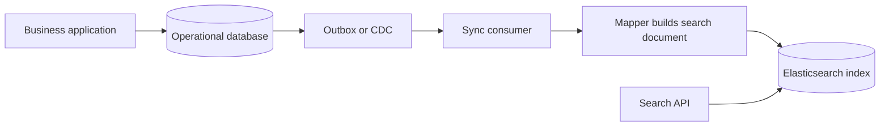
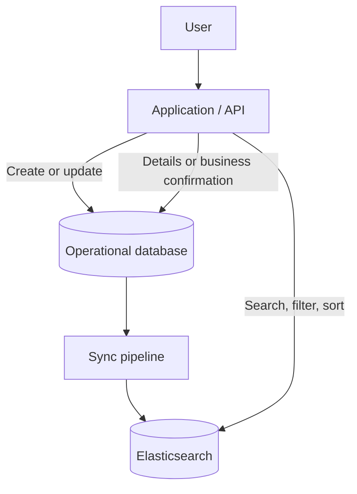

# Distinguishing Operational Databases from Search Data Models

In a Spring Data Elasticsearch application, data stored in an operational database and data indexed in Elasticsearch may both describe the same product, customer, or order, yet they serve two different purposes. The operational database manages the authoritative state of the system and transactional rules. The search data model organizes information in a way that enables Elasticsearch to perform full-text search, filtering, sorting, and aggregations quickly.

Clearly understanding this distinction helps you design the proper role for each data store, avoid unintentionally turning Elasticsearch into a transactional state store, and build a reliable data synchronization pipeline.

## 1. Two data models solving two problems

### Operational database

An operational database (typically a relational database such as PostgreSQL, MySQL, or SQL Server) stores the authoritative state of the application. It handles create, read, update, and delete operations inside business workflows, commonly referred to as OLTP (Online Transaction Processing).

For example, when a customer places an order, the system must ensure that:

- The order ID is unique.
- Inventory quantities are updated according to business rules.
- Totals and order line items remain consistent.
- Writing the order, line items, and related updates respects transaction boundaries.
- Constraints such as foreign keys, uniqueness, and validity are enforced.

Therefore, operational data is usually split across multiple normalized tables with explicit relationships. Shared information is stored once and linked via primary and foreign keys. This organization minimizes data duplication and enables safe state updates.

### Search data model

A search data model (or search document model) is designed around how users search for and explore information. In Elasticsearch, data is typically indexed as JSON documents inside an index.

For example, a product search page may need to display the product name, brand name, category path, current price, stock status, and selected variant attributes. If this information lives across many tables, each search query would otherwise require multiple joins and extra processing. A search document can pre-include the necessary fields so Elasticsearch can search and return results in a single query.

Search models often accept selective data duplication. This is denormalization: data is copied into the document to optimize querying. This duplication is an intentional design choice that brings the responsibility of updating documents when source data changes.

## 2. Comparing by purpose and organization

| Aspect | Operational database | Search data model |
|---|---|---|
| Goal | Record and manage authoritative business state | Full-text search, filtering, sorting, suggestions, and aggregations |
| Data role | Authoritative source of truth | Read/search projection |
| Storage unit | Tables and rows in a relational model, or a structure suited to the operational DB | JSON documents in an Elasticsearch index |
| Relationships | Expressed with keys and cross-table relationships; usually normalized | Typically embedded or copied required data into the document |
| Primary optimization | Integrity, transactions, accurate updates | Query capability, relevance, read speed, and aggregations |
| How data is queried | Key lookups, business conditions, and joins | Inverted index, text analysis, filters, and aggregations |
| Updates | Driven by transactions and business rules | Driven by indexing pipelines or synchronization from source data |
| Consistency | Can use transactions to guarantee consistency within the DB scope | Usually has sync lag; typically achieves eventual consistency |
| Schema changes | Usually requires migrations and application compatibility control | May require creating a new index and reindexing on incompatible mapping changes |

Do not treat this comparison table as an absolute rule for every system. Some operational databases are not relational, and Elasticsearch supports various query patterns. The core point is that data design should stem from each system's responsibilities.

## 3. Example: one product, two representations

Suppose an online store has the following operational tables:

```text
products
  id, sku, name, brand_id, price, status

brands
  id, name

categories
  id, name, parent_id

product_categories
  product_id, category_id

inventory
  product_id, warehouse_id, available_quantity

product_variants
  id, product_id, color, size, price
```

This model works well for operational workflows because brands, categories, inventory, and variants have independent update lifecycles. A product can belong to multiple categories, have many variants, and maintain inventory across multiple warehouses. When a brand name changes, the application only updates the brand record without modifying every product row.

Meanwhile, a search results page may need a document closer to this structure:

```json
{
  "id": "p-1001",
  "sku": "COFFEE-001",
  "name": "Espresso Coffee Maker",
  "brand": {
    "id": "b-12",
    "name": "North Star"
  },
  "categoryIds": ["c-10", "c-11"],
  "categoryNames": ["Home Appliances", "Coffee Makers"],
  "price": 3250000,
  "available": true,
  "variants": [
    { "color": "black", "size": "compact", "price": 3250000 },
    { "color": "silver", "size": "standard", "price": 3590000 }
  ]
}
```

The document already bundles information pulled from multiple tables. Elasticsearch can search by product name and brand, filter by category or stock availability, sort by price, and return basic display fields without executing relational joins like an operational model.

The `available` value in the document represents search-serving data at indexing time. During checkout or order confirmation, the application must still verify stock in the operational system. Search results may lag behind the latest state by a short window due to synchronization delay.

## 4. Designing search documents in Spring Data Elasticsearch

Spring Data Elasticsearch maps Java classes to Elasticsearch documents through annotations. This class should reflect the fields needed by search queries and screens rather than copying the entire operational entity verbatim.

For example, the document class can be declared as follows:

```java
import java.math.BigDecimal;
import java.util.List;

import org.springframework.data.annotation.Id;
import org.springframework.data.elasticsearch.annotations.Document;
import org.springframework.data.elasticsearch.annotations.Field;
import org.springframework.data.elasticsearch.annotations.FieldType;
import org.springframework.data.elasticsearch.annotations.InnerField;
import org.springframework.data.elasticsearch.annotations.MultiField;

@Document(indexName = "products")
public class ProductSearchDocument {

    @Id
    private String id;

    @MultiField(
        mainField = @Field(type = FieldType.Text, analyzer = "standard"),
        otherFields = {
            @InnerField(suffix = "keyword", type = FieldType.Keyword)
        }
    )
    private String name;

    @Field(type = FieldType.Keyword)
    private String sku;

    @Field(type = FieldType.Keyword)
    private String brandName;

    @Field(type = FieldType.Keyword)
    private List<String> categoryIds;

    @Field(type = FieldType.Text, analyzer = "standard")
    private String description;

    @Field(type = FieldType.Double)
    private BigDecimal price;

    @Field(type = FieldType.Boolean)
    private boolean available;

    @Field(type = FieldType.Nested)
    private List<VariantSearchData> variants;

    // Constructors, getters and setters
}
```

The `VariantSearchData` class models the nested data inside the document:

```java
import java.math.BigDecimal;

import org.springframework.data.elasticsearch.annotations.Field;
import org.springframework.data.elasticsearch.annotations.FieldType;

public class VariantSearchData {

    @Field(type = FieldType.Keyword)
    private String color;

    @Field(type = FieldType.Keyword)
    private String size;

    @Field(type = FieldType.Double)
    private BigDecimal price;

    // Constructors, getters and setters
}
```

The annotations above describe how Spring Data Elasticsearch maps Java properties to Elasticsearch fields:

- `@Document` identifies the index the document belongs to.
- `@Id` marks the document identifier. This value is typically derived from the business object's stable identifier so the exact document can be updated or deleted later.
- `@Field` declares the field type, such as `Text`, `Keyword`, `Double`, or `Boolean`.
- `@MultiField` combines multiple indexing strategies for the same property. In the example, `name` has a primary `text` field for full-text search and a secondary `name.keyword` field of type `keyword` to support exact matching, sorting, or aggregations.
- `@InnerField` declares a secondary field inside a multi-field configuration.

Basic repository example:

```java
import org.springframework.data.elasticsearch.repository.ElasticsearchRepository;

public interface ProductSearchRepository
        extends ElasticsearchRepository<ProductSearchDocument, String> {
}
```

`ElasticsearchRepository` provides save, find, and delete document operations. Calling `save(document)` writes the document to the corresponding index via Spring Data Elasticsearch. This repository does not automatically read JPA tables, detect when operational entities change, or synchronize data from the relational database to Elasticsearch. The application needs to build its own transformation and indexing flow.

In real-world projects, mappings also depend on the active Elasticsearch and Spring Data Elasticsearch versions. Custom analyzers, synonyms, normalizers, and index settings usually need to be declared in index settings or appropriate index templates. Simply specifying an analyzer name in `@Field` does not mean Elasticsearch will create that analyzer definition automatically.

## 5. Choosing field types based on how users query

Choosing field types is one of the most critical decisions when designing search documents.

### `text` and `keyword`

`text` is intended for content that needs tokenization for full-text search. For example, a product name or description can be analyzed into words and matched against user queries.

`keyword` stores a value as an intact unit. This type fits SKU codes, statuses, category IDs, brands requiring exact matching, as well as fields used for filtering, sorting, or aggregations.

For example:

| Attribute | Commonly used type | Reason |
|---|---|---|
| Product name | `text` | Search by words or phrases |
| Product name needing sort/aggregation | Multi-field with `keyword` | Retains an unanalyzed version alongside text |
| SKU | `keyword` | Code requiring exact matching |
| Status | `keyword` | Filter over a finite set of values |
| Price | Suitable numeric type | Range filtering and numeric sorting |
| Creation timestamp | `date` | Time-range filtering and sorting |
| In stock | `boolean` | True/false filter |

Do not use `text` for every field just because the data is a string. A status field like `PUBLISHED` typically needs exact filtering rather than tokenization.

### `object` and `nested`

Elasticsearch can store nested objects. For standard objects, Elasticsearch flattens field structures during indexing. This works well if the application only searches across independent attributes.

When a document contains an array of objects and queries must ensure multiple conditions match on the exact same array element, the `nested` type may be required. For example, a product has two variants:

```json
{
  "variants": [
    { "color": "black", "size": "small" },
    { "color": "silver", "size": "large" }
  ]
}
```

If you need products with a variant that is both black and large, a standard object model can allow color and size conditions to match two different elements after flattening. `nested` preserves each element's context so queries can enforce that both conditions hold on a single variant.

`nested` carries higher storage and query overhead than standard objects. Use it only when query semantics genuinely require preserving relationships between attributes within the same array element.

## 6. Deciding which data belongs in the document

Not every field in the operational database belongs in the search index. For each field, ask whether it serves search, filtering, sorting, aggregations, result display, or navigation.

Useful guidelines:

1. **Include fields that serve real queries.** For example: name, SKU, brand, categories, visibility status, price, and filterable user attributes.
2. **Copy reference data when doing so lowers read cost.** Brand names or category names can be included in the document for convenient display and search.
3. **Keep source identifiers.** Store product IDs, brand IDs, or category IDs so you can trace back to operational data and process updates.
4. **Avoid putting unnecessary sensitive data into the index.** Access controls, retention periods, and deletion requirements must apply to the copy in Elasticsearch as well.
5. **Do not embed every relationship out of habit.** Oversized documents increase write, network, and indexing costs; balance read speed against update cost.

### When should you denormalize?

Denormalization is useful when a query frequently needs several pieces of information together and those pieces can reasonably be updated together as a unit. For example, a product search page typically needs the brand name and category path on every result. Copying these fields into the document reduces data stitching at read time.

In exchange, when a brand name changes, every product document holding that brand name may need updating. If a value is copied into hundreds of thousands of documents, you need bulk updates, reindexing, or tolerance for a window of stale data.

### When should you keep data separate?

If data changes very frequently, is large, or has an independent lifecycle, embedding all of it inside the document can cause excessive rewrites. For instance, detailed transaction history should not be copied wholesale into product documents solely for the product search page.

For one-to-many relationships, you can choose one of these approaches:

- Embed as `object` if data is small and queries do not need to preserve intra-element relationships within an array.
- Embed as `nested` if queries must evaluate conditions on the same array element.
- Create a separate document/index if data is large, queried independently, or follows a distinct update lifecycle.
- Use parent-child relationships in special cases when cross-document relationships are needed and more complex query overhead is acceptable. This is rarely the default choice.

## 7. Synchronizing from the operational database to Elasticsearch

Because the two models serve different purposes, the application needs a pipeline that transforms operational source data into search documents.

A general flow can be represented as follows:



When a user updates a product, the application writes changes to the operational database. A synchronization component detects that change, reads the necessary data, converts it into a `ProductSearchDocument`, and writes it to Elasticsearch.

### Ways to detect changes

- **Direct sync in the application flow:** after updating the DB, the application calls the Elasticsearch repository. This is simple, but you must handle cases where the DB commits while Elasticsearch fails. Two systems do not automatically form a distributed transaction just because both calls sit in the same service method.
- **Application events:** the service publishes an event after a business change and a listener updates the index. This decouples business logic from search logic, though in-memory events can be lost if the process stops at an inopportune time.
- **Transactional outbox:** the application writes the business change and an event record into an outbox table within the same DB transaction. A separate process reads the outbox and updates Elasticsearch. This avoids gaps between the business commit and recording the sync event.
- **Change Data Capture (CDC):** a tool reads the database's change log and forwards changes to the sync pipeline. This is useful for high change volumes or when decoupling the sync pipeline from application code.

No single option fits every system. Smaller applications may start with a simple listener and clear retry logic; high-reliability systems often require an outbox or CDC.

### Properties to guarantee

A sync pipeline should address the following scenarios:

- **Retries:** Elasticsearch may be temporarily unreachable; events must be retried without getting lost.
- **Idempotency:** an event may be processed more than once. Re-indexing the same state should yield a stable outcome.
- **Event ordering:** two consecutive updates for the same product may arrive out of order. Reliable versions, sequences, or timestamps can prevent stale state from overwriting newer state.
- **Deletions:** delete events must remove the corresponding document or mark it unsearchable.
- **Partial failures:** an error on one document must not silently drop an entire batch. Log failures, retry, and monitor backlog counts.
- **Reconciliation:** provide a way to detect missing documents or drift relative to the source data.

An important point is that consumers should generally build the document from current state in the operational database when processing an event rather than assuming event payloads always hold every related piece of data. However, this pattern must be paired with versioning or event ordering to avoid reading and overwriting with stale state.

## 8. Example of organizing a data transformation service

Isolate the responsibility of converting data into search documents inside a dedicated mapper or indexing component. Illustrative example:

```java
public class ProductSearchMapper {

    public ProductSearchDocument toDocument(
            Product product,
            Brand brand,
            List<Category> categories,
            InventorySummary inventory) {

        ProductSearchDocument document = new ProductSearchDocument();
        document.setId(product.getId().toString());
        document.setSku(product.getSku());
        document.setName(product.getName());
        document.setBrandName(brand.getName());
        document.setCategoryIds(
            categories.stream()
                .map(category -> category.getId().toString())
                .toList()
        );
        document.setPrice(product.getPrice());
        document.setAvailable(inventory.getAvailableQuantity() > 0);

        return document;
    }
}
```

This illustrates structure and responsibility; domain classes, relationship loading, and variant handling should be adapted to the specific application. A mapper should not hide excessive database queries inside itself. A service or data-loading component should provide sufficient inputs so the mapper builds the document predictably.

A consumer can use the mapper and repository as follows:

```java
public class ProductIndexingService {

    private final ProductSearchMapper mapper;
    private final ProductSearchRepository searchRepository;

    public void index(Product product,
                      Brand brand,
                      List<Category> categories,
                      InventorySummary inventory) {

        ProductSearchDocument document =
            mapper.toDocument(product, brand, categories, inventory);

        searchRepository.save(document);
    }
}
```

In a real application, add appropriate retry handling, logging, monitoring, versioning, and error policies. The snippet above solely illustrates the boundary between operational data, transformation, and the Elasticsearch repository.

## 9. Reading and writing data in the right place

A common architecture uses the operational database for write flows and Elasticsearch for search queries.



For example:

- User searches products by keyword: query Elasticsearch.
- User filters product lists by brand or price range: query Elasticsearch when those fields are indexed.
- User opens a detail page requiring the freshest data: the application can read authoritative data from the operational DB.
- User places an order: verify price, status, and inventory against business rules in the authoritative system before confirming the transaction.
- Administrator updates product name or price: write to the operational DB, then let the pipeline update the search document.

Do not use search results as the final authority for a transactional decision. A product might have just gone out of stock in the DB before the search document caught up. Similarly, prices in search documents can lag behind current prices. Values governing transactions must be re-verified against the operational source.

## 10. Reindexing when the search model changes

Search models evolve as products add new filters, require new analyzers, change field types, or alter document structure. Certain mapping changes cannot be applied directly to already-indexed data as desired. In those cases, create a new index and reindex the data.

A safe rollout process usually consists of:

1. Creating a new index with the new mapping and settings, e.g., `products-v2`.
2. Running a backfill from the operational database to populate documents for all existing data.
3. Continuing to process changes occurring during the backfill by replaying events or syncing from a checkpoint.
4. Reconciling counts and key fields between the source and the new index.
5. Switching the search alias to the new index once data is ready.
6. Keeping the old index for a retention period to allow rollback if issues arise.

Aliases let the application query a stable name while physical indices are swapped by version. The exact cutover procedure must account for write traffic during the switch so no updates are missed.

## 11. Common design mistakes

### Using Elasticsearch as the primary transactional data store

Elasticsearch is optimized for search and analytics. If an application relies on it as the final decision-maker for inventory, balances, or payment states, sync lag and update semantics can cause business inconsistencies. Keep the source of truth in a transaction-capable system.

### Copying the entire operational entity into a document

Operational entities often contain relationships, internal columns, and fields unnecessary for search. Copying them verbatim bloats documents, increases update overhead, and tightly couples mappings to database schemas. Define search documents around real queries.

### Using `text` for every string

Codes, statuses, and categories usually require exact matching. Use `keyword` or appropriate multi-fields so filtering and sorting work properly.

### Having no mechanism to update duplicated data

Denormalization speeds up queries but creates sync obligations. If a brand name is copied into product documents, plan how those documents will be updated when a brand renames.

### Writing to DB and Elasticsearch without handling failures between steps

The DB may commit successfully while the Elasticsearch write fails. Without retries, an outbox, or reconciliation, search data becomes silently missing or stale.

### Changing mappings without a reindex plan

Mappings govern how Elasticsearch stores and queries data. Manage index versions, verify compatibility, and prepare backfills when changing document structure or text analysis.

### Putting sensitive data into an index while forgetting the copy's lifecycle

Elasticsearch holds a copy of data. Authorization policies, retention periods, deletion rules, and data protection must cover indices, snapshots, and sync pipelines too.

## 12. Practical workflow for designing a search data model

When starting a design, follow this sequence:

1. **List search screens and queries.** Identify which keywords users search, which fields they filter on, and what sorting and aggregations are needed.
2. **Identify source data.** For every result field, pinpoint the authoritative table, entity, or business service supplying that value.
3. **Design documents around queries.** Group fields commonly read together; decide which fields are copied and which remain separate.
4. **Choose Elasticsearch types.** Distinguish `text`, `keyword`, numeric, date/time, boolean, `object`, and `nested` based on query patterns.
5. **Design synchronization.** Pick events, outbox, CDC, or another approach; define retries, idempotency, update ordering, and deletes.
6. **Plan initial data loading.** Provide a backfill for existing data that seamlessly catches up with live changes during ingestion.
7. **Test search behavior.** Use representative sample data to verify word matching, filtering, sorting, aggregations, missing fields, and edge variants.
8. **Monitor lag and drift.** Measure elapsed time from business change to document update; track errors and maintain a reconciliation process.

## 13. Conclusion

An operational database and a search data model are two distinct data representations serving two separate sets of responsibilities. The operational database guarantees authoritative state, relationships, and transactional rules. The search data model in Elasticsearch organizes data around search, filtering, sorting, and aggregation needs; therefore, it commonly uses denormalized documents and accepts controlled synchronization lag.

In Spring Data Elasticsearch, create dedicated document classes, use annotations to declare mappings, use repositories or `ElasticsearchOperations` to work with indices, and build a transformation pipeline from source data. Maintaining this clear boundary lets your application leverage Elasticsearch's search capabilities while preserving business correctness.
