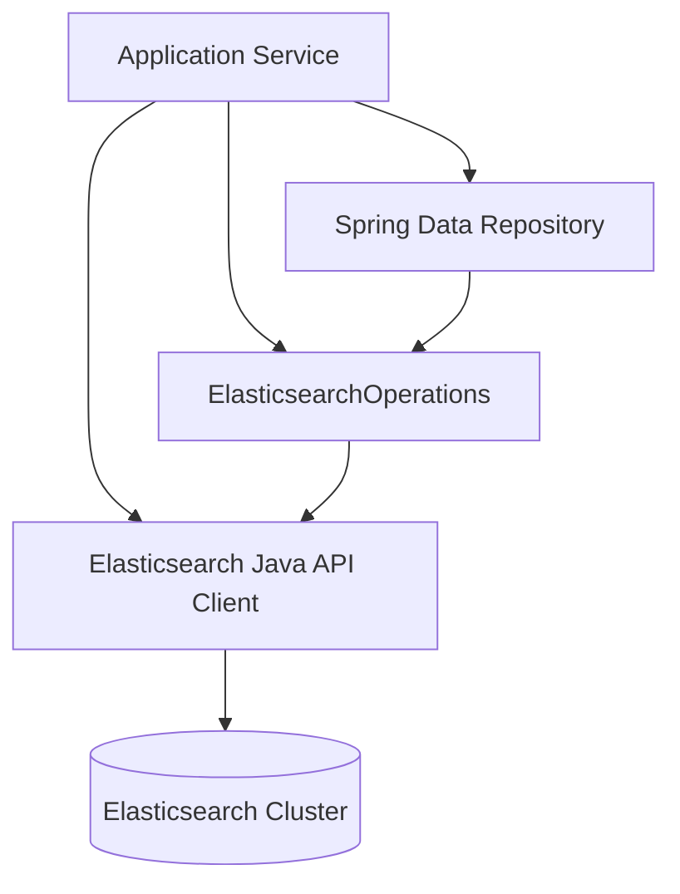
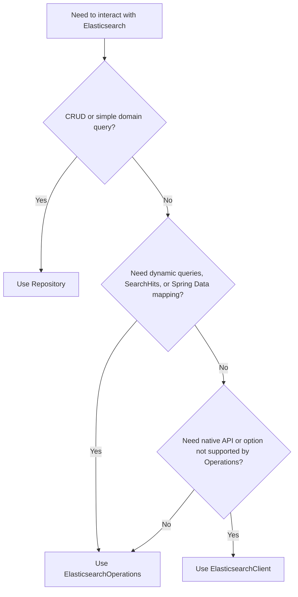

# Comparing Repository, ElasticsearchOperations, and Direct Client Usage

In Spring Data Elasticsearch, searching or writing documents can be performed through three commonly used API layers:

- **Repository**: a domain-oriented interface suited for CRUD operations and common queries.
- **`ElasticsearchOperations`**: a Spring Data-level operations API suited when you need fine-grained control over queries, search results, mappings, or index lifecycle.
- **Elasticsearch Java API Client (`ElasticsearchClient`)**: the official Elasticsearch Java client, enabling direct calls to the APIs exposed by Elasticsearch.

All three approaches interact with the same Elasticsearch cluster. The differences lie in abstraction level, object mapping behavior, degree of request control, and the amount of code the application must manage itself. Choosing the right layer keeps code readable, testable, and flexible as search requirements grow more complex.

## 1. Context: where does Spring Data Elasticsearch fit?

Elasticsearch stores data as **JSON documents** inside **indices**. A document typically has an `_id`, fields, and search metadata. When an application sends requests, Elasticsearch executes operations on indices: creating or updating documents, deleting documents, searching, aggregating data, managing mappings, and more.

Spring Data Elasticsearch adds a working layer following the Spring Data model:

- Declaring Java entities with annotations such as `@Document`, `@Id`, and `@Field`.
- Converting between Java entities and Elasticsearch documents.
- Providing Repositories so applications can invoke methods in Spring Data style.
- Providing `ElasticsearchOperations` for more flexible operations.

At the layer communicating with Elasticsearch, Spring Data Elasticsearch currently uses the **Elasticsearch Java API Client**. Thus, Repositories and `ElasticsearchOperations` are not separate database engines from the client. They are Spring Data abstractions built on top of the client and Spring Data's mapping components.

High-level diagram:



In typical flows, a Repository is implemented by Spring Data and uses `ElasticsearchOperations` underneath. When needed, a service or adapter can also call `ElasticsearchOperations` directly. Applications can likewise inject `ElasticsearchClient` to invoke the Java API Client directly.

## 2. Preparing a sample entity for examples

Suppose an application manages products. We need to search products by name, filter by category, and paginate results.

```java
import java.math.BigDecimal;

import org.springframework.data.annotation.Id;
import org.springframework.data.elasticsearch.annotations.Document;
import org.springframework.data.elasticsearch.annotations.Field;
import org.springframework.data.elasticsearch.annotations.FieldType;

@Document(indexName = "products")
public class Product {

    @Id
    private String id;

    @Field(type = FieldType.Text)
    private String name;

    @Field(type = FieldType.Keyword)
    private String category;

    @Field(type = FieldType.Double)
    private BigDecimal price;

    protected Product() {
    }

    public Product(String id, String name, String category, BigDecimal price) {
        this.id = id;
        this.name = name;
        this.category = category;
        this.price = price;
    }

    public String getId() {
        return id;
    }

    public String getName() {
        return name;
    }

    public String getCategory() {
        return category;
    }

    public BigDecimal getPrice() {
        return price;
    }
}
```

The annotations carry meaning at the Spring Data layer:

| Annotation | Meaning |
|---|---|
| `@Document(indexName = "products")` | Declares the index bound to the entity. |
| `@Id` | Marks the property used as the document ID (`_id`). |
| `@Field(type = FieldType.Text)` | Declares a text-analyzed field for full-text search. |
| `@Field(type = FieldType.Keyword)` | Declares a field used for exact values, filtering, sorting, or aggregations. |
| `@Field(type = FieldType.Double)` | Declares a numeric type in the Elasticsearch mapping. |

`text` and `keyword` serve different purposes. A `match` query generally suits `name` of type `text`; a `term` query suits `category` of type `keyword`. Do not use `term` to search free-form phrases on a `text` field without understanding how the analyzer transforms the content.

This example assumes the index has a matching mapping. You can declare mappings via annotations and proactively create or verify the index through `IndexOperations`. For systems already running in production, manage mappings intentionally because many field type changes cannot be applied in place to existing data; you may need to create a new index and reindex.

## 3. Repository: working in the Spring Data model

A Repository is the easiest starting point when data operations can be expressed as familiar domain methods. You declare an interface, and Spring Data generates the implementation at runtime.

```java
import java.util.List;

import org.springframework.data.domain.Page;
import org.springframework.data.domain.Pageable;
import org.springframework.data.elasticsearch.repository.ElasticsearchRepository;

public interface ProductRepository extends ElasticsearchRepository<Product, String> {

    List<Product> findByCategory(String category);

    Page<Product> findByCategory(String category, Pageable pageable);

    List<Product> findByName(String name);
}
```

`ElasticsearchRepository<Product, String>` states that the entity is `Product` and the ID type is `String`. Repositories provide basic operations such as saving, finding by ID, deleting, and retrieving lists. Methods named according to Spring Data conventions can be parsed to generate queries.

Example usage:

```java
import org.springframework.data.domain.Page;
import org.springframework.data.domain.PageRequest;

Page<Product> page = productRepository.findByCategory(
    "audio",
    PageRequest.of(0, 20)
);

page.getContent().forEach(product ->
    System.out.println(product.getName())
);
```

The code communicates business intent clearly: retrieve the first page of 20 products in the `audio` category. The service does not manually construct Elasticsearch requests, parse hit lists, or deserialize JSON into entities.

### 3.1. Queries derived from method names

Spring Data supports naming conventions such as `findBy...`, `existsBy...`, and `countBy...`, combining conditions and supported operators. For example:

```java
Page<Product> findByCategoryAndPriceLessThan(
    String category,
    BigDecimal maxPrice,
    Pageable pageable
);
```

Advantages of this approach:

- Short interfaces that are easy to read and mock in unit tests.
- Method names describe conditions at the domain level without forcing readers to learn Query DSL.
- CRUD operations and simple queries can be used directly in services.
- Spring Data handles most entity conversion and query parameter binding.

Limitations appear when queries involve multiple `bool` branches, nested queries, aggregations, highlights, function scores, pipelines, or specialized search logic. Long method names become hard to read, and not every Elasticsearch construct maps cleanly to derived queries.

### 3.2. Using `@Query` when queries need clearer expression

For a straightforward query that does not fit method-name derivation well, a Repository can declare a JSON query via `@Query`:

```java
import org.springframework.data.elasticsearch.annotations.Query;

public interface ProductRepository extends ElasticsearchRepository<Product, String> {

    @Query("{\"match\": {\"name\": {\"query\": \"?0\"}}}")
    List<Product> searchByName(String text);
}
```

Here `?0` is the method's first parameter. The annotation body is JSON representing an Elasticsearch query. This preserves the Repository interface, though the author must understand query syntax and field names in the mapping.

Avoid turning a Repository into a dumping ground for dozens of huge JSON strings. When queries have many clauses or require dynamic construction, `ElasticsearchOperations` is usually easier to organize. If a query is reusable, consider extracting a repository fragment or a dedicated adapter.

### 3.3. When is Repository a good fit?

Choose a Repository when:

- Use cases are primarily CRUD or simple property-based queries.
- Methods can be expressed concisely by name or a small `@Query`.
- The application prefers depending on Spring Data-style interfaces.
- Return types like `Iterable`, `Optional`, `List`, or `Page` satisfy requirements.

Repositories are a sensible starting point for most everyday data operations. When a particular query becomes awkward to express, you can move just that use case to `ElasticsearchOperations` without replacing the entire Repository.

## 4. `ElasticsearchOperations`: Spring Data's flexible operations API

`ElasticsearchOperations` is the central interface in Spring Data Elasticsearch for entity and index operations. Its standard implementation is `ElasticsearchTemplate`.

Compared to a Repository, `ElasticsearchOperations` lets code explicitly build queries, choose query types, configure pagination and sorting, and inspect result metadata, while still participating in Spring Data's mapping and conversion system.

Common operation categories:

| Category | Examples |
|---|---|
| Document | `save`, `get`, `delete`, `search` |
| Bulk | Write or delete multiple documents in batches |
| Query | `CriteriaQuery`, `StringQuery`, `NativeQuery` |
| Search result | `SearchHits`, scores, highlights, aggregations, and search metadata |
| Index | `indexOps(...)` to check, create indices, apply mappings, and perform supported index operations |

### 4.1. Building dynamic queries with `NativeQuery`

The following example searches for products whose name matches `wireless` while strictly filtering by the `audio` category:

```java
import co.elastic.clients.elasticsearch._types.FieldValue;
import org.springframework.data.domain.PageRequest;
import org.springframework.data.elasticsearch.client.elc.NativeQuery;
import org.springframework.data.elasticsearch.core.ElasticsearchOperations;
import org.springframework.data.elasticsearch.core.SearchHit;
import org.springframework.data.elasticsearch.core.SearchHits;
import org.springframework.data.elasticsearch.core.query.Query;

public class ProductSearchService {

    private final ElasticsearchOperations operations;

    public ProductSearchService(ElasticsearchOperations operations) {
        this.operations = operations;
    }

    public void searchProducts() {
        Query query = NativeQuery.builder()
            .withQuery(q -> q
                .bool(b -> b
                    .must(m -> m
                        .match(match -> match
                            .field("name")
                            .query("wireless")
                        )
                    )
                    .filter(f -> f
                        .term(term -> term
                            .field("category")
                            .value(FieldValue.of("audio"))
                        )
                    )
                )
            )
            .withPageable(PageRequest.of(0, 20))
            .build();

        SearchHits<Product> hits = operations.search(query, Product.class);

        for (SearchHit<Product> hit : hits) {
            Product product = hit.getContent();
            float score = hit.getScore();
            System.out.println(product.getName() + " - score=" + score);
        }
    }
}
```

`NativeQuery` lets you construct Query DSL using the strongly typed builders of the Elasticsearch Java API Client. `ElasticsearchOperations` accepts the query, runs the search, and returns results already converted into `Product` by Spring Data.

The two clauses in the query play different roles:

- `must` contains conditions that affect the relevance score. `match` analyzes text according to the field's mapping/analyzer.
- `filter` retains matching documents without participating in scoring. `term` matches the exact keyword value `audio`.

In the example, `PageRequest.of(0, 20)` limits results to the first page of 20 hits. If deep paging is needed, account for `from`/`size` limits and consider `search_after` paired with stable sorting rather than letting `from` grow unbounded.

### 4.2. Why is `SearchHits` useful?

If a Repository returns `List<Product>`, the application typically receives only entities. `SearchHits<Product>` preserves search-specific metadata as well:

- The entity corresponding to `_source` after conversion.
- The `_score` of each hit.
- Total hit count and pagination information provided by the response.
- Search metadata such as highlights, sort values, or other details depending on the query and API version.
- Aggregations returned with the response when requested by the query.

As a result, the service layer can assemble rich search responses without parsing raw JSON responses manually.

### 4.3. Managing indices with `IndexOperations`

`ElasticsearchOperations` also provides an entry point for index operations. For example:

```java
import org.springframework.data.elasticsearch.core.IndexOperations;

IndexOperations indexOperations = operations.indexOps(Product.class);

if (!indexOperations.exists()) {
    indexOperations.create();
    indexOperations.putMapping();
}
```

This snippet illustrates obtaining `IndexOperations` from entity metadata, checking existence, and creating the index along with its mapping. In real applications, design an explicit migration/index-provisioning strategy. Avoid letting multiple application instances arbitrarily alter production index mappings at startup.

### 4.4. When is `ElasticsearchOperations` a good fit?

Choose `ElasticsearchOperations` when:

- Queries are assembled dynamically from user filters.
- You need multiple `bool` conditions, nested queries, sorting, pagination, or native Query DSL.
- You need to read scores, highlights, aggregations, or hit metadata.
- You need bulk operations or index management through Spring Data abstractions.
- You want to keep using Spring Data's entity mapping and conversion.

This is usually the balanced choice for search features of medium to high complexity in Spring applications.

## 5. Using the Elasticsearch Java API Client directly

The Elasticsearch Java API Client is the official Java client for calling Elasticsearch APIs. In Spring Boot, applications typically receive `ElasticsearchClient` via client auto-configuration aligned with the active Spring Boot/Spring Data and Elasticsearch versions.

When calling the client directly, code works closer to Elasticsearch's native requests and responses. You explicitly specify the index, query, sort, paging, and Java type used to deserialize `_source`.

Equivalent search example:

```java
import co.elastic.clients.elasticsearch.ElasticsearchClient;
import co.elastic.clients.elasticsearch.core.SearchResponse;
import co.elastic.clients.elasticsearch.core.search.Hit;
import co.elastic.clients.elasticsearch._types.FieldValue;

public class DirectProductSearchService {

    private final ElasticsearchClient client;

    public DirectProductSearchService(ElasticsearchClient client) {
        this.client = client;
    }

    public void searchProducts() throws IOException {
        SearchResponse<ProductDocument> response = client.search(search -> search
            .index("products")
            .from(0)
            .size(20)
            .query(query -> query
                .bool(bool -> bool
                    .must(must -> must
                        .match(match -> match
                            .field("name")
                            .query("wireless")
                        )
                    )
                    .filter(filter -> filter
                        .term(term -> term
                            .field("category")
                            .value(FieldValue.of("audio"))
                        )
                    )
                )
            ),
            ProductDocument.class
        );

        for (Hit<ProductDocument> hit : response.hits().hits()) {
            ProductDocument document = hit.source();
            Double score = hit.score();
            System.out.println(document + " - score=" + score);
        }
    }
}
```

`ProductDocument` is the type the client uses to deserialize `_source`. For example, you can define it as a dedicated POJO or record whose field structure matches the JSON returned by Elasticsearch. The snippet assumes `java.io.IOException` is imported and `ProductDocument` is defined appropriately.

Important caveat: the Java API Client uses the transport's JSON mapper to convert JSON into objects. It **does not automatically run through Spring Data's `MappingElasticsearchConverter`**, so never assume Spring Data annotations like `@Document`, `@Field`, or entity conversion rules will apply during direct client calls. If sharing a single class across both paths, verify that serializers, field names, data types, date formats, and custom conversions align. In larger systems, separating a document DTO for direct client usage can keep boundaries cleaner.

### 5.1. What the direct client offers

- Access to endpoints and options that Spring Data abstractions do not yet support or fully expose.
- Request/response control matching Elasticsearch documentation closely.
- Full use of the Java API Client's typed request builders and response models.
- Fit for specialized operations such as cluster APIs, advanced index operations, new APIs, or bespoke features.

In exchange, the application takes on more responsibility:

- Specifying indices and field names in every request.
- Constructing queries, sorting, paging, and required options.
- Converting responses into models used by the business layer.
- Managing differences between the client's JSON mapping and Spring Data's mapping/conversion.
- Tracking Java API Client changes when upgrading Elasticsearch versions.

Using the direct client does not mean sending raw HTTP via `RestTemplate` or hand-crafting JSON strings. The Java API Client provides typed builder APIs, request/response models, and transport handling for talking to Elasticsearch. Distinguish it from the legacy `RestHighLevelClient` from Elasticsearch 7.x, which was deprecated in the newer client generation.

### 5.2. When is the direct client a good fit?

Choose `ElasticsearchClient` when:

- You need to call an API lacking a corresponding abstraction in Spring Data Elasticsearch.
- You need exact control over options in a specialized request.
- A feature depends closely on newly introduced Elasticsearch APIs.
- You are building a dedicated infrastructure adapter where Elasticsearch request/response handling is an explicit responsibility.

If you only need CRUD or ordinary search queries, calling the client directly usually adds boilerplate without meaningful benefit.

## 6. Comparing the three approaches across criteria

| Criterion | Repository | `ElasticsearchOperations` | Direct `ElasticsearchClient` |
|---|---|---|---|
| Abstraction level | High, domain- and Spring Data-oriented | Medium, entity/index operations-oriented | Lower, close to the Elasticsearch API |
| Declaration style | Interface, method names, `@Query`, repository fragments | Build `Query`/`NativeQuery`, invoke operations | Request builders and client APIs |
| CRUD | Very convenient | Flexible | Must build requests and handle responses manually |
| Dynamic queries | More limited; may need fragments | Well suited | Well suited with full API control |
| Query DSL | Derived queries or JSON in `@Query` | `NativeQuery` and Spring Data query types | Java API Client Query DSL |
| Entity mapping | Uses Spring Data mapping/conversion | Uses Spring Data mapping/conversion | Uses the client's JSON mapper |
| Search results | Typically entities, `List`, `Page`, `Optional` | `SearchHits` with search metadata | `SearchResponse` and raw response types |
| Index management | Not the primary purpose of Repositories | Provides `IndexOperations` | Calls index APIs directly |
| API control | Low to medium | Medium to high | Highest |
| Application boilerplate | Usually lowest | Medium | Usually higher |
| Spring Data coupling | High | High | Can be used independently of Spring Data, even inside a Spring app |

Do not interpret this table as a speed ranking. All three paths ultimately send requests to Elasticsearch. Performance differences typically depend far more on the query, network, data, mapping, hit count, and pagination strategy than on the number of Java layers invoked. Drop down to the direct client only when you need specific APIs or control; if you suspect overhead, verify with profiling and representative benchmarks.

## 7. Choosing an API for real-world scenarios

| Scenario | Starting choice | Reason |
|---|---|---|
| Save a product, find by ID, delete a product | Repository | Clean CRUD with minimal code. |
| Filter by category, status, price range, and paginate | Repository if conditions are simple; Operations if filters are dynamic | Match the choice to query complexity. |
| Search screen with many optional filters | `ElasticsearchOperations` | Can assemble queries from input while keeping Spring Data mapping. |
| Need scores, highlights, or aggregations | `ElasticsearchOperations` | `SearchHits` and metadata fit search use cases naturally. |
| Need a cluster API or new endpoint not yet wrapped by Spring Data | `ElasticsearchClient` | Direct access to native APIs. |
| Need common entity-bound index/mapping operations | `ElasticsearchOperations` | `IndexOperations` and Spring Data metadata. |
| Need an advanced request option available only in the Java API Client | `ElasticsearchClient` | Direct request control. |

A practical principle is to start at the highest abstraction that clearly expresses the use case. If a Repository meets the requirement, there is no need to drop to a lower-level API. If dynamic queries make the Repository hard to read, move that specific use case to Operations. Drop to the direct client only when you have a concrete requirement that Operations does not handle conveniently.

## 8. Can all three be combined in the same application?

Yes. An application can use Repositories for routine domain operations, `ElasticsearchOperations` for search screens, and `ElasticsearchClient` for a specialized infrastructure API. This combination works well when each component has a clear responsibility.

Example separation:

```text
ProductApplicationService
    ├── ProductRepository
    │     └── CRUD and simple domain queries
    │
    ├── ProductSearchService
    │     └── ElasticsearchOperations
    │           └── Dynamic queries, SearchHits, highlights, aggregations
    │
    └── ElasticsearchMaintenanceAdapter
          └── ElasticsearchClient
                └── Specialized infrastructure APIs
```

When combining them, establish a few conventions:

1. **Define who owns mappings.** If Spring Data entities are the source of mapping declarations, keep `@Document`/`@Field` consistent and manage index changes in a controlled way.
2. **Do not mix conversion silently.** Repositories and Operations use Spring Data conversion; the direct client uses the transport's JSON mapper. Explicitly check compatibility whenever both paths read or write the same document type.
3. **Encapsulate queries in proper adapters.** Business services should not contain long request builders or JSON query strings. Keep those details inside a repository fragment or search adapter.
4. **Avoid two sources of truth for field names.** If a mapping uses renamed fields, nested paths, or custom conversions, ensure direct queries reference the actual Elasticsearch field names consistently.
5. **Use appropriate result types.** If a screen needs scores or highlights, do not return only `List<Product>` and discard metadata before reaching the presentation layer.

## 9. Key points regardless of which API you choose

### 9.1. Elasticsearch is not a relational database

Repositories in Spring Data Elasticsearch present an interface familiar to Spring Data JPA users, but you should not infer that Elasticsearch offers full relational database semantics. Elasticsearch does not provide multi-document transactions in the way relational databases typically do. Do not design business logic assuming multiple `save` calls automatically roll back together.

### 9.2. A successful write does not mean instant search visibility

Elasticsearch uses a refresh mechanism to make newly written documents searchable. Thus, an index operation can succeed while an immediate search query still misses the document if a refresh has not occurred yet. If a use case requires immediate read-after-write visibility, understand refresh policies and the cost of forcing refreshes; do not turn on immediate refresh for every request by default.

This behavior does not change when switching from Repository to Operations or the direct client. It is a property of Elasticsearch itself.

### 9.3. Mapping defines what a query means

A syntactically valid query can still produce unexpected results if the mapping does not fit. For example:

- `text` is tokenized by an analyzer, suitable for full-text search.
- `keyword` preserves values intact, suitable for exact filtering and aggregations.
- Numeric and date fields need matching mapping types for range queries and sorting to behave accurately.
- Nested objects require `nested` query semantics if relationships between fields in the same nested object must be preserved.

Repositories, Operations, and the direct client must all obey the index mapping. Higher abstractions cannot fix an incorrect mapping.

### 9.4. Deep pagination requires dedicated design

`Pageable` is convenient for standard pagination. However, Elasticsearch limits `from`/`size` depth to avoid excessive memory and resource consumption. For deep scrolling or exporting large result sets, consider `search_after` paired with a stable sort and PIT (Point in Time) where appropriate for your Elasticsearch version. Operations or the direct client may be chosen depending on required control; Repositories do not always expose all of these options.

### 9.5. Bulk operations and error handling

When writing many documents, consider the bulk API rather than sending individual requests one by one. Bulk responses report success/failure status per item; do not inspect only the overall HTTP status and assume every document succeeded. When using Operations or the direct client, handle per-item outcomes according to business requirements.

## 10. Decision guide

You can walk through the following questions:



When hesitating between Operations and the direct client, pinpoint the exact gap: which endpoint, which parameter, which response type, or which level of control is missing. If you cannot name that concrete need, Operations generally preserves Spring Data's benefits with less code.

## 11. Summary of choices

- **Repository** suits CRUD and simple queries where method names express business intent well.
- **`ElasticsearchOperations`** suits flexible search, complex queries, and metadata handling while continuing to leverage Spring Data's mapping and conversion.
- **`ElasticsearchClient`** suits advanced Elasticsearch APIs or features not yet fully exposed by Spring Data abstractions; in return, the application manages requests, responses, and JSON mapping more explicitly.

The three APIs are not mutually exclusive. Choose according to each use case's requirements, keep mappings consistent, and isolate query details inside appropriate adapters. That way, most business code stays readable while specialized search features retain full control over Elasticsearch.
