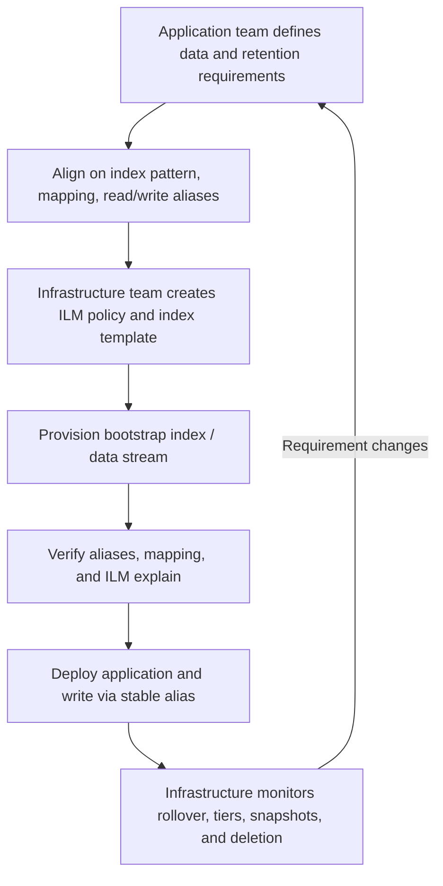

# Index Lifecycle Management and Infrastructure Responsibilities

When Elasticsearch data grows over time, creating new indices, moving data to appropriate storage tiers, and deleting expired data must be operated consistently. **Index Lifecycle Management (ILM)** is Elasticsearch's mechanism for automating steps in an index's lifecycle according to a policy. Spring Data Elasticsearch applications typically continue reading and writing through a stable alias; the infrastructure or platform team is responsible for configuring policies, templates, storage tiers, snapshots, and cluster monitoring.

This lesson explains how ILM works, commonly used phases and actions, how to combine policies with index templates and rollover aliases, how to inspect lifecycle status, as well as the boundary of responsibilities between application code and infrastructure. The goal is so the application does not have to create/delete indices on a schedule itself, while data is retained for the proper duration and remains accessible according to business requirements.

## 1. Why manage the index lifecycle?

A logging, event, audit, or time-based data system continuously writes new documents. If all documents stay forever in a single index, the index grows steadily and can create difficulties for:

- Search performance and shard management.
- Storage costs when older data is rarely accessed.
- Meeting retention and expired-data deletion requirements.
- Cluster snapshots, recovery, and maintenance.
- Changing mappings or index structures across stages.

A common solution is partitioning data into indices by time or size, then moving older indices through storage tiers and deleting them upon expiration. For example:

```text
logs-000001  -> hot  -> warm -> delete
logs-000002  -> hot  -> warm -> delete
logs-000003  -> hot  -> warm -> delete
```

Instead of having the application decide when to create `logs-000004` or delete `logs-000001`, we declare a policy and let Elasticsearch execute lifecycle actions.

## 2. What is ILM?

**Index Lifecycle Management (ILM)** lets you define phases and actions applied to indices over time or based on conditions. ILM runs inside the Elasticsearch cluster, not as a scheduler inside a Spring Boot application.

An ILM policy typically includes these phases:

| Phase | Purpose | Example actions |
|---|---|---|
| `hot` | Index actively receiving writes and frequent queries | Rollover when reaching age or size; set shard priority. |
| `warm` | Index with fewer writes, still needing queries | Switch to read-only, force merge, change priority or placement. |
| `cold` | Rarely accessed data, prioritizing cost savings | Move to cold storage tier per supported topology and actions. |
| `frozen` | Very rarely accessed data, optimizing storage cost | Can use searchable snapshots with appropriate configuration. |
| `delete` | Data past its retention period | Delete the index per policy. |

Not every policy needs all five phases. A small system might only use `hot` and `delete`; a system with multiple storage tiers can add `warm`, `cold`, or `frozen`.

Phases represent the lifecycle model, while specific actions depend on the Elasticsearch version, topology, cluster features, and operational requirements. Check the capabilities of the running version before choosing actions.

## 3. ILM and rollover

Rollover creates a new index when the current index meets one or more conditions. For example, when the write index reaches one day of age or a primary shard exceeds 50 GB, Elasticsearch can switch the write alias to the next index.

```text
logs-write (write alias)
      |
      v
 logs-000001  -- rollover -->  logs-000002
      |                              |
      +-- read alias ----------------+
```

The application only writes to the `logs-write` alias. Upon rollover, this alias is switched to the new index as the write index. Old indices can remain under the read alias for historical queries.

### 3.1. Rollover conditions

Common conditions include:

- `max_age`: maximum age of the index before rollover.
- `max_primary_shard_size`: maximum size of the largest primary shard.
- `max_size`: total primary shard size per supported rollover conditions.
- `max_docs`: maximum number of documents.
- `min_age`, `min_docs`, and other `min_*` conditions: minimum thresholds that can be combined with maximum conditions.

Rollover typically triggers when one of the `max_*` conditions reaches its threshold while all declared `min_*` conditions in the policy are also satisfied. Choose thresholds based on shard size, write rate, query frequency, and index-count management capacity.

Do not pick rollover thresholds solely based on a commonly cited number. Overly small indices increase shard/index count and management overhead; overly large indices can make recovery, relocation, and searches resource-intensive. Measure actual ingest rate and shard size.

### 3.2. Index names and write aliases

With a rollover alias, indices usually have an incrementing numeric suffix, such as `logs-000001`. ILM needs to know the write alias via the `index.lifecycle.rollover_alias` setting. The initial index must be created with that alias and marked `is_write_index: true`.

If the initial index name lacks a suitable numeric suffix, rollover may fail to generate the next index name as expected. Establish a naming convention from the start and apply it consistently across templates, policies, and application configuration.

## 4. Example ILM policy for logs

Suppose a system needs to retain logs for roughly 30 days. An index operates in the hot phase, moves to the warm phase after 7 days to become read-only and force-merged, and is deleted after 30 days.

Create the policy:

```json
PUT _ilm/policy/logs-retention
{
  "policy": {
    "phases": {
      "hot": {
        "actions": {
          "rollover": {
            "max_age": "1d",
            "max_primary_shard_size": "50gb"
          },
          "set_priority": {
            "priority": 100
          }
        }
      },
      "warm": {
        "min_age": "7d",
        "actions": {
          "readonly": {},
          "forcemerge": {
            "max_num_segments": 1
          },
          "set_priority": {
            "priority": 50
          }
        }
      },
      "delete": {
        "min_age": "30d",
        "actions": {
          "delete": {}
        }
      }
    }
  }
}
```

Meaning:

- `hot.rollover`: roll over when the index reaches one day of age or the largest primary shard reaches 50 GB.
- `set_priority`: sets index recovery priority in the cluster.
- `warm.min_age`: age at which the index becomes eligible to move to the warm phase based on the lifecycle reference timestamp used by ILM.
- `readonly`: prevents further writes to the index in the warm phase.
- `forcemerge`: merges segments to reduce segment count; this is a resource-intensive operation and must run at an appropriate time.
- `delete`: deletes the index when it reaches the configured retention age.

This example only illustrates a policy. Before using in production, verify from which timestamp retention is measured, confirm that a warm tier exists if the policy moves data to that tier, evaluate the cost of force merge, and test the policy on representative indices. `min_age` of subsequent phases must be understood relative to the index's lifecycle reference timestamp; for policies with rollover, phase age is calculated from the index's rollover timestamp unless a lifecycle origination date is configured otherwise.

## 5. Attaching a policy to an index template

A policy only defines behavior. For new indices to be managed automatically, attach the policy to indices via the `index.lifecycle.name` setting. With a rollover alias, you also need to declare `index.lifecycle.rollover_alias`.

Create the index template:

```json
PUT _index_template/logs-template
{
  "index_patterns": ["logs-*"],
  "priority": 100,
  "template": {
    "settings": {
      "index.lifecycle.name": "logs-retention",
      "index.lifecycle.rollover_alias": "logs-write",
      "number_of_shards": 1
    },
    "mappings": {
      "properties": {
        "@timestamp": {
          "type": "date"
        },
        "message": {
          "type": "text"
        },
        "level": {
          "type": "keyword"
        }
      }
    },
    "aliases": {
      "logs-read": {}
    }
  }
}
```

The template applies to indices whose names match `logs-*`. Every new index created matching the pattern receives the policy, rollover alias setting, mapping, and read alias.

In this example, `logs-read` is the read alias applied to matching indices. `logs-write` is configured as the rollover alias in settings; the initial write alias is attached to the bootstrap index in the next step. When ILM rolls over, Elasticsearch updates the write alias to point to the new index.

Index templates are an important operational responsibility: if a template fails to match the index name, the policy is not attached; if a template has lower priority than another template or is overridden by a component template, the final settings may differ from expectations. Simulate/verify that the template applies as expected before release.

## 6. Creating the first index and configuring the write alias

An ILM rollover alias needs a starting index. After creating the policy and template, create `logs-000001` with the write alias:

```json
PUT logs-000001
{
  "aliases": {
    "logs-write": {
      "is_write_index": true
    }
  }
}
```

Because the index matches `logs-*`, the template supplies the policy, mapping, settings, and the `logs-read` alias. The bootstrap command adds `logs-write` as the write alias for the first index.

When ILM rolls over, Elasticsearch creates the next index with the incremented suffix and switches the write alias to the new index. The application continues writing to `logs-write` without needing to know whether the current physical index is `logs-000001` or `logs-000002`.

Verify aliases:

```http
GET _alias/logs-write
GET _alias/logs-read
```

Verify the policy attached to the index:

```http
GET logs-000001/_settings?filter_path=*.settings.index.lifecycle*
```

## 7. Integrating ILM with Spring Data Elasticsearch

Spring Data applications should use a stable alias in `@Document` or `IndexCoordinates`. Example log entity:

```java
package com.example.catalog.logs;

import java.time.Instant;

import org.springframework.data.annotation.Id;
import org.springframework.data.elasticsearch.annotations.Document;
import org.springframework.data.elasticsearch.annotations.Field;
import org.springframework.data.elasticsearch.annotations.FieldType;

@Document(indexName = "logs-write", createIndex = false)
public class LogEntry {

    @Id
    private String id;

    @Field(type = FieldType.Date)
    private Instant timestamp;

    @Field(type = FieldType.Text)
    private String message;

    @Field(type = FieldType.Keyword)
    private String level;

    protected LogEntry() {
    }

    public LogEntry(String id, Instant timestamp, String message, String level) {
        this.id = id;
        this.timestamp = timestamp;
        this.message = message;
        this.level = level;
    }
}
```

`createIndex = false` is intentional: indices and aliases have already been provisioned by infrastructure. Spring Data should not try to create a new index named `logs-write`, because `logs-write` is an alias pointing to the current write index.

The repository can be declared as follows:

```java
import org.springframework.data.elasticsearch.repository.ElasticsearchRepository;

public interface LogEntryRepository
        extends ElasticsearchRepository<LogEntry, String> {
}
```

When calling `save`, the repository writes documents through the alias declared in `@Document`:

```java
logEntryRepository.save(new LogEntry(
    "event-1001",
    Instant.now(),
    "User signed in",
    "INFO"
));
```

Elasticsearch receives the write request through `logs-write` and routes it to the index marked `is_write_index`. After rollover, the alias points to the new index and the application keeps writing as before.

If using `ElasticsearchOperations` directly, you can specify the alias:

```java
operations.save(logEntry, IndexCoordinates.of("logs-write"));
```

To read historical data, you can query through the `logs-read` alias if this alias points to all indices to search. Specific query types and overloads depend on the Spring Data Elasticsearch version; what matters is that the read path uses the read alias and the write path uses the write alias.

## 8. What are the application and infrastructure responsible for?

ILM runs inside the Elasticsearch cluster, so you should not place the entire lifecycle inside an application `@Scheduled` job. If every Spring Boot instance creates indices, triggers rollovers, and deletes indices on a schedule, it is easy to hit race conditions, delete data accidentally, or cause policy drift across environments.

Responsibility boundaries should be clearly defined:

| Party | Primary responsibilities |
|---|---|
| Application team | Define data types, mappings, timestamps, read/write aliases, supported queries, business retention requirements, and error handling when indices/aliases are unavailable. |
| Infrastructure/platform team | Configure ILM policies, index templates, shards/replicas, data tiers, snapshots, cluster privileges, rollout policies, and monitor lifecycle status. |
| Both teams together | Align on index/alias naming, retention, historical query SLAs, deletion timing, mapping changes, and recovery procedures. |

### 8.1. What information does the application team need to provide?

The application team understands the meaning of the data and how users query it. Therefore, they must specify:

- Which data consists of logs, events, audits, or long-term business records.
- Which time field serves as the timestamp and its timezone/format.
- How long data needs to be queried frequently.
- Total retention duration according to business requirements or internal policies.
- Whether there are deletion requirements by user, tenant, contract, or specific data regulations.
- Whether the application needs to query history across multiple indices.
- Which read/write aliases are used in code and environment configuration.

The application must also handle cases where an alias has not been created yet or Elasticsearch is temporarily unavailable. Do not auto-create an empty index at runtime to mask provisioning errors, because that index may lack mappings and ILM policies.

### 8.2. What does the infrastructure team need to deploy?

The infrastructure team is responsible for configuring ILM and cluster components:

- Create and version-control ILM policies.
- Create index templates/component templates and attach policies to the proper patterns.
- Create bootstrap indices along with write aliases when rollover aliases are needed.
- Configure data tiers and allocation matching hardware/topology.
- Manage snapshots, backups, and restore capability.
- Grant applications only the minimum necessary privileges.
- Monitor lifecycle execution, shard allocation, disk watermarks, and policy errors.
- Test retention, rollover, and delete changes before broad rollout.

Applications should not be granted cluster-wide privileges to edit policies, templates, or delete arbitrary indices if they only need to write to a specific alias. Least privilege limits the blast radius if application code has bugs affecting other systems' data.

## 9. Why shouldn't the application manage retention with its own scheduler?

A tempting approach is using `@Scheduled` to check old indices daily and call `deleteIndex()`. This approach has several issues:

- Every application instance may run the same scheduler and operate on the same index concurrently.
- Retention logic gets scattered across application versions and environments.
- Application schedulers can stop during deployments, restarts, or process crashes.
- Application code requires broader index deletion privileges than needed for writing documents.
- Tier migration, force merge, snapshots, and shard control still have to be implemented manually.
- It is hard to monitor lifecycle state centrally at the cluster level.

ILM solves lifecycle management where indices and shards reside. The application focuses on data and business use cases, while the cluster performs storage actions according to policy.

This does not mean applications can never manage indices. A migration tool or deployment job can create indices, mappings, and aliases when releasing a new version. The key point is that periodic retention lifecycles and destructive data operations should be centrally managed with explicit privileges and auditing.

## 10. Data streams and ILM

For append-only time-series data such as logs, metrics, or events, a **data stream** may be a better fit than manually managing rollover aliases. A data stream provides a stable write target name and manages backing indices underneath.

Overview:

```text
Application
    |
    v
  logs-prod  (data stream)
    |
    +--> .ds-logs-prod-...-000001
    +--> .ds-logs-prod-...-000002
    +--> .ds-logs-prod-...-000003
```

The application writes to the data stream name `logs-prod`. Elasticsearch manages backing indices and rollovers per the data stream configuration. An ILM policy can be attached to the index template applying to backing indices as supported.

Data streams are suitable when:

- Data is primarily appended over time.
- Documents include an appropriate timestamp.
- The application typically writes to the stream and queries through the stream.
- Arbitrary updates/deletes of old documents like a standard CRUD workflow are not needed.

If you need to update old documents or operate by ID on specific backing indices, understand data stream limitations and targeting/routing mechanics. For data requiring arbitrary updates or a CRUD model, traditional index aliases may be more suitable.

Data stream templates use `data_stream` and policies inside the index template. Specific configuration depends on Elasticsearch version; do not add `index.lifecycle.rollover_alias` in the traditional rollover-alias pattern to a data stream. Data streams have their own rollover mechanism.

## 11. Checking ILM status

After deploying policies and templates, confirm that Elasticsearch is actually managing the indices.

### 11.1. Inspecting the policy

```http
GET _ilm/policy/logs-retention
```

The response shows the policy stored in the cluster. This confirms configuration existence, not yet proving individual indices have received the policy.

### 11.2. Inspecting the lifecycle state of an index

```http
GET logs-000001/_ilm/explain
```

The explain API shows whether the index is managed by ILM, its current phase, action, step, phase transition timestamp, and any errors. This is one of the most important checks when an index does not roll over or get deleted as expected.

### 11.3. Inspecting aliases and indices

```http
GET _cat/aliases/logs-*?v
GET _cat/indices/logs-*?v&s=index
```

These commands verify that the write alias points to the right index, the read alias includes the indices to query, and rollover created the next index.

### 11.4. Checking cluster-wide ILM status

```http
GET _ilm/status
```

This API shows whether ILM is running on the cluster. If ILM is stopped or errored, policies may not execute at expected times.

## 12. Troubleshooting when rollover or lifecycle does not run

When an index fails to roll over, the warm phase does not happen, or expired indices remain, check layer by layer:

| Symptom | What to check |
|---|---|
| Index has no lifecycle policy | Index template does not match the pattern, policy was not attached, or index was created before the template existed. |
| ILM explain reports rollover alias not found | `index.lifecycle.rollover_alias` is wrong or the alias does not point to an index marked as write index. |
| Rollover does not occur | `max_*` conditions not yet reached, ILM is at another step, index lacks the expected suffix, or alias is wrong. |
| New index lacks mapping | Template did not apply, or template priority / component template produced an unexpected final configuration. |
| Warm phase does not move data | Tier is not configured, allocation rules cannot be satisfied, or warm action failed. |
| Delete phase does not delete index | `min_age` not yet reached, phase/action pending, ILM has an error, or index is managed by a different policy. |
| Write alias does not work | `is_write_index` not set, alias points to the wrong index, or write privileges are insufficient. |

Read `_ilm/explain` output and cluster logs before modifying the policy. Avoid manually deleting a managed index just because lifecycle hasn't run; doing so can destroy data needed for investigation.

## 13. Safely changing policies and retention

Changing retention can directly affect data under management. Before modifying a policy:

1. Identify which indices use the policy and their current lifecycle state.
2. Confirm new retention requirements with data owners and stakeholders.
3. Assess impact on snapshots, historical queries, and recovery requirements.
4. Update the policy in a test environment and verify `_ilm/explain`.
5. Deploy the updated policy through a versioned workflow with rollback capability.
6. Monitor indices that have transitioned phases and indices awaiting actions.

If reducing retention from 90 days to 30 days, a large number of old indices may immediately become eligible for deletion simultaneously. This can generate significant load and impact investigation or recovery capabilities. Evaluate how many indices are affected and plan phased deletions if needed.

Increasing retention also does not automatically bring old data back to the hot tier. Determine whether indices already moved to cold/frozen or searchable snapshots can be accessed under the new SLA.

## 14. Snapshots, backups, and data deletion requirements

ILM manages index lifecycles but does not replace a backup strategy. If a policy deletes an index after 30 days, determine whether snapshots keep data longer and whether deletion mandates apply to snapshots/backups as well.

The infrastructure team must align on:

- Snapshot repositories and snapshot schedules.
- Snapshot retention.
- Restore procedures and restore testing.
- Consistency between index deletion policies and snapshot retention policies.
- Procedures for handling personal data deletion requests or contractually bound data.

Do not assume deleting an index means data has disappeared from all snapshots or backups. Data deletion requirements must be addressed under the organization's overall storage policy.

## 15. Security and privileges

Applications writing to an alias typically only need index/create permissions or write permissions matching the target alias/index. Infrastructure teams should avoid granting application service accounts cluster admin rights, ILM policy modification rights, or permission to delete any index unless required by the use case.

The following operations should belong to administrative service accounts or dedicated infrastructure pipelines:

- Creating/editing ILM policies.
- Creating/editing index templates and component templates.
- Creating bootstrap indices and aliases.
- Modifying data tiers or shard allocation.
- Deleting indices due to retention or migration.
- Managing snapshot repositories and restores.

Separating privileges limits impact when application code malfunctions or credentials leak. Also log who modifies policies, templates, aliases, and retention to support auditing.

## 16. Coordination workflow between application and infrastructure



A deployment contract should explicitly specify:

| Item | Example |
|---|---|
| Index pattern | `logs-*` |
| Write target | `logs-write` or data stream `logs-prod` |
| Read target | `logs-read` |
| Timestamp field | `@timestamp` |
| Mapping owner | Application team provides schema; infrastructure deploys template |
| ILM policy | `logs-retention` |
| Rollover | 1 day or 50 GB primary shard |
| Retention | 30 days, confirmed against data requirements |
| Snapshot | Repository, schedule, and snapshot retention duration |
| Application permissions | Only necessary alias read/write permissions |
| Operational checks | `_ilm/explain`, aliases, index size, shard allocation |

When changing alias names or index patterns, deploy templates/policies and application configuration under a compatible plan. Do not change one side first and leave the other writing to an alias that does not exist yet.

## 17. ILM deployment checklist

Before moving a policy to production, teams can use the following checklist to coordinate:

- [ ] Identify data types and retention approved by the data owner.
- [ ] Choose an appropriate index pattern or data stream.
- [ ] Define the timestamp field and mapping.
- [ ] Select rollover conditions based on ingest rate and shard size.
- [ ] Create the ILM policy with required phases/actions.
- [ ] Attach the policy and mapping to the index template.
- [ ] Create the bootstrap index with its write alias if using a rollover alias.
- [ ] Confirm the read alias covers the indices needing queries.
- [ ] Verify `_ilm/explain` and `_ilm/status`.
- [ ] Verify data tiers, snapshots, and restores.
- [ ] Grant least-privilege permissions to applications and infrastructure pipelines.
- [ ] Test rollover, phase transitions, and deletion in a test environment.
- [ ] Have a rollback and post-release monitoring plan.

## 18. Conclusion

Index Lifecycle Management automates index lifecycles at the Elasticsearch cluster level through policies, phases, and actions. Rollover creates new indices by age or size; warm/cold/frozen phases adjust storage characteristics; the delete phase enforces retention when data expires.

Spring Data Elasticsearch should operate through stable aliases or data streams. The application owns schema, timestamps, queries, and business retention requirements; infrastructure owns ILM policies, templates, tiers, snapshots, privileges, and monitoring. Both teams must align on index/alias naming, retention, and historical query SLAs.

Do not use schedulers on individual application instances to trigger rollovers or delete indices periodically. Let Elasticsearch manage lifecycles centrally, inspect status with `_ilm/explain`, version-control policy changes, and always pair retention with a backup/restore strategy. This division keeps data growth controlled, storage costs aligned, and operational responsibilities clear.
