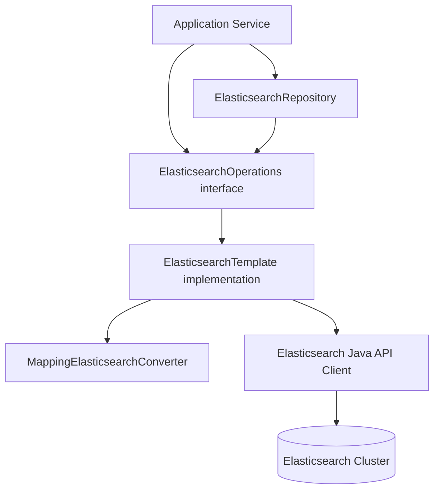
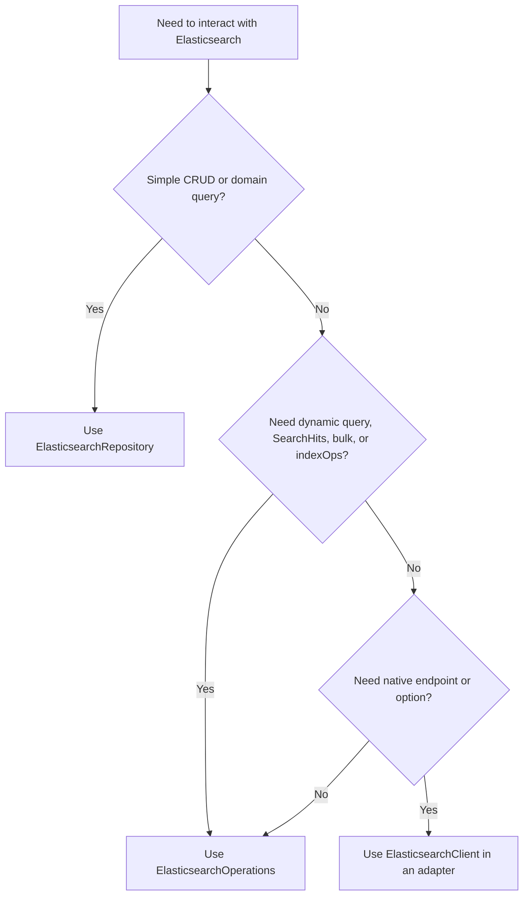

# The Role of ElasticsearchOperations and ElasticsearchTemplate

In Spring Data Elasticsearch, **`ElasticsearchOperations`** is the central API for an application to work with documents, search queries, and index management. **`ElasticsearchTemplate`** is the concrete implementation of this abstraction in the imperative (synchronous) model. The two names often appear together because an application typically injects the `ElasticsearchOperations` interface, while Spring provides a template bean that performs those operations.

Understanding the roles of these two components helps keep code well organized: Repositories are suitable for CRUD and simple domain queries; `ElasticsearchOperations` is suitable for dynamic queries, search results with metadata, and index operations; `ElasticsearchTemplate` executes those calls through the Elasticsearch client and Spring Data's mapping mechanism.

## 1. Where Operations and Template Fit in the Architecture

Spring Data Elasticsearch provides multiple API levels for an application to work with Elasticsearch:

- **Repository**: a domain-oriented interface providing CRUD and derived queries based on method names.
- **`ElasticsearchOperations`**: a Spring Data-level operations interface allowing you to save/read/delete documents, search, perform bulk operations, and access index APIs.
- **`ElasticsearchTemplate`**: the synchronous implementation of `ElasticsearchOperations`, connecting with the Elasticsearch Java API Client and the mapping infrastructure.
- **`ElasticsearchClient`**: the official Java API Client, providing Elasticsearch's request builders and response models.

Overview diagram:



Repositories and Services do not need to construct HTTP requests manually. Operations provides a unified API for the application, while Template coordinates mapping/conversion and the client to send requests to Elasticsearch.

In a typical Spring Boot application, Spring auto-configuration creates the required connection beans. You inject `ElasticsearchOperations` via the constructor and let Spring provide the corresponding implementation. There is no need to manually instantiate `new ElasticsearchTemplate(...)` in each service.

## 2. What is `ElasticsearchOperations`?

`ElasticsearchOperations` is an interface in Spring Data Elasticsearch that describes common Elasticsearch operations using a Java entity model. It decouples business code from client implementation details and provides a consistent API for working with documents.

Key functional groups:

| Group | Responsibility | Example APIs |
|---|---|---|
| Document | Save, read, delete documents | `save`, `get`, `delete`, `exists` |
| Search | Execute queries and receive results | `search`, `searchOne`, `count` |
| Bulk | Send multiple operations in a single bulk request | `bulkIndex`, `bulkUpdate`, `bulkDelete` depending on version |
| Index | Access index operations by entity or index name | `indexOps` |
| Mapping | Convert between Java entities and JSON documents | Coordinated via converter and mapping metadata |
| Coordinates | Specify the target index/alias for an operation | `IndexCoordinates` |

Operations lets the application focus on *how it wants to manipulate data*, rather than manually handling JSON requests/responses, HTTP transport, and mapping everywhere.

### 2.1. Why Use an Interface?

Services should depend on `ElasticsearchOperations` rather than directly on the `ElasticsearchTemplate` class:

```java
import org.springframework.data.elasticsearch.core.ElasticsearchOperations;
import org.springframework.stereotype.Service;

@Service
public class ProductSearchService {

    private final ElasticsearchOperations operations;

    public ProductSearchService(ElasticsearchOperations operations) {
        this.operations = operations;
    }
}
```

Benefits of this declaration:

- Business code depends only on the Spring Data API contract.
- Configuration or implementation can be changed without modifying individual services.
- Easy to replace with a mock or test double in unit tests.
- Prevents client, transport, and converter details from leaking across multiple packages.
- Easier to read when distinguishing between synchronous and reactive APIs.

If an application has multiple `ElasticsearchOperations` beans for multiple clusters, use `@Qualifier` or configure an appropriate primary bean. Do not rely on Spring's initialization order to select a cluster.

## 3. What is `ElasticsearchTemplate`?

`ElasticsearchTemplate` is the class implementing the imperative operations of `ElasticsearchOperations`. It bridges the Spring Data API with the Elasticsearch Java API Client and the mapping/conversion components.

You can picture Template's responsibilities through the steps taken when saving an entity:

1. Receive the Java object and target index information.
2. Use Spring Data's mapping metadata and converter to convert the entity into a JSON document.
3. Build the corresponding request through the Elasticsearch Java API Client.
4. Send the request to the Elasticsearch cluster.
5. Receive the response and convert the necessary data back into Java types.

When searching, Template performs the reverse flow: it receives a query, sends the request, reads the hits, and converts `_source` into entities while preserving search metadata in the Spring Data result types.

In modern versions of Spring Data Elasticsearch, the `ElasticsearchTemplate` implementation resides in the client module based on the Elasticsearch Java API Client. Older template classes tied to `RestHighLevelClient` belong to the previous client generation; when upgrading a project, make sure to use the implementation and dependencies compatible with the running Spring Boot/Spring Data version.

### 3.1. No Need to Create Template Manually in Services

Spring Boot typically auto-configures the client, converter, and operations beans when the Spring Data Elasticsearch starter is on the classpath and connection settings are valid. Example URI configuration:

```yaml
spring:
  elasticsearch:
    uris: ${ELASTICSEARCH_URIS:http://localhost:9200}
```

Then inject the interface:

```java
@Service
public class ProductService {

    private final ElasticsearchOperations operations;

    public ProductService(ElasticsearchOperations operations) {
        this.operations = operations;
    }
}
```

If you need to customize the client, converter, or multiple clusters, configure them at the Spring configuration layer according to your project version's API. Do not instantiate a new client/Template on every method call; the client and transport should be reused and have their lifecycle managed by the Application Context.

## 4. Mapping and Conversion Are Key Parts of Operations

An advantage of `ElasticsearchOperations` over calling the client directly is that it integrates Spring Data's mapping infrastructure. Entities can be declared using annotations:

```java
package com.example.catalog.product.document;

import org.springframework.data.annotation.Id;
import org.springframework.data.elasticsearch.annotations.Document;
import org.springframework.data.elasticsearch.annotations.Field;
import org.springframework.data.elasticsearch.annotations.FieldType;

@Document(indexName = "products")
public class ProductDocument {

    @Id
    private String id;

    @Field(type = FieldType.Keyword)
    private String sku;

    @Field(type = FieldType.Text)
    private String name;

    @Field(type = FieldType.Keyword)
    private String category;

    @Field(type = FieldType.Double)
    private Double price;

    protected ProductDocument() {
    }

    public ProductDocument(
            String id,
            String sku,
            String name,
            String category,
            Double price) {
        this.id = id;
        this.sku = sku;
        this.name = name;
        this.category = category;
        this.price = price;
    }

    public String getId() {
        return id;
    }

    public String getSku() {
        return sku;
    }

    public String getName() {
        return name;
    }

    public String getCategory() {
        return category;
    }

    public Double getPrice() {
        return price;
    }
}
```

The annotations describe metadata for mapping:

- `@Document` associates the entity with an index.
- `@Id` marks the property corresponding to `_id`.
- `@Field` declares field types such as `text`, `keyword`, `double`, `date`.

When `operations.save(product)` is called, the converter reads this metadata to transform the object into a document. When reading search results, the converter uses the metadata and configured custom conversions to reconstruct Java objects.

### 4.1. `MappingElasticsearchConverter`

In Spring Data Elasticsearch, `MappingElasticsearchConverter` is the component responsible for converting between Java objects and Elasticsearch document structures. It uses the mapping context, entity metadata, annotations, and custom conversions.

The converter can handle:

- ID properties and field metadata.
- Date/time types and common Java data types.
- Nested objects and collections according to the mapping.
- Custom conversions when a Java type needs a different JSON representation.
- Field names and declared mapping rules.

This means code using Operations does not need to manually call `ObjectMapper.writeValueAsString(...)` for each entity. However, the resulting JSON must still be compatible with the actual index mapping.

### 4.2. When Do You Need Custom Conversions?

If the domain model has custom types—such as `Money`, `EmailAddress`, or a business ID type—you may need custom converters to define how the field is written/read. Register conversions in the appropriate Spring Data configuration so all operations going through Operations use the same rules.

Do not perform conversions in only one service if the same entity is read/written from multiple Repositories or Operations calls. Consistent conversions prevent situations where one write path stores a string while a read path expects a different object structure.

## 5. Document Operations with `ElasticsearchOperations`

Operations provides methods for common document operations. Example of a service that saves and looks up products:

```java
package com.example.catalog.product.service;

import org.springframework.data.elasticsearch.core.ElasticsearchOperations;
import org.springframework.stereotype.Service;

import com.example.catalog.product.document.ProductDocument;

@Service
public class ProductDocumentService {

    private final ElasticsearchOperations operations;

    public ProductDocumentService(ElasticsearchOperations operations) {
        this.operations = operations;
    }

    public ProductDocument save(ProductDocument product) {
        return operations.save(product);
    }

    public ProductDocument findById(String id) {
        return operations.get(id, ProductDocument.class);
    }

    public String deleteById(String id) {
        return operations.delete(id, ProductDocument.class);
    }
}
```

Corresponding operations:

| Method | Purpose |
|---|---|
| `save(entity)` | Index a document using the entity's metadata and ID. |
| `get(id, entityClass)` | Retrieve a document by `_id` and convert it to a Java entity. |
| `delete(id, entityClass)` | Delete a document by ID and the index associated with the entity. |
| `exists(id, entityClass)` | Check if a document exists by ID if the version's API provides this overload. |
| `count(query, entityClass)` | Count documents matching the query criteria. |

Exact return types and overloads depend on the Spring Data Elasticsearch version. Check the Javadoc of your dependency when you need an exact method signature.

### 5.1. Distinguishing `save` from Insert-Only

`save` typically performs a document index operation by ID. If the ID already exists, the document contents may be overwritten according to Index API semantics. Therefore, you should not assume `save` is equivalent to a SQL `INSERT` that always rejects duplicate keys.

If business logic requires creating a new record without allowing existing documents to be overwritten, choose an appropriate create-only/optimistic concurrency operation and handle conflicts. Do not simply call `get` followed by `save` to enforce uniqueness under concurrent requests.

### 5.2. Using `IndexCoordinates` When Specifying an Index

By default, Operations can derive the index from the entity's `@Document`. When you want to operate through a specific alias or index, use `IndexCoordinates`:

```java
import org.springframework.data.elasticsearch.core.mapping.IndexCoordinates;

IndexCoordinates productsWrite = IndexCoordinates.of("products-write");

ProductDocument saved = operations.save(product, productsWrite);
```

This is useful when the application uses aliases for rollover or needs to write the same entity type into tenant-specific or versioned indices. For the read path, you can specify a read alias:

```java
SearchHits<ProductDocument> hits = operations.search(
    query,
    ProductDocument.class,
    IndexCoordinates.of("products-read")
);
```

Alias names and mappings must be provisioned beforehand if the application sets `createIndex = false`. Do not let Operations auto-create an index named after an alias when the infrastructure has not yet set up the corresponding alias.

## 6. Querying with `ElasticsearchOperations`

One of the primary reasons to use Operations is the ability to build flexible queries. Spring Data Elasticsearch provides several types of `Query`:

| Query Type | Purpose | When to Use |
|---|---|---|
| `CriteriaQuery` | Build conditions using Criteria style | Simple conditions that can be chained by field and operator. |
| `StringQuery` | Pass Query DSL as a JSON string | Small, fixed JSON queries or queries stored in resources. |
| `NativeQuery` | Build Query DSL using typed builders from the Elasticsearch Java API Client | Complex queries, bool/nested/aggregations, and Elasticsearch-specific options. |

All queries are executed via Operations:

```java
SearchHits<ProductDocument> hits = operations.search(
    query,
    ProductDocument.class
);
```

### 6.1. `NativeQuery` for Full-Text Search

Example of searching for products whose name matches the word `wireless`:

```java
import org.springframework.data.domain.PageRequest;
import org.springframework.data.elasticsearch.client.elc.NativeQuery;
import org.springframework.data.elasticsearch.core.SearchHits;
import org.springframework.data.elasticsearch.core.query.Query;

public SearchHits<ProductDocument> searchByName(String text) {
    Query query = NativeQuery.builder()
        .withQuery(q -> q
            .match(match -> match
                .field("name")
                .query(text)
            )
        )
        .withPageable(PageRequest.of(0, 20))
        .build();

    return operations.search(query, ProductDocument.class);
}
```

`NativeQuery` uses typed builders from the Elasticsearch Java API Client. Spring Data still receives the results and converts `_source` into `ProductDocument` via the converter.

### 6.2. Combining `must` and `filter` Clauses

A search screen may need to match by name and filter by exact category:

```java
import co.elastic.clients.elasticsearch._types.FieldValue;
import org.springframework.data.elasticsearch.client.elc.NativeQuery;
import org.springframework.data.elasticsearch.core.SearchHits;
import org.springframework.data.elasticsearch.core.query.Query;

public SearchHits<ProductDocument> search(String text, String category) {
    Query query = NativeQuery.builder()
        .withQuery(q -> q
            .bool(b -> b
                .must(m -> m
                    .match(match -> match
                        .field("name")
                        .query(text)
                    )
                )
                .filter(f -> f
                    .term(term -> term
                        .field("category")
                        .value(FieldValue.of(category))
                    )
                )
            )
        )
        .build();

    return operations.search(query, ProductDocument.class);
}
```

In this example:

- `must` contains the full-text condition and can affect the relevance score.
- `filter` contains the exact-match condition and does not participate in score calculation.
- `name` is `text`, suitable for `match`.
- `category` is `keyword`, suitable for `term`.

The Query DSL is built by the Java API Client, while the results still pass through Spring Data Operations and the mapping converter.

### 6.3. `StringQuery` When You Already Have JSON DSL

For a small JSON query, you can use `StringQuery`:

```java
import org.springframework.data.elasticsearch.core.query.Query;
import org.springframework.data.elasticsearch.core.query.StringQuery;

Query query = new StringQuery("""
    {
      "range": {
        "price": {
          "gte": 100,
          "lte": 500
        }
      }
    }
    """);

SearchHits<ProductDocument> hits = operations.search(
    query,
    ProductDocument.class
);
```

`StringQuery` is convenient when you already have a JSON query, but you must keep the JSON string valid and field names synchronized with the mapping. If a query needs to be assembled dynamically from multiple parameters, `NativeQuery` or `CriteriaQuery` is usually easier to control.

## 7. Reading `SearchHits` and Result Metadata

Operations does not just return a list of entities. With `search`, the result is typically `SearchHits<T>`, where each hit contains both the content and search metadata.

```java
SearchHits<ProductDocument> hits = operations.search(
    query,
    ProductDocument.class
);

for (SearchHit<ProductDocument> hit : hits) {
    ProductDocument product = hit.getContent();
    float score = hit.getScore();

    System.out.println(product.getName() + " - score=" + score);
}
```

Information commonly accessible from the results includes:

- The entity converted from `_source`.
- The relevance score of each hit.
- Total hit count from the response and pagination information.
- Highlight fields if the query requested highlighting.
- Sort values and metadata for each hit.
- Aggregations or additional information returned depending on query type and version.

This is important for search UIs. Converting `SearchHits` into `List<ProductDocument>` too early can cause the application to lose scores, highlights, or metadata needed by the interface.

## 8. Bulk Operations and Large-Scale Writes

When writing many documents, sending individual `save` calls can create many separate requests. Operations provides bulk APIs to group multiple operations into a single request, reducing network overhead and leveraging Elasticsearch's bulk mechanism.

Common use cases:

- Initial data imports.
- Synchronizing a product catalog from another system.
- Batch-updating fields.
- Deleting a group of documents matching a condition.

The Bulk API can return success/failure status per item. An overall bulk request accepted by Elasticsearch does not mean every document succeeded. The application needs to inspect individual item results, classify retryable errors, and avoid blindly retrying mapping or validation errors.

When data volumes are very large, split batches based on payload size and measure processing time, heap usage, and throughput. Batches that are too small increase request count; batches that are too large can cause memory pressure and timeouts.

## 9. Managing Indices via `indexOps`

Operations also provides an entry point to `IndexOperations`:

```java
import org.springframework.data.elasticsearch.core.IndexOperations;

IndexOperations indexOperations = operations.indexOps(ProductDocument.class);

if (!indexOperations.exists()) {
    indexOperations.createWithMapping();
}
```

`IndexOperations` supports index operations such as:

- Checking whether an index exists.
- Creating an index and mapping from entity metadata.
- Reading mappings and settings.
- Updating mappings within what Elasticsearch permits.
- Deleting an index.
- Refreshing an index when a use case needs to control when data becomes searchable.

If specifying an index by name or alias:

```java
IndexOperations indexOperations = operations.indexOps(
    IndexCoordinates.of("products-read")
);
```

Index management in production should be carried out via controlled migration/provisioning. Do not let multiple application instances create or delete indices concurrently at startup.

## 10. Comparing Repository, Operations, and Template

These three components are related but do not completely replace one another:

| Criterion | Repository | `ElasticsearchOperations` | `ElasticsearchTemplate` |
|---|---|---|---|
| API Type | Domain-oriented interface | General-purpose data operations interface | Concrete implementation class |
| Abstraction Level | High | Medium | Spring Data implementation detail |
| CRUD | Very convenient | Flexible | Executes Operations methods |
| Dynamic Queries | Derived queries, `@Query`, fragments | Criteria/Native/String queries | Processes queries received by Operations |
| Search Metadata | Depends on Repository return type | `SearchHits` and metadata | Executes and maps responses |
| Entity Mapping | Spring Data converter | Spring Data converter | Coordinates converter and client |
| Index Management | Not its main purpose | Via `indexOps` | Provides implementation for index APIs |
| Dependency in Service | Repository interface | Operations interface | No direct dependency needed in most services |

A practical rule of thumb:

- Use Repository for CRUD and concise domain queries.
- Use Operations when you need dynamic queries, `SearchHits`, bulk, or index operations.
- Let Spring provide the Template implementation; only configure or reference the concrete class when there is a clear infrastructure requirement.

## 11. When to Use `ElasticsearchTemplate` Directly?

In a normal application, injecting `ElasticsearchOperations` is sufficient. There may be cases where you need to configure the concrete implementation—for example, manually creating beans for multiple clusters or configuring a custom converter. In such cases, the `ElasticsearchTemplate` class can be declared in the configuration layer corresponding to your Spring Data Elasticsearch version.

Conceptual example:

```java
@Configuration
public class ElasticsearchConfiguration {

    // Declare ElasticsearchClient, converter, and
    // ElasticsearchOperations/ElasticsearchTemplate beans according to your project version.
}
```

Do not copy Template constructors from documentation for a different version. Constructor parameters and client creation vary across Elasticsearch Java Client, transport, and Spring Data generations. Let Spring Boot auto-configuration create beans unless customization is required.

If you need to call a native API not yet supported by Operations, inject `ElasticsearchClient` into a dedicated adapter. Do not cast `ElasticsearchOperations` to `ElasticsearchTemplate` just to extract the client or access a specialized endpoint.

## 12. Reactive Operations and Reactive Template

Spring Data Elasticsearch also provides reactive APIs for applications using a reactive stack:

- `ReactiveElasticsearchOperations` is the reactive abstraction.
- `ReactiveElasticsearchTemplate` is the corresponding reactive implementation.
- Methods typically return `Mono<T>`, `Flux<T>`, or an appropriate reactive type instead of blocking the thread to wait for results.

Example of a reactive service:

```java
import org.springframework.data.elasticsearch.core.ReactiveElasticsearchOperations;
import org.springframework.stereotype.Service;
import reactor.core.publisher.Mono;

@Service
public class ReactiveProductService {

    private final ReactiveElasticsearchOperations operations;

    public ReactiveProductService(ReactiveElasticsearchOperations operations) {
        this.operations = operations;
    }

    public Mono<ProductDocument> save(ProductDocument product) {
        return operations.save(product);
    }
}
```

Do not call blocking APIs of `ElasticsearchOperations` on a reactive event loop and expect the application to remain non-blocking. If the entire processing path uses Reactor/WebFlux, use reactive operations and a properly configured reactive client. Conversely, an imperative Spring MVC application can use the synchronous `ElasticsearchOperations`.

Reactive does not automatically make Elasticsearch queries faster. It changes the thread usage model and I/O task composition. Keep the entire processing flow consistent to avoid blocking in the middle of a reactive pipeline.

## 13. Testing Code That Depends on Operations

Because the service receives `ElasticsearchOperations` via constructor injection, you can unit test the service with mocks without running Elasticsearch. Example testing the save method:

```java
import static org.junit.jupiter.api.Assertions.assertSame;
import static org.mockito.Mockito.verify;
import static org.mockito.Mockito.when;

import org.junit.jupiter.api.Test;
import org.junit.jupiter.api.extension.ExtendWith;
import org.mockito.InjectMocks;
import org.mockito.Mock;
import org.mockito.junit.jupiter.MockitoExtension;

import org.springframework.data.elasticsearch.core.ElasticsearchOperations;

@ExtendWith(MockitoExtension.class)
class ProductDocumentServiceTest {

    @Mock
    private ElasticsearchOperations operations;

    @InjectMocks
    private ProductDocumentService service;

    @Test
    void saveDelegatesToOperations() {
        ProductDocument product = new ProductDocument(
            "p-1001", "SKU-1001", "Wireless Headphones", "audio", 129.90
        );
        when(operations.save(product)).thenReturn(product);

        ProductDocument saved = service.save(product);

        assertSame(product, saved);
        verify(operations).save(product);
    }
}
```

This unit test verifies that the Service calls the right abstraction and returns results according to its contract. It does not verify mappings, connectivity, Query DSL, or actual Elasticsearch behavior.

For mapping and queries, you should have integration tests against a compatible Elasticsearch instance to verify:

- The index and mapping are created properly.
- Entities are serialized into `_source` in the expected format.
- Queries return the right documents.
- Search metadata such as score/highlights are mapped accurately.
- Aliases and index coordinates behave as configured.

## 14. Common Pitfalls

| Symptom | Causes to Check |
|---|---|
| Cannot inject `ElasticsearchOperations` | Missing starter, auto-configuration not running, or misconfigured client/converter bean. |
| Multiple Operations beans found | Application configures multiple clusters without `@Qualifier` or `@Primary`. |
| `save` writes to the wrong index | `@Document(indexName=...)` or `IndexCoordinates` points to the wrong index/alias. |
| Fields in `_source` have wrong names or types | Incorrect mapping annotations or custom conversions. |
| Search returns entities without score/highlight | Service layer converted `SearchHits` to an entity list too early. |
| Query runs but returns no results | Index mapping does not match query, wrong field name, or data not yet refreshed. |
| Bulk request reports errors despite HTTP success | One or more items in the bulk response failed; inspect each item. |
| Reactive pipeline is slow or blocked | Blocking calls inside the event loop or accidentally using imperative operations. |
| Template incompatibility after upgrade | Mixing an older client generation with a newer Spring Data/Spring Boot version. |

When diagnosing, identify whether the fault lies in bean configuration, mapping/conversion, the request/query, or the cluster response. Do not try to fix every error by instantiating a new client inside a service.

## 15. Workflow for Choosing an API for a Use Case



Selection workflow:

1. Determine whether the use case needs to save, read, search, or manage an index.
2. If Repository expresses the business logic clearly, use Repository.
3. If you need dynamic queries or search metadata, use `ElasticsearchOperations`.
4. Let `ElasticsearchTemplate` execute Operations via Spring configuration.
5. Only call `ElasticsearchClient` directly when you need an endpoint or option not provided by the abstraction.
6. If the application is reactive, use `ReactiveElasticsearchOperations` and keep the pipeline non-blocking.

## 16. Conclusion

`ElasticsearchOperations` is the Spring Data-level abstraction for Elasticsearch operations. It provides APIs for document CRUD, queries, search results, bulk operations, and index management. `ElasticsearchTemplate` is the imperative implementation that executes those operations using the Elasticsearch Java API Client and Spring Data's mapping/conversion infrastructure.

In services, inject `ElasticsearchOperations` to minimize coupling to the implementation class. Use Repository for simple CRUD, Operations for flexible queries and operations, while Template is typically managed by Spring Boot/Spring Data. For reactive applications, use the `ReactiveElasticsearchOperations` and `ReactiveElasticsearchTemplate` pair.

Understanding these boundaries allows business code to leverage Spring Data's mapping, queries, and search metadata without manually managing requests/responses everywhere. Specialized endpoints can still be called via the Elasticsearch Java API Client in a dedicated adapter, while the rest of the application remains readable and easy to test.
