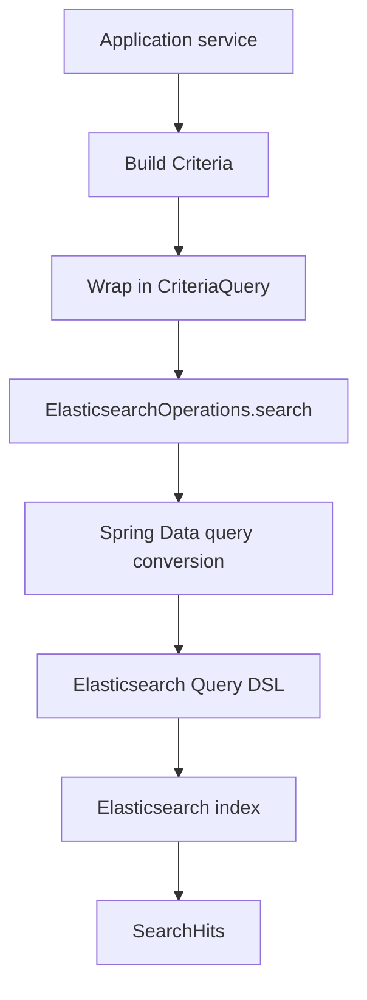

# Criteria and CriteriaQuery for Search Conditions in Java

Spring Data Elasticsearch provides `Criteria` and `CriteriaQuery` to build search conditions in Java. Instead of writing the entire Query DSL as JSON, an application can describe conditions using Java objects such as exact matches, price ranges, statuses, keywords, and AND/OR combinations.

`Criteria` represents field conditions and how conditions are combined. `CriteriaQuery` wraps that condition tree into a query object that `ElasticsearchOperations` can execute. This approach fits queries that have a relatively clear structure and can be expressed using the operators supported by Criteria.

Criteria is not a full replica of the Elasticsearch Query DSL. For complex queries such as nested queries, aggregations, scripts, function scores, or specialized DSL constructs, consider `NativeQuery` or the Elasticsearch Java Client API. Choosing the right abstraction keeps code readable while preserving control over the query.

## 1. Criteria and CriteriaQuery in the Spring Data Architecture

Suppose an application manages a product catalog. Users can filter products by status, category, maximum price, name keyword, and sort results by price.

Execution flow:



The components have distinct responsibilities:

| Component | Responsibility |
|---|---|
| `Criteria` | Represents fields, operators, values, and AND/OR relationships |
| `CriteriaQuery` | Wraps Criteria into an executable query; can combine pagination/sorting |
| `ElasticsearchOperations` | Sends the query to Elasticsearch and maps results back to entities |
| `SearchHits<T>` | Holds hits along with metadata such as total hits, score, and entity content |

## 2. Declaring the Entity and Mapping Before Building Criteria

Criteria references field names in the Elasticsearch mapping. Therefore, you first need to know the entity and mapping being used.

```java
import org.springframework.data.annotation.Id;
import org.springframework.data.elasticsearch.annotations.Document;
import org.springframework.data.elasticsearch.annotations.Field;
import org.springframework.data.elasticsearch.annotations.FieldType;

@Document(indexName = "products")
public class Product {

    @Id
    private String id;

    @Field(type = FieldType.Keyword)
    private String sku;

    @Field(type = FieldType.Text)
    private String name;

    @Field(type = FieldType.Keyword)
    private String category;

    @Field(type = FieldType.Keyword)
    private String status;

    @Field(type = FieldType.Double)
    private Double price;

    @Field(type = FieldType.Boolean)
    private Boolean available;

    protected Product() {
    }

    // Constructors and accessors omitted for brevity.
}
```

The corresponding mapping could be:

```json
PUT /products
{
  "mappings": {
    "properties": {
      "sku": { "type": "keyword" },
      "name": { "type": "text" },
      "category": { "type": "keyword" },
      "status": { "type": "keyword" },
      "price": { "type": "double" },
      "available": { "type": "boolean" }
    }
  }
}
```

Field names in Criteria must match the field mapping. If an entity has a Java property `productStatus` that is mapped to `status`, Criteria needs to reference the Elasticsearch field name that Spring Data uses according to its metadata, rather than arbitrarily taking the Java name and assuming both sides are always identical.

## 3. Creating Basic Criteria

`Criteria` belongs to the package `org.springframework.data.elasticsearch.core.query`. You can create a Criteria for a field using the constructor that accepts a field name:

```java
import org.springframework.data.elasticsearch.core.query.Criteria;

Criteria criteria = new Criteria("status").is("ACTIVE");
```

The condition above requires the `status` field to have the value `ACTIVE`. You can create Criteria for other data types:

```java
Criteria byCategory = new Criteria("category").is("keyboard");

Criteria byPrice = new Criteria("price").lessThanEqual(500000);

Criteria available = new Criteria("available").is(true);
```

These expressions describe conditions; they do not yet send a request to Elasticsearch. To execute them, you need to create a `CriteriaQuery` and call `ElasticsearchOperations`.

## 4. Commonly Used Operators

Criteria supports many common condition types. Usage must align with the field's mapping.

### 4.1 Exact Matching with `is`

`is(value)` represents the condition that a field equals a given value:

```java
Criteria criteria = new Criteria("status").is("ACTIVE");
```

For `keyword` fields, `is` is usually suitable for exact matching such as status, category, SKU, or identifiers. For `text` fields, semantics depend on how Criteria translates the condition and on the mapping/analyzer; `is` should not be treated as full-text search. To search text content, typically use a search operator such as `matches`.

### 4.2 Negation with `isNot` or `not`

You can express the condition that a field does not equal a value:

```java
Criteria criteria = new Criteria("status").isNot("DELETED");
```

Or use negation according to the Criteria syntax supported by your version:

```java
Criteria criteria = new Criteria("status").not().is("DELETED");
```

Choose a consistent style matching your project's API version. Negation often has different semantics from a field that does not exist or has a null value. If you need to check field existence, use `exists()`/`doesNotExist()` according to the Criteria API.

### 4.3 Greater Than and Less Than Comparisons

For numeric or date fields, you can use:

```java
Criteria minPrice = new Criteria("price").greaterThan(100000);

Criteria maxPrice = new Criteria("price").lessThan(500000);

Criteria minOrEqual = new Criteria("price").greaterThanEqual(100000);

Criteria maxOrEqual = new Criteria("price").lessThanEqual(500000);
```

These operators correspond to range conditions. The field must have an appropriate type, such as `double`, `long`, or `date`. If `price` is mapped as `keyword`, comparisons may not have the intended numeric semantics.

### 4.4 Value Ranges with `between`

To find prices within a range:

```java
Criteria priceRange = new Criteria("price").between(100000, 500000);
```

`between` expresses a range condition according to Criteria's semantics. If business logic needs to explicitly distinguish inclusive vs. exclusive bounds, check the chosen operator and the generated query; you can use `greaterThan`, `greaterThanEqual`, `lessThan`, or `lessThanEqual` to state each bound explicitly.

Example of an open interval on both ends:

```java
Criteria priceRange = new Criteria("price")
    .greaterThan(100000)
    .lessThan(500000);
```

### 4.5 Value Sets with `in` and `notIn`

When a field can take one of several values:

```java
Criteria categories = new Criteria("category")
    .in("keyboard", "mouse", "monitor");
```

Or pass a collection:

```java
List<String> statuses = List.of("ACTIVE", "FEATURED");
Criteria statusCriteria = new Criteria("status").in(statuses);
```

To exclude a set of values, use the `notIn` operator if appropriate for your version:

```java
Criteria excluded = new Criteria("status").notIn("DELETED", "ARCHIVED");
```

For an empty input collection, clearly define the business meaning before building Criteria. An empty set might mean "no filter", "no results", or "invalid input"; do not let the semantics depend on how the framework handles an empty list.

### 4.6 Full-Text Search with `matches`

For `text` fields, use the appropriate search operator:

```java
Criteria nameCriteria = new Criteria("name").matches("mechanical keyboard");
```

`matches` represents content-based search and is typically translated into a match query. The field analyzer and search analyzer affect which tokens match.

Do not confuse `matches` with an exact comparison of the entire string. Text search usually relies on tokens, relevance, and analyzers. If you need an exact match for a normalized name, you may need a `keyword` multi-field or a separate keyword field.

### 4.7 `contains`, `startsWith`, and `endsWith`

Criteria provides string operators such as `contains`, `startsWith`, and `endsWith` in supported APIs. They are commonly used to express string/pattern conditions, though their semantics and generated queries depend on the field type and version.

```java
Criteria contains = new Criteria("sku").contains("1001");

Criteria prefix = new Criteria("sku").startsWith("SKU-");

Criteria suffix = new Criteria("sku").endsWith("1001");
```

For `keyword` fields, prefix/suffix or contains can lead to pattern/wildcard queries. Leading wildcards can be resource-intensive on large indices. If prefix searching is frequent, consider an appropriate mapping/analyzer such as edge n-gram or a dedicated search field.

Do not use string operators as if they were in-memory substring operations on a Java `String`. They are executed by Elasticsearch according to the semantics of the generated query.

### 4.8 Checking Field Existence

You can express conditions for whether a field exists or does not exist:

```java
Criteria hasDescription = new Criteria("description").exists();

Criteria missingDescription = new Criteria("description").doesNotExist();
```

A field missing from `_source`, a field with a null value, and an unindexed field can behave differently depending on the mapping and how documents are written. If business logic depends strictly on null/missing state, determine how data is serialized and query directly to verify.

## 5. Combining Multiple Conditions with AND

By default, conditions chained with `and` require documents to satisfy all conditions.

For example, finding active, in-stock products priced at no more than 500,000:

```java
Criteria criteria = new Criteria("status").is("ACTIVE")
    .and("available").is(true)
    .and("price").lessThanEqual(500000);
```

You can also compose conditions from separate Criteria instances:

```java
Criteria status = new Criteria("status").is("ACTIVE");
Criteria availability = new Criteria("available").is(true);
Criteria price = new Criteria("price").lessThanEqual(500000);

Criteria criteria = status.and(availability).and(price);
```

Separating variables makes code easier to read when each condition is built from its own logic. When writing dynamic queries, only add a condition when the input actually has a value and has been validated.

## 6. Combining Conditions with OR

`or` represents alternative conditions: a document satisfying one branch can be selected.

For example, finding products with status ACTIVE or FEATURED:

```java
Criteria criteria = new Criteria("status").is("ACTIVE")
    .or("status").is("FEATURED");
```

Or building separate Criteria branches:

```java
Criteria active = new Criteria("status").is("ACTIVE");
Criteria featured = new Criteria("status").is("FEATURED");

Criteria criteria = active.or(featured);
```

When both AND and OR are present, actively group conditions to express the intended business logic. For example, the requirement:

`category = keyboard AND (status = ACTIVE OR status = FEATURED)`

can be expressed using one Criteria for the status group and then combining it with category:

```java
Criteria statusGroup = new Criteria("status").is("ACTIVE")
    .or(new Criteria("status").is("FEATURED"));

Criteria criteria = new Criteria("category").is("keyboard")
    .and(statusGroup);
```

For queries with multiple levels of conditions, split them into variables whose names reflect the logical groups. Do not write a long chain where readers cannot easily tell which conditions belong to the same group.

### 6.1 Verifying Boolean Logic

Suppose the required condition is:

```text
(category = keyboard)
AND
(status = ACTIVE OR status = FEATURED)
AND
(price <= 500000)
```

Before executing, write out the condition as a logical expression or decision table. A common mistake is joining all Criteria with `or`, producing broader results than expected; or joining all conditions with `and`, yielding empty results due to mutually exclusive values.

Criteria provides a way to assemble conditions in Java, but the author remains responsible for the final boolean logic. For important queries, verify the generated query or run integration tests with data covering both matching and non-matching cases.

## 7. Creating CriteriaQuery and Executing with ElasticsearchOperations

Once you have a Criteria, create a `CriteriaQuery`:

```java
import org.springframework.data.elasticsearch.core.query.Criteria;
import org.springframework.data.elasticsearch.core.query.CriteriaQuery;

Criteria criteria = new Criteria("status").is("ACTIVE")
    .and("available").is(true)
    .and("price").lessThanEqual(500000);

CriteriaQuery query = new CriteriaQuery(criteria);
```

Execute via `ElasticsearchOperations`:

```java
import org.springframework.data.elasticsearch.core.ElasticsearchOperations;
import org.springframework.data.elasticsearch.core.SearchHits;

public class ProductSearchService {

    private final ElasticsearchOperations operations;

    public ProductSearchService(ElasticsearchOperations operations) {
        this.operations = operations;
    }

    public SearchHits<Product> findAvailableProducts() {
        Criteria criteria = new Criteria("status").is("ACTIVE")
            .and("available").is(true)
            .and("price").lessThanEqual(500000);

        CriteriaQuery query = new CriteriaQuery(criteria);
        return operations.search(query, Product.class);
    }
}
```

`operations.search(query, Product.class)` sends the query to the index determined by the `Product` entity metadata and converts each hit into a `Product`. `SearchHits<Product>` contains more information than a list of entities, such as total hits and scores.

If you only need the list of entities, you can map from `SearchHits`:

```java
List<Product> products = operations.search(query, Product.class)
    .getSearchHits()
    .stream()
    .map(SearchHit::getContent)
    .toList();
```

## 8. Pagination and Sorting

CriteriaQuery can be combined with `Pageable` to limit the number of results and choose ordering.

```java
import org.springframework.data.domain.PageRequest;
import org.springframework.data.domain.Sort;

Criteria criteria = new Criteria("status").is("ACTIVE");
CriteriaQuery query = new CriteriaQuery(criteria);

query.setPageable(PageRequest.of(
    0,
    20,
    Sort.by(Sort.Order.asc("price"))
));

SearchHits<Product> hits = operations.search(query, Product.class);
```

`PageRequest.of(0, 20, ...)` requests the first page with at most 20 results, sorted by price ascending. Page indices are zero-based.

The field used for sorting must support sorting in the mapping. For `text`, you typically need to sort on a `keyword` multi-field rather than the analyzed text field. For numbers and dates, use fields with the corresponding numeric/date type.

### 8.1 Input-Driven Pagination

A service may accept page and size from a request, but it must cap the maximum size:

```java
int page = Math.max(requestedPage, 0);
int size = Math.min(Math.max(requestedSize, 1), 100);

Pageable pageable = PageRequest.of(
    page,
    size,
    Sort.by(Sort.Direction.DESC, "price")
);

CriteriaQuery query = new CriteriaQuery(criteria);
query.setPageable(pageable);
```

Do not accept an arbitrary unbounded size directly from the client. Overly large result sets can increase network traffic, heap usage, and processing time.

### 8.2 Offset Pagination Has Limits

Pageable typically uses offset (`from`) and `size`. For deep queries, Elasticsearch must process preceding results to build later pages, which can be resource-intensive. For very large result sets or deep scrolling, consider `search_after` and point in time according to your version's capabilities. CriteriaQuery is not necessarily the right abstraction for every advanced pagination style.

## 9. Building Dynamic Criteria from Optional Filters

In search APIs, users may enter only a few filters. Do not add conditions with null values or empty strings unless that carries business meaning.

Example request:

```java
public record ProductSearchRequest(
    String category,
    String status,
    Double minPrice,
    Double maxPrice,
    Boolean available,
    String keyword
) {
}
```

A controllable approach is to build a list of conditions and then combine them:

```java
List<Criteria> filters = new ArrayList<>();

if (request.category() != null && !request.category().isBlank()) {
    filters.add(new Criteria("category").is(request.category()));
}

if (request.status() != null && !request.status().isBlank()) {
    filters.add(new Criteria("status").is(request.status()));
}

if (request.minPrice() != null) {
    filters.add(new Criteria("price").greaterThanEqual(request.minPrice()));
}

if (request.maxPrice() != null) {
    filters.add(new Criteria("price").lessThanEqual(request.maxPrice()));
}

if (request.available() != null) {
    filters.add(new Criteria("available").is(request.available()));
}

if (request.keyword() != null && !request.keyword().isBlank()) {
    filters.add(new Criteria("name").matches(request.keyword().trim()));
}

if (filters.isEmpty()) {
    throw new IllegalArgumentException("At least one search filter is required");
}

Criteria criteria = filters.get(0);

for (int i = 1; i < filters.size(); i++) {
    criteria = criteria.and(filters.get(i));
}
```

The example above chooses a policy requiring at least one filter. If business rules allow searching without any filter, handle that case explicitly using a match-all query or the API appropriate for your version; do not create a dummy condition on an unrelated field just to initialize Criteria.

## 10. Criteria and Mapping: Choosing Operators by Field Type

Criteria is converted into an Elasticsearch query; the mapping determines field semantics. An operator that is syntactically valid in Java can still be inappropriate for the field type.

| Field mapping | Need | Recommended usage |
|---|---|---|
| `keyword` | Exact matching for status/code | `is`, `in`, `notIn` |
| `text` | Content search | `matches` or an appropriate text query |
| `double`, `long`, `integer` | Numeric/range comparisons | `greaterThan`, `lessThan`, `between` |
| `date` | Time-range filtering | Range operators with an appropriate date type |
| `boolean` | Status flag filtering | `is(true/false)` |

### 10.1 `text` Is Not Like `keyword`

`text` fields are typically split into tokens by an analyzer. Content queries should use full-text search operators. `keyword` fields preserve the value as an exact term and are suitable for filtering, sorting, and aggregations.

For example, if `name` is mapped as `text` and `status` as `keyword`:

```java
Criteria criteria = new Criteria("name").matches("mechanical keyboard")
    .and("status").is("ACTIVE");
```

Do not use `is("mechanical keyboard")` on `text` expecting it to automatically match any document containing those words. If exact matching on the full name string is needed, design a `keyword` multi-field and query the sub-field directly.

### 10.2 Date and Timezone

For `date` fields, pass values with a type and format compatible with the mapping. Align on timezone conventions and distinguish between `LocalDate`, `LocalDateTime`, `Instant`, or `OffsetDateTime`. A calendar-day range may need to be converted into start and end instants in the business timezone before building Criteria.

Conceptual example:

```java
Criteria dateRange = new Criteria("createdAt")
    .greaterThanEqual(startInstant)
    .lessThan(endInstant);
```

Ensure the Java type is supported by Spring Data converters and that the index's date mapping has a compatible format.

## 11. Search Results: SearchHits

`ElasticsearchOperations.search(...)` typically returns `SearchHits<T>`, not directly `List<T>`. Each `SearchHit<T>` holds the entity along with search result metadata.

```java
SearchHits<Product> searchHits = operations.search(query, Product.class);

long total = searchHits.getTotalHits();

for (SearchHit<Product> hit : searchHits) {
    Product product = hit.getContent();
    float score = hit.getScore();

    System.out.println(product.getName() + " score=" + score);
}
```

Useful metadata includes:

- `getContent()`: the entity mapped from `_source`.
- `getScore()`: relevance score if the query performs scoring.
- `getId()`: document ID.
- `getIndex()`: the index containing the hit.
- `getTotalHits()`: total hit count according to the response and total-hit tracking.

If you only need the entities, you can map `SearchHit::getContent`. If you need the score, ID, or source index, retain `SearchHits`/`SearchHit` instead of immediately converting to an entity list.

## 12. Organizing Criteria in a Service

To make code easier to test, separate building Criteria from executing the query. Example:

```java
import org.springframework.data.domain.PageRequest;
import org.springframework.data.domain.Sort;
import org.springframework.data.elasticsearch.core.ElasticsearchOperations;
import org.springframework.data.elasticsearch.core.SearchHits;
import org.springframework.data.elasticsearch.core.query.Criteria;
import org.springframework.data.elasticsearch.core.query.CriteriaQuery;

public class ProductSearchService {

    private final ElasticsearchOperations operations;

    public ProductSearchService(ElasticsearchOperations operations) {
        this.operations = operations;
    }

    public SearchHits<Product> search(String category, Double maxPrice) {
        Criteria criteria = new Criteria("status").is("ACTIVE");

        if (category != null && !category.isBlank()) {
            criteria = criteria.and("category").is(category);
        }

        if (maxPrice != null) {
            criteria = criteria.and("price").lessThanEqual(maxPrice);
        }

        CriteriaQuery query = new CriteriaQuery(criteria);
        query.setPageable(PageRequest.of(
            0,
            20,
            Sort.by(Sort.Direction.ASC, "price")
        ));

        return operations.search(query, Product.class);
    }
}
```

Here the `status = ACTIVE` condition is always applied. Category and maxPrice are only added when provided by the user. Page size is capped at 20 and sorted by `price`.

If filters have multiple AND/OR groups or logic that varies by user role, create small helper methods such as `buildStatusCriteria`, `buildPriceCriteria`, and `buildTextCriteria`. Method names should reflect business meaning rather than just operator names.

## 13. When Is CriteriaQuery Not Enough?

CriteriaQuery fits queries that can be expressed with Criteria's operator set. However, the Elasticsearch Query DSL has many features that Criteria does not cover or does not express conveniently.

Consider `NativeQuery`/Java Client when you need:

- Complex nested queries, nested sorting, or `inner_hits`.
- Multi-level aggregations, pipeline aggregations, or composite aggregations.
- Script queries, script scores, or function scores.
- Highlighting, collapsing, rescoring, or specialized search options.
- Query DSL requiring exact control over `bool`, `minimum_should_match`, `dis_max`, or complex nested structures.
- Newer Elasticsearch features not yet supported by your Spring Data version's Criteria API.

Criteria does not remove Spring Data's extensibility; it is a convenient abstraction for a specific query scope. You can use Criteria for simple filters and `NativeQuery` for another advanced search endpoint.

For example, with the modern Java Client API, a native query can be constructed using the builder corresponding to your Spring Data version:

```java
import org.springframework.data.elasticsearch.client.elc.NativeQuery;
import org.springframework.data.elasticsearch.core.query.Query;

Query query = NativeQuery.builder()
    .withQuery(q -> q.bool(b -> b
        .filter(f -> f.term(t -> t
            .field("status")
            .value("ACTIVE")
        ))
        .filter(f -> f.range(r -> r
            .number(n -> n
                .field("price")
                .lte(500000)
            )
        ))
    ))
    .build();
```

This is the API style using the modern Elasticsearch Java Client; specific packages and builders depend on the Spring Data Elasticsearch/client version. Use the dependency version managed by Spring Boot and consult the corresponding Javadoc.

## 14. Testing CriteriaQuery

Criteria builders can be tested using integration tests against a real Elasticsearch instance or a compatible test environment. What needs verification is not only that the Java code produces a query, but that the query has the right semantics against the actual mapping and data.

A test dataset should cover cases such as:

- ACTIVE products matching the category and below maxPrice.
- ACTIVE products exceeding maxPrice.
- INACTIVE products matching category/price.
- Products in another category.
- Missing or null optional fields according to application semantics.
- Multi-token names to verify `matches` and the analyzer.

Verify:

1. Results satisfy all AND conditions.
2. OR branches return the expected result set.
3. Numeric ranges handle inclusive/exclusive bounds properly.
4. Sorting works properly with the mapping.
5. Pageable returns the right page and size.
6. Text and keyword fields are queried with the right operators.
7. Behavior when no filters are provided is clearly defined.

If results are incorrect, run the equivalent Query DSL directly against Elasticsearch and inspect the mapping via `GET /index/_mapping`. This helps distinguish bugs in Criteria logic from field mapping or input data issues.

## 15. Common Pitfalls

### 15.1 Using the Wrong Field Name

Criteria references Elasticsearch fields. If the mapping uses `product_status` while the code queries `productStatus`, the query may not return expected results. Verify the mapping and field names after conversion.

### 15.2 Using Exact Match on a Text Field

`text` fields are processed by an analyzer. Exact matching is usually appropriate for `keyword`. Use `matches` for text content search and `is` for exact values per the mapping.

### 15.3 Confusing AND and OR

An OR condition placed in the wrong group can broaden results unexpectedly. Split Criteria groups into separate variables and write down the logical expression clearly before execution.

### 15.4 Adding Null or Empty Filters

If a request omits category, do not create `category.is(null)` unless business logic genuinely wants to match null fields. Only add Criteria when input is valid and meaningful.

### 15.5 Not Capping Page Size

Large page sizes can create heavy responses. Enforce a size limit at the API layer and consider cursor/`search_after` for deep queries.

### 15.6 Using Criteria for Overly Complex Queries

If you have to work around Criteria to express nested queries, aggregations, or advanced DSL, switching to `NativeQuery`/Java Client will be clearer.

### 15.7 Assuming Criteria Fixes the Mapping

Criteria only describes the query. It does not create fields, change field types, or transform data in the index. Mappings must be managed separately.

## 16. Usage Guidelines

- Use `Criteria` to describe field conditions in Java.
- Use `CriteriaQuery` to wrap conditions before calling `ElasticsearchOperations`.
- Choose operators based on mapping: exact match for keyword, full-text match for text, range for numbers/dates.
- Separate AND/OR groups into clearly named variables.
- Only add dynamic conditions when input is valid and meaningful.
- Use bounded `Pageable` and sorting; sort fields must support sorting in the mapping.
- Read `SearchHits<T>` when score, ID, and metadata are needed; convert to an entity list when only content is needed.
- Verify queries against representative test data and real mappings.
- Use `NativeQuery`/Java Client when advanced DSL is needed that Criteria does not express well.

## 17. Summary

`Criteria` is a Java API for describing field conditions and combining them with AND/OR. `CriteriaQuery` wraps Criteria into a query that `ElasticsearchOperations` can execute. With operators such as `is`, `in`, `between`, `greaterThan`, `lessThan`, `matches`, and existence checks, applications can build many common CRUD/search filters without writing JSON DSL directly.

When building queries, mapping remains the foundation that determines semantics. `keyword` fits exact matches, `text` fits full-text search, and numbers/dates fit ranges and sorting. AND/OR condition groups should be structured clearly to avoid logic bugs; optional filters should be added intentionally; pagination should be bounded. For nested queries, aggregations, and complex DSL, use a stronger query abstraction such as `NativeQuery` rather than forcing every requirement into Criteria.

## References

- [Spring Data Elasticsearch Reference — Search Operations](https://docs.spring.io/spring-data/elasticsearch/reference/elasticsearch/template.html)
- [Spring Data Elasticsearch Reference — Query Methods](https://docs.spring.io/spring-data/elasticsearch/reference/elasticsearch/repositories/elasticsearch-repositories.html)
- [Spring Data Elasticsearch API — Criteria](https://docs.spring.io/spring-data/elasticsearch/docs/current/api/org/springframework/data/elasticsearch/core/query/Criteria.html)
- [Spring Data Elasticsearch API — CriteriaQuery](https://docs.spring.io/spring-data/elasticsearch/docs/current/api/org/springframework/data/elasticsearch/core/query/CriteriaQuery.html)
