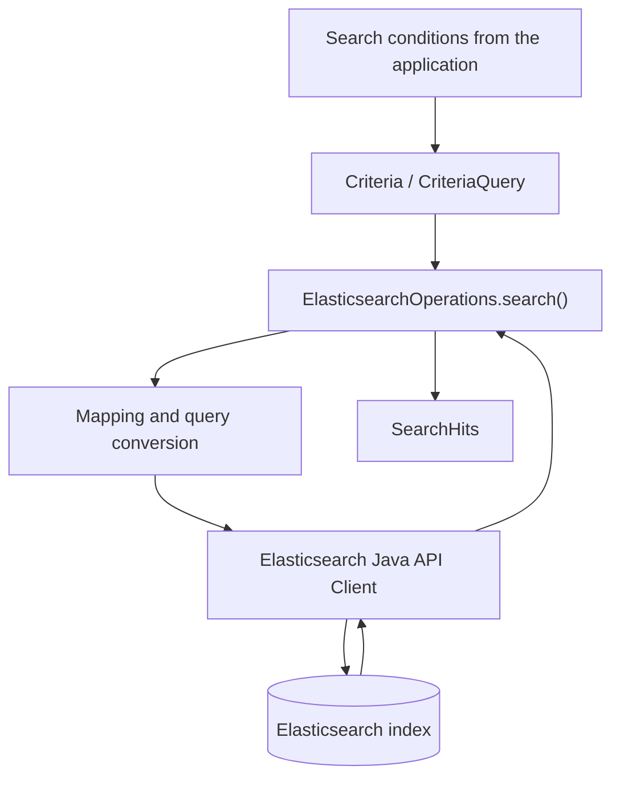
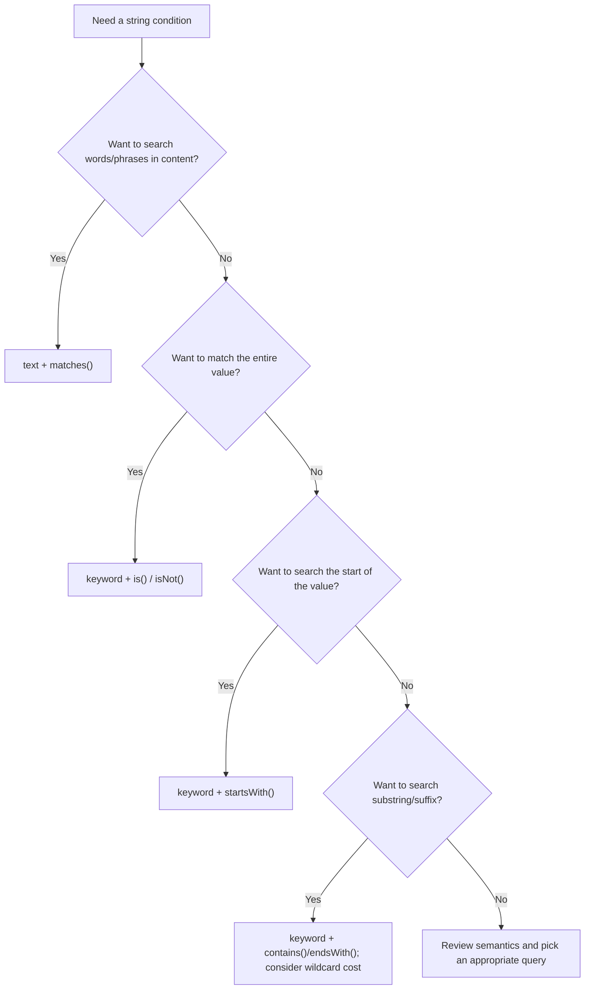

# String Conditions and Mapping Dependency

`CriteriaQuery` in Spring Data Elasticsearch lets you compose search conditions using a Java API instead of manually writing the entire Query DSL. When conditions operate on strings, results depend directly on the field **mapping**: `text` is analyzed into tokens, `keyword` preserves the value as a single term, an analyzer may change case or split words, and a normalizer normalizes a keyword value.

Therefore, the same Criteria expression can produce different results depending on whether the field is mapped as `text` or `keyword`. To use Criteria properly, you need to understand what each predicate expresses, which field type it suits, and how Elasticsearch has indexed the data.

## 1. Where Does CriteriaQuery Fit in Spring Data Elasticsearch?

Spring Data Elasticsearch provides `ElasticsearchOperations` to execute queries. `CriteriaQuery` is a `Query` implementation built from `Criteria` objects.

Basic flow:



`Criteria` describes a condition by field and operator. `CriteriaQuery` wraps that condition into a query that Operations can execute. Operations converts the query using the mapping context, calls Elasticsearch, and maps results into Java entities.

Minimal example:

```java
import org.springframework.data.elasticsearch.core.query.Criteria;
import org.springframework.data.elasticsearch.core.query.CriteriaQuery;
import org.springframework.data.elasticsearch.core.query.Query;

Criteria criteria = Criteria.where("category").is("audio");
Query query = new CriteriaQuery(criteria);

SearchHits<ProductDocument> hits = operations.search(
    query,
    ProductDocument.class
);
```

The example uses `is` to filter a category value. To understand why this query behaves as expected, we first need to see how the `category` field is mapped.

## 2. Mapping Determines the Meaning of String Conditions

Suppose a product document has the following fields:

```json
{
  "name": "Wireless Headphones",
  "category": "Audio Equipment",
  "sku": "WH-1001"
}
```

All three fields are strings in JSON, but their usage differs:

| Field | Usage | Appropriate mapping |
|---|---|---|
| `name` | Search by words or phrases in the name | `text` |
| `category` | Exact filtering by category | `keyword` |
| `sku` | Exact lookup of product code | `keyword` |

### 2.1. `text` Is Analyzed into Tokens

A `text` field uses an analyzer during indexing and during compatible full-text queries. The analyzer can lowercase text, split words, handle punctuation, or apply other token filters.

For example, the standard analyzer can transform:

```text
Input:  "Wireless Headphones"
Tokens: ["wireless", "headphones"]
```

Elasticsearch indexes those tokens rather than storing a single term with the verbatim text `Wireless Headphones` for a `text` field. Thus, a `match` on `wireless` can find the document; an exact term query for the verbatim phrase usually will not match because that term does not exist in the inverted index.

### 2.2. `keyword` Preserves the Value as a Single Term

A `keyword` field is indexed as a single intact value. For the string `Audio Equipment`, the stored term is that entire value (after a normalizer if configured), not split into two tokens `audio` and `equipment`.

This is the right choice for exact filters, sorting, aggregations, SKUs, statuses, and categories. If full-text search is needed on a `keyword` field, keep in mind that the query will not automatically perform word tokenization like it does on a `text` field.

### 2.3. Declaring Mappings in Spring Data

```java
import org.springframework.data.annotation.Id;
import org.springframework.data.elasticsearch.annotations.Document;
import org.springframework.data.elasticsearch.annotations.Field;
import org.springframework.data.elasticsearch.annotations.FieldType;
import org.springframework.data.elasticsearch.annotations.InnerField;
import org.springframework.data.elasticsearch.annotations.MultiField;

@Document(indexName = "products")
public class ProductDocument {

    @Id
    private String id;

    @MultiField(
        mainField = @Field(type = FieldType.Text, analyzer = "standard"),
        otherFields = {
            @InnerField(suffix = "raw", type = FieldType.Keyword)
        }
    )
    private String name;

    @Field(type = FieldType.Keyword)
    private String category;

    @Field(type = FieldType.Keyword)
    private String sku;

    protected ProductDocument() {
    }
}
```

In this example:

- `name` is a `text` field for full-text search.
- `name.raw` is a `keyword` multi-field for exact matching or sorting.
- `category` and `sku` are `keyword` because they are used as classification/identifier values.

A multi-field does not require an extra Java property. The same `name` value is indexed in multiple ways to serve multiple query types.

## 3. Common String Predicates in Criteria

The Criteria API provides string conditions such as `is`, `isNot`, `matches`, `contains`, `startsWith`, `endsWith`, and `expression`. Method names describe intent, yet mapping still determines which terms or tokens Elasticsearch matches against.

| Predicate | Application-level meaning | Typically suitable mapping |
|---|---|---|
| `is(value)` | Exact value match | `keyword` or a field with appropriate term semantics |
| `isNot(value)` | Exclude exact matching value | `keyword` |
| `matches(text)` | Full-text match via analyzer | `text` |
| `contains(text)` | Substring search using Criteria wildcard/contains semantics | Usually `keyword` when needing a substring of the full value; consider cost |
| `startsWith(prefix)` | Find values starting with prefix | Usually `keyword` or a field designed for prefix |
| `endsWith(suffix)` | Find values ending with suffix | `keyword`, typically requiring wildcard-style matching |
| `expression(query)` | Express a query string in query parser syntax | Field and syntax must be clearly defined |

Predicates can translate into different Elasticsearch query types. Translation details, escaping, and supported overloads may vary across Spring Data Elasticsearch versions. When exact semantics matter, check the API/Javadoc for your project's dependency and inspect the actual request in integration tests.

## 4. `is`: Exact Matching and the Impact of `text`

`is(value)` fits when you want to find an exact value. For example, filtering products by SKU:

```java
Criteria criteria = Criteria.where("sku").is("WH-1001");
Query query = new CriteriaQuery(criteria);

SearchHits<ProductDocument> hits = operations.search(
    query,
    ProductDocument.class
);
```

Because `sku` is mapped as `keyword`, the entire string `WH-1001` is treated as one term and works with exact matching.

If you use `is` on a `text` field, you must understand what terms the analyzer produced. For instance, a `name` field containing `Wireless Headphones` may be indexed as `wireless` and `headphones`. An exact term condition for `Wireless Headphones` is not a character-by-character comparison of `_source` and typically will not match a whole-phrase term. Querying `is("wireless")` may match the `wireless` token, but that is also not a comparison of the full product name.

When you want an exact match on the full name, use the `name.raw` multi-field:

```java
Criteria criteria = Criteria.where("name.raw")
    .is("Wireless Headphones");
```

When you want documents whose category differs from a value, you can use `isNot`:

```java
Criteria criteria = Criteria.where("category")
    .isNot("accessories");
```

Negation conditions must be used carefully: a document missing the field can behave differently from a document with a different value. If business logic requires including or excluding documents without the field, express an explicit existence condition rather than relying solely on `isNot`.

## 5. `matches`: Analyzer-Dependent Full-Text Search

`matches(value)` is used when searching text with full-text semantics. For example, finding products whose name relates to `wireless headphones`:

```java
Criteria criteria = Criteria.where("name")
    .matches("wireless headphones");

Query query = new CriteriaQuery(criteria);
SearchHits<ProductDocument> hits = operations.search(
    query,
    ProductDocument.class
);
```

For a `text` field `name`, Elasticsearch analyzes the query string with the appropriate search analyzer and matches tokens in the inverted index. Results may include documents containing one or more tokens depending on match query semantics and operator configuration.

For example, a lowercase analyzer allows `WIRELESS` and `wireless` to normalize to the same token. However, results also depend on the tokenizer, stop words, stemming, synonyms, and the field's search analyzer.

Do not use `matches` as a substitute for exact matching on SKUs or statuses. For identifiers, using `is` on a `keyword` field expresses the intent properly.

## 6. `startsWith`: Searching by Prefix

`startsWith(prefix)` is useful when users type the beginning of a code or name. For example, finding SKUs starting with `WH-`:

```java
Criteria criteria = Criteria.where("sku")
    .startsWith("WH-");

Query query = new CriteriaQuery(criteria);
SearchHits<ProductDocument> hits = operations.search(
    query,
    ProductDocument.class
);
```

With `sku` as `keyword`, the prefix applies to the intact term. Codes like `WH-1001` and `WH-2002` match, while `XWH-1001` does not.

If used on a `text` field, the prefix applies to the analyzed terms, not the full original string in `_source`. For example, a product name may be tokenized into `wireless` and `headphones`; prefix `head` can act on the `headphones` token depending on the generated query, rather than meaning the name string begins with `head`.

For high-traffic autocomplete or prefix search, design suitable mapping and index settings. Prefix queries can be expensive on high-cardinality fields or large indices; consider `index_prefixes`, edge n-gram, or a specialized search structure if profiling indicates it is needed.

## 7. `contains` and `endsWith`: Substring and Suffix Search

`contains(value)` expresses searching for values containing a substring. `endsWith(value)` expresses searching for values ending with a suffix.

For example, finding SKUs containing `100`:

```java
Criteria criteria = Criteria.where("sku")
    .contains("100");

Query query = new CriteriaQuery(criteria);
SearchHits<ProductDocument> hits = operations.search(
    query,
    ProductDocument.class
);
```

For example, finding codes ending with `001`:

```java
Criteria criteria = Criteria.where("sku")
    .endsWith("001");
```

On `keyword` fields, contains/suffix conditions are typically executed with wildcard semantics over the full term. This is substring matching on the indexed value, not word-based full-text search.

On `text` fields, wildcards operate on the terms produced by the analyzer. They do not scan for an arbitrary substring inside the original `_source`. If substring search across the full value is needed, consider a `keyword` multi-field or a purpose-built mapping.

### 7.1. Cost of Wildcards

Conditions with a leading wildcard, such as `*100*` or `*001`, may have to inspect many terms and become expensive on large indices. Do not use `contains`/`endsWith` as the default search approach for every field.

Consider:

- Using `match` on a `text` field if the goal is searching by words.
- Using `prefix` if you only need to match the beginning of a value.
- Using `keyword` with wildcard when dataset size and query frequency allow.
- Using n-gram or a specialized field type/structure when substring search at scale is required.
- Enforcing length and rate limits on user-entered queries.

## 8. `expression`: Query String Syntax

`expression(value)` lets you express conditions using Elasticsearch query string syntax. It is useful when the application genuinely needs query parser operators and syntax, such as combining keywords with query string operators.

Conceptual example:

```java
Criteria criteria = Criteria.where("name")
    .expression("wireless AND headphones");
```

Query string has its own syntax for parentheses, operators, wildcards, escaping, and fields. Do not pass raw user input verbatim into `expression` without defining how special characters are handled. Users might enter characters with syntactic meaning and unintentionally construct a different query than expected.

If you only need simple full-text search, `matches` is usually easier to understand. If you need rich Query DSL with strong typing, consider `NativeQuery`. Use `expression` when a query parser is an explicit part of the product feature.

## 9. Combining Multiple Conditions with AND and OR

Criteria can combine conditions to build multi-field queries. For example, finding products whose name matches `wireless`, category is exactly `audio`, and SKU starts with `WH-`:

```java
Criteria criteria = Criteria.where("name")
    .matches("wireless")
    .and("category").is("audio")
    .and("sku").startsWith("WH-");

Query query = new CriteriaQuery(criteria);
SearchHits<ProductDocument> hits = operations.search(
    query,
    ProductDocument.class
);
```

Conditions are combined with AND in this Criteria chain: documents must satisfy all three conditions.

When OR is needed, create separate Criteria branches and combine them using the `or(...)` API supported in your Spring Data Elasticsearch version. Illustrative example:

```java
Criteria wireless = Criteria.where("name").matches("wireless");
Criteria bluetooth = Criteria.where("name").matches("bluetooth");

Criteria criteria = new Criteria().or(wireless).or(bluetooth);
Query query = new CriteriaQuery(criteria);
```

For complex nested AND/OR expressions, inspect the generated query structure to ensure condition grouping matches business logic. If the Boolean structure becomes hard to read, `NativeQuery` can express `must`, `should`, `filter`, and `must_not` groups more clearly.

## 10. Mappings with Field Names Different from Java Property Names

Spring Data allows Elasticsearch field names to differ from Java property names via `@Field(name = ...)`:

```java
@Field(name = "product_name", type = FieldType.Text)
private String name;
```

When querying through the entity's mapping context, Spring Data can translate property paths according to declared metadata. With CriteriaQuery, use the proper property path per the entity and verify how your version maps field names. With JSON/NativeQuery Query DSL, you generally must reference the actual field name in the index—in this example, `product_name`.

This is especially important for nested objects or multi-fields:

```java
@MultiField(
    mainField = @Field(type = FieldType.Text),
    otherFields = {
        @InnerField(suffix = "raw", type = FieldType.Keyword)
    }
)
private String name;
```

The sub-field in the index is `name.raw`. Queries must target that sub-field when performing exact matching or sorting. Do not assume `name` and `name.raw` share the same semantics.

## 11. Normalizers and Case Sensitivity

By default, `keyword` fields preserve letter case. Therefore, exact matching on `WH-1001` differs from `wh-1001` unless an appropriate normalizer is configured.

You can declare a lowercase normalizer in index settings:

```json
PUT products
{
  "settings": {
    "analysis": {
      "normalizer": {
        "lowercase_normalizer": {
          "type": "custom",
          "filter": ["lowercase", "asciifolding"]
        }
      }
    }
  },
  "mappings": {
    "properties": {
      "category": {
        "type": "keyword",
        "normalizer": "lowercase_normalizer"
      }
    }
  }
}
```

And reference the normalizer in the entity:

```java
@Field(
    type = FieldType.Keyword,
    normalizer = "lowercase_normalizer"
)
private String category;
```

At index and query time, keyword values are normalized as configured. For example, `Audio`, `AUDIO`, and `audio` can all normalize to the same lowercase form.

Normalizers must be declared in settings before creating the index. You cannot arbitrarily change an existing field's normalizer simply by editing an annotation. For incompatible mapping/settings changes, you may need to create a new index, reindex, and switch aliases.

`asciifolding` converts certain accented characters to ASCII equivalents. It is not a language-aware word segmenter. For Vietnamese, test analyzers/normalizers on real data to verify accent-sensitive/accent-insensitive search requirements and how compound words are handled.

## 12. `text` Analyzers and Differences Between Index and Search

For `text` fields, you can configure the analyzer used at index time and `search_analyzer` used when analyzing query input. The two analyzers can be the same or different depending on the use case.

Example field declaration:

```java
@Field(
    type = FieldType.Text,
    analyzer = "standard",
    searchAnalyzer = "standard"
)
private String description;
```

Analyzers directly affect `matches` and full-text queries. If the index analyzer lowercases text but the search analyzer does not normalize equivalently, results may differ from expectations. When using synonyms, stemming, or stop words, verify both indexing and search behavior.

Elasticsearch provides the Analyze API to inspect tokens:

```http
POST products/_analyze
{
  "field": "name",
  "text": "Wireless Headphones"
}
```

The output shows the tokens, positions, and offsets generated by the analyzer. This is how you determine why a `matches` query matches or does not match a document.

## 13. Building CriteriaQuery in a Service

In real applications, conditions often come from UI filters. You can add Criteria only when the user provides a value:

```java
import org.springframework.data.domain.PageRequest;
import org.springframework.data.elasticsearch.core.ElasticsearchOperations;
import org.springframework.data.elasticsearch.core.SearchHits;
import org.springframework.data.elasticsearch.core.query.Criteria;
import org.springframework.data.elasticsearch.core.query.CriteriaQuery;
import org.springframework.data.elasticsearch.core.query.Query;
import org.springframework.stereotype.Service;

@Service
public class ProductSearchService {

    private final ElasticsearchOperations operations;

    public ProductSearchService(ElasticsearchOperations operations) {
        this.operations = operations;
    }

    public SearchHits<ProductDocument> search(
            String text,
            String category,
            String skuPrefix) {

        Criteria criteria = new Criteria();

        if (text != null && !text.isBlank()) {
            criteria.and("name").matches(text.trim());
        }

        if (category != null && !category.isBlank()) {
            criteria.and("category").is(category.trim());
        }

        if (skuPrefix != null && !skuPrefix.isBlank()) {
            criteria.and("sku").startsWith(skuPrefix.trim());
        }

        Query query = new CriteriaQuery(criteria);
        query.setPageable(PageRequest.of(0, 20));

        return operations.search(query, ProductDocument.class);
    }
}
```

This example illustrates dynamic condition assembly. In production code, verify how an empty Criteria and chained sub-conditions behave in your Spring Data version. If no conditions are present, decide explicitly whether to allow querying the whole index or return a validation error; avoid unintentionally running overly broad queries.

The conditions here have distinct semantics:

- `name.matches(text)` uses full-text search on a `text` field.
- `category.is(category)` uses exact match on a `keyword` field.
- `sku.startsWith(prefix)` uses prefix matching on a `keyword` field.

This example shows how a single CriteriaQuery can combine multiple predicate types, while each field needs a matching mapping.

## 14. When Should You Switch to NativeQuery?

CriteriaQuery works well when conditions are relatively straightforward: exact match, full-text match, prefix, range, and simple AND/OR groups. When queries require capabilities such as complex nested queries, function scores, scripts, aggregations, or multiple nested Boolean branches, `NativeQuery` typically expresses them more clearly.

Example using `NativeQuery` for a query with `must` and `filter`:

```java
import co.elastic.clients.elasticsearch._types.FieldValue;
import org.springframework.data.elasticsearch.client.elc.NativeQuery;
import org.springframework.data.elasticsearch.core.query.Query;

Query query = NativeQuery.builder()
    .withQuery(q -> q
        .bool(b -> b
            .must(m -> m
                .match(match -> match
                    .field("name")
                    .query("wireless headphones")
                )
            )
            .filter(f -> f
                .term(term -> term
                    .field("category")
                    .value(FieldValue.of("audio"))
                )
            )
        )
    )
    .build();
```

`NativeQuery` can still be executed via `ElasticsearchOperations.search(...)`, so results continue to use Spring Data mapping/conversion. Switching to NativeQuery does not change mapping requirements: `name` still needs `text`, and `category` still needs `keyword`.

## 15. Inspecting the Actual Query and Index Mapping

When a CriteriaQuery returns unexpected results, inspect the index structure before changing code.

Read the mapping:

```http
GET products/_mapping
```

Check the analyzer:

```http
POST products/_analyze
{
  "field": "name",
  "text": "Wireless Headphones"
}
```

Inspect a document:

```http
GET products/_doc/PRODUCT_ID
```

In development environments or integration tests, you can enable appropriate logging to view requests sent by Spring Data, or use Elasticsearch profile/query tools to identify the actual Query DSL. Avoid enabling logs containing sensitive data in production.

Check in order:

1. Which property/field is Criteria targeting?
2. Is the field's actual mapping `text`, `keyword`, or another type?
3. What terms did the analyzer/normalizer produce from the data?
4. Is the predicate generating exact, full-text, prefix, or wildcard semantics?
5. Does the value in `_source` match what the application expects?

## 16. Common Pitfalls

| Symptom | Possible cause | How to fix |
|---|---|---|
| `is("Wireless Headphones")` does not match a `text` field | The analyzer split the string into separate tokens | Use a `keyword` multi-field for exact match or `matches` for full-text. |
| `matches` on SKU returns unexpected results | SKU is an identifier, yet the query uses full-text semantics | Use `is` on a `keyword` field. |
| `contains` fails to find a substring in `_source` | Predicate operates on indexed terms, not raw JSON strings | Use a suitable multi-field or design n-grams for substring search. |
| `startsWith` on `text` does not mean start of the full name | Prefix is applied to analyzed tokens | Use `keyword` if prefix matching on the whole value is needed. |
| Case differences break exact matches | Keyword lacks an appropriate normalizer | Declare a normalizer and create the matching mapping. |
| Results change after editing an annotation | Existing index still keeps the old mapping | Inspect mapping; create a new index/reindex if changes are incompatible. |
| Wildcard query is slow | `contains`/`endsWith` may need to scan many terms | Limit use cases, use prefix/full-text, or design a dedicated index. |
| Wrong field queried when using `@Field(name=...)` | Confusing Java property name with Query DSL field name | Check the mapping context and use the right name for the query type. |
| OR/AND produces unexpected logical results | Nested Criteria groups differ from intent | Inspect generated query or use NativeQuery with explicit bool clauses. |

## 17. Guidelines for Choosing Predicates by Mapping



A practical workflow:

1. Determine whether the field represents prose text, an identifier, or a categorical value.
2. Choose `text`, `keyword`, or a multi-field based on query needs.
3. Choose the matching predicate: `matches` for full-text; `is` for exact; `startsWith` for prefix; `contains`/`endsWith` only when wildcard-style matching is truly required.
4. Define analyzers or normalizers and verify with `_analyze` when needed.
5. Verify the index's actual mapping, not just Java annotations.
6. Test with case variations, accents, whitespace, punctuation, and boundary strings.
7. Benchmark wildcard/prefix queries on production-like data.

## 18. Conclusion

`CriteriaQuery` helps describe search conditions with a Java API and execute them via `ElasticsearchOperations`. For string conditions, mapping determines how Elasticsearch sees values: `text` is turned into tokens by an analyzer, `keyword` keeps the term intact, and a normalizer can normalize that term.

Use `matches` when full-text search on `text` is needed; use `is`/`isNot` for exact matching on `keyword`; use `startsWith` for prefixes; only use `contains` or `endsWith` when wildcard-style matching is genuinely necessary and its cost has been evaluated. When the same field requires multiple query styles, a multi-field is usually the right fit.

When a query does not return expected results, check the mapping, analyzer/normalizer, and generated query before modifying conditions. Understanding the link between Criteria and mappings keeps queries accurate, maintainable, and free of costly wildcard queries on large indices.
