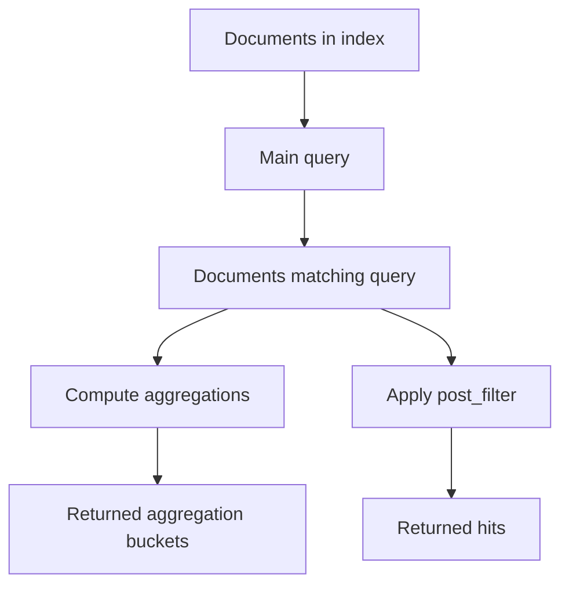
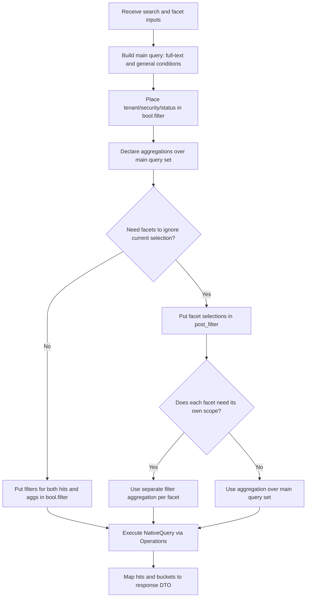

# Combining Queries, Filters, and post_filter

In Elasticsearch, a single search request can both select documents to return and compute aggregations for statistics or UI filters. When using **`NativeQuery`** in Spring Data Elasticsearch, you must distinguish three places where conditions can be placed: the main query, `bool.filter` inside the query, and `post_filter` at the search request level.

The most important difference is the scope of application:

- `query` determines the set of documents searched, can calculate relevance scores, and serves as the input for aggregations.
- `bool.filter` is a filtering condition inside the main query. It restricts both hits and the data used to compute aggregations, without contributing to relevance scores.
- `post_filter` filters the hit list after aggregations have already been computed. It affects the returned hits, but does not narrow the document set for aggregations.

`post_filter` is especially useful for faceted navigation search UIs: users select a category to narrow the product list while facet counters continue to display counts across other categories in the broader result set.

## 1. Context: A Multi-Part Search Request

Suppose the application has a `products` index with these fields:

| Field | Mapping | Role |
|---|---|---|
| `name` | `text` | Full-text search on product name. |
| `category` | `keyword` | Filtering and aggregation by category. |
| `brand` | `keyword` | Filtering and aggregation by brand. |
| `tenantId` | `keyword` | Restricting data by tenant. |
| `price` | `double` or suitable numeric type | Price range filtering and price statistics. |

A search screen may need to:

1. Search for products whose name relates to `wireless`.
2. Return only products belonging to the current tenant.
3. Return at most 20 hits.
4. Compute product counts by category and brand to display facets.
5. If the user selects category `audio`, return only hits in that category, while keeping facet counts over the broader result set so the user can continue changing their selection.

A search request can contain `query`, `aggs`, and `post_filter`:

```json
GET products/_search
{
  "query": {
    "bool": {
      "must": [
        { "match": { "name": "wireless" } }
      ],
      "filter": [
        { "term": { "tenantId": "tenant-7" } }
      ]
    }
  },
  "aggs": {
    "categories": {
      "terms": { "field": "category" }
    },
    "brands": {
      "terms": { "field": "brand" }
    }
  },
  "post_filter": {
    "term": { "category": "audio" }
  },
  "size": 20
}
```

This request means:

- The main query finds documents whose name matches `wireless`.
- `bool.filter` restricts data to tenant `tenant-7`.
- Aggregations run over the documents matching the main query, including the tenant condition.
- `post_filter` restricts only the final hits to category `audio`.
- The `categories` and `brands` aggregations still compute over the result set prior to `post_filter`.

That is the core difference between `bool.filter` and `post_filter`.

## 2. Main Query: Selecting Documents and Computing Relevance

The main query sits in the `query` section of the Search API. It determines which documents participate in the search results and serves as the basis for Elasticsearch to compute relevance scores if the query includes scoring components.

Full-text query example:

```json
{
  "query": {
    "match": {
      "name": "wireless headphones"
    }
  }
}
```

For the `text` field `name`, Elasticsearch analyzes the keywords using the search analyzer and finds documents with matching tokens. The relevance score is used to rank hits.

The main query can also contain `bool` to combine multiple conditions:

| Clause | Effect | Score Impact |
|---|---|---|
| `must` | Document must satisfy the condition | Can contribute to the score. |
| `filter` | Document must satisfy the condition | Does not contribute to the score; suitable for filter conditions. |
| `should` | Condition should match to boost relevance or may become mandatory depending on query structure | Can contribute to the score. |
| `must_not` | Excludes documents satisfying the condition | Does not contribute to the score. |

`bool.filter` fits tenant, status, category, price range, or mandatory conditions that do not require relevance scoring. Full-text queries are typically placed in `must` or `should` depending on semantics.

## 3. `bool.filter`: Filtering Before Computing Aggregations

`bool.filter` is a clause inside the main query:

```json
GET products/_search
{
  "query": {
    "bool": {
      "must": [
        { "match": { "name": "wireless" } }
      ],
      "filter": [
        { "term": { "tenantId": "tenant-7" } },
        { "term": { "category": "audio" } },
        { "range": { "price": { "gte": 50, "lte": 300 } } }
      ]
    }
  },
  "aggs": {
    "brands": {
      "terms": { "field": "brand" }
    }
  },
  "size": 20
}
```

In this request, only documents satisfying both the `match` query and all three filters are included in the results. The `brands` aggregation also counts brands only within the documents passing those filters.

Place a condition in `bool.filter` when it needs to restrict both hits and aggregations. Examples:

- Tenant or data scope of the current user.
- Data access permissions that must apply to the entire request.
- Record status must be `PUBLISHED`.
- Time or price range applying to all results and facets.

In particular, tenant and access-control conditions must be applied in the main query if aggregations must not leak counts outside the user's scope. Never put critical security conditions only in `post_filter`, because aggregations can still reflect documents excluded from hits.

## 4. `post_filter`: Filtering Hits After Aggregations Are Computed

`post_filter` is a separate top-level section in the search request, alongside `query` and `aggs`, not inside `bool`.

```json
GET products/_search
{
  "query": {
    "match": {
      "name": "wireless"
    }
  },
  "aggs": {
    "categories": {
      "terms": { "field": "category" }
    }
  },
  "post_filter": {
    "term": {
      "category": "audio"
    }
  }
}
```

Here:

- The main query finds all documents whose name matches `wireless`.
- The `categories` aggregation counts categories across that entire document set.
- `post_filter` retains only hits with `category = audio`.

For example, suppose the document set after the main query has 100 products:

| Category | Documents Before `post_filter` |
|---|---:|
| `audio` | 40 |
| `computer` | 35 |
| `accessories` | 25 |
| **Total** | **100** |

After applying `post_filter` for category `audio`:

- Returned hits contain only products in `audio` (up to `size`).
- The `categories` aggregation still reports `audio: 40`, `computer: 35`, `accessories: 25`.

The UI can continue showing the category options and their corresponding counts even though the hit list is filtered to a single category.

If the same category condition were placed in `bool.filter`, the aggregation would only see documents in category `audio`; the `computer` and `accessories` buckets would no longer appear in that request's aggregation.

## 5. Processing Flow Diagram



`bool.filter` is part of the main Query, so it takes effect before the document set is used for aggregations. `post_filter` runs after the aggregation step on the hit branch.

| Condition Placement | Affects Hits | Affects Aggregations | Computes Relevance Score? |
|---|---|---|---|
| `query.bool.must` | Yes | Yes | Possibly |
| `query.bool.filter` | Yes | Yes | No |
| `query.bool.must_not` | Yes, excludes documents | Yes | No |
| Top-level `post_filter` | Yes | No | No |

If the request has no aggregations, using `post_filter` usually offers no meaningful benefit over `bool.filter`. Prefer placing regular filter conditions inside the main query unless you specifically need aggregations to ignore those conditions.

## 6. Using `NativeQuery` with Spring Data Elasticsearch

`NativeQuery` lets you construct Query DSL using the Elasticsearch Java API Client's typed builders while executing via `ElasticsearchOperations` and receiving Spring Data-typed results.

Example service searching products by name, restricting by tenant, computing category aggregations, and filtering hits by the category the user selected:

```java
package com.example.catalog.product.search;

import co.elastic.clients.elasticsearch._types.FieldValue;
import org.springframework.data.domain.PageRequest;
import org.springframework.data.elasticsearch.client.elc.NativeQuery;
import org.springframework.data.elasticsearch.core.ElasticsearchOperations;
import org.springframework.data.elasticsearch.core.SearchHits;
import org.springframework.data.elasticsearch.core.query.Query;
import org.springframework.stereotype.Service;

import com.example.catalog.product.document.ProductDocument;

@Service
public class ProductSearchService {

    private final ElasticsearchOperations operations;

    public ProductSearchService(ElasticsearchOperations operations) {
        this.operations = operations;
    }

    public SearchHits<ProductDocument> search(
            String text,
            String tenantId,
            String selectedCategory) {

        Query query = NativeQuery.builder()
            .withQuery(q -> q
                .bool(b -> b
                    .must(m -> m
                        .match(match -> match
                            .field("name")
                            .query(text)
                        )
                    )
                    .filter(f -> f
                        .term(term -> term
                            .field("tenantId")
                            .value(FieldValue.of(tenantId))
                        )
                    )
                )
            )
            .withAggregation("categories", aggregation -> aggregation
                .terms(terms -> terms.field("category"))
            )
            .withFilter(filter -> filter
                .term(term -> term
                    .field("category")
                    .value(FieldValue.of(selectedCategory))
                )
            )
            .withPageable(PageRequest.of(0, 20))
            .build();

        return operations.search(query, ProductDocument.class);
    }
}
```

In `NativeQuery`, `.withQuery(...)` sets the main query. The tenant condition sits in `bool.filter`, so it restricts both hits and aggregations. `NativeQuery`'s `.withFilter(...)` represents top-level `post_filter`, so the selected category restricts only the hits after aggregations have been computed.

The method name `withFilter` can easily be confused with `bool.filter`. Distinguish their positions carefully:

- `.withQuery(q -> q.bool(b -> b.filter(...)))`: filter inside the main query.
- `.withFilter(f -> ...)`: post filter at the search request level of `NativeQuery`.

If the Spring Data Elasticsearch version you use has a different builder API, consult its Javadoc and verify the request translates to an equivalent structure. The key semantics to preserve are that top-level `post_filter` affects only hits, whereas `bool.filter` affects both hits and aggregations.

## 7. Same Category Condition: `bool.filter` vs. `post_filter` Produce Different Results

Suppose the main query only searches for name `wireless` and includes a category aggregation.

### 7.1. Category Inside `bool.filter`

```java
Query query = NativeQuery.builder()
    .withQuery(q -> q
        .bool(b -> b
            .must(m -> m.match(match -> match
                .field("name")
                .query("wireless")
            ))
            .filter(f -> f.term(term -> term
                .field("category")
                .value(FieldValue.of("audio"))
            ))
        )
    )
    .withAggregation("categories", aggregation -> aggregation
        .terms(terms -> terms.field("category"))
    )
    .build();
```

Result:

- Hits only include category `audio`.
- The category aggregation also counts only documents in category `audio`.
- Other categories do not appear in buckets because they were excluded by the main query.

### 7.2. Category Inside `post_filter`

```java
Query query = NativeQuery.builder()
    .withQuery(q -> q
        .match(match -> match
            .field("name")
            .query("wireless")
        )
    )
    .withAggregation("categories", aggregation -> aggregation
        .terms(terms -> terms.field("category"))
    )
    .withFilter(f -> f.term(term -> term
        .field("category")
        .value(FieldValue.of("audio"))
    ))
    .build();
```

Result:

- Hits only include category `audio`.
- The aggregation still counts all categories in the document set matching `name = wireless`.
- The UI can still show other category buckets so the user can switch selections.

Two requests can return the exact same set of hits while producing different aggregations. This is why choosing the right filter placement matters.

## 8. Using filter for General Conditions and post_filter for Facet Selections

A search page typically has general conditions and facet selections:

- General conditions: tenant, access permissions, published status, search keywords.
- Facet selections: category, brand, color, or size that the user just clicked.

Put general conditions in the main query. Conditions that must constrain aggregation data—especially tenant and access permissions—must go in `bool.filter`.

Put facet selections in `post_filter` if you want hits to obey those selections while aggregations still calculate over the result set before facet selections.

JSON request example:

```json
GET products/_search
{
  "query": {
    "bool": {
      "must": [
        { "match": { "name": "wireless" } }
      ],
      "filter": [
        { "term": { "tenantId": "tenant-7" } },
        { "term": { "status": "PUBLISHED" } }
      ]
    }
  },
  "aggs": {
    "categories": {
      "terms": { "field": "category" }
    },
    "brands": {
      "terms": { "field": "brand" }
    }
  },
  "post_filter": {
    "bool": {
      "filter": [
        { "term": { "category": "audio" } },
        { "term": { "brand": "acme" } }
      ]
    }
  },
  "size": 20
}
```

In this request, hits contain only products with category `audio` and brand `acme`. The category/brand aggregations are still computed over the documents matching the keyword, tenant, and status, without being narrowed by the two facet selections.

This behavior fits some facet UIs, though not every UI wants to keep all buckets that broad. If you need each facet to reflect selections from other facets while ignoring its own selection, use dedicated filter aggregations per facet.

## 9. Self-Excluding Facets and Filter Aggregations

In an e-commerce UI, a user might select:

- Category = `audio`.
- Brand = `acme`.
- Color = `black`.

When displaying the category facet, you may want to apply the brand and color filters while ignoring the current category filter, so the user sees how many results other categories have within the context of the remaining selections. Likewise, the brand facet applies category and color while ignoring the brand selection.

A global `post_filter` does not automatically create per-aggregation self-excluding behavior. It causes every aggregation to ignore the entire `post_filter`. To compute each facet accurately, you can use `filter` or `filters` aggregations:

```json
GET products/_search
{
  "query": {
    "bool": {
      "must": [
        { "match": { "name": "wireless" } }
      ],
      "filter": [
        { "term": { "tenantId": "tenant-7" } },
        { "term": { "status": "PUBLISHED" } }
      ]
    }
  },
  "post_filter": {
    "bool": {
      "filter": [
        { "term": { "category": "audio" } },
        { "term": { "brand": "acme" } },
        { "term": { "color": "black" } }
      ]
    }
  },
  "aggs": {
    "categories_after_brand_and_color": {
      "filter": {
        "bool": {
          "filter": [
            { "term": { "brand": "acme" } },
            { "term": { "color": "black" } }
          ]
        }
      },
      "aggs": {
        "values": {
          "terms": { "field": "category" }
        }
      }
    },
    "brands_after_category_and_color": {
      "filter": {
        "bool": {
          "filter": [
            { "term": { "category": "audio" } },
            { "term": { "color": "black" } }
          ]
        }
      },
      "aggs": {
        "values": {
          "terms": { "field": "brand" }
        }
      }
    }
  },
  "size": 20
}
```

Each aggregation has its own filtering scope:

- `categories_after_brand_and_color` applies brand and color, while excluding the currently selected category.
- `brands_after_category_and_color` applies category and color, while excluding the currently selected brand.
- `post_filter` still applies all selections to restrict the final hits.

This is a common technique when building accurate facet counts per filter dimension. Consider the cost, as each filter aggregation increases the work Elasticsearch must perform.

## 10. `NativeQuery` and Retrieving Aggregation Results

When a query is executed with `ElasticsearchOperations.search`, Spring Data returns `SearchHits<T>`. In addition to the hit list, `SearchHits` holds metadata and an aggregations container if the request declared aggregations.

```java
SearchHits<ProductDocument> hits = operations.search(
    query,
    ProductDocument.class
);

for (SearchHit<ProductDocument> hit : hits) {
    ProductDocument product = hit.getContent();
    float score = hit.getScore();
    System.out.println(product.getName() + " score=" + score);
}

var aggregations = hits.getAggregations();
```

`getAggregations()` returns an aggregation container according to your Spring Data Elasticsearch version's API. With `NativeQuery` based on the Elasticsearch Java API Client, the container type may wrap the aggregation responses provided by the client. The exact way to extract buckets depends on the version and declared aggregation type; use the response model of your current dependency rather than casting arbitrarily.

When building an API for a frontend, it is usually best to map buckets into simple DTOs:

```java
public record FacetBucket(String value, long count) {
}

public record ProductSearchResponse(
    List<ProductSummary> products,
    List<FacetBucket> categories,
    List<FacetBucket> brands,
    long totalHits
) {
}
```

DTOs keep the frontend decoupled from the internal response model of the Elasticsearch Java API Client. The service or adapter converts `SearchHits` and aggregation buckets into the application's API model.

## 11. Pagination, Sort, and Aggregation Size

`NativeQuery` can combine query/filter/post_filter with pageable and sort. Example:

```java
Query query = NativeQuery.builder()
    .withQuery(q -> q
        .bool(b -> b
            .must(m -> m.match(match -> match
                .field("name")
                .query("wireless")
            ))
            .filter(f -> f.term(term -> term
                .field("tenantId")
                .value(FieldValue.of("tenant-7"))
            ))
        )
    )
    .withFilter(f -> f.term(term -> term
        .field("category")
        .value(FieldValue.of("audio"))
    ))
    .withPageable(PageRequest.of(0, 20))
    .build();
```

`PageRequest` limits the returned hits. It does not mean aggregations only count the 20 documents on the page; aggregations are calculated over the documents matching the main query (and not narrowed by `post_filter`).

For terms aggregations, the aggregation's `size` parameter controls how many buckets are returned, independently of the hit `size`. Example:

```json
"aggs": {
  "categories": {
    "terms": {
      "field": "category",
      "size": 20
    }
  }
}
```

Do not confuse:

- Hit size: number of documents returned in `hits.hits`.
- Aggregation bucket size: number of buckets returned for a terms aggregation.
- Total hits: total number of documents matching the query and post_filter in the hits response, subject to the request's semantics and tracking options.

If you need an exact total hit count beyond Elasticsearch's default threshold, configure tracking total hits as required and consider the cost. `post_filter` affects the hit set; aggregations still reflect the main query.

## 12. When Should You Use `post_filter`?

| Scenario | Condition Placement | Reason |
|---|---|---|
| Restricting tenant or access permissions | `query.bool.filter` | Both hits and aggregations must stay within the permitted scope. |
| Retrieving only published products | `query.bool.filter` | Aggregations should not count products that are not displayed. |
| Searching by name and computing facets over search results | `query` + `aggs` | Aggregations reflect documents matching the keyword. |
| User selects a category but category facet should still show other choices | `post_filter` | Only hits are filtered by the selected category. |
| User selects brand and category, and each facet must ignore its own selection | `post_filter` for hits + dedicated filter aggregations | Each facet requires an independent filter scope. |
| No aggregations | Usually use `query.bool.filter` | `post_filter` generally provides no notable benefit. |

An important rule: every security condition, tenant isolation rule, or data restriction that aggregations must not bypass must reside in the main query. `post_filter` is not an access control mechanism.

## 13. Calling `post_filter` Directly with the Elasticsearch Java API Client

To understand the request structure at the client level, you can call the Search API directly:

```java
import java.io.IOException;

import co.elastic.clients.elasticsearch.ElasticsearchClient;
import co.elastic.clients.elasticsearch.core.SearchResponse;
import co.elastic.clients.elasticsearch._types.FieldValue;

public SearchResponse<ProductDocument> search(
        ElasticsearchClient client,
        String text,
        String tenantId,
        String category) throws IOException {

    return client.search(request -> request
            .index("products")
            .query(query -> query
                .bool(bool -> bool
                    .must(must -> must
                        .match(match -> match
                            .field("name")
                            .query(text)
                        )
                    )
                    .filter(filter -> filter
                        .term(term -> term
                            .field("tenantId")
                            .value(FieldValue.of(tenantId))
                        )
                    )
                )
            )
            .aggregations("categories", aggregation -> aggregation
                .terms(terms -> terms.field("category"))
            )
            .postFilter(postFilter -> postFilter
                .term(term -> term
                    .field("category")
                    .value(FieldValue.of(category))
                )
            )
            .size(20),
        ProductDocument.class
    );
}
```

In the Java API Client, `postFilter(...)` makes it explicit that this is the top-level `post_filter` field of the Search API. With Spring Data, `NativeQuery.withFilter(...)` provides the corresponding representation, whereas `bool.filter(...)` sits inside the query builder.

When calling the client directly, the application works with the client's response model directly and does not automatically use Spring Data's `MappingElasticsearchConverter`. If you want entities converted according to Spring Data annotations, execute the query through `ElasticsearchOperations`.

## 14. Verifying Requests and Actual Results

When aggregations lack expected buckets or hits are filtered incorrectly, verify where the condition sits in the request.

Test directly with the Elasticsearch Search API:

```http
GET products/_search
{
  "query": {
    "bool": {
      "must": [
        { "match": { "name": "wireless" } }
      ],
      "filter": [
        { "term": { "tenantId": "tenant-7" } }
      ]
    }
  },
  "aggs": {
    "categories": {
      "terms": { "field": "category" }
    }
  },
  "post_filter": {
    "term": { "category": "audio" }
  }
}
```

Compare with a version placing category inside `bool.filter`. If the buckets change, that is expected behavior because the aggregation scope changed.

Diagnostic steps:

1. Check which conditions are in the main query.
2. Check whether tenant/security filters are inside the main query.
3. Confirm `post_filter` is a top-level field, not nested inside `bool`.
4. Check the mapping of fields used in term/aggregation clauses—usually `keyword` or another suitable type.
5. Compare hit counts and bucket counts before/after moving a condition between `bool.filter` and `post_filter`.
6. Check aggregation `size`, field names, and whether data has null/missing values.

In development environments, you can enable appropriate request logging or use the Elasticsearch Profile API to inspect the query. Do not enable logs containing sensitive data in production.

## 15. Common Mistakes

| Symptom | Possible Cause | Resolution |
|---|---|---|
| After selecting a category, the category bucket has only one value | Category was placed in `bool.filter` | Move the facet selection to top-level `post_filter` if you want aggregations to ignore that selection. |
| `post_filter` does not change buckets | Expected behavior: aggregations are not restricted by `post_filter` | Decide whether the condition belongs in the main query or post filter. |
| Aggregations display counts from another tenant | Tenant condition was only in `post_filter` or missing | Place tenant/security filters in `query.bool.filter`. |
| No hits even though aggregations have buckets | `post_filter` excludes all hits while the aggregation still has documents | Check facet values, mappings, and post filter conditions. |
| Brand facet does not reflect the selected category | Global post filter ignores all facet selections in aggregations | Use separate filter aggregations to apply other facets while excluding the facet being computed. |
| `withFilter` confused with `bool.filter` | Similar API names in different positions | `NativeQuery.withFilter` is top-level post filter; the `bool.filter` builder belongs to the main query. |
| Aggregations miss buckets | Small `size` on terms aggregation, wrong field, or unsuitable mapping | Check `size`, `keyword` fields, and actual data. |
| Query fails to compile after upgrade | Builder/API changed between client or Spring Data versions | Check Javadoc and examples for your exact dependencies. |

## 16. Search Request Design Workflow



Recommended steps:

1. Define the base document set the user is allowed to search.
2. Put full-text queries in `must`/`should` and general conditions in `bool.filter`.
3. Determine which document set aggregations should summarize.
4. If facet selections should filter only hits, place them in `post_filter`.
5. If each facet needs to ignore its own selection while still applying other facet selections, create dedicated filter aggregations.
6. Execute using `NativeQuery` and `ElasticsearchOperations`.
7. Test both hits and aggregation counts, not just the document list.

## 17. Conclusion

`NativeQuery` lets you combine the main query, aggregations, and post filter in a single search request. `bool.filter` is a condition inside the main query, so it restricts both hits and aggregations. Top-level `post_filter` filters only hits after aggregations have already been computed.

Use `query` and `bool.filter` for search keywords, tenant isolation, access permissions, status, and conditions that must apply to both results and statistics. Use `post_filter` when users select facets and you want hits to change while aggregations still reflect a broader result set. For self-excluding facets, create separate filter aggregations per filter dimension.

In Spring Data Elasticsearch, `.withQuery(...)` builds the main query, `bool.filter(...)` adds filters to that query, and `NativeQuery`'s `.withFilter(...)` expresses the top-level `post_filter`. Checking the exact placement of each condition and verifying both hits and bucket counts helps ensure your search UI renders consistent results and facets.
