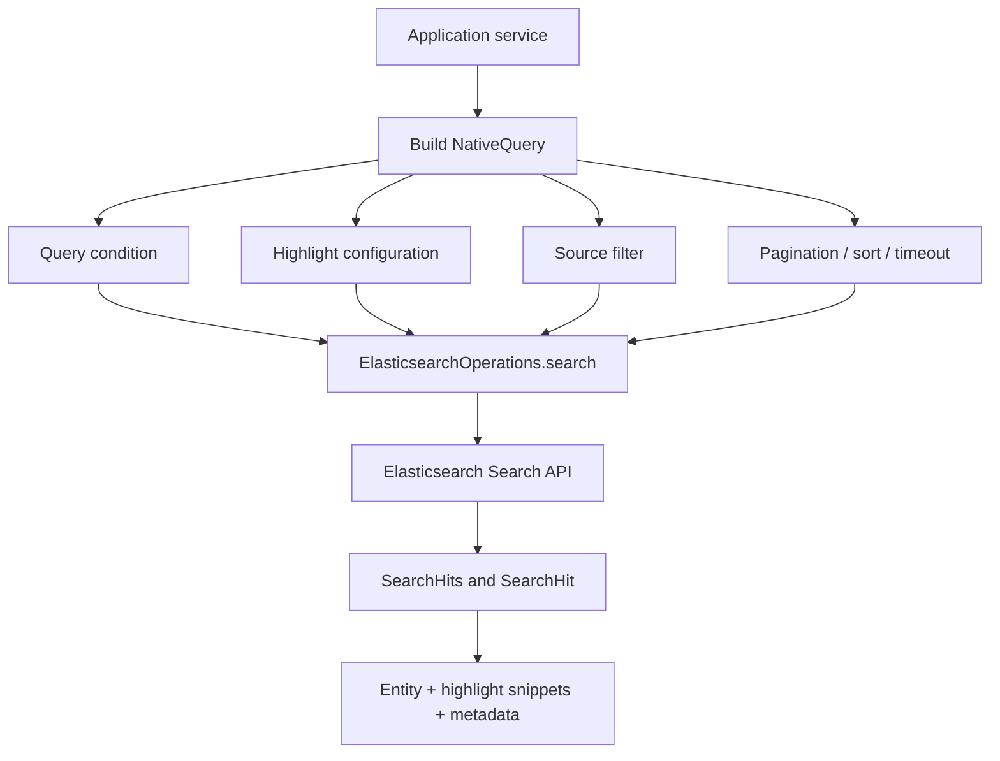

# Configuring Highlighting, Source Filters, and Search Options

In Spring Data Elasticsearch, `NativeQuery` allows building queries with the Elasticsearch Java Client and passing various Search API options. Beyond the query condition itself, a search request often needs to decide three distinct concerns: how to display text snippets matching keywords, which fields to return from `_source`, and how Elasticsearch should paginate, sort, track total hits, or limit execution time.

**Highlighting** generates text snippets with query matches marked. **Source filtering** restricts which fields are returned in `_source`. **Search options** control how results are retrieved and presented, such as `from`, `size`, `sort`, `track_total_hits`, `timeout`, `search_after`, and other parameters.

These options do not replace the main query. The query determines which documents match; highlighting helps present matching excerpts; source filtering trims the returned payload; and pagination/sort/timeout govern how the search executes and how results reach the application.

## 1. Context: NativeQuery and the Search API

`NativeQuery` is Spring Data Elasticsearch's abstraction for queries built with the Elasticsearch Java API Client. It is well suited when you need flexible Query DSL or search features that `CriteriaQuery` cannot express conveniently.

Basic flow:



A search request can include:

| Request Part | Role |
|---|---|
| `query` | Selects matching documents |
| `highlight` | Generates snippets and marks matched text |
| `_source` | Chooses which fields are returned from source |
| `from`, `size` | Offset-based pagination |
| `sort` | Sorts results |
| `track_total_hits` | Controls counting total hits |
| `timeout` | Caps search execution time per request config |
| `search_after` / point in time | Deep pagination via cursor/snapshot |

These parts can be combined in the same request. In Java, Spring Data translates the query object into the corresponding Search API request.

## 2. What Is Highlighting?

Highlighting marks the parts of a document's text relevant to a query. For example, if a user searches `wireless keyboard`, the returned result might include a snippet such as:

```html
Wireless <em>keyboard</em> with <em>wireless</em> connectivity
```

The application can display this snippet next to the product name so the user understands why the document appeared in the results.

Highlighting does not modify `_source` stored in the index. It is metadata generated by Elasticsearch for each hit in the response. Thus, a single hit can hold the `Product` entity while also carrying a separate map of highlighted snippets.

### 2.1 Which Fields Should Be Highlighted?

Specify the fields to highlight in `highlight.fields`. Typically these are `text` fields such as `name`, `description`, `content`, or `body`.

```json
GET /products/_search
{
  "query": {
    "match": {
      "description": "wireless keyboard"
    }
  },
  "highlight": {
    "fields": {
      "description": {}
    }
  }
}
```

Elasticsearch uses the query and field content to produce one or more fragments. If the field has no matching content, no highlights may be returned for that field. Highlights only appear in the response if the field is configured and Elasticsearch can produce matching fragments.

### 2.2 Pre-tags and Post-tags

`pre_tags` and `post_tags` define the opening/closing strings wrapping highlighted segments:

```json
GET /products/_search
{
  "query": {
    "match": {
      "description": "wireless keyboard"
    }
  },
  "highlight": {
    "pre_tags": ["<mark>"],
    "post_tags": ["</mark>"],
    "fields": {
      "description": {}
    }
  }
}
```

The response may contain:

```json
"highlight": {
  "description": [
    "<mark>Wireless</mark> keyboard with low-latency connection"
  ]
}
```

Tags are simply markers inside the response strings. The application decides how to render them in the UI. Do not inject unvalidated highlight HTML directly into a webpage if the original content may come from users. Escape untrusted content or use a safe renderer to prevent XSS; allow only controlled, predefined markers.

### 2.3 Fragment Size and Number of Fragments

A long field can produce multiple highlight excerpts. Common options include:

- `fragment_size`: target character length of each fragment.
- `number_of_fragments`: maximum number of fragments returned for the field.
- `no_match_size`: number of characters to return from the start of the field when no fragments match, if configured.
- `order`: fragment ordering, such as by score when supported.

Example:

```json
GET /articles/_search
{
  "query": {
    "match": {
      "content": "distributed search"
    }
  },
  "highlight": {
    "pre_tags": ["<strong>"],
    "post_tags": ["</strong>"],
    "fields": {
      "content": {
        "fragment_size": 180,
        "number_of_fragments": 3,
        "no_match_size": 80
      }
    }
  }
}
```

`fragment_size` is not a strict character cap for every snippet; the highlighter can adjust fragment boundaries to align with sentences, words, or boundary scanner settings. Treat it as a target length for producing readable snippets.

### 2.4 Short Fields and `number_of_fragments: 0`

For short fields like `name` or `title`, you may want the entire field value rather than small excerpts. Set `number_of_fragments` to `0`:

```json
"highlight": {
  "fields": {
    "name": {
      "number_of_fragments": 0
    }
  }
}
```

In this case, the highlighter returns the entire highlighted field instead of splitting it into fragments. For long fields, returning the full content can bloat responses; reserve this for short fields or deliberate use cases.

### 2.5 Highlighting Multiple Fields with Per-Field Configuration

Each field can specify its own options:

```json
"highlight": {
  "pre_tags": ["<mark>"],
  "post_tags": ["</mark>"],
  "fields": {
    "name": {
      "number_of_fragments": 0
    },
    "description": {
      "fragment_size": 160,
      "number_of_fragments": 2
    },
    "content": {
      "fragment_size": 220,
      "number_of_fragments": 3
    }
  }
}
```

Field-level settings can override certain top-level options. This lets a title field return its full text while a description field returns only a couple of short excerpts.

## 3. Highlighter Types and Choosing the Right One

Elasticsearch provides several highlighter implementations. The right choice depends on field type, analyzer, performance needs, and how data is stored.

### 3.1 Unified Highlighter

The unified highlighter is the common default for most cases. It supports `text` fields and generates fragments using the content, query, and term vector or inverted index data depending on configuration.

Example specification:

```json
"highlight": {
  "fields": {
    "description": {
      "type": "unified"
    }
  }
}
```

Unless you have special requirements, it is usually best to start with default/unified and measure real results.

### 3.2 Plain Highlighter

The plain highlighter re-analyzes text for each field and can suit small fields or simple cases. With large content or high result counts, evaluate its cost because the highlighter may need to reprocess the text.

```json
"highlight": {
  "fields": {
    "description": {
      "type": "plain"
    }
  }
}
```

### 3.3 Fast Vector Highlighter (FVH)

FVH can be suitable when advanced highlighting is needed and the field is configured with appropriate term vectors, typically `with_positions_offsets`. In return, term vectors increase index size and storage overhead.

Mapping example:

```json
PUT /articles
{
  "mappings": {
    "properties": {
      "content": {
        "type": "text",
        "term_vector": "with_positions_offsets"
      }
    }
  }
}
```

Highlight query:

```json
"highlight": {
  "fields": {
    "content": {
      "type": "fvh"
    }
  }
}
```

Enable term vectors only when FVH's benefits meet a real need. Do not add term vectors to every text field unnecessarily, as they enlarge the index.

### 3.4 `require_field_match`

`require_field_match` controls whether the query must directly match the field being highlighted. The default is typically `true`.

```json
"highlight": {
  "require_field_match": false,
  "fields": {
    "name": {},
    "description": {}
  }
}
```

Setting `false` can be helpful when queries are complex or a highlighted field relates to the queried field. However, it can cause highlights to appear in fields that did not match as users expect. Use it only when you understand the query and highlighter semantics.

### 3.5 `highlight_query`

Normally, the highlighter uses the search query to determine what to mark. `highlight_query` lets you specify a separate query specifically for highlighting.

This is useful when the main query contains filters or relevance clauses that should not all influence fragment selection. For example, the main query combines a full-text match with a category filter, while highlighting only needs to mark text keywords:

```json
GET /products/_search
{
  "query": {
    "bool": {
      "must": [
        { "match": { "description": "wireless keyboard" } }
      ],
      "filter": [
        { "term": { "category": "computer-accessories" } }
      ]
    }
  },
  "highlight": {
    "highlight_query": {
      "match": {
        "description": "wireless keyboard"
      }
    },
    "fields": {
      "description": {}
    }
  }
}
```

`highlight_query` does not change which documents are selected by the main query. It affects only how the highlighter identifies text to mark.

## 4. What Is Source Filtering?

By default, search responses usually return the `_source` of every hit. If a document has many fields while a screen needs only a few, the application can use source filtering to ask Elasticsearch to return only the required fields.

Example document with many fields:

```json
{
  "sku": "SKU-1001",
  "name": "Mechanical Keyboard",
  "description": "Wireless mechanical keyboard",
  "price": 185000,
  "internalNotes": "Supplier discount: confidential",
  "auditTrail": ["created", "reviewed", "published"]
}
```

An API needing only `sku`, `name`, and `price` can request:

```json
GET /products/_search
{
  "query": {
    "match_all": {}
  },
  "_source": ["sku", "name", "price"]
}
```

The `_source` in the response will contain only the selected fields. Source filtering reduces network transfer and client-side deserialization work, especially when documents have many fields or large payloads.

### 4.1 Includes and Excludes

You can specify `includes` and `excludes`:

```json
GET /products/_search
{
  "query": {
    "match_all": {}
  },
  "_source": {
    "includes": ["sku", "name", "price", "manufacturer.*"],
    "excludes": ["internalNotes", "auditTrail"]
  }
}
```

- `includes`: fields or patterns allowed to appear in the returned `_source`.
- `excludes`: fields or patterns to omit from the returned `_source`.
- Wildcard patterns and nested field paths can be used.

If both includes and excludes match the same field, understand Elasticsearch's filtering precedence; design clear lists and avoid overlapping patterns that are hard to predict.

### 4.2 Including Partial Nested Fields

Given a document:

```json
{
  "name": "Mechanical Keyboard",
  "manufacturer": {
    "name": "Northwind",
    "country": "VN",
    "contact": {
      "email": "support@example.test",
      "phone": "0000000000"
    }
  }
}
```

You can fetch only part of the nested object:

```json
"_source": {
  "includes": ["name", "manufacturer.name", "manufacturer.country"]
}
```

The resulting `_source` preserves the nested structure for the selected fields. Source filtering does not alter mappings or stored data.

### 4.3 Disabling `_source` Retrieval

If a request needs only metadata or aggregations, you can set:

```json
"_source": false
```

This omits `_source` from every hit in the response. It can reduce payload size significantly, though the application will not receive document content to map into full entities. Use this only when results do not require entity source—for instance, when only IDs, scores, aggregations, or fields fetched via another mechanism are needed.

If an index is created with `_source` disabled in the mapping, APIs requiring `_source` such as update or reindex may be restricted. Configuring `_source` in a request controls only the response; it differs from disabling `_source` storage at the mapping level.

### 4.4 Source Filtering Is Not Field-Level Security

Source filtering only decides which fields are returned in a single search request. It does not protect data from callers who can issue queries directly or modify requests to ask for other fields.

Do not rely on `_source.excludes` as a security mechanism for `internalNotes`, personal data, or secrets. If a user is not permitted to access a field, enforce authorization and proper field/document-level security at the Elasticsearch or API layer. Source filtering is a payload optimization and response projection tool, not an access-control boundary.

## 5. Distinguishing `_source`, fields, and stored fields

Elasticsearch provides several ways to retrieve field values in responses. They are not equivalent:

| Mechanism | Purpose | Characteristics |
|---|---|---|
| `_source` | Returns original stored JSON | Supports includes/excludes filtering; mirrors document structure |
| `fields` | Returns fields via mapping/field retrieval API | Values returned as arrays in response; can handle runtime/mapped fields depending on version |
| `stored_fields` | Fetches fields configured with `store: true` | Contains data only if the field is stored separately in the mapping |
| `docvalue_fields` | Retrieves doc values | Suitable for certain fields with doc values, typically numeric/date/keyword |

Example requesting specific `_source` fields:

```json
"_source": ["name", "price"]
```

Example requesting doc values for a date field:

```json
"docvalue_fields": [
  {
    "field": "createdAt",
    "format": "strict_date_time"
  }
]
```

Do not enable `store: true` on every field just to avoid returning `_source`. Stored fields increase disk usage and must be evaluated against query patterns. Source filtering is usually the simpler choice when the application merely wants to trim the returned JSON source.

## 6. Search Options: Pagination and Result Counts

### 6.1 `from` and `size`

`from` is the starting offset; `size` is the maximum number of hits returned:

```json
GET /products/_search
{
  "from": 20,
  "size": 10,
  "query": {
    "match_all": {}
  }
}
```

The request returns 10 results starting at position 20. This works well for regular pagination at moderate depth.

Offset pagination is bounded by `index.max_result_window`, typically 10,000 by default. When `from + size` exceeds that limit, Elasticsearch rejects the request. Raising the limit increases memory and processing costs; do not raise it merely to support very deep pages.

### 6.2 Sort

Sort determines result ordering:

```json
GET /products/_search
{
  "query": {
    "match": {
      "name": "keyboard"
    }
  },
  "sort": [
    { "price": { "order": "asc" } },
    { "_id": { "order": "asc" } }
  ]
}
```

Sorting on multiple fields makes ordering more stable when many documents share the same price. `_id` can act as a tie-breaker in some scenarios, though for deep pagination you should choose a stable sort field with suitable mapping and doc values, while understanding `_id` sort limitations in your Elasticsearch version.

For `text` fields, you typically need to sort on a `keyword` multi-field such as `name.raw`. For nested fields, sorting requires nested context and appropriate filters.

### 6.3 `track_total_hits`

Elasticsearch can cap exact total-hit counting to improve performance. `track_total_hits` controls this behavior:

```json
"track_total_hits": true
```

Requests exact total-hit counting, which can add overhead on large datasets.

You can set a numeric threshold:

```json
"track_total_hits": 10000
```

Once the threshold is reached, Elasticsearch may stop counting exact hits and report the total relation as `gte` (greater than or equal to). Setting `false` indicates the application does not require an exact total hit count.

Request exact counts only when the UI truly needs total page counts or exact totals. For infinite scroll, knowing whether another page exists is usually enough.

### 6.4 `min_score`

`min_score` excludes hits whose relevance score falls below a threshold:

```json
"min_score": 0.5
```

Use this only when the query computes meaningful scores and the threshold has been evaluated on real data. Scores are not probabilities and do not necessarily share the same scale across different queries. Do not pick an arbitrary threshold and assume it works uniformly across all queries.

## 7. Search Options: Timing and Result Handling

### 7.1 `timeout`

`timeout` limits how long Elasticsearch spends executing the search request per search operation semantics:

```json
"timeout": "2s"
```

If time expires, Elasticsearch can return a response with `timed_out: true` and partial results depending on shard/request state. A search timeout is different from an HTTP client socket timeout. An HTTP client timeout aborts waiting for a response; a search timeout is sent to Elasticsearch to bound server-side search execution.

The application should inspect the `timed_out` flag and shard status if business rules cannot accept partial results. Never assume every successful HTTP response represents complete results if the search response indicates a timeout.

### 7.2 `allow_partial_search_results`

The Search API can allow returning partial results if some shards fail. The `allow_partial_search_results` option controls this behavior at the request/cluster level per API support:

```http
GET /products/_search?allow_partial_search_results=false
```

If business logic requires complete results, handle shard failures explicitly. If the application accepts partial results to prioritize availability, surface that status at the API layer rather than presenting results as if every shard succeeded.

### 7.3 `terminate_after`

`terminate_after` limits the number of documents collected per shard before stopping early:

```json
"terminate_after": 1000
```

This is a per-shard collection limit, not a pagination mechanism or a guarantee of returning exactly 1,000 total results. It can cause incomplete results and incomplete total hit counts. Use it only when early-termination semantics are acceptable.

### 7.4 `track_scores`

When sorting by a field, Elasticsearch does not necessarily compute relevance scores unless requested. `track_scores` forces score calculation even when sorting by fields:

```json
"track_scores": true
```

Enable this only if the application needs to display or process scores in the results. Otherwise, avoid unnecessary work.

### 7.5 `explain`

`explain` asks Elasticsearch to include an explanation of how each score was computed:

```json
"explain": true
```

This information is useful when investigating relevance or debugging queries in development. It enlarges responses and increases cost; do not enable it for all production requests.

## 8. Deep Pagination with search_after and Point in Time

Offset pagination fits the first few pages. When traversing large result sets, `search_after` avoids asking Elasticsearch to skip across a very deep offset.

### 8.1 `search_after`

`search_after` uses the sort values of the last hit from the previous page as a cursor for the next page. The query must have a stable sort:

```json
GET /products/_search
{
  "size": 100,
  "query": {
    "match_all": {}
  },
  "sort": [
    { "createdAt": "asc" },
    { "sku": "asc" }
  ]
}
```

Suppose the last hit has `sort` values:

```json
"sort": [
  "2025-03-12T10:30:00.000Z",
  "SKU-1001"
]
```

The next request passes those exact values:

```json
GET /products/_search
{
  "size": 100,
  "query": {
    "match_all": {}
  },
  "sort": [
    { "createdAt": "asc" },
    { "sku": "asc" }
  ],
  "search_after": [
    "2025-03-12T10:30:00.000Z",
    "SKU-1001"
  ]
}
```

The sort must define a sufficiently stable order. If multiple documents share the same sort values, include an appropriate unique tie-breaker. If data changes during pagination, results can shift between pages.

### 8.2 Point in Time (PIT)

Point in time creates a stable view of an index over a window of time. Combining PIT with `search_after` keeps deep traversal consistent even while the index continues receiving writes.

High-level flow:

1. Open a PIT for the index.
2. Send search requests with the PIT ID and a stable sort.
3. Use the last hit's sort values as `search_after` for the next page.
4. Continue until all results are read or the PIT expires.
5. Close the PIT when finished.

PIT consumes resources because Elasticsearch retains state needed for the snapshot. Set `keep_alive` just long enough for the job, close the PIT when no longer needed, and avoid leaving long-lived PITs open unchecked.

CriteriaQuery/Pageable usually fits regular offset pagination. For PIT/`search_after` or advanced search options, `NativeQuery` and the Java Client API can be a better fit; exact builder APIs depend on the Spring Data Elasticsearch version.

## 9. Combining Highlighting, Source Filters, and Search Options in One Request

Example searching products related to `wireless keyboard`, retrieving only fields needed by the screen, highlighting matches, sorting by score then price, and capping results:

```json
GET /products/_search
{
  "from": 0,
  "size": 10,
  "track_total_hits": 10000,
  "timeout": "2s",
  "query": {
    "bool": {
      "must": [
        {
          "multi_match": {
            "query": "wireless keyboard",
            "fields": ["name", "description"]
          }
        }
      ],
      "filter": [
        { "term": { "status": "ACTIVE" } },
        { "range": { "price": { "lte": 500000 } } }
      ]
    }
  },
  "_source": {
    "includes": ["sku", "name", "price", "description"],
    "excludes": ["internalNotes"]
  },
  "highlight": {
    "pre_tags": ["<mark>"],
    "post_tags": ["</mark>"],
    "fields": {
      "name": {
        "number_of_fragments": 0
      },
      "description": {
        "fragment_size": 160,
        "number_of_fragments": 2
      }
    }
  },
  "sort": [
    { "_score": "desc" },
    { "price": "asc" }
  ]
}
```

This request:

- Searches across `name` and `description` with `multi_match`.
- Filters for `ACTIVE` products priced at most 500,000.
- Returns only the four fields needed on screen.
- Generates `<mark>` highlights for name and description.
- Returns at most 10 hits starting at offset 0.
- Tracks total hits up to a threshold of 10,000.
- Sets a 2-second search timeout.
- Prioritizes relevance score, then ascending price.

## 10. Using NativeQuery in Spring Data Elasticsearch

Spring Data Elasticsearch provides classes to configure highlighting and source filtering alongside a query. The examples below illustrate the Spring Data Elasticsearch 5.x API style using the Elasticsearch Java Client.

### 10.1 Declaring HighlightQuery

Common classes:

- `HighlightParameters`: general parameters such as pre/post tags, fragment size, and fragment count.
- `HighlightField`: a field to highlight.
- `Highlight`: highlight configuration consisting of fields and parameters.
- `HighlightQuery`: associates the highlight configuration with an entity type.

Example:

```java
import java.util.List;

import org.springframework.data.elasticsearch.core.query.Highlight;
import org.springframework.data.elasticsearch.core.query.HighlightField;
import org.springframework.data.elasticsearch.core.query.HighlightParameters;
import org.springframework.data.elasticsearch.core.query.HighlightQuery;

HighlightParameters parameters = HighlightParameters.builder()
    .withPreTags("<mark>")
    .withPostTags("</mark>")
    .withFragmentSize(160)
    .withNumberOfFragments(2)
    .build();

Highlight highlight = new Highlight(
    List.of(
        new HighlightField("name"),
        new HighlightField("description")
    ),
    parameters
);

HighlightQuery highlightQuery = new HighlightQuery(
    highlight,
    Product.class
);
```

`HighlightQuery` links highlight metadata with the entity type so Spring Data can translate the configuration. Some advanced options can be set per field depending on your version's API. If you need exact control over the full highlight JSON, you can construct a native request compatible with the Java Client.

### 10.2 Setting Up a Source Filter

Spring Data provides `FetchSourceFilter` to specify fields to include/exclude in `_source`:

```java
import org.springframework.data.elasticsearch.core.query.FetchSourceFilter;

FetchSourceFilter sourceFilter = new FetchSourceFilter(
    new String[] {"sku", "name", "price", "description"},
    new String[] {"internalNotes"}
);
```

The two arrays represent includes and excludes respectively. If one side is unnecessary, pass `null` per the corresponding constructor/API.

Source filters affect only the returned `_source` data. They do not remove fields from the index, alter mappings, or replace authorization.

### 10.3 Building NativeQuery

Example combining query, highlight, source filter, and pageable:

```java
import org.springframework.data.domain.PageRequest;
import org.springframework.data.domain.Sort;
import org.springframework.data.elasticsearch.client.elc.NativeQuery;
import org.springframework.data.elasticsearch.core.query.Query;

Query query = NativeQuery.builder()
    .withQuery(q -> q.bool(b -> b
        .must(m -> m.multiMatch(mm -> mm
            .query("wireless keyboard")
            .fields("name", "description")
        ))
        .filter(f -> f.term(t -> t
            .field("status")
            .value("ACTIVE")
        ))
        .filter(f -> f.range(r -> r
            .number(n -> n
                .field("price")
                .lte(500000)
            )
        ))
    ))
    .withPageable(PageRequest.of(
        0,
        10,
        Sort.by(Sort.Order.desc("_score"), Sort.Order.asc("price"))
    ))
    .withHighlightQuery(highlightQuery)
    .build();

query.addSourceFilter(sourceFilter);
```

Then execute:

```java
import org.springframework.data.elasticsearch.core.SearchHits;

SearchHits<Product> hits = operations.search(query, Product.class);
```

`NativeQuery.builder()` provides builders for the query and several search options. Source filters can be attached via the query API. Exact method names, overloads, and builders may vary across Spring Data Elasticsearch versions; consult the Javadoc of your exact dependency if a method is absent in your version.

### 10.4 Reading Highlights from SearchHit

Each `SearchHit<T>` holds the entity and hit metadata. Highlights are accessed separately via `getHighlightFields()`:

```java
import java.util.List;
import java.util.Map;

for (SearchHit<Product> hit : hits) {
    Product product = hit.getContent();

    Map<String, List<String>> highlights = hit.getHighlightFields();
    List<String> nameFragments = highlights.getOrDefault("name", List.of());
    List<String> descriptionFragments = highlights.getOrDefault(
        "description",
        List.of()
    );

    System.out.println(product.getName());
    nameFragments.forEach(System.out::println);
    descriptionFragments.forEach(System.out::println);
}
```

Do not assume every field always has highlights. If the query did not match the field, the field was not configured, or the highlighter produced no fragments, the map may omit that key or return an empty list. Provide a fallback to the original field permitted by the source filter when the UI needs content displayed.

### 10.5 Entities May Omit Fields Due to Source Filtering

If `Product` has many properties while the source filter retrieves only `sku`, `name`, and `price`, other fields may remain unpopulated when Spring Data maps hits into `Product`. Do not treat this partial entity as a complete `Product` for saving back.

Source-filtered search results should be treated as read projections. If a search result DTO is needed, use a projection type or map the entity/metadata into a dedicated response model. In particular, never call `save()` with an entity missing fields due to source filtering, as it can overwrite the stored document with incomplete data.

## 11. Search Options in Java

Not every Search API option is configured via the same builder method. They fall into these groups:

| Group | Examples | Common Spring Data API |
|---|---|---|
| Query | match, bool, range | `NativeQuery.withQuery(...)` |
| Highlight | fields, tags, fragments | `HighlightQuery` / `withHighlightQuery(...)` |
| Source filter | includes, excludes | `FetchSourceFilter` / query source filter |
| Pagination | page, size | `Pageable` / `withPageable(...)` |
| Sort | field, direction | `Sort` / sort builder |
| Advanced Search API | timeout, track total hits, PIT, search_after | Native Java Client or version extension point |

With `Pageable`, Spring Data usually translates page/size to offset/size. Advanced options without a stable abstraction across all versions may require the native client API or an appropriate request callback.

### 11.1 Sort and Relevance

If no sort is specified, search typically uses relevance score for scoring queries. When adding a field sort, ordering may prioritize the field over score. If you want score as the primary criterion, include `_score` in the sort as shown above.

When using `Sort` via `Pageable`, ensure the sort field has a suitable mapping. Sorting on a text field typically requires a keyword sub-field; sorting on a nested field requires nested sort context that simple abstractions may not fully express.

### 11.2 Total Hit Count

`SearchHits.getTotalHits()` returns the total hit count reported by the response. If the request did not ask to track total hits accurately, the value may be a lower bound rather than an exact total. When an API requires exact counts, configure `track_total_hits` appropriately and consider the performance impact.

### 11.3 Timeout and Partial Results

Search API timeout and HTTP client timeout are two distinct limits. A search timeout can return a response with `timed_out`; an HTTP timeout prevents the application from receiving a response at all. Distinguish both cases in logging and error handling.

If a shard failure or timeout yields a partial response, inspect the search response metadata. Do not check only the HTTP status code or the number of returned hits.

## 12. Performance Considerations

Highlighting, source filtering, and search options can make requests more efficient or heavier depending on how they are configured.

### 12.1 Highlight Only Displayed Fields

Highlighting many fields and fragments across hundreds of hits consumes CPU and enlarges responses. Enable it only for fields the UI actually displays, and limit `number_of_fragments` and `fragment_size`.

### 12.2 Source Filtering Reduces Payload, Not All Index Work

Source filtering shrinks the returned `_source` and client deserialization work. It does not remove fields from the index and does not automatically reduce query work over inverted indices/doc values. If the query needs fields to filter or sort, Elasticsearch still performs that work.

### 12.3 Do Not Count Exact Total Hits When Unneeded

Counting every match accurately can be costly on large indices. For infinite scroll or UIs that only show a "load more" button, consider skipping exact total counts.

### 12.4 Avoid Deep Offset Pagination

Deep `from`/`size` increases the results Elasticsearch must process. Use `search_after` with a stable sort and PIT when traversing large result sets.

### 12.5 Do Not Hide Slow Queries Behind Long Timeouts

Setting a longer timeout lets requests wait longer without fixing an expensive query. Inspect mappings, query plans/profiles, shard counts, data volume, and aggregations before raising timeouts.

## 13. Common Mistakes

### 13.1 Highlights Missing in SearchHit

Check:

- Does the request declare `highlight.fields` for the exact field?
- Is the field mapped as an appropriate text type?
- Did the query actually match that field?
- Was the field excluded from `_source` by source filtering (highlighting is separate metadata, though entity content may be missing)?
- Does the highlighter type fit the mapping/term vectors?
- Does the code read `SearchHit.getHighlightFields()` instead of looking for highlight keys inside the entity?

### 13.2 Highlight Tags Rendered as Plain Text

If the frontend escapes the entire string, `<mark>` may appear literally. If the frontend renders raw HTML unsafely, original content can trigger XSS. Separate highlight markers from untrusted content or use a safe renderer permitting only defined tags.

### 13.3 Entity Missing Properties After Source Filtering

This is expected behavior when fields are excluded from `_source`. Source filtering produces a partial projection. Do not pass that entity to operations that overwrite the full document.

### 13.4 Source Filter Mistaken for Security

Callers can craft another request to fetch excluded fields. Use authorization and field-level security for sensitive data.

### 13.5 Missing Exact Total Hit Count

Check `track_total_hits`, the response's total relation, and metadata in `SearchHits`. Do not assume every query counts all matching results accurately by default.

### 13.6 Wrong or Unstable Sort

Check field types, doc values, keyword multi-fields, and tie-breakers. With `search_after`, preserve exact sort order and pass the last hit's sort values verbatim.

### 13.7 Timeouts Treated as Complete Results

Check `timed_out` and shard failures. If complete results are required, treat partial states as business errors or retry under a clear policy.

## 14. Testing Directly via the REST API

When a Java query returns unexpected results, running the equivalent request directly against Elasticsearch helps isolate whether the issue lies in query configuration, mapping, or Spring Data response mapping.

Inspect mapping:

```http
GET /products/_mapping
```

Run search with highlighting and source filtering:

```http
GET /products/_search
{
  "size": 5,
  "query": {
    "match": {
      "description": "wireless keyboard"
    }
  },
  "_source": ["sku", "name", "description"],
  "highlight": {
    "fields": {
      "description": {
        "fragment_size": 150,
        "number_of_fragments": 2
      }
    }
  }
}
```

Inspect the response:

- `hits.hits[*]._source`: fields returned by the source filter.
- `hits.hits[*].highlight`: highlight fragments.
- `hits.total`: total hit count and relation.
- `timed_out`: whether the request exceeded the search timeout.
- `_shards.failed`: whether any shards failed.
- `sort`: sort values per hit, useful for `search_after`.

If the REST request succeeds while Java results differ, inspect `NativeQuery`, source filters, highlight mappings, and how `SearchHit` is read. If the REST request is also wrong, check the mapping and Query DSL first.

## 15. Usage Guidelines

- Use highlighting to generate snippets for text fields actually displayed in the UI.
- Choose safe pre/post tags and sanitize/escape untrusted HTML to prevent XSS.
- Limit fragment size and fragment counts to control response size.
- Start with the unified highlighter; switch to plain/FVH only when required after evaluating mappings and cost.
- Use `highlight_query` when highlight matching should differ from document selection.
- Use source filtering to trim payloads and create suitable read projections.
- Never treat source filtering as a security mechanism.
- Distinguish `_source`, `fields`, `stored_fields`, and `docvalue_fields`.
- Use `from`/`size` for moderate pagination; use `search_after`/PIT for deep pagination.
- Request exact total hits only when needed by the UI.
- Check timeouts, shard failures, and partial results before treating responses as complete.
- Use `SearchHit.getHighlightFields()` to read fragments; do not assume highlights populate entity fields.
- Never save an entity read through a source filter as if it were a full document.
- Use `NativeQuery`/Java Client for advanced search options that `CriteriaQuery` cannot express well.

## 16. Summary

Highlighting, source filtering, and search options address three different aspects of a search request. Highlighting shows users the matching portions of content; source filtering limits the returned JSON `_source`; search options control result count, ordering, execution time, and traversal strategy. They can be combined in a single Query DSL request and configured in Spring Data Elasticsearch via `NativeQuery` and its supporting classes.

In Java, `HighlightQuery` describes highlight fields and parameters, `FetchSourceFilter` defines includes/excludes, and `Pageable` and `Sort` handle common pagination and sorting. Advanced options such as timeout, track total hits, `search_after`, and PIT may require version-specific native APIs. On response handling, `SearchHits` provides overall metadata while `SearchHit` carries the entity and a separate map of highlights.

Keep highlights and payloads bounded to UI needs, enforce dedicated authorization for sensitive data, verify timeout/shard statuses, and pick an appropriate pagination strategy. These choices keep search responses lightweight, readable, and semantically clear in Spring Data Elasticsearch applications.

## References

- [Elasticsearch — Highlighting search results](https://www.elastic.co/guide/en/elasticsearch/reference/current/highlighting.html)
- [Elasticsearch — Retrieve selected fields](https://www.elastic.co/guide/en/elasticsearch/reference/current/search-fields.html)
- [Elasticsearch — Search API](https://www.elastic.co/guide/en/elasticsearch/reference/current/search-search.html)
- [Elasticsearch — Paginate search results](https://www.elastic.co/guide/en/elasticsearch/reference/current/paginate-search-results.html)
- [Spring Data Elasticsearch Reference — Search Operations](https://docs.spring.io/spring-data/elasticsearch/reference/elasticsearch/template.html)
