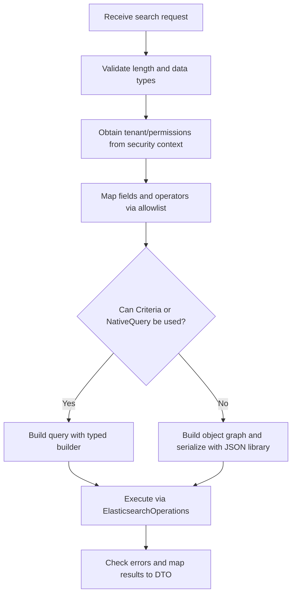

# Controlling Escaping and Avoiding JSON Concatenation from Arbitrary Input

When building Elasticsearch queries in Java, user-supplied data placed into Query DSL must be handled properly. A string containing double quotes, backslashes, newlines, or JSON-like content can break a request if concatenated directly into a JSON string. Even worse, if input is used to construct query structure, users can alter the conditions the application intends to send.

In Spring Data Elasticsearch, prefer **`NativeQuery`** or **`CriteriaQuery`** to pass values through typed APIs. If you must use `StringQuery`, build a data structure and serialize it to JSON with a JSON library instead of concatenating strings yourself. At the same time, distinguish three separate processing layers:

- **Java string escaping**: rules for representing strings inside Java source code.
- **JSON escaping**: rules for encoding string values into valid JSON.
- **Elasticsearch query-language escaping**: rules of sub-languages such as `query_string`, where certain characters act as operators.

Handling one layer properly does not automatically handle the other two. For example, validly serialized JSON can still contain `query_string` syntax that users accidentally or intentionally use to alter search semantics.

## 1. Why Is Direct JSON Concatenation Error-Prone?

Suppose an application needs to search products by category. An easy-to-write but unsafe approach is splicing input directly into JSON:

```java
String category = request.category();

String json = """
    {
      "query": {
        "term": {
          "category": "%s"
        }
      }
    }
    """.formatted(category);
```

For ordinary inputs like `audio`, the generated string looks valid. However, JSON strings must handle characters such as `"`, `\\`, and control characters. If input contains double quotes or newlines, the request can become invalid JSON. If strings are concatenated into structural positions rather than value positions, users can alter the Query DSL tree.

This pattern also becomes fragile when the query later expands with `bool`, `filter`, `range`, `sort`, or aggregations. Developers must manually track every comma, brace, quote, and escaping rule across every branch.

**Do not use** `String.format`, `formatted`, string `+` concatenation, or text templates to inject untrusted input into JSON DSL. Build structures with a typed API or serialize structured data.

## 2. Distinguishing Three Layers of Escaping

### 2.1. Java String Escaping

In Java source code, double quotes delimit strings. To include a double quote inside a literal, it must be escaped according to Java syntax:

```java
String value = "He said: \"hello\"";
String path = "C:\\catalog\\products";
```

Text blocks `"""` make multiline strings easier to read, but they **do not automatically sanitize dynamic data**. If you use `.formatted(userInput)` on a text block, the input content is still inserted verbatim at the placeholder position.

### 2.2. JSON Escaping

JSON has its own rules for string values. For example, a value containing a double quote must be represented as `\"`, a backslash as `\\`, and a newline with its corresponding escape sequence. A JSON serializer performs this accurately.

Example Java value:

```java
String category = "audio \"premium\"";
```

When serialized to JSON, the serializer encodes inner double quotes so the JSON remains valid. Do not write your own helper replacing `"` or `\\`, because manual handling often misses control characters, Unicode, or double-escaping edge cases.

### 2.3. Query Language Escaping

Some Elasticsearch queries embed a sub-language with its own syntax. For instance, `query_string` supports operators, parentheses, wildcards, field selectors, and special characters. A valid JSON string does not mean its content will be interpreted as plain text.

For example, if an application serializes the string `wireless OR headphones` into valid JSON and puts it into `query_string.query`, Elasticsearch still interprets `OR` using query string syntax. A JSON serializer does not escape query-language operators.

When users only enter ordinary keywords, prefer `match` on a `text` field. Only use `query_string` when the product intentionally provides advanced query syntax and clearly defines how that syntax is handled.

| Layer | Examples Requiring Handling | Appropriate Approach |
|---|---|---|
| Java source | `"`, `\\`, multiline literals | Use valid Java syntax; text blocks only aid formatting. |
| JSON | Quotes, backslashes, control characters, Unicode | Use a JSON serializer such as Jackson. |
| Query language | `AND`, `OR`, wildcards, parentheses, and parser syntax | Use an appropriate query or escape according to the parser. |

## 3. Preferred Approach: Using `NativeQuery` with Typed Builders

`NativeQuery` builds Query DSL using the Elasticsearch Java API Client builders. Input values are passed to request builder properties rather than inserted into an arbitrary JSON snippet.

Example searching products by name and category:

```java
import co.elastic.clients.elasticsearch._types.FieldValue;
import org.springframework.data.elasticsearch.client.elc.NativeQuery;
import org.springframework.data.elasticsearch.core.ElasticsearchOperations;
import org.springframework.data.elasticsearch.core.SearchHits;
import org.springframework.data.elasticsearch.core.query.Query;
import org.springframework.stereotype.Service;

@Service
public class ProductSearchService {

    private final ElasticsearchOperations operations;

    public ProductSearchService(ElasticsearchOperations operations) {
        this.operations = operations;
    }

    public SearchHits<ProductDocument> search(
            String searchText,
            String category) {

        Query query = NativeQuery.builder()
            .withQuery(q -> q
                .bool(b -> b
                    .must(m -> m
                        .match(match -> match
                            .field("name")
                            .query(searchText)
                        )
                    )
                    .filter(f -> f
                        .term(term -> term
                            .field("category")
                            .value(FieldValue.of(category))
                        )
                    )
                )
            )
            .build();

        return operations.search(query, ProductDocument.class);
    }
}
```

In this example:

- `searchText` is the value of a full-text query on the `name` field.
- `category` is the value of an exact filter on the `category` field.
- Fields and the `bool` structure are fixed in code.
- Users supply only values, never a JSON fragment that can introduce new clauses.

The builder serializes the request according to the client protocol. If `searchText` contains double quotes, backslashes, or curly braces, it remains input data to `match`, never becoming part of the Query DSL structure.

Note that builders do not replace business validation. The application must still cap input length, validate empty values, and apply tenant/security filters from the authenticated context.

## 4. Using `CriteriaQuery` for Simple Conditions

For simple search conditions, `CriteriaQuery` also avoids hand-crafting JSON:

```java
import org.springframework.data.elasticsearch.core.query.Criteria;
import org.springframework.data.elasticsearch.core.query.CriteriaQuery;
import org.springframework.data.elasticsearch.core.query.Query;

public SearchHits<ProductDocument> findByCategory(String category) {
    Criteria criteria = Criteria.where("category").is(category);
    Query query = new CriteriaQuery(criteria);

    return operations.search(query, ProductDocument.class);
}
```

`category` is passed as the value of the `is` condition. It is not interpreted as part of a JSON structure. The field name `category` is declared statically in code.

If there are multiple optional conditions, add predicates only after validating inputs:

```java
Criteria criteria = Criteria.where("tenantId").is(authenticatedTenantId);

if (category != null && !category.isBlank()) {
    criteria.and("category").is(category.trim());
}

if (minPrice != null) {
    criteria.and("price").greaterThanEqual(minPrice);
}

Query query = new CriteriaQuery(criteria);
```

Property paths such as `tenantId`, `category`, and `price` are defined in code. Never take raw field names from requests and pass them straight into Criteria; field paths must be controlled separately.

## 5. When You Must Use `StringQuery`, Serialize a Structure Instead of Concatenating Strings

There are cases where Query DSL is already stored as JSON or a dynamic query must be built and the team chooses `StringQuery`. In such cases, construct an object graph using `Map`/`List` and serialize the entire structure with Jackson `ObjectMapper`.

Example:

```java
import java.util.List;
import java.util.Map;

import com.fasterxml.jackson.core.JsonProcessingException;
import com.fasterxml.jackson.databind.ObjectMapper;
import org.springframework.data.elasticsearch.core.query.Query;
import org.springframework.data.elasticsearch.core.query.StringQuery;

public Query buildQuery(
        ObjectMapper objectMapper,
        String category,
        long minPrice,
        long maxPrice) throws JsonProcessingException {

    Map<String, Object> range = Map.of(
        "priceInCents",
        Map.of("gte", minPrice, "lte", maxPrice)
    );

    Map<String, Object> categoryTerm = Map.of(
        "category",
        category
    );

    Map<String, Object> queryBody = Map.of(
        "bool",
        Map.of(
            "filter",
            List.of(
                Map.of("term", categoryTerm),
                Map.of("range", range)
            )
        )
    );

    String json = objectMapper.writeValueAsString(queryBody);
    return new StringQuery(json);
}
```

Here:

1. `category` sits in the value position of the `term` object.
2. `minPrice` and `maxPrice` are numeric values, requiring no manual quoting.
3. `ObjectMapper` is responsible for generating valid JSON, including string escaping.
4. `StringQuery` receives the serialized JSON.

If `category` contains double quotes or newlines, Jackson encodes it into a valid JSON string. That value remains a single term value; it cannot close out or append another query clause to the constructed object graph.

In Spring Boot, you can usually inject the Boot-configured `ObjectMapper`. There is no need to instantiate a new mapper per request. If the query structure can be expressed using `NativeQuery`, prefer the typed builder to avoid maintaining JSON strings yourself.

### 5.1. Checking Nulls and Price Ranges Before Building Objects

`Map.of(...)` does not allow `null` keys or values. That is another reason to validate inputs before building the query:

```java
if (category == null || category.isBlank()) {
    throw new IllegalArgumentException("category is required");
}

if (minPrice < 0 || maxPrice < minPrice) {
    throw new IllegalArgumentException("Invalid price range");
}
```

If a filter is optional, conditionally add or omit the entire filter object in the `List`. Never serialize `null` hoping Elasticsearch will treat it as an omitted condition.

## 6. Why Is a JSON Serializer Safer Than Manual Escaping?

Another common practice is manually replacing a few characters:

```java
String escaped = value
    .replace("\\", "\\\\")
    .replace("\"", "\\\"");
```

This snippet handles only a subset of cases. JSON also has control characters that require encoding, and replacement order matters. If the value later passes through another encoding layer, missing escapes or double escaping can easily occur.

Do not write custom JSON escaping for application data. Let Jackson or JSON-P serialize string values and entire object graphs. Serializers know the JSON specification and handle special characters properly.

This also means you should not serialize an already-escaped JSON string and embed it inside another JSON string when your goal is to produce Query DSL. Build the object graph with the proper structure and serialize once at the boundary where JSON is needed.

## 7. JSON Escaping Does Not Replace `query_string` Escaping

`query_string` is a query parser with its own syntax. It lets users write expressions such as:

```text
wireless AND headphones
```

or expressions with parentheses, wildcards, field selectors, and other operators. If user input is passed directly into `query_string.query`, users are providing a fragment of a query language, not just search text.

Example:

```java
// Only use when the product explicitly supports query_string syntax.
Query query = NativeQuery.builder()
    .withQuery(q -> q
        .queryString(qs -> qs
            .query(advancedQueryText)
        )
    )
    .build();
```

`NativeQuery` protects the JSON structure of the request, but it does not turn `advancedQueryText` into plain text. The parser still evaluates any query string operators present in the value.

If the feature is simply a free-text search box, use `match`:

```java
Query query = NativeQuery.builder()
    .withQuery(q -> q
        .match(match -> match
            .field("name")
            .query(userText)
        )
    )
    .build();
```

If the product genuinely requires advanced query syntax, you must:

- Clearly define the syntax users are allowed to enter.
- Escape special characters according to the active query parser's syntax.
- Restrict searchable fields; never let users pick arbitrary fields.
- Limit wildcards and query complexity to prevent resource-intensive queries.
- Handle parse errors as input errors rather than silently turning them into empty results.
- Write tests for operators, parentheses, quotes, backslashes, and malformed strings.

No generic JSON escape function can replace `query_string` syntax handling.

## 8. Never Accept Arbitrary Field Names or Operators from Requests

Values and query structure are two distinct kinds of data. `NativeQuery` passes values safely, yet if the application lets users choose field names, operators, or query types, they can still make the system run unintended queries.

Example to avoid:

```java
String field = request.field();
String operator = request.operator();

// Do not turn client-supplied fields/operators into arbitrary Query DSL structures.
```

Map external choices to an allowed set of fields and operators:

```java
public enum ProductFacet {
    CATEGORY,
    BRAND,
    STATUS
}

private String elasticsearchField(ProductFacet facet) {
    return switch (facet) {
        case CATEGORY -> "category";
        case BRAND -> "brand";
        case STATUS -> "status";
    };
}
```

After parsing the request into a valid enum, use an application-controlled field name:

```java
ProductFacet facet = ProductFacet.valueOf(request.facet().toUpperCase(Locale.ROOT));
String field = elasticsearchField(facet);

Query query = NativeQuery.builder()
    .withQuery(q -> q
        .term(t -> t
            .field(field)
            .value(FieldValue.of(request.value()))
        )
    )
    .build();
```

This example requires importing `java.util.Locale` and handling `IllegalArgumentException` for invalid facet names. If you prefer not to expose enum names directly, use a parser mapping API strings to enum values. The key rule is that only allowlisted fields may be used to construct queries.

Apply the same principle to:

- Sort fields and sort directions.
- Target index or alias names.
- Permitted query types.
- Aggregation names and aggregation fields.
- Scripts, regexps, wildcards, or expensive options.

JSON escaping cannot make an arbitrary field name valid or safe. Field names must be controlled through API design and allowlists.

## 9. Keep Tenant and Access Control Conditions Server-Side

In a multi-tenant application, never trust a client-supplied `tenantId` to define data scope. Obtain the tenant from the authenticated principal or security context and add a filter to the main query:

```java
String tenantId = currentUser.tenantId();

Query query = NativeQuery.builder()
    .withQuery(q -> q
        .bool(b -> b
            .must(m -> m.match(match -> match
                .field("name")
                .query(userText)
            ))
            .filter(f -> f.term(term -> term
                .field("tenantId")
                .value(FieldValue.of(tenantId))
            ))
        )
    )
    .build();
```

Tenant filters must be derived from authenticated identity and placed inside the main query so they restrict both hits and aggregations. Never place critical security conditions solely in `post_filter`, because aggregations are not restricted by `post_filter`.

Escaping only protects how data is represented in the request. It does not replace authorization, tenant isolation, or access-control checks.

## 10. Limiting Input and Query Complexity

Even with typed builders, overly long input or overly broad queries can drive up search cost. Define limits suited to your product:

| Input | Recommended Control |
|---|---|
| Search text | Cap length, trim whitespace, and define empty-input behavior. |
| Category/brand/status | Accept only valid values from the domain or allowed list. |
| Numeric range | Check negative bounds, `min <= max`, and cap span width if needed. |
| Date range | Parse into explicit date/time types, standardize time zones, and cap date span. |
| Page size | Enforce a server-side maximum; never trust request `size` blindly. |
| Sort | Allowlist fields and allow only `ASC`/`DESC` directions. |
| Wildcard/regexp | Enable only when necessary, restrict patterns, and monitor actual cost. |
| Advanced query syntax | Define grammar, escape per parser rules, and cap complexity. |

Do not turn all invalid inputs into empty strings and proceed with the query. Returning clear validation errors helps users fix invalid conditions and prevents unintended queries from running.

## 11. Avoid JSON Concatenation for Scripts and Specialized Queries

Queries using scripts, regexps, or query parsers can have custom syntax and high execution cost. Never concatenate user input directly into script source or regexp expressions.

For scripts, prefer fixed scripts and pass values through `params` instead of building new source via string concatenation. Conceptual example:

```json
{
  "script": {
    "source": "doc['price'].value * params.factor > params.limit",
    "params": {
      "factor": 1.2,
      "limit": 100
    }
  }
}
```

`source` is application-controlled logic; `factor` and `limit` are data parameters. Never let clients submit arbitrary script source unless the feature is explicitly designed to run user-provided scripts.

Likewise, regexp patterns should be bounded and tested. A JSON serializer guarantees only that the pattern is validly encoded in JSON, not that the pattern has low execution cost or intended semantics.

## 12. Testing Escaping and Query Behavior

A serialization test should include characters known to trigger bugs:

```java
import static org.assertj.core.api.Assertions.assertThat;

import com.fasterxml.jackson.databind.JsonNode;
import com.fasterxml.jackson.databind.ObjectMapper;
import org.junit.jupiter.api.Test;

class QueryJsonSerializationTest {

    private final ObjectMapper objectMapper = new ObjectMapper();

    @Test
    void serializesSpecialCharactersAsAJsonStringValue() throws Exception {
        String input = "audio \"premium\" \\ path\nline 2 {x}: [y]";

        String json = objectMapper.writeValueAsString(
            java.util.Map.of("category", input)
        );

        JsonNode parsed = objectMapper.readTree(json);

        assertThat(parsed.get("category").asText()).isEqualTo(input);
    }
}
```

This test verifies that the serializer preserves the value after the JSON is parsed back. It verifies the JSON escaping layer, not the Elasticsearch query parser or mapping.

In integration tests, verify that input containing special characters is treated as a literal field value and does not inject additional query clauses. If the product supports `query_string`, write dedicated tests for parser syntax and query-language escaping cases.

Cases to include in tests:

- Double quotes: `"`.
- Backslashes: `\\`.
- Newlines and tabs.
- Unicode and accented characters.
- Curly braces, square brackets, colons, and commas.
- Empty strings, whitespace-only strings, and very long strings.
- Query strings with `AND`, `OR`, wildcards, or parentheses if advanced syntax is supported.
- Field names or operators not on the allowlist.

Do not check only whether the request parses. Verify that actual results match business semantics and do not expand data scope beyond what was intended.

## 13. Decision Table for Building Queries

| Need | Recommended Approach | Reason |
|---|---|---|
| Ordinary text search | `NativeQuery` with `match` or `Criteria.matches` | Input is passed as data; no query parser syntax needed. |
| Exact filter on category/SKU | `NativeQuery` with `term` or `Criteria.is` | Field and operator are controlled; value is passed separately. |
| Simple dynamic condition assembly | `CriteriaQuery` | Easy to add or omit predicates from validated inputs. |
| Complex Query DSL | `NativeQuery` | Typed builder clearly expresses request structure. |
| Pre-existing JSON query to preserve | `StringQuery` with JSON serialized from an object graph | Jackson handles escaping instead of string concatenation. |
| Users entering advanced syntax | Constrained query parser with dedicated syntax handling | JSON escaping does not replace query-language escaping. |
| User-selected fields/sorting | Server-side enum or allowlist | Prevents input from dictating arbitrary query structure. |

## 14. Safe Workflow for Building Dynamic Queries



Recommended sequence:

1. Receive input data and validate types, lengths, and value ranges.
2. Retrieve tenant and access permissions from the server-side security context.
3. Translate field/operator selections into enums or allowlisted values.
4. Use `NativeQuery` or `CriteriaQuery` whenever possible.
5. If `StringQuery` is required, construct a `Map`/`List` structure and serialize it with a JSON library.
6. If using `query_string`, handle syntax according to the query parser rather than confusing it with JSON escaping.
7. Execute via `ElasticsearchOperations` and check parse/validation errors.
8. Test special characters, access controls, and results on representative data.

## 15. Conclusion

Never concatenate JSON Query DSL directly from untrusted input. Injecting strings via `+`, `String.format`, or text blocks does not escape JSON automatically and can break requests or alter query structure.

In Spring Data Elasticsearch, prefer `NativeQuery` and `CriteriaQuery` to pass values through typed builders. When `StringQuery` is needed, build an object graph and serialize it using Jackson or an equivalent JSON library. Independently control field names, operators, indices, sorting, and structural components with allowlists.

Finally, distinguish Java escaping, JSON escaping, and query-language escaping. `match` suits regular search text; `query_string` should only be used when the product intentionally supports advanced syntax. Combining proper serialization, validation, authorization, and special-character testing keeps dynamic queries safe, predictable, and maintainable.
